:::: {#page-1 .source-page}

::: {#ch01-number .paragraph}
1
:::

::: {#ch01-title .heading}
第1章 React の開発環境と動作確認
:::

::: {#ch01-goals .heading}
章の目標
:::

::: {#ch01-goal-setup .paragraph}
◼ React の開発環境を準備し、Vite でひな形を作成できる
:::

::: {#ch01-goal-files .paragraph}
◼ VS Code の NPM スクリプトから配布サンプルを起動できる
:::

::: {#ch01-goal-types .paragraph}
◼ サンプルの主要なファイルのつながりを説明できる
:::

::::

:::: {#page-2 .source-page}

::: {#ch01-spa-title .heading}
1.1. ReactとSPA
:::

::: {#ch01-spa-slide .slide layout="illustration"}
ReactとSPA


:::

::: {#ch01-spa-background .heading level="minor"}
Reactが必要になった背景
:::

::: {#ch01-spa-interface-update .paragraph}
Webアプリケーションでは、ボタンのクリックやフォームへの入力など、ユーザーの操作に応じて画面の表示を変更する必要があります。
:::

::: {#ch01-spa-note-example .paragraph}
例えば、ショッピングサイトで商品の数量を1個から2個に変更すると、合計金額も250円から500円に変わります。このような画面を、従来のJavaScriptで実装する場合を考えてみましょう。
:::

::: {#ch01-spa-js-process .paragraph}
従来のJavaScriptでは、主に次の処理をプログラムで記述します。
:::

::: {#ch01-spa-js-step-1 .paragraph numbered="true"}
1．HTMLから更新対象の要素を取得する
:::

::: {#ch01-spa-js-step-2 .paragraph numbered="true"}
2．ボタンのクリックなどのイベントを登録する
:::

::: {#ch01-spa-js-step-3 .paragraph numbered="true"}
3．データ（商品の数量）を変更する
:::

::: {#ch01-spa-js-step-4 .paragraph numbered="true"}
4．HTMLの表示内容（数量と合計金額）を書き換える
:::

::::

:::: {#page-3 .source-page}

::: {#ch01-spa-js-example .paragraph}
**従来のJavaScriptによる実装例**
:::

::: {#ch01-spa-counter .code filename="ch01-setup/examples/counter.html" highlight-lines="21-22"}
```html
<!doctype html>
<html lang="ja">
<head>
  <meta charset="UTF-8">
  <title>商品の数量変更</title>
</head>
<body>
  <h2>商品：ノート（1個250円）</h2>
  <p>数量：<span id="quantity">1</span>個</p>
  <p>合計：<span id="total">250</span>円</p>
  <button id="add">1個追加</button>

  <script>
    const price = 250
    let quantity = 1
    const quantityEl = document.getElementById('quantity')
    const totalEl = document.getElementById('total')

    document.getElementById('add').addEventListener('click', () => {
      quantity += 1
      quantityEl.textContent = String(quantity)
      totalEl.textContent = String(price * quantity)
    })
  </script>
</body>
</html>
```
:::

{#ch01-spa-js-result}

::: {#ch01-spa-js-result-caption .paragraph}
［1個追加］を1回押したときの数量と合計金額
:::

::: {#ch01-spa-js-code-reading .paragraph}
このコードでは、`getElementById()` で表示を書き換える場所を取得し、`addEventListener()` でボタンのクリック処理を登録しています。そして、クリックするたびに `quantity` を1増やし、`textContent` を使って数量と合計金額の表示をそれぞれ書き換えています。
:::

::::

:::: {#page-4 .source-page}

::: {#ch01-spa-dom-maintenance .paragraph}
この方法でもWebアプリケーションは開発できます。しかし、商品の小計、送料、在庫数など、画面内で連動する表示が増えるほど、**どのHTML要素を、いつ書き換えるか**を管理する処理が複雑になります。
:::

::: {#ch01-spa-react .heading level="minor"}
Reactとは
:::

::: {#ch01-spa-react-definition .paragraph}
React（リアクト）は、Webアプリケーションの画面（UI）を効率よく作成するための**JavaScriptライブラリ**です。
:::

::: {#ch01-spa-react-data .paragraph}
Reactでは、**画面に表示するデータを管理し、そのデータが変更されたときにReactが必要な画面の更新を行う**という考え方で開発します。
:::

::: {#ch01-spa-react-example-intro .paragraph}
先ほどの「ノートの数量を1個増やす」処理を、Reactで記述すると次のようになります。
:::

::: {#ch01-spa-react-example .paragraph}
**Reactによる実装例**
:::

::: {#ch01-react-counter .code filename="ch01-setup/examples/Counter.tsx"}
```tsx
import { useState } from 'react'

export default function Counter() {
  const price = 250
  const [quantity, setQuantity] = useState(1)

  return (
    <main>
      <h2>商品：ノート（1個250円）</h2>
      <p>数量：{quantity}個</p>
      <p>合計：{price * quantity}円</p>
      <button onClick={() => setQuantity(quantity + 1)}>
        1個追加
      </button>
    </main>
  )
}
```
:::

{#ch01-spa-react-result}

::: {#ch01-spa-react-result-caption .paragraph}
［1個追加］を1回押したときの数量と合計金額
:::

::::

:::: {#page-5 .source-page}

::: {#ch01-spa-react-quantity .paragraph}
このコードでは、`useState(1)` を使って数量の初期値を1にしています。ボタンをクリックすると、`setQuantity(quantity + 1)` が数量を更新します。
:::

::: {#ch01-spa-react-display .paragraph}
Reactはデータが更新されたことを受けて、画面に必要な変更を反映します。そのため、JavaScript版で記述していた `getElementById()` や `textContent` による**表示先の取得・書き換えを、自分で記述する必要がありません**。
:::

::: {#ch01-spa-react-total .paragraph}
また、合計金額は `{price * quantity}` と書くだけで、最新の数量に応じた値を表示できます。
:::

::: {#ch01-spa-react-next-chapter .paragraph}
※ `useState` や `onClick`、HTMLに似た記述方法（JSX）の詳しい書き方は、第2章で学習します。ここでは、**「データが変わると、その結果が画面に反映される」**というReactの考え方を抑えてください。
:::

::: {#ch01-spa-react-components .paragraph}
Reactには、画面を「コンポーネント」という部品に分けて作成し、組み合わせたり再利用したりできる特徴もあります。例えば、商品カードや検索フォームを独立した部品として管理できます。この考え方についても、後続の章で扱います。
:::

::: {#ch01-spa-related-title .paragraph}
**【参考】フロントエンド開発で使われる主な技術**
:::

::: {#ch01-spa-related-table .comparison icons="assets/reactive-display.svg assets/template-binding.svg assets/application-routing.svg"}
| React | Vue.js | Angular |
| --- | --- | --- |
| Metaが開発する画面（UI）用のライブラリ。3つの中で最も多く使われた（Stack Overflow 2026年調査）。 | Evan Youの個人開発から始まったフレームワーク。HTMLに近い書き方で学びやすい。 | Googleが開発するフレームワーク。前身のAngularJSは、初期のフロントエンドフレームワークの一つ。 |
:::

::: {#ch01-spa-react-history .paragraph}
Reactは2013年に公開され、2019年にはHooksと呼ばれる仕組みが追加されました。今回使った `useState` もHooksの一つです。また、Reactを基盤としたフレームワークにはNext.jsなどがあります。
:::

::::

:::: {#page-6 .source-page}

::: {#ch01-spa-definition .heading level="minor"}
SPAとは
:::

::: {#ch01-spa-spa-definition-body .paragraph}
SPA（Single Page Application：シングルページアプリケーション）とは、**画面を切り替えるたびにHTMLページ全体を再読み込みするのではなく、必要な部分を更新して表示する**Webアプリケーションの方式です。
:::

::: {#ch01-spa-product-pages .paragraph}
例えば、商品管理システムに「商品一覧画面」と「商品詳細画面」があるとします。
:::

::: {#ch01-spa-traditional-pages .paragraph}
**従来のWebページの構成**では、商品一覧から商品詳細へ移動するときに、サーバーから別のHTMLページを取得し、ページ全体を読み込み直す方式が一般的でした。
:::

::: {#ch01-spa-spa-pages .paragraph}
一方、**SPA**では、最初に読み込んだHTMLを土台として、ヘッダーやメニューなどの共通部分を維持しながら、商品一覧と商品詳細に相当する部分を切り替えることができます。
:::

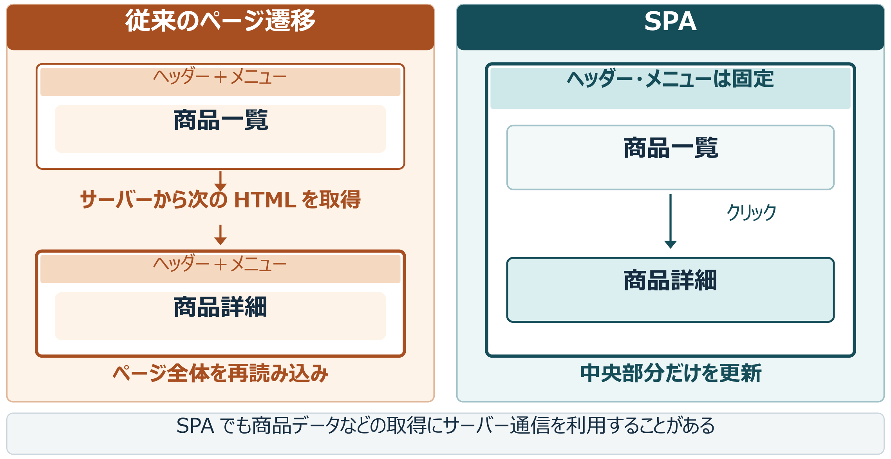{#ch01-spa-routing-figure}

::: {#ch01-spa-routing-figure-caption .paragraph}
商品一覧から商品詳細への切り替え
:::

::: {#ch01-spa-spa-communication .paragraph}
なお、SPAでも、商品情報をサーバーから取得するための通信は行われます。違いは「通信するかどうか」ではなく、**画面を切り替えるときにページ全体を再読み込みするか、必要な表示部分を更新するか**という点です。
:::

::::

:::: {#page-7 .source-page}

::: {#ch01-spa-react-spa-distinction .paragraph}
Reactは、このようなSPAの画面を構築するためにも利用できます。ただし、**ReactとSPAは同じ意味ではありません。**
:::

::: {#ch01-spa-list-1-1 .paragraph}
● **React**：画面を作成・更新するためのライブラリ
:::

::: {#ch01-spa-list-1-2 .paragraph}
● **SPA**：Webアプリケーションの画面切り替えの方式
:::

::: {#ch01-spa-router-course .paragraph}
本研修では、Reactによる画面表示や入力処理を学習した後、第3章でReact Routerを使い、URLに応じて画面を切り替えるSPAを実装します。
:::

::: {#ch01-spa-key-points .section-points}
この節のポイント

● 従来のJavaScriptでは、表示するデータとHTMLの書き換えを自分で管理する必要がある。

● Reactでは、データの変更に合わせて必要な画面の更新をReactが行う。

● SPAは、ページ全体を再読み込みせず、必要な部分を更新して画面を切り替える方式である。

● Reactはライブラリ、SPAはアプリケーションの構成方式であり、同じ意味ではない。
:::

::::

:::: {#page-8 .source-page}

::: {#ch01-tools-title .heading}
1.2. 開発環境の準備
:::

::: {#ch01-tools-slide .slide layout="illustration"}
Reactの開発環境の準備

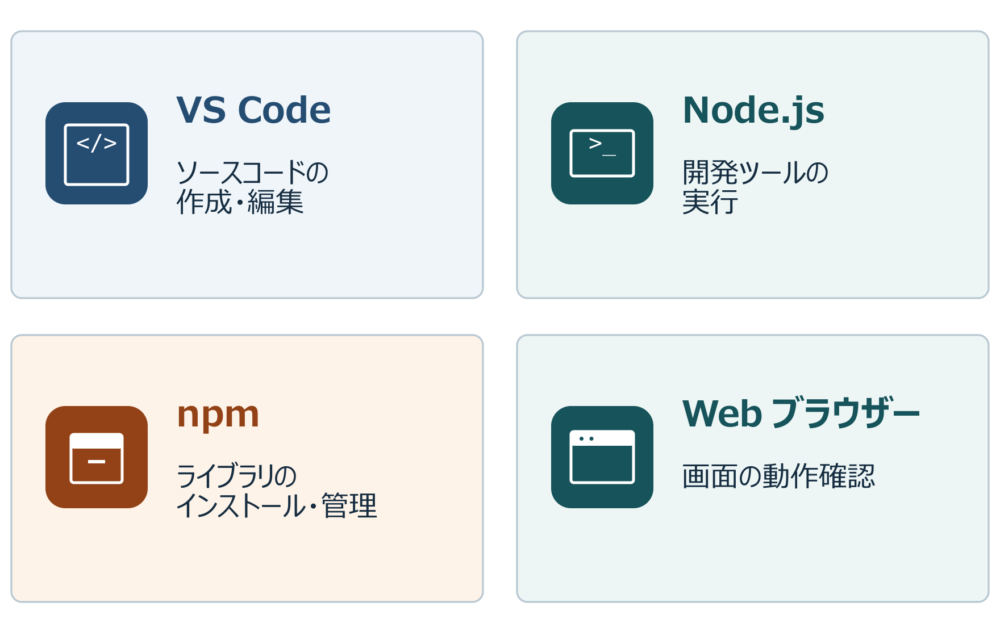
:::

::: {#ch01-tools-body-title .heading level="minor"}
Reactの開発に必要なもの
:::

::: {#ch01-tools-intro-1 .paragraph}
Reactを使用してWebアプリケーションを開発するためには、まず開発環境を準備する必要があります。
:::

::: {#ch01-tools-intro-2 .paragraph}
これまでのHTMLやJavaScriptの学習では、テキストエディターでソースコードを作成し、HTMLファイルをブラウザーで開くだけでも動作を確認できました。
:::

::: {#ch01-tools-intro-3 .paragraph}
しかし、Reactでは、HTMLに似た**JSX（本研修ではTypeScriptに対応したTSX）**という構文を使用します。
:::

::: {#ch01-tools-intro-4 .paragraph}
ブラウザーはTSXをそのまま実行できないため、開発時にはブラウザーが理解できるJavaScriptへ変換する仕組みが必要です。
:::

::: {#ch01-tools-intro-5 .paragraph}
また、Reactでは複数のライブラリを組み合わせて開発するため、それらを簡単にインストール・管理できる仕組みも必要です。
:::

::::

:::: {#page-9 .source-page}

::: {#ch01-tools-intro-6 .paragraph}
本研修では、こうした作業を効率よく進めるために、次のツールを使用します。
:::

::: {#ch01-tools-roles .table}
| ツール | 主な役割 |
| --- | --- |
| Visual Studio Code（VS Code） | Reactのソースコードを作成・編集する |
| Node.js | Viteなどの開発ツールを動作させる |
| npm | Reactなどのライブラリをインストール・管理する |
| Webブラウザー | 作成したReactアプリケーションを表示・確認する |
:::

::: {#ch01-tools-runtime-1 .paragraph}
なお、**Reactの画面自体は基本的にブラウザー上で動作します。**
:::

::: {#ch01-tools-runtime-2 .paragraph}
Node.jsは、Reactの画面を動かすためではなく、ソースコードの変換や開発サーバーの起動など、開発に必要なツールを実行するために使用します。
:::

::: {#ch01-tools-runtime-3 .paragraph}
具体的には、次の節で紹介する「Vite」というツールをNode.js上で動作させます。
:::

::: {#ch01-tools-training .training-note}
**本研修での扱い**

本研修では、この節で扱う開発環境の準備は事前に完了しています。以下のインストールや設定の手順は、個人でReactの開発環境をゼロから準備する際の参考として確認してください。研修では、各ツールの役割と確認方法を理解して先へ進みましょう。
:::

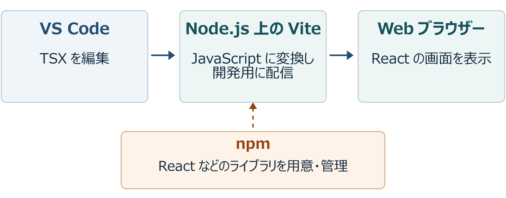{#ch01-tools-workflow}

::: {#ch01-tools-workflow-caption .paragraph}
Reactの開発時に使うツールと画面表示までの流れ
:::

::::

:::: {#page-10 .source-page}

::: {#ch01-folder-title .heading}
**【作業手順①】　親フォルダーと章フォルダーを用意する**
:::

::: {#ch01-folder-intro-1 .paragraph}
最初に、Reactのソースコードを保存するフォルダーを用意します。
:::

::: {#ch01-folder-intro-2 .paragraph}
本研修では、学習する章ごとにReactのプロジェクトを分けて管理します。
:::

::: {#ch01-folder-intro-3 .paragraph}
章ごとにフォルダーを分けることで、学習したソースコードを保存しながら、次の章では別のプロジェクトを使用できます。
:::

::: {#ch01-folder-intro-4 .paragraph}
また、Reactではプロジェクトごとに必要なライブラリを管理するため、他の章の設定やソースコードに影響を与えずに学習できます。
:::

::: {#ch01-folder-parent .step}
**1．親フォルダーを作成する**
:::

::: {#ch01-folder-parent-1 .paragraph}
Windowsのエクスプローラーを開き、Cドライブの直下に `work` フォルダーを作成します。
:::

::: {#ch01-folder-parent-2 .paragraph}
さらに、その中に `react_basic` フォルダーを作成してください。
:::

::: {#ch01-folder-parent-3 .paragraph keep-lines="true"}
保存先：`C:\work\react_basic`
:::

::: {#ch01-folder-chapters .step}
**2．章フォルダーを配置する**
:::

::: {#ch01-folder-chapters-1 .paragraph}
配布されたサンプルファイルを展開し、`react_basic` フォルダーの下に配置します。
:::

::: {#ch01-folder-chapters-2 .paragraph}
第1章では、`ch01-setup` というフォルダーを使用します。
:::

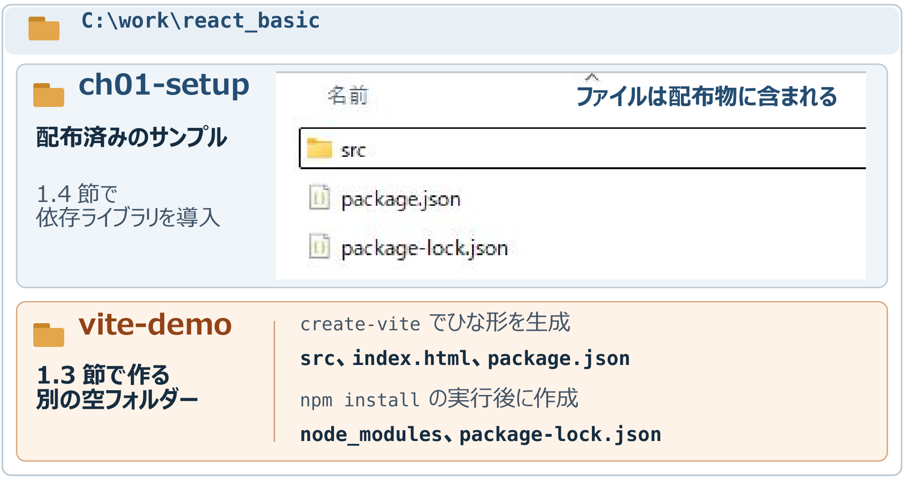{#ch01-folder-files}

::: {#ch01-folder-files-caption .paragraph}
配布済みのサンプルとViteのひな形を作るフォルダー
:::

::: {#ch01-folder-state .paragraph}
`ch01-setup` には、配布時点で `src`、`package.json`、`package-lock.json` があります。1.3節では、別に用意する空の `vite-demo` にひな形を作り、`src` と `package.json` を確認します。新規プロジェクトの `package-lock.json` は、依存ライブラリをインストールすると作成されます。1.4節では、配布済みの `ch01-setup` に戻ります。
:::

::: {#ch01-folder-location-note .paragraph}
なお、社内PCなどの制限によって `C:\work` にフォルダーを作成できない場合は、書き込み可能な別の場所を使用してください。
:::

::::

:::: {#page-11 .source-page}

::: {#ch01-workspace-title .heading}
**【作業手順②】　VS Codeでワークスペースを作成する**
:::

::: {#ch01-workspace-intro .paragraph}
次に、Reactのソースコードを編集するためのVS Codeを準備します。
:::

::: {#ch01-workspace-editor-title .heading level="minor"}
VS Codeとは
:::

::: {#ch01-workspace-editor-1 .paragraph}
VS Codeは、Microsoftが提供しているソースコードエディターです。
:::

::: {#ch01-workspace-editor-2 .paragraph}
JavaScriptやTypeScriptなど、さまざまなプログラミング言語に対応しており、入力補完や構文エラーの表示など、開発を支援する機能が用意されています。
:::

::: {#ch01-workspace-editor-3 .paragraph}
本研修では、このVS Codeを使用してReactのソースコードを編集します。
:::

::: {#ch01-workspace-install .step}
**1．VS Codeをインストールする**
:::

::: {#ch01-workspace-install-1 .paragraph}
まだVS Codeがインストールされていない場合は、公式サイトからWindows用のインストーラーをダウンロードし、インストールしてください。
:::

::: {#ch01-workspace-install-2 .paragraph keep-lines="true"}
<https://code.visualstudio.com/>
:::

::: {#ch01-workspace-install-3 .paragraph}
インストール済みの場合は、VS Codeを起動してください。
:::

::: {#ch01-workspace-add .step}
**2．ワークスペースに章フォルダーを追加する**
:::

::: {#ch01-workspace-add-1 .paragraph}
VS Codeには、複数のフォルダーを1つの画面でまとめて管理できる「マルチルート・ワークスペース」という機能があります。
:::

::: {#ch01-workspace-add-2 .paragraph}
本研修では、章ごとにプロジェクトを分けるため、この機能を使用します。
:::

::::

:::: {#page-12 .source-page}

::: {#ch01-workspace-add-3 .paragraph}
VS Codeのメニューから、［ファイル］→［フォルダーをワークスペースに追加］を選択してください。
:::

::: {#ch01-workspace-add-4 .paragraph}
続いて、次のフォルダーを指定します。
:::

::: {#ch01-workspace-add-5 .paragraph keep-lines="true"}
`C:\work\react_basic\ch01-setup`
:::

::: {#ch01-workspace-add-6 .paragraph}
ほかの章のフォルダーも配布されている場合は、同様に追加してください。
:::

{#ch01-workspace-menu}

::: {#ch01-workspace-menu-caption .paragraph}
章フォルダーをワークスペースに追加するメニュー
:::

::: {#ch01-workspace-save .step}
**3．ワークスペースを保存する**
:::

::: {#ch01-workspace-save-1 .paragraph}
［ファイル］→［名前を付けてワークスペースを保存］を選択します。
:::

::: {#ch01-workspace-save-2 .paragraph}
次の名前で保存してください。
:::

::: {#ch01-workspace-save-3 .paragraph keep-lines="true"}
`C:\work\react_basic\react-basic.code-workspace`
:::

::: {#ch01-workspace-save-4 .paragraph}
これで、複数の章フォルダーを1つのVS Code画面で管理できるようになりました。
:::

::: {#ch01-workspace-save-5 .paragraph}
次回からは、保存した `react-basic.code-workspace` を開くだけで、登録した章フォルダーをまとめて表示できます。
:::

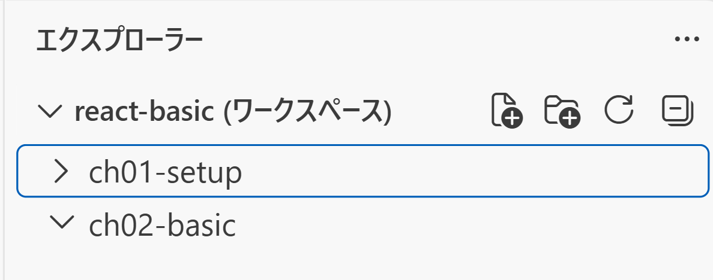{#ch01-workspace-roots}

::: {#ch01-workspace-roots-caption .paragraph}
複数の章フォルダーを追加した場合の表示例
:::

::::

:::: {#page-13 .source-page}

::: {#ch01-language-title .heading}
**【作業手順③】　VS Codeの言語機能を確認する**
:::

::: {#ch01-language-intro-1 .paragraph}
Reactでは、JavaScriptだけでなくTypeScriptも使用します。
:::

::: {#ch01-language-intro-2 .paragraph}
TypeScriptは、JavaScriptに型の仕組みを追加したプログラミング言語です。
:::

::: {#ch01-language-intro-3 .paragraph}
例えば、数値を扱う変数に誤って文字列を代入した場合、開発中に型の不一致を検出できます。
:::

::: {#ch01-language-intro-4 .paragraph}
VS Codeには、JavaScriptとTypeScriptの入力補完やエラー表示を行うための言語機能が標準で用意されています。
:::

::: {#ch01-language-intro-5 .paragraph}
本研修では、まずこの機能が有効になっていることを確認します。
:::

::: {#ch01-language-open .step}
**1．拡張機能の画面を開く**
:::

::: {#ch01-language-open-extensions .paragraph}
VS Codeの左側にある［拡張機能］をクリックします。
:::

::: {#ch01-language-search .step}
**2．言語機能を検索する**
:::

::: {#ch01-language-search-1 .paragraph}
検索欄に次の文字列を入力してください。
:::

::: {#ch01-language-search-2 .paragraph keep-lines="true"}
`@builtin typescript`
:::

::: {#ch01-language-search-3 .paragraph}
検索結果から、［JavaScript と TypeScript の言語機能］を選択します。
:::

{#ch01-typescript-feature}

::: {#ch01-typescript-feature-caption .paragraph}
VS Codeに組み込まれたJavaScriptとTypeScriptの言語機能
:::

::: {#ch01-language-check .step}
**3．有効になっていることを確認する**
:::

::: {#ch01-language-check-1 .paragraph}
［無効にする］というボタンが表示されていれば、現在その機能が有効になっています。
:::

::: {#ch01-language-check-2 .paragraph}
無効になっている場合は、有効にしてください。
:::

::: {#ch01-language-check-3 .paragraph}
これにより、後続の章でTSXファイルを編集するときに、入力補完や構文エラーの表示などを利用できます。
:::

::::

:::: {#page-14 .source-page}

::: {#ch01-node-title .heading}
**【作業手順④】　Node.jsをインストールする**
:::

::: {#ch01-node-intro-1 .paragraph}
ここまでで、ソースコードを編集するためのVS Codeを準備しました。
:::

::: {#ch01-node-intro-2 .paragraph}
次に、Reactの開発ツールを動かすためのNode.jsをインストールします。
:::

::: {#ch01-node-definition-title .heading level="minor"}
Node.jsとは
:::

::: {#ch01-node-definition-1 .paragraph}
Node.js（ノード・ジェイエス）は、JavaScriptをWebブラウザーの外でも実行できるようにする実行環境です。
:::

::: {#ch01-node-definition-2 .paragraph}
通常、JavaScriptはWebブラウザーの中で実行される言語として学習します。
:::

::: {#ch01-node-definition-3 .paragraph}
しかし、Node.jsを使用すると、自分のPC上でJavaScriptのプログラムを実行できます。
:::

::: {#ch01-node-definition-4 .paragraph}
Reactの開発では、このNode.jsを利用して、Viteなどの開発ツールを動かします。
:::

::: {#ch01-node-definition-5 .paragraph}
また、Node.jsをインストールすると、**npmというパッケージ管理ツール**も利用できるようになります。
:::

::: {#ch01-node-definition-6 .paragraph}
npmは、Reactなどのライブラリをインストールするときに使用します。
:::

::: {#ch01-node-definition-7 .paragraph}
※npmを使用したライブラリのインストールについては、1.4節で詳しく説明します。
:::

::: {#ch01-node-install .step}
**1．Node.jsをインストールする**
:::

::: {#ch01-node-install-1 .paragraph}
Node.jsの公式サイトにアクセスしてください。
:::

::: {#ch01-node-install-2 .paragraph keep-lines="true"}
<https://nodejs.org/>
:::

::: {#ch01-node-install-3 .paragraph}
本研修では、Node.js 24系を使用します。
:::

::: {#ch01-node-install-4 .paragraph}
Windows用のインストーラーをダウンロードし、画面の指示に従ってインストールしてください。
:::

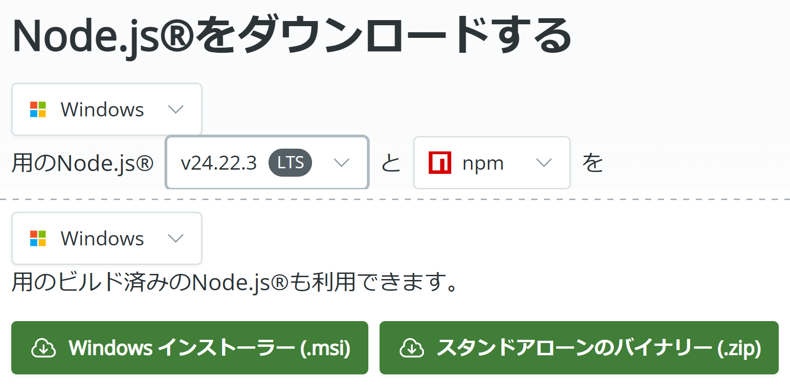{#ch01-node-installer}

::: {#ch01-node-installer-caption .paragraph}
Node.js公式サイトで24系のWindowsインストーラー（.msi）を選ぶ画面（画面の一部）
:::

::::

:::: {#page-15 .source-page}

::: {#ch01-terminal-open .step}
**2．VS Codeのターミナルを開く**
:::

::: {#ch01-terminal-open-1 .paragraph}
インストール後、VS Codeを一度終了してから再起動してください。
:::

::: {#ch01-terminal-open-2 .paragraph}
保存したワークスペースを開き、［ターミナル］→［新しいターミナル］を選択します。
:::

::: {#ch01-terminal-open-3 .paragraph}
フォルダーの選択画面が表示された場合は、`ch01-setup` を選択してください。
:::

{#ch01-workspace-terminal}

::: {#ch01-workspace-terminal-caption .paragraph}
新しいターミナルを開く章フォルダーを選択
:::

::: {#ch01-terminal-open-4 .paragraph}
画面下部にターミナルが表示されます。
:::

::: {#ch01-terminal-definition-title .heading level="minor"}
ターミナルとは
:::

::: {#ch01-terminal-definition-1 .paragraph}
ターミナルとは、文字でコマンドを入力してPCを操作するための画面です。
:::

::: {#ch01-terminal-definition-2 .paragraph}
WindowsのコマンドプロンプトやPowerShellと同様の操作が、VS Codeの画面内でできます。
:::

::: {#ch01-terminal-definition-3 .paragraph}
Reactの開発では、ライブラリのインストールや開発サーバーの起動などに、このターミナルを使用します。
:::

::::

:::: {#page-16 .source-page}

::: {#ch01-terminal-version .step}
**3．Node.jsとnpmのバージョンを確認する**
:::

::: {#ch01-terminal-version-prompt .paragraph}
ターミナルに次のコマンドを1行ずつ入力してください。
:::

::: {#ch01-tools-code .code}
```powershell
node -v
npm -v
```
:::

::: {#ch01-terminal-version-1 .paragraph}
`node -v` はNode.jsのバージョンを確認するコマンドです。
:::

::: {#ch01-terminal-version-2 .paragraph}
`npm -v` はnpmのバージョンを確認するコマンドです。
:::

::: {#ch01-terminal-version-3 .paragraph}
それぞれのコマンドを実行すると、バージョン番号が表示されます。
:::

::: {#ch01-terminal-version-4 .paragraph}
Node.jsについては、`v24.` で始まるバージョン番号が表示されることを確認してください。
:::

::: {#ch01-terminal-version-5 .paragraph}
npmについても、バージョン番号が表示されれば問題ありません。
:::

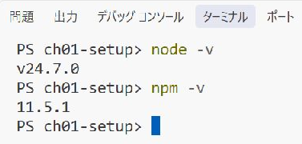{#ch01-terminal-versions}

::: {#ch01-terminal-versions-caption .paragraph}
Node.jsとnpmのバージョン番号の表示例
:::

::: {#ch01-tools-npm-ps .paragraph}
※PowerShellの設定によっては、`npm.ps1` の実行が制限され、`npm -v` がエラーになる場合があります。その場合は、`npm.cmd -v` を使用して確認してください。
:::

::: {#ch01-tools-next-title .heading level="minor"}
開発環境の準備が完了したら
:::

::: {#ch01-tools-next-1 .paragraph}
ここまでの作業で、Reactの開発を始めるための基本的な環境が整いました。
:::

::: {#ch01-tools-next-2 .paragraph}
VS Codeでソースコードを作成し、Node.js上で開発ツールを動かし、npmを使って必要なライブラリを導入できる状態です。
:::

::: {#ch01-tools-next-3 .paragraph}
次の1.3節では、**Viteを使用してReactプロジェクトのひな形を作成する方法**を学習します。
:::

::::

:::: {#page-17 .source-page}

::: {#ch01-vite-title .heading}
1.3. Viteでプロジェクトを作成
:::

::: {#ch01-vite-slide .slide layout="illustration"}
Viteでプロジェクトを作成

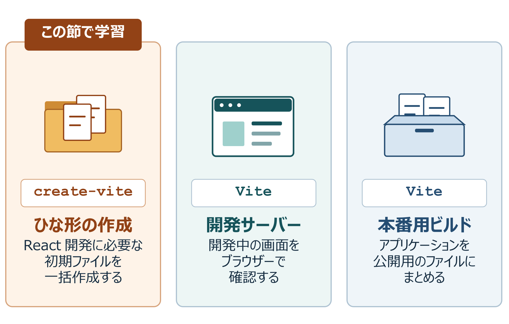
:::

::: {#ch01-vite-definition .heading level="minor"}
Viteとは
:::

::: {#ch01-vite-intro-1 .paragraph}
前節では、Reactの開発に必要なVS CodeやNode.jsなどの環境を準備しました。
:::

::: {#ch01-vite-intro-2 .paragraph}
しかし、これだけではReactのアプリケーションを開発することはできません。
:::

::: {#ch01-vite-intro-3 .paragraph}
Reactを使って開発を始めるためには、ソースコードを記述するファイルだけでなく、TypeScriptの設定ファイルや、必要なライブラリを管理するファイルなども用意する必要があります。
:::

::: {#ch01-vite-intro-4 .paragraph}
これらのファイルを最初からすべて手作業で作成するのは大変です。
:::

::: {#ch01-vite-intro-5 .paragraph}
そこで利用するのが、**Vite（ヴィート）**です。
:::

::: {#ch01-vite-intro-6 .paragraph}
Viteは、ReactなどのWebアプリケーションを効率よく開発するためのツールです。
:::

::::

:::: {#page-18 .source-page}

::: {#ch01-vite-roles-intro .paragraph}
Viteと、ひな形作成ツールである `create-vite` の役割は、次のとおりです。
:::

::: {#ch01-vite-roles .table highlight-row="1" column-widths="32 68"}
| 機能 | 説明 |
| --- | --- |
| **ひな形作成（create-vite）** | ReactとTypeScriptの開発に必要な初期ファイルや設定をまとめて作成する（Viteに関連する別のツール） |
| 開発サーバー | 開発中のアプリケーションをブラウザーで確認できる |
| 本番用ビルド | TypeScriptなどのソースコードを変換し、公開に適したファイルを生成する |
:::

::: {#ch01-vite-roles-summary-1 .paragraph}
Viteには `create-vite` というひな形作成ツールが用意されています。
:::

::: {#ch01-vite-roles-summary-2 .paragraph}
`create-vite` を使用すると、Reactの開発に必要な初期ファイルや設定を、コマンド1つでまとめて作成できます。
:::

::: {#ch01-vite-roles-summary-3 .paragraph}
つまり、開発者が最初からすべてのファイルを用意する必要はなく、**自動生成されたひな形にソースコードを追加・修正することで、Reactの開発を始められる**ということです。
:::

::: {#ch01-vite-template-title .heading level="minor"}
Reactプロジェクトのひな形とは
:::

::: {#ch01-vite-template-1 .paragraph}
ここでいう「ひな形」とは、Reactアプリケーションを開発するために必要な、基本的なファイルやフォルダーがそろった状態のことです。
:::

::: {#ch01-vite-template-2 .paragraph}
例えば、Reactでは、画面を表示するための `App.tsx` や、アプリケーションの起動処理を記述する `main.tsx` などのファイルを使用します。
:::

::: {#ch01-vite-template-3 .paragraph}
さらに、TypeScriptの設定ファイルやライブラリの管理ファイルも必要です。
:::

::: {#ch01-vite-template-4 .paragraph}
これらを最初から自分で作成する代わりに、`create-vite` を利用すれば、自動的に用意できます。
:::

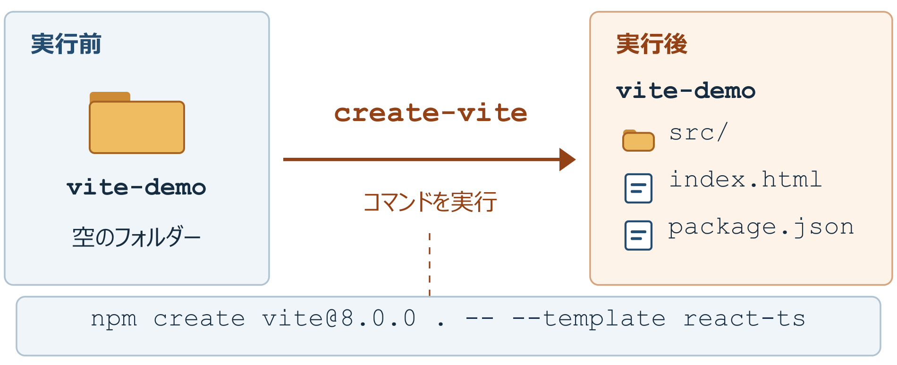{#ch01-vite-before-after}

::: {#ch01-vite-before-after-caption .paragraph}
ひな形を作成する前と作成した後のvite-demo
:::

::::

:::: {#page-19 .source-page}

::: {#ch01-vite-body-title .heading}
**【作業手順①】　ViteでReactプロジェクトを作成する**
:::

::: {#ch01-vite-scaffold-intro-1 .paragraph}
それでは、実際に `create-vite` を使用して、Reactプロジェクトのひな形を作成してみましょう。
:::

::: {#ch01-vite-scaffold-intro-2 .paragraph}
本研修では、完成済みのサンプルプロジェクトも配布していますが、ここではひな形が生成される仕組みを理解するため、別のフォルダーを使用して作成します。
:::

::: {#ch01-vite-folder .step}
**1．空のフォルダーを用意する**
:::

::: {#ch01-vite-folder-1 .paragraph}
Windowsのエクスプローラーを開き、次の場所に `vite-demo` という空のフォルダーを作成してください。
:::

::: {#ch01-vite-folder-path .paragraph keep-lines="true"}
`C:\work\react_basic\vite-demo`
:::

::: {#ch01-vite-folder-followup-1 .paragraph}
このフォルダーに、Reactの初期ファイルを自動生成します。
:::

::: {#ch01-vite-folder-followup-2 .paragraph}
※ `ch01-setup` は配布サンプル用のフォルダーなので、ここでは使用しません。
:::

::: {#ch01-vite-open-folder .step}
**2．VS Codeでフォルダーを開く**
:::

::: {#ch01-vite-open-folder-1 .paragraph}
VS Codeの［ファイル］→［新しいウィンドウ］を選択してください。
:::

::: {#ch01-vite-open-folder-2 .paragraph}
新しいウィンドウが開いたら、［ファイル］→［フォルダーを開く］から、先ほど作成した `vite-demo` フォルダーを指定します。
:::

::: {#ch01-vite-open-folder-3 .paragraph}
これで、ひな形の作成先となるフォルダーをVS Codeで開けました。
:::

::: {#ch01-vite-open-terminal .step}
**3．VS Codeのターミナルを開く**
:::

::: {#ch01-vite-open-terminal-1 .paragraph}
［ターミナル］→［新しいターミナル］を選択してください。
:::

::: {#ch01-vite-open-terminal-2 .paragraph}
ターミナルの入力待ちの行が、次のようになっていることを確認します。
:::

::: {#ch01-vite-terminal-path .code}
```powershell
PS C:\work\react_basic\vite-demo>
```
:::

::: {#ch01-vite-terminal-path-1 .paragraph}
この部分は、**現在コマンドを実行しようとしているフォルダー**を表しています。
:::

::: {#ch01-vite-terminal-path-2 .paragraph}
今回のコマンドでは、この場所にReactプロジェクトのファイルを生成するため、実行するフォルダーを間違えないようにしてください。
:::

::: {#ch01-vite-scaffold .step}
**4．Reactプロジェクトのひな形を作成する**
:::

::: {#ch01-vite-scaffold-run-1 .paragraph}
ターミナルに、次のコマンドを入力して実行してください。
:::

::: {#ch01-vite-code .code}
```powershell
npm create vite@8.0.0 . -- --template react-ts
```
:::

::: {#ch01-vite-scaffold-result-1 .paragraph}
このコマンドを実行すると、ReactとTypeScriptを使用するためのひな形が作成されます。
:::

::::

:::: {#page-20 .source-page}

::: {#ch01-vite-command-title .heading level="minor"}
コマンドの意味
:::

::: {#ch01-vite-command-explanation-1 .paragraph}
一見すると複雑なコマンドですが、それぞれの部分には役割があります。
:::

::: {#ch01-vite-command-args .table}
| コマンドの部分 | 意味 |
| --- | --- |
| `npm create` | プロジェクトのひな形作成ツールを実行する |
| `vite@8.0.0` | create-viteのバージョン8.0.0を指定する |
| `.` | 現在開いているフォルダーに作成する |
| `--` | これ以降のオプションをひな形作成ツールに渡す |
| `--template react-ts` | ReactとTypeScriptに対応したひな形を選択する |
:::

::: {#ch01-vite-command-explanation-detail-1 .paragraph}
特に覚えておきたいのが、**`.`（ドット）と `--template react-ts`** です。
:::

::: {#ch01-vite-command-explanation-detail-2 .paragraph}
`.` は、現在のフォルダーを意味します。
:::

::: {#ch01-vite-command-explanation-detail-3 .paragraph}
今回は `vite-demo` フォルダーを開いて実行しているため、そのフォルダーの中にファイルが生成されます。
:::

::: {#ch01-vite-command-explanation-detail-4 .paragraph}
また、`--template react-ts` は、ReactとTypeScriptに対応したひな形を指定するオプションです。
:::

::: {#ch01-vite-command-explanation-detail-5 .paragraph}
例えば、Vue.jsとTypeScriptのプロジェクトを作りたい場合は、`vue-ts` というテンプレートを選択できます。
:::

::: {#ch01-vite-command-explanation-detail-6 .paragraph}
なお、今回は教材と同じ環境を再現できるように、ひな形作成ツールのバージョンを `8.0.0` に固定しています。
:::

::: {#ch01-vite-latest .training-note}
**補足　最新版の利用**

最新版を使用する場合は `@latest` と指定できますが、生成されるファイルや操作画面が教材と異なる可能性があります。
:::

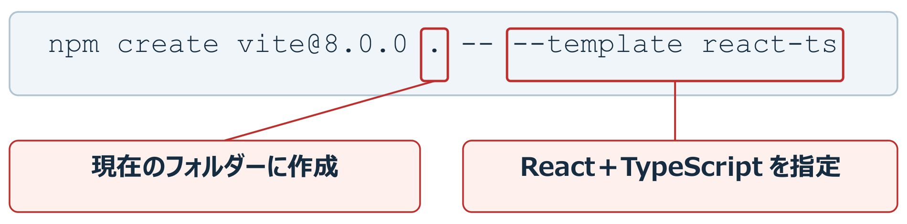{#ch01-vite-command-callouts}

::: {#ch01-vite-command-callouts-caption .paragraph}
実行するフォルダーとReact・TypeScriptのひな形を指定する部分
:::

::::

:::: {#page-21 .source-page}

::: {#ch01-vite-prompts-title .heading level="minor"}
作成時に表示されるメッセージを確認する
:::

::: {#ch01-vite-prompts-intro-1 .paragraph}
コマンドの実行中に、いくつかの確認メッセージが表示される場合があります。
:::

::: {#ch01-vite-prompts-intro-2 .paragraph}
それぞれの意味を確認しながら操作しましょう。
:::

::: {#ch01-vite-confirm .step}
**1．インストールの確認**
:::

::: {#ch01-vite-confirm-1 .paragraph}
次のようなメッセージが表示された場合は、`y` を入力して［Enter］を押してください。
:::

::: {#ch01-vite-confirm-result .code highlight-text="(y)"}
```text
Need to install the following packages:
create-vite@8.0.0
Ok to proceed? (y)
```
:::

::: {#ch01-vite-confirm-reason-1 .paragraph}
これは、「create-viteというひな形作成ツールを一時的にインストールしてもよいですか」という確認です。
:::

::: {#ch01-vite-confirm-reason-2 .paragraph}
Reactプロジェクトの作成に必要なツールなので、許可して問題ありません。
:::

::: {#ch01-vite-rolldown .step}
**2．Rolldownの使用確認**
:::

::: {#ch01-vite-rolldown-1 .paragraph}
次のようなメッセージが表示された場合は、`No` を選択してください。
:::

::: {#ch01-vite-rolldown-result .code highlight-text="No"}
```text
Use rolldown-vite (Experimental)?:
  Yes
> No
```
:::

::: {#ch01-vite-rolldown-explanation-1 .paragraph}
Rolldownは、JavaScriptなどのファイルをまとめる処理に使用されるツールです。
:::

::: {#ch01-vite-rolldown-explanation-2 .paragraph}
この選択肢は、指定した `create-vite` のバージョンで実験的な構成を使用するかどうかを尋ねています。
:::

::: {#ch01-vite-rolldown-explanation-3 .paragraph}
本研修では教材と同じ構成で学習するため、`No` を選択します。
:::

::: {#ch01-vite-rolldown-explanation-4 .paragraph}
※この選択肢の詳しい仕組みを理解する必要はありません。ここでは `No` を選択することだけ確認してください。
:::

::::

:::: {#page-22 .source-page}

::: {#ch01-vite-immediate .step}
**3．ライブラリのインストールと起動確認**
:::

::: {#ch01-vite-immediate-1 .paragraph}
次のようなメッセージが表示された場合も、`No` を選択してください。
:::

::: {#ch01-vite-immediate-result .code highlight-text="No"}
```text
Install with npm and start now?
  Yes / > No
```
:::

::: {#ch01-vite-immediate-explanation-1 .paragraph}
これは、「必要なライブラリをインストールして、開発サーバーも起動しますか」という確認です。
:::

::: {#ch01-vite-immediate-explanation-2 .paragraph}
今回は、ひな形を作成するところまでを実施するため、`No` を選択します。
:::

::: {#ch01-vite-immediate-explanation-3 .paragraph}
ライブラリのインストールや開発サーバーの起動については、次の節以降で説明します。
:::

::: {#ch01-vite-done .step}
**4．作成完了を確認する**
:::

::: {#ch01-vite-done-1 .paragraph}
次のようなメッセージが表示されれば、ひな形の作成は完了です。
:::

::: {#ch01-vite-done-result .code highlight-text="Done. Now run:"}
```text
Done. Now run:

  npm install
  npm run dev
```
:::

::: {#ch01-vite-done-explanation-1 .paragraph}
ここで表示されている2つのコマンドには、次の役割があります。
:::

::: {#ch01-vite-install-role .paragraph}
● `npm install`：Reactなど、必要なライブラリをインストールする
:::

::: {#ch01-vite-dev-role .paragraph}
● `npm run dev`：開発サーバーを起動し、ブラウザーで画面を確認する
:::

::: {#ch01-vite-done-followup-1 .paragraph}
つまり、**ひな形を作成しただけでは、まだReactアプリケーションを起動できる準備がすべて整ったわけではありません。**
:::

::: {#ch01-vite-done-followup-2 .paragraph}
この2つのコマンドについては、1.4節と1.5節で詳しく学習します。
:::

::: {#ch01-vite-done-followup-3 .paragraph}
※作成先に既存ファイルがあるというメッセージが表示された場合は、勝手に上書きせず、フォルダーが空であることを確認してください。
:::

::::

:::: {#page-23 .source-page}

::: {#ch01-vite-files-title .heading}
**【作業手順②】　生成されたプロジェクトの初期ファイルを確認する**
:::

::: {#ch01-vite-files-intro-1 .paragraph}
Reactプロジェクトのひな形が作成されたら、実際にどのようなファイルが生成されたのか確認してみましょう。
:::

::: {#ch01-vite-files-intro-2 .paragraph}
VS Codeの左側にある［エクスプローラー］を開いてください。
:::

::: {#ch01-vite-files-intro-3 .paragraph}
先ほどまで空だった `vite-demo` フォルダーの中に、複数のファイルやフォルダーが生成されています。
:::

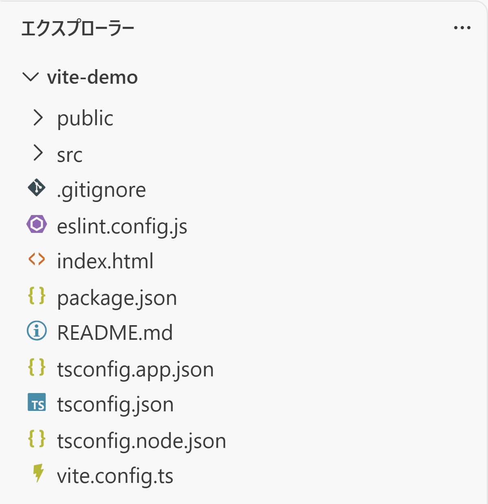{#ch01-vite-tree}

::: {#ch01-vite-tree-caption .paragraph}
VS Codeのエクスプローラーで確認するReactの初期ファイル
:::

::: {#ch01-vite-node-modules-after-scaffolding .paragraph}
この時点の `vite-demo` には、`node_modules` フォルダーがありません。
:::

::::

:::: {#page-24 .source-page}

::: {#ch01-vite-file-roles-title .heading level="minor" keep-next="2"}
主なファイルとフォルダーの役割
:::

::: {#ch01-vite-file-roles-intro-1 .paragraph}
生成されたファイルの中でも、次のものは今後のReact開発で頻繁に使用します。
:::

::: {#ch01-vite-file-roles .table column-widths="30 70"}
| ファイル・フォルダー | 役割 |
| --- | --- |
| `index.html` | Reactの画面を表示するための土台となるHTMLファイル |
| `src/` | Reactのソースコードを格納するフォルダー |
| `src/main.tsx` | Reactアプリケーションの起動処理を記述するファイル |
| `src/App.tsx` | Reactで表示する画面を記述するファイル |
| `package.json` | プロジェクトで使用するライブラリや実行コマンドなどを管理するファイル |
| `vite.config.ts` | Viteの動作に関する設定ファイル |
| `tsconfig.json` | TypeScriptに関する設定ファイル |
:::

::: {#ch01-vite-file-display-1 .paragraph}
ここで、HTMLやJavaScriptを学習したときとの違いに注目してください。
:::

::: {#ch01-vite-file-display-2 .paragraph}
従来のHTMLの学習では、`index.html` に画面を作成するためのHTMLを直接記述していました。
:::

::: {#ch01-vite-file-display-3 .paragraph}
しかし、**Reactでは、基本的に `App.tsx` などのコンポーネントに画面の内容を記述します。**
:::

::: {#ch01-vite-file-display-4 .paragraph}
そして、`main.tsx` を通じて、その画面が `index.html` に表示される仕組みになっています。
:::

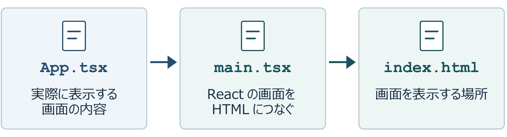{#ch01-vite-file-relations}

::: {#ch01-vite-file-relations-caption .paragraph}
Reactの画面表示に関わる3つのファイル
:::

::::

:::: {#page-25 .source-page}

::: {#ch01-vite-stages-title .heading level="minor"}
ひな形の作成とライブラリのインストールは別の作業
:::

::: {#ch01-vite-stages-intro-1 .paragraph}
ここまでの操作で、React開発に必要な基本ファイルが作成されました。
:::

::: {#ch01-vite-stages-intro-2 .paragraph}
しかし、この時点ではReactなどのライブラリ本体がまだインストールされていません。
:::

::: {#ch01-vite-stages-intro-3 .paragraph}
なぜなら、先ほどの作成手順で「Install with npm and start now?」に `No` と回答したためです。
:::

::: {#ch01-vite-stages-lead-1 .paragraph}
`package.json` には必要なライブラリの情報が記載されていますが、それらを実際に取得するには、`npm install` というコマンドを実行する必要があります。
:::

::: {#ch01-vite-stages-lead-2 .paragraph}
つまり、Reactの開発環境を作成する作業は、次のように分けられます。
:::

::: {#ch01-vite-stages .stage-flow}
この節で実施

**① create-viteで<br>ひな形を作成する**

必要なファイルや設定を自動生成する。

1.4節

**② npm installで<br>ライブラリを導入する**

ReactやViteなど、プログラムの実行に必要なライブラリを取得する。

1.5節

**③ npm run devで<br>開発サーバーを起動する**

ブラウザーからReactアプリケーションの動作を確認する。
:::

::: {#ch01-vite-stage-done-1 .paragraph}
今回は、①の作業を行いました。
:::

::: {#ch01-vite-back-title .heading level="minor"}
配布サンプルのプロジェクトに戻る
:::

::: {#ch01-vite-back-1 .paragraph}
今回作成した `vite-demo` は、Reactプロジェクトのひな形がどのように生成されるかを確認するためのものです。
:::

::: {#ch01-vite-back-2 .paragraph}
以降の学習では、あらかじめ配布されている `ch01-setup` プロジェクトを使用します。
:::

::: {#ch01-vite-back-3 .paragraph keep-lines="true"}
`vite-demo` を開いたVS Codeのウィンドウを閉じ、<br>1.2節で作成した `react-basic.code-workspace` に戻ってください。
:::

::: {#ch01-vite-back-4 .paragraph}
次の1.4節では、配布サンプルの `package.json` を使用して、必要なライブラリを導入します。
:::

::: {#ch01-vite-points .section-points}
この節のポイント

● **Vite**は、ReactなどのWebアプリケーションの開発を支援するツールである。

● **create-vite**を使用すると、React開発に必要なひな形を自動生成できる。

● `--template react-ts` を指定すると、<br>ReactとTypeScriptに対応したプロジェクトを作成できる。

● ひな形の作成とライブラリのインストールは別の作業であり、<br>実行するコマンドも異なる。
:::

::::

:::: {#page-26 .source-page}

::: {#ch01-install-title .heading}
1.4. 依存ライブラリの導入
:::

::: {#ch01-install-slide .slide layout="illustration"}
依存ライブラリの導入

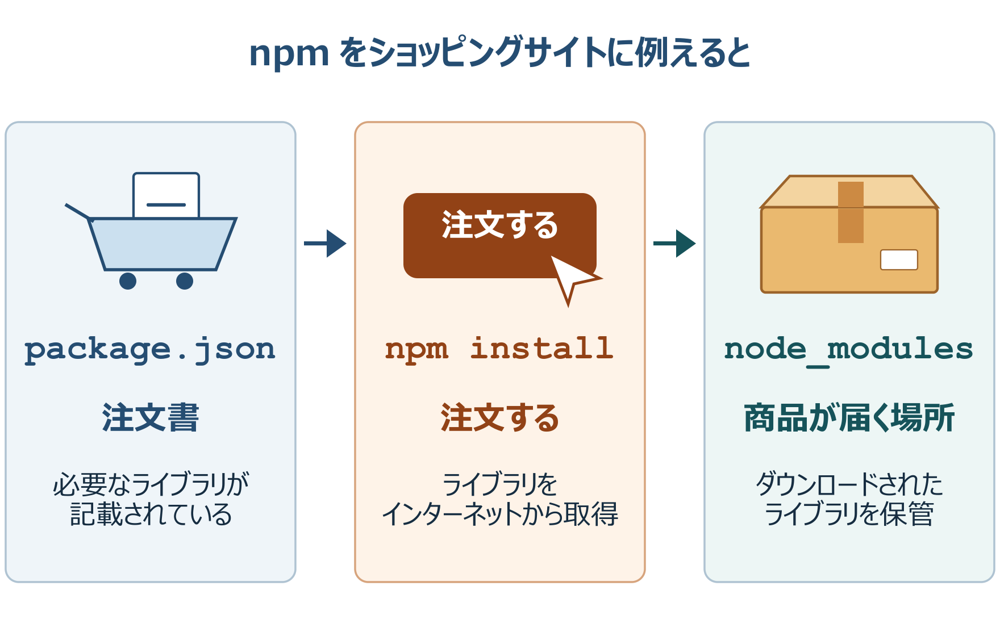
:::

::: {#ch01-install-definition .heading level="minor"}
依存ライブラリとは
:::

::: {#ch01-install-definition-1 .paragraph}
前節では、`create-vite` を使用して、Reactプロジェクトのひな形を作成しました。
:::

::: {#ch01-install-definition-2 .paragraph}
しかし、**ひな形を作成しただけでは、Reactの開発に必要なライブラリがすべてインストールされたわけではありません。**
:::

::: {#ch01-install-definition-3 .paragraph}
Reactの開発には、React本体のほか、TypeScriptやViteなど、さまざまなライブラリや開発ツールが必要です。
:::

::: {#ch01-install-definition-4 .paragraph}
このように、プログラムの開発や動作に必要となる別のライブラリなどを、**依存ライブラリ（依存パッケージ）**と呼びます。
:::

::: {#ch01-install-definition-5 .paragraph}
これらを簡単にインストールするために使用するのが、**npm**です。
:::

::: {#ch01-install-shopping-title .heading level="minor"}
npmとpackage.jsonの仕組み
:::

::: {#ch01-install-shopping-1 .paragraph}
npmは、インターネットからライブラリを取得・管理するためのツールです。
:::

::: {#ch01-install-shopping-2 .paragraph}
その仕組みは、**インターネットのショッピングサイトで商品を注文する流れ**に似ています。
:::

::: {#ch01-install-shopping-3 .paragraph}
例えば、ショッピングサイトでは、欲しい商品をカートに入れ、注文ボタンを押すと、自宅まで商品が配送されます。
:::

::::

:::: {#page-27 .source-page}

::: {#ch01-install-shopping-4 .paragraph}
npmも、これと似たような仕組みです。
:::

::: {#ch01-install-order-sheet .paragraph keep-lines="true"}
● **package.json：注文書**<br>インストールしたいライブラリの名前などが記載されています。
:::

::: {#ch01-install-order-button .paragraph keep-lines="true"}
● **npm install：注文ボタン**<br>コマンドを実行すると、必要なライブラリがインターネットからダウンロードされます。
:::

::: {#ch01-install-order-storage .paragraph keep-lines="true"}
● **node_modules：商品が届く場所**<br>ダウンロードしたライブラリが、このフォルダーの中に保存されます。
:::

::: {#ch01-install-manifest-heading .heading level="minor"}
package.jsonには、すでに必要なライブラリが登録されている
:::

::: {#ch01-install-manifest-lead-1 .paragraph}
ところで、前節では、次のコマンドを実行しました。
:::

::: {#ch01-install-scaffold-command .code}
```powershell
npm create vite@8.0.0 . -- --template react-ts
```
:::

::: {#ch01-install-manifest-template-1 .paragraph}
このコマンドでは、ReactとTypeScriptに対応したひな形を指定していました。
:::

::: {#ch01-install-manifest-vite-demo .paragraph}
そのため、前節で作成した `vite-demo` の `package.json` には、**ReactやTypeScriptなど、開発に必要なライブラリが最初から登録されています。**
:::

::: {#ch01-install-manifest-description-1 .paragraph}
つまり、注文書には、すでに必要な商品が記載されている状態です。
:::

::: {#ch01-install-manifest-description-2 .paragraph}
あとは、npmを使って注文するだけです。
:::

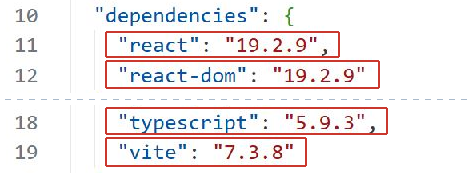{#ch01-install-manifest}

::: {#ch01-install-manifest-caption .paragraph}
配布サンプルの package.json に記載されたライブラリ（画面の一部）
:::

::::

:::: {#page-28 .source-page}

::: {#ch01-install-first-title .heading}
**【作業手順①】　npm installを実行する**
:::

::: {#ch01-install-first-intro-1 .paragraph}
それでは、必要なライブラリを実際にインストールしてみましょう。
:::

::: {#ch01-install-first-intro-2 .paragraph}
本研修では、あらかじめ用意された `ch01-setup` プロジェクトを使用します。
:::

::: {#ch01-install-terminal-title .step}
**1．VS Codeでch01-setupのターミナルを開く**
:::

::: {#ch01-install-terminal-1 .paragraph}
VS Codeで `react-basic.code-workspace` を開き、`ch01-setup` のターミナルを起動してください。
:::

::: {#ch01-install-terminal-2 .paragraph}
次の場所になっていることを確認します。
:::

::: {#ch01-install-terminal-path .paragraph keep-lines="true"}
`PS C:\work\react_basic\ch01-setup>`
:::

::: {#ch01-install-run-title .step}
**2．npm installを実行する**
:::

::: {#ch01-install-run-lead-1 .paragraph}
ターミナルに次のコマンドを入力してください。
:::

::: {#ch01-install-run-command .code highlight-text="npm install"}
```powershell
npm install
```
:::

::: {#ch01-install-run-result-1 .paragraph}
これだけで、`package.json` に記載された必要なライブラリがインストールされます。
:::

{#ch01-install-result}

::: {#ch01-install-result-caption .paragraph}
npm install が完了したときの表示例（先頭行を抜粋）
:::

::: {#ch01-install-check-title .heading}
**【作業手順②】　インストール結果を確認する**
:::

::: {#ch01-install-check-1 .paragraph}
インストールが完了したら、VS Codeのエクスプローラーを確認してください。
:::

::: {#ch01-install-check-2 .paragraph}
`ch01-setup` の中に、**node_modules** というフォルダーが新しく生成されています。
:::

::: {#ch01-install-check-3 .paragraph}
このフォルダーの中には、先ほど注文したReactやTypeScriptなどのライブラリが保存されています。
:::

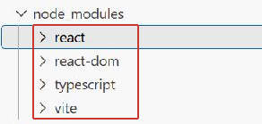{#ch01-install-modules}

::: {#ch01-install-modules-caption .paragraph}
npm install 後の node_modules（確認するフォルダーを抜粋）
:::

::::

:::: {#page-29 .source-page}

::: {#ch01-install-extra-title .heading level="minor"}
追加のライブラリをインストールする方法
:::

::: {#ch01-install-extra-1 .paragraph}
ここまでは、最初から `package.json` に登録されているライブラリをインストールしました。
:::

::: {#ch01-install-extra-2 .paragraph}
しかし、開発中に新しいライブラリが必要になることもあります。
:::

::: {#ch01-install-extra-3 .paragraph}
その場合は、`package.json` に必要なライブラリを追加してから `npm install` を実行する方法もありますが、もっと簡単な方法があります。
:::

::: {#ch01-install-extra-4 .paragraph}
それが、**npm installの後ろに、インストールしたいライブラリ名を指定する方法**です。
:::

::: {#ch01-install-extra-5 .paragraph}
例えば、本研修では、画面のデザインを簡単に整えるために、**Bootstrap（ブートストラップ）**というライブラリを使用します。
:::

::: {#ch01-install-extra-6 .paragraph}
Bootstrapは、ボタンや表などの見た目を、あらかじめ用意されたCSSのクラスを使って簡単に整えられるライブラリです。
:::

::: {#ch01-install-extra-7 .paragraph}
今回は、このBootstrapを追加でインストールしてみましょう。
:::

::: {#ch01-install-bootstrap-install-heading .step}
**1．Bootstrapをインストールする**
:::

::: {#ch01-install-bootstrap-install-start-1 .paragraph}
`ch01-setup` のターミナルで、次のコマンドを実行してください。
:::

::: {#ch01-install-bootstrap-command .code}
```powershell
npm install bootstrap
```
:::

::: {#ch01-install-bootstrap-install-result-1 .paragraph}
このコマンドを実行すると、Bootstrapがインターネットからダウンロードされます。
:::

::: {#ch01-install-bootstrap-install-result-2 .paragraph}
さらに、**package.jsonにもBootstrapが自動的に追加されます。**
:::

::: {#ch01-install-bootstrap-install-result-3 .paragraph}
つまり、ライブラリ名をコマンドで指定すれば、注文書への登録も自動で行われるわけです。
:::

::::

:::: {#page-30 .source-page}

::: {#ch01-install-bootstrap-check-heading .step}
**2．インストール結果を確認する**
:::

::: {#ch01-install-bootstrap-check-intro-1 .paragraph}
次の2か所を確認してください。
:::

::: {#ch01-install-bootstrap-check-manifest .paragraph}
● `package.json` に `bootstrap` が追加されている
:::

::: {#ch01-install-bootstrap-check-folder .paragraph}
● `node_modules` の中に `bootstrap` フォルダーが生成されている
:::

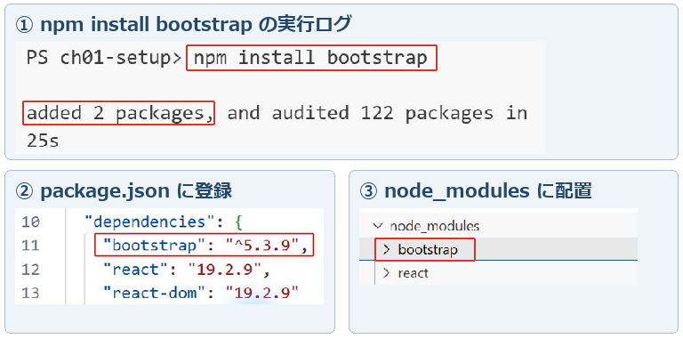{#ch01-install-bootstrap-result}

::: {#ch01-install-bootstrap-result-caption .paragraph}
Bootstrapの追加コマンドと、登録・配置の確認箇所
:::

::: {#ch01-install-bootstrap-css-1 .paragraph}
※BootstrapのCSSを実際の画面に適用するには、別途CSSを読み込む必要があります。この節ではインストールまでを扱います。
:::

::: {#ch01-install-points .section-points}
この節のポイント

● **npm**は、ライブラリをインターネットから取得・管理するためのツールである。

● **package.json**には、必要なライブラリの情報が記載されている。

● **npm install**を実行すると、必要なライブラリが`node_modules`にインストールされる。

● **npm install ライブラリ名**と指定すると、新しいライブラリを追加できる。
:::

::::

:::: {#page-31 .source-page}

::: {#ch01-start-title .heading}
1.5. 開発サーバーの起動と動作確認
:::

::: {#ch01-start-slide .slide layout="diagram" art="assets/slide-dev-server.png"}
開発サーバーの起動と動作確認

NPM スクリプト<br>
`dev` の実行ボタンを押す

開発サーバー<br>
`Local` の URL を<br>ターミナルで確認する

ブラウザー<br>
URL を開いて<br>商品管理画面を表示する
:::

::: {#ch01-start-intro-title .heading level="minor"}
React のサンプルを手元の PC で起動する
:::

::: {#ch01-start-intro .paragraph}
React の画面を手元の PC で確認するときは、Vite の**開発サーバー**を起動します。VS Code の **［Npm スクリプト］** には、`package.json` に登録された実行コマンドが表示されます。
:::

::: {#ch01-start-sidebar .heading}
**【作業手順①】　VS Code で NPM スクリプトを表示する**
:::

::: {#ch01-start-menu .paragraph numbered="true"}
1．VS Code の［エクスプローラー］を開き、見出しの右にある **［…］** をクリックします。表示されたメニューで **［Npm スクリプト］** を選び、チェックを付けます。
:::

{#ch01-npm-menu}

::: {#ch01-npm-menu-caption .paragraph}
エクスプローラーの［…］メニューにある［Npm スクリプト］
:::

::::

:::: {#page-32 .source-page}

::: {#ch01-start-run-title .heading}
**【作業手順②】　開発サーバーを起動する**
:::

::: {#ch01-start-run .paragraph numbered="true"}
1．エクスプローラーの下にある［Npm スクリプト］を開きます。章が並ぶ場合は `ch01-setup` を選び、`package.json` の項目を展開します。`dev` の行にマウスポインターを合わせ、右端の **［▷］（実行）** をクリックします。
:::

{#ch01-npm-dev}

::: {#ch01-npm-dev-caption .paragraph}
`dev` の行の右端に表示される実行ボタン
:::

::: {#ch01-start-location .paragraph numbered="true"}
2．VS Code の画面下部にターミナルが開きます。**`Local` の行に表示された URL** をコピーし、ブラウザーのアドレスバーに貼り付けて［Enter］を押します。
:::

{#ch01-start-terminal}

::: {#ch01-start-terminal-caption .paragraph}
`Local` の行に表示されたアドレスをブラウザーで開く
:::

::: {#ch01-start-running .paragraph}
確認中は開発サーバーを動かしておきます。コマンドで操作する場合は、`ch01-setup` のターミナルで `npm run dev` を実行しても同じように起動できます。
:::

::::

:::: {#page-33 .source-page}

::: {#ch01-start-verify-title .heading}
**【作業手順③】　商品データを変更して表示を確認する**
:::

::: {#ch01-start-verify .paragraph numbered="true"}
1．ブラウザーに「商品管理システム」と表示され、商品名が「ノート」、価格が「250 円」であることを確認します。
:::

::: {#ch01-start-edit .paragraph numbered="true"}
2．VS Code のエクスプローラーで［src］を展開し、［product.ts］を開きます。商品名を表す **`name`** の値を `'ノート'` から `'ノート１'` に変更し、［Ctrl］＋［S］で保存します。
:::

::: {#ch01-product-update-code .code filename="ch01-setup/src/product.ts"}
```typescript
export const product = {
  id: 1,
  name: 'ノート１',
  price: 250,
  category: '文具',
}
```
:::

::: {#ch01-start-check .paragraph numbered="true"}
3．ブラウザーに戻り、「商品名」が **「ノート１」** に変わったことを確認します。Vite の開発サーバーは保存を検知し、ブラウザーに変更を反映します。
:::

{#ch01-product-update-screen}

::: {#ch01-product-update-caption .paragraph}
商品名の欄に、変更後の「ノート１」が表示された画面
:::

::: {#ch01-product-update-restore .paragraph}
React の画面を組み立てる `App.tsx` は、`product.name` を読み取って「商品名」の欄に表示します。確認後は、`product.ts` の `name` を `'ノート'` に戻して保存します。
:::

::: {#ch01-start-stop .paragraph numbered="true"}
4．Vite を起動したターミナルで［Ctrl］＋［C］を押します。終了の確認が出た場合は `Y` を入力して［Enter］を押します。プロンプトが表示されれば停止しています。
:::

::::

:::: {#page-34 .source-page}

::: {#ch01-files-title .heading}
1.6. フォルダーと主要ファイルの役割
:::

::: {#ch01-files-slide .slide layout="diagram" art="assets/slide-source-files.png"}
フォルダーと主要ファイルの役割

`index.html`<br>
画面を表示する<br>場所を用意する

`main.tsx`<br>
`App` を HTML に<br>描画する

`App.tsx`<br>
`product.ts` のデータを<br>画面に表示する
:::

::: {#ch01-index-title .heading level="minor"}
ブラウザーが最初に読み込む index.html
:::

::: {#ch01-index-body .paragraph}
配布サンプル `ch01-setup` の `index.html` を開きます。9行目の **`<div id="root">`** は、React の画面を表示する場所です。10行目の `script` 要素で、画面表示を始める **`src/main.tsx`** を読み込みます。
:::

::: {#ch01-index-code .code filename="ch01-setup/index.html"}
```html
<!doctype html>
<html lang="ja">
  <head>
    <meta charset="UTF-8" />
    <meta name="viewport" content="width=device-width, initial-scale=1.0" />
    <title>商品管理システム</title>
  </head>
  <body>
    <div id="root"></div>
    <script type="module" src="/src/main.tsx"></script>
  </body>
</html>
```
:::

::::

:::: {#page-35 .source-page}

::: {#ch01-main-title .heading level="minor"}
画面の表示を始める main.tsx
:::

::: {#ch01-main-body .paragraph}
`src/main.tsx` の2行目は、画面を組み立てる **`App`** を読み込みます。5行目は `index.html` にある `id="root"` の要素を取得します。7行目の `render(<App />)` で、その場所に `App` の内容を表示します。
:::

::: {#ch01-main-code .code filename="ch01-setup/src/main.tsx"}
```tsx
import { createRoot } from 'react-dom/client'
import App from './App'
import './style.css'

const root = document.getElementById('root')
if (root) {
  createRoot(root).render(<App />)
}
```
:::

::: {#ch01-product-title .heading level="minor"}
商品1件のデータを用意する product.ts
:::

::: {#ch01-product-body .paragraph}
`src/product.ts` には、商品名、価格、カテゴリなどをまとめた**商品データ**が入っています。`export` を付けた **`product`** は、次ページの `App.tsx` から読み込めます。
:::

::: {#ch01-product-code .code filename="ch01-setup/src/product.ts"}
```javascript
export const product = {
  id: 1,
  name: 'ノート',
  price: 250,
  category: '文具',
}
```
:::

::::

:::: {#page-36 .source-page}

::: {#ch01-app-title .heading level="minor"}
商品管理の画面を組み立てる App.tsx
:::

::: {#ch01-app-body .paragraph}
`src/App.tsx` の1行目は、`product.ts` の商品データを読み込みます。5行目からの HTML に似た記述を **JSX** と呼びます。6行目がページの見出しです。11行目の **`{product.name}`** により、画面の「商品名」の欄に「ノート」が表示されます。価格とカテゴリも同じ商品データから読み取ります。
:::

::: {#ch01-app-code .code filename="ch01-setup/src/App.tsx"}
```tsx
import { product } from './product'

export default function App() {
  return (
    <main>
      <h1>商品管理システム</h1>
      <p>第1章の動作確認</p>
      <dl aria-label="サンプル商品">
        <div>
          <dt>商品名</dt>
          <dd>{product.name}</dd>
        </div>
        <div>
          <dt>価格</dt>
          <dd>{product.price.toLocaleString('ja-JP')} 円</dd>
        </div>
        <div>
          <dt>カテゴリ</dt>
          <dd>{product.category}</dd>
        </div>
      </dl>
    </main>
  )
}
```
:::

::::

:::: {#page-37 .source-page}

::: {#ch01-summary-title .heading}
章のまとめ
:::

::: {#ch01-summary-slide .slide layout="summary"}
章のまとめ

■ 開発環境の準備とViteによるプロジェクト作成

■ 章ごとの依存ライブラリの導入

■ NPMスクリプトによる開発サーバーの起動と動作確認

■ ブラウザーによるファイルの読み込みと商品データの表示
:::

::: {#ch01-summary-body .paragraph}
この章では、React の開発環境を準備し、Vite でひな形を作成しました。配布サンプルを VS Code の NPM スクリプトから起動し、商品管理システムが表示されることを確かめました。第2章では、商品を一覧に表示し、フォームの入力値を扱います。
:::

::::
