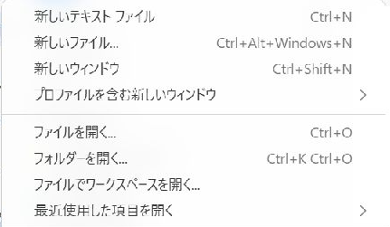
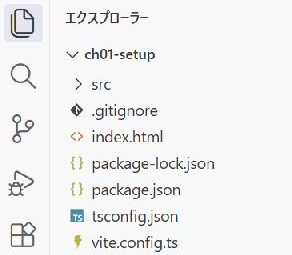
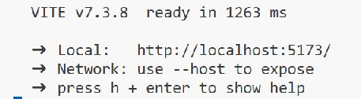

:::: {#page-1 .source-page}

::: {#ch01-number .paragraph}
1
:::

::: {#ch01-title .heading}
第1章 開発環境とTypeScriptの基礎
:::

::: {#ch01-goals .heading}
章の目標
:::

::: {#ch01-goal-setup .paragraph}
◼ Viteを使い、ReactとTypeScriptのサンプルを起動できる
:::

::: {#ch01-goal-files .paragraph}
◼ 主要ファイルの役割を説明できる
:::

::: {#ch01-goal-types .paragraph}
◼ TypeScriptでレコードと配列の型を定義できる
:::

::::

:::: {#page-2 .source-page}

::: {#ch01-spa-title .heading}
1.1. React と SPA
:::

::: {#ch01-spa-slide .slide layout="columns"}
React と SPA

1995年<br>
JavaScript が登場し、ボタンの操作や入力に応じて画面を変えられるようになりました。

2000年代<br>
Ajax が広まり、ページを読み込み直さずにサーバーのデータを取得できるようになりました。

画面更新の課題<br>
表示する項目が増えると、データが変わるたびにどこを書き換えるかの管理が難しくなります。

2013年以降<br>
Facebook が React を公開。2019年には Hooks が加わりました。
:::

::: {#ch01-spa-react .heading}
**React が登場した背景**
:::

::: {#ch01-spa-body .paragraph}
JavaScript の用途は、入力チェックからサーバーとの通信に広がりました。2005年に **Ajax** と名付けられた手法では、**非同期通信**で応答を待つ間も画面を操作でき、受信後に画面の一部を更新できます。 [Web の歴史](https://github.com/whatwg/web-history)
:::

::: {#ch01-spa-behavior .paragraph}
商品検索では、通信中の表示、件数、一覧、エラーを切り替えます。**DOM**（ブラウザーが持つページの構造）を直接操作する方式では、データが変わるたびに書き換える要素を指定します。項目が増えるほど、表示の更新漏れが起きやすくなります。
:::

::: {#ch01-spa-api .paragraph}
React は、画面を部品（**コンポーネント**）に分けて作るライブラリです。データに応じて表示内容を計算する処理を**レンダリング**と呼びます。その結果を DOM に反映し、ページの再読み込みをせずに画面を切り替える **SPA**（Single Page Application）を作れます。 [React の公開履歴](https://react.dev/versions)・[画面更新の仕組み](https://ja.react.dev/learn/render-and-commit)
:::

::: {#ch01-spa-frameworks-title .heading}
**関連するフレームワーク**
:::

::: {#ch01-spa-angular .paragraph}
■ [AngularJS](https://angularjs.org/)　HTML テンプレートとデータを結ぶ初期の SPA フレームワーク。
:::

::: {#ch01-spa-vue .paragraph}
■ [Vue.js](https://ja.vuejs.org/guide/introduction)　データの変化に応じて画面を更新するフレームワーク。
:::

::: {#ch01-spa-next .paragraph}
■ [Next.js](https://nextjs.org/docs)　React を使い、画面遷移やサーバーでの描画を扱うフレームワーク。
:::

::::

:::: {#page-3 .source-page}

::: {#ch01-tools-title .heading}
1.2. 開発環境の準備
:::

::: {#ch01-tools-slide .slide layout="columns"}
開発環境の準備

VS Code<br>
ソースコードを編集し、ターミナルからコマンドを実行します。

Node.js・npm<br>
Node.js で開発ツールを動かし、npm でライブラリをインストールします。

ブラウザー<br>
開発サーバーで動くアプリケーションの画面を確認します。

配布サンプル<br>
展開したファイルから、作業する章のフォルダーを開きます。
:::

::: {#ch01-tools-body-title .heading}
**VS Code と Node.js を用意する**
:::

::: {#ch01-tools-body .paragraph}
本書の操作画面は **Windows** の例です。研修用 PC に VS Code と Node.js が用意されている場合は、次のページの配布サンプルの展開から進みます。
:::

::: {#ch01-tools-editor .paragraph}
1．**Visual Studio Code（VS Code）**の公式サイトで Windows 用インストーラーをダウンロードし、起動します。セットアップを画面の案内に沿って進め、完了したらスタートメニューから VS Code を開きます。 [VS Code の公式サイト](https://code.visualstudio.com/)
:::

::: {#ch01-tools-node .paragraph}
2．Node.js のダウンロードページで **Node.js 24 系**を選び、Windows 用のインストーラー（`.msi`）をダウンロードします。インストーラーを起動し、画面の案内に沿って進めると **npm も一緒にインストール**されます。開いていた VS Code は、インストールが終わってから開き直します。 [Node.js の公式ダウンロードページ](https://nodejs.org/ja/download)
:::

::::

:::: {#page-4 .source-page}

::: {#ch01-folder-title .heading}
**【作業手順①】配布サンプルを展開して開く**
:::

::: {#ch01-folder-extract .paragraph}
1．配布物が ZIP ファイルの場合は、Windows のエクスプローラーで右クリックし、［すべて展開］を選びます。自分が書き込める作業フォルダーを展開先に指定します。配布サンプルの中から、第1章の **`ch01-setup` フォルダー**を探します。
:::

::: {#ch01-folder-open .paragraph}
2．VS Code で［ファイル］→［フォルダーを開く］を選びます。展開した `ch01-setup` を選択して［フォルダーの選択］をクリックします。フォルダーの信頼を確認する画面が出た場合は、研修で配布されたフォルダーであることを確かめて開きます。
:::

{#ch01-folder-menu}

::: {#ch01-folder-menu-caption .paragraph}
VS Code の［ファイル］メニューにある［フォルダーを開く］
:::

::: {#ch01-folder-check .paragraph}
3．VS Code の左側にある**エクスプローラー**で、フォルダー名 `ch01-setup` の直下に `package.json` が見えることを確認します。左側にファイル一覧が出ていない場合は、一番左のエクスプローラーのアイコンをクリックします。
:::

{#ch01-folder-explorer}

::: {#ch01-folder-explorer-caption .paragraph}
`ch01-setup` の直下に `package.json` があることを確認
:::

::::

:::: {#page-5 .source-page}

::: {#ch01-terminal-title .heading}
**【作業手順②】ターミナルを開いてバージョンを確認する**
:::

::: {#ch01-terminal-open .paragraph}
1．VS Code の上部メニューで［ターミナル］→［新しいターミナル］を選びます。メニューが省略されているときは、上部の［…］をクリックします。画面下部に、文字でコマンドを入力する**ターミナル**が表示されます。
:::

::: {#ch01-terminal-prompt .paragraph}
2．ターミナルの `PS …>` は、入力を待っていることを示す**プロンプト**です。`>` の左側に表示されるパスの末尾が `ch01-setup` であることを確認します。コマンドは `>` の右側に入力し、1行ずつ［Enter］を押します。
:::

::: {#ch01-tools-code .code}
```powershell
node -v
npm -v
```
:::

{#ch01-terminal-versions}

::: {#ch01-terminal-versions-caption .paragraph}
`node -v` と `npm -v` の実行結果。バージョン番号は環境によって異なります。
:::

::: {#ch01-tools-check .paragraph}
3．両方のバージョン番号が表示されれば、コマンドを実行できる状態です。掲載例の Node.js は `v24.` で始まります。`node` が認識されない場合は、Node.js のインストールが終わってから VS Code を開き直したか確認します。
:::

::: {#ch01-tools-npm-ps .paragraph}
PowerShell で `npm.ps1` の実行が拒否された場合は、**`npm.cmd -v`** を使います。以降、同じエラーが出る場合は、`npm install` や `npm run dev` も、先頭の `npm` を `npm.cmd` に置き換えて実行します。
:::

::::

:::: {#page-6 .source-page}

::: {#ch01-vite-title .heading}
1.3. Vite でプロジェクトを作成
:::

::: {#ch01-vite-slide .slide layout="columns"}
Vite でプロジェクトを作成

Vite<br>
開発サーバーの起動と、配布用のファイルを作るビルドを行うツールです。

ひな形<br>
React と TypeScript に必要なファイルや設定をまとめて用意できます。

研修での作業<br>
設定済みの `ch01-setup` を使います。次の 1.4 節で準備を続けます。
:::

::: {#ch01-vite-course .paragraph}
**Vite**（ヴィート）は、編集中のアプリケーションをブラウザーで確認するための**開発サーバー**を起動します。また、アプリケーションを配布できる形にまとめる処理を**ビルド**といいます。Vite はどちらの処理も Node.js 上で行います。
:::

::: {#ch01-vite-template .paragraph}
新規作成時は、React と TypeScript に対応した**ひな形**を使えます。画面を表示するソースコード、使うライブラリの情報、TypeScript の設定がそろった状態から開発を始められます。
:::

::: {#ch01-vite-next .paragraph}
研修では設定済みの `ch01-setup` を使います。VS Code で開いたフォルダーのまま **1.4 節「依存ライブラリの導入」**に進みます。自分で新規作成する場合は、次のページの手順を確認してください。
:::

::::

:::: {#page-7 .source-page}

::: {#ch01-vite-body-title .heading}
**【参考】新しくプロジェクトを作る**
:::

::: {#ch01-vite-action .paragraph}
1．研修のサンプルとは別の空の作業フォルダーを用意します。VS Code の［ファイル］→［フォルダーを開く］でそのフォルダーを開き、新しいターミナルで次のコマンドを実行します。`demo` は新しく作るフォルダー名、**`react-ts`** は React と TypeScript 用のひな形です。 [Vite の公式ガイド](https://v7.vite.dev/guide/#scaffolding-your-first-vite-project)
:::

::: {#ch01-vite-code .code}
```powershell
npm create vite@7.1.3 demo -- --template react-ts
```
:::

::: {#ch01-vite-check .paragraph}
2．作成ツールのインストールを確認された場合は `y` を入力し、［Enter］を押します。`Done` が表示されたら、エクスプローラーで **`demo` の中に `package.json` と `src` ができたこと**を確認します。
:::

{#ch01-vite-result}

::: {#ch01-vite-result-caption .paragraph}
`Done` に続いて、作成したフォルダーに移動して実行するコマンドが表示されます。
:::

::: {#ch01-vite-result-action .paragraph}
3．新しく作ったプロジェクトを起動する場合は、表示されたとおり `cd demo` で移動し、`npm install`、`npm run dev` の順に実行します。ライブラリの導入と起動の手順は、次の節から配布サンプルで行います。
:::

::::

:::: {#page-8 .source-page}

::: {#ch01-install-title .heading}
1.4. 依存ライブラリの導入
:::

::: {#ch01-install-slide .slide layout="columns"}
依存ライブラリの導入

作業場所<br>
使う章の `package.json` があるフォルダーを開きます。

インストール<br>
サンプルに必要なライブラリを導入します。

`npm install`

完了の目印<br>
ターミナルが入力待ちに戻り、`node_modules` フォルダーができます。
:::

::: {#ch01-install-body-title .heading}
**【作業手順】第1章のサンプルにライブラリを入れる**
:::

::: {#ch01-install-body .paragraph}
`package.json` に**依存ライブラリ**が書かれ、`package-lock.json` にバージョンが記録されています。npm はインターネット経由で必要なライブラリを取得します。
:::

::: {#ch01-install-action .paragraph}
1．`ch01-setup` のターミナルで **`npm install`** を入力し、［Enter］を押します。親フォルダーで開いた場合は、先に `cd ch01-setup` で移動します。プロンプトが戻るまで待ちます。
:::

{#ch01-install-result}

::: {#ch01-install-result-caption .paragraph}
追加したパッケージの件数が表示され、プロンプトに戻った状態
:::

::: {#ch01-install-check .paragraph}
2．エクスプローラーに **`node_modules`** ができたことを確認します。`package.json` が見つからない場合は作業場所を確認します。次の章でも、**その章のフォルダーで `npm install`** を実行します。
:::

::::

:::: {#page-9 .source-page}

::: {#ch01-start-title .heading}
1.5. 開発サーバーの起動と動作確認
:::

::: {#ch01-start-slide .slide layout="columns"}
開発サーバーの起動と動作確認

起動<br>
`npm run dev` で Vite を起動します。

表示<br>
表示された URL を開き、商品管理の画面を確認します。

更新<br>
`App.tsx` の見出しを変更して保存し、画面への反映を確認します。
:::

::: {#ch01-start-body .paragraph}
1．`npm install` が終わった `ch01-setup` で、次のコマンドを入力して［Enter］を押します。npm が `package.json` の `dev` に設定された Vite を起動します。
:::

::: {#ch01-start-code .code}
```powershell
npm run dev
```
:::

{#ch01-start-terminal}

::: {#ch01-start-terminal-caption .paragraph}
Vite が起動し、`Local` にブラウザーで使う URL が表示された状態
:::

::: {#ch01-start-location .paragraph}
2．**`Local` に表示された URL** をブラウザーのアドレスバーに貼り付け、［Enter］を押します。`5173` の部分は環境によって変わるため、実際に表示された URL を使います。
:::

::: {#ch01-start-running .paragraph}
ブラウザーで確認する間は、Vite を起動した**ターミナルを開いたまま**にします。
:::

::::

:::: {#page-10 .source-page}

::: {#ch01-start-verify-title .heading}
**【作業手順】表示と保存後の反映を確認する**
:::

::: {#ch01-start-verify .paragraph}
1．ブラウザーに「商品管理システム」と表示され、商品名が「ノート」、価格が「250 円」となっていることを確認します。接続できない場合は、ターミナルで Vite が起動したままで、`Local` の URL を開いているか確認します。
:::

{#ch01-start-screen}

::: {#ch01-start-caption .paragraph}
ブラウザーに表示された商品管理システムの初期画面
:::

::: {#ch01-start-edit .paragraph}
2．VS Code のエクスプローラーで［src］を展開して［App.tsx］を開きます。`<h1>` と `</h1>` の間にある「商品管理システム」を「商品管理システム（確認）」に変えて、［Ctrl］＋［S］で保存します。
:::

{#ch01-start-edit-screen}

::: {#ch01-start-edit-caption .paragraph}
`src/App.tsx` の見出しを変更。`<h1>` と `</h1>` はそのまま残します。
:::

::: {#ch01-start-check .paragraph}
3．ブラウザーに戻り、ページを再読み込みする操作をしなくても見出しが変わったことを確認します。Vite は**保存した変更を開発中の画面に反映**します。見出しを元に戻して保存し、変わったことを確認します。
:::

::: {#ch01-start-stop .paragraph}
4．確認を終えたら、Vite を起動したターミナルをクリックして［Ctrl］＋［C］を押します。**プロンプトに戻れば停止完了**です。もう一度表示を確認するときは、同じフォルダーで `npm run dev` を実行します。
:::

::::

:::: {#page-11 .source-page}

::: {#ch01-files-title .heading}
1.6. フォルダと主要ファイルの役割
:::

::: {#ch01-files-slide .slide layout="columns"}
フォルダと主要ファイルの役割

index.html<br>
ブラウザーが最初に読み、画面を表示する場所を用意します。

main.tsx<br>
`App` を読み込み、HTML 内の `root` に表示します。

App.tsx<br>
画面の内容を定義します。このサンプルでは商品名や価格を表示します。
:::

::: {#ch01-files-body .paragraph}
VS Code のエクスプローラーで `index.html` を開き、`id="root"` の要素と `src/main.tsx` の読み込みを確認します。ブラウザーが `index.html` を読み込むと、`main.tsx` が **`App` を `root` に描画**します。
:::

::: {#ch01-files-check .paragraph}
次に `src` フォルダーで `App.tsx` と `product.ts` を開きます。**`.tsx`** は、TypeScript と **JSX**（タグの形で画面を記述する構文）を使うファイルです。`product.ts` には、第1章の画面に表示する商品データが定義されています。
:::

::: {#ch01-files-table .table}
| ファイル | 役割 |
| --- | --- |
| index.html | HTML の土台。表示場所と入口を指定する |
| src/main.tsx | App を読み込んでブラウザーに描画する |
| src/App.tsx | 商品管理の画面を定義する |
| src/product.ts | 商品の型とデータを定義する |
| package.json | 依存ライブラリと実行コマンドを指定する |
| tsconfig.json | TypeScript の型チェックなどを設定する |
:::

::::

:::: {#page-12 .source-page}

::: {#ch01-js-title .heading}
1.7. 必要な JavaScript 構文
:::

::: {#ch01-js-slide .slide layout="columns"}
必要な JavaScript 構文

変数<br>
`const` は再代入しない変数に使います。

項目の参照<br>
`product.name` で商品の名前を参照します。

配列の変換<br>
`map` で要素ごとに処理し、新しい配列を作ります。

ファイル間の連携<br>
`export` で公開し、`import` で読み込みます。
:::

::: {#ch01-js-body-title .heading}
**商品データを読み込む**
:::

::: {#ch01-js-body .paragraph}
`src/product.ts` では `export` を付けて商品データを公開しています。`src/App.tsx` は `import` でそれを読み込み、`product.name` などの式で商品情報にアクセスします。
:::

::: {#ch01-js-code .code}
```typescript
import { product } from './product'

const items = [product]
const names = items.map((item) => item.name)
```
:::

::: {#ch01-js-check .paragraph}
この例では、`items` に商品が1件入っています。**`map` で各商品の名前を取り出す**ので、`names` は `['ノート']` になります。第2章ではこの考え方を一覧表示に使います。
:::

::::

:::: {#page-13 .source-page}

::: {#ch01-ts-title .heading}
1.8. TypeScript の基本型とデータ型
:::

::: {#ch01-ts-slide .slide layout="columns"}
TypeScript の基本型とデータ型

基本型<br>
商品名は `string`、価格は `number`、真偽値は `boolean` です。

オブジェクト型<br>
`Product` に `id`、`name`、`price`、`category` を定義します。

配列の型<br>
`Product[]` は `Product` 型のデータが並ぶ配列です。

型チェック<br>
価格に文字列を指定すると、実行前に型エラーが分かります。
:::

::: {#ch01-ts-body .paragraph}
`product: Product` で**商品データの型**を指定します。`name: string` は文字列の項目、`price: number` は数値の項目です。`price: '250'` に変えると、`npm run build` の**型チェック**でエラーになります。 [React で TypeScript を使う方法](https://react.dev/learn/typescript)
:::

::: {#ch01-ts-code .code filename="src/product.ts"}
```typescript
export type Product = {
  id: number
  name: string
  price: number
  category: string
}

export const product: Product = {
  id: 1,
  name: 'ノート',
  price: 250,
  category: '文具',
}
```
:::

::::

:::: {#page-14 .source-page}

::: {#ch01-exercise-title .heading}
1.9. 演習① 環境確認と社員データの型定義
:::

::: {#ch01-exercise-slide .slide layout="columns"}
演習① 環境確認と社員データの型定義

環境確認<br>
サンプルを起動して「商品管理システム」を表示します。

社員の型<br>
`src/employee.ts` に `Employee` 型を定義します。

配列の型<br>
`employees` に `Employee[]` を指定します。

型チェック<br>
`npm run build` が成功することを確認します。
:::

::: {#ch01-exercise-setup .paragraph}
`ch01-setup` で `npm install` を実行した状態から始めます。`npm run dev` で画面を開き、「商品管理システム」とサンプル商品を確認します。確認後、［Ctrl］＋［C］で開発サーバーを止めます。
:::

::: {#ch01-exercise-data .paragraph}
`src/employee.ts` に `type Employee` を追加します。次の表を使い、定義済みの **`employees` に `Employee[]` を指定**してください。
:::

::: {#ch01-exercise-fields .table}
| 項目名 | 意味 | 型 |
| --- | --- | --- |
| id | 社員番号 | number |
| name | 氏名 | string |
| salary | 給与 | number |
| location_name | 勤務地 | string |
:::

::: {#ch01-exercise-check .paragraph}
**`npm run build` が成功すること**を確認します。社員番号を一時的に `'1001'` に変えると型エラーになります。数値の `1001` に戻し、再度ビルドが成功すれば完了です。
:::

::::

:::: {#page-15 .source-page}

::: {#ch01-summary-title .heading}
章のまとめ
:::

::: {#ch01-summary-slide .slide layout="summary"}
章のまとめ

■ 開発環境の準備とViteによるプロジェクト作成

■ 章ごとの依存ライブラリの導入

■ 開発サーバーの起動と動作確認

■ フォルダと主要ファイルの役割

■ TypeScriptによるデータの型定義
:::

::: {#ch01-summary-body .paragraph}
この章では、開発環境を準備し、React のサンプルを起動しました。商品と社員のデータを例に、TypeScript でデータの形を定義しました。第2章では社員のデータを一覧に表示し、入力値を React の状態として管理します。
:::

::::
