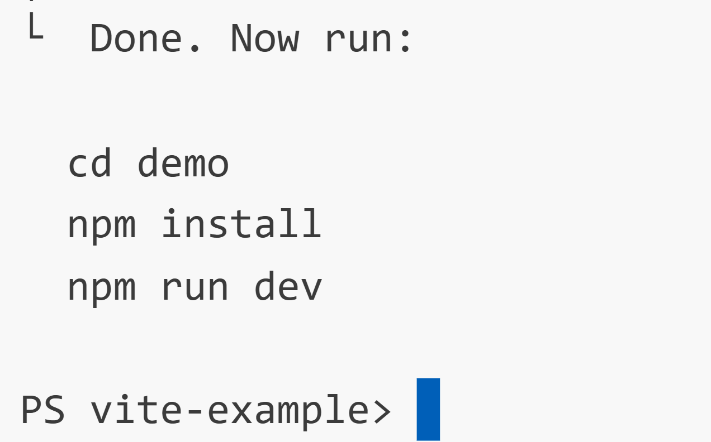
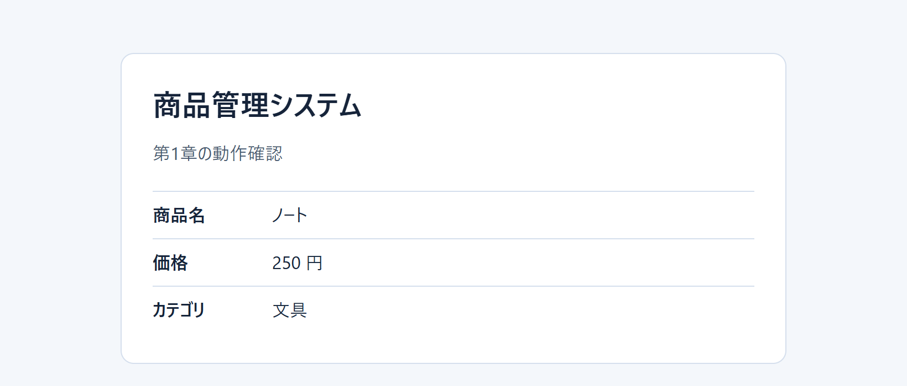

:::: {#page-1 .source-page}

::: {#ch01-number .paragraph}
1
:::

::: {#ch01-title .heading}
第1章 開発環境とTypeScriptの基礎
:::

::: {#ch01-goals .heading}
章の目標
:::

::: {#ch01-goal-setup .paragraph}
◼ Viteを使い、ReactとTypeScriptのサンプルを起動できる
:::

::: {#ch01-goal-files .paragraph}
◼ 主要ファイルの役割を説明できる
:::

::: {#ch01-goal-types .paragraph}
◼ TypeScriptでレコードと配列の型を定義できる
:::

::::

:::: {#page-2 .source-page}

::: {#ch01-spa-title .heading}
1.1. React と SPA
:::

::: {#ch01-spa-slide .slide layout="columns"}
React と SPA

1995年<br>
JavaScript が登場し、ボタンの操作や入力に応じて画面を変えられるようになりました。

2000年代<br>
Ajax が広まり、ページを読み込み直さずにサーバーのデータを取得できるようになりました。

画面更新の課題<br>
表示する項目が増えると、データが変わるたびにどこを書き換えるかの管理が難しくなります。

2013年以降<br>
Facebook が React を公開。2019年には Hooks が加わりました。
:::

::: {#ch01-spa-react .heading}
**動的な画面更新の必要性と課題**
:::

::: {#ch01-spa-body .paragraph}
Web アプリケーションでは、操作や通信の結果に応じて画面を更新します。従来は、JavaScript で **DOM**（ドキュメントオブジェクトモデル）を直接操作して実装していました。次の例では、［カウントアップ］を押すたびに表示する数値を 1 増やします。
:::

::: {#ch01-spa-counter .code filename="counter.html"}
```html
<!doctype html>
<meta charset="utf-8">
<h1 id="count">0</h1>
<button id="btn">カウントアップ</button>
<script>
  let count = 0; // 初期値
  const countEl = document.getElementById("count");
  const btnEl = document.getElementById("btn");
  btnEl.addEventListener("click", function () {
    count++;
    countEl.textContent = count; // 表示を書き換える
  });
</script>
```
:::

::::

:::: {#page-3 .source-page}

::: {#ch01-spa-behavior .paragraph}
前ページの7・8行目では、`getElementById` で見出しとボタンを**読み込み時に一度取得**します。9行目で `addEventListener` を使い、クリック時の処理（イベントリスナー）を登録します。ボタンを押すと10・11行目が実行され、`count` を増やして `textContent` に代入し、見出しの表示を更新します。
:::

::: {#ch01-spa-maintenance .paragraph}
例えば、上限に達したときにメッセージを表示してボタンを無効にする場合は、見出しとあわせて三つの要素を更新します。更新する項目や条件が増えると、どの処理がどの要素を書き換えるのかを追いにくくなり、保守が難しくなります。
:::

::: {#ch01-spa-frameworks-title .heading}
**フロントエンドフレームワークの登場**
:::

::: {#ch01-spa-frameworks-body .paragraph}
この課題に対応するため、**データに応じて表示を更新する仕組み**を持つフロントエンドフレームワークやライブラリが登場しました。カウンターなら、現在の値から数値の表示とボタンの状態を決めます。画面を**コンポーネント**という部品に分けると、表示と処理をまとめて、ほかの画面でも再利用できます。
:::

::: {#ch01-spa-frameworks .comparison icons="assets/reactive-display.svg assets/application-routing.svg assets/template-binding.svg"}
| React | Angular | Vue.js |
| --- | --- | --- |
| Facebook（現 Meta）が開発した、画面を作るためのライブラリです。 | Google が開発したフレームワークで、フォームや画面遷移の機能を備えています。 | Evan You が個人で開発を始めたフレームワークです。HTML に近い構文で表示を記述します。 |
:::

::: {#ch01-react-history-title .heading}
**Reactの歴史と進化**
:::

::: {#ch01-react-history-release .paragraph}
2013年に Facebook が React をオープンソースとして公開しました。React は状態から画面に表示する内容を計算し（**レンダリング**）、必要な変更を DOM に反映します。この仕組みで、同じページ内で画面を切り替える **SPA** を作れます。
:::

::: {#ch01-react-history-hooks .paragraph}
2019年の React 16.8 では **Hooks** が導入され、関数で書いたコンポーネントでも状態を管理できるようになりました。第2章では `useState` を使い、入力値や表示の状態を扱います。
:::

::: {#ch01-react-history-next .paragraph}
**Next.js** は、React を使って Web アプリケーションを作るフレームワークです。URL に応じてページを切り替えたり、サーバー側で表示内容を組み立てたりできます。
:::

::::

:::: {#page-4 .source-page}

::: {#ch01-tools-title .heading}
1.2. 開発環境の準備
:::

::: {#ch01-tools-slide .slide layout="columns"}
開発環境の準備

VS Code<br>
ソースコードを編集し、ターミナルからコマンドを実行します。

Node.js・npm<br>
Node.js で開発ツールを動かし、npm でライブラリをインストールします。

ブラウザー<br>
開発サーバーで動くアプリケーションの画面を確認します。

配布サンプル<br>
展開したファイルから、作業する章のフォルダーを開きます。
:::

::: {#ch01-tools-body-title .heading}
**VS Code と Node.js を用意する**
:::

::: {#ch01-tools-body .paragraph}
本章の作業は **Windows** で行います。研修用 PC に VS Code と Node.js が用意されている場合は、次ページの「配布サンプルを展開して開く」へ進んでください。
:::

::: {#ch01-tools-editor .paragraph numbered="true" keep-lines="true"}
1．**Visual Studio Code（VS Code）をインストールする**<br>
ダウンロード先　[https://code.visualstudio.com/Download](https://code.visualstudio.com/Download)<br>
Windows の［User Installer］で、PC に合わせて［x64］または［Arm64］を選びます。<br>
ダウンロードしたファイルを開き、画面の案内に従ってインストールします。<br>
完了後、［スタート］メニューから VS Code を起動します。
:::

::: {#ch01-tools-node .paragraph numbered="true" keep-lines="true"}
2．**Node.js と npm を準備する**<br>
ダウンロード先　[https://nodejs.org/ja/download](https://nodejs.org/ja/download)<br>
**Node.js 24 系**の Windows 用インストーラー（`.msi`）をダウンロードして開きます。<br>
画面の案内に従って進めると、Node.js と npm が一緒にインストールされます。<br>
VS Code を開いている場合は、インストール完了後に起動し直します。
:::

::::

:::: {#page-5 .source-page}

::: {#ch01-folder-title .heading}
**【作業手順①】　配布サンプルを展開して開く**
:::

::: {#ch01-folder-extract .paragraph numbered="true"}
1．配布物が ZIP 形式の場合は、Windows のエクスプローラーで ZIP ファイルを右クリックし、［すべて展開］を選びます。ファイルを保存できる場所を展開先に指定します。
:::

::: {#ch01-folder-open .paragraph numbered="true"}
2．VS Code で［ファイル］→［フォルダーを開く］を選びます。配布物の中の **`ch01-setup`** を選び、［フォルダーの選択］をクリックします。
:::

{#ch01-folder-menu}

::: {#ch01-folder-menu-caption .paragraph}
［ファイル］メニューから［フォルダーを開く］を選択
:::

::: {#ch01-folder-check .paragraph numbered="true"}
3．VS Code 左側の**エクスプローラー**を確認します。`ch01-setup` の直下に `package.json` があれば、第1章のプロジェクトを開けています。
:::

{#ch01-folder-explorer}

::: {#ch01-folder-explorer-caption .paragraph}
フォルダー名と、その直下の `package.json` を確認
:::

::: {#ch01-folder-trust .paragraph}
※フォルダーの信頼を確認された場合は、研修で配布されたフォルダーであることを確かめてから、信頼して開きます。
:::

::::

:::: {#page-6 .source-page}

::: {#ch01-terminal-title .heading}
**【作業手順②】　ターミナルを開いてバージョンを確認する**
:::

::: {#ch01-terminal-open .paragraph numbered="true"}
1．［ターミナル］→［新しいターミナル］を選びます。画面下部に、コマンドを入力する**ターミナル**が開きます。メニューが省略されている場合は上部の［…］を開きます。
:::

::: {#ch01-terminal-prompt .paragraph numbered="true"}
2．入力待ちを示す `PS …>` を**プロンプト**と呼びます。`>` の直前が `ch01-setup` であることを確認し、次のコマンドを1行ずつ入力して［Enter］を押します。
:::

::: {#ch01-tools-code .code}
```powershell
node -v
npm -v
```
:::

{#ch01-terminal-versions}

::: {#ch01-terminal-versions-caption .paragraph}
実行したコマンドの直下に、Node.js と npm のバージョンが表示される
:::

::: {#ch01-tools-check .paragraph numbered="true"}
3．`node -v` と `npm -v` の直下に、それぞれバージョン番号が表示されることを確認します。`node` が認識されない場合は、Node.js のインストール完了後に VS Code を起動し直します。
:::

::: {#ch01-tools-npm-ps .paragraph}
PowerShell で `npm.ps1` の実行が制限されている場合は、**`npm.cmd -v`** を実行します。同じメッセージが出る場合は、以降もコマンドの先頭の `npm` を `npm.cmd` に置き換えます。
:::

::::

:::: {#page-7 .source-page}

::: {#ch01-vite-title .heading}
1.3. Vite でプロジェクトを作成
:::

::: {#ch01-vite-slide .slide layout="columns"}
Vite でプロジェクトを作成

Vite<br>
開発サーバーの起動と、配布用のファイルを作るビルドを行うツールです。

ひな形<br>
React と TypeScript に必要なファイルや設定をまとめて用意できます。

研修での作業<br>
設定済みの `ch01-setup` を使います。次の 1.4 節で準備を続けます。
:::

::: {#ch01-vite-course .paragraph}
**Vite**（ヴィート）は、React と TypeScript の開発を支えるツールです。開発中は、**開発サーバー**を起動して、編集中の画面をブラウザーで確認できます。公開時には、アプリに必要なファイルを配布用にまとめる**ビルド**を実行します。
:::

::: {#ch01-vite-template .paragraph}
プロジェクトを新しく作るときは、React と TypeScript 用のひな形から始められます。ひな形には、最初の画面を表示するコードと、Vite、TypeScript、npm を使うための設定が含まれます。
:::

::: {#ch01-vite-next .paragraph}
研修では、配布済みの `ch01-setup` を使います。このフォルダーを開いた状態で **1.4 節「依存ライブラリの導入」**へ進んでください。新規作成の手順は次ページに示します。
:::

::::

:::: {#page-8 .source-page}

::: {#ch01-vite-body-title .heading}
**【参考】　React と TypeScript のプロジェクトを作成する**
:::

::: {#ch01-vite-action .paragraph numbered="true"}
1．空の作業フォルダーを用意し、VS Code で開きます。そのフォルダーのターミナルで、次のコマンドを1行で実行します。
:::

::: {#ch01-vite-code .code}
```powershell
npm create vite@7.1.3 demo -- --template react-ts
```
:::

::: {#ch01-vite-command-args .paragraph}
`demo` は新しく作るフォルダー名です。`--template react-ts` で React と TypeScript のひな形を指定します。
:::

::: {#ch01-vite-check .paragraph numbered="true"}
2．作成ツールのインストールを確認するメッセージが出た場合は、`y` を入力して［Enter］を押します。`Done` が表示されたら、`demo` の中に `package.json` と `src` ができたことを確認します。
:::

{#ch01-vite-result}

::: {#ch01-vite-result-caption .paragraph}
ひな形の作成が完了し、次に実行するコマンドが表示された状態
:::

::: {#ch01-vite-result-action .paragraph numbered="true"}
3．新規プロジェクトを起動するには、`cd demo` で作業場所を移動します。`npm install` で依存ライブラリを導入し、`npm run dev` で開発サーバーを起動します。
:::

::::

:::: {#page-9 .source-page}

::: {#ch01-install-title .heading}
1.4. 依存ライブラリの導入
:::

::: {#ch01-install-slide .slide layout="columns"}
依存ライブラリの導入

作業場所<br>
使う章の `package.json` があるフォルダーを開きます。

インストール<br>
サンプルに必要なライブラリを導入します。

`npm install`

完了の目印<br>
ターミナルが入力待ちに戻り、`node_modules` フォルダーができます。
:::

::: {#ch01-install-body-title .heading}
**【作業手順】　配布サンプルの依存ライブラリをインストールする**
:::

::: {#ch01-install-body .paragraph}
`package.json` にはサンプルが使う**依存ライブラリ**が記載されています。npm は `package-lock.json` のバージョン情報を参照し、必要なファイルを取得します。
:::

::: {#ch01-install-action .paragraph numbered="true"}
1．作業場所が `ch01-setup` であることを確認し、**`npm install`** を実行します。ファイルの取得中は、そのままプロンプトが戻るまで待ちます。
:::

{#ch01-install-result}

::: {#ch01-install-result-caption .paragraph}
初回の実行例。`added` の行に追加件数が表示され、入力待ちに戻る
:::

::: {#ch01-install-check .paragraph numbered="true"}
2．エクスプローラーで **`node_modules`** ができたことを確認します。次の章も、その章の `package.json` があるフォルダーで `npm install` を実行します。
:::

::::

:::: {#page-10 .source-page}

::: {#ch01-start-title .heading}
1.5. 開発サーバーの起動と動作確認
:::

::: {#ch01-start-slide .slide layout="columns"}
開発サーバーの起動と動作確認

起動<br>
`npm run dev` で Vite を起動します。

表示<br>
表示された URL を開き、商品管理の画面を確認します。

更新<br>
`App.tsx` の見出しを変更して保存し、画面への反映を確認します。
:::

::: {#ch01-start-body .paragraph numbered="true"}
1．インストールが完了した `ch01-setup` のターミナルで、次のコマンドを実行します。`package.json` の `dev` に登録されている Vite が起動します。
:::

::: {#ch01-start-code .code}
```powershell
npm run dev
```
:::

{#ch01-start-terminal}

::: {#ch01-start-terminal-caption .paragraph}
`Local` に表示されたアドレスが、開発中の画面を開く URL
:::

::: {#ch01-start-location .paragraph numbered="true"}
2．**`Local` の行に表示された URL** をコピーし、ブラウザーのアドレスバーに貼り付けて［Enter］を押します。
:::

::: {#ch01-start-running .paragraph}
ブラウザーで確認する間は、Vite を起動した**ターミナルを開いたまま**にします。
:::

::::

:::: {#page-11 .source-page}

::: {#ch01-start-verify-title .heading}
**【作業手順】　初期表示と保存後の反映を確認する**
:::

::: {#ch01-start-verify .paragraph numbered="true"}
1．ブラウザーに「商品管理システム」と表示され、商品名が「ノート」、価格が「250 円」であることを確認します。
:::

{#ch01-start-screen}

::: {#ch01-start-caption .paragraph}
ブラウザーに表示された商品管理システムの初期画面
:::

::: {#ch01-start-edit .paragraph numbered="true"}
2．VS Code のエクスプローラーで［src］を展開し、［App.tsx］を開きます。`<h1>` と `</h1>` の間の文字を「商品管理システム（確認）」に変更し、［Ctrl］＋［S］で保存します。
:::

{#ch01-start-edit-screen}

::: {#ch01-start-edit-caption .paragraph}
編集するのは `<h1>` と `</h1>` で囲まれた見出しの文字列
:::

::: {#ch01-start-check .paragraph numbered="true"}
3．ブラウザーに戻ると、保存した見出しが画面に反映されています。確認後、VS Code で見出しを「商品管理システム」に戻し、保存してください。
:::

::: {#ch01-start-stop .paragraph numbered="true"}
4．Vite を起動したターミナルをクリックし、［Ctrl］＋［C］を押します。プロンプトが表示されたら、開発サーバーは停止しています。
:::

::::

:::: {#page-12 .source-page}

::: {#ch01-files-title .heading}
1.6. フォルダと主要ファイルの役割
:::

::: {#ch01-files-slide .slide layout="columns"}
フォルダと主要ファイルの役割

index.html<br>
ブラウザーが最初に読み、画面を表示する場所を用意します。

main.tsx<br>
`App` を読み込み、HTML 内の `root` に表示します。

App.tsx<br>
画面の内容を定義します。このサンプルでは商品名や価格を表示します。
:::

::: {#ch01-files-body .paragraph}
VS Code で `index.html` を開き、表示先の `id="root"` と、`src/main.tsx` を読み込む指定を確認します。開発時は Vite が TypeScript を JavaScript に変換し、`main.tsx` の処理が **`App` を `root` に描画**します。
:::

::: {#ch01-files-check .paragraph}
次に `src` の `App.tsx` と `product.ts` を開きます。`App.tsx` にある HTML に似た記述は **JSX** です。TypeScript と JSX を含むファイルは拡張子を `.tsx` とします。商品データは `product.ts` に定義されています。
:::

::: {#ch01-files-table .table}
| ファイル | 役割 |
| --- | --- |
| index.html | HTML の土台。表示場所と入口を指定する |
| src/main.tsx | App を読み込んでブラウザーに描画する |
| src/App.tsx | 商品管理の画面を定義する |
| src/product.ts | 商品の型とデータを定義する |
| package.json | 依存ライブラリと実行コマンドを指定する |
| tsconfig.json | TypeScript の型チェックなどを設定する |
:::

::::

:::: {#page-13 .source-page}

::: {#ch01-js-title .heading}
1.7. 必要な JavaScript 構文
:::

::: {#ch01-js-slide .slide layout="columns"}
必要な JavaScript 構文

変数<br>
`const` は再代入しない変数に使います。

項目の参照<br>
`product.name` で商品の名前を参照します。

配列の変換<br>
`map` で要素ごとに処理し、新しい配列を作ります。

ファイル間の連携<br>
`export` で公開し、`import` で読み込みます。
:::

::: {#ch01-js-body-title .heading}
**商品データを読み込む**
:::

::: {#ch01-js-body .paragraph}
`src/product.ts` では `export` を付けて商品データを公開しています。`src/App.tsx` は `import` でそれを読み込み、`product.name` などの式で商品情報にアクセスします。
:::

::: {#ch01-js-code .code}
```typescript
import { product } from './product'

const items = [product]
const names = items.map((item) => item.name)
```
:::

::: {#ch01-js-check .paragraph}
`items` は、商品データを1件格納した配列です。`map` に渡した関数が各商品の `name` を返すため、`names` には名前だけの配列 `['ノート']` が入ります。第2章では、同じ `map` を使って商品ごとの表示を組み立てます。
:::

::::

:::: {#page-14 .source-page}

::: {#ch01-ts-title .heading}
1.8. TypeScript の基本型とデータ型
:::

::: {#ch01-ts-slide .slide layout="columns"}
TypeScript の基本型とデータ型

基本型<br>
商品名は `string`、価格は `number`、真偽値は `boolean` です。

オブジェクト型<br>
`Product` に `id`、`name`、`price`、`category` を定義します。

配列の型<br>
`Product[]` は `Product` 型のデータが並ぶ配列です。

型チェック<br>
価格に文字列を指定すると、実行前に型エラーが分かります。
:::

::: {#ch01-ts-body .paragraph}
`Product` 型では、商品名を文字列、価格を数値として定義します。`product: Product` と型を指定すると、価格に `'250'` のような文字列を設定した場合、`npm run build` の**型チェック**でエラーを検出できます。
:::

::: {#ch01-ts-code .code filename="src/product.ts"}
```typescript
export type Product = {
  id: number
  name: string
  price: number
  category: string
}

export const product: Product = {
  id: 1,
  name: 'ノート',
  price: 250,
  category: '文具',
}
```
:::

::::

:::: {#page-15 .source-page}

::: {#ch01-exercise-title .heading}
1.9. 演習① 環境確認と社員データの型定義
:::

::: {#ch01-exercise-slide .slide layout="columns"}
演習① 環境確認と社員データの型定義

環境確認<br>
サンプルを起動して「商品管理システム」を表示します。

社員の型<br>
`src/employee.ts` に `Employee` 型を定義します。

配列の型<br>
`employees` に `Employee[]` を指定します。

型チェック<br>
`npm run build` が成功することを確認します。
:::

::: {#ch01-exercise-setup .paragraph numbered="true"}
1．依存ライブラリの導入が済んだ `ch01-setup` で `npm run dev` を実行します。「商品管理システム」が表示されることを確認し、［Ctrl］＋［C］で開発サーバーを停止します。
:::

::: {#ch01-exercise-data .paragraph numbered="true"}
2．`src/employee.ts` を開き、次の表に従って `Employee` 型を定義します。定義済みの **`employees` に `Employee[]` を指定**してください。
:::

::: {#ch01-exercise-fields .table}
| 項目名 | 意味 | 型 |
| --- | --- | --- |
| id | 社員番号 | number |
| name | 氏名 | string |
| salary | 給与 | number |
| location_name | 勤務地 | string |
:::

::: {#ch01-exercise-check .paragraph numbered="true" keep-lines="true"}
3．**`npm run build` が成功すること**を確認します。<br>
先頭の `id` を文字列 `'1001'` に変え、再度ビルドして型エラーを確認します。<br>
数値の `1001` に戻し、ビルドが成功すれば完了です。
:::

::::

:::: {#page-16 .source-page}

::: {#ch01-summary-title .heading}
章のまとめ
:::

::: {#ch01-summary-slide .slide layout="summary"}
章のまとめ

■ 開発環境の準備とViteによるプロジェクト作成

■ 章ごとの依存ライブラリの導入

■ 開発サーバーの起動と動作確認

■ フォルダと主要ファイルの役割

■ TypeScriptによるデータの型定義
:::

::: {#ch01-summary-body .paragraph}
この章では、開発環境を準備し、React のサンプルを起動しました。商品と社員のデータを例に、TypeScript でデータの形を定義しました。第2章では社員のデータを一覧に表示し、入力値を React の状態として管理します。
:::

::::
