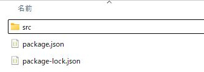
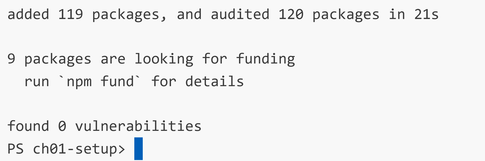
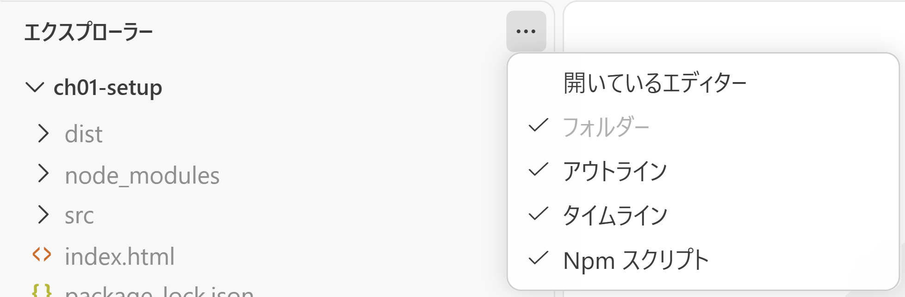

:::: {#page-1 .source-page}

::: {#ch01-number .paragraph}
1
:::

::: {#ch01-title .heading}
第1章 React の開発環境と動作確認
:::

::: {#ch01-goals .heading}
章の目標
:::

::: {#ch01-goal-setup .paragraph}
◼ React の開発環境を準備し、Vite でひな形を作成できる
:::

::: {#ch01-goal-files .paragraph}
◼ VS Code の NPM スクリプトから配布サンプルを起動できる
:::

::: {#ch01-goal-types .paragraph}
◼ サンプルの主要なファイルのつながりを説明できる
:::

::::

:::: {#page-2 .source-page}

::: {#ch01-spa-title .heading}
1.1. React と SPA
:::

::: {#ch01-spa-slide .slide layout="diagram" art="assets/slide-react-spa.png"}
React と SPA

JavaScript<br>
1995年に登場<br>操作や入力に反応する

Ajax<br>
2000年代に普及<br>ページを開いたまま通信

React<br>
2013年に公開<br>データに応じて表示を更新
:::

::: {#ch01-spa-react .heading}
**動的な画面更新の必要性と課題**
:::

::: {#ch01-spa-body .paragraph}
Web アプリケーションでは、操作や通信の結果に応じて画面を更新します。従来は、JavaScript で **DOM**（ドキュメントオブジェクトモデル）を直接操作して実装していました。次の例では、［カウントアップ］を押すたびに表示する数値を 1 増やします。
:::

::: {#ch01-spa-counter .code filename="ch01-setup/examples/counter.html"}
```html
<!doctype html>
<meta charset="utf-8">
<h1 id="count">0</h1>
<button id="btn">カウントアップ</button>
<script>
  let count = 0; // 初期値
  const countEl = document.getElementById("count");
  const btnEl = document.getElementById("btn");
  btnEl.addEventListener("click", function () {
    count++;
    countEl.textContent = count; // 表示を書き換える
  });
</script>
```
:::

::::

:::: {#page-3 .source-page}

::: {#ch01-spa-behavior .paragraph}
14ページの7〜9行目では、画面の要素を取得してクリック処理を登録します。10・11行目で値と表示を更新します。更新箇所が増えるほど、処理と表示の対応を追いにくくなります。
:::

::: {#ch01-spa-frameworks-title .heading}
**フロントエンドフレームワークの登場**
:::

::: {#ch01-spa-frameworks-body .paragraph}
この課題を解決するために、**フロントエンドフレームワーク**が開発されました。代表例には React、Angular、Vue.js があります。これらを使うと、データの変化に応じて表示を更新し、表示と処理を**コンポーネント**（画面の部品）にまとめて再利用できます。この仕組みは、同じページ内で画面を切り替える **SPA** の構築にも使われます。
:::

::: {#ch01-spa-frameworks .comparison icons="assets/reactive-display.svg assets/application-routing.svg assets/template-binding.svg"}
| React | Angular | Vue.js |
| --- | --- | --- |
| Meta が開発した画面表示用ライブラリです。 | Google が開発し、画面遷移やフォームを扱えます。 | Evan You が開発。HTML に近い記法を使えます。 |
:::

::: {#ch01-react-counter-intro .paragraph}
次は同じカウンターの React 版です。DOM を直接操作する処理が省けます。
:::

::: {#ch01-react-counter .code filename="ch01-setup/examples/Counter.tsx"}
```tsx
import { useState } from 'react'

export default function Counter() {
  const [count, setCount] = useState(0)
  return (
    <>
      <h1>{count}</h1>
      <button onClick={() => setCount(count + 1)}>
        カウントアップ
      </button>
    </>
  )
}
```
:::

::: {#ch01-react-counter-reading .paragraph keep-lines="true"}
①　4行目　**`useState(0)`** は、初期値 0 の `count` と更新用の `setCount` を返します。\
②　8行目　クリックすると **`setCount(count + 1)`** が次の値を React に渡します。\
③　7行目　React が `Counter` を再実行し、見出しに新しい `count` を表示します。\
14ページの `textContent` への代入にあたる表示の更新は、React が行います。
:::

::: {#ch01-react-history-title .heading}
**Reactの歴史と進化**
:::

::: {#ch01-react-history-release .paragraph}
2013年に Facebook が React を公開し、2019年の React 16.8 で **Hooks** が加わりました。`useState` も Hooks の一つです。第2章ではフォームの入力値を管理します。
:::

::: {#ch01-react-history-next .paragraph}
**Next.js** は React でアプリを作るフレームワークです。URL に応じた画面の切り替えや、サーバー側での表示の組み立てを扱います。
:::

::::

:::: {#page-4 .source-page}

::: {#ch01-tools-title .heading}
1.2. 開発環境の準備
:::

::: {#ch01-tools-slide .slide layout="diagram" art="assets/slide-environment.png"}
開発環境の準備

章フォルダー<br>
配布サンプルを<br>章ごとに置く

VS Code<br>
複数の章フォルダーを<br>まとめて開く

Node.js・npm<br>
バージョンを<br>ターミナルで確認する
:::

::: {#ch01-tools-body-title .heading}
**React の環境構築のための準備**
:::

::: {#ch01-tools-body .paragraph}
本章は **Windows** で操作します。React の開発を始める前に、次の準備を行います。
:::

::: {#ch01-tools-folders .paragraph numbered="true"}
①　**章フォルダーを用意します。** 親フォルダーの下に章ごとのサンプルを置きます。
:::

::: {#ch01-tools-editor .paragraph numbered="true"}
②　**VS Code のワークスペースを作ります。** インターネットから Windows 用の Visual Studio Code をダウンロードしてインストールし、章フォルダーを追加します。
:::

::: {#ch01-tools-language .paragraph numbered="true"}
③　**言語機能を確認します。** VS Code に組み込まれた入力補完とエラー表示の機能を確認します。
:::

::: {#ch01-tools-node .paragraph numbered="true"}
④　**Node.js を導入します。** インターネットから Node.js 24 系をダウンロードしてインストールし、Node.js と npm のバージョンを確認します。
:::

::::

:::: {#page-5 .source-page}

::: {#ch01-folder-title .heading}
**【作業手順①】　親フォルダーと章フォルダーを作る**
:::

::: {#ch01-folder-open .paragraph numbered="true"}
1．Windows の［エクスプローラー］を開き、`C:\` を表示します。
:::

::: {#ch01-folder-parent .paragraph numbered="true"}
2．`work` フォルダーがなければ［新規作成］→［フォルダー］で作ります。`work` を開き、その中に `react_basic` を作ります。
:::

::: {#ch01-folder-path .paragraph keep-lines="true"}
親フォルダーの例　`C:\work\react_basic`
:::

::: {#ch01-folder-extract .paragraph numbered="true"}
3．`react_basic` の下に、章ごとのフォルダーを用意します。第1章は **`ch01-setup`** です。配布物が ZIP 形式の場合は右クリックして［すべて展開］を選び、展開した章フォルダーを親フォルダーの下に置きます。ファイルのみが配布された場合は、`ch01-setup` を作成して、その中にファイルを入れます。
:::

::: {#ch01-folder-structure .table}
| 場所 | その直下にあるもの |
| --- | --- |
| `C:\work\react_basic` | `ch01-setup` |
| `C:\work\react_basic\ch01-setup` | `package.json`、`package-lock.json`、`src` |
:::

{#ch01-folder-files}

::: {#ch01-folder-files-caption .paragraph}
`ch01-setup` の直下にある主なファイルとフォルダー
:::

::: {#ch01-folder-check .paragraph}
第2章以降も、配布されたフォルダーを同じ親フォルダーの下に置きます。章ごとに分けると、各章のコードと依存ライブラリを別々に管理できます。`C:\work` に作成できない場合は、書き込みができる場所に親フォルダーを用意してください。
:::

::::

:::: {#page-6 .source-page}

::: {#ch01-workspace-title .heading}
**【作業手順②】　VS Code でマルチルート・ワークスペースを作る**
:::

::: {#ch01-workspace-intro .paragraph}
**マルチルート・ワークスペース**は、複数のフォルダーを一つの VS Code ウィンドウにまとめて開く仕組みです。研修では章ごとのフォルダーを登録します。
:::

::: {#ch01-workspace-start .paragraph numbered="true"}
1．インターネットから Windows 用の **Visual Studio Code（VS Code）** のインストーラーをダウンロードして実行します。インストール済みの場合は VS Code を起動します。
:::

::: {#ch01-workspace-add .paragraph numbered="true"}
2．［ファイル］→［フォルダーをワークスペースに追加］を選び、`C:\work\react_basic\ch01-setup` を追加します。配布済みの章フォルダーがほかにもある場合は、同じ操作で追加します。
:::

{#ch01-workspace-menu}

::: {#ch01-workspace-menu-caption .paragraph}
章フォルダーをワークスペースへ追加するメニュー
:::

::: {#ch01-workspace-save .paragraph numbered="true"}
3．［ファイル］→［名前を付けてワークスペースを保存］を選びます。親フォルダーに **`react-basic.code-workspace`** という名前で保存します。
:::

::: {#ch01-workspace-path .paragraph keep-lines="true"}
保存先の例　`C:\work\react_basic\react-basic.code-workspace`
:::

::::

:::: {#page-7 .source-page}

::: {#ch01-workspace-reopen .paragraph numbered="true"}
4．次回は［ファイル］→［ファイルでワークスペースを開く］で `react-basic.code-workspace` を選びます。VS Code のエクスプローラーに、登録した章フォルダーが並びます。
:::

{#ch01-workspace-roots}

::: {#ch01-workspace-roots-caption .paragraph}
第2章のフォルダーを追加したワークスペースの例
:::

::: {#ch01-workspace-more .paragraph}
新しい章のサンプルが配布されたら、同じ親フォルダーに配置し、このワークスペースに追加して保存します。
:::

::: {#ch01-language-title .heading}
**【作業手順③】　VS Code の言語機能を確認する**
:::

::: {#ch01-language-intro .paragraph}
React の `.tsx` ファイルを編集するときの入力補完やエラー表示には、VS Code に組み込まれた言語機能を使います。
:::

::: {#ch01-language-search .paragraph numbered="true"}
1．左の［拡張機能］を開き、検索欄に `@builtin typescript` と入力します。
:::

::: {#ch01-language-check .paragraph numbered="true"}
2．一覧から **［JavaScript と TypeScript の言語機能］** を開きます。［無効にする］が表示されたら、機能は有効です。
:::

{#ch01-typescript-feature}

::: {#ch01-typescript-feature-caption .paragraph}
VS Code に組み込まれた JavaScript と TypeScript の言語機能
:::

::::

:::: {#page-8 .source-page}

::: {#ch01-node-title .heading}
**【作業手順④】　Node.js をインストールしてターミナルを開く**
:::

::: {#ch01-node-intro .paragraph}
次の節で使う Vite などの開発ツールは **Node.js** 上で動きます。Node.js をインストールすると、ライブラリの導入に使う **npm** も利用できるようになります。
:::

::: {#ch01-node-install .paragraph numbered="true"}
1．インターネットから **Node.js 24 系**の Windows 用インストーラー（`.msi`）をダウンロードします。ダウンロードしたファイルを開き、画面の案内に従ってインストールします。
:::

::: {#ch01-terminal-open .paragraph numbered="true"}
2．VS Code を起動し直し、保存した `react-basic.code-workspace` を開きます。［ターミナル］→［新しいターミナル］を選び、フォルダーの選択が表示されたら **`ch01-setup`** を選びます。
:::

{#ch01-workspace-terminal}

::: {#ch01-workspace-terminal-caption .paragraph}
新しいターミナルを開く章フォルダーを選択
:::

::: {#ch01-node-terminal-note .paragraph}
画面下部の**ターミナル**にコマンドを入力します。コマンドは選んだ章フォルダーで実行されます。ウィンドウの幅が狭い場合、［ターミナル］は［…］の中にあります。
:::

::::

:::: {#page-9 .source-page}

::: {#ch01-terminal-title .heading}
**Node.js と npm のバージョンを確認する**
:::

::: {#ch01-terminal-prompt .paragraph numbered="true"}
3．PowerShell のターミナルでは、`PS …>` が入力待ちの**プロンプト**です。`>` の直前のフォルダー名が `ch01-setup` であることを確かめます。次のコマンドを1行ずつ入力して［Enter］を押します。
:::

::: {#ch01-tools-code .code}
```powershell
node -v
npm -v
```
:::

{#ch01-terminal-versions}

::: {#ch01-terminal-versions-caption .paragraph}
各コマンドの実行結果としてバージョン番号が表示される
:::

::: {#ch01-tools-check .paragraph numbered="true"}
4．`node -v` の結果が `v24.` で始まり、`npm -v` の結果にバージョン番号が表示されることを確かめます。`node` が認識されない場合は、インストールが完了していることを確かめて VS Code を起動し直します。
:::

::: {#ch01-tools-npm-ps .paragraph}
PowerShell で `npm.ps1` の実行が制限されている場合は、**`npm.cmd -v`** を実行します。同じメッセージが出る場合は、以降もコマンドの先頭の `npm` を `npm.cmd` に置き換えます。
:::

::::

:::: {#page-10 .source-page}

::: {#ch01-vite-title .heading}
1.3. Vite でプロジェクトを作成
:::

::: {#ch01-vite-slide .slide layout="diagram" art="assets/slide-vite-project.png"}
Vite でプロジェクトを作成

ひな形の作成<br>
空のフォルダーに<br>初期ファイルを作る

開発サーバー<br>
開発中の画面を<br>ブラウザーで確認する

本番用ビルド<br>
公開用のファイルを<br>まとめる
:::

::: {#ch01-vite-definition .heading}
**Vite とは**
:::

::: {#ch01-vite-course .paragraph}
**Vite**（ヴィート）は、Web アプリケーションの**開発サーバー**と**本番用ビルド**の機能を備えたツールです。新しく開発を始めるときは、Vite のひな形作成ツール **create-vite** で、React の初期ファイルと設定をまとめて用意できます。
:::

::: {#ch01-vite-body-title .heading}
**【作業手順①】　Vite でプロジェクトを作成する**
:::

::: {#ch01-vite-folder .paragraph}
`C:\work\react_basic` の下に、空の **`vite-demo`** フォルダーを作ります。VS Code の［ファイル］→［新しいウィンドウ］を選び、そのウィンドウで `vite-demo` を開きます。
:::

::: {#ch01-vite-action .paragraph numbered="true"}
1．［ターミナル］→［新しいターミナル］を選び、プロンプトの末尾が `vite-demo>` であることを確認します。次のコマンドを1行で入力して［Enter］を押します。
:::

::: {#ch01-vite-code .code}
```powershell
npm create vite@8.0.0 . -- --template react-ts
```
:::

::: {#ch01-vite-command-args .paragraph}
`.`（ドット）は**現在のフォルダー**、`--template react-ts` は作成する React の**ひな形**を指定します。
:::

::::

:::: {#page-11 .source-page}

::: {#ch01-vite-prompts-title .heading}
**作成時に表示されるメッセージを確認する**
:::

::: {#ch01-vite-pin .paragraph}
本書では、選択画面と生成されるファイルをそろえるため、ひな形を作成するツールのバージョンを **create-vite 8.0.0** に固定します。
:::

::: {#ch01-vite-confirm .paragraph numbered="true"}
2．`Ok to proceed? (y)` が表示された場合は、`create-vite@8.0.0` の表示を確認し、**`y`** を入力して［Enter］を押します。
:::

::: {#ch01-vite-confirm-result .code}
```text
Need to install the following packages:
create-vite@8.0.0
Ok to proceed? (y)
```
:::

::: {#ch01-vite-rolldown .paragraph numbered="true"}
3．`Use rolldown-vite (Experimental)?:` が表示されたら、**`No`** を選んで［Enter］を押します。
:::

::: {#ch01-vite-rolldown-result .code}
```text
Use rolldown-vite (Experimental)?:
    Yes
  > No
```
:::

::: {#ch01-vite-immediate .paragraph numbered="true"}
4．`Install with npm and start now?` が表示されたら、方向キーで **`No`** を選んで［Enter］を押します。ここではひな形を作成するところまで確認します。
:::

::: {#ch01-vite-immediate-result .code}
```text
Install with npm and start now?
  Yes / > No
```
:::

::: {#ch01-vite-done .paragraph}
`Done. Now run:` と表示され、プロンプトが戻れば作成は完了です。
:::

::: {#ch01-vite-done-result .code}
```text
Done. Now run:

  npm install
  npm run dev
```
:::

::: {#ch01-vite-not-empty .paragraph}
※既存ファイルがあるというメッセージが表示された場合は、`Cancel operation` を選び、空の `vite-demo` フォルダーを開いてから実行します。
:::

::::

:::: {#page-12 .source-page}

::: {#ch01-vite-files-title .heading}
**【作業手順②】　生成されたプロジェクトの初期ファイルを確認する**
:::

::: {#ch01-vite-show-files .paragraph numbered="true"}
1．VS Code 左側の［エクスプローラー］を開きます。`vite-demo` に **`package.json`**、**`index.html`**、**`vite.config.ts`**、`tsconfig.json`、**`src` フォルダー**が表示されることを確かめます。
:::

{#ch01-vite-tree}

::: {#ch01-vite-tree-caption .paragraph}
VS Code のエクスプローラーで確認する React の初期ファイル
:::

::: {#ch01-vite-file-roles .paragraph}
`index.html` はブラウザーが最初に読み込むファイルです。画面のコードは `src` にあり、実行するコマンドや利用するライブラリは `package.json` に記載されています。
:::

::: {#ch01-vite-back .paragraph numbered="true"}
2．確認したら、`vite-demo` を開いたウィンドウを閉じ、1.2 節で保存した `react-basic.code-workspace` に戻ります。以降は、配布サンプルの **`ch01-setup`** で商品管理システムを起動します。
:::

::::

:::: {#page-13 .source-page}

::: {#ch01-install-title .heading}
1.4. 依存ライブラリの導入
:::

::: {#ch01-install-slide .slide layout="diagram" art="assets/slide-npm-install.png"}
依存ライブラリの導入

`package.json`<br>
必要なライブラリを<br>記載する

`npm install`<br>
ライブラリを取得する

`node_modules`<br>
取得したライブラリが<br>ここに入る
:::

::: {#ch01-install-body-title .heading}
**配布サンプルの依存ライブラリをインストールする**
:::

::: {#ch01-install-body .paragraph}
`package.json` にはサンプルが使う**依存ライブラリ**が記載されています。npm は `package-lock.json` のバージョン情報を参照し、必要なファイルを取得します。
:::

::: {#ch01-install-action .paragraph numbered="true"}
1．作業場所が `ch01-setup` であることを確認し、**`npm install`** を実行します。ファイルの取得中は、そのままプロンプトが戻るまで待ちます。
:::

{#ch01-install-result}

::: {#ch01-install-result-caption .paragraph}
初回の実行例。`added` の行に追加件数が表示され、入力待ちに戻る
:::

::: {#ch01-install-check .paragraph numbered="true"}
2．エクスプローラーで **`node_modules`** ができたことを確認します。次の章も、その章の `package.json` があるフォルダーで `npm install` を実行します。
:::

::::

:::: {#page-14 .source-page}

::: {#ch01-start-title .heading}
1.5. 開発サーバーの起動と動作確認
:::

::: {#ch01-start-slide .slide layout="diagram" art="assets/slide-dev-server.png"}
開発サーバーの起動と動作確認

NPM スクリプト<br>
`dev` の実行ボタンを押す

開発サーバー<br>
`Local` の URL を<br>ターミナルで確認する

ブラウザー<br>
URL を開いて<br>商品管理画面を表示する
:::

::: {#ch01-start-intro-title .heading}
**React のサンプルを手元の PC で起動する**
:::

::: {#ch01-start-intro .paragraph}
React の画面を手元の PC で確認するときは、Vite の**開発サーバー**を起動します。VS Code の **［Npm スクリプト］** には、`package.json` に登録された実行コマンドが表示されます。
:::

::: {#ch01-start-sidebar .heading}
**【作業手順①】　VS Code で NPM スクリプトを表示する**
:::

::: {#ch01-start-menu .paragraph numbered="true"}
1．VS Code の［エクスプローラー］を開き、見出しの右にある **［…］** をクリックします。表示されたメニューで **［Npm スクリプト］** を選び、チェックを付けます。
:::

{#ch01-npm-menu}

::: {#ch01-npm-menu-caption .paragraph}
エクスプローラーの［…］メニューにある［Npm スクリプト］
:::

::::

:::: {#page-15 .source-page}

::: {#ch01-start-run-title .heading}
**【作業手順②】　開発サーバーを起動する**
:::

::: {#ch01-start-run .paragraph numbered="true"}
1．エクスプローラーの下にある［Npm スクリプト］を開きます。章が並ぶ場合は `ch01-setup` を選び、`package.json` の項目を展開します。`dev` の行にマウスポインターを合わせ、右端の **［▷］（実行）** をクリックします。
:::

{#ch01-npm-dev}

::: {#ch01-npm-dev-caption .paragraph}
`dev` の行の右端に表示される実行ボタン
:::

::: {#ch01-start-location .paragraph numbered="true"}
2．VS Code の画面下部にターミナルが開きます。**`Local` の行に表示された URL** をコピーし、ブラウザーのアドレスバーに貼り付けて［Enter］を押します。
:::

{#ch01-start-terminal}

::: {#ch01-start-terminal-caption .paragraph}
`Local` の行に表示されたアドレスをブラウザーで開く
:::

::: {#ch01-start-running .paragraph}
確認中は開発サーバーを動かしておきます。コマンドで操作する場合は、`ch01-setup` のターミナルで `npm run dev` を実行しても同じように起動できます。
:::

::::

:::: {#page-16 .source-page}

::: {#ch01-start-verify-title .heading}
**【作業手順③】　初期表示と保存後の反映を確認する**
:::

::: {#ch01-start-verify .paragraph numbered="true"}
1．ブラウザーに「商品管理システム」と表示され、商品名が「ノート」、価格が「250 円」であることを確認します。
:::

{#ch01-start-screen}

::: {#ch01-start-caption .paragraph}
ブラウザーに表示された商品管理システムの初期画面
:::

::: {#ch01-start-edit .paragraph numbered="true"}
2．VS Code のエクスプローラーで［src］を展開し、［App.tsx］を開きます。`<h1>` と `</h1>` の間の文字を「商品管理システム（確認）」に変更し、［Ctrl］＋［S］で保存します。
:::

{#ch01-start-edit-screen}

::: {#ch01-start-edit-caption .paragraph}
編集するのは `<h1>` と `</h1>` で囲まれた見出しの文字列
:::

::: {#ch01-start-check .paragraph numbered="true"}
3．Vite の開発サーバーは、ファイルの保存を検知するとブラウザーの表示を更新します。ブラウザーに戻り、見出しが変わったことを確かめます。確認後、元の見出しに戻して保存します。
:::

::: {#ch01-start-stop .paragraph numbered="true"}
4．Vite を起動したターミナルで［Ctrl］＋［C］を押します。終了の確認が出た場合は `Y` を入力して［Enter］を押します。プロンプトが表示されれば停止しています。
:::

::::

:::: {#page-17 .source-page}

::: {#ch01-files-title .heading}
1.6. フォルダーと主要ファイルの役割
:::

::: {#ch01-files-slide .slide layout="diagram" art="assets/slide-source-files.png"}
フォルダーと主要ファイルの役割

`index.html`<br>
画面を表示する<br>場所を用意する

`main.tsx`<br>
`App` を HTML に<br>描画する

`App.tsx`<br>
`product.ts` のデータを<br>画面に表示する
:::

::: {#ch01-index-title .heading}
**ブラウザーが最初に読み込む index.html**
:::

::: {#ch01-index-body .paragraph}
配布サンプル `ch01-setup` の `index.html` を開きます。9行目の **`<div id="root">`** は、React の画面を表示する場所です。10行目の `script` 要素で、画面表示を始める **`src/main.tsx`** を読み込みます。
:::

::: {#ch01-index-code .code filename="ch01-setup/index.html"}
```html
<!doctype html>
<html lang="ja">
  <head>
    <meta charset="UTF-8" />
    <meta name="viewport" content="width=device-width, initial-scale=1.0" />
    <title>商品管理システム</title>
  </head>
  <body>
    <div id="root"></div>
    <script type="module" src="/src/main.tsx"></script>
  </body>
</html>
```
:::

::::

:::: {#page-18 .source-page}

::: {#ch01-main-title .heading}
**画面の表示を始める main.tsx**
:::

::: {#ch01-main-body .paragraph}
`src/main.tsx` の2行目は、画面を組み立てる **`App`** を読み込みます。5行目は `index.html` にある `id="root"` の要素を取得します。7行目の `render(<App />)` で、その場所に `App` の内容を表示します。
:::

::: {#ch01-main-code .code filename="ch01-setup/src/main.tsx"}
```tsx
import { createRoot } from 'react-dom/client'
import App from './App'
import './style.css'

const root = document.getElementById('root')
if (root) {
  createRoot(root).render(<App />)
}
```
:::

::: {#ch01-product-title .heading}
**商品1件のデータを用意する product.ts**
:::

::: {#ch01-product-body .paragraph}
`src/product.ts` には、商品名、価格、カテゴリなどをまとめた**商品データ**が入っています。`export` を付けた **`product`** は、次ページの `App.tsx` から読み込めます。
:::

::: {#ch01-product-code .code filename="ch01-setup/src/product.ts"}
```javascript
export const product = {
  id: 1,
  name: 'ノート',
  price: 250,
  category: '文具',
}
```
:::

::::

:::: {#page-19 .source-page}

::: {#ch01-app-title .heading}
**商品管理の画面を組み立てる App.tsx**
:::

::: {#ch01-app-body .paragraph}
`src/App.tsx` の1行目は、`product.ts` の商品データを読み込みます。5行目からの HTML に似た記述を **JSX** と呼びます。6行目がページの見出しです。11行目の **`{product.name}`** により、画面の「商品名」の欄に「ノート」が表示されます。価格とカテゴリも同じ商品データから読み取ります。
:::

::: {#ch01-app-code .code filename="ch01-setup/src/App.tsx"}
```tsx
import { product } from './product'

export default function App() {
  return (
    <main>
      <h1>商品管理システム</h1>
      <p>第1章の動作確認</p>
      <dl aria-label="サンプル商品">
        <div>
          <dt>商品名</dt>
          <dd>{product.name}</dd>
        </div>
        <div>
          <dt>価格</dt>
          <dd>{product.price.toLocaleString('ja-JP')} 円</dd>
        </div>
        <div>
          <dt>カテゴリ</dt>
          <dd>{product.category}</dd>
        </div>
      </dl>
    </main>
  )
}
```
:::

::::

:::: {#page-20 .source-page}

::: {#ch01-summary-title .heading}
章のまとめ
:::

::: {#ch01-summary-slide .slide layout="summary"}
章のまとめ

■ 開発環境の準備とViteによるプロジェクト作成

■ 章ごとの依存ライブラリの導入

■ NPMスクリプトによる開発サーバーの起動と動作確認

■ ブラウザーによるファイルの読み込みと商品データの表示
:::

::: {#ch01-summary-body .paragraph}
この章では、React の開発環境を準備し、Vite でひな形を作成しました。配布サンプルを VS Code の NPM スクリプトから起動し、商品管理システムが表示されることを確かめました。第2章では、商品を一覧に表示し、フォームの入力値を扱います。
:::

::::
