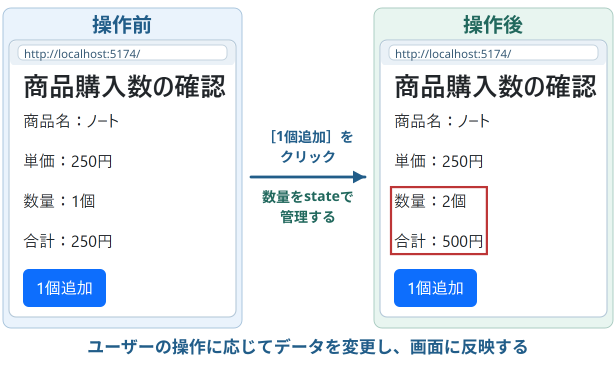
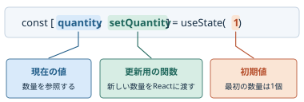
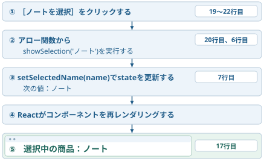
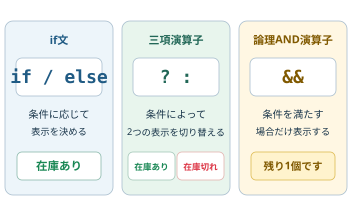
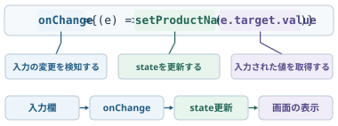
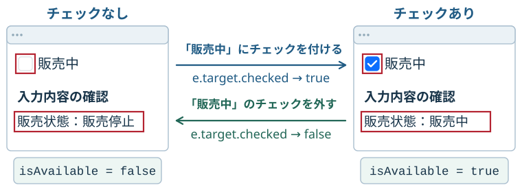
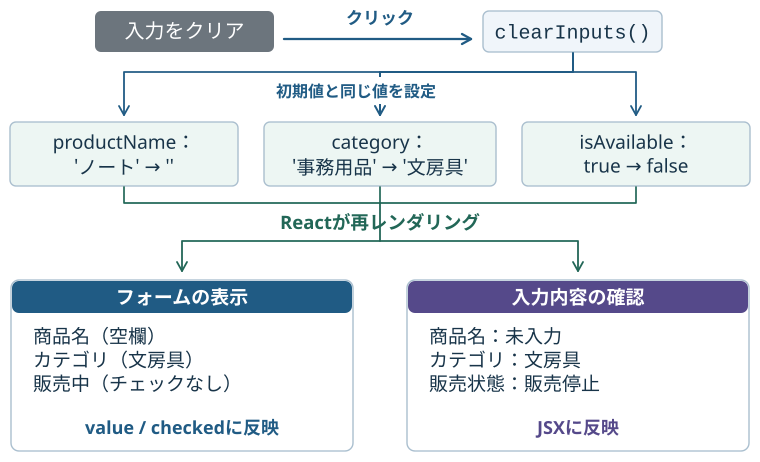

:::: {#page-1 .source-page}

::: {#ch02-number .paragraph}
2
:::

::: {#ch02-title .heading}
第2章 Reactによる画面表示と入力処理
:::

::: {#ch02-goals .heading}
章の目標
:::

::: {#ch02-goal-1 .paragraph}
◼ ReactのコンポーネントとJSXの基本的な書き方を理解し、画面を作成できる
:::

::: {#ch02-goal-2 .paragraph}
◼ JSXで変数や計算結果を表示し、HTML属性に値を設定できる
:::

::: {#ch02-goal-3 .paragraph}
◼ `useState`を使って状態を管理し、値の変更を画面に反映できる
:::

::: {#ch02-goal-4 .paragraph}
◼ イベント処理と条件分岐を使って、ユーザーの操作に応じた表示を実装できる
:::

::: {#ch02-goal-5 .paragraph}
◼ 配列データを一覧表示できる
:::

::: {#ch02-goal-6 .paragraph}
◼ フォームの入力値を状態と連動させ、画面に表示できる
:::

::::

:::: {#page-2 .source-page}

::: {#ch02-overview-title .heading}
章の概要
:::

::: {#ch02-overview-slide .slide layout="summary"}
章の概要

■ ReactコンポーネントとJSXの基本

■ JSXによるデータ表示と属性の設定

■ 状態の管理（useState）

■ イベント処理

■ 条件に応じた表示

■ 配列データの一覧表示

■ フォーム入力と状態の連動
:::

::: {#ch02-overview-1 .paragraph}
この章では、Reactで画面を作成し、ユーザーの操作に応じて表示を変更するための基本構文を学習します。
:::

::: {#ch02-overview-2 .paragraph}
最初に、Reactの画面を構成する「コンポーネント」と、HTMLに似た記述方法である「JSX」の基本を確認します。続いて、変数や計算結果を画面に表示する方法と、画像のパスやCSSのクラスなどを属性に設定する方法を学びます。
:::

::: {#ch02-overview-3 .paragraph}
次に、`useState`を使用して画面の状態を管理し、ボタンのクリックなどのイベントに応じてデータと表示を更新する方法を学習します。さらに、条件に応じた表示の切り替えや、配列データの一覧表示にも取り組みます。
:::

::: {#ch02-overview-4 .paragraph}
最後に、フォームに入力された値をReactの状態と連動させ、入力内容を画面へ反映する方法を学びます。
:::

::: {#ch02-overview-5 .paragraph}
本章では、まず1つのコンポーネントで基本構文を学習します。複数のコンポーネントの連携や画面遷移については、後続の章で扱います。
:::

::::

:::: {#page-3 .source-page}
::: {#ch02-jsx-intro-title .heading}
2.1. ReactコンポーネントとJSXの基本
:::

::: {#ch02-jsx-intro-slide .slide layout="illustration"}
ReactコンポーネントとJSXの基本


:::

::: {#ch02-21-heading-01 .heading level="minor"}
Reactコンポーネントとは
:::

::: {#ch02-21-paragraph-01 .paragraph}
第1章では、`App.tsx` に記述された変数の値を変更すると、ブラウザーの表示も変わることを確認しました。
:::

::: {#ch02-21-paragraph-02 .paragraph}
この章では、Reactで画面を作成するための基本構文を学習します。まずは、Reactの画面がどのような仕組みで作られているのかを確認しましょう。
:::

::: {#ch02-21-paragraph-03 .paragraph punctuation-font="inherit"}
Reactでは、画面を **コンポーネント（Component）** という部品に分けて作成できます。
:::

::: {#ch02-21-paragraph-04 .paragraph}
例えば、商品管理システムの画面は、ヘッダー、サイドメニュー、商品一覧、フッターなど、複数の部分から構成されています。これらをそれぞれコンポーネントとして作成し、組み合わせることで、1つの画面を構築できます。
:::

::: {#ch02-21-paragraph-05 .paragraph}
Reactでは、コンポーネントをJavaScriptやTypeScriptの関数として定義できます。また、画面の内容を記述する際には、HTMLに似た **JSX** という構文を使用します。
:::

::: {#ch02-21-paragraph-06 .paragraph}
本章では、まず1つのコンポーネントを使って、画面を作成するための基本構文を学習します。複数のコンポーネントに分割し、組み合わせて使用する方法は、第3章で学習します。
:::
::::

:::: {#page-4 .source-page}
::: {#ch02-21-heading-02 .heading level="minor"}
【サンプル】関数コンポーネントで画面を表示する
:::

::: {#ch02-21-paragraph-07 .paragraph}
第1章で使用した `App.tsx` も、Reactのコンポーネントです。
:::

::: {#ch02-21-paragraph-08 .paragraph}
第1章では、変数の値を変更して画面への反映を確認しました。今回は、同じソースコードを使用して、コンポーネントの基本的な構成とJSXの書き方を学習します。
:::

::: {#ch02-21-code-01 .code filename="ch01-setup/src/App.tsx"}
~~~tsx
export default function App() {
  // 画面に表示するデータ
  const courseName = 'React開発入門'
  const message = 'Reactの動作確認をしています'
  const lessonNumber = 1

  return (
    <main>
      <h1>{courseName}</h1>
      <p>{message}</p>
      <p>現在の学習：第{lessonNumber}章</p>
    </main>
  )
}
~~~
:::

::: {#ch02-21-paragraph-09 .paragraph}
このソースコードは、大きく次の3つの部分に分けられます。
:::

::: {#ch02-21-paragraph-10 .paragraph}
● コンポーネントとなる関数を定義する部分
:::

::: {#ch02-21-paragraph-11 .paragraph}
● 画面に表示するデータを変数として定義する部分
:::

::: {#ch02-21-paragraph-12 .paragraph}
● 画面に表示する内容を返す部分
:::

::: {#ch02-21-paragraph-13 .paragraph}
それぞれの部分について、順番に確認していきましょう。
:::
::::

:::: {#page-5 .source-page}
::: {#ch02-21-heading-03 .heading level="minor"}
構文の解説
:::

::: {#ch02-21-step-01 .step}
**① コンポーネントを定義する**
:::

::: {#ch02-21-code-02 .code filename="ch01-setup/src/App.tsx"}
~~~tsx
export default function App() {
~~~
:::

::: {#ch02-21-paragraph-14 .paragraph}
`function App()` は、`App` という名前の関数を定義するための記述です。
:::

::: {#ch02-21-paragraph-15 .paragraph}
Reactでは、このように関数を使ってコンポーネントを作成できます。関数の中に画面の内容を記述し、Reactがその関数を呼び出すことで、画面を表示するために必要な情報を取得します。
:::

::: {#ch02-21-paragraph-16 .paragraph}
このように、**関数として定義されたコンポーネントを関数コンポーネント**と呼びます。
:::

::: {#ch02-21-paragraph-17 .paragraph}
コンポーネント名には、1つ注意すべきルールがあります。HTML要素と区別するために、**コンポーネント名の先頭は大文字**にします。
:::

::: {#ch02-21-paragraph-18 .paragraph}
例えば、JSXの中で次のように記述した場合、それぞれの意味は異なります。
:::

::: {#ch02-21-table-01 .table}
| 記述 | 意味 |
|---|---|
| `<App />` | 自分で定義した `App` コンポーネントを使用する |
| `<main>` | HTMLの `main` 要素を使用する |
:::

::: {#ch02-21-paragraph-19 .paragraph}
`App` を使用するつもりで `<app />` と記述しても、Reactは `App` 関数を呼び出すための記述として扱いません。
:::

::: {#ch02-21-paragraph-20 .paragraph}
また、1行目にある `export default` は、**別のファイルからこのコンポーネントを読み込んで使用できるようにする**ための記述です。
:::

::: {#ch02-21-paragraph-21 .paragraph}
実際に、第1章の `main.tsx` では、次のように `App` コンポーネントを読み込んで使用しています。
:::

::: {#ch02-21-code-03 .code filename="ch01-setup/src/main.tsx"}
~~~tsx
2:import App from './App'
7:  createRoot(root).render(<App />)
~~~
:::

::: {#ch02-21-paragraph-22 .paragraph}
`import App from './App'` で、同じフォルダーにある `App.tsx` からコンポーネントを読み込んでいます。そして、`render(<App />)` によって、Reactに `App` コンポーネントの表示を指示しています。
:::
::::

:::: {#page-6 .source-page}
::: {#ch02-21-step-02 .step}
**② 画面に表示するデータを変数として定義する**
:::

::: {#ch02-21-code-04 .code filename="ch01-setup/src/App.tsx" start-line="3"}
~~~tsx
  const courseName = 'React開発入門'
  const message = 'Reactの動作確認をしています'
  const lessonNumber = 1
~~~
:::

::: {#ch02-21-paragraph-23 .paragraph}
Reactのコンポーネント内では、通常のJavaScriptやTypeScriptと同じように、変数の宣言や計算、条件分岐などを記述できます。
:::

::: {#ch02-21-paragraph-24 .paragraph}
今回のサンプルでは、画面に表示するデータを、次の3つの変数に格納しています。
:::

::: {#ch02-21-paragraph-25 .paragraph}
● `courseName`：講座名
:::

::: {#ch02-21-paragraph-26 .paragraph}
● `message`：案内文
:::

::: {#ch02-21-paragraph-27 .paragraph}
● `lessonNumber`：現在学習している章の番号
:::

::: {#ch02-21-paragraph-28 .paragraph}
このように、**画面に表示するデータと、画面の構成を記述するJSXを分けて管理できます。**
:::

::: {#ch02-21-paragraph-29 .paragraph}
例えば、`lessonNumber` の値を2に変更して保存すると、JSXの記述を変更しなくても、「現在の学習：第2章」と表示されます。
:::

::: {#ch02-21-step-03 .step}
**③ JSXを使用して画面に表示する内容を返す**
:::

::: {#ch02-21-code-05 .code filename="ch01-setup/src/App.tsx" start-line="7"}
~~~tsx
  return (
    <main>
      <h1>{courseName}</h1>
      <p>{message}</p>
      <p>現在の学習：第{lessonNumber}章</p>
    </main>
  )
~~~
:::

::: {#ch02-21-paragraph-30 .paragraph}
JavaScriptやTypeScriptの `return` は、関数の戻り値を指定するための構文です。
:::

::: {#ch02-21-paragraph-31 .paragraph}
Reactの関数コンポーネントでは、**`return` で画面に表示する内容を返します。** Reactは、関数コンポーネントから返された内容をもとに、ブラウザーの画面を構成します。
:::

::: {#ch02-21-paragraph-32 .paragraph}
ここで、`return` の後ろに記述されているコードに注目してください。`<h1>` や `<p>` など、HTMLに似たタグが使われています。
:::

::: {#ch02-21-paragraph-33 .paragraph punctuation-font="inherit"}
このように、**JavaScriptの中にHTMLに似た記述を書くための構文を、JSX（JavaScript XML）と呼びます。**
:::

::: {#ch02-21-paragraph-34 .paragraph}
本研修ではTypeScriptを使用しているため、JSXを含むファイルの拡張子には `.tsx` を使用します。
:::

::: {#ch02-21-paragraph-35 .paragraph}
また、JSXの中では、変数の値を画面に表示できます。
:::

::: {#ch02-21-paragraph-36 .paragraph}
例えば、9行目の `<h1>{courseName}</h1>` では、`courseName` を波括弧 `{ }` で囲んでいます。そのため、見出しには変数名ではなく、変数に格納されている「React開発入門」という文字列が表示されます。
:::

::: {#ch02-21-paragraph-37 .paragraph}
10行目の案内文、11行目の章番号についても、同じ仕組みで変数の値を表示しています。
:::

{#ch02-component-code}

::: {#ch02-component-code-caption .paragraph}
App.tsxの3つの部分と、ブラウザーの表示内容
:::

::: {#ch02-21-paragraph-38 .paragraph}
このように、関数の中でデータを用意し、JSXを使って画面の内容を記述することが、Reactによる画面作成の基本です。
:::

::: {#ch02-21-paragraph-39 .paragraph}
JSXで変数や計算結果を表示する方法については、次の2.2節で詳しく学習します。
:::
::::

:::: {#page-7 .source-page}
::: {#ch02-21-heading-04 .heading level="minor"}
JSXとHTMLの主な違い
:::

::: {#ch02-21-paragraph-40 .paragraph}
JSXはHTMLに似ていますが、HTMLとまったく同じ書き方ができるわけではありません。
:::

::: {#ch02-21-paragraph-41 .paragraph}
Reactで画面を作成する際には、特に次の3つのルールを覚えておきましょう。
:::

::: {#ch02-21-step-04 .step}
**① 複数のJSX要素を1つにまとめる**
:::

::: {#ch02-21-paragraph-42 .paragraph}
関数コンポーネントの `return` に複数のJSX要素を並べて記述する場合は、それらを1つにまとめる必要があります。
:::

::: {#ch02-21-paragraph-43 .paragraph}
例えば、見出しと案内文を表示するために、次のように記述したとします。
:::

::: {#ch02-21-step-05 .step keep-next="1"}
**誤った例**
:::

::: {#ch02-21-code-06 .code example="true" highlight-lines="2-3"}
~~~tsx
return (
  <h1>商品管理システム</h1>
  <p>商品一覧を表示します</p>
)
~~~
:::

::: {#ch02-21-paragraph-44 .paragraph}
このコードでは、`<h1>` と `<p>` がそれぞれ独立した要素として並んでいるため、構文エラーになります。通常のHTMLではこのような書き方ができますが、JSXではそのまま `return` で返すことはできません。
:::

::: {#ch02-21-paragraph-45 .paragraph}
なお、外側にある丸括弧 `( )` は、複数行にわたる式を記述するためのものです。丸括弧で囲んだだけでは、2つのJSX要素を1つにまとめたことにはなりません。
:::

::: {#ch02-21-paragraph-46 .paragraph}
このような場合は、次のように `<main>` などの親要素で囲みます。
:::

::: {#ch02-21-step-06 .step keep-next="1"}
**正しい例**
:::

::: {#ch02-21-code-07 .code example="true" highlight-lines="2,5"}
~~~tsx
return (
  <main>
    <h1>商品管理システム</h1>
    <p>商品一覧を表示します</p>
  </main>
)
~~~
:::

::: {#ch02-21-paragraph-47 .paragraph}
これで、`<main>` を親要素として、その中に見出しと案内文を配置できました。
:::

::: {#ch02-21-paragraph-48 .paragraph}
先ほどの `App.tsx` でも、見出しと2つの段落を `<main>` で囲んでいます。
:::
::::

:::: {#page-8 .source-page}
::: {#ch02-21-step-07 .step punctuation-font="inherit"}
**フラグメント（Fragment）を使用する場合**
:::

::: {#ch02-21-paragraph-49 .paragraph}
画面の構成によっては、複数の要素をまとめたいだけで、新たなHTML要素を追加する必要がない場合もあります。
:::

::: {#ch02-21-paragraph-50 .paragraph}
そのような場合は、次のように `<>` と `</>` で囲むことができます。
:::

::: {#ch02-21-code-08 .code example="true" highlight-lines="2,5"}
~~~tsx
return (
  <>
    <h1>商品管理システム</h1>
    <p>商品一覧を表示します</p>
  </>
)
~~~
:::

::: {#ch02-21-paragraph-51 .paragraph punctuation-font="inherit"}
この記述を **フラグメント（Fragment）** と呼びます。
:::

::: {#ch02-21-paragraph-52 .paragraph}
フラグメントを使用すると、複数のJSX要素を1つにまとめることができます。ただし、ブラウザーのHTMLには、フラグメントに相当する親要素は追加されません。
:::

::: {#ch02-21-step-08 .step}
**② タグは必ず閉じる**
:::

::: {#ch02-21-paragraph-53 .paragraph}
通常のHTMLでは、`` や `<input>` など、終了タグを記述しない要素があります。
:::

::: {#ch02-21-paragraph-54 .paragraph}
一方、**JSXではすべてのタグを閉じる必要があります。** `img` や `input` のように内容を持たない要素は、タグの末尾を `/>` と記述します。
:::

::: {#ch02-21-table-02 .table}
| HTML | JSX |
|---|---|
| `` | `` |
| `<input type="text">` | `<input type="text" />` |
| `<br>` | `<br />` |
:::

::: {#ch02-21-paragraph-55 .paragraph}
通常のHTMLと同じように `` と記述すると、JSXではタグが閉じられていないため、構文エラーになります。
:::

::: {#ch02-21-paragraph-56 .paragraph}
なお、`<h1>` や `<p>` のように内容を記述する要素は、通常のHTMLと同じように `</h1>` や `</p>` で閉じます。
:::
::::

:::: {#page-9 .source-page}
::: {#ch02-21-step-09 .step}
**③ CSSのクラスを指定する際はclassNameを使用する**
:::

::: {#ch02-21-paragraph-57 .paragraph}
JSXでは、一部のHTML属性の名前が異なります。代表的なものが、CSSのクラスを指定する `class` 属性です。
:::

::: {#ch02-21-paragraph-58 .paragraph}
通常のHTMLでは、次のように記述します。
:::

::: {#ch02-21-code-09 .code example="true" highlight-tokens="class"}
~~~html
<p class="text-primary">こんにちは</p>
~~~
:::

::: {#ch02-21-paragraph-59 .paragraph}
同じCSSのクラスをJSXで指定する場合は、次のように記述します。
:::

::: {#ch02-21-code-10 .code example="true" highlight-tokens="className"}
~~~tsx
<p className="text-primary">こんにちは</p>
~~~
:::

::: {#ch02-21-paragraph-60 .paragraph}
このように、**JSXでは `class` ではなく `className` を使用します。**
:::

::: {#ch02-21-paragraph-61 .paragraph}
Reactが画面に反映する際には、指定したクラスがHTMLの `class` 属性として設定されます。
:::

::: {#ch02-21-paragraph-62 .paragraph}
`className` を使って画面のデザインを設定する方法は、次の2.2節で学習します。
:::

::: {#ch02-21-heading-05 .heading level="minor"}
【確認演習】変数をJSXに表示する
:::

::: {#ch02-21-paragraph-63 .paragraph}
関数コンポーネント内にあらかじめ定義されている変数を使用して、社員管理システムの見出しと案内文を表示します。
:::

::: {#ch02-21-paragraph-64 .paragraph numbered="true"}
1．`ch02-basic-q` プロジェクトの `src/components/Q2_1.tsx` を開いてください。
:::

::: {#ch02-21-paragraph-65 .paragraph numbered="true"}
2．コード内の➀～➂の番号付きコメントを確認し、指示された箇所を実装してください。コメントに指定されていないコードや、ほかのファイルは変更する必要はありません。
:::

::: {#ch02-21-paragraph-66 .paragraph numbered="true"}
3．編集したファイルを保存してください。
:::

::: {#ch02-21-paragraph-67 .paragraph numbered="true"}
4．初回は `ch02-basic-q` フォルダーで `npm install` を実行してください。1.5節と同じ手順で開発サーバーを起動し、ターミナルに表示されたURLを開いてください。すでに開発サーバーを起動している場合は、ブラウザーの画面に戻ってください。
:::

::: {#ch02-21-paragraph-68 .paragraph numbered="true"}
5．メニューから「2.1 ReactコンポーネントとJSXの基本」を選択してください。
:::
::::

:::: {#page-11 .source-page}
::: {#ch02-21-heading-06 .heading level="minor"}
動作確認
:::

::: {#ch02-21-paragraph-69 .paragraph numbered="true"}
6．次の図と見比べながら、見出しと案内文が正しく表示されていることを確認してください。
:::

{#ch02-app-exercise-result}

::: {#ch02-app-exercise-result-caption .paragraph}
確認演習の実装後に表示される社員管理システムの画面
:::

::: {#ch02-21-paragraph-70 .paragraph}
見出しに「社員管理システム」、案内文に「社員情報を確認できます。」と表示されていれば、演習完了です。
:::

::: {#ch02-21-paragraph-71 .paragraph}
画面に変更が反映されない場合は、ブラウザーの画面を再読み込みして、もう一度確認してください。
:::

::: {#ch02-21-section-points-01 .section-points}
この節のポイント

● Reactでは、画面をコンポーネントという部品に分けて作成できる。

● 関数コンポーネントは関数として定義し、`return` で画面に表示する内容を返す。

● コンポーネント名の先頭は大文字にする。

● JSXは、JavaScriptの中にHTMLに似た記述を書くための構文である。

● JSXでは、複数の要素を1つにまとめて返し、タグを必ず閉じる。

● JSXでCSSのクラスを指定する際は、`className` を使用する。
:::
::::

:::: {#page-12 .source-page}
::: {#ch02-values-title .heading}
2.2. JSXによるデータ表示と属性の設定
:::

::: {#ch02-values-slide .slide layout="illustration"}
JSXによるデータ表示と属性の設定


:::

::: {#ch02-22-heading-01 .heading level="minor"}
JSXでJavaScriptの値を使用する
:::

::: {#ch02-22-paragraph-01 .paragraph}
前節では、JSXの中に `{変数名}` と記述すると、変数に格納されている値を画面に表示できることを学習しました。
:::

::: {#ch02-22-paragraph-02 .paragraph}
実際のWebアプリケーションでは、変数の値をそのまま表示するだけでなく、データをもとにさまざまな情報を表示する必要があります。
:::

::: {#ch02-22-paragraph-03 .paragraph}
例えば、ショッピングサイトの商品情報画面では、次のような処理が必要になります。
:::

::: {#ch02-22-paragraph-04 .paragraph}
● 商品データから商品名や単価を取得して表示する。
:::

::: {#ch02-22-paragraph-05 .paragraph}
● 商品の単価と数量から合計金額を計算して表示する。
:::

::: {#ch02-22-paragraph-06 .paragraph}
● 商品ごとに異なる画像を表示する。
:::

::: {#ch02-22-paragraph-07 .paragraph}
JSXでは、変数だけでなく、計算結果やオブジェクトのプロパティなども画面に表示できます。また、画像のパスやCSSのクラスなど、**HTML要素の属性にもJavaScriptの値を設定できます。**
:::

::: {#ch02-22-paragraph-08 .paragraph}
この節では、商品情報を表示するサンプルを使って、これらの記述方法を学習します。
:::
::::

:::: {#page-13 .source-page}
::: {#ch02-22-heading-02 .heading level="minor"}
【サンプル】商品情報を表示する
:::

::: {#ch02-22-paragraph-09 .paragraph}
今回は、商品名・単価・画像のパスを1つのオブジェクトとして管理し、それらの情報を画面に表示します。
:::

::: {#ch02-22-paragraph-10 .paragraph}
商品の数量は2個とし、単価と数量から合計金額を求めます。また、Bootstrapを使用して、合計金額を青い太字で表示します。
:::

::: {#ch02-22-code-01 .code filename="ch02-basic/src/components/Sample2_2.tsx"}
~~~tsx
export default function Sample2_2() {
  // 商品情報
  const product = {
    name: 'ノート',
    price: 250,
    imagePath: '/images/notebook.png'
  }

  // 数量とデザイン
  const quantity = 2
  const totalClass = 'text-primary fw-bold'

  return (
    <main className="container mt-4">
      <h1>商品情報</h1>

      

      <p>商品名：{product.name}</p>
      <p>単価：{product.price}円</p>
      <p>数量：{quantity}個</p>

      <p className={totalClass}>
        合計：{product.price * quantity}円
      </p>
    </main>
  )
}
~~~
:::
::::

:::: {#page-14 .source-page}
::: {#ch02-22-paragraph-11 .paragraph}
配布サンプルの `ch02-basic` フォルダーで、初回は `npm install` を実行してください。1.5節と同じ手順で開発サーバーを起動し、ブラウザーのメニューから「2.2 JSXによるデータ表示と属性の設定」を選択してください。
:::

::: {#ch02-22-paragraph-12 .paragraph}
次のように、商品情報と合計金額が表示されます。
:::

{#ch02-product-display}

::: {#ch02-product-display-caption .paragraph}
商品情報を表示する完成サンプル
:::

::: {#ch02-22-heading-03 .heading level="minor"}
構文の解説
:::

::: {#ch02-22-step-01 .step}
**① オブジェクトのプロパティや変数の値を表示する**
:::

::: {#ch02-22-paragraph-13 .paragraph}
商品名や単価など、関連する複数のデータを管理する場合には、JavaScriptのオブジェクトを使用できます。
:::

::: {#ch02-22-paragraph-14 .paragraph}
今回のサンプルでは、商品情報を次のように `product` というオブジェクトにまとめています。また、商品の数量は `quantity` という変数に格納しています。
:::

::: {#ch02-22-code-02 .code filename="ch02-basic/src/components/Sample2_2.tsx"}
~~~tsx
3:  const product = {
4:    name: 'ノート',
5:    price: 250,
6:    imagePath: '/images/notebook.png'
7:  }
10:  const quantity = 2
~~~
:::
::::

:::: {#page-15 .source-page}
::: {#ch02-22-paragraph-15 .paragraph}
オブジェクトには、プロパティ名と値の組み合わせを記述します。例えば、`name: 'ノート'` では、`name` というプロパティに「ノート」という文字列を設定しています。
:::

::: {#ch02-22-paragraph-16 .paragraph}
オブジェクトから値を取得する場合は、`オブジェクト名.プロパティ名` の形式で記述します。今回の `product` では、次のように値を取得できます。
:::

::: {#ch02-22-table-01 .table}
| 記述 | 取得できる値 | 意味 |
|---|---|---|
| `product.name` | `'ノート'` | 商品名 |
| `product.price` | `250` | 単価 |
| `product.imagePath` | `'/images/notebook.png'` | 商品画像のパス |
:::

::: {#ch02-22-paragraph-17 .paragraph}
次に、取得した値を画面に表示する部分を確認しましょう。
:::

::: {#ch02-22-code-03 .code filename="ch02-basic/src/components/Sample2_2.tsx" start-line="23"}
~~~tsx
      <p>商品名：{product.name}</p>
      <p>単価：{product.price}円</p>
      <p>数量：{quantity}個</p>
~~~
:::

::: {#ch02-22-paragraph-18 .paragraph}
前節と同じように、表示したい値を波括弧 `{ }` で囲んでいます。
:::

::: {#ch02-22-paragraph-19 .paragraph}
例えば、23行目の `{product.name}` では、`product` オブジェクトの `name` プロパティから取得した値が使用されます。その結果、画面には「商品名：ノート」と表示されます。
:::

::: {#ch02-22-paragraph-20 .paragraph}
24行目では単価を、25行目では数量を表示しています。「単価：」や「円」のように、波括弧の外に記述した文字は、そのまま表示されます。
:::

::: {#ch02-22-table-02 .table}
| JSXの記述 | 画面に表示される内容 |
|---|---|
| `商品名：{product.name}` | 商品名：ノート |
| `単価：{product.price}円` | 単価：250円 |
| `数量：{quantity}個` | 数量：2個 |
:::

::: {#ch02-22-paragraph-21 .paragraph}
このように、**JSXの波括弧 `{ }` の中には、JavaScriptの式を記述できます。**
:::

::: {#ch02-22-paragraph-22 .paragraph}
例えば、`product.name` はオブジェクトのプロパティの値を取得する式です。波括弧で囲むことで、その式から得られた値をJSXの中で使用できます。
:::

::: {#ch02-22-paragraph-23 .paragraph}
なお、`if` 文や `for` 文のように、処理の流れを制御する文を波括弧の中にそのまま記述することはできません。条件に応じた表示や繰り返し表示の方法については、後続の節で学習します。
:::
::::

:::: {#page-16 .source-page}
::: {#ch02-22-step-02 .step}
**② 計算結果を画面に表示する**
:::

::: {#ch02-22-paragraph-24 .paragraph}
JSXの波括弧 `{ }` の中には、変数やオブジェクトのプロパティだけでなく、計算式も記述できます。
:::

::: {#ch02-22-paragraph-25 .paragraph}
今回のサンプルでは、商品の合計金額を次のように表示しています。
:::

::: {#ch02-22-code-04 .code filename="ch02-basic/src/components/Sample2_2.tsx" start-line="28"}
~~~tsx
        合計：{product.price * quantity}円
~~~
:::

::: {#ch02-22-paragraph-26 .paragraph}
`product.price` は商品の単価、`quantity` は商品の数量です。これらを `*`（掛け算）で結ぶことで、合計金額を求めています。
:::

::: {#ch02-22-paragraph-27 .paragraph}
今回の商品は単価250円、数量2個なので、計算結果は500となります。そのため、画面には「合計：500円」と表示されます。
:::

{#ch02-calculation-diagram}

::: {#ch02-calculation-diagram-caption .paragraph}
単価と数量から合計金額を計算して表示する
:::

::: {#ch02-22-paragraph-28 .paragraph}
このように、**JSXの中で直接計算できるため、計算結果をあらかじめ別の変数に格納しなくても表示できます。**
:::

::: {#ch02-22-step-03 .step}
**③ HTML要素の属性に値を設定する**
:::

::: {#ch02-22-paragraph-29 .paragraph}
ここまでは、`<p>` などの要素の中に、JavaScriptの値を表示する方法を確認しました。
:::

::: {#ch02-22-paragraph-30 .paragraph}
JSXでは、要素の中に表示する内容だけでなく、`src` や `alt` などの属性にもJavaScriptの値を設定できます。
:::
::::

:::: {#page-17 .source-page}
::: {#ch02-22-paragraph-31 .paragraph}
例えば、通常のHTMLでノートの画像を表示する場合は、次のように記述します。
:::

::: {#ch02-22-code-05 .code example="true" highlight-tokens="\"/images/notebook.png\"|\"ノート\""}
~~~html

~~~
:::

::: {#ch02-22-paragraph-32 .paragraph}
このコードでは、`src` 属性に画像のパスを、`alt` 属性に画像の代替テキストを直接指定しています。
:::

::: {#ch02-22-paragraph-33 .paragraph}
一方、今回のReactのサンプルでは、これらの情報を `product` オブジェクトに格納しています。オブジェクトに格納された値を属性に設定する場合は、次のように記述します。
:::

::: {#ch02-22-code-06 .code filename="ch02-basic/src/components/Sample2_2.tsx" start-line="17"}
~~~tsx
      
~~~
:::

::: {#ch02-22-paragraph-34 .paragraph}
18行目の `src={product.imagePath}` では、`product.imagePath` から取得した画像のパスを `src` 属性に設定しています。今回の場合は `/images/notebook.png` が設定されるため、ノートの画像が表示されます。
:::

::: {#ch02-22-paragraph-35 .paragraph}
19行目の `alt={product.name}` では、商品名の「ノート」を代替テキストとして設定しています。
:::

::: {#ch02-22-paragraph-36 .paragraph}
また、20行目の `width={180}` では、画像の表示幅を180ピクセルに指定しています。
:::

::: {#ch02-22-paragraph-37 .paragraph}
ここで重要なのは、**属性に固定の文字列を指定する場合と、JavaScriptの値を指定する場合では、書き方が異なる**という点です。
:::

::: {#ch02-22-table-03 .table}
| 記述 | 意味 |
|---|---|
| `src="/images/notebook.png"` | 固定の文字列を画像のパスに指定する |
| `src={product.imagePath}` | プロパティから取得した値を画像のパスに指定する |
| `alt={product.name}` | プロパティから取得した値を代替テキストに指定する |
| `width={180}` | 数値の180を画像の表示幅に指定する |
:::
::::

::::: {#page-18 .source-page}
::: {#ch02-22-paragraph-38 .paragraph}
固定の文字列を指定する場合は引用符 `" "` で囲み、JavaScriptの式を指定する場合は波括弧 `{ }` で囲みます。
:::

::: {#ch02-22-paragraph-39 .paragraph}
例えば、次のように波括弧の外側を引用符で囲むと、`{product.imagePath}` という文字列そのものが画像のパスとして設定されます。そのため、目的の画像を読み込むことができません。
:::

::: {#ch02-22-step-04 .step keep-next="1"}
**誤った例**
:::

::: {#ch02-22-code-07 .code example="true" highlight-tokens="\"{product.imagePath}\""}
~~~tsx

~~~
:::

::: {#ch02-22-step-05 .step keep-next="1"}
**正しい例**
:::

::: {#ch02-22-code-08 .code example="true" highlight-tokens="src={product.imagePath}"}
~~~tsx

~~~
:::

{#ch02-image-path-result}

::: {#ch02-image-path-result-caption .paragraph}
オブジェクトに格納した画像のパスをsrc属性に設定する流れ
:::

::: {#ch02-22-paragraph-40 .paragraph}
このように、商品情報をオブジェクトとして管理しておけば、商品ごとに異なる画像や代替テキストを、同じJSXの記述で設定できます。
:::

:::: {#ch02-22-training-note-01 .training-note}
**【補足】画像ファイルの配置**

今回使用する `notebook.png` は、配布サンプルの `public/images` フォルダーに用意されています。

Viteでは、`public` フォルダー内のファイルを、サイトのルートを基準としたパスで参照できます。そのため、今回の画像は `/images/notebook.png` と指定します。画像のパスに `public` を含める必要はありません。
::::
:::::

::::: {#page-19 .source-page}
::: {#ch02-22-step-06 .step}
**④ classNameによるデザインの設定**
:::

::: {#ch02-22-paragraph-41 .paragraph}
前節では、JSXでCSSのクラスを指定する際に、`className` を使用することを学習しました。
:::

::: {#ch02-22-paragraph-42 .paragraph}
本研修では、画面のデザインを簡単に整えるために、Bootstrapを使用します。
:::

::: {#ch02-22-paragraph-43 .paragraph}
例えば、合計金額を青い太字で表示するには、次のように記述できます。
:::

::: {#ch02-22-code-09 .code example="true"}
~~~tsx
<p className="text-primary fw-bold">合計：500円</p>
~~~
:::

::: {#ch02-22-paragraph-44 .paragraph}
`text-primary` と `fw-bold` は、Bootstrapが用意しているCSSのクラスです。
:::

::: {#ch02-22-table-04 .table}
| クラス名 | 役割 |
|---|---|
| `text-primary` | 文字色を青色にする（今回のBootstrapの設定の場合） |
| `fw-bold` | 文字を太字にする |
:::

::: {#ch02-22-paragraph-45 .paragraph}
複数のクラスを使用する場合は、空白で区切って指定します。これにより、2つのクラスが同じ要素に適用され、合計金額が青い太字で表示されます。
:::

::: {#ch02-22-paragraph-46 .paragraph}
また、`className` 属性にもJavaScriptの変数を使用できます。
:::

::: {#ch02-22-paragraph-47 .paragraph}
今回のサンプルでは、11行目でクラス名を変数に格納し、27行目でその変数の値を使用しています。
:::

::: {#ch02-22-code-10 .code filename="ch02-basic/src/components/Sample2_2.tsx"}
~~~tsx
11:  const totalClass = 'text-primary fw-bold'
27:      <p className={totalClass}>
28:        合計：{product.price * quantity}円
29:      </p>
~~~
:::

::: {#ch02-22-paragraph-48 .paragraph}
`className={totalClass}` と記述することで、変数 `totalClass` に格納されている `text-primary fw-bold` がCSSのクラスとして設定されます。
:::

::: {#ch02-22-paragraph-49 .paragraph}
クラス名を直接指定した場合も、変数の値を指定した場合も、適用されるCSSのクラスは同じです。
:::

::: {#ch02-22-paragraph-50 .paragraph}
ただし、`className="totalClass"` と記述すると、変数の値ではなく「totalClass」という固定の文字列を指定したことになります。
:::

::: {#ch02-22-paragraph-51 .paragraph}
このように、**CSSのクラスを変数で指定する場合も、波括弧 `{ }` を使用します。**
:::

::: {#ch02-22-paragraph-52 .paragraph}
データの値に応じて文字色やデザインを切り替える場合にも、この書き方を活用できます。条件によってデザインを切り替える方法は、2.5節で学習します。
:::

:::: {#ch02-22-training-note-02 .training-note}
**【補足】BootstrapのCSSの読み込み**

Bootstrapをインストールしただけでは、画面にBootstrapのデザインは適用されません。BootstrapのCSSを読み込む必要があります。

本研修の配布サンプルでは、`main.tsx` に次の記述を用意しています。

~~~{#ch02-22-code-11 .tsx filename="ch02-basic/src/main.tsx" start-line="3"}
import 'bootstrap/dist/css/bootstrap.min.css'
~~~

この記述によってBootstrapのCSSが読み込まれ、`text-primary` や `fw-bold` などのクラスを画面のデザインに使用できます。

配布サンプルには、この設定があらかじめ記述されているため、受講者が追加する必要はありません。
::::
:::::

:::: {#page-20 .source-page}
::: {#ch02-22-heading-04 .heading level="minor"}
【確認演習】商品情報の表示と属性を設定する
:::

::: {#ch02-22-paragraph-53 .paragraph}
商品名・単価・画像のパス・数量などのデータをJSXに設定し、商品情報を表示する画面を作成します。
:::

::: {#ch02-22-paragraph-54 .paragraph}
商品データや数量、合計金額のデザインに使用するCSSのクラス名は、あらかじめ定義されています。これらの値を使用して、商品情報を正しく表示できるようにしましょう。
:::

::: {#ch02-22-paragraph-55 .paragraph numbered="true"}
1．`ch02-basic-q` プロジェクトの `src/components/Q2_2.tsx` を開いてください。
:::

::: {#ch02-22-paragraph-56 .paragraph numbered="true"}
2．コード内の➀～➃の番号付きコメントを確認し、指示された箇所を実装してください。コメントに指定されていないコードや、ほかのファイルは変更する必要はありません。
:::

::: {#ch02-22-paragraph-57 .paragraph numbered="true"}
3．編集したファイルを保存してください。
:::

::: {#ch02-22-paragraph-58 .paragraph numbered="true"}
4．`ch02-basic-q` の開発サーバーを起動し、ターミナルに表示されたURLを開いてください。すでに開発サーバーを起動している場合は、ブラウザーの画面に戻ってください。
:::

::: {#ch02-22-paragraph-59 .paragraph numbered="true"}
5．メニューから「2.2 JSXによるデータ表示と属性の設定」を選択してください。
:::

::: {#ch02-22-heading-05 .heading level="minor"}
動作確認
:::

::: {#ch02-22-paragraph-60 .paragraph numbered="true"}
6．次の図と見比べながら、商品情報が正しく表示されていることを確認してください。
:::

{#ch02-product-exercise-result}

::: {#ch02-product-exercise-result-caption .paragraph}
確認演習の実装後に表示される商品情報
:::

::: {#ch02-22-paragraph-61 .paragraph keep-next="3"}
次の3点を確認できれば、演習完了です。
:::

::: {#ch02-22-paragraph-62 .paragraph}
● ノートの画像が表示されている。
:::

::: {#ch02-22-paragraph-63 .paragraph}
● 商品名が「ノート」、単価が300円、数量が3個と表示されている。
:::

::: {#ch02-22-paragraph-64 .paragraph}
● 合計金額が **青い太字で900円** と表示されている。
:::

::: {#ch02-22-paragraph-65 .paragraph}
画面に変更が反映されない場合は、ブラウザーの画面を再読み込みして、もう一度確認してください。
:::

::: {#ch02-22-paragraph-66 .paragraph}
ここまでの演習では、ソースコードを編集して保存することで、画面の表示を変更しました。
:::

::: {#ch02-22-paragraph-67 .paragraph}
実際のWebアプリケーションでは、ボタンのクリックなどによって、プログラムの実行中にデータを変更し、その結果を画面に反映することも必要になります。
:::

::: {#ch02-22-paragraph-68 .paragraph}
次の2.3節では、そのための仕組みとして `useState` を学習します。
:::

::: {#ch02-22-section-points-01 .section-points}
この節のポイント

● JSXでは、波括弧 `{ }` を使用して、変数の値、オブジェクトのプロパティ、計算結果などを表示できる。

● JSXの波括弧の中にはJavaScriptの式を記述する。`if` 文や `for` 文をそのまま記述することはできない。

● 属性に固定の文字列を指定する場合は引用符、JavaScriptの値を指定する場合は波括弧を使用する。

● `src` や `className` などの属性にも、変数やオブジェクトのプロパティの値を設定できる。

● BootstrapのCSSのクラスを指定することで、文字色や文字の太さなどを簡単に設定できる。
:::
::::

:::: {#page-21 .source-page}

::: {#ch02-state-title .heading}
2.3. 状態の管理（useState）
:::

::: {#ch02-state-slide .slide layout="illustration"}
状態の管理（useState）


:::

::: {#ch02-state-definition .heading level="minor"}
操作に応じて画面を更新する
:::

::: {#ch02-state-intro-1 .paragraph}
前節では、その時点の数量と単価をもとに、合計金額をJSXで表示しました。この節では、商品の数量を操作で変え、その結果を画面に反映します。
:::

::: {#ch02-state-intro-2 .paragraph}
例えば、単価が250円の商品で［1個追加］を押すと、数量は1個から2個へ、合計は250円から500円へ変わります。次に押したときは、前回の数量を引き継いで計算する必要があります。
:::

::: {#ch02-state-intro-3 .paragraph}
Reactでは、こうした変化するデータを **状態（state、ステート）** として管理できます。商品の購入数を例に、`useState()` を使って値を記憶し、表示を更新する仕組みを学びます。
:::

::::

:::: {#page-22 .source-page}

::: {#ch02-state-sample .heading level="minor"}
【サンプル】useStateで商品の数量を変更する
:::

::: {#ch02-state-sample-intro .paragraph}
商品の数量をstateで管理し、［1個追加］ボタンをクリックするたびに数量と合計金額を更新するサンプルを確認しましょう。
:::

::: {#ch02-state-sample-source .code filename="ch02-basic/src/components/Sample2_3.tsx"}
```tsx
import { useState } from 'react'

export default function Sample2_3() {
  const productName = 'ノート'
  const price = 250
  //let quantity = 1
  const [quantity, setQuantity] = useState(1)

  const addOne = () => {
    //quantity = quantity + 1
    setQuantity(quantity + 1)
  }

  return (
    <main className="container mt-4">
      <h1>商品購入数の確認</h1>
      <p>商品名：{productName}</p>
      <p>単価：{price}円</p>
      <p>数量：{quantity}個</p>
      <p>合計：{price * quantity}円</p>
      <button className="btn btn-primary" onClick={addOne}>
        1個追加
      </button>
    </main>
  )
}
```
:::

::::

:::: {#page-23 .source-page}

::: {#ch02-state-syntax .heading level="minor"}
構文の解説
:::

::: {#ch02-state-syntax-local .step}
**① なぜ通常の変数ではなくstateを使用するのか**
:::

::: {#ch02-state-local-comparison-source .code filename="ch02-basic/src/components/Sample2_3.tsx"}
```tsx
6:  //let quantity = 1
7:  const [quantity, setQuantity] = useState(1)
10:    //quantity = quantity + 1
11:    setQuantity(quantity + 1)
```
:::

::: {#ch02-state-local-comments .paragraph}
6行目と10行目の `//` で始まる行は、通常の変数を使う場合との比較用コメントです。6行目は数量を `1` で初期化する宣言、10行目は数量を1増やす代入です。完成サンプルでは、7行目と11行目でstateを使います。
:::

::: {#ch02-state-local-render .paragraph}
通常の変数に代入する組み合わせでは、1回クリックすると `quantity` の値は `2` になります。ただし、代入だけではReactに描画のきっかけが伝わらず、「数量：1個」「合計：250円」と表示されたままです。別のきっかけで再レンダリングされると、関数が再実行され、ローカル変数は `1` で初期化されます。
:::

::: {#ch02-state-local-state .paragraph}
数量をstateにすると、更新用の関数 `setQuantity` で新しい値をReactに伝えられます。Reactはその値を保持し、再レンダリングで数量と合計金額を更新します。
:::

{#ch02-state-plain-screen}

::: {#ch02-state-plain-screen-caption .paragraph}
「1個追加」を1回押した後の表示を比較
:::

::::

:::: {#page-24 .source-page}

::: {#ch02-state-syntax-declaration .step}
**② useStateを使ってstateを定義する**
:::

::: {#ch02-state-declaration-source .code filename="ch02-basic/src/components/Sample2_3.tsx"}
```tsx
1:import { useState } from 'react'
7:  const [quantity, setQuantity] = useState(1)
```
:::

::: {#ch02-state-import .paragraph}
`useState` を使うには、最初に `react` からインポートします。`useState` は **Hooks（フック）** と呼ばれるReactの機能の一つで、コンポーネントごとの値を保持するために使います。
:::

::: {#ch02-state-declaration-pair .paragraph}
`useState(1)` は、現在の値と更新用の関数を、この順に並べた配列として返します。左側の `[quantity, setQuantity]` は、配列の1番目を `quantity`、2番目を `setQuantity` として受け取る書き方です。これをJavaScriptの **配列の分割代入** と呼びます。
:::

::: {#ch02-state-declaration-const .paragraph}
`const` は、その実行中の変数 `quantity` への再代入を禁止します。`setQuantity` はこの変数に代入する関数ではなく、Reactが保持するstateに次の値を渡す関数です。次の描画では、関数が再び実行され、新しい値を `quantity` として受け取ります。
:::

::: {#ch02-state-declaration-initial .paragraph}
`useState(1)` の `1` は、最初の表示に使う **初期値** です。再レンダリングのたびに `useState(1)` を呼び出しますが、そのときの `quantity` には、Reactが保持している数量が入ります。
:::

{#ch02-state-pair}

::: {#ch02-state-pair-caption .paragraph}
useStateの初期値と、分割代入で受け取る二つの項目
:::

::::

:::: {#page-25 .source-page}

::: {#ch02-state-syntax-update .step}
**③ 更新用の関数でstateを変更する**
:::

::: {#ch02-state-update-source .code filename="ch02-basic/src/components/Sample2_3.tsx" start-line="9"}
```tsx
  const addOne = () => {
    //quantity = quantity + 1
    setQuantity(quantity + 1)
  }
```
:::

::: {#ch02-state-update-reason .paragraph}
stateを更新するときは、今の `quantity` に直接代入せず、`setQuantity` に次の値を渡します。直接代入では、Reactが管理している値の更新と、その後の描画を依頼できません。
:::

::: {#ch02-state-update-value .paragraph}
今の数量が `1` なら、`quantity + 1` の計算結果は `2` なので、ここでは `setQuantity(2)` を呼び出すのと同じです。この呼び出しによってReactに次の数量が伝わり、再レンダリング時に新しい数量を使って表示を作り直します。
:::

::: {#ch02-state-syntax-click .step}
**④ ボタン操作と画面の更新**
:::

::: {#ch02-state-click-source .code filename="ch02-basic/src/components/Sample2_3.tsx" start-line="19"}
```tsx
      <p>数量：{quantity}個</p>
      <p>合計：{price * quantity}円</p>
      <button className="btn btn-primary" onClick={addOne}>
        1個追加
      </button>
```
:::

::: {#ch02-state-click-path .paragraph}
［1個追加］ボタンを押すと `addOne` が実行されます。次の描画では、`{quantity}` に新しい数量が入り、`{price * quantity}` も新しい数量で計算されます。例えば数量が2個になれば、合計は `250 * 2` で500円です。
:::

::: {#ch02-state-click-total .paragraph}
合計は単価と数量から計算できるので、合計用のstateを別に持つ必要はありません。ボタンのクリックと関数を結び付ける `onClick` は、2.4節で詳しく学びます。
:::

::::

:::: {#page-26 .source-page}

{#ch02-state-update-flow}

::: {#ch02-state-update-flow-caption .paragraph}
ボタンをクリックしてから、数量と合計が更新されるまで
:::

::: {#ch02-state-syntax-choice .step}
**⑤ 通常の変数とstateの使い分け**
:::

::: {#ch02-state-choice-intro .paragraph}
画面に使う値ごとに、固定の値か、操作で変わる値か、ほかの値から求められるかを考えます。今回のサンプルでは、次のように使い分けています。
:::

::: {#ch02-state-choice-table .table column-widths="1.2 1.2 1.9"}
| データ | 管理方法 | 理由 |
|---|---|---|
| 商品名（`productName`） | 通常の変数（`const`） | 商品名は変わらない |
| 単価（`price`） | 通常の変数（`const`） | 単価は変わらない |
| 数量（`quantity`） | state（`useState()`） | ボタン操作で変わり、画面に反映する |
| 合計金額 | `price * quantity` | 既存の単価と数量から計算できる |
:::

::::

:::: {#page-27 .source-page}

::: {#ch02-state-type-note .training-note}
【補足】useStateで管理できるデータ型

`useState` では、数量のような数値に加え、文字列や真偽値も管理できます。
:::

::: {#ch02-state-type-example .code example="true"}
```tsx
const [count, setCount] = useState(0)
const [name, setName] = useState('田中')
const [isActive, setIsActive] = useState(true)
```
:::

::: {#ch02-state-type-1 .paragraph}
TypeScriptは、渡した初期値から型を推論します。例えば `useState(0)` で定義した `count` は数値です。`setCount('田中')` とすると、渡した値の型が合わないことを開発中に検出できます。
:::

::: {#ch02-state-type-2 .paragraph}
`useState` はコンポーネント関数のトップレベルで呼び出します。`if` や繰り返し処理の外に置くことで、Reactが描画のたびに同じ順序でstateを対応づけられます。
:::

::: {#ch02-state-practice .heading level="minor"}
【確認演習】useStateで商品の数量を1個ずつ増やす
:::

::: {#ch02-state-practice-intro .paragraph}
`useState()` を使って商品の数量を管理します。［1個追加］ボタンをクリックするたびに数量が1個増えるようにしてください。
:::

::: {#ch02-state-practice-1 .paragraph numbered="true"}
1．　`ch02-basic-q` プロジェクトの `src/components/Q2_3.tsx` を開いてください。
:::

::: {#ch02-state-practice-2 .paragraph numbered="true"}
2．　コード内の➀～➄の番号付きコメントを確認し、指示された箇所を実装してください。➀・➄は確認、➁～➃は実装です。コメントに指定されていないコードや、ほかのファイルは変更する必要はありません。
:::

::: {#ch02-state-practice-3 .paragraph numbered="true"}
3．　編集したファイルを保存してください。
:::

::: {#ch02-state-practice-4 .paragraph numbered="true"}
4．　`ch02-basic-q` の開発サーバーを起動し、ターミナルに表示されたURLを開いてください。起動済みの場合は、開いているブラウザーの画面に戻ってください。
:::

::: {#ch02-state-practice-5 .paragraph numbered="true"}
5．　メニューから「2.3 状態の管理（useState）」を選んでください。
:::

::::

:::: {#page-28 .source-page}

::: {#ch02-state-practice-check .heading level="minor"}
動作確認
:::

::: {#ch02-state-practice-6 .paragraph numbered="true"}
6．　［1個追加］ボタンをクリックし、数量と合計金額が次の表のとおり変わることを確認してください。
:::

::: {#ch02-state-practice-result-table .table column-widths="1.55 1 1"}
| 操作 | 数量 | 合計金額 |
|---|---:|---:|
| 初期状態 | 1個 | 250円 |
| 1回クリック | 2個 | 500円 |
| 2回クリック | 3個 | 750円 |
:::

::: {#ch02-state-practice-retry .paragraph}
画面に変更が反映されない場合は、ブラウザーの画面を再読み込みして、もう一度操作してください。
:::

::: {#ch02-state-points .section-points}
この節のポイント

● `useState()` を使用すると、再レンダリング後も値を保持できる。

● `useState()` は現在のstateの値と更新用の関数を返す。

● stateは更新用の関数を使用して変更し、Reactが必要な画面の更新を行う。

● 固定値や既存のデータから計算できる値を、すべてstateとして管理する必要はない。
:::

::::

:::: {#page-33 .source-page}

::: {#ch02-events-title .heading}
2.4. イベント処理
:::

::: {#ch02-events-slide .slide layout="illustration"}
イベント処理


:::

::: {#ch02-events-definition .heading level="minor"}
ユーザーの操作に応じて処理を実行する
:::

::: {#ch02-events-intro-1 .paragraph}
前節では、［1個追加］をクリックすると、数量と合計が変わる画面を作りました。この節では、どの操作でどの処理を実行するかに注目します。
:::

::: {#ch02-events-intro-2 .paragraph}
商品の選択画面では、ノートとボールペンのボタンは同じ「商品を選ぶ」操作ですが、反映する商品名は異なります。選択を解除する操作も必要です。
:::

::: {#ch02-events-intro-3 .paragraph}
クリックしたボタンに応じて関数を呼び出し、選択中の商品を画面に表示する方法を学びます。
:::

::::

:::: {#page-34 .source-page}

::: {#ch02-events-sample .heading level="minor"}
【サンプル】商品の選択と表示
:::

::: {#ch02-events-sample-intro .paragraph}
［ノートを選択］と［ボールペンを選択］をクリックすると、選択した商品名が表示されます。また、［選択を解除］をクリックすると、表示が「未選択」に戻ります。
:::

::: {#ch02-events-sample-source .code filename="ch02-basic/src/components/Sample2_4.tsx"}
```tsx
import { useState } from 'react'

export default function Sample2_4() {
  const [selectedName, setSelectedName] = useState('未選択')

  const showSelection = (name: string) => {
    setSelectedName(name)
  }

  const clearSelection = () => {
    setSelectedName('未選択')
  }

  return (
    <main className="container mt-4">
      <h1>商品の選択</h1>
      <p>選択中の商品：{selectedName}</p>

      <button className="btn btn-outline-primary me-2"
        onClick={() => showSelection('ノート')}>
        ノートを選択
      </button>
      <button className="btn btn-outline-primary me-2"
        onClick={() => showSelection('ボールペン')}>
        ボールペンを選択
      </button>
      <button className="btn btn-secondary"
        onClick={clearSelection}>
        選択を解除
      </button>
    </main>
  )
}
```
:::

::::

:::: {#page-35 .source-page}

::: {#ch02-events-syntax .heading level="minor"}
構文の解説
:::

::: {#ch02-events-syntax-event .step}
**① イベントとイベントハンドラー**
:::

::: {#ch02-events-definition-event .paragraph}
ボタンを押した、マウスポインターが要素に入った、入力欄の値が変わったといった出来事を **イベント** と呼びます。イベントが起きたときに呼び出す関数が **イベントハンドラー** です。
:::

::: {#ch02-events-definition-onclick .paragraph}
クリックに応じて処理を実行するときは、JSXのボタンに `onClick` 属性を書きます。そこに関数を指定すると、Reactがクリックイベントと関数を結び付けます。例えば、このサンプルでは［選択を解除］を押したときに `clearSelection` が呼び出されます。
:::

{#ch02-events-click-action}

::: {#ch02-events-click-action-caption .paragraph}
クリックイベントとイベントハンドラーの対応
:::

::: {#ch02-events-syntax-handler .step}
**② 引数を必要としないイベントハンドラーを指定する**
:::

::: {#ch02-events-clear-source .code filename="ch02-basic/src/components/Sample2_4.tsx"}
```tsx
10:  const clearSelection = () => {
11:    setSelectedName('未選択')
12:  }
28:        onClick={clearSelection}>
```
:::

::: {#ch02-events-handler-reference .paragraph}
`clearSelection` は、選択中の商品を「未選択」に戻す関数です。`onClick={clearSelection}` では、クリック時に呼べるよう、描画の段階では関数そのものを渡します。
:::

::::

:::: {#page-36 .source-page}

::: {#ch02-events-handler-mistake-title .step}
誤った書き方
:::

::: {#ch02-events-handler-call-example .code example="true"}
```tsx
onClick={clearSelection()}
```
:::

::: {#ch02-events-handler-call .paragraph}
JavaScriptで関数名の後ろに `()` を付けると、評価した時点で関数を呼び出します。この書き方では、クリックを待たずにレンダリング中に `clearSelection()` が実行されます。戻り値がない関数なので、`onClick` に必要な関数を渡せず、TypeScriptでも型のエラーになります。
:::

{#ch02-events-handler-timing}

::: {#ch02-events-handler-timing-caption .paragraph}
括弧の有無で関数を呼び出す時点が変わる
:::

::: {#ch02-events-syntax-argument .step}
**③ 引数を受け取るイベントハンドラーを定義する**
:::

::: {#ch02-events-selection-source .code filename="ch02-basic/src/components/Sample2_4.tsx" start-line="6"}
```tsx
  const showSelection = (name: string) => {
    setSelectedName(name)
  }
```
:::

::: {#ch02-events-argument-value .paragraph}
ノートを選ぶ場合もボールペンを選ぶ場合も、選択中の商品名を更新する処理は共通です。`showSelection` は、渡された商品名を `name` で受け取り、`setSelectedName(name)` に渡します。商品名だけを変えれば、どのボタンでも同じ関数を使えます。
:::

::: {#ch02-events-type-note .training-note}
【補足】TypeScriptでは引数に型を指定する

`name: string` の `name` は引数の名前、`string` は受け取る値の型です。例えば `showSelection('ノート')` は文字列を渡しています。`showSelection(1)` のように数値を渡すと、TypeScriptが開発中に型の不一致を検出します。
:::

::::

:::: {#page-37 .source-page}

::: {#ch02-events-syntax-arrow .step}
**④ アロー関数を使用して引数を渡す**
:::

::: {#ch02-events-buttons-source .code filename="ch02-basic/src/components/Sample2_4.tsx" start-line="19"}
```tsx
      <button className="btn btn-outline-primary me-2"
        onClick={() => showSelection('ノート')}>
        ノートを選択
      </button>
      <button className="btn btn-outline-primary me-2"
        onClick={() => showSelection('ボールペン')}>
        ボールペンを選択
      </button>
```
:::

::: {#ch02-events-arrow-function .paragraph}
`onClick` には、クリック時に呼び出せる関数を渡します。`() => showSelection('ノート')` はアロー関数で、`=>` の右側に書いた `showSelection('ノート')` が、この関数を呼び出したときに行う処理です。先頭の `()` は引数を並べる場所です。この例ではクリックイベントの情報を使わないので、空にしています。
:::

::: {#ch02-events-arrow-click .paragraph}
レンダリング中は、このアロー関数を作って `onClick` に渡します。ボタンがクリックされたときにReactがアロー関数を呼び出し、その中で初めて `showSelection` に「ノート」を渡します。ボールペンのボタンでは、同じ仕組みで「ボールペン」を渡します。
:::

::: {#ch02-events-arrow-mistake .paragraph}
`onClick={showSelection('ノート')}` と書くと、②の `clearSelection()` と同じく、レンダリング中に関数を実行してしまいます。引数のある処理をクリックまで待たせるために、ここではアロー関数で包みます。
:::

{#ch02-events-handler-arguments}

::: {#ch02-events-handler-arguments-caption .paragraph}
二つのボタンから同じ関数へ異なる商品名を渡す
:::

::::

:::: {#page-38 .source-page}

::: {#ch02-events-timing-summary .step}
関数の渡し方と実行のタイミング
:::

::: {#ch02-events-arrow-table .table column-widths="1.25 1.15"}
| 書き方 | いつ何を実行するか |
|---|---|
| `onClick={clearSelection}` | クリック時に関数を実行する |
| `onClick={() => showSelection('ノート')}` | クリック時に「ノート」を渡して関数を実行する |
| `onClick={showSelection('ノート')}` | レンダリング中に関数を実行してしまう |
:::

::: {#ch02-events-syntax-flow .step}
**⑤ イベント処理から画面が更新されるまでの流れ**
:::

::: {#ch02-events-selected-source .code filename="ch02-basic/src/components/Sample2_4.tsx" start-line="17"}
```tsx
      <p>選択中の商品：{selectedName}</p>
```
:::

::: {#ch02-events-flow-result .paragraph}
［ノートを選択］を押すと、クリック時の処理から `showSelection` に「ノート」が渡り、`setSelectedName` がstateの更新をReactに伝えます。再レンダリングすると、17行目の `{selectedName}` に新しい値が入り、「選択中の商品：ノート」と表示されます。
:::

{#ch02-events-selection-flow}

::: {#ch02-events-selection-flow-caption .paragraph}
商品を選ぶ操作が、画面の表示に反映されるまで
:::

::::

:::: {#page-39 .source-page}

::: {#ch02-events-other-note .training-note}
【補足】その他のイベント

Reactでは、クリック以外にも次のようなイベントを扱えます。
:::

::: {#ch02-events-other-table .table column-widths="1 2.05"}
| イベント名 | 発生するタイミング |
|---|---|
| `onClick` | 要素をクリックしたとき |
| `onDoubleClick` | 要素をダブルクリックしたとき |
| `onMouseEnter` | マウスポインターが要素に入ったとき |
| `onMouseLeave` | マウスポインターが要素から離れたとき |
| `onChange` | フォームの値が変更されたとき |
| `onSubmit` | フォームが送信されたとき |
:::

::: {#ch02-events-other-next .paragraph}
フォーム入力で使用する `onChange` は、2.7節で詳しく学習します。
:::

::: {#ch02-events-practice .heading level="minor"}
【確認演習】商品の選択イベントを実装する
:::

::: {#ch02-events-practice-intro .paragraph}
用意されているイベントハンドラーを使用して、ボタンをクリックしたときに商品名が切り替わるように実装します。
:::

::: {#ch02-events-practice-1 .paragraph numbered="true"}
1．　`ch02-basic-q` プロジェクトの `src/components/Q2_4.tsx` を開いてください。
:::

::: {#ch02-events-practice-2 .paragraph numbered="true"}
2．　コード内の➀～➄の番号付きコメントを確認し、指示された箇所を実装してください。➀・➁はイベントハンドラーの確認、➂～➄は `onClick` 属性の実装です。コメントに指定されていないコードや、ほかのファイルは変更する必要はありません。
:::

::: {#ch02-events-practice-3 .paragraph numbered="true"}
3．　編集したファイルを保存してください。
:::

::: {#ch02-events-practice-4 .paragraph numbered="true"}
4．　`ch02-basic-q` の開発サーバーを起動し、ターミナルに表示されたURLを開いてください。起動済みの場合は、開いているブラウザーの画面に戻ってください。
:::

::: {#ch02-events-practice-5 .paragraph numbered="true"}
5．　メニューから「2.4 イベント処理」を選んでください。
:::

::::

:::: {#page-40 .source-page}

::: {#ch02-events-practice-check .heading level="minor"}
動作確認
:::

::: {#ch02-events-practice-6 .paragraph numbered="true"}
6．　［ノートを選択］、［ボールペンを選択］、［選択を解除］の順にクリックし、選択中の商品名が次のように変わることを確認してください。
:::

::: {#ch02-events-practice-result-table .table column-widths="1 1"}
| 操作 | 選択中の商品 |
|---|---|
| 初期状態 | 未選択 |
| ノートを選択 | ノート |
| ボールペンを選択 | ボールペン |
| 選択を解除 | 未選択 |
:::

::: {#ch02-events-practice-retry .paragraph}
画面に変更が反映されない場合は、ブラウザーの画面を再読み込みして、もう一度操作してください。
:::

::: {#ch02-events-points .section-points}
この節のポイント

● イベントとはユーザーの操作や出来事であり、イベントハンドラーとはイベント発生時に実行する処理である。

● `onClick={関数名}` と記述すると、クリック時に実行する関数を指定できる。

● 引数を渡す場合は、`onClick={() => 関数名(引数)}` のようにアロー関数を使用できる。

● イベント処理と `useState()` を組み合わせることで、ユーザーの操作に応じて表示を更新できる。
:::

::::

:::: {#page-46 .source-page}

::: {#ch02-stock-title .heading}
2.5. 条件に応じた表示
:::

::: {#ch02-stock-slide .slide layout="illustration"}
条件に応じた表示


:::

::: {#ch02-stock-definition .heading level="minor"}
Reactで条件に応じた表示を行う
:::

::: {#ch02-stock-intro-1 .paragraph}
Webアプリケーションでは、データの内容によって、処理を実行するかどうかを判断したり、画面の表示を切り替えたりする必要があります。
:::

::: {#ch02-stock-intro-2 .paragraph}
例えば、ショッピングサイトでは、在庫がある場合は「購入できます」、在庫がない場合は「購入できません」と表示します。また、在庫が残り1個になったときだけ注意メッセージを表示し、在庫が0個になったときは購入できないようにします。
:::

::: {#ch02-stock-intro-3 .paragraph}
Reactでは、JavaScriptの `if` 文、三項演算子（`? :`）、論理AND演算子（`&&`）を使用して、このような処理や表示の切り替えを実装できます。
:::

::: {#ch02-stock-intro-4 .paragraph}
3つの構文は用途に応じて使い分けます。今回のサンプルでは、`if` 文で購入処理を制御し、三項演算子と `&&` を使って在庫数に応じた画面を表示します。
:::

::::

:::: {#page-47 .source-page}

::: {#ch02-stock-sample .heading level="minor"}
【サンプル】商品の在庫状況を表示する
:::

::: {#ch02-stock-sample-intro .paragraph}
最初の在庫数を2個とし、［1個購入］ボタンをクリックするたびに在庫数を1個減らします。在庫数に応じて、メッセージや文字色、ボタンの状態が変わるサンプルを確認しましょう。
:::

::: {#ch02-stock-sample-source .code filename="ch02-basic/src/components/Sample2_5.tsx"}
```tsx
import { useState } from 'react'

export default function Sample2_5() {
  const [stock, setStock] = useState(2)

  const purchaseOne = () => {
    if (stock > 0) {
      setStock(stock - 1)
    }
  }

  return (
    <main className="container mt-4">
      <h1>商品の在庫確認</h1>
      <p>商品名：ノート</p>
      <p>在庫数：{stock}個</p>
      <p>在庫状況：{stock > 0 ? '在庫あり' : '在庫切れ'}</p>

      <p className={stock > 0 ? 'text-success fw-bold'
        : 'text-danger fw-bold'}>
        {stock > 0 ? '購入できます' : '購入できません'}
      </p>

      {stock === 1 && (
        <p className="alert alert-warning">残り1個です</p>
      )}

      <button className="btn btn-primary" onClick={purchaseOne}
        disabled={stock === 0}>
        1個購入
      </button>
    </main>
  )
}
```
:::

::::

:::: {#page-48 .source-page}

{#ch02-stock-purchase-states}

::: {#ch02-stock-purchase-states-caption .paragraph}
在庫数が2個、1個、0個と変わったときの表示
:::

::: {#ch02-stock-syntax .heading level="minor"}
構文の解説
:::

::: {#ch02-stock-syntax-if .step}
**① if文で購入処理を制御する**
:::

::: {#ch02-stock-if-source .code filename="ch02-basic/src/components/Sample2_5.tsx" start-line="6"}
```tsx
  const purchaseOne = () => {
    if (stock > 0) {
      setStock(stock - 1)
    }
  }
```
:::

::: {#ch02-stock-if-1 .paragraph}
在庫数は、初期値を2としたstateの `stock` で管理しています。
:::

::: {#ch02-stock-if-2 .paragraph}
［1個購入］ボタンをクリックすると、`purchaseOne` 関数が実行されます。`if (stock > 0)` によって在庫が残っているかを判定し、条件を満たす場合だけ `setStock(stock - 1)` を実行します。
:::

::: {#ch02-stock-if-3 .paragraph}
在庫数が0の場合はstateを更新しないため、在庫がマイナスになることを防げます。このように、**条件によって処理を実行するかどうかを判断する場合**や、複数の処理をまとめて実行する場合には、`if` 文が適しています。`else if` を使えば、3つ以上の条件に分岐する処理も分かりやすく記述できます。
:::

::: {#ch02-stock-if-4 .paragraph}
JSXの `{ }` には、値を求めるJavaScriptの式を記述します。`if` は処理を分岐させる文のため、ここに直接記述できません。イベントハンドラーの内部やJSXを返す前のJavaScriptの処理部分などで使用します。
:::

::::

:::: {#page-49 .source-page}

::: {#ch02-stock-syntax-ternary .step}
**② 三項演算子で表示内容と文字色を切り替える**
:::

::: {#ch02-stock-ternary-source .code filename="ch02-basic/src/components/Sample2_5.tsx" start-line="17"}
```tsx
      <p>在庫状況：{stock > 0 ? '在庫あり' : '在庫切れ'}</p>

      <p className={stock > 0 ? 'text-success fw-bold'
        : 'text-danger fw-bold'}>
        {stock > 0 ? '購入できます' : '購入できません'}
      </p>
```
:::

::: {#ch02-stock-ternary-intro .paragraph}
三項演算子は、条件に応じて2つの値から1つを選ぶための演算子です。
:::

::: {#ch02-stock-ternary-example .code example="true"}
```tsx
条件式 ? trueの場合の値 : falseの場合の値
```
:::

::: {#ch02-stock-ternary-1 .paragraph}
例えば、`stock > 0 ? '在庫あり' : '在庫切れ'` では、`stock > 0` がtrueの場合は「在庫あり」、falseの場合は「在庫切れ」が選択されます。
:::

::: {#ch02-stock-ternary-2 .paragraph}
三項演算子はJavaScriptの式なので、JSXの `{ }` に直接記述できます。要素の中に表示する文字列だけでなく、`className` などの属性の値にも使用できます。
:::

::: {#ch02-stock-ternary-3 .paragraph}
今回のサンプルでは、購入可否のメッセージと、その文字色に使用するCSSのクラスを同じ条件で切り替えています。
:::

::: {#ch02-stock-ternary-table .table column-widths="1 1.7 1"}
| 在庫数 | 表示内容 | 文字色 |
|---|---|---|
| 1個以上 | 購入できます | 緑色 |
| 0個 | 購入できません | 赤色 |
:::

::::

:::: {#page-50 .source-page}

::: {#ch02-stock-syntax-and .step}
**③ 論理AND演算子（&&）で必要な場合だけ表示する**
:::

::: {#ch02-stock-and-source .code filename="ch02-basic/src/components/Sample2_5.tsx" start-line="24"}
```tsx
      {stock === 1 && (
        <p className="alert alert-warning">残り1個です</p>
      )}
```
:::

::: {#ch02-stock-and-1 .paragraph}
三項演算子では、条件に応じて2つの表示を切り替えました。一方、条件を満たす場合だけ要素を表示したいときには、論理AND演算子の `&&` が便利です。
:::

::: {#ch02-stock-and-2 .paragraph}
左側の `stock === 1` がtrueの場合は、右側に記述した `<p>` 要素が表示されます。falseの場合は、この要素は表示されません。
:::

::: {#ch02-stock-and-3 .paragraph}
このため、在庫数が1個の場合だけ、黄色の背景付きで「残り1個です」と表示されます。在庫数が2個以上、または0個の場合は表示されません。
:::

::: {#ch02-stock-and-4 .paragraph}
`&&` も三項演算子と同様に、JSXの `{ }` の中に直接記述できます。
:::

::: {#ch02-stock-and-note .training-note}
【補足】&&を使用するときの注意点

`&&` の左側には、`stock === 1` や `stock > 0` のように、trueまたはfalseになる条件式を指定することを基本とします。単に `stock && <p>在庫あり</p>` と記述すると、`stock` が0の場合に数字の「0」が画面に表示されることがあるためです。
:::

::::

:::: {#page-51 .source-page}

::: {#ch02-stock-syntax-disabled .step}
**④ 在庫が0個の場合は購入ボタンを無効にする**
:::

::: {#ch02-stock-disabled-source .code filename="ch02-basic/src/components/Sample2_5.tsx" start-line="28"}
```tsx
      <button className="btn btn-primary" onClick={purchaseOne}
        disabled={stock === 0}>
        1個購入
      </button>
```
:::

::: {#ch02-stock-disabled-1 .paragraph}
`disabled` は、ボタンなどのHTML要素を操作できない状態にするための属性です。`disabled={stock === 0}` と指定すると、条件がtrueになる在庫0個の場合だけ、購入ボタンをクリックできなくなります。
:::

::: {#ch02-stock-disabled-2 .paragraph}
ここでの `disabled` は画面上の操作を制限するためのものです。一方、①の `if` 文は、購入処理自体を実行するかどうかを判断するためのものです。この2つには役割の違いがあります。
:::

::: {#ch02-stock-practice .heading level="minor"}
【確認演習】商品の在庫表示を実装する
:::

::: {#ch02-stock-practice-intro .paragraph}
在庫数を管理するstateや画面の基本構成は、あらかじめ用意されています。`if` 文、三項演算子、論理AND演算子、`disabled` 属性を使用して、在庫数に応じた処理と表示を実装しましょう。
:::

::: {#ch02-stock-practice-1 .paragraph numbered="true"}
1．　`ch02-basic-q` プロジェクトの `src/components/Q2_5.tsx` を開いてください。
:::

::: {#ch02-stock-practice-2 .paragraph numbered="true"}
2．　コード内の➀～➄の番号付きコメントを確認し、指示された箇所を実装してください。➀は既存コードの確認、➁～➄は実装問題です。コメントに指定されていないコードや、ほかのファイルは変更する必要はありません。
:::

::: {#ch02-stock-practice-3 .paragraph numbered="true"}
3．　編集したファイルを保存してください。
:::

::: {#ch02-stock-practice-4 .paragraph numbered="true"}
4．　`ch02-basic-q` の開発サーバーを起動し、ターミナルに表示されたURLを開いてください。起動済みの場合は、開いているブラウザーの画面に戻ってください。
:::

::: {#ch02-stock-practice-5 .paragraph numbered="true"}
5．　メニューから「2.5 条件に応じた表示」を選んでください。
:::

::::

:::: {#page-52 .source-page}

::: {#ch02-stock-practice-check .heading level="minor"}
動作確認
:::

::: {#ch02-stock-practice-6 .paragraph numbered="true"}
6．　［1個購入］ボタンをクリックし、次の表のとおりに表示が変わることを確認してください。
:::

::: {#ch02-stock-practice-result-table .table column-widths="1 1.3 2.5 .8"}
| 操作 | 在庫数・在庫状況 | メッセージ | ボタン |
|---|---|---|---|
| 初期状態 | 2個・在庫あり | 購入できます（緑色） | 押せる |
| 1回クリック | 1個・在庫あり | 購入できます（緑色）／残り1個です（黄色の背景付き） | 押せる |
| 2回クリック | 0個・在庫切れ | 購入できません（赤色） | 押せない |
:::

::: {#ch02-stock-practice-note-1 .paragraph}
在庫数に応じて表示内容やボタンの状態が正しく切り替われば、演習完了です。
:::

::: {#ch02-stock-practice-note-2 .paragraph}
画面に変更が反映されない場合は、ブラウザーの画面を再読み込みして、もう一度操作してください。
:::

::: {#ch02-stock-points .section-points}
この節のポイント

● `if` 文は条件に応じて処理を実行・分岐する場合に適している。JSXの `{ }` 内には直接記述できない。

● 三項演算子（`? :`）は2つの表示を切り替えるとき、論理AND演算子（`&&`）は条件を満たす場合だけ要素を表示するときに便利である。<br>どちらもJSXの `{ }` 内に記述できる。

● `disabled={条件式}` を使うと、条件に応じてボタンの操作を制限できる。

● stateの更新に応じて、条件に合った表示が画面に反映される。
:::

::::

:::: {#page-60 .source-page}

::: {#ch02-list-title .heading}
2.6. 配列データの一覧表示
:::

::: {#ch02-list-slide .slide layout="illustration"}
配列データの一覧表示


:::

::: {#ch02-list-definition .heading level="minor"}
複数のデータを画面に表示するには
:::

::: {#ch02-list-intro-1 .paragraph}
これまでの学習では、商品の名前や単価などをJSXに埋め込んで表示しました。しかし、実際のWebアプリケーションでは、商品一覧や社員一覧のように、複数のデータをまとめて表示する場面が多くあります。
:::

::: {#ch02-list-intro-2 .paragraph}
商品ごとにHTMLの `<tr>` や `<td>` を記述する方法では、商品が増えるたびに行を追加する必要があります。データが100件、1,000件と増えることを考えると、データの件数に合わせて自動的に行を生成できる仕組みが必要です。
:::

::: {#ch02-list-intro-3 .paragraph}
Reactでは、JavaScriptの配列の `map()` メソッドを使って、配列のデータから必要な数のJSX要素を生成できます。これにより、商品1件分の表示を記述するだけで、配列に格納された商品を一覧表示できます。
:::

::::

:::: {#page-61 .source-page}

::: {#ch02-list-sample .heading level="minor"}
【サンプル】商品データをテーブルで一覧表示する
:::

::: {#ch02-list-sample-intro .paragraph}
3件の商品情報を配列として用意し、`map()` を使用してテーブル形式で一覧表示するサンプルを確認しましょう。
:::

::: {#ch02-list-sample-source .code filename="ch02-basic/src/components/Sample2_6.tsx"}
```tsx
export default function Sample2_6() {
  const products = [
    { id: 101, name: 'ノート', price: 250 },
    { id: 102, name: 'ボールペン', price: 120 },
    { id: 103, name: '消しゴム', price: 100 }
  ]

  return (
    <main className="container mt-4">
      <h1>商品一覧</h1>
      <table className="table table-bordered w-auto">
        <thead className="table-light">
          <tr>
            <th>商品番号</th>
            <th>商品名</th>
            <th>単価</th>
          </tr>
        </thead>
        <tbody>
          {products.map((product) => (
            <tr key={product.id}>
              <td>{product.id}</td>
              <td>{product.name}</td>
              <td>{product.price}円</td>
            </tr>
          ))}
        </tbody>
      </table>
    </main>
  )
}
```
:::

::::

:::: {#page-62 .source-page}

{#ch02-list-table-match}

::: {#ch02-list-table-match-caption .paragraph}
完成サンプルの商品一覧（3件）
:::

::: {#ch02-list-syntax .heading level="minor"}
構文の解説
:::

::: {#ch02-list-syntax-array .step}
**① 商品データを配列で定義する**
:::

::: {#ch02-list-array-source .code filename="ch02-basic/src/components/Sample2_6.tsx" start-line="2"}
```tsx
  const products = [
    { id: 101, name: 'ノート', price: 250 },
    { id: 102, name: 'ボールペン', price: 120 },
    { id: 103, name: '消しゴム', price: 100 }
  ]
```
:::

::: {#ch02-list-array-1 .paragraph}
`products` は、商品番号（`id`）、商品名（`name`）、単価（`price`）を持つ商品オブジェクトを3件格納した配列です。
:::

::: {#ch02-list-array-2 .paragraph}
今回は、一覧表示の仕組みを学習するため、商品データをコンポーネント内に直接定義しています。後続の章では、REST APIから取得した商品データを同じように配列として扱います。
:::

::::

:::: {#page-63 .source-page}

::: {#ch02-list-syntax-map .step}
**② map()で配列データを一覧表示する**
:::

::: {#ch02-list-map-source .code filename="ch02-basic/src/components/Sample2_6.tsx" start-line="20"}
```tsx
          {products.map((product) => (
            <tr key={product.id}>
              <td>{product.id}</td>
              <td>{product.name}</td>
              <td>{product.price}円</td>
            </tr>
          ))}
```
:::

::: {#ch02-list-map-intro-1 .paragraph}
`map()` は、配列の要素を1つずつ取り出して処理し、その結果を新しい配列として返すJavaScriptのメソッドです。Reactでは、この仕組みを利用して、配列データから複数のJSX要素を生成します。
:::

::: {#ch02-list-map-intro-2 .paragraph}
今回のコードを分解すると、次のようになります。
:::

::: {#ch02-list-map-table .table column-widths="1 1.9"}
| 記述 | 意味 |
|---|---|
| `products` | 繰り返し処理する配列 |
| `.map()` | 配列の要素を順番に処理するメソッド |
| `(product) =>` | 商品データ1件分を受け取るアロー関数 |
| `<tr>...</tr>` | 商品1件分として返すJSX |
:::

::: {#ch02-list-map-1 .paragraph}
アロー関数の引数 `product` には、配列から取り出された商品オブジェクトが1件ずつ渡されます。そして、`{product.id}`、`{product.name}`、`{product.price}` を使用して、その商品の情報を `<td>` 要素に表示します。
:::

::: {#ch02-list-map-2 .paragraph}
例えば、最初の商品では商品番号101、商品名「ノート」、単価250円が表示されます。2件目、3件目についても同じ処理が行われます。
:::

::: {#ch02-list-map-3 .paragraph}
ここでは、アロー関数を `=> (` の形式で記述しているため、`return` を明示的に書かなくても、括弧内のJSXが返されます。
:::

::: {#ch02-list-map-4 .paragraph}
その結果、`map()` は3件分の `<tr>` 要素を含む配列を返し、Reactがそれらを一覧として表示します。
:::

::::

:::: {#page-64 .source-page}

::: {#ch02-list-syntax-key .step}
**③ key属性で繰り返し生成した要素を識別する**
:::

::: {#ch02-list-key-source .code filename="ch02-basic/src/components/Sample2_6.tsx" start-line="21"}
```tsx
            <tr key={product.id}>
```
:::

::: {#ch02-list-key-1 .paragraph}
`key` は、Reactが繰り返し生成した要素を識別するために使用する特別な属性です。
:::

::: {#ch02-list-key-2 .paragraph}
例えば、商品が追加・削除されたり、並べ替えられたりした場合、Reactは `key` を利用して、変更前後のどの要素が同じ商品に対応するかを判断します。
:::

::: {#ch02-list-key-3 .paragraph}
今回のサンプルでは、商品番号101、102、103を `key` に指定しています。商品番号のように、同じ一覧内で重複せず、商品ごとに安定した値を使用することが基本です。
:::

::: {#ch02-list-key-4 .paragraph}
なお、`key` はReactが内部で使用するもので、画面に表示される属性ではありません。指定しない場合は開発時に警告が表示されます。また、配列の順番を表す番号を `key` にすると、追加・削除・並べ替えの際に問題が生じることがあるため、本研修では商品番号などを使用します。
:::

::: {#ch02-list-state-note .training-note}
【補足】map()とuseState()の違い

今回のサンプルでは、あらかじめ用意した配列を一覧表示するだけなので、`useState()` は使用していません。

`map()` は配列データから表示用のJSXを生成するための処理であり、`useState()` は変化するデータを管理するための仕組みです。データが変化する一覧画面では、この2つを組み合わせて使用できます。
:::

::::

:::: {#page-65 .source-page}

::: {#ch02-list-practice .heading level="minor"}
【確認演習】商品一覧を表示する
:::

::: {#ch02-list-practice-intro .paragraph}
商品データの配列やテーブルの見出しは、あらかじめ用意されています。`map()` を使用して繰り返し行を生成し、`key` 属性と商品の各プロパティを設定してください。
:::

::: {#ch02-list-practice-1 .paragraph numbered="true"}
1．　`ch02-basic-q` プロジェクトの `src/components/Q2_6.tsx` を開いてください。
:::

::: {#ch02-list-practice-2 .paragraph numbered="true"}
2．　コード内の➀～➄の番号付きコメントを確認し、指示された箇所を実装してください。➀と➁は確認、➂～➄は実装問題です。コメントに指定されていないコードや、ほかのファイルは変更する必要はありません。
:::

::: {#ch02-list-practice-3 .paragraph numbered="true"}
3．　編集したファイルを保存してください。
:::

::: {#ch02-list-practice-4 .paragraph numbered="true"}
4．　`ch02-basic-q` の開発サーバーを起動し、ターミナルに表示されたURLを開いてください。起動済みの場合は、開いているブラウザーの画面に戻ってください。
:::

::: {#ch02-list-practice-5 .paragraph numbered="true"}
5．　メニューから「2.6 配列データの一覧表示」を選んでください。
:::

::: {#ch02-list-practice-check .heading level="minor"}
動作確認
:::

::: {#ch02-list-practice-6 .paragraph numbered="true"}
6．　商品データが次の表のとおりに表示されることを確認してください。
:::

::: {#ch02-list-practice-result-table .table column-widths="1 1.4 1"}
| 商品番号 | 商品名 | 単価 |
|---|---|---:|
| 201 | ファイル | 600円 |
| 202 | クリップ | 180円 |
| 203 | 付箋 | 240円 |
| 204 | 封筒 | 100円 |
:::

::: {#ch02-list-practice-note-1 .paragraph}
4件の商品データが4行に表示されていれば、演習完了です。また、ブラウザーの開発者ツールに `key` に関する警告が表示されていないことも確認してください。
:::

::: {#ch02-list-practice-note-2 .paragraph}
画面に変更が反映されない場合は、ブラウザーの画面を再読み込みして、もう一度操作してください。
:::

::: {#ch02-list-points .section-points}
この節のポイント

● JavaScriptの `map()` を使うと、配列の要素数に応じて複数のJSX要素を生成できる。

● `map()` のアロー関数では、配列の要素を1件ずつ受け取り、1件分の表示に使用するJSXを返す。

● `key` 属性は、Reactが繰り返し生成した要素を識別するために使用する。

● `key` には、商品番号のような一意で安定した値を指定する。
:::

::::

:::: {#page-73 .source-page}

::: {#ch02-form-title .heading}
2.7. フォーム入力と状態の連動
:::

::: {#ch02-form-slide .slide layout="illustration"}
フォーム入力と状態の連動


:::

::: {#ch02-form-intro .heading level="minor"}
フォームの入力値をReactで管理するには
:::

::: {#ch02-form-intro-text-1 .paragraph}
Webアプリケーションでは、ユーザーがフォームに入力した情報を利用して、さまざまな処理を行います。
:::

::: {#ch02-form-intro-text-2 .paragraph}
例えば、商品管理システムでは、商品名の入力やカテゴリの選択、販売状態の設定などが必要になります。
:::

::: {#ch02-form-intro-text-3 .paragraph}
通常のHTMLでは、次のように入力欄を作成できます。
:::

::: {#ch02-form-html-input .code example="true"}
```html
<input type="text">
```
:::

::: {#ch02-form-intro-text-4 .paragraph}
この入力欄に文字を入力することはできますが、Reactで入力内容を管理するには、入力値をstateと連動させる仕組みが必要です。
:::

::::

:::: {#page-74 .source-page}

::: {#ch02-form-intro-text-5 .paragraph}
例えば、商品名の入力欄に「ノート」と入力すると、画面の別の場所にも「ノート」と表示される機能を考えてみましょう。
:::

::: {#ch02-form-intro-text-6 .paragraph}
Reactでは、次のような流れで実現できます。
:::

::: {#ch02-form-intro-flow .paragraph keep-lines="true"}
① ユーザーが入力欄に「ノート」と入力する<br>　↓<br>② 入力された値をstateに保存する<br>　↓<br>③ Reactがstateの変更を受けて再レンダリングする<br>　↓<br>④ 画面の確認エリアにも「ノート」と表示される
:::

::: {#ch02-form-intro-text-7 .paragraph}
このように、フォームの入力値とReactのstateを連動させるために使用するのが、**value属性とonChangeイベント**です。
:::

::: {#ch02-form-binding .heading level="minor"}
value属性とonChangeイベント
:::

::: {#ch02-form-binding-text-1 .paragraph}
まずは、テキスト入力欄をReactのstateと連動させる基本的な方法を確認しましょう。
:::

::: {#ch02-form-binding-app .code example="true"}
```tsx
import { useState } from 'react'

export default function App() {
  const [productName, setProductName] = useState('')

  return (
    <main>
      <input
        type="text"
        value={productName}
        onChange={(e) => setProductName(e.target.value)}
      />

      <p>商品名：{productName}</p>
    </main>
  )
}
```
:::

::::

:::: {#page-75 .source-page}

::: {#ch02-form-binding-text-2 .paragraph}
このコードには、3つの重要な部分があります。
:::

::: {#ch02-form-binding-state .step}
**① useStateで入力値を管理する**
:::

::: {#ch02-form-binding-state-code .code filename="ch02-basic/src/components/Sample2_7.tsx" start-line="4"}
```tsx
  const [productName, setProductName] = useState('')
```
:::

::: {#ch02-form-binding-state-text-1 .paragraph}
`productName`は、現在入力されている商品名を保持するstateです。
:::

::: {#ch02-form-binding-state-text-2 .paragraph}
初期値は空文字列の`''`なので、最初は何も入力されていません。
:::

::: {#ch02-form-binding-state-text-3 .paragraph}
`setProductName`は、商品名を更新するための関数です。
:::

::: {#ch02-form-binding-value .step}
**② value属性にstateを設定する**
:::

::: {#ch02-form-binding-value-code .code filename="ch02-basic/src/components/Sample2_7.tsx" start-line="26"}
```tsx
          value={productName}
```
:::

::: {#ch02-form-binding-value-text-1 .paragraph}
`value`属性は、入力欄に表示する値を指定するための属性です。
:::

::: {#ch02-form-binding-value-text-2 .paragraph}
ここでは`productName`を指定しているため、stateの値が入力欄に表示されます。
:::

::: {#ch02-form-binding-value-text-3 .paragraph}
例えば、`productName`の値が「ノート」であれば、入力欄にも「ノート」が表示されます。
:::

::::

:::: {#page-76 .source-page}

::: {#ch02-form-binding-event .step}
**③ onChangeで入力値を更新する**
:::

::: {#ch02-form-binding-event-code .code filename="ch02-basic/src/components/Sample2_7.tsx" start-line="27"}
```tsx
          onChange={(e) => setProductName(e.target.value)}
```
:::

::: {#ch02-form-binding-event-text-1 .paragraph}
この部分が、フォーム入力とstateを連動させるための重要な処理です。
:::

::: {#ch02-form-binding-event-text-2 .paragraph}
`onChange`は、入力値の変更を検知するイベントです。
:::

::: {#ch02-form-binding-event-text-3 .paragraph}
テキスト入力の場合、Reactでは文字を入力したり削除したりするたびに処理が実行されます。
:::

::: {#ch02-form-binding-event-text-4 .paragraph}
ここで、`e`にはイベントに関する情報が渡されます。
:::

::: {#ch02-form-binding-event-text-5 .paragraph}
そして、`e.target.value`によって、入力欄の現在の値を取得できます。
:::

::: {#ch02-form-binding-event-table-1 .table column-widths="33 67"}
| 記述 | 意味 |
|---|---|
| `onChange` | 入力値が変更されたときに実行されるイベント |
| `e` | 発生したイベントの情報 |
| `e.target` | イベントが発生した入力要素 |
| `e.target.value` | 入力欄の現在の値 |
| `setProductName(...)` | 取得した入力値をstateに設定する |
:::

::: {#ch02-form-binding-event-text-6 .paragraph}
例えば、入力欄に「ノート」と入力すると、`e.target.value`には「ノート」という文字列が入ります。
:::

::: {#ch02-form-binding-event-text-7 .paragraph}
そして、`setProductName('ノート')`に相当する処理が実行され、stateが更新されます。
:::

{#ch02-form-onchange-parts}

::: {#ch02-form-onchange-parts-caption .caption}
onChangeで入力値を取得し、stateを更新する
:::

::::

:::: {#page-77 .source-page}

::: {#ch02-form-controlled .heading level="minor"}
valueとonChangeはセットで使用する
:::

::: {#ch02-form-controlled-text-1 .paragraph}
ここで注意したいのが、`value`と`onChange`の関係です。
:::

::: {#ch02-form-controlled-text-2 .paragraph}
例えば、次のように`value`だけを指定した場合を考えてみましょう。
:::

::: {#ch02-form-value-only-code .code example="true"}
```tsx
<input type="text" value={productName} />
```
:::

::: {#ch02-form-controlled-text-3 .paragraph}
この場合、入力欄にはstateの値が表示されます。
:::

::: {#ch02-form-controlled-text-4 .paragraph}
しかし、`onChange`によるstateの更新処理がないため、ユーザーが文字を入力しても、その変更を保持できません。
:::

::: {#ch02-form-controlled-text-5 .paragraph}
その結果、入力欄の値が固定されたような状態になります。
:::

::: {#ch02-form-controlled-text-6 .paragraph}
そのため、Reactで入力値をstateによって管理する場合は、通常、次の2つをセットで記述します。
:::

::: {#ch02-form-controlled-code .code example="true"}
```tsx
<input
  type="text"
  value={productName}
  onChange={(e) => setProductName(e.target.value)}
/>
```
:::

::: {#ch02-form-controlled-text-7 .paragraph}
このように、Reactのstateによって入力値を管理するフォーム要素を、**制御された入力要素（Controlled Input）**と呼びます。
:::

{#ch02-form-controlled-compare}

::: {#ch02-form-controlled-compare-caption .caption}
「ノート」と表示された入力欄に「ノートPC」と入力した場合
:::

::::

:::: {#page-78 .source-page}

::: {#ch02-form-category .heading level="minor"}
セレクトボックスの入力値を管理する
:::

::: {#ch02-form-category-text-1 .paragraph}
テキスト入力欄だけでなく、セレクトボックスもstateで管理できます。
:::

::: {#ch02-form-category-text-2 .paragraph}
例えば、商品のカテゴリを「文房具」「事務用品」「電子機器」から選択する場合を考えてみましょう。
:::

::: {#ch02-form-category-text-3 .paragraph}
まず、カテゴリを管理するstateを定義します。
:::

::: {#ch02-form-category-state-code .code filename="ch02-basic/src/components/Sample2_7.tsx" start-line="5"}
```tsx
  const [category, setCategory] = useState('文房具')
```
:::

::: {#ch02-form-category-text-4 .paragraph}
初期値は「文房具」としています。
:::

::: {#ch02-form-category-text-5 .paragraph}
そして、セレクトボックスを次のように記述します。
:::

::: {#ch02-form-category-example .code example="true"}
```tsx
<select
  value={category}
  onChange={(e) => setCategory(e.target.value)}
>
  <option value="文房具">文房具</option>
  <option value="事務用品">事務用品</option>
  <option value="電子機器">電子機器</option>
</select>
```
:::

::: {#ch02-form-category-text-6 .paragraph}
基本的な仕組みは、テキスト入力欄と同じです。
:::

::: {#ch02-form-category-text-7 .paragraph}
`value={category}`で現在選択されている値を指定し、`onChange`で新しく選択された値をstateに保存します。
:::

::: {#ch02-form-category-text-8 .paragraph}
例えば、「電子機器」を選択すると、`category`の値も「電子機器」に更新されます。
:::

{#ch02-form-category-states}

::: {#ch02-form-category-states-caption .caption}
選択を変えると、確認エリアのカテゴリも変わる
:::

::::

:::: {#page-79 .source-page}

::: {#ch02-form-checked .heading level="minor"}
チェックボックスの状態を管理する
:::

::: {#ch02-form-checked-text-1 .paragraph}
次に、商品の販売状態をチェックボックスで管理してみましょう。
:::

::: {#ch02-form-checked-text-2 .paragraph}
例えば、チェックが付いている場合は「販売中」、チェックを外した場合は「販売停止」と表示する仕組みを考えます。
:::

::: {#ch02-form-checked-text-3 .paragraph}
チェックボックスの場合は、trueまたはfalseで状態を管理します。
:::

::: {#ch02-form-checked-state-code .code filename="ch02-basic/src/components/Sample2_7.tsx" start-line="6"}
```tsx
  const [isAvailable, setIsAvailable] = useState(false)
```
:::

::: {#ch02-form-checked-text-4 .paragraph}
初期値がfalseなので、最初はチェックが付いていない状態です。
:::

::: {#ch02-form-checked-text-5 .paragraph}
チェックボックスは、次のように記述します。
:::

::: {#ch02-form-checked-example .code example="true"}
```tsx
<input
  type="checkbox"
  checked={isAvailable}
  onChange={(e) => setIsAvailable(e.target.checked)}
/>
```
:::

::: {#ch02-form-checked-text-6 .paragraph}
ここで注目してほしいのは、テキスト入力欄とは異なり、**valueではなくchecked属性を使用している**ことです。
:::

::: {#ch02-form-checked-table-1 .table column-widths="36 28 36"}
| 比較項目 | テキスト入力 | チェックボックス |
|---|---|---|
| 表示を制御する属性 | `value` | `checked` |
| 変更後の値を取得 | `e.target.value` | `e.target.checked` |
| 主なデータ型 | string | boolean |
:::

::: {#ch02-form-checked-text-7 .paragraph}
チェックボックスにチェックを付けると`e.target.checked`はtrue、チェックを外すとfalseになります。
:::

::: {#ch02-form-checked-text-8 .paragraph}
そして、`setIsAvailable()`を使ってstateを更新します。
:::

::::

:::: {#page-80 .source-page}

::: {#ch02-form-checked-text-9 .paragraph}
画面には、2.5で学習した三項演算子を使用して、次のように表示できます。
:::

::: {#ch02-form-checked-result-code .code filename="ch02-basic/src/components/Sample2_7.tsx" start-line="69"}
```tsx
      <p>販売状態：{isAvailable ? '販売中' : '販売停止'}</p>
```
:::

{#ch02-form-available-states}

::: {#ch02-form-available-states-caption .caption}
チェックの有無をcheckedで管理し、販売状態を表示する
:::

::: {#ch02-form-radio-note .training-note}
【補足】ラジオボタンの場合

ラジオボタンは、**複数の選択肢から1つを選ぶ**ための入力要素です。ここでは、商品の販売方法を「店頭販売」と「オンライン販売」から選びます。

選択中の値は、`useState('店頭販売')` で用意する `salesMethod` に保存します。初期値が「店頭販売」なので、最初は店頭販売が選択されます。

同じ `name` で2つのボタンを1つのグループにまとめ、`value` で選択肢を区別します。次のコードは、`useState` をインポートした関数コンポーネントに記述します。
:::

::: {#ch02-form-radio-example .code example="true"}
```tsx
const [salesMethod, setSalesMethod] = useState('店頭販売')

return (
  <div>
    <label>
      <input
        type="radio"
        name="salesMethod"
        value="店頭販売"
        checked={salesMethod === '店頭販売'}
        onChange={(e) => setSalesMethod(e.target.value)}
      />
      店頭販売
    </label>

    <label>
      <input
        type="radio"
        name="salesMethod"
        value="オンライン販売"
        checked={salesMethod === 'オンライン販売'}
        onChange={(e) => setSalesMethod(e.target.value)}
      />
      オンライン販売
    </label>

    <p>選択中の販売方法：{salesMethod}</p>
  </div>
)
```
:::

::: {#ch02-form-radio-checked .paragraph}
**`checked` に `true` を指定するとチェックが付き、`false` を指定すると外れます。** `salesMethod` は選択中の文字列なので、`salesMethod === '店頭販売'` のように各ボタンの `value` と比較します。値が一致するボタンの `checked` だけが `true` になります。
:::

::: {#ch02-form-radio-change .step}
**「オンライン販売」を選択したときの動作**
:::

::: {#ch02-form-radio-change-steps .paragraph keep-lines="true"}
1．「オンライン販売」のボタンで `onChange` イベントが発生します。<br>2．`setSalesMethod('オンライン販売')` に相当する処理を実行します。<br>3．stateが更新され、Reactがコンポーネントを再レンダリングします。<br>4．チェックが移り、下に「選択中の販売方法：オンライン販売」と表示されます。
:::

::: {#ch02-form-radio-compare .paragraph}
チェックボックスでは、`e.target.checked` からチェックの有無（`true` または `false`）を取得しました。ここでは、`onChange` の中で `e.target.value` から選択肢の値を文字列として取り出し、`setSalesMethod()` に渡します。
:::

::::

:::: {#page-81 .source-page}

::: {#ch02-form-sample .heading level="minor"}
【サンプル】商品情報の入力フォーム
:::

::: {#ch02-form-sample-text-1 .paragraph}
それでは、ここまで学習した内容を組み合わせて、商品情報の入力フォームを作成してみましょう。
:::

::: {#ch02-form-sample-text-2 .paragraph}
今回は、商品名・カテゴリ・販売状態をフォームで設定し、入力内容を画面の下部にリアルタイムで表示します。
:::

::: {#ch02-form-sample-text-3 .paragraph}
さらに、「入力をクリア」ボタンを押すと、stateを初期値に戻し、フォームの表示も元に戻るようにします。
:::

::: {#ch02-form-sample-code-p1 .code filename="ch02-basic/src/components/Sample2_7.tsx"}
```tsx
import { useState } from 'react'

export default function Sample2_7() {
  const [productName, setProductName] = useState('')
  const [category, setCategory] = useState('文房具')
  const [isAvailable, setIsAvailable] = useState(false)

  const clearInputs = () => {
    setProductName('')
    setCategory('文房具')
    setIsAvailable(false)
  }

  return (
    <main className="container mt-4">
      <h1>商品情報の入力</h1>

      <div className="mb-3">
        <label htmlFor="productName" className="form-label">
          商品名
        </label>
        <input
          id="productName"
          type="text"
          className="form-control"
          value={productName}
          onChange={(e) => setProductName(e.target.value)}
        />
      </div>

```
:::

::::

:::: {#page-82 .source-page}

::: {#ch02-form-sample-code-p2 .code filename="ch02-basic/src/components/Sample2_7.tsx" start-line="31"}
```tsx
      <div className="mb-3">
        <label htmlFor="category" className="form-label">
          カテゴリ
        </label>
        <select
          id="category"
          className="form-select"
          value={category}
          onChange={(e) => setCategory(e.target.value)}
        >
          <option value="文房具">文房具</option>
          <option value="事務用品">事務用品</option>
          <option value="電子機器">電子機器</option>
        </select>
      </div>

      <div className="form-check mb-3">
        <input
          id="isAvailable"
          type="checkbox"
          className="form-check-input"
          checked={isAvailable}
          onChange={(e) => setIsAvailable(e.target.checked)}
        />
        <label htmlFor="isAvailable"
          className="form-check-label">
          販売中
        </label>
      </div>

      <button className="btn btn-secondary mb-3"
        onClick={clearInputs}>
        入力をクリア
      </button>
```
:::

::::

:::: {#page-83 .source-page}

::: {#ch02-form-sample-code-p3 .code filename="ch02-basic/src/components/Sample2_7.tsx" start-line="65"}
```tsx

      <h2 className="h5">入力内容の確認</h2>
      <p>商品名：{productName || '未入力'}</p>
      <p>カテゴリ：{category}</p>
      <p>販売状態：{isAvailable ? '販売中' : '販売停止'}</p>
    </main>
  )
}
```
:::

::: {#ch02-form-sample-check .step}
**動作確認**
:::

::: {#ch02-form-sample-check-text-1 .paragraph}
`ch02-basic`の開発サーバーを起動し、メニューから「2.7 フォーム入力と状態の連動」を選択してください。
:::

::: {#ch02-form-sample-check-text-2 .paragraph}
初期状態では、商品名は空欄、カテゴリは「文房具」、販売中のチェックは外れています。
:::

::: {#ch02-form-sample-check-text-3 .paragraph}
フォームを操作すると、入力内容が画面下部の確認エリアへ反映されます。
:::

{#ch02-form-product-browser}

::: {#ch02-form-product-browser-caption .caption}
フォームで設定した値が下部の確認エリアに表示される
:::

::::

:::: {#page-84 .source-page}

::: {#ch02-form-review .heading level="minor"}
構文の解説
:::

::: {#ch02-form-review-text-1 .paragraph}
ここからは、サンプルコードの重要な部分を確認します。
:::

::: {#ch02-form-review-state .step}
**① 入力値を管理するstateを定義する**
:::

::: {#ch02-form-review-state-code .code filename="ch02-basic/src/components/Sample2_7.tsx" start-line="4"}
```tsx
  const [productName, setProductName] = useState('')
  const [category, setCategory] = useState('文房具')
  const [isAvailable, setIsAvailable] = useState(false)
```
:::

::: {#ch02-form-review-state-text-1 .paragraph}
3つの入力項目に対応するstateを定義しています。
:::

::: {#ch02-form-review-state-table-1 .table column-widths="40 26 34"}
| state | 初期値 | 用途 |
|---|---|---|
| `productName` | `''` | 商品名 |
| `category` | `'文房具'` | カテゴリ |
| `isAvailable` | `false` | 販売状態 |
:::

::: {#ch02-form-review-state-text-2 .paragraph}
それぞれの入力内容を、対応するstateで管理しています。
:::

::: {#ch02-form-review-text-input .step}
**② テキスト入力欄とstateを連動させる**
:::

::: {#ch02-form-review-text-input-code .code filename="ch02-basic/src/components/Sample2_7.tsx" start-line="22"}
```tsx
        <input
          id="productName"
          type="text"
          className="form-control"
          value={productName}
          onChange={(e) => setProductName(e.target.value)}
        />
```
:::

::: {#ch02-form-review-text-input-text-1 .paragraph}
`value={productName}`で、stateの値を入力欄に表示しています。
:::

::: {#ch02-form-review-text-input-text-2 .paragraph}
`onChange`では、ユーザーが入力した文字列を取得し、`setProductName()`でstateに設定しています。
:::

::: {#ch02-form-review-text-input-text-3 .paragraph}
これにより、テキスト入力とstateの値が連動します。
:::

::::

:::: {#page-85 .source-page}

::: {#ch02-form-review-category .step}
**③ セレクトボックスとstateを連動させる**
:::

::: {#ch02-form-review-category-code .code filename="ch02-basic/src/components/Sample2_7.tsx" start-line="35"}
```tsx
        <select
          id="category"
          className="form-select"
          value={category}
          onChange={(e) => setCategory(e.target.value)}
        >
          <option value="文房具">文房具</option>
          <option value="事務用品">事務用品</option>
          <option value="電子機器">電子機器</option>
        </select>
```
:::

::: {#ch02-form-review-category-text-1 .paragraph}
`value={category}`で現在のカテゴリを指定し、`onChange`で選択変更時に新しいカテゴリをstateへ設定しています。
:::

::: {#ch02-form-review-category-text-2 .paragraph}
`<option>`の`value`属性には、各選択肢に対応する値が記述されています。
:::

::: {#ch02-form-review-checked .step}
**④ チェックボックスの状態を連動させる**
:::

::: {#ch02-form-review-checked-code .code filename="ch02-basic/src/components/Sample2_7.tsx" start-line="48"}
```tsx
        <input
          id="isAvailable"
          type="checkbox"
          className="form-check-input"
          checked={isAvailable}
          onChange={(e) => setIsAvailable(e.target.checked)}
        />
        <label htmlFor="isAvailable"
          className="form-check-label">
          販売中
        </label>
```
:::

::: {#ch02-form-review-checked-text-1 .paragraph}
`checked={isAvailable}`で、チェックの有無をstateと連動させています。
:::

::: {#ch02-form-review-checked-text-2 .paragraph}
`onChange`では、チェックが変更されたときに`e.target.checked`からtrueまたはfalseを取得しています。
:::

::::

:::: {#page-86 .source-page}

::: {#ch02-form-review-clear .step}
**⑤ 入力をクリアする**
:::

::: {#ch02-form-review-clear-code .code filename="ch02-basic/src/components/Sample2_7.tsx" start-line="8"}
```tsx
  const clearInputs = () => {
    setProductName('')
    setCategory('文房具')
    setIsAvailable(false)
  }
```
:::

::: {#ch02-form-review-clear-text-1 .paragraph}
「入力をクリア」ボタンをクリックすると、この関数が実行されます。
:::

::: {#ch02-form-review-clear-text-2 .paragraph}
各stateを初期値に戻すことで、フォームの表示も元に戻ります。
:::

::: {#ch02-form-review-clear-text-3 .paragraph}
つまり、**ユーザーの入力によってstateを更新するだけでなく、プログラム側からstateを変更してフォームの表示を更新することもできます。**
:::

::: {#ch02-form-review-preview .step}
**⑥ 入力内容を画面に表示する**
:::

::: {#ch02-form-review-preview-code .code filename="ch02-basic/src/components/Sample2_7.tsx" start-line="66"}
```tsx
      <h2 className="h5">入力内容の確認</h2>
      <p>商品名：{productName || '未入力'}</p>
      <p>カテゴリ：{category}</p>
      <p>販売状態：{isAvailable ? '販売中' : '販売停止'}</p>
```
:::

::: {#ch02-form-review-preview-text-1 .paragraph}
ここでは、フォームで管理している3つのstateを画面に表示しています。
:::

::: {#ch02-form-review-preview-text-2 .paragraph}
商品名には、論理OR演算子の`||`を使用しています。`productName`が空文字列の場合は「未入力」を表示し、それ以外の場合は入力された商品名を表示します。
:::

::: {#ch02-form-review-preview-text-3 .paragraph}
また、販売状態は三項演算子を使用し、trueの場合は「販売中」、falseの場合は「販売停止」と表示しています。
:::

{#ch02-form-render-flow}

::: {#ch02-form-render-flow-caption .caption}
入力時とクリア時のstateの更新から画面に反映されるまでの流れ
:::

::::

:::: {#page-87 .source-page}

::: {#ch02-form-practice .heading level="minor"}
【確認演習】商品情報の入力フォームを作成する
:::

::: {#ch02-form-practice-text-1 .paragraph}
商品名・カテゴリ・販売状態を入力するフォームを作成します。
:::

::: {#ch02-form-practice-text-2 .paragraph}
フォームの基本構成やstateは、あらかじめ用意されています。
:::

::: {#ch02-form-practice-text-3 .paragraph}
今回は、`value`属性・`onChange`イベント・`checked`属性を使用して、入力値とstateを連動させましょう。
:::

::: {#ch02-form-practice-steps .step}
**作業手順・動作確認**
:::

::: {#ch02-form-practice-step-1 .paragraph numbered="true"}
1．　`ch02-basic-q`プロジェクトの`src/components/Q2_7.tsx`を開いてください。
:::

::: {#ch02-form-practice-step-2 .paragraph numbered="true"}
2．　コード内の➀～➅の番号付きコメントを確認し、指示された箇所を実装してください。➀と➄は既存コードの確認、➁～➃と➅は実装問題です。コメントに指定されていないコードや、ほかのファイルは変更する必要はありません。
:::

::: {#ch02-form-practice-step-3 .paragraph numbered="true"}
3．　編集したファイルを保存してください。
:::

::: {#ch02-form-practice-step-4 .paragraph numbered="true"}
4．　`ch02-basic-q`の開発サーバーを起動し、ターミナルに表示されたURLを開いてください。起動済みの場合は、開いているブラウザーの画面に戻ってください。
:::

::: {#ch02-form-practice-step-5 .paragraph numbered="true"}
5．　メニューから「2.7 フォーム入力と状態の連動」を選んでください。
:::

::: {#ch02-form-practice-step-6 .paragraph numbered="true" keep-lines="true"}
6．　次の操作を行い、フォームの入力内容が正しく反映されることを確認してください。<br>● 商品名に「ノート」と入力すると、確認エリアにも「ノート」と表示されます。<br>● カテゴリを「事務用品」に変更すると、確認エリアのカテゴリも「事務用品」に変わります。<br>● 「販売中」にチェックを付けると、販売状態が「販売中」と表示されます。<br>● 「販売中」のチェックを外すと、販売状態が「販売停止」に戻ります。<br>● 「入力をクリア」をクリックすると、商品名が空欄、カテゴリが「文房具」、チェックが外れた状態に戻ります。
:::

::: {#ch02-form-practice-steps-text-1 .paragraph}
すべての操作で、フォームと確認エリアが正しく連動すれば演習完了です。
:::

::: {#ch02-form-points .section-points}
この節のポイント

● Reactでは、フォームの入力値を**useState()**で管理できる。

● **value属性**は、テキスト入力欄やセレクトボックスの値をstateと連動させるために使用する。

● **onChangeイベント**は、フォームの値が変更されたときに実行される。

● **e.target.value**を使用すると、入力・選択された値を取得できる。

● チェックボックスでは**checked属性**と**e.target.checked**を使用する。

● stateの変更に応じて、フォームの表示や入力内容の確認エリアが更新される。
:::

::::

:::: {#page-88 .source-page}

::: {#ch02-summary-title .heading}
章のまとめ
:::

::: {#ch02-summary-slide .slide layout="summary"}
章のまとめ

■ ReactコンポーネントとJSXの基本

■ JSXによるデータ表示と属性の設定

■ 状態の管理（useState）

■ イベント処理

■ 条件に応じた表示

■ 配列データの一覧表示

■ フォーム入力と状態の連動
:::

::: {#ch02-summary-1 .paragraph}
この章では、Reactを使用して画面を作成し、ユーザーの操作に応じて表示を更新するための基本的な方法を学習しました。
:::

::: {#ch02-summary-2 .paragraph}
最初に、ReactコンポーネントとJSXの基本を確認し、変数や計算結果を画面に表示する方法や、HTML属性に値を設定する方法を学びました。
:::

::: {#ch02-summary-3 .paragraph}
続いて、useStateを使用した状態管理とイベント処理を学習し、ボタン操作による画面の更新や、条件に応じた表示の切り替えを実装しました。また、map()を使用して配列データを一覧表示する方法も確認しました。
:::

::: {#ch02-summary-4 .paragraph}
最後に、value属性やonChangeイベント、checked属性を使用し、フォームの入力値とstateを連動させる方法を学習しました。
:::

::: {#ch02-summary-5 .paragraph}
次の第3章では、React Routerを使用して、URLに応じた画面の切り替えや画面遷移を実装し、複数の画面を持つSPAの構成を学習します。
:::

::::
