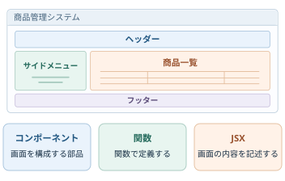
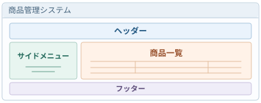
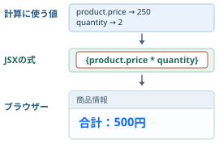
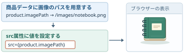

:::: {#page-1 .source-page}

::: {#ch02-number .paragraph}
2
:::

::: {#ch02-title .heading}
第2章 Reactによる画面表示と入力処理
:::

::: {#ch02-goals .heading}
章の目標
:::

::: {#ch02-goal-1 .paragraph}
◼ ReactのコンポーネントとJSXの基本的な書き方を理解し、画面を作成できる
:::

::: {#ch02-goal-2 .paragraph}
◼ JSXで変数や計算結果を表示し、HTML属性に値を設定できる
:::

::: {#ch02-goal-3 .paragraph}
◼ `useState`を使って状態を管理し、値の変更を画面に反映できる
:::

::: {#ch02-goal-4 .paragraph}
◼ イベント処理と条件分岐を使って、ユーザーの操作に応じた表示を実装できる
:::

::: {#ch02-goal-5 .paragraph}
◼ 配列データを一覧表示できる
:::

::: {#ch02-goal-6 .paragraph}
◼ フォームの入力値を状態と連動させ、画面に表示できる
:::

::::

:::: {#page-2 .source-page}

::: {#ch02-overview-title .heading}
章の概要
:::

::: {#ch02-overview-slide .slide layout="summary"}
章の概要

■ ReactコンポーネントとJSXの基本

■ JSXによるデータ表示と属性の設定

■ 状態の管理（useState）

■ イベント処理

■ 条件に応じた表示

■ 配列データの一覧表示

■ フォーム入力と状態の連動
:::

::: {#ch02-overview-1 .paragraph}
この章では、Reactで画面を作成し、ユーザーの操作に応じて表示を変更するための基本構文を学習します。
:::

::: {#ch02-overview-2 .paragraph}
最初に、Reactの画面を構成する「コンポーネント」と、HTMLに似た記述方法である「JSX」の基本を確認します。続いて、変数や計算結果を画面に表示する方法と、画像のパスやCSSのクラスなどを属性に設定する方法を学びます。
:::

::: {#ch02-overview-3 .paragraph}
次に、`useState`を使用して画面の状態を管理し、ボタンのクリックなどのイベントに応じてデータと表示を更新する方法を学習します。さらに、条件に応じた表示の切り替えや、配列データの一覧表示にも取り組みます。
:::

::: {#ch02-overview-4 .paragraph}
最後に、フォームに入力された値をReactの状態と連動させ、入力内容を画面へ反映する方法を学びます。
:::

::: {#ch02-overview-5 .paragraph}
本章では、まず1つのコンポーネントで基本構文を学習します。複数のコンポーネントの連携や画面遷移については、後続の章で扱います。
:::

::::

:::: {#page-3 .source-page}

::: {#ch02-jsx-intro-title .heading}
2.1. ReactコンポーネントとJSXの基本
:::

::: {#ch02-jsx-intro-slide .slide layout="illustration"}
ReactコンポーネントとJSXの基本


:::

::: {#ch02-components-definition .heading level="minor"}
Reactコンポーネントとは
:::

::: {#ch02-definition-1 .paragraph}
第1章では、Reactの開発サーバーを起動し、`App.tsx` の変数を変更すると、ブラウザーの表示も変わることを確認しました。
:::

::: {#ch02-definition-2 .paragraph}
ここからは、Reactのソースコードがどのような仕組みで画面を表示しているのか、詳しく見ていきましょう。
:::

::: {#ch02-definition-3 .paragraph}
Reactには、**画面をコンポーネントという部品に分けて作成できる**という特徴があります。
:::

::: {#ch02-definition-4 .paragraph}
例えば、Webアプリケーションの画面には、ヘッダー、メニュー、商品一覧、フッターなど、さまざまな部分があります。
:::

::: {#ch02-definition-5 .paragraph}
Reactでは、これらをそれぞれ独立したコンポーネントとして作成し、組み合わせて1つの画面を構築できます。
:::

::::

:::: {#page-4 .source-page}

{#ch02-layout-diagram}

::: {#ch02-layout-diagram-caption .paragraph}
画面を構成する部品。本章では1つのコンポーネントを使います。
:::

::: {#ch02-component-function .heading level="minor"}
Reactでは、関数を使って画面を作成する
:::

::: {#ch02-full-ch01-1 .paragraph}
Reactのコンポーネントは、基本的にJavaScriptやTypeScriptの**関数**として定義します。
:::

::: {#ch02-full-ch01-2 .paragraph}
第1章で使用した `App.tsx` も、実はReactのコンポーネントです。
:::

::: {#ch02-full-ch01-3 .paragraph}
まずは、次のコードを確認してください。
:::

::: {#ch02-full-ch01-4 .code filename="ch01-setup/src/App.tsx"}
```tsx
export default function App() {
  // 画面に表示するデータ
  const courseName = 'React開発入門'
  const message = 'Reactの動作確認をしています'
  const lessonNumber = 1

  return (
    <main>
      <h1>{courseName}</h1>
      <p>{message}</p>
      <p>現在の学習：第{lessonNumber}章</p>
    </main>
  )
}
```
:::

::::

:::: {#page-5 .source-page}

::: {#ch02-component-parts-1 .paragraph}
このコードは、JavaScriptの関数とHTMLに似た記述を組み合わせて作成されています。
:::

::: {#ch02-component-parts-2 .paragraph}
特に重要なのは、次の3つの部分です。
:::

::: {#ch02-component-parts-3 .step}
**① コンポーネントを定義する部分**
:::

::: {#ch02-component-parts-4 .code filename="ch01-setup/src/App.tsx" highlight-lines="1-1"}
```tsx
export default function App() {
```
:::

::: {#ch02-component-parts-5 .paragraph}
`function App()` は、`App` という名前の関数を定義しています。
:::

::: {#ch02-component-parts-6 .paragraph}
Reactでは、このように関数を使ってコンポーネントを作成します。
:::

::: {#ch02-component-parts-7 .paragraph}
コンポーネント名は、通常のHTML要素と区別するために、**先頭を大文字にする**というルールがあります。
:::

::: {#ch02-component-parts-8 .paragraph}
また、`export default` は、作成したコンポーネントを別のファイルから読み込んで使用できるようにするための記述です。
:::

::: {#ch02-component-parts-9 .paragraph}
実際に、第1章の `main.tsx` では、この `App` コンポーネントを読み込み、画面に表示するために使用しています。
:::

::: {#ch02-component-parts-10 .step}
**② 変数を定義する部分**
:::

::: {#ch02-component-parts-11 .code filename="ch01-setup/src/App.tsx" start-line="3" highlight-lines="3-5"}
```tsx
  const courseName = 'React開発入門'
  const message = 'Reactの動作確認をしています'
  const lessonNumber = 1
```
:::

::: {#ch02-component-parts-12 .paragraph}
この部分は、通常のJavaScriptやTypeScriptの変数宣言と同じです。
:::

::: {#ch02-component-parts-13 .paragraph}
Reactのコンポーネント内でも、これまで学習した変数や関数、条件分岐などを使用できます。
:::

::: {#ch02-component-parts-14 .paragraph}
今回のサンプルでは、画面に表示する文字列や数値を変数として用意しています。
:::

::::

:::: {#page-6 .source-page}

::: {#ch02-return-label .step}
**③ 画面に表示する内容を返す部分**
:::

::: {#ch02-return-1 .code filename="ch01-setup/src/App.tsx" start-line="7"}
```tsx
  return (
    <main>
      <h1>{courseName}</h1>
      <p>{message}</p>
      <p>現在の学習：第{lessonNumber}章</p>
    </main>
  )
```
:::

::: {#ch02-return-2 .paragraph}
`return` は、関数の処理結果を返すための構文です。
:::

::: {#ch02-return-3 .paragraph}
Reactのコンポーネントでは、`return` にHTMLに似た記述を書くことで、画面に表示する内容を指定できます。
:::

::: {#ch02-return-4 .paragraph}
例えば、`<h1>` は大きな見出し、`<p>` は文章を表示するための要素です。
:::

::: {#ch02-return-5 .paragraph}
また、`{courseName}` のように変数を波括弧で囲むと、その値を画面に表示できます。
:::

{#ch02-component-code}

::: {#ch02-component-code-caption .paragraph}
App.tsxの3つの部分と、returnに対応する初期画面
:::

::::

:::: {#page-7 .source-page}

::: {#ch02-jsx-definition .heading level="minor"}
JSXとは
:::

::: {#ch02-jsx-1 .paragraph}
ここで、先ほどの `return` の中に記述されていたコードに注目してください。
:::

::: {#ch02-jsx-2 .code filename="ch01-setup/src/App.tsx" start-line="9"}
```tsx
      <h1>{courseName}</h1>
      <p>{message}</p>
```
:::

::: {#ch02-jsx-3 .paragraph}
HTMLと非常によく似ていますが、実は通常のHTMLではありません。
:::

::: {#ch02-jsx-4 .paragraph}
このような記述方法を、**JSX（JavaScript XML）**と呼びます。
:::

::: {#ch02-jsx-5 .paragraph}
JSXは、JavaScriptの中にHTMLに似た記述を書くための構文です。
:::

::: {#ch02-jsx-6 .paragraph}
Reactでは、このJSXを使うことで、画面に表示する内容を分かりやすく記述できます。
:::

::: {#ch02-jsx-7 .paragraph}
また、本研修ではTypeScriptを使用するため、JSXを含むファイルには **`.tsx`** という拡張子を使用します。
:::

::: {#ch02-jsx-rules .heading level="minor"}
JSXとHTMLの主な違い
:::

::: {#ch02-rules-1 .paragraph}
JSXはHTMLに似ていますが、いくつかのルールが異なります。
:::

::: {#ch02-rules-2 .paragraph}
特に、最初は次の3点を覚えておきましょう。
:::

::::

:::: {#page-8 .source-page}

::: {#ch02-jsx-parent .heading level="minor"}
① 複数の要素は、1つの親要素で囲む
:::

::: {#ch02-parent-1 .paragraph}
Reactのコンポーネントで複数の要素を返す場合、それらを1つの親要素で囲む必要があります。
:::

::: {#ch02-parent-2 .step}
**誤った例**
:::

::: {#ch02-parent-3 .code example="true"}
```tsx
return (
  <h1>商品管理システム</h1>
  <p>商品一覧を表示します</p>
)
```
:::

::: {#ch02-parent-4 .paragraph}
このコードでは、`<h1>` と `<p>` が別々の要素として並んでいるため、エラーになります。
:::

::: {#ch02-parent-5 .step}
**正しい例**
:::

::: {#ch02-parent-6 .code example="true"}
```tsx
return (
  <main>
    <h1>商品管理システム</h1>
    <p>商品一覧を表示します</p>
  </main>
)
```
:::

::: {#ch02-parent-7 .paragraph}
このように、`<main>` などの親要素でまとめれば、正常に動作します。
:::

::::

:::: {#page-9 .source-page}

::: {#ch02-fragment-1 .paragraph}
なお、不要なHTML要素を増やしたくない場合は、`<>` と `</>` で囲む方法もあります。
:::

::: {#ch02-fragment-2 .code example="true"}
```tsx
return (
  <>
    <h1>商品管理システム</h1>
    <p>商品一覧を表示します</p>
  </>
)
```
:::

::: {#ch02-fragment-3 .paragraph}
この記述を**フラグメント（Fragment）**と呼びます。
:::

::: {#ch02-jsx-closing .heading level="minor"}
② タグは必ず閉じる
:::

::: {#ch02-closing-1 .paragraph}
通常のHTMLでは、`` や `<input>` など、終了タグを記述しない要素があります。
:::

::: {#ch02-closing-2 .paragraph}
しかし、JSXでは、これらのタグも必ず閉じる必要があります。
:::

::: {#ch02-closing-3 .table}
| HTML | JSX |
|---|---|
| `` | `` |
| `<input type="text">` | `<input type="text" />` |
| `<br>` | `<br />` |
:::

::: {#ch02-closing-4 .paragraph}
`<h1>` や `<p>` などについても、通常のHTMLと同じように終了タグを記述します。
:::

::::

:::: {#page-10 .source-page}

::: {#ch02-jsx-attributes .heading level="minor"}
③ HTML属性の名前が一部異なる
:::

::: {#ch02-attributes-name-1 .paragraph}
JSXでは、HTMLで使用していた属性名と異なる書き方をする場合があります。
:::

::: {#ch02-attributes-name-2 .paragraph}
代表例は、CSSのクラスを指定する `class` 属性です。
:::

::: {#ch02-attributes-name-3 .paragraph}
HTMLでは、
:::

::: {#ch02-attributes-name-4 .code example="true"}
```html
<p class="text-primary">こんにちは</p>
```
:::

::: {#ch02-attributes-name-5 .paragraph}
と書きますが、JSXでは、
:::

::: {#ch02-attributes-name-6 .code example="true"}
```tsx
<p className="text-primary">こんにちは</p>
```
:::

::: {#ch02-attributes-name-7 .paragraph}
と記述します。
:::

::: {#ch02-attributes-name-8 .paragraph}
Reactでは、**`class` ではなく `className` を使用する**ことを覚えておきましょう。
:::

::: {#ch02-attributes-name-9 .paragraph}
`className` を使用した画面のデザインについては、次の2.2節で詳しく説明します。
:::

::: {#ch02-jsx-points .section-points}
この節のポイント

● Reactでは、画面を**コンポーネント**という部品に分けて作成できる。

● コンポーネントは、基本的に**関数**として定義する。

● `return` に記述したJSXが、画面に表示する内容となる。

● **JSX**は、JavaScriptの中にHTMLに似た記述を書くための構文である。

● JSXでは、要素を1つの親要素で囲み、タグを正しく閉じる必要がある。

● CSSのクラスを指定するときは、`className` を使用する。
:::

::::

:::: {#page-11 .source-page}

::: {#ch02-values-title .heading}
2.2. JSXによるデータ表示と属性の設定
:::

::: {#ch02-values-slide .slide layout="illustration"}
JSXによるデータ表示と属性の設定


:::

::: {#ch02-values-definition .heading level="minor"}
JSXでJavaScriptの値を表示する
:::

::: {#ch02-chapter1-example-1 .paragraph}
前節では、Reactのコンポーネントが関数で作られ、`return` にJSXを記述することで画面を表示できることを学習しました。
:::

::: {#ch02-chapter1-example-2 .paragraph}
また、第1章では、次のように変数の値を画面に表示しました。
:::

::: {#ch02-chapter1-constant .code filename="ch01-setup/src/App.tsx" start-line="3"}
```tsx
  const courseName = 'React開発入門'
```
:::

::: {#ch02-chapter1-h1 .code filename="ch01-setup/src/App.tsx" start-line="9"}
```tsx
      <h1>{courseName}</h1>
```
:::

::: {#ch02-braces-1 .paragraph}
このように、JSXでは**`{ }`（波括弧）を使って、JavaScriptやTypeScriptの値をHTMLに似た記述の中に埋め込むことができます。**
:::

::::

:::: {#page-12 .source-page}

::: {#ch02-calculation-1 .paragraph}
さらに、`{ }` の中では変数だけでなく、計算式やオブジェクトのプロパティなども使用できます。
:::

::: {#ch02-calculation-2 .paragraph}
例えば、商品の単価と数量が、それぞれ変数に格納されているとします。
:::

::: {#ch02-calculation-3 .code example="true"}
```tsx
const price = 250
const quantity = 2
```
:::

::: {#ch02-calculation-4 .paragraph}
この2つの値を画面に表示する場合は、次のように記述します。
:::

::: {#ch02-calculation-5 .code example="true"}
```tsx
<>
  <p>単価：{price}円</p>
  <p>数量：{quantity}個</p>
</>
```
:::

::: {#ch02-calculation-6 .paragraph}
さらに、合計金額を計算して表示することもできます。
:::

::: {#ch02-calculation-7 .code example="true"}
```tsx
<p>合計：{price * quantity}円</p>
```
:::

::: {#ch02-calculation-8 .paragraph}
この場合、`{price * quantity}` の部分で250×2が計算され、画面には「合計：500円」と表示されます。
:::

{#ch02-calculation-diagram}

::: {#ch02-calculation-diagram-caption .paragraph}
変数の値を使った計算結果が、画面の合計金額に表示される
:::

::::

:::: {#page-13 .source-page}

::: {#ch02-object-title .heading level="minor"}
オブジェクトの値を表示する
:::

::: {#ch02-object-1 .paragraph}
商品情報のように、複数の関連するデータを管理する場合は、JavaScriptのオブジェクトを使用することもできます。
:::

::: {#ch02-object-2 .paragraph}
例えば、次のように商品名と単価を1つのオブジェクトにまとめられます。
:::

::: {#ch02-object-3 .code example="true"}
```tsx
const product = {
  name: 'ノート',
  price: 250
}
```
:::

::: {#ch02-object-4 .paragraph}
このようなオブジェクトを使用している場合も、JSXの中からプロパティを参照できます。
:::

::: {#ch02-object-5 .code filename="ch02-basic/src/App.tsx" start-line="23"}
```tsx
      <p>商品名：{product.name}</p>
      <p>単価：{product.price}円</p>
```
:::

::: {#ch02-object-6 .paragraph}
`product.name` は商品名、`product.price` は単価を取得するための記述です。
:::

::: {#ch02-object-7 .paragraph}
**このように、JSXの `{ }` には、通常のJavaScriptと同じように値を取得する式を記述できます。**
:::

::: {#ch02-object-8 .paragraph}
ただし、`{ }` に記述できるのは、画面に表示する値を求めるための式です。`if` 文や`for`文などの制御構文を、そのまま波括弧の中に記述することはできません。
:::

::: {#ch02-object-9 .paragraph}
条件分岐や繰り返し表示の方法は、後続の節で学習します。
:::

::: {#ch02-values-attributes .heading level="minor"}
JSXでHTML属性に変数を設定する
:::

::: {#ch02-image-path-1 .paragraph}
ここまでは、`<p>` や `<h1>` などの要素の中に、変数の値を表示していました。
:::

::: {#ch02-image-path-2 .paragraph}
しかし、JSXでは、**HTML要素の属性にもJavaScriptの変数を設定できます。**
:::

::: {#ch02-image-path-3 .paragraph}
例えば、HTMLで画像を表示する際は、次のように記述します。
:::

::: {#ch02-image-path-4 .code example="true"}
```html

```
:::

::::

:::: {#page-14 .source-page}

::: {#ch02-image-path-5 .paragraph}
この場合、`src` 属性に画像ファイルの場所を直接指定しています。
:::

::: {#ch02-image-path-6 .paragraph}
一方、Reactでは、画像の場所を変数に格納し、その値を `src` 属性に設定できます。
:::

::: {#ch02-image-path-7 .code example="true"}
```tsx
const imagePath = '/images/notebook.png'

return (
  
)
```
:::

::: {#ch02-image-path-8 .paragraph}
ここで注目してほしいのが、`src={imagePath}` の部分です。
:::

::: {#ch02-image-path-9 .paragraph}
`{ }` で囲むことで、変数 `imagePath` に格納されている画像のパスが `src` 属性に設定されます。
:::

::: {#ch02-literal-attributes .heading level="minor"}
固定値と変数を指定する場合の違い
:::

::: {#ch02-attribute-comparison-1 .table}
| 記述方法 | 意味 |
|---|---|
| `src="/images/notebook.png"` | 画像のパスを直接指定する |
| `src={imagePath}` | 変数の値を画像のパスとして使用する |
| `alt={product.name}` | 商品名を画像の代替テキストとして使用する |
:::

::: {#ch02-attribute-comparison-2 .paragraph}
つまり、**属性に固定の文字列を指定する場合は `" "`、JavaScriptの値を使用する場合は `{ }` を使う**という違いがあります。
:::

{#ch02-image-path-result}

::: {#ch02-image-path-result-caption .paragraph}
imagePathに入れた画像のパスをsrc属性に設定する流れ
:::

::::

:::: {#page-15 .source-page}

::: {#ch02-class-name .heading level="minor"}
classNameによるデザインの設定
:::

::: {#ch02-class-1 .paragraph}
ReactでCSSのクラスを指定する場合は、前節で学んだ `className` を使用します。
:::

::: {#ch02-class-2 .paragraph}
例えば、Bootstrapを使って文字色を青くしたい場合、次のように記述できます。
:::

::: {#ch02-class-3 .code example="true"}
```tsx
<p className="text-primary">商品情報</p>
```
:::

::: {#ch02-class-4 .paragraph}
`text-primary` は、Bootstrapで用意されている文字色を指定するクラスです。
:::

::: {#ch02-class-5 .paragraph}
さらに、`className` 属性にも変数を使用できます。
:::

::: {#ch02-class-6 .code example="true"}
```tsx
const textClass = 'text-primary fw-bold'

return (
  <p className={textClass}>合計：500円</p>
)
```
:::

::: {#ch02-class-7 .paragraph}
`text-primary` は文字色を青に、`fw-bold` は文字を太字にするためのBootstrapのクラスです。
:::

::: {#ch02-class-8 .paragraph}
このように、変数にクラス名を格納しておけば、画面のデザインに使用するクラスもJavaScript側で指定できます。
:::

::: {#ch02-bootstrap .training-note}
【補足】BootstrapのCSSの読み込み

Bootstrapのデザインを適用するには、インストールしたBootstrapのCSSを読み込む必要があります。
:::

::: {#ch02-bootstrap-import-1 .paragraph}
本研修のサンプルでは、次のように `main.tsx` からBootstrapのCSSを読み込みます。
:::

::: {#ch02-bootstrap-import-2 .code filename="ch02-basic/src/main.tsx" start-line="3"}
```tsx
import 'bootstrap/dist/css/bootstrap.min.css'
```
:::

::::

:::: {#page-16 .source-page}

::: {#ch02-product-sample .heading level="minor"}
【サンプル】商品情報を表示する
:::

::: {#ch02-sample-1 .paragraph}
それでは、ここまで学習した内容を組み合わせて、商品情報を表示する画面を作成してみましょう。
:::

::: {#ch02-sample-2 .paragraph}
今回は、商品名・単価・画像などをオブジェクトで管理し、JSXを使って画面に表示します。
:::

::: {#ch02-sample-start .paragraph}
配布サンプルの `ch02-basic` フォルダーで `npm install` を実行し、1.5節と同じ手順で開発サーバーを起動してください。
:::

::: {#ch02-product-source .code filename="ch02-basic/src/App.tsx"}
```tsx
export default function App() {
  // 商品情報
  const product = {
    name: 'ノート',
    price: 250,
    imagePath: '/images/notebook.png'
  }

  // 数量とデザイン
  const quantity = 2
  const totalClass = 'text-primary fw-bold'

  return (
    <main className="container mt-4">
      <h1>商品情報</h1>

      

      <p>商品名：{product.name}</p>
      <p>単価：{product.price}円</p>
      <p>数量：{quantity}個</p>

      <p className={totalClass}>
        合計：{product.price * quantity}円
      </p>
    </main>
  )
}
```
:::

::::

:::: {#page-17 .source-page}

::: {#ch02-image-file .training-note}
【補足】画像ファイルの配置

画像ファイル `notebook.png` は、配布サンプルの `public/images` フォルダーに用意する。
:::

{#ch02-product-display}

::: {#ch02-product-display-caption .paragraph}
配布サンプルを開いたときの商品情報の表示
:::

::: {#ch02-sample-explain .heading level="minor"}
サンプルコードの解説
:::

::: {#ch02-property-display-1 .paragraph}
今回のサンプルで特に確認したいのは、次の3か所です。
:::

::: {#ch02-property-display-2 .step}
**① オブジェクトのプロパティを表示する**
:::

::: {#ch02-property-display-3 .code filename="ch02-basic/src/App.tsx" start-line="23"}
```tsx
      <p>商品名：{product.name}</p>
      <p>単価：{product.price}円</p>
```
:::

::: {#ch02-property-display-4 .paragraph}
商品情報は、`product` というオブジェクトにまとめています。
:::

::: {#ch02-property-display-5 .paragraph}
JSX内では、そのプロパティを指定することで、商品名や単価を表示できます。
:::

::::

:::: {#page-18 .source-page}

::: {#ch02-product-calculation-label .step}
**② 計算結果を表示する**
:::

::: {#ch02-product-explanation-1 .code filename="ch02-basic/src/App.tsx" start-line="25" highlight-lines="28-28"}
```tsx
      <p>数量：{quantity}個</p>

      <p className={totalClass}>
        合計：{product.price * quantity}円
      </p>
```
:::

::: {#ch02-product-explanation-2 .paragraph}
合計金額の部分では、`product.price` と `quantity` を掛け算しています。
:::

::: {#ch02-product-explanation-3 .paragraph}
今回の値は250円と2個なので、500円と表示されます。
:::

::: {#ch02-product-explanation-4 .paragraph}
このように、計算結果を事前に別の変数へ格納しなくても、JSXの中で計算して表示できます。
:::

::: {#ch02-product-explanation-5 .step}
**③ 属性に変数を設定する**
:::

::: {#ch02-product-explanation-6 .code filename="ch02-basic/src/App.tsx" start-line="17" highlight-lines="18-19"}
```tsx
      
```
:::

::: {#ch02-product-explanation-7 .paragraph}
`src` 属性には、商品画像のパスを指定しています。
:::

::: {#ch02-product-explanation-8 .paragraph}
`alt` 属性には、商品名を指定しています。
:::

::: {#ch02-product-explanation-9 .paragraph}
このように、要素の中身だけでなく、属性にもJavaScriptの値を使用できます。
:::

::::

:::: {#page-19 .source-page}

::: {#ch02-check-exercise .heading level="minor"}
【確認演習】値を変更して表示を確認する
:::

::: {#ch02-check-1 .paragraph}
ここまでの内容を理解できたら、次の変更を行ってみましょう。
:::

::: {#ch02-check-2-1 .paragraph numbered="true"}
1．`product.price` の初期値を `300` に変更する。
:::

::: {#ch02-check-2-2 .paragraph numbered="true"}
2．`quantity` の初期値を `3` に変更する。
:::

::: {#ch02-check-2-3 .paragraph numbered="true"}
3．`totalClass` を `'text-danger fw-bold'` に変更する。
:::

::: {#ch02-check-5 .paragraph}
保存後、ブラウザーで次のように表示されることを確認してください。
:::

::: {#ch02-check-6-1 .paragraph}
● 単価：300円
:::

::: {#ch02-check-6-2 .paragraph}
● 数量：3個
:::

::: {#ch02-check-6-3 .paragraph}
● 合計：900円
:::

::: {#ch02-check-6-4 .paragraph}
● 合計金額の文字色：赤色
:::

::: {#ch02-check-10 .paragraph}
この演習では、**データやクラス名の値を変更するだけで、JSXの表示内容を変えられる**ことを確認します。
:::

::: {#ch02-check-11 .paragraph}
なお、今回はソースコードを変更して保存したため、Viteの機能によって画面が更新されています。
:::

::: {#ch02-check-12 .paragraph}
実際のReactアプリケーションでは、ボタン操作などによってプログラムの実行中にデータを変更し、画面を更新することもできます。
:::

::: {#ch02-check-13 .paragraph}
そのための仕組みが、次の節で学習する `useState` です。
:::

::: {#ch02-values-points .section-points}
この節のポイント

● JSXでは、**`{ }`** を使ってJavaScriptやTypeScriptの値を表示できる。

● `{ }` の中には、変数・計算式・オブジェクトのプロパティなどを記述できる。

● HTML属性にも、`src={imagePath}` のように変数の値を設定できる。

● ReactでCSSのクラスを指定するときは、**`className`** を使用する。

● Bootstrapのクラスを使うことで、文字色やレイアウトを簡単に設定できる。
:::

::::
