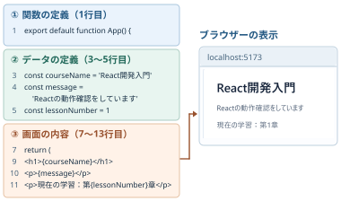
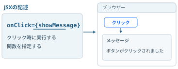
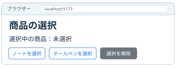
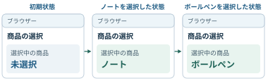

:::: {#page-1 .source-page}

::: {#ch02-number .paragraph}
2
:::

::: {#ch02-title .heading}
第2章 Reactによる画面表示と入力処理
:::

::: {#ch02-goals .heading}
章の目標
:::

::: {#ch02-goal-1 .paragraph}
◼ ReactのコンポーネントとJSXの基本的な書き方を理解し、画面を作成できる
:::

::: {#ch02-goal-2 .paragraph}
◼ JSXで変数や計算結果を表示し、HTML属性に値を設定できる
:::

::: {#ch02-goal-3 .paragraph}
◼ `useState`を使って状態を管理し、値の変更を画面に反映できる
:::

::: {#ch02-goal-4 .paragraph}
◼ イベント処理と条件分岐を使って、ユーザーの操作に応じた表示を実装できる
:::

::: {#ch02-goal-5 .paragraph}
◼ 配列データを一覧表示できる
:::

::: {#ch02-goal-6 .paragraph}
◼ フォームの入力値を状態と連動させ、画面に表示できる
:::

::::

:::: {#page-2 .source-page}

::: {#ch02-overview-title .heading}
章の概要
:::

::: {#ch02-overview-slide .slide layout="summary"}
章の概要

■ ReactコンポーネントとJSXの基本

■ JSXによるデータ表示と属性の設定

■ 状態の管理（useState）

■ イベント処理

■ 条件に応じた表示

■ 配列データの一覧表示

■ フォーム入力と状態の連動
:::

::: {#ch02-overview-1 .paragraph}
この章では、Reactで画面を作成し、ユーザーの操作に応じて表示を変更するための基本構文を学習します。
:::

::: {#ch02-overview-2 .paragraph}
最初に、Reactの画面を構成する「コンポーネント」と、HTMLに似た記述方法である「JSX」の基本を確認します。続いて、変数や計算結果を画面に表示する方法と、画像のパスやCSSのクラスなどを属性に設定する方法を学びます。
:::

::: {#ch02-overview-3 .paragraph}
次に、`useState`を使用して画面の状態を管理し、ボタンのクリックなどのイベントに応じてデータと表示を更新する方法を学習します。さらに、条件に応じた表示の切り替えや、配列データの一覧表示にも取り組みます。
:::

::: {#ch02-overview-4 .paragraph}
最後に、フォームに入力された値をReactの状態と連動させ、入力内容を画面へ反映する方法を学びます。
:::

::: {#ch02-overview-5 .paragraph}
本章では、まず1つのコンポーネントで基本構文を学習します。複数のコンポーネントの連携や画面遷移については、後続の章で扱います。
:::

::::

:::: {#page-3 .source-page}

::: {#ch02-jsx-intro-title .heading}
2.1. ReactコンポーネントとJSXの基本
:::

::: {#ch02-jsx-intro-slide .slide layout="illustration"}
ReactコンポーネントとJSXの基本


:::

::: {#ch02-components-definition .heading level="minor"}
Reactコンポーネントとは
:::

::: {#ch02-definition-1 .paragraph}
第1章では、Reactの開発サーバーを起動し、`App.tsx` の変数を変更すると、ブラウザーの表示も変わることを確認しました。
:::

::: {#ch02-definition-2 .paragraph}
ここからは、Reactのソースコードがどのような仕組みで画面を表示しているのか、詳しく見ていきましょう。
:::

::: {#ch02-definition-3 .paragraph}
Reactには、**画面をコンポーネントという部品に分けて作成できる**という特徴があります。
:::

::: {#ch02-definition-4 .paragraph}
例えば、Webアプリケーションの画面には、ヘッダー、メニュー、商品一覧、フッターなど、さまざまな部分があります。
:::

::: {#ch02-definition-5 .paragraph}
Reactでは、これらをそれぞれ独立したコンポーネントとして作成し、組み合わせて1つの画面を構築できます。
:::

::::

:::: {#page-4 .source-page}

{#ch02-layout-diagram}

::: {#ch02-layout-diagram-caption .paragraph}
画面を構成する部品。本章では1つのコンポーネントを使います。
:::

::: {#ch02-component-function .heading level="minor"}
Reactでは、関数を使って画面を作成する
:::

::: {#ch02-full-ch01-1 .paragraph}
Reactのコンポーネントは、基本的にJavaScriptやTypeScriptの**関数**として定義します。
:::

::: {#ch02-full-ch01-2 .paragraph}
第1章で使用した `App.tsx` も、実はReactのコンポーネントです。
:::

::: {#ch02-full-ch01-3 .paragraph}
まずは、次のコードを確認してください。
:::

::: {#ch02-full-ch01-4 .code filename="ch01-setup/src/App.tsx"}
```tsx
export default function App() {
  // 画面に表示するデータ
  const courseName = 'React開発入門'
  const message = 'Reactの動作確認をしています'
  const lessonNumber = 1

  return (
    <main>
      <h1>{courseName}</h1>
      <p>{message}</p>
      <p>現在の学習：第{lessonNumber}章</p>
    </main>
  )
}
```
:::

::::

:::: {#page-5 .source-page}

::: {#ch02-component-parts-1 .paragraph}
このコードは、JavaScriptの関数とHTMLに似た記述を組み合わせて作成されています。
:::

::: {#ch02-component-parts-2 .paragraph}
特に重要なのは、次の3つの部分です。
:::

::: {#ch02-component-parts-3 .step}
**① コンポーネントを定義する部分**
:::

::: {#ch02-component-parts-4 .code filename="ch01-setup/src/App.tsx" highlight-lines="1-1"}
```tsx
export default function App() {
```
:::

::: {#ch02-component-parts-5 .paragraph}
`function App()` は、`App` という名前の関数を定義しています。
:::

::: {#ch02-component-parts-6 .paragraph}
Reactでは、このように関数を使ってコンポーネントを作成します。
:::

::: {#ch02-component-parts-7 .paragraph}
コンポーネント名は、通常のHTML要素と区別するために、**先頭を大文字にする**というルールがあります。
:::

::: {#ch02-component-parts-8 .paragraph}
また、`export default` は、作成したコンポーネントを別のファイルから読み込んで使用できるようにするための記述です。
:::

::: {#ch02-component-parts-9 .paragraph}
実際に、第1章の `main.tsx` では、この `App` コンポーネントを読み込み、画面に表示するために使用しています。
:::

::: {#ch02-component-parts-10 .step}
**② 変数を定義する部分**
:::

::: {#ch02-component-parts-11 .code filename="ch01-setup/src/App.tsx" start-line="3" highlight-lines="3-5"}
```tsx
  const courseName = 'React開発入門'
  const message = 'Reactの動作確認をしています'
  const lessonNumber = 1
```
:::

::: {#ch02-component-parts-12 .paragraph}
この部分は、通常のJavaScriptやTypeScriptの変数宣言と同じです。
:::

::: {#ch02-component-parts-13 .paragraph}
Reactのコンポーネント内でも、これまで学習した変数や関数、条件分岐などを使用できます。
:::

::: {#ch02-component-parts-14 .paragraph}
今回のサンプルでは、画面に表示する文字列や数値を変数として用意しています。
:::

::::

:::: {#page-6 .source-page}

::: {#ch02-return-label .step}
**③ 画面に表示する内容を返す部分**
:::

::: {#ch02-return-1 .code filename="ch01-setup/src/App.tsx" start-line="7"}
```tsx
  return (
    <main>
      <h1>{courseName}</h1>
      <p>{message}</p>
      <p>現在の学習：第{lessonNumber}章</p>
    </main>
  )
```
:::

::: {#ch02-return-2 .paragraph}
`return` は、関数の処理結果を返すための構文です。
:::

::: {#ch02-return-3 .paragraph}
Reactのコンポーネントでは、`return` にHTMLに似た記述を書くことで、画面に表示する内容を指定できます。
:::

::: {#ch02-return-4 .paragraph}
例えば、`<h1>` は大きな見出し、`<p>` は文章を表示するための要素です。
:::

::: {#ch02-return-5 .paragraph}
また、`{courseName}` のように変数を波括弧で囲むと、その値を画面に表示できます。
:::

{#ch02-component-code}

::: {#ch02-component-code-caption .paragraph}
App.tsxの3つの部分と、returnに対応する初期画面
:::

::::

:::: {#page-7 .source-page}

::: {#ch02-jsx-definition .heading level="minor"}
JSXとは
:::

::: {#ch02-jsx-1 .paragraph}
ここで、先ほどの `return` の中に記述されていたコードに注目してください。
:::

::: {#ch02-jsx-2 .code filename="ch01-setup/src/App.tsx" start-line="9"}
```tsx
      <h1>{courseName}</h1>
      <p>{message}</p>
```
:::

::: {#ch02-jsx-3 .paragraph}
HTMLと非常によく似ていますが、実は通常のHTMLではありません。
:::

::: {#ch02-jsx-4 .paragraph}
このような記述方法を、**JSX（JavaScript XML）**と呼びます。
:::

::: {#ch02-jsx-5 .paragraph}
JSXは、JavaScriptの中にHTMLに似た記述を書くための構文です。
:::

::: {#ch02-jsx-6 .paragraph}
Reactでは、このJSXを使うことで、画面に表示する内容を分かりやすく記述できます。
:::

::: {#ch02-jsx-7 .paragraph}
また、本研修ではTypeScriptを使用するため、JSXを含むファイルには **`.tsx`** という拡張子を使用します。
:::

::: {#ch02-jsx-rules .heading level="minor"}
JSXとHTMLの主な違い
:::

::: {#ch02-rules-1 .paragraph}
JSXはHTMLに似ていますが、いくつかのルールが異なります。
:::

::: {#ch02-rules-2 .paragraph}
特に、最初は次の3点を覚えておきましょう。
:::

::::

:::: {#page-8 .source-page}

::: {#ch02-jsx-parent .heading level="minor"}
① 複数の要素は、1つの親要素で囲む
:::

::: {#ch02-parent-1 .paragraph}
Reactのコンポーネントで複数の要素を返す場合、それらを1つの親要素で囲む必要があります。
:::

::: {#ch02-parent-2 .step}
**誤った例**
:::

::: {#ch02-parent-3 .code example="true"}
```tsx
return (
  <h1>商品管理システム</h1>
  <p>商品一覧を表示します</p>
)
```
:::

::: {#ch02-parent-4 .paragraph}
このコードでは、`<h1>` と `<p>` が別々の要素として並んでいるため、エラーになります。
:::

::: {#ch02-parent-5 .step}
**正しい例**
:::

::: {#ch02-parent-6 .code example="true"}
```tsx
return (
  <main>
    <h1>商品管理システム</h1>
    <p>商品一覧を表示します</p>
  </main>
)
```
:::

::: {#ch02-parent-7 .paragraph}
このように、`<main>` などの親要素でまとめれば、正常に動作します。
:::

::::

:::: {#page-9 .source-page}

::: {#ch02-fragment-1 .paragraph}
なお、不要なHTML要素を増やしたくない場合は、`<>` と `</>` で囲む方法もあります。
:::

::: {#ch02-fragment-2 .code example="true"}
```tsx
return (
  <>
    <h1>商品管理システム</h1>
    <p>商品一覧を表示します</p>
  </>
)
```
:::

::: {#ch02-fragment-3 .paragraph}
この記述を**フラグメント（Fragment）**と呼びます。
:::

::: {#ch02-jsx-closing .heading level="minor"}
② タグは必ず閉じる
:::

::: {#ch02-closing-1 .paragraph}
通常のHTMLでは、`` や `<input>` など、終了タグを記述しない要素があります。
:::

::: {#ch02-closing-2 .paragraph}
しかし、JSXでは、これらのタグも必ず閉じる必要があります。
:::

::: {#ch02-closing-3 .table}
| HTML | JSX |
|---|---|
| `` | `` |
| `<input type="text">` | `<input type="text" />` |
| `<br>` | `<br />` |
:::

::: {#ch02-closing-4 .paragraph}
`<h1>` や `<p>` などについても、通常のHTMLと同じように終了タグを記述します。
:::

::::

:::: {#page-10 .source-page}

::: {#ch02-jsx-attributes .heading level="minor"}
③ HTML属性の名前が一部異なる
:::

::: {#ch02-attributes-name-1 .paragraph}
JSXでは、HTMLで使用していた属性名と異なる書き方をする場合があります。
:::

::: {#ch02-attributes-name-2 .paragraph}
代表例は、CSSのクラスを指定する `class` 属性です。
:::

::: {#ch02-attributes-name-3 .paragraph}
HTMLでは、
:::

::: {#ch02-attributes-name-4 .code example="true"}
```html
<p class="text-primary">こんにちは</p>
```
:::

::: {#ch02-attributes-name-5 .paragraph}
と書きますが、JSXでは、
:::

::: {#ch02-attributes-name-6 .code example="true"}
```tsx
<p className="text-primary">こんにちは</p>
```
:::

::: {#ch02-attributes-name-7 .paragraph}
と記述します。
:::

::: {#ch02-attributes-name-8 .paragraph}
Reactでは、**`class` ではなく `className` を使用する**ことを覚えておきましょう。
:::

::: {#ch02-attributes-name-9 .paragraph}
`className` を使用した画面のデザインについては、次の2.2節で詳しく説明します。
:::

::::

:::: {#page-11 .source-page}

::: {#ch02-jsx-practice .heading level="minor"}
【確認演習】変数をJSXに表示する
:::

::: {#ch02-jsx-practice-intro .paragraph}
関数コンポーネント内の変数を使って、社員管理システムの見出しと案内文を表示します。
:::

::: {#ch02-jsx-practice-open-file .paragraph numbered="true"}
1．　`ch02-basic-q` プロジェクトの `src/components/Q2_1.tsx` を開いてください。
:::

::: {#ch02-jsx-practice-follow-comments .paragraph numbered="true"}
2．　コード内の➀～➂の番号付きコメントを確認し、指示された箇所を実装してください。コメントに指定されていないコードや、ほかのファイルは変更する必要はありません。
:::

::: {#ch02-jsx-practice-save .paragraph numbered="true"}
3．　編集したファイルを保存してください。
:::

::: {#ch02-jsx-practice-run .paragraph numbered="true" keep-lines="true"}
4．　初回は `ch02-basic-q` フォルダーで `npm install` を実行してください。<br>1.5節と同じ手順で開発サーバーを起動し、表示されたURLを開いてください。
:::

::: {#ch02-jsx-practice-menu .paragraph numbered="true"}
5．　メニューから **「2.1 ReactコンポーネントとJSXの基本」** を選んでください。
:::

::: {#ch02-jsx-practice-result .paragraph numbered="true"}
6．　見出しに「社員管理システム」、案内文に「社員情報を確認できます。」が表示されることを確認してください。
:::

::: {#ch02-jsx-points .section-points}
この節のポイント

● Reactでは、画面を**コンポーネント**という部品に分けて作成できる。

● コンポーネントは、基本的に**関数**として定義する。

● `return` に記述したJSXが、画面に表示する内容となる。

● **JSX**は、JavaScriptの中にHTMLに似た記述を書くための構文である。

● JSXでは、要素を1つの親要素で囲み、タグを正しく閉じる必要がある。

● CSSのクラスを指定するときは、`className` を使用する。
:::

::::

:::: {#page-12 .source-page}

::: {#ch02-values-title .heading}
2.2. JSXによるデータ表示と属性の設定
:::

::: {#ch02-values-slide .slide layout="illustration"}
JSXによるデータ表示と属性の設定


:::

::: {#ch02-values-definition .heading level="minor"}
JSXでJavaScriptの値を表示する
:::

::: {#ch02-chapter1-example-1 .paragraph}
前節では、Reactのコンポーネントが関数で作られ、`return` にJSXを記述することで画面を表示できることを学習しました。
:::

::: {#ch02-chapter1-example-2 .paragraph}
また、第1章では、次のように変数の値を画面に表示しました。
:::

::: {#ch02-chapter1-constant .code filename="ch01-setup/src/App.tsx" start-line="3"}
```tsx
  const courseName = 'React開発入門'
```
:::

::: {#ch02-chapter1-h1 .code filename="ch01-setup/src/App.tsx" start-line="9"}
```tsx
      <h1>{courseName}</h1>
```
:::

::: {#ch02-braces-1 .paragraph}
このように、JSXでは**`{ }`（波括弧）を使って、JavaScriptやTypeScriptの値をHTMLに似た記述の中に埋め込むことができます。**
:::

::::

:::: {#page-13 .source-page}

::: {#ch02-calculation-1 .paragraph}
さらに、`{ }` の中では変数だけでなく、計算式やオブジェクトのプロパティなども使用できます。
:::

::: {#ch02-calculation-2 .paragraph}
例えば、商品の単価と数量が、それぞれ変数に格納されているとします。
:::

::: {#ch02-calculation-3 .code example="true"}
```tsx
const price = 250
const quantity = 2
```
:::

::: {#ch02-calculation-4 .paragraph}
この2つの値を画面に表示する場合は、次のように記述します。
:::

::: {#ch02-calculation-5 .code example="true"}
```tsx
<>
  <p>単価：{price}円</p>
  <p>数量：{quantity}個</p>
</>
```
:::

::: {#ch02-calculation-6 .paragraph}
さらに、合計金額を計算して表示することもできます。
:::

::: {#ch02-calculation-7 .code example="true"}
```tsx
<p>合計：{price * quantity}円</p>
```
:::

::: {#ch02-calculation-8 .paragraph}
この場合、`{price * quantity}` の部分で250×2が計算され、画面には「合計：500円」と表示されます。
:::

{#ch02-calculation-diagram}

::: {#ch02-calculation-diagram-caption .paragraph}
変数の値を使った計算結果が、画面の合計金額に表示される
:::

::::

:::: {#page-14 .source-page}

::: {#ch02-object-title .heading level="minor"}
オブジェクトの値を表示する
:::

::: {#ch02-object-1 .paragraph}
商品情報のように、複数の関連するデータを管理する場合は、JavaScriptのオブジェクトを使用することもできます。
:::

::: {#ch02-object-2 .paragraph}
例えば、次のように商品名と単価を1つのオブジェクトにまとめられます。
:::

::: {#ch02-object-3 .code example="true"}
```tsx
const product = {
  name: 'ノート',
  price: 250
}
```
:::

::: {#ch02-object-4 .paragraph}
このようなオブジェクトを使用している場合も、JSXの中からプロパティを参照できます。
:::

::: {#ch02-object-5 .code filename="ch02-basic/src/components/Sample2_2.tsx" start-line="23"}
```tsx
      <p>商品名：{product.name}</p>
      <p>単価：{product.price}円</p>
```
:::

::: {#ch02-object-6 .paragraph}
`product.name` は商品名、`product.price` は単価を取得するための記述です。
:::

::: {#ch02-object-7 .paragraph}
**このように、JSXの `{ }` には、通常のJavaScriptと同じように値を取得する式を記述できます。**
:::

::: {#ch02-object-8 .paragraph}
ただし、`{ }` に記述できるのは、画面に表示する値を求めるための式です。`if` 文や`for`文などの制御構文を、そのまま波括弧の中に記述することはできません。
:::

::: {#ch02-object-9 .paragraph}
条件分岐や繰り返し表示の方法は、後続の節で学習します。
:::

::: {#ch02-values-attributes .heading level="minor"}
JSXでHTML属性に変数を設定する
:::

::: {#ch02-image-path-1 .paragraph}
ここまでは、`<p>` や `<h1>` などの要素の中に、変数の値を表示していました。
:::

::: {#ch02-image-path-2 .paragraph}
しかし、JSXでは、**HTML要素の属性にもJavaScriptの変数を設定できます。**
:::

::: {#ch02-image-path-3 .paragraph}
例えば、HTMLで画像を表示する際は、次のように記述します。
:::

::: {#ch02-image-path-4 .code example="true"}
```html

```
:::

::::

:::: {#page-15 .source-page}

::: {#ch02-image-path-5 .paragraph}
この場合、`src` 属性に画像ファイルの場所を直接指定しています。
:::

::: {#ch02-image-path-6 .paragraph}
一方、Reactでは、画像の場所を変数に格納し、その値を `src` 属性に設定できます。
:::

::: {#ch02-image-path-7 .code example="true"}
```tsx
const imagePath = '/images/notebook.png'

return (
  
)
```
:::

::: {#ch02-image-path-8 .paragraph}
ここで注目してほしいのが、`src={imagePath}` の部分です。
:::

::: {#ch02-image-path-9 .paragraph}
`{ }` で囲むことで、変数 `imagePath` に格納されている画像のパスが `src` 属性に設定されます。
:::

::: {#ch02-literal-attributes .heading level="minor"}
固定値と変数を指定する場合の違い
:::

::: {#ch02-attribute-comparison-1 .table}
| 記述方法 | 意味 |
|---|---|
| `src="/images/notebook.png"` | 画像のパスを直接指定する |
| `src={imagePath}` | 変数の値を画像のパスとして使用する |
| `alt={product.name}` | 商品名を画像の代替テキストとして使用する |
:::

::: {#ch02-attribute-comparison-2 .paragraph}
つまり、**属性に固定の文字列を指定する場合は `" "`、JavaScriptの値を使用する場合は `{ }` を使う**という違いがあります。
:::

{#ch02-image-path-result}

::: {#ch02-image-path-result-caption .paragraph}
imagePathに入れた画像のパスをsrc属性に設定する流れ
:::

::::

:::: {#page-16 .source-page}

::: {#ch02-class-name .heading level="minor"}
classNameによるデザインの設定
:::

::: {#ch02-class-1 .paragraph}
ReactでCSSのクラスを指定する場合は、前節で学んだ `className` を使用します。
:::

::: {#ch02-class-2 .paragraph}
例えば、Bootstrapを使って文字色を青くしたい場合、次のように記述できます。
:::

::: {#ch02-class-3 .code example="true"}
```tsx
<p className="text-primary">商品情報</p>
```
:::

::: {#ch02-class-4 .paragraph}
`text-primary` は、Bootstrapで用意されている文字色を指定するクラスです。
:::

::: {#ch02-class-5 .paragraph}
さらに、`className` 属性にも変数を使用できます。
:::

::: {#ch02-class-6 .code example="true"}
```tsx
const textClass = 'text-primary fw-bold'

return (
  <p className={textClass}>合計：500円</p>
)
```
:::

::: {#ch02-class-7 .paragraph}
`text-primary` は文字色を青に、`fw-bold` は文字を太字にするためのBootstrapのクラスです。
:::

::: {#ch02-class-8 .paragraph}
このように、変数にクラス名を格納しておけば、画面のデザインに使用するクラスもJavaScript側で指定できます。
:::

::: {#ch02-bootstrap .training-note}
【補足】BootstrapのCSSの読み込み

Bootstrapのデザインを適用するには、インストールしたBootstrapのCSSを読み込む必要があります。
:::

::: {#ch02-bootstrap-import-1 .paragraph}
本研修のサンプルでは、次のように `main.tsx` からBootstrapのCSSを読み込みます。
:::

::: {#ch02-bootstrap-import-2 .code filename="ch02-basic/src/main.tsx" start-line="3"}
```tsx
import 'bootstrap/dist/css/bootstrap.min.css'
```
:::

::::

:::: {#page-17 .source-page}

::: {#ch02-product-sample .heading level="minor"}
【サンプル】商品情報を表示する
:::

::: {#ch02-sample-1 .paragraph}
それでは、ここまで学習した内容を組み合わせて、商品情報を表示する画面を作成してみましょう。
:::

::: {#ch02-sample-2 .paragraph}
今回は、商品名・単価・画像などをオブジェクトで管理し、JSXを使って画面に表示します。
:::

::: {#ch02-sample-start .paragraph}
配布サンプルの `ch02-basic` フォルダーで `npm install` を実行し、1.5節と同じ手順で開発サーバーを起動します。ブラウザーのメニューで「2.2」を選択してください。
:::

::: {#ch02-product-source .code filename="ch02-basic/src/components/Sample2_2.tsx"}
```tsx
export default function Sample2_2() {
  // 商品情報
  const product = {
    name: 'ノート',
    price: 250,
    imagePath: '/images/notebook.png'
  }

  // 数量とデザイン
  const quantity = 2
  const totalClass = 'text-primary fw-bold'

  return (
    <main className="container mt-4">
      <h1>商品情報</h1>

      

      <p>商品名：{product.name}</p>
      <p>単価：{product.price}円</p>
      <p>数量：{quantity}個</p>

      <p className={totalClass}>
        合計：{product.price * quantity}円
      </p>
    </main>
  )
}
```
:::

::::

:::: {#page-18 .source-page}

::: {#ch02-image-file .training-note}
【補足】画像ファイルの配置

画像ファイル `notebook.png` は、配布サンプルの `public/images` フォルダーに用意する。
:::

{#ch02-product-display}

::: {#ch02-product-display-caption .paragraph}
メニューで「2.2」を選んだときの商品情報の表示部分
:::

::: {#ch02-sample-explain .heading level="minor"}
サンプルコードの解説
:::

::: {#ch02-property-display-2 .step}
**① オブジェクトのプロパティを表示する**
:::

::: {#ch02-property-display-3 .code filename="ch02-basic/src/components/Sample2_2.tsx"}
```tsx
2:  // 商品情報
3:  const product = {
4:    name: 'ノート',
5:    price: 250,
6:    imagePath: '/images/notebook.png'
7:  }
23:      <p>商品名：{product.name}</p>
24:      <p>単価：{product.price}円</p>
```
:::

::: {#ch02-property-display-4 .paragraph}
3〜7行目では、商品情報を `product` というオブジェクトにまとめています。`name: 'ノート'` のように、コロン（`:`）の左に**プロパティ名**、右に**値**を書きます。
:::

::: {#ch02-property-display-5 .paragraph keep-lines="true"}
値を取り出すときは、**`オブジェクト名.プロパティ名`** と書きます。<br>ドットの左にオブジェクト名、右にプロパティ名を指定します。<br>例えば、`product.name` は `'ノート'`、`product.price` は `250` です。
:::

::: {#ch02-property-display-6 .paragraph keep-lines="true"}
23・24行目では、JSXの `{ }` で取り出した値を埋め込みます。<br>画面には「商品名：ノート」と「単価：250円」が表示されます。
:::

::::

:::: {#page-19 .source-page}

::: {#ch02-product-calculation-label .step}
**② 計算結果を表示する**
:::

::: {#ch02-product-explanation-1 .code filename="ch02-basic/src/components/Sample2_2.tsx" start-line="25" highlight-lines="28-28"}
```tsx
      <p>数量：{quantity}個</p>

      <p className={totalClass}>
        合計：{product.price * quantity}円
      </p>
```
:::

::: {#ch02-product-explanation-2 .paragraph}
合計金額の部分では、`product.price` と `quantity` を掛け算しています。
:::

::: {#ch02-product-explanation-3 .paragraph}
今回の値は250円と2個なので、500円と表示されます。
:::

::: {#ch02-product-explanation-4 .paragraph}
このように、計算結果を事前に別の変数へ格納しなくても、JSXの中で計算して表示できます。
:::

::: {#ch02-product-explanation-5 .step}
**③ 属性に変数を設定する**
:::

::: {#ch02-product-explanation-6 .code filename="ch02-basic/src/components/Sample2_2.tsx" start-line="17" highlight-lines="18-19"}
```tsx
      
```
:::

::: {#ch02-product-explanation-7 .paragraph}
`src` 属性には、商品画像のパスを指定しています。
:::

::: {#ch02-product-explanation-8 .paragraph}
`alt` 属性には、商品名を指定しています。
:::

::: {#ch02-product-explanation-9 .paragraph}
このように、要素の中身だけでなく、属性にもJavaScriptの値を使用できます。
:::

::::

:::: {#page-20 .source-page}

::: {#ch02-values-practice .heading level="minor"}
【確認演習】商品情報の表示と属性を設定する
:::

::: {#ch02-values-practice-intro .paragraph}
商品データやクラス名の変数を、JSXの本文とHTML属性に設定します。単価300円、数量3個、合計を青い太字にするクラス名は、あらかじめ定義されています。
:::

::: {#ch02-values-practice-open-file .paragraph numbered="true"}
1．　`ch02-basic-q` プロジェクトの `src/components/Q2_2.tsx` を開いてください。
:::

::: {#ch02-values-practice-follow-comments .paragraph numbered="true"}
2．　コード内の➀～➃の番号付きコメントを確認し、指示された箇所を実装してください。コメントに指定されていないコードや、ほかのファイルは変更する必要はありません。
:::

::: {#ch02-values-practice-save .paragraph numbered="true"}
3．　編集したファイルを保存してください。
:::

::: {#ch02-values-practice-run .paragraph numbered="true"}
4．　`ch02-basic-q` の開発サーバーを起動し、ターミナルに表示されたURLを開いてください。起動済みの場合は、開いているブラウザーの画面に戻ってください。
:::

::: {#ch02-values-practice-menu .paragraph numbered="true"}
5．　メニューから **「2.2 JSXによるデータ表示と属性の設定」** を選んでください。
:::

::: {#ch02-values-practice-result .paragraph numbered="true" keep-lines="true"}
6．　ノートの画像と商品名「ノート」、単価300円、数量3個を確認してください。<br>合計は **青い太字で900円** と表示されます。
:::

::: {#ch02-check-11 .paragraph}
開発サーバーを起動した状態でソースコードを変更して保存すると、Viteの機能によって画面が更新されます。
:::

::: {#ch02-check-12 .paragraph}
実際のReactアプリケーションでは、ボタン操作などによってプログラムの実行中にデータを変更し、画面を更新することもできます。
:::

::: {#ch02-check-13 .paragraph}
そのための仕組みが、次の節で学習する `useState` です。
:::

::: {#ch02-values-points .section-points}
この節のポイント

● JSXでは、**`{ }`** を使ってJavaScriptやTypeScriptの値を表示できる。

● `{ }` の中には、変数・計算式・オブジェクトのプロパティなどを記述できる。

● HTML属性にも、`src={imagePath}` のように変数の値を設定できる。

● ReactでCSSのクラスを指定するときは、**`className`** を使用する。

● Bootstrapのクラスを使うことで、文字色やレイアウトを簡単に設定できる。
:::

::::

:::: {#page-21 .source-page}

::: {#ch02-state-title .heading}
2.3. 状態の管理（useState）
:::

::: {#ch02-state-slide .slide layout="illustration"}
状態の管理（useState）


:::

::: {#ch02-state-definition .heading level="minor"}
状態（state）とは
:::

::: {#ch02-state-definition-1 .paragraph}
前節では、JSXを使用して、変数やオブジェクトの値を画面に表示する方法を学習しました。
:::

::: {#ch02-state-definition-2 .paragraph}
例えば、次のように変数を定義すると、
:::

::: {#ch02-state-definition-3 .code example="true"}
```tsx
const quantity = 1
```
:::

::: {#ch02-state-definition-4 .paragraph}
JSXの中で `{quantity}` と記述することで、数量を画面に表示できました。
:::

::: {#ch02-state-definition-5 .paragraph}
しかし、実際のWebアプリケーションでは、最初に表示したデータをそのまま表示し続けるだけではありません。
:::

::::

:::: {#page-22 .source-page}

::: {#ch02-state-in-practice-1 .paragraph}
例えば、ショッピングサイトでは、ユーザーが「1個追加」ボタンをクリックすると、商品の数量が1個から2個に増え、それに合わせて合計金額も変わります。
:::

::: {#ch02-state-in-practice-2 .paragraph}
このように、**ユーザーの操作などによって変化し、その変化を画面に反映させたいデータ**を、Reactでは**状態（state：ステート）**として管理します。
:::

::: {#ch02-state-in-practice-3 .paragraph}
Reactでは、このstateを管理するために、主に `useState()` という関数を使用します。
:::

::: {#ch02-state-plain .heading level="minor"}
なぜ通常の変数ではダメなのか
:::

::: {#ch02-state-plain-1 .paragraph}
では、なぜReactでは `useState()` を使用するのでしょうか。
:::

::: {#ch02-state-plain-2 .paragraph keep-lines="true"}
まずは、通常のJavaScriptの変数を使って、<br>商品の数量を変更するコードを考えてみましょう。
:::

::: {#ch02-state-plain-3 .paragraph}
**通常の変数を使用した比較例**
:::

::: {#ch02-state-plain-4 .code example="true"}
```tsx
export default function App() {
  let quantity = 1
  const price = 250

  const addOne = () => {
    quantity = quantity + 1
  }

  return (
    <main>
      <h1>商品の数量変更</h1>
      <p>数量：{quantity}個</p>
      <p>合計：{price * quantity}円</p>
      <button onClick={addOne}>1個追加</button>
    </main>
  )
}
```
:::

::: {#ch02-state-plain-5 .paragraph}
このコードでは、`quantity` という変数を宣言し、初期値として1を代入しています。
:::

::: {#ch02-state-plain-6 .paragraph keep-lines="true"}
そして、「1個追加」ボタンをクリックすると、<br>`addOne` という関数が実行されるようになっています。
:::

::::

:::: {#page-23 .source-page}

::: {#ch02-state-plain-handler-1 .paragraph}
`addOne` の中では、次の処理を行っています。
:::

::: {#ch02-state-plain-handler-2 .code example="true"}
```tsx
quantity = quantity + 1
```
:::

::: {#ch02-state-plain-handler-3 .paragraph}
つまり、ボタンをクリックすると、変数 `quantity` の値が1増えるはずです。
:::

::: {#ch02-state-plain-handler-4 .paragraph}
ところが、実際にボタンをクリックしても、**画面には「数量：1個」「合計：250円」と表示されたままになります。**
:::

::: {#ch02-state-plain-handler-5 .paragraph}
なぜでしょうか。
:::

::: {#ch02-state-plain-handler-6 .paragraph}
これは、**通常の変数の値を変更しただけでは、Reactが画面を再表示する必要があることを認識できないため**です。
:::

::: {#ch02-state-plain-handler-7 .paragraph}
Reactは、コンポーネントの処理を実行して画面を作成しますが、通常の変数を変更しても、それだけではコンポーネントを再実行しません。
:::

::: {#ch02-state-plain-handler-8 .paragraph}
さらに、通常のローカル変数はコンポーネントが再実行されたときに改めて初期化されるため、変更後の値を保持する用途にも適していません。
:::

::: {#ch02-state-plain-handler-9 .paragraph}
そこで必要になるのが、`useState()` です。
:::

{#ch02-state-plain-screen}

::: {#ch02-state-plain-screen-caption .paragraph}
通常の変数の値を増やしても、画面の数量と合計は同じままになる
:::

::::

:::: {#page-24 .source-page}

::: {#ch02-state-api .heading level="minor"}
useState()とは
:::

::: {#ch02-state-api-1 .paragraph}
`useState()` は、Reactでstateを管理するための関数です。
:::

::: {#ch02-state-api-2 .paragraph}
主に次の2つの役割があります。
:::

::: {#ch02-state-api-3-1 .paragraph numbered="true" keep-lines="true"}
1．　**データの値を保持する**：<br>コンポーネントが再レンダリングされても、更新した値を保持する
:::

::: {#ch02-state-api-3-2 .paragraph numbered="true" keep-lines="true"}
2．　**データの更新をReactに知らせる**：<br>値を変更した際に、Reactが画面を再表示できるようにする
:::

::: {#ch02-state-api-5 .paragraph}
Reactでは、このような特別な関数を**Hooks（フック）**と呼びます。
:::

::: {#ch02-state-api-6 .paragraph}
`useState()` はHooksの一つです。
:::

::: {#ch02-state-api-7 .paragraph}
まずは、基本構文を確認してみましょう。
:::

::: {#ch02-state-basic-label .step}
基本構文
:::

::: {#ch02-state-syntax .code filename="ch02-basic/src/components/Sample2_3.tsx"}
```tsx
1:import { useState } from 'react'
6:  const [quantity, setQuantity] = useState(1)
```
:::

::: {#ch02-state-basic-1 .paragraph}
`useState()` を使用するためには、最初に `react` からインポートする必要があります。
:::

::: {#ch02-state-basic-2 .paragraph}
次の行では、数量を管理するstateを定義しています。
:::

::: {#ch02-state-basic-3 .paragraph}
少し複雑な書き方ですが、次のように分解すると理解しやすくなります。
:::

::: {#ch02-state-basic-4 .table}
| 記述 | 意味 |
|---|---|
| `useState(1)` | stateの初期値を1にする |
| `quantity` | 現在のstateの値を取得するための変数 |
| `setQuantity` | stateを更新するための関数 |
:::

::: {#ch02-state-basic-5 .paragraph}
`useState()` は、現在の値と更新用の関数をセットにして返します。
:::

::: {#ch02-state-basic-6 .paragraph}
それらを `[quantity, setQuantity]` のように受け取っています。
:::

::: {#ch02-state-basic-7 .paragraph}
この `[ ]` を使った書き方は、JavaScriptの**分割代入**という構文です。
:::

::::

:::: {#page-25 .source-page}

{#ch02-state-pair}

::: {#ch02-state-pair-caption .paragraph}
useStateの初期値・現在の値・更新用の関数
:::

::: {#ch02-state-setter .heading level="minor"}
useState()で値を変更する方法
:::

::: {#ch02-state-setter-1 .paragraph}
通常の変数では、値を変更するために次のように記述していました。
:::

::: {#ch02-state-setter-2 .code example="true"}
```tsx
quantity = quantity + 1
```
:::

::: {#ch02-state-setter-3 .paragraph}
しかし、`useState()` で管理しているstateは、この方法で直接変更してはいけません。
:::

::: {#ch02-state-setter-4 .paragraph}
代わりに、`useState()` から取得した更新用の関数を使用します。
:::

::: {#ch02-state-setter-5 .code filename="ch02-basic/src/components/Sample2_3.tsx" start-line="9" highlight-lines="9-9"}
```tsx
    setQuantity(quantity + 1)
```
:::

::: {#ch02-state-setter-6 .paragraph}
これは、現在の `quantity` に1を加えた値を、新しいstateとしてReactに渡すという意味です。
:::

::: {#ch02-state-setter-7 .paragraph}
例えば、現在の数量が1であれば、`setQuantity(2)` に相当する処理になります。
:::

::: {#ch02-state-setter-8 .paragraph keep-lines="true"}
Reactはstateの更新を受けてコンポーネントを再レンダリングし、<br>新しい値を使って画面を作成します。
:::

::: {#ch02-state-setter-9 .paragraph}
その結果、画面の数量も2個に更新されるわけです。
:::

::::

:::: {#page-26 .source-page}

::: {#ch02-state-initial .training-note}
【補足】useStateの初期値は毎回適用される？

`useState(1)` と書かれていると、コンポーネントが再実行されるたびに数量が1に戻るように感じるかもしれません。

しかし、引数の1は初回の表示で使用する初期値です。

その後は、Reactが更新後のstateを保持するため、ボタンをクリックするたびに1へ戻ることはありません。
:::

::: {#ch02-state-example .heading level="minor"}
【サンプル】useStateで商品の数量を変更する
:::

::: {#ch02-state-example-1 .paragraph}
それでは、先ほどのサンプルを `useState()` を使用したコードに修正してみましょう。
:::

::: {#ch02-state-example-2 .paragraph}
今回は、商品の数量を増やすと、合計金額も自動的に変更される画面を作成します。
:::

::: {#ch02-state-sample .code filename="ch02-basic/src/components/Sample2_3.tsx"}
```tsx
import { useState } from 'react'

export default function Sample2_3() {
  const productName = 'ノート'
  const price = 250
  const [quantity, setQuantity] = useState(1)

  const addOne = () => {
    setQuantity(quantity + 1)
  }

  return (
    <main className="container mt-4">
      <h1>商品購入数の確認</h1>
      <p>商品名：{productName}</p>
      <p>単価：{price}円</p>
      <p>数量：{quantity}個</p>
      <p>合計：{price * quantity}円</p>
      <button className="btn btn-primary" onClick={addOne}>
        1個追加
      </button>
    </main>
  )
}
```
:::

::::

:::: {#page-27 .source-page}

::: {#ch02-state-bootstrap .training-note}
【補足】BootstrapのCSS

BootstrapのCSSは、前節までに `main.tsx` から読み込まれているものとします。
:::

::: {#ch02-state-check .step}
動作確認
:::

::: {#ch02-state-check-1 .paragraph}
開発サーバーを起動し、ブラウザーで動作を確認してください。`ch02-basic` のメニューで「2.3 状態の管理（useState）」を選択します。
:::

::: {#ch02-state-check-2 .paragraph}
初期状態では、次の情報が表示されます。
:::

::: {#ch02-state-check-3-1 .paragraph}
● 商品名：ノート
:::

::: {#ch02-state-check-3-2 .paragraph}
● 単価：250円
:::

::: {#ch02-state-check-3-3 .paragraph}
● 数量：1個
:::

::: {#ch02-state-check-3-4 .paragraph}
● 合計：250円
:::

::: {#ch02-state-check-7 .paragraph}
「1個追加」ボタンをクリックするたびに、数量と合計金額が変わります。
:::

::: {#ch02-state-check-8 .table}
| ボタンの操作 | 数量 | 合計金額 |
|---|---:|---:|
| 初期状態 | 1個 | 250円 |
| 1回クリック | 2個 | 500円 |
| 2回クリック | 3個 | 750円 |
:::

{#ch02-state-click-states}

::: {#ch02-state-click-states-caption .paragraph}
「1個追加」をクリックしたときの数量と合計金額
:::

::::

:::: {#page-28 .source-page}

::: {#ch02-state-code-review .heading level="minor"}
構文の解説
:::

::: {#ch02-state-code-review-1 .paragraph}
ここからは、サンプルコードの重要な部分を確認していきます。
:::

::: {#ch02-state-review-import .step}
① useStateをインポートする
:::

::: {#ch02-state-review-import-1 .paragraph}
**1行目**
:::

::: {#ch02-state-review-import-2 .code filename="ch02-basic/src/components/Sample2_3.tsx"}
```tsx
import { useState } from 'react'
```
:::

::: {#ch02-state-review-import-3 .paragraph}
`useState()` を使用するために、Reactのライブラリからインポートしています。
:::

::: {#ch02-state-review-import-4 .paragraph}
Reactでは、必要な機能を `import` で読み込んで使用します。
:::

::: {#ch02-state-review-definition .step}
② stateを定義する
:::

::: {#ch02-state-review-definition-1 .paragraph}
**6行目**
:::

::: {#ch02-state-review-definition-2 .code filename="ch02-basic/src/components/Sample2_3.tsx" start-line="6"}
```tsx
  const [quantity, setQuantity] = useState(1)
```
:::

::: {#ch02-state-review-definition-3 .paragraph}
商品の数量を管理するstateを定義しています。
:::

::: {#ch02-state-review-definition-4 .paragraph}
`quantity` には現在の数量が入り、`setQuantity` は数量を更新するための関数です。
:::

::: {#ch02-state-review-definition-5 .paragraph}
`useState(1)` の引数には初期値を指定しているので、最初の数量は1個になります。
:::

::: {#ch02-state-review-definition-6 .paragraph}
なお、stateを定義する際は、通常、`const` を使用します。
:::

::: {#ch02-state-review-definition-7 .paragraph keep-lines="true"}
stateの値を更新する場合は `quantity` に直接代入するのではなく、<br>`setQuantity` を呼び出します。
:::

::::

:::: {#page-29 .source-page}

::: {#ch02-state-review-handler .step}
③ ボタンをクリックしたときにstateを更新する
:::

::: {#ch02-state-review-handler-1 .paragraph}
**8～10行目**
:::

::: {#ch02-state-review-handler-2 .code filename="ch02-basic/src/components/Sample2_3.tsx" start-line="8" highlight-lines="9-9"}
```tsx
  const addOne = () => {
    setQuantity(quantity + 1)
  }
```
:::

::: {#ch02-state-review-handler-3 .paragraph}
この部分では、`addOne` という関数を定義しています。
:::

::: {#ch02-state-review-handler-4 .paragraph keep-lines="true"}
9行目の `setQuantity(quantity + 1)` によって、<br>現在の数量に1を加えた値をstateに設定します。
:::

::: {#ch02-state-review-handler-5 .paragraph}
今回は、ボタンのクリック時にこの関数が実行されるようにしています。
:::

::: {#ch02-state-review-handler-6 .paragraph keep-lines="true"}
なお、ボタンのクリックを検知する `onClick` の詳しい書き方については、<br>次の2.4節で学習します。
:::

::: {#ch02-state-review-display .step}
④ stateの値を画面に表示する
:::

::: {#ch02-state-review-display-1 .paragraph}
**17～18行目**
:::

::: {#ch02-state-review-display-2 .code filename="ch02-basic/src/components/Sample2_3.tsx" start-line="17"}
```tsx
      <p>数量：{quantity}個</p>
      <p>合計：{price * quantity}円</p>
```
:::

::: {#ch02-state-review-display-3 .paragraph}
17行目では、`quantity` の値を画面に表示しています。
:::

::: {#ch02-state-review-display-4 .paragraph}
18行目では、商品の単価 `price` と数量 `quantity` を掛け算し、合計金額を表示しています。
:::

::: {#ch02-state-review-display-5 .paragraph keep-lines="true"}
ここで重要なのは、**数量が変更されると、<br>合計金額も新しい数量を使って計算される**という点です。
:::

::: {#ch02-state-review-display-6 .paragraph}
そのため、合計金額を別のstateで管理する必要はありません。
:::

::::

:::: {#page-30 .source-page}

::: {#ch02-state-review-click .step}
⑤ ボタンから関数を呼び出す
:::

::: {#ch02-state-review-click-1 .paragraph}
**19～21行目**
:::

::: {#ch02-state-review-click-2 .code filename="ch02-basic/src/components/Sample2_3.tsx" start-line="19" highlight-lines="19-19"}
```tsx
      <button className="btn btn-primary" onClick={addOne}>
        1個追加
      </button>
```
:::

::: {#ch02-state-review-click-3 .paragraph}
`onClick={addOne}` は、ボタンをクリックしたときに `addOne` 関数を呼び出すための記述です。
:::

::: {#ch02-state-review-click-4 .paragraph}
関数が実行されると、先ほどの `setQuantity()` によりstateが更新されます。
:::

::: {#ch02-state-review-click-5 .paragraph}
その結果、Reactが再レンダリングを行い、画面に新しい数量と合計金額を表示します。
:::

{#ch02-state-update-flow}

::: {#ch02-state-update-flow-caption .paragraph}
ボタンのクリックから表示の更新までの流れ
:::

::::

:::: {#page-31 .source-page}

::: {#ch02-state-or-variable .heading level="minor"}
通常の変数とstateの使い分け
:::

::: {#ch02-state-or-variable-1 .paragraph}
ここまでの説明で、すべての変数を `useState()` で定義する必要があるのか、疑問に思うかもしれません。
:::

::: {#ch02-state-or-variable-2 .paragraph}
結論として、**すべての変数をstateとして管理する必要はありません。**
:::

::: {#ch02-state-or-variable-3 .paragraph}
今回のサンプルでは、次のように使い分けています。
:::

::: {#ch02-state-or-variable-4 .table}
| 変数 | 定義方法 | 理由 |
|---|---|---|
| `productName` | `const` | 商品名は変更しないため |
| `price` | `const` | 単価は変更しないため |
| `quantity` | `useState()` | ボタン操作で数量が変化し、画面を更新する必要があるため |
:::

::: {#ch02-state-or-variable-5 .paragraph}
このように、変更されない固定値は通常の変数として定義し、ユーザーの操作などによって変化して画面に反映させたい値をstateで管理します。
:::

::: {#ch02-state-or-variable-6 .paragraph}
また、合計金額のように、既存の値から計算できるものは、必ずしも別のstateとして定義する必要はありません。
:::

::: {#ch02-state-types .training-note}
【補足】useStateで管理できるデータ型

`useState()` では、数値だけでなく、文字列や真偽値なども管理できます。
:::

::: {#ch02-state-types-1 .code example="true"}
```tsx
const [count, setCount] = useState(0)
const [name, setName] = useState('田中')
const [isActive, setIsActive] = useState(true)
```
:::

::: {#ch02-state-types-2 .paragraph}
TypeScriptでは、これらの初期値から基本的なデータ型が自動的に推論されます。例えば数値を入れるべき `count` に文字列の `'田中'` を設定しようとすると、VS Codeの型チェックなどで型の不一致を確認できます。
:::

::: {#ch02-state-types-3 .paragraph}
なお、`useState()` は、コンポーネントの関数内のトップレベルで呼び出します。`if` 文や繰り返し処理の中で呼び出すことはできません。
:::

::::

:::: {#page-32 .source-page}

::: {#ch02-state-practice .heading level="minor"}
【確認演習】useStateで商品の数量を2個ずつ増やす
:::

::: {#ch02-state-practice-open-1 .paragraph}
ここまで学習した `useState()` の使い方を確認しましょう。今度は、1回クリックすると商品の数量が2個ずつ増えるプログラムを完成させます。
:::

::: {#ch02-state-practice-open-file .paragraph numbered="true"}
1．　`ch02-basic-q` プロジェクトの `src/components/Q2_3.tsx` を開いてください。
:::

::: {#ch02-state-practice-follow-comments .paragraph numbered="true"}
2．　コード内の➀～➄の番号付きコメントを確認し、指示された箇所を実装してください。コメントに指定されていないコードや、ほかのファイルは変更する必要はありません。
:::

::: {#ch02-state-practice-save .paragraph numbered="true"}
3．　編集したファイルを保存してください。
:::

::: {#ch02-state-practice-run .paragraph numbered="true"}
4．　`ch02-basic-q` の開発サーバーを起動し、ターミナルに表示されたURLを開いてください。起動済みの場合は、開いているブラウザーの画面に戻ってください。
:::

::: {#ch02-state-practice-menu .paragraph numbered="true"}
5．　メニューから **「2.3 状態の管理（useState）」** を選んでください。
:::

::: {#ch02-state-practice-result .paragraph numbered="true" keep-lines="true"}
6．　「2個追加」ボタンをクリックし、<br>数量と合計金額が次の表のとおり変わることを確認してください。
:::

::: {#ch02-state-practice-check-4 .table}
| 操作 | 数量 | 合計金額 |
|---|---:|---:|
| 初期状態 | 1個 | 250円 |
| 1回クリック | 3個 | 750円 |
| 2回クリック | 5個 | 1250円 |
:::

::: {#ch02-state-practice-check-5 .paragraph}
期待どおりの結果になれば、演習完了です。正しく表示されない場合は、➀～➄のコメントと実装した構文を確認してください。
:::

::: {#ch02-state-practice-check-6 .paragraph}
※ この演習では、完成版の `Sample2_3.tsx` を直接編集する必要はありません。問題用の `Q2_3.tsx` に指定された部分だけを記述します。
:::

::: {#ch02-state-points .section-points}
この節のポイント

● **state**とは、ユーザーの操作などによって変化し、画面の表示に反映させたいデータのことである。

● Reactでは、**`useState()`** を使用してstateを管理できる。

● `useState()` は、現在のstateの値と、更新用の関数を返す。

● stateを変更するときは、**`setQuantity()`** のような更新用の関数を使用する。

● stateの更新に応じて、Reactがコンポーネントを再レンダリングし、必要な画面の変更を反映する。

● 変更しない固定値や、既存のデータから計算できる値を、<br>すべてstateで管理する必要はない。
:::

::::

:::: {#page-33 .source-page}

::: {#ch02-events-title .heading}
2.4. イベント処理
:::

::: {#ch02-events-slide .slide layout="illustration"}
イベント処理


:::

::: {#ch02-events-intro .heading level="minor"}
イベント処理とは
:::

::: {#ch02-events-intro-p1 .paragraph}
前節では、`useState()` を使って商品の数量を管理し、ボタンをクリックすると数量が増えるサンプルを作成しました。
:::

::: {#ch02-events-intro-p2 .paragraph}
ここで、少し振り返ってみましょう。
:::

::: {#ch02-events-intro-p3 .paragraph}
前節のサンプルでは、次のように記述していました。
:::

::: {#ch02-events-recap-code .code filename="ch02-basic/src/components/Sample2_3.tsx" start-line="19" highlight-lines="19-19"}
```tsx
      <button className="btn btn-primary" onClick={addOne}>
        1個追加
      </button>
```
:::

::: {#ch02-events-intro-p4 .paragraph}
この `onClick` は、何を意味しているのでしょうか。
:::

::::

:::: {#page-34 .source-page}

::: {#ch02-events-intro-p5 .paragraph}
Webアプリケーションでは、ボタンのクリック、マウスの移動、キーボードからの入力など、ユーザーのさまざまな操作をきっかけに処理を実行することがあります。
:::

::: {#ch02-events-intro-p6 .paragraph}
このような操作や出来事を**イベント**と呼びます。
:::

::: {#ch02-events-intro-p7 .paragraph}
また、イベントが発生したときに実行する処理を**イベントハンドラー**と呼びます。
:::

::: {#ch02-events-intro-p8 .paragraph keep-lines="true"}
Reactでは、JSXに `onClick` などの属性を記述することで、<br>イベントと関数を結びつけることができます。
:::

::: {#ch02-events-onclick .heading level="minor"}
onClickによるクリックイベント
:::

::: {#ch02-events-onclick-p1 .paragraph}
最も基本的なイベントが、ボタンのクリックです。
:::

::: {#ch02-events-onclick-p2 .paragraph}
Reactでは、`onClick` という属性を使って、クリック時に実行する関数を指定します。
:::

::: {#ch02-events-onclick-syntax .step}
基本構文
:::

::: {#ch02-events-onclick-syntax-code .code example="true"}
```tsx
<button onClick={関数名}>ボタン</button>
```
:::

::: {#ch02-events-onclick-syntax-p1 .paragraph}
例えば、次のように記述します。
:::

::: {#ch02-events-onclick-demo .code example="true"}
```tsx
const showMessage = () => {
  alert('ボタンがクリックされました')
}

return (
  <button onClick={showMessage}>クリック</button>
)
```
:::

::: {#ch02-events-onclick-syntax-p2 .paragraph}
`showMessage` は、メッセージを表示するための関数です。
:::

::: {#ch02-events-onclick-syntax-p3 .paragraph keep-lines="true"}
`onClick={showMessage}` と指定することで、<br>ボタンをクリックしたときに、この関数が実行されます。
:::

::::

:::: {#page-35 .source-page}

{#ch02-events-click-action}

::: {#ch02-events-click-action-caption .caption}
onClickに指定した関数でメッセージを表示する
:::

::: {#ch02-events-timing .heading level="minor"}
関数を指定するときは、()を付けない
:::

::: {#ch02-events-timing-p1 .paragraph}
イベント処理で注意したいのが、関数の指定方法です。
:::

::: {#ch02-events-timing-p2 .paragraph}
次の2つのコードを比較してください。
:::

::: {#ch02-events-timing-label-3 .step}
**正しい書き方**
:::

::: {#ch02-events-timing-correct-code .code example="true"}
```tsx
<button onClick={showMessage}>クリック</button>
```
:::

::: {#ch02-events-timing-label-4 .step}
**誤った書き方**
:::

::: {#ch02-events-timing-incorrect-code .code example="true"}
```tsx
<button onClick={showMessage()}>クリック</button>
```
:::

::: {#ch02-events-timing-p5 .paragraph}
見た目は似ていますが、意味が異なります。
:::

::: {#ch02-events-timing-p6 .paragraph}
`onClick={showMessage}` は、クリックされたときに実行する関数を指定しています。
:::

::: {#ch02-events-timing-p7 .paragraph keep-lines="true"}
一方、`onClick={showMessage()}` は、<br>画面を作成する処理の途中で関数を呼び出してしまいます。
:::

::: {#ch02-events-timing-p8 .paragraph}
そのため、クリックする前に関数が実行されてしまい、意図した動作になりません。
:::

::: {#ch02-events-timing-p9 .paragraph keep-lines="true"}
**イベントハンドラーに関数を指定するときは、<br>基本的に関数名だけを記述する**と覚えておきましょう。
:::

::::

:::: {#page-36 .source-page}

{#ch02-events-handler-timing}

::: {#ch02-events-handler-timing-caption .caption}
括弧の有無による関数の実行タイミングの違い
:::

::: {#ch02-events-arguments .heading level="minor"}
イベントハンドラーに引数を渡す方法
:::

::: {#ch02-events-arguments-p1 .paragraph}
ここまでは、引数のない関数をイベントハンドラーとして指定していました。
:::

::: {#ch02-events-arguments-p2 .paragraph}
しかし、実際のアプリケーションでは、**どのボタンがクリックされたのかによって、関数に渡す値を変えたい場合**があります。
:::

::: {#ch02-events-arguments-p3 .paragraph keep-lines="true"}
例えば、商品一覧に「ノートを選択」<br>「ボールペンを選択」という2つのボタンがあるとします。
:::

::: {#ch02-events-arguments-p4 .paragraph keep-lines="true"}
それぞれ別の関数を作成することもできますが、<br>商品名を引数として渡せば、同じ関数を使い回せます。
:::

::: {#ch02-events-arguments-p5 .paragraph}
まずは、次の関数を考えてみましょう。
:::

::: {#ch02-events-arguments-demo-function .code example="true"}
```tsx
const showSelection = (name: string) => {
  alert(name + 'が選択されました')
}
```
:::

::: {#ch02-events-arguments-p6 .paragraph}
この関数は、引数として受け取った商品名をメッセージで表示します。
:::

::: {#ch02-events-arguments-p7 .paragraph}
では、ボタンをクリックしたときに「ノート」という文字列を渡すには、どのようにすればよいのでしょうか。
:::

::::

:::: {#page-37 .source-page}

::: {#ch02-events-arguments-syntax .step}
引数を渡す場合の構文
:::

::: {#ch02-events-arguments-demo-button .code example="true"}
```tsx
<button onClick={() => showSelection('ノート')}>
  ノートを選択
</button>
```
:::

::: {#ch02-events-arguments-syntax-p1 .paragraph}
ここでは、`onClick` の中にアロー関数を記述しています。
:::

::: {#ch02-events-arguments-demo-arrow .code example="true"}
```tsx
() => showSelection('ノート')
```
:::

::: {#ch02-events-arguments-syntax-p2 .paragraph}
これは、「クリックされたら、`showSelection('ノート')` を実行する」という意味です。
:::

::: {#ch02-events-arguments-syntax-p3 .paragraph}
例えば、2つのボタンに同じ関数を指定する場合は、次のように記述できます。
:::

::: {#ch02-events-arguments-two-buttons .code example="true"}
```tsx
<button onClick={() => showSelection('ノート')}>
  ノートを選択
</button>

<button onClick={() => showSelection('ボールペン')}>
  ボールペンを選択
</button>
```
:::

::: {#ch02-events-arguments-syntax-p4 .paragraph}
どちらも `showSelection` という同じ関数を使用していますが、渡している引数が異なります。
:::

::: {#ch02-events-arguments-syntax-p5 .paragraph keep-lines="true"}
このように、引数を使うことで、ボタンごとに別の関数を作成しなくても、<br>共通の処理を実行できます。
:::

{#ch02-events-handler-arguments}

::: {#ch02-events-handler-arguments-caption .caption}
ボタンごとに異なる商品名を同じ関数に渡す
:::

::::

:::: {#page-38 .source-page}

::: {#ch02-events-typescript-note .training-note}
【補足】TypeScriptでは引数に型を指定する

今回のサンプルでは、関数の引数を `(name: string)` と記述しています。`string` は、文字列を扱う型です。
:::

::: {#ch02-events-typescript-example .code example="true"}
```tsx
const showSelection = (name: string) => {
  alert(name + 'が選択されました')
}
```
:::

::: {#ch02-events-typescript-p1 .paragraph}
JavaScriptでは `name` とだけ記述することもできますが、TypeScriptでは、引数がどのようなデータを受け取るのかを型で表します。
:::

::: {#ch02-events-typescript-p2 .paragraph}
このように自分で定義する関数では、TypeScriptが引数の型を推論できない場合があります。今回の研修では、**文字列を受け取る引数には `name: string` のように型を明示する**ことを基本とします。これにより、数値など意図しない型の引数を渡した場合に、開発中にエラーを検出しやすくなります。
:::

::: {#ch02-events-typescript-p3 .paragraph}
※TypeScriptの引数すべてに型注釈が必須というわけではありません。文脈から型を推論できる場合もありますが、まずは今回の書き方を覚えましょう。
:::

::: {#ch02-events-sample .heading level="minor"}
【サンプル】商品の選択と表示
:::

::: {#ch02-events-sample-p1 .paragraph}
それでは、ここまで学習したイベント処理と、前節の `useState` を組み合わせてみましょう。
:::

::: {#ch02-events-sample-p2 .paragraph}
今回は、「ノートを選択」「ボールペンを選択」の2つのボタンを用意します。
:::

::: {#ch02-events-sample-p3 .paragraph}
ボタンをクリックすると、その商品名を画面に表示します。
:::

::: {#ch02-events-sample-p4 .paragraph}
また、「選択を解除」ボタンをクリックすると、表示を「未選択」に戻します。
:::

::::

:::: {#page-39 .source-page}

::: {#ch02-events-sample-code .code filename="ch02-basic/src/components/Sample2_4.tsx"}
```tsx
import { useState } from 'react'

export default function Sample2_4() {
  const [selectedName, setSelectedName] = useState('未選択')

  const showSelection = (name: string) => {
    setSelectedName(name)
  }

  const clearSelection = () => {
    setSelectedName('未選択')
  }

  return (
    <main className="container mt-4">
      <h1>商品の選択</h1>
      <p>選択中の商品：{selectedName}</p>

      <button className="btn btn-outline-primary me-2"
        onClick={() => showSelection('ノート')}>
        ノートを選択
      </button>
      <button className="btn btn-outline-primary me-2"
        onClick={() => showSelection('ボールペン')}>
        ボールペンを選択
      </button>
      <button className="btn btn-secondary"
        onClick={clearSelection}>
        選択を解除
      </button>
    </main>
  )
}
```
:::

::: {#ch02-events-bootstrap-note .training-note}
【補足】BootstrapのCSS

BootstrapのCSSは、これまでの節と同様に読み込み済みとします。
:::

::::

:::: {#page-40 .source-page}

::: {#ch02-events-sample-check .step}
動作確認
:::

::: {#ch02-events-sample-check-p1 .paragraph}
開発サーバーを起動し、「2.4 イベント処理」の画面を開いてください。
:::

{#ch02-events-selection-browser}

::: {#ch02-events-selection-browser-caption .caption}
商品の選択画面の初期表示
:::

::: {#ch02-events-sample-check-p2 .paragraph}
それぞれのボタンをクリックすると、次のように表示が変わります。
:::

::: {#ch02-events-sample-check-table-1 .table}
| 操作 | 画面に表示される内容 |
|---|---|
| 初期状態 | 選択中の商品：未選択 |
| ノートを選択 | 選択中の商品：ノート |
| ボールペンを選択 | 選択中の商品：ボールペン |
| 選択を解除 | 選択中の商品：未選択 |
:::

{#ch02-events-selection-states}

::: {#ch02-events-selection-states-caption .caption}
ボタンをクリックすると選択中の商品名が切り替わる
:::

::::

:::: {#page-41 .source-page}

::: {#ch02-events-review .heading level="minor"}
構文の解説
:::

::: {#ch02-events-review-p1 .paragraph}
ここからは、サンプルコードの重要な部分を確認します。
:::

::: {#ch02-events-review-state .step}
① 選択中の商品名を管理するstate
:::

::: {#ch02-events-review-state-label-1 .step}
**4行目**
:::

::: {#ch02-events-review-state-code .code filename="ch02-basic/src/components/Sample2_4.tsx" start-line="4"}
```tsx
  const [selectedName, setSelectedName] = useState('未選択')
```
:::

::: {#ch02-events-review-state-p2 .paragraph}
`selectedName` は、現在選択されている商品名を管理するstateです。
:::

::: {#ch02-events-review-state-p3 .paragraph}
初期値は「未選択」としています。
:::

::: {#ch02-events-review-state-p4 .paragraph}
`setSelectedName` を使用してstateを更新すると、画面に表示する商品名も更新されます。
:::

::: {#ch02-events-review-state-p5 .paragraph}
これは、前節で学習した `useState` の使い方と同じです。
:::

::: {#ch02-events-review-select .step}
② 商品名を受け取る関数
:::

::: {#ch02-events-review-select-label-1 .step}
**6～8行目**
:::

::: {#ch02-events-review-select-code .code filename="ch02-basic/src/components/Sample2_4.tsx" start-line="6"}
```tsx
  const showSelection = (name: string) => {
    setSelectedName(name)
  }
```
:::

::: {#ch02-events-review-select-p2 .paragraph}
この関数は、引数として商品名を受け取ります。
:::

::: {#ch02-events-review-select-p3 .paragraph}
6行目の `name: string` は、TypeScriptの型注釈です。
:::

::: {#ch02-events-review-select-p4 .paragraph}
受け取った商品名を、7行目の `setSelectedName(name)` でstateに設定しています。
:::

::: {#ch02-events-review-select-p5 .paragraph keep-lines="true"}
例えば、`showSelection('ノート')` が実行された場合、<br>`selectedName` の値が「ノート」に変更されます。
:::

::::

:::: {#page-42 .source-page}

::: {#ch02-events-review-clear .step}
③ 選択を解除する関数
:::

::: {#ch02-events-review-clear-label-1 .step}
**10～12行目**
:::

::: {#ch02-events-review-clear-code .code filename="ch02-basic/src/components/Sample2_4.tsx" start-line="10"}
```tsx
  const clearSelection = () => {
    setSelectedName('未選択')
  }
```
:::

::: {#ch02-events-review-clear-p2 .paragraph}
この関数は、選択中の商品名を「未選択」に戻すためのものです。
:::

::: {#ch02-events-review-clear-p3 .paragraph}
引数を必要としないため、`()` の中には何も指定していません。
:::

::: {#ch02-events-review-arguments .step}
④ 引数を渡して関数を実行する
:::

::: {#ch02-events-review-arguments-label-1 .step}
**19～26行目**
:::

::: {#ch02-events-review-arguments-code .code filename="ch02-basic/src/components/Sample2_4.tsx" start-line="19"}
```tsx
      <button className="btn btn-outline-primary me-2"
        onClick={() => showSelection('ノート')}>
        ノートを選択
      </button>
      <button className="btn btn-outline-primary me-2"
        onClick={() => showSelection('ボールペン')}>
        ボールペンを選択
      </button>
```
:::

::: {#ch02-events-review-arguments-p2 .paragraph}
この2つのボタンは、どちらも `showSelection` 関数を使用しています。
:::

::: {#ch02-events-review-arguments-p3 .paragraph}
違いは、関数に渡す引数です。
:::

::: {#ch02-events-review-arguments-p4 .paragraph keep-lines="true"}
「ノートを選択」ボタンでは `'ノート'`、<br>「ボールペンを選択」ボタンでは `'ボールペン'` を渡しています。
:::

::: {#ch02-events-review-arguments-p5 .paragraph}
`onClick` にアロー関数を指定することで、ボタンがクリックされたタイミングで、引数を付けて関数を実行できます。
:::

::::

:::: {#page-43 .source-page}

::: {#ch02-events-review-direct .step}
⑤ 引数を必要としない関数を実行する
:::

::: {#ch02-events-review-direct-label-1 .step}
**27～30行目**
:::

::: {#ch02-events-review-direct-code .code filename="ch02-basic/src/components/Sample2_4.tsx" start-line="27"}
```tsx
      <button className="btn btn-secondary"
        onClick={clearSelection}>
        選択を解除
      </button>
```
:::

::: {#ch02-events-review-direct-p2 .paragraph}
こちらは、引数を必要としない `clearSelection` 関数を実行するボタンです。
:::

::: {#ch02-events-review-direct-p3 .paragraph}
そのため、`onClick={clearSelection}` と関数名だけを指定しています。
:::

::: {#ch02-events-review-direct-p4 .paragraph}
今回のサンプルには、2種類の書き方が登場しました。
:::

::: {#ch02-events-review-direct-table-1 .table}
| 書き方 | 主な用途 |
|---|---|
| `onClick={clearSelection}` | 引数を指定せず、関数を実行したい場合 |
| `onClick={() => showSelection('ノート')}` | 引数を渡して関数を実行したい場合 |
:::

::: {#ch02-events-review-direct-p5 .paragraph}
実際の開発でも、どちらの書き方も頻繁に使用します。
:::

{#ch02-events-selection-flow}

::: {#ch02-events-selection-flow-caption .caption}
商品を選択してから選択中の商品名が表示されるまでの流れ
:::

::::

:::: {#page-44 .source-page}

::: {#ch02-events-more-events-note .training-note}
【補足】その他のイベント

ここまでは、クリックイベントを中心に学習しましたが、Reactで扱えるイベントはほかにもあります。
:::

::: {#ch02-events-more-events-table-1 .table}
| イベント名 | 実行されるタイミング |
|---|---|
| `onClick` | 要素がクリックされたとき |
| `onDoubleClick` | 要素がダブルクリックされたとき |
| `onMouseEnter` | マウスポインターが要素に入ったとき |
| `onMouseLeave` | マウスポインターが要素から離れたとき |
| `onChange` | フォームの値が変更されたとき |
| `onSubmit` | フォームが送信されたとき |
:::

::: {#ch02-events-more-events-p1 .paragraph}
例えば、マウスポインターが要素の上に入ったときの処理は、次のように記述できます。
:::

::: {#ch02-events-more-events-example .code example="true"}
```tsx
<button onMouseEnter={showMessage}>
  マウスを重ねてください
</button>
```
:::

::: {#ch02-events-more-events-p2 .paragraph}
なお、フォームの入力処理で使用する `onChange` については、2.7節で詳しく説明します。
:::

::::

:::: {#page-45 .source-page}

::: {#ch02-events-practice .heading level="minor"}
【確認演習】商品の選択イベントを実装する
:::

::: {#ch02-events-practice-p1 .paragraph}
ここまで学習したイベント処理を、実際に記述してみましょう。
:::

::: {#ch02-events-practice-p2 .paragraph}
今回は、完成済みのサンプルを参考に、イベントハンドラーの穴埋め問題を行います。
:::

::: {#ch02-events-practice-open-file .paragraph numbered="true"}
1．　`ch02-basic-q` プロジェクトの `src/components/Q2_4.tsx` を開いてください。
:::

::: {#ch02-events-practice-follow-comments .paragraph numbered="true"}
2．　コード内の➀～➄の番号付きコメントを確認し、指示された箇所を実装してください。コメントに指定されていないコードや、ほかのファイルは変更する必要はありません。
:::

::: {#ch02-events-practice-save .paragraph numbered="true"}
3．　編集したファイルを保存してください。
:::

::: {#ch02-events-practice-run .paragraph numbered="true"}
4．　`ch02-basic-q` の開発サーバーを起動し、ターミナルに表示されたURLを開いてください。起動済みの場合は、開いているブラウザーの画面に戻ってください。
:::

::: {#ch02-events-practice-menu .paragraph numbered="true"}
5．　メニューから **「2.4 イベント処理」** を選んでください。
:::

::: {#ch02-events-practice-result .paragraph numbered="true"}
6．　「ノートを選択」「ボールペンを選択」「選択を解除」の順にクリックしてください。「選択中の商品」が **未選択 → ノート → ボールペン → 未選択** の順に変わることを確認してください。
:::

::: {#ch02-events-practice-check-p3 .paragraph}
※完成済みの講義サンプルは `ch02-basic`、穴埋め問題は `ch02-basic-q` を使用します。両者を混同しないようにしてください。
:::

::: {#ch02-events-points .section-points}
この節のポイント

● **イベント**とは、クリックやキーボード入力など、ユーザーの操作や出来事のことである。

● **イベントハンドラー**とは、イベントが発生したときに実行する処理のことである。

● Reactでは、**`onClick`** などの属性を使用してイベントハンドラーを指定できる。

● 引数を渡さない場合は、`onClick={関数名}` の形式で記述できる。

● 引数を渡す場合は、`onClick={() => 関数名(引数)}` のようにアロー関数を使用できる。

● イベント処理と `useState` を組み合わせることで、<br>ユーザーの操作に応じて画面を更新できる。
:::

::::
