:::: {#page-1 .source-page}

::: {#ch02-number .paragraph}
2
:::

::: {#ch02-title .heading}
第2章 Reactによる画面表示と入力処理
:::

::: {#ch02-goals .heading}
章の目標
:::

::: {#ch02-goal-1 .paragraph}
◼ ReactのコンポーネントとJSXの基本的な書き方を理解し、画面を作成できる
:::

::: {#ch02-goal-2 .paragraph}
◼ JSXで変数や計算結果を表示し、HTML属性に値を設定できる
:::

::: {#ch02-goal-3 .paragraph}
◼ `useState`を使って状態を管理し、値の変更を画面に反映できる
:::

::: {#ch02-goal-4 .paragraph}
◼ イベント処理と条件分岐を使って、ユーザーの操作に応じた表示を実装できる
:::

::: {#ch02-goal-5 .paragraph}
◼ 配列データを一覧表示できる
:::

::: {#ch02-goal-6 .paragraph}
◼ フォームの入力値を状態と連動させ、画面に表示できる
:::

::::

:::: {#page-2 .source-page}

::: {#ch02-overview-title .heading}
章の概要
:::

::: {#ch02-overview-slide .slide layout="summary"}
章の概要

■ ReactコンポーネントとJSXの基本

■ JSXによるデータ表示と属性の設定

■ 状態の管理（useState）

■ イベント処理

■ 条件に応じた表示

■ 配列データの一覧表示

■ フォーム入力と状態の連動
:::

::: {#ch02-overview-1 .paragraph}
この章では、Reactで画面を作成し、ユーザーの操作に応じて表示を変更するための基本構文を学習します。
:::

::: {#ch02-overview-2 .paragraph}
最初に、Reactの画面を構成する「コンポーネント」と、HTMLに似た記述方法である「JSX」の基本を確認します。続いて、変数や計算結果を画面に表示する方法と、画像のパスやCSSのクラスなどを属性に設定する方法を学びます。
:::

::: {#ch02-overview-3 .paragraph}
次に、`useState`を使用して画面の状態を管理し、ボタンのクリックなどのイベントに応じてデータと表示を更新する方法を学習します。さらに、条件に応じた表示の切り替えや、配列データの一覧表示にも取り組みます。
:::

::: {#ch02-overview-4 .paragraph}
最後に、フォームに入力された値をReactの状態と連動させ、入力内容を画面へ反映する方法を学びます。
:::

::: {#ch02-overview-5 .paragraph}
本章では、まず1つのコンポーネントで基本構文を学習します。複数のコンポーネントの連携や画面遷移については、後続の章で扱います。
:::

::::

:::: {#page-3 .source-page}
::: {#ch02-jsx-intro-title .heading}
2.1. ReactコンポーネントとJSXの基本
:::

::: {#ch02-jsx-intro-slide .slide layout="illustration"}
ReactコンポーネントとJSXの基本


:::

::: {#ch02-21-heading-01 .heading level="minor"}
Reactコンポーネントとは
:::

::: {#ch02-21-paragraph-01 .paragraph}
第1章では、`App.tsx` に記述された変数の値を変更すると、ブラウザーの表示も変わることを確認しました。
:::

::: {#ch02-21-paragraph-02 .paragraph}
この章では、Reactで画面を作成するための基本構文を学習します。まずは、Reactの画面がどのような仕組みで作られているのかを確認しましょう。
:::

::: {#ch02-21-paragraph-03 .paragraph punctuation-font="inherit"}
Reactでは、画面を **コンポーネント（Component）** という部品に分けて作成できます。
:::

::: {#ch02-21-paragraph-04 .paragraph}
例えば、商品管理システムの画面は、ヘッダー、サイドメニュー、商品一覧、フッターなど、複数の部分から構成されています。これらをそれぞれコンポーネントとして作成し、組み合わせることで、1つの画面を構築できます。
:::

::: {#ch02-21-paragraph-05 .paragraph}
Reactでは、コンポーネントをJavaScriptやTypeScriptの関数として定義できます。また、画面の内容を記述する際には、HTMLに似た **JSX** という構文を使用します。
:::

::: {#ch02-21-paragraph-06 .paragraph}
本章では、まず1つのコンポーネントを使って、画面を作成するための基本構文を学習します。複数のコンポーネントに分割し、組み合わせて使用する方法は、第3章で学習します。
:::
::::

:::: {#page-4 .source-page}
::: {#ch02-21-heading-02 .heading level="minor"}
【サンプル】関数コンポーネントで画面を表示する
:::

::: {#ch02-21-paragraph-07 .paragraph}
第1章で使用した `App.tsx` も、Reactのコンポーネントです。
:::

::: {#ch02-21-paragraph-08 .paragraph}
第1章では、変数の値を変更して画面への反映を確認しました。今回は、同じソースコードを使用して、コンポーネントの基本的な構成とJSXの書き方を学習します。
:::

::: {#ch02-21-code-01 .code filename="ch01-setup/src/App.tsx"}
~~~tsx
export default function App() {
  // 画面に表示するデータ
  const courseName = 'React開発入門'
  const message = 'Reactの動作確認をしています'
  const lessonNumber = 1

  return (
    <main>
      <h1>{courseName}</h1>
      <p>{message}</p>
      <p>現在の学習：第{lessonNumber}章</p>
    </main>
  )
}
~~~
:::

::: {#ch02-21-paragraph-09 .paragraph}
このソースコードは、大きく次の3つの部分に分けられます。
:::

::: {#ch02-21-paragraph-10 .paragraph}
● コンポーネントとなる関数を定義する部分
:::

::: {#ch02-21-paragraph-11 .paragraph}
● 画面に表示するデータを変数として定義する部分
:::

::: {#ch02-21-paragraph-12 .paragraph}
● 画面に表示する内容を返す部分
:::

::: {#ch02-21-paragraph-13 .paragraph}
それぞれの部分について、順番に確認していきましょう。
:::
::::

:::: {#page-5 .source-page}
::: {#ch02-21-heading-03 .heading level="minor"}
構文の解説
:::

::: {#ch02-21-step-01 .step}
**① コンポーネントを定義する**
:::

::: {#ch02-21-code-02 .code filename="ch01-setup/src/App.tsx"}
~~~tsx
export default function App() {
~~~
:::

::: {#ch02-21-paragraph-14 .paragraph}
`function App()` は、`App` という名前の関数を定義するための記述です。
:::

::: {#ch02-21-paragraph-15 .paragraph}
Reactでは、このように関数を使ってコンポーネントを作成できます。関数の中に画面の内容を記述し、Reactがその関数を呼び出すことで、画面を表示するために必要な情報を取得します。
:::

::: {#ch02-21-paragraph-16 .paragraph}
このように、**関数として定義されたコンポーネントを関数コンポーネント**と呼びます。
:::

::: {#ch02-21-paragraph-17 .paragraph}
コンポーネント名には、1つ注意すべきルールがあります。HTML要素と区別するために、**コンポーネント名の先頭は大文字**にします。
:::

::: {#ch02-21-paragraph-18 .paragraph}
例えば、JSXの中で次のように記述した場合、それぞれの意味は異なります。
:::

::: {#ch02-21-table-01 .table}
| 記述 | 意味 |
|---|---|
| `<App />` | 自分で定義した `App` コンポーネントを使用する |
| `<main>` | HTMLの `main` 要素を使用する |
:::

::: {#ch02-21-paragraph-19 .paragraph}
`App` を使用するつもりで `<app />` と記述しても、Reactは `App` 関数を呼び出すための記述として扱いません。
:::

::: {#ch02-21-paragraph-20 .paragraph}
また、1行目にある `export default` は、**別のファイルからこのコンポーネントを読み込んで使用できるようにする**ための記述です。
:::

::: {#ch02-21-paragraph-21 .paragraph}
実際に、第1章の `main.tsx` では、次のように `App` コンポーネントを読み込んで使用しています。
:::

::: {#ch02-21-code-03 .code filename="ch01-setup/src/main.tsx"}
~~~tsx
2:import App from './App'
7:  createRoot(root).render(<App />)
~~~
:::

::: {#ch02-21-paragraph-22 .paragraph}
`import App from './App'` で、同じフォルダーにある `App.tsx` からコンポーネントを読み込んでいます。そして、`render(<App />)` によって、Reactに `App` コンポーネントの表示を指示しています。
:::
::::

:::: {#page-6 .source-page}
::: {#ch02-21-step-02 .step}
**② 画面に表示するデータを変数として定義する**
:::

::: {#ch02-21-code-04 .code filename="ch01-setup/src/App.tsx" start-line="3"}
~~~tsx
  const courseName = 'React開発入門'
  const message = 'Reactの動作確認をしています'
  const lessonNumber = 1
~~~
:::

::: {#ch02-21-paragraph-23 .paragraph}
Reactのコンポーネント内では、通常のJavaScriptやTypeScriptと同じように、変数の宣言や計算、条件分岐などを記述できます。
:::

::: {#ch02-21-paragraph-24 .paragraph}
今回のサンプルでは、画面に表示するデータを、次の3つの変数に格納しています。
:::

::: {#ch02-21-paragraph-25 .paragraph}
● `courseName`：講座名
:::

::: {#ch02-21-paragraph-26 .paragraph}
● `message`：案内文
:::

::: {#ch02-21-paragraph-27 .paragraph}
● `lessonNumber`：現在学習している章の番号
:::

::: {#ch02-21-paragraph-28 .paragraph}
このように、**画面に表示するデータと、画面の構成を記述するJSXを分けて管理できます。**
:::

::: {#ch02-21-paragraph-29 .paragraph}
例えば、`lessonNumber` の値を2に変更して保存すると、JSXの記述を変更しなくても、「現在の学習：第2章」と表示されます。
:::

::: {#ch02-21-step-03 .step}
**③ JSXを使用して画面に表示する内容を返す**
:::

::: {#ch02-21-code-05 .code filename="ch01-setup/src/App.tsx" start-line="7"}
~~~tsx
  return (
    <main>
      <h1>{courseName}</h1>
      <p>{message}</p>
      <p>現在の学習：第{lessonNumber}章</p>
    </main>
  )
~~~
:::

::: {#ch02-21-paragraph-30 .paragraph}
JavaScriptやTypeScriptの `return` は、関数の戻り値を指定するための構文です。
:::

::: {#ch02-21-paragraph-31 .paragraph}
Reactの関数コンポーネントでは、**`return` で画面に表示する内容を返します。** Reactは、関数コンポーネントから返された内容をもとに、ブラウザーの画面を構成します。
:::

::: {#ch02-21-paragraph-32 .paragraph}
ここで、`return` の後ろに記述されているコードに注目してください。`<h1>` や `<p>` など、HTMLに似たタグが使われています。
:::

::: {#ch02-21-paragraph-33 .paragraph punctuation-font="inherit"}
このように、**JavaScriptの中にHTMLに似た記述を書くための構文を、JSX（JavaScript XML）と呼びます。**
:::

::: {#ch02-21-paragraph-34 .paragraph}
本研修ではTypeScriptを使用しているため、JSXを含むファイルの拡張子には `.tsx` を使用します。
:::

::: {#ch02-21-paragraph-35 .paragraph}
また、JSXの中では、変数の値を画面に表示できます。
:::

::: {#ch02-21-paragraph-36 .paragraph}
例えば、9行目の `<h1>{courseName}</h1>` では、`courseName` を波括弧 `{ }` で囲んでいます。そのため、見出しには変数名ではなく、変数に格納されている「React開発入門」という文字列が表示されます。
:::

::: {#ch02-21-paragraph-37 .paragraph}
10行目の案内文、11行目の章番号についても、同じ仕組みで変数の値を表示しています。
:::

{#ch02-component-code}

::: {#ch02-component-code-caption .paragraph}
App.tsxの3つの部分と、ブラウザーの表示内容
:::

::: {#ch02-21-paragraph-38 .paragraph}
このように、関数の中でデータを用意し、JSXを使って画面の内容を記述することが、Reactによる画面作成の基本です。
:::

::: {#ch02-21-paragraph-39 .paragraph}
JSXで変数や計算結果を表示する方法については、次の2.2節で詳しく学習します。
:::
::::

:::: {#page-7 .source-page}
::: {#ch02-21-heading-04 .heading level="minor"}
JSXとHTMLの主な違い
:::

::: {#ch02-21-paragraph-40 .paragraph}
JSXはHTMLに似ていますが、HTMLとまったく同じ書き方ができるわけではありません。
:::

::: {#ch02-21-paragraph-41 .paragraph}
Reactで画面を作成する際には、特に次の3つのルールを覚えておきましょう。
:::

::: {#ch02-21-step-04 .step}
**① 複数のJSX要素を1つにまとめる**
:::

::: {#ch02-21-paragraph-42 .paragraph}
関数コンポーネントの `return` に複数のJSX要素を並べて記述する場合は、それらを1つにまとめる必要があります。
:::

::: {#ch02-21-paragraph-43 .paragraph}
例えば、見出しと案内文を表示するために、次のように記述したとします。
:::

::: {#ch02-21-step-05 .step keep-next="1"}
**誤った例**
:::

::: {#ch02-21-code-06 .code example="true" highlight-lines="2-3"}
~~~tsx
return (
  <h1>商品管理システム</h1>
  <p>商品一覧を表示します</p>
)
~~~
:::

::: {#ch02-21-paragraph-44 .paragraph}
このコードでは、`<h1>` と `<p>` がそれぞれ独立した要素として並んでいるため、構文エラーになります。通常のHTMLではこのような書き方ができますが、JSXではそのまま `return` で返すことはできません。
:::

::: {#ch02-21-paragraph-45 .paragraph}
なお、外側にある丸括弧 `( )` は、複数行にわたる式を記述するためのものです。丸括弧で囲んだだけでは、2つのJSX要素を1つにまとめたことにはなりません。
:::

::: {#ch02-21-paragraph-46 .paragraph}
このような場合は、次のように `<main>` などの親要素で囲みます。
:::

::: {#ch02-21-step-06 .step keep-next="1"}
**正しい例**
:::

::: {#ch02-21-code-07 .code example="true" highlight-lines="2,5"}
~~~tsx
return (
  <main>
    <h1>商品管理システム</h1>
    <p>商品一覧を表示します</p>
  </main>
)
~~~
:::

::: {#ch02-21-paragraph-47 .paragraph}
これで、`<main>` を親要素として、その中に見出しと案内文を配置できました。
:::

::: {#ch02-21-paragraph-48 .paragraph}
先ほどの `App.tsx` でも、見出しと2つの段落を `<main>` で囲んでいます。
:::
::::

:::: {#page-8 .source-page}
::: {#ch02-21-step-07 .step punctuation-font="inherit"}
**フラグメント（Fragment）を使用する場合**
:::

::: {#ch02-21-paragraph-49 .paragraph}
画面の構成によっては、複数の要素をまとめたいだけで、新たなHTML要素を追加する必要がない場合もあります。
:::

::: {#ch02-21-paragraph-50 .paragraph}
そのような場合は、次のように `<>` と `</>` で囲むことができます。
:::

::: {#ch02-21-code-08 .code example="true" highlight-lines="2,5"}
~~~tsx
return (
  <>
    <h1>商品管理システム</h1>
    <p>商品一覧を表示します</p>
  </>
)
~~~
:::

::: {#ch02-21-paragraph-51 .paragraph punctuation-font="inherit"}
この記述を **フラグメント（Fragment）** と呼びます。
:::

::: {#ch02-21-paragraph-52 .paragraph}
フラグメントを使用すると、複数のJSX要素を1つにまとめることができます。ただし、ブラウザーのHTMLには、フラグメントに相当する親要素は追加されません。
:::

::: {#ch02-21-step-08 .step}
**② タグは必ず閉じる**
:::

::: {#ch02-21-paragraph-53 .paragraph}
通常のHTMLでは、`` や `<input>` など、終了タグを記述しない要素があります。
:::

::: {#ch02-21-paragraph-54 .paragraph}
一方、**JSXではすべてのタグを閉じる必要があります。** `img` や `input` のように内容を持たない要素は、タグの末尾を `/>` と記述します。
:::

::: {#ch02-21-table-02 .table}
| HTML | JSX |
|---|---|
| `` | `` |
| `<input type="text">` | `<input type="text" />` |
| `<br>` | `<br />` |
:::

::: {#ch02-21-paragraph-55 .paragraph}
通常のHTMLと同じように `` と記述すると、JSXではタグが閉じられていないため、構文エラーになります。
:::

::: {#ch02-21-paragraph-56 .paragraph}
なお、`<h1>` や `<p>` のように内容を記述する要素は、通常のHTMLと同じように `</h1>` や `</p>` で閉じます。
:::
::::

:::: {#page-9 .source-page}
::: {#ch02-21-step-09 .step}
**③ CSSのクラスを指定する際はclassNameを使用する**
:::

::: {#ch02-21-paragraph-57 .paragraph}
JSXでは、一部のHTML属性の名前が異なります。代表的なものが、CSSのクラスを指定する `class` 属性です。
:::

::: {#ch02-21-paragraph-58 .paragraph}
通常のHTMLでは、次のように記述します。
:::

::: {#ch02-21-code-09 .code example="true" highlight-tokens="class"}
~~~html
<p class="text-primary">こんにちは</p>
~~~
:::

::: {#ch02-21-paragraph-59 .paragraph}
同じCSSのクラスをJSXで指定する場合は、次のように記述します。
:::

::: {#ch02-21-code-10 .code example="true" highlight-tokens="className"}
~~~tsx
<p className="text-primary">こんにちは</p>
~~~
:::

::: {#ch02-21-paragraph-60 .paragraph}
このように、**JSXでは `class` ではなく `className` を使用します。**
:::

::: {#ch02-21-paragraph-61 .paragraph}
Reactが画面に反映する際には、指定したクラスがHTMLの `class` 属性として設定されます。
:::

::: {#ch02-21-paragraph-62 .paragraph}
`className` を使って画面のデザインを設定する方法は、次の2.2節で学習します。
:::

::: {#ch02-21-heading-05 .heading level="minor"}
【確認演習】変数をJSXに表示する
:::

::: {#ch02-21-paragraph-63 .paragraph}
関数コンポーネント内にあらかじめ定義されている変数を使用して、社員管理システムの見出しと案内文を表示します。
:::

::: {#ch02-21-paragraph-64 .paragraph numbered="true"}
1．`ch02-basic-q` プロジェクトの `src/components/Q2_1.tsx` を開いてください。
:::

::: {#ch02-21-paragraph-65 .paragraph numbered="true"}
2．コード内の➀～➂の番号付きコメントを確認し、指示された箇所を実装してください。コメントに指定されていないコードや、ほかのファイルは変更する必要はありません。
:::

::: {#ch02-21-paragraph-66 .paragraph numbered="true"}
3．編集したファイルを保存してください。
:::

::: {#ch02-21-paragraph-67 .paragraph numbered="true"}
4．初回は `ch02-basic-q` フォルダーで `npm install` を実行してください。1.5節と同じ手順で開発サーバーを起動し、ターミナルに表示されたURLを開いてください。すでに開発サーバーを起動している場合は、ブラウザーの画面に戻ってください。
:::

::: {#ch02-21-paragraph-68 .paragraph numbered="true"}
5．メニューから「2.1 ReactコンポーネントとJSXの基本」を選択してください。
:::
::::

:::: {#page-11 .source-page}
::: {#ch02-21-heading-06 .heading level="minor"}
動作確認
:::

::: {#ch02-21-paragraph-69 .paragraph numbered="true"}
6．次の図と見比べながら、見出しと案内文が正しく表示されていることを確認してください。
:::

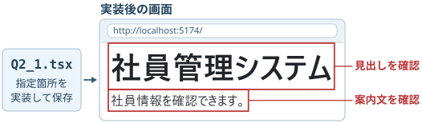{#ch02-app-exercise-result}

::: {#ch02-app-exercise-result-caption .paragraph}
確認演習の実装後に表示される社員管理システムの画面
:::

::: {#ch02-21-paragraph-70 .paragraph}
見出しに「社員管理システム」、案内文に「社員情報を確認できます。」と表示されていれば、演習完了です。
:::

::: {#ch02-21-paragraph-71 .paragraph}
画面に変更が反映されない場合は、ブラウザーの画面を再読み込みして、もう一度確認してください。
:::

::: {#ch02-21-section-points-01 .section-points}
この節のポイント

● Reactでは、画面をコンポーネントという部品に分けて作成できる。

● 関数コンポーネントは関数として定義し、`return` で画面に表示する内容を返す。

● コンポーネント名の先頭は大文字にする。

● JSXは、JavaScriptの中にHTMLに似た記述を書くための構文である。

● JSXでは、複数の要素を1つにまとめて返し、タグを必ず閉じる。

● JSXでCSSのクラスを指定する際は、`className` を使用する。
:::
::::

:::: {#page-12 .source-page}
::: {#ch02-values-title .heading}
2.2. JSXによるデータ表示と属性の設定
:::

::: {#ch02-values-slide .slide layout="illustration"}
JSXによるデータ表示と属性の設定


:::

::: {#ch02-22-heading-01 .heading level="minor"}
JSXでJavaScriptの値を使用する
:::

::: {#ch02-22-paragraph-01 .paragraph}
前節では、JSXの中に `{変数名}` と記述すると、変数に格納されている値を画面に表示できることを学習しました。
:::

::: {#ch02-22-paragraph-02 .paragraph}
実際のWebアプリケーションでは、変数の値をそのまま表示するだけでなく、データをもとにさまざまな情報を表示する必要があります。
:::

::: {#ch02-22-paragraph-03 .paragraph}
例えば、ショッピングサイトの商品情報画面では、次のような処理が必要になります。
:::

::: {#ch02-22-paragraph-04 .paragraph}
● 商品データから商品名や単価を取得して表示する。
:::

::: {#ch02-22-paragraph-05 .paragraph}
● 商品の単価と数量から合計金額を計算して表示する。
:::

::: {#ch02-22-paragraph-06 .paragraph}
● 商品ごとに異なる画像を表示する。
:::

::: {#ch02-22-paragraph-07 .paragraph}
JSXでは、変数だけでなく、計算結果やオブジェクトのプロパティなども画面に表示できます。また、画像のパスやCSSのクラスなど、**HTML要素の属性にもJavaScriptの値を設定できます。**
:::

::: {#ch02-22-paragraph-08 .paragraph}
この節では、商品情報を表示するサンプルを使って、これらの記述方法を学習します。
:::
::::

:::: {#page-13 .source-page}
::: {#ch02-22-heading-02 .heading level="minor"}
【サンプル】商品情報を表示する
:::

::: {#ch02-22-paragraph-09 .paragraph}
今回は、商品名・単価・画像のパスを1つのオブジェクトとして管理し、それらの情報を画面に表示します。
:::

::: {#ch02-22-paragraph-10 .paragraph}
商品の数量は2個とし、単価と数量から合計金額を求めます。また、Bootstrapを使用して、合計金額を青い太字で表示します。
:::

::: {#ch02-22-code-01 .code filename="ch02-basic/src/components/Sample2_2.tsx"}
~~~tsx
export default function Sample2_2() {
  // 商品情報
  const product = {
    name: 'ノート',
    price: 250,
    imagePath: '/images/notebook.png'
  }

  // 数量とデザイン
  const quantity = 2
  const totalClass = 'text-primary fw-bold'

  return (
    <main className="container mt-4">
      <h1>商品情報</h1>

      

      <p>商品名：{product.name}</p>
      <p>単価：{product.price}円</p>
      <p>数量：{quantity}個</p>

      <p className={totalClass}>
        合計：{product.price * quantity}円
      </p>
    </main>
  )
}
~~~
:::
::::

:::: {#page-14 .source-page}
::: {#ch02-22-paragraph-11 .paragraph}
配布サンプルの `ch02-basic` フォルダーで、初回は `npm install` を実行してください。1.5節と同じ手順で開発サーバーを起動し、ブラウザーのメニューから「2.2 JSXによるデータ表示と属性の設定」を選択してください。
:::

::: {#ch02-22-paragraph-12 .paragraph}
次のように、商品情報と合計金額が表示されます。
:::

{#ch02-product-display}

::: {#ch02-product-display-caption .paragraph}
商品情報を表示する完成サンプル
:::

::: {#ch02-22-heading-03 .heading level="minor"}
構文の解説
:::

::: {#ch02-22-step-01 .step}
**① オブジェクトのプロパティや変数の値を表示する**
:::

::: {#ch02-22-paragraph-13 .paragraph}
商品名や単価など、関連する複数のデータを管理する場合には、JavaScriptのオブジェクトを使用できます。
:::

::: {#ch02-22-paragraph-14 .paragraph}
今回のサンプルでは、商品情報を次のように `product` というオブジェクトにまとめています。また、商品の数量は `quantity` という変数に格納しています。
:::

::: {#ch02-22-code-02 .code filename="ch02-basic/src/components/Sample2_2.tsx"}
~~~tsx
3:  const product = {
4:    name: 'ノート',
5:    price: 250,
6:    imagePath: '/images/notebook.png'
7:  }
10:  const quantity = 2
~~~
:::
::::

:::: {#page-15 .source-page}
::: {#ch02-22-paragraph-15 .paragraph}
オブジェクトには、プロパティ名と値の組み合わせを記述します。例えば、`name: 'ノート'` では、`name` というプロパティに「ノート」という文字列を設定しています。
:::

::: {#ch02-22-paragraph-16 .paragraph}
オブジェクトから値を取得する場合は、`オブジェクト名.プロパティ名` の形式で記述します。今回の `product` では、次のように値を取得できます。
:::

::: {#ch02-22-table-01 .table}
| 記述 | 取得できる値 | 意味 |
|---|---|---|
| `product.name` | `'ノート'` | 商品名 |
| `product.price` | `250` | 単価 |
| `product.imagePath` | `'/images/notebook.png'` | 商品画像のパス |
:::

::: {#ch02-22-paragraph-17 .paragraph}
次に、取得した値を画面に表示する部分を確認しましょう。
:::

::: {#ch02-22-code-03 .code filename="ch02-basic/src/components/Sample2_2.tsx" start-line="23"}
~~~tsx
      <p>商品名：{product.name}</p>
      <p>単価：{product.price}円</p>
      <p>数量：{quantity}個</p>
~~~
:::

::: {#ch02-22-paragraph-18 .paragraph}
前節と同じように、表示したい値を波括弧 `{ }` で囲んでいます。
:::

::: {#ch02-22-paragraph-19 .paragraph}
例えば、23行目の `{product.name}` では、`product` オブジェクトの `name` プロパティから取得した値が使用されます。その結果、画面には「商品名：ノート」と表示されます。
:::

::: {#ch02-22-paragraph-20 .paragraph}
24行目では単価を、25行目では数量を表示しています。「単価：」や「円」のように、波括弧の外に記述した文字は、そのまま表示されます。
:::

::: {#ch02-22-table-02 .table}
| JSXの記述 | 画面に表示される内容 |
|---|---|
| `商品名：{product.name}` | 商品名：ノート |
| `単価：{product.price}円` | 単価：250円 |
| `数量：{quantity}個` | 数量：2個 |
:::

::: {#ch02-22-paragraph-21 .paragraph}
このように、**JSXの波括弧 `{ }` の中には、JavaScriptの式を記述できます。**
:::

::: {#ch02-22-paragraph-22 .paragraph}
例えば、`product.name` はオブジェクトのプロパティの値を取得する式です。波括弧で囲むことで、その式から得られた値をJSXの中で使用できます。
:::

::: {#ch02-22-paragraph-23 .paragraph}
なお、`if` 文や `for` 文のように、処理の流れを制御する文を波括弧の中にそのまま記述することはできません。条件に応じた表示や繰り返し表示の方法については、後続の節で学習します。
:::
::::

:::: {#page-16 .source-page}
::: {#ch02-22-step-02 .step}
**② 計算結果を画面に表示する**
:::

::: {#ch02-22-paragraph-24 .paragraph}
JSXの波括弧 `{ }` の中には、変数やオブジェクトのプロパティだけでなく、計算式も記述できます。
:::

::: {#ch02-22-paragraph-25 .paragraph}
今回のサンプルでは、商品の合計金額を次のように表示しています。
:::

::: {#ch02-22-code-04 .code filename="ch02-basic/src/components/Sample2_2.tsx" start-line="28"}
~~~tsx
        合計：{product.price * quantity}円
~~~
:::

::: {#ch02-22-paragraph-26 .paragraph}
`product.price` は商品の単価、`quantity` は商品の数量です。これらを `*`（掛け算）で結ぶことで、合計金額を求めています。
:::

::: {#ch02-22-paragraph-27 .paragraph}
今回の商品は単価250円、数量2個なので、計算結果は500となります。そのため、画面には「合計：500円」と表示されます。
:::

{#ch02-calculation-diagram}

::: {#ch02-calculation-diagram-caption .paragraph}
単価と数量から合計金額を計算して表示する
:::

::: {#ch02-22-paragraph-28 .paragraph}
このように、**JSXの中で直接計算できるため、計算結果をあらかじめ別の変数に格納しなくても表示できます。**
:::

::: {#ch02-22-step-03 .step}
**③ HTML要素の属性に値を設定する**
:::

::: {#ch02-22-paragraph-29 .paragraph}
ここまでは、`<p>` などの要素の中に、JavaScriptの値を表示する方法を確認しました。
:::

::: {#ch02-22-paragraph-30 .paragraph}
JSXでは、要素の中に表示する内容だけでなく、`src` や `alt` などの属性にもJavaScriptの値を設定できます。
:::
::::

:::: {#page-17 .source-page}
::: {#ch02-22-paragraph-31 .paragraph}
例えば、通常のHTMLでノートの画像を表示する場合は、次のように記述します。
:::

::: {#ch02-22-code-05 .code example="true" highlight-tokens="\"/images/notebook.png\"|\"ノート\""}
~~~html

~~~
:::

::: {#ch02-22-paragraph-32 .paragraph}
このコードでは、`src` 属性に画像のパスを、`alt` 属性に画像の代替テキストを直接指定しています。
:::

::: {#ch02-22-paragraph-33 .paragraph}
一方、今回のReactのサンプルでは、これらの情報を `product` オブジェクトに格納しています。オブジェクトに格納された値を属性に設定する場合は、次のように記述します。
:::

::: {#ch02-22-code-06 .code filename="ch02-basic/src/components/Sample2_2.tsx" start-line="17"}
~~~tsx
      
~~~
:::

::: {#ch02-22-paragraph-34 .paragraph}
18行目の `src={product.imagePath}` では、`product.imagePath` から取得した画像のパスを `src` 属性に設定しています。今回の場合は `/images/notebook.png` が設定されるため、ノートの画像が表示されます。
:::

::: {#ch02-22-paragraph-35 .paragraph}
19行目の `alt={product.name}` では、商品名の「ノート」を代替テキストとして設定しています。
:::

::: {#ch02-22-paragraph-36 .paragraph}
また、20行目の `width={180}` では、画像の表示幅を180ピクセルに指定しています。
:::

::: {#ch02-22-paragraph-37 .paragraph}
ここで重要なのは、**属性に固定の文字列を指定する場合と、JavaScriptの値を指定する場合では、書き方が異なる**という点です。
:::

::: {#ch02-22-table-03 .table}
| 記述 | 意味 |
|---|---|
| `src="/images/notebook.png"` | 固定の文字列を画像のパスに指定する |
| `src={product.imagePath}` | プロパティから取得した値を画像のパスに指定する |
| `alt={product.name}` | プロパティから取得した値を代替テキストに指定する |
| `width={180}` | 数値の180を画像の表示幅に指定する |
:::
::::

::::: {#page-18 .source-page}
::: {#ch02-22-paragraph-38 .paragraph}
固定の文字列を指定する場合は引用符 `" "` で囲み、JavaScriptの式を指定する場合は波括弧 `{ }` で囲みます。
:::

::: {#ch02-22-paragraph-39 .paragraph}
例えば、次のように波括弧の外側を引用符で囲むと、`{product.imagePath}` という文字列そのものが画像のパスとして設定されます。そのため、目的の画像を読み込むことができません。
:::

::: {#ch02-22-step-04 .step keep-next="1"}
**誤った例**
:::

::: {#ch02-22-code-07 .code example="true" highlight-tokens="\"{product.imagePath}\""}
~~~tsx

~~~
:::

::: {#ch02-22-step-05 .step keep-next="1"}
**正しい例**
:::

::: {#ch02-22-code-08 .code example="true" highlight-tokens="src={product.imagePath}"}
~~~tsx

~~~
:::

{#ch02-image-path-result}

::: {#ch02-image-path-result-caption .paragraph}
オブジェクトに格納した画像のパスをsrc属性に設定する流れ
:::

::: {#ch02-22-paragraph-40 .paragraph}
このように、商品情報をオブジェクトとして管理しておけば、商品ごとに異なる画像や代替テキストを、同じJSXの記述で設定できます。
:::

:::: {#ch02-22-training-note-01 .training-note}
**【補足】画像ファイルの配置**

今回使用する `notebook.png` は、配布サンプルの `public/images` フォルダーに用意されています。

Viteでは、`public` フォルダー内のファイルを、サイトのルートを基準としたパスで参照できます。そのため、今回の画像は `/images/notebook.png` と指定します。画像のパスに `public` を含める必要はありません。
::::
:::::

::::: {#page-19 .source-page}
::: {#ch02-22-step-06 .step}
**④ classNameによるデザインの設定**
:::

::: {#ch02-22-paragraph-41 .paragraph}
前節では、JSXでCSSのクラスを指定する際に、`className` を使用することを学習しました。
:::

::: {#ch02-22-paragraph-42 .paragraph}
本研修では、画面のデザインを簡単に整えるために、Bootstrapを使用します。
:::

::: {#ch02-22-paragraph-43 .paragraph}
例えば、合計金額を青い太字で表示するには、次のように記述できます。
:::

::: {#ch02-22-code-09 .code example="true"}
~~~tsx
<p className="text-primary fw-bold">合計：500円</p>
~~~
:::

::: {#ch02-22-paragraph-44 .paragraph}
`text-primary` と `fw-bold` は、Bootstrapが用意しているCSSのクラスです。
:::

::: {#ch02-22-table-04 .table}
| クラス名 | 役割 |
|---|---|
| `text-primary` | 文字色を青色にする（今回のBootstrapの設定の場合） |
| `fw-bold` | 文字を太字にする |
:::

::: {#ch02-22-paragraph-45 .paragraph}
複数のクラスを使用する場合は、空白で区切って指定します。これにより、2つのクラスが同じ要素に適用され、合計金額が青い太字で表示されます。
:::

::: {#ch02-22-paragraph-46 .paragraph}
また、`className` 属性にもJavaScriptの変数を使用できます。
:::

::: {#ch02-22-paragraph-47 .paragraph}
今回のサンプルでは、11行目でクラス名を変数に格納し、27行目でその変数の値を使用しています。
:::

::: {#ch02-22-code-10 .code filename="ch02-basic/src/components/Sample2_2.tsx"}
~~~tsx
11:  const totalClass = 'text-primary fw-bold'
27:      <p className={totalClass}>
28:        合計：{product.price * quantity}円
29:      </p>
~~~
:::

::: {#ch02-22-paragraph-48 .paragraph}
`className={totalClass}` と記述することで、変数 `totalClass` に格納されている `text-primary fw-bold` がCSSのクラスとして設定されます。
:::

::: {#ch02-22-paragraph-49 .paragraph}
クラス名を直接指定した場合も、変数の値を指定した場合も、適用されるCSSのクラスは同じです。
:::

::: {#ch02-22-paragraph-50 .paragraph}
ただし、`className="totalClass"` と記述すると、変数の値ではなく「totalClass」という固定の文字列を指定したことになります。
:::

::: {#ch02-22-paragraph-51 .paragraph}
このように、**CSSのクラスを変数で指定する場合も、波括弧 `{ }` を使用します。**
:::

::: {#ch02-22-paragraph-52 .paragraph}
データの値に応じて文字色やデザインを切り替える場合にも、この書き方を活用できます。条件によってデザインを切り替える方法は、2.5節で学習します。
:::

:::: {#ch02-22-training-note-02 .training-note}
**【補足】BootstrapのCSSの読み込み**

Bootstrapをインストールしただけでは、画面にBootstrapのデザインは適用されません。BootstrapのCSSを読み込む必要があります。

本研修の配布サンプルでは、`main.tsx` に次の記述を用意しています。

~~~{#ch02-22-code-11 .tsx filename="ch02-basic/src/main.tsx" start-line="3"}
import 'bootstrap/dist/css/bootstrap.min.css'
~~~

この記述によってBootstrapのCSSが読み込まれ、`text-primary` や `fw-bold` などのクラスを画面のデザインに使用できます。

配布サンプルには、この設定があらかじめ記述されているため、受講者が追加する必要はありません。
::::
:::::

:::: {#page-20 .source-page}
::: {#ch02-22-heading-04 .heading level="minor"}
【確認演習】商品情報の表示と属性を設定する
:::

::: {#ch02-22-paragraph-53 .paragraph}
商品名・単価・画像のパス・数量などのデータをJSXに設定し、商品情報を表示する画面を作成します。
:::

::: {#ch02-22-paragraph-54 .paragraph}
商品データや数量、合計金額のデザインに使用するCSSのクラス名は、あらかじめ定義されています。これらの値を使用して、商品情報を正しく表示できるようにしましょう。
:::

::: {#ch02-22-paragraph-55 .paragraph numbered="true"}
1．`ch02-basic-q` プロジェクトの `src/components/Q2_2.tsx` を開いてください。
:::

::: {#ch02-22-paragraph-56 .paragraph numbered="true"}
2．コード内の➀～➃の番号付きコメントを確認し、指示された箇所を実装してください。コメントに指定されていないコードや、ほかのファイルは変更する必要はありません。
:::

::: {#ch02-22-paragraph-57 .paragraph numbered="true"}
3．編集したファイルを保存してください。
:::

::: {#ch02-22-paragraph-58 .paragraph numbered="true"}
4．`ch02-basic-q` の開発サーバーを起動し、ターミナルに表示されたURLを開いてください。すでに開発サーバーを起動している場合は、ブラウザーの画面に戻ってください。
:::

::: {#ch02-22-paragraph-59 .paragraph numbered="true"}
5．メニューから「2.2 JSXによるデータ表示と属性の設定」を選択してください。
:::

::: {#ch02-22-heading-05 .heading level="minor"}
動作確認
:::

::: {#ch02-22-paragraph-60 .paragraph numbered="true"}
6．次の図と見比べながら、商品情報が正しく表示されていることを確認してください。
:::

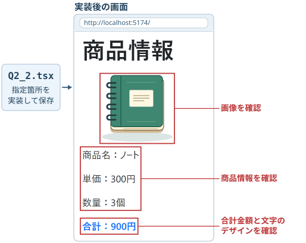{#ch02-product-exercise-result}

::: {#ch02-product-exercise-result-caption .paragraph}
確認演習の実装後に表示される商品情報
:::

::: {#ch02-22-paragraph-61 .paragraph keep-next="3"}
次の3点を確認できれば、演習完了です。
:::

::: {#ch02-22-paragraph-62 .paragraph}
● ノートの画像が表示されている。
:::

::: {#ch02-22-paragraph-63 .paragraph}
● 商品名が「ノート」、単価が300円、数量が3個と表示されている。
:::

::: {#ch02-22-paragraph-64 .paragraph}
● 合計金額が **青い太字で900円** と表示されている。
:::

::: {#ch02-22-paragraph-65 .paragraph}
画面に変更が反映されない場合は、ブラウザーの画面を再読み込みして、もう一度確認してください。
:::

::: {#ch02-22-paragraph-66 .paragraph}
ここまでの演習では、ソースコードを編集して保存することで、画面の表示を変更しました。
:::

::: {#ch02-22-paragraph-67 .paragraph}
実際のWebアプリケーションでは、ボタンのクリックなどによって、プログラムの実行中にデータを変更し、その結果を画面に反映することも必要になります。
:::

::: {#ch02-22-paragraph-68 .paragraph}
次の2.3節では、そのための仕組みとして `useState` を学習します。
:::

::: {#ch02-22-section-points-01 .section-points}
この節のポイント

● JSXでは、波括弧 `{ }` を使用して、変数の値、オブジェクトのプロパティ、計算結果などを表示できる。

● JSXの波括弧の中にはJavaScriptの式を記述する。`if` 文や `for` 文をそのまま記述することはできない。

● 属性に固定の文字列を指定する場合は引用符、JavaScriptの値を指定する場合は波括弧を使用する。

● `src` や `className` などの属性にも、変数やオブジェクトのプロパティの値を設定できる。

● BootstrapのCSSのクラスを指定することで、文字色や文字の太さなどを簡単に設定できる。
:::
::::

:::: {#page-21 .source-page}
::: {#ch02-state-title .heading}
2.3. 状態の管理（useState）
:::

::: {#ch02-state-slide .slide layout="illustration"}
状態の管理（useState）


:::

::: {#ch02-23-heading-01 .heading level="minor"}
状態（state）とは
:::

::: {#ch02-23-paragraph-01 .paragraph}
前節では、JSXを使用して変数の値や計算結果を画面に表示する方法を学習しました。また、ソースコードに記述した値を変更して保存すると、ブラウザーの表示も変わることを確認しました。
:::

::: {#ch02-23-paragraph-02 .paragraph}
しかし、実際のWebアプリケーションでは、ユーザーの操作に応じて、プログラムの実行中にデータを変更する必要があります。
:::

::: {#ch02-23-paragraph-03 .paragraph}
例えば、単価250円のノートを購入する画面で、［1個追加］ボタンをクリックすると、次の2つの表示が変わります。
:::

::: {#ch02-23-paragraph-04 .paragraph}
● 数量：1個から2個に増える。
:::

::: {#ch02-23-paragraph-05 .paragraph}
● 合計金額：250円から500円に変わる。
:::

::: {#ch02-23-paragraph-06 .paragraph}
さらにボタンをクリックした場合は、前回の操作で変更した数量をもとに、次の数量と合計金額を求める必要があります。
:::

::: {#ch02-23-paragraph-07 .paragraph punctuation-font="inherit"}
Reactでは、このように変化するデータを **状態（state：ステート）** として管理できます。
:::

::: {#ch02-23-paragraph-08 .paragraph}
この節では、`useState()` を使用して、データの値を保持し、ユーザーの操作に応じて画面を更新する方法を学習します。
:::
::::

:::: {#page-22 .source-page}
::: {#ch02-23-heading-02 .heading level="minor"}
【サンプル】useStateで商品の数量を変更する
:::

::: {#ch02-23-paragraph-09 .paragraph}
今回は、商品の購入数量をstateで管理します。
:::

::: {#ch02-23-paragraph-10 .paragraph}
最初の数量は1個とし、［1個追加］ボタンをクリックするたびに、数量と合計金額が更新されるようにします。
:::

::: {#ch02-23-code-01 .code filename="ch02-basic/src/components/Sample2_3.tsx"}
~~~tsx
import { useState } from 'react'

export default function Sample2_3() {
  const productName = 'ノート'
  const price = 250
  //let quantity = 1
  const [quantity, setQuantity] = useState(1)

  const addOne = () => {
    //quantity = quantity + 1
    setQuantity(quantity + 1)
  }

  return (
    <main className="container mt-4">
      <h1>商品購入数の確認</h1>
      <p>商品名：{productName}</p>
      <p>単価：{price}円</p>
      <p>数量：{quantity}個</p>
      <p>合計：{price * quantity}円</p>
      <button className="btn btn-primary" onClick={addOne}>
        1個追加
      </button>
    </main>
  )
}
~~~
:::

::: {#ch02-23-paragraph-11 .paragraph}
配布サンプルの `ch02-basic` の開発サーバーを起動し、ブラウザーのメニューから「2.3 状態の管理（useState）」を選択してください。
:::

::: {#ch02-23-paragraph-12 .paragraph}
このサンプルでは、商品の数量を管理するために、これまで使用していた通常の変数ではなく、`useState()` を使用しています。6行目と10行目のコメントは、通常の変数を使用する場合との違いを確認するために用意したものです。
:::
::::

:::: {#page-23 .source-page}
::: {#ch02-23-heading-03 .heading level="minor"}
構文の解説
:::

::: {#ch02-23-step-01 .step}
**① なぜ通常の変数ではなくstateを使用するのか**
:::

::: {#ch02-23-paragraph-13 .paragraph}
これまでのJavaScriptの学習では、変数の値を変更するために代入を使用していました。
:::

::: {#ch02-23-paragraph-14 .paragraph}
例えば、今回のサンプルで `useState()` を使用せず、通常の変数で数量を管理する場合、次のような記述が考えられます。
:::

::: {#ch02-23-code-02 .code example="true"}
~~~tsx
let quantity = 1
~~~
:::

::: {#ch02-23-paragraph-15 .paragraph}
そして、`addOne` 関数の中で、数量を1増やす処理を記述します。
:::

::: {#ch02-23-code-03 .code example="true"}
~~~tsx
quantity = quantity + 1
~~~
:::

::: {#ch02-23-paragraph-16 .paragraph}
この場合、最初にボタンをクリックすると、変数 `quantity` の値は1から2に変わります。
:::

::: {#ch02-23-paragraph-17 .paragraph}
ところが、画面に表示されている数量は「1個」、合計金額は「250円」のままです。変数の値を変更できても、画面の表示は変わりません。
:::

::: {#ch02-23-paragraph-18 .paragraph}
これは、**通常の変数に新しい値を代入しただけでは、Reactがコンポーネントを再レンダリングしないためです。**
:::

::: {#ch02-23-paragraph-19 .paragraph}
ここでいう再レンダリングとは、Reactがコンポーネントを再度実行し、新しいデータをもとに表示内容を求め直すことです。
:::

::: {#ch02-23-paragraph-20 .paragraph}
また、通常のローカル変数は、コンポーネントが再実行されると、宣言した箇所で改めて初期化されます。この例では `let quantity = 1` が再度実行されるため、以前の操作で変更した数量を保持できません。
:::
::::

:::: {#page-24 .source-page}
::: {#ch02-23-paragraph-21 .paragraph}
一方、完成サンプルでは、次の記述を使用しています。
:::

::: {#ch02-23-code-04 .code filename="ch02-basic/src/components/Sample2_3.tsx"}
~~~tsx
7:  const [quantity, setQuantity] = useState(1)
11:    setQuantity(quantity + 1)
~~~
:::

::: {#ch02-23-paragraph-22 .paragraph}
`useState()` で管理するデータの値は、Reactによって保持されます。また、更新用の関数である `setQuantity()` を使用することで、Reactに新しい数量を渡し、画面の表示を更新できます。
:::

{#ch02-state-plain-screen}

::: {#ch02-state-plain-screen-caption .paragraph}
通常の変数とstateを使用した場合の画面更新の違い
:::

::: {#ch02-23-paragraph-23 .paragraph}
このように、`useState()` を使用すると、次の2つのことができます。
:::

::: {#ch02-23-paragraph-24 .paragraph}
● **データの値を保持する：** 再レンダリングされても、更新したstateの値を利用できる。
:::

::: {#ch02-23-paragraph-25 .paragraph}
● **データの更新をReactに知らせる：** 更新用の関数を使用することで、データの変更を画面に反映できる。
:::
::::

:::: {#page-25 .source-page}
::: {#ch02-23-step-02 .step}
**② useStateを使ってstateを定義する**
:::

::: {#ch02-23-paragraph-26 .paragraph punctuation-font="inherit"}
`useState()` は、Reactでstateを管理するための関数です。Reactが提供するこのような特別な関数を **Hooks（フック）** と呼びます。
:::

::: {#ch02-23-paragraph-27 .paragraph}
`useState()` を使用するには、まずReactのライブラリからインポートします。
:::

::: {#ch02-23-code-05 .code filename="ch02-basic/src/components/Sample2_3.tsx"}
~~~tsx
import { useState } from 'react'
~~~
:::

::: {#ch02-23-paragraph-28 .paragraph}
続いて、商品の数量を管理するstateを定義します。
:::

::: {#ch02-23-code-06 .code filename="ch02-basic/src/components/Sample2_3.tsx" start-line="7"}
~~~tsx
  const [quantity, setQuantity] = useState(1)
~~~
:::

::: {#ch02-23-paragraph-29 .paragraph}
この記述は少し複雑に見えるかもしれません。それぞれの部分には、次のような役割があります。
:::

::: {#ch02-23-table-01 .table}
| 記述 | 意味 |
|---|---|
| `useState(1)` | stateの初期値を1にする。 |
| `quantity` | 現在のstateの値（今回のサンプルでは数量）を受け取る。 |
| `setQuantity` | stateを更新するための関数を受け取る。 |
:::

{#ch02-state-pair}

::: {#ch02-state-pair-caption .paragraph}
useStateの初期値・現在の値・更新用の関数
:::
::::

::::: {#page-26 .source-page}
::: {#ch02-23-paragraph-30 .paragraph}
`useState()` は、現在のstateの値と、stateを更新するための関数を、この順番で並べた配列として返します。
:::

::: {#ch02-23-paragraph-31 .paragraph}
その2つの値を受け取るために、左側に `[quantity, setQuantity]` と記述しています。これをJavaScriptの **配列の分割代入** と呼びます。
:::

::: {#ch02-23-paragraph-32 .paragraph}
なお、更新用の関数の名前は自分で決めることができます。本研修では、stateの名前に対応するように、`quantity` に対して `setQuantity` と命名しています。
:::

:::: {#ch02-23-training-note-01 .training-note}
**【補足】useStateの初期値は毎回適用される？**

`useState(1)` と記述しているため、コンポーネントが再実行されるたびに、数量が1に戻るように見えるかもしれません。

しかし、1はstateを最初に用意するときの初期値です。同じコンポーネントが表示され続けている間は、Reactが更新後のstateを保持します。

そのため、数量が2に更新された後に再レンダリングされても、`quantity` には1ではなく、更新後の値である2が入ります。
::::

::: {#ch02-23-step-03 .step}
**③ 更新用の関数でstateを変更する**
:::

::: {#ch02-23-code-07 .code filename="ch02-basic/src/components/Sample2_3.tsx" start-line="9"}
~~~tsx
  const addOne = () => {
    //quantity = quantity + 1
    setQuantity(quantity + 1)
  }
~~~
:::

::: {#ch02-23-paragraph-33 .paragraph}
`addOne` は、商品の数量を1増やすための関数です。10行目は通常の変数を使用する場合の記述であり、完成サンプルでは11行目の `setQuantity()` を使用しています。
:::

::: {#ch02-23-paragraph-34 .paragraph}
**stateの値を更新する場合は、変数に直接代入するのではなく、更新用の関数を使用します。**
:::
:::::

:::: {#page-27 .source-page}
::: {#ch02-23-paragraph-35 .paragraph}
例えば、現在の `quantity` の値が1の場合を考えてみましょう。
:::

::: {#ch02-23-paragraph-36 .paragraph numbered="true"}
1\. 引数の `quantity + 1` を計算すると、結果は2になる。
:::

::: {#ch02-23-paragraph-37 .paragraph numbered="true"}
2\. `setQuantity(2)` に相当する処理が実行される。
:::

::: {#ch02-23-paragraph-38 .paragraph numbered="true"}
3\. Reactが新しい値を受け取り、次のレンダリングで `quantity` の値として2を返す。
:::

::: {#ch02-23-paragraph-39 .paragraph}
ここで、`quantity` は `const` で宣言されていることに注目してください。
:::

::: {#ch02-23-paragraph-40 .paragraph}
`const` で宣言した変数には、通常の代入によって別の値を設定することはできません。しかし、`setQuantity()` は、現在の変数 `quantity` に直接代入するための関数ではありません。Reactが保持しているstateに対して、新しい値を設定するための関数です。
:::

::: {#ch02-23-paragraph-41 .paragraph}
Reactがコンポーネントを再レンダリングすると、関数の中の `useState(1)` が再び呼び出されます。その際に、更新後のstateの値を `quantity` として受け取ります。
:::

::: {#ch02-23-paragraph-42 .paragraph}
このため、`const` を使用していても、stateを更新できます。
:::

::: {#ch02-23-step-04 .step}
**④ ボタンの操作に応じて画面の表示を更新する**
:::

::: {#ch02-23-code-08 .code filename="ch02-basic/src/components/Sample2_3.tsx" start-line="19"}
~~~tsx
      <p>数量：{quantity}個</p>
      <p>合計：{price * quantity}円</p>
      <button className="btn btn-primary" onClick={addOne}>
        1個追加
      </button>
~~~
:::

::: {#ch02-23-paragraph-43 .paragraph}
21行目の `onClick={addOne}` は、ボタンをクリックしたときに `addOne` 関数を実行するための記述です。
:::

::: {#ch02-23-paragraph-44 .paragraph}
［1個追加］ボタンをクリックすると、`addOne` 関数の中で `setQuantity()` が呼び出され、stateが更新されます。
:::
::::

:::: {#page-28 .source-page}
::: {#ch02-23-paragraph-45 .paragraph}
Reactはstateの更新を受けてコンポーネントを再レンダリングします。その結果、次の2つの表示に、新しい数量が使用されます。
:::

::: {#ch02-23-paragraph-46 .paragraph}
● 19行目：`{quantity}` によって、更新後の数量を表示する。
:::

::: {#ch02-23-paragraph-47 .paragraph}
● 20行目：`{price * quantity}` によって、更新後の数量を使って合計金額を計算する。
:::

::: {#ch02-23-paragraph-48 .paragraph}
例えば、数量が2個になると、合計金額も `250 * 2` の計算結果である500円になります。
:::

{#ch02-state-update-flow}

::: {#ch02-state-update-flow-caption .paragraph}
ボタンのクリックから数量と合計金額が更新されるまでの流れ
:::
::::

:::: {#page-29 .source-page}
::: {#ch02-23-paragraph-49 .paragraph}
このように、Reactでは、画面の表示に使用するデータを更新することで、必要な画面の変更を反映できます。従来のJavaScriptのように、数量や合計金額を表示するHTML要素を個別に取得し、その内容を書き換える処理を記述する必要はありません。
:::

::: {#ch02-23-paragraph-50 .paragraph}
なお、ボタンのクリックと関数を結び付ける `onClick` の詳しい書き方は、次の2.4節で学習します。
:::

::: {#ch02-23-step-05 .step}
**⑤ 通常の変数とstateを使い分ける**
:::

::: {#ch02-23-paragraph-51 .paragraph}
ここまでの説明で、Reactではすべての変数を `useState()` で定義する必要があるのか、疑問に思った方もいるかもしれません。
:::

::: {#ch02-23-paragraph-52 .paragraph}
**すべてのデータをstateとして管理する必要はありません。**
:::

::: {#ch02-23-paragraph-53 .paragraph}
今回のサンプルでは、データの用途に応じて、次のように使い分けています。
:::

::: {#ch02-23-table-02 .table}
| データ | 管理方法 | 理由 |
|---|---|---|
| 商品名（`productName`） | 通常の変数（`const`） | このサンプルでは商品名を変更しないため。 |
| 単価（`price`） | 通常の変数（`const`） | このサンプルでは単価を変更しないため。 |
| 数量（`quantity`） | state（`useState()`） | 操作に応じて数量が変わり、変更した値を保持して画面に反映するため。 |
| 合計金額 | `price * quantity` | 単価と数量から計算できるため。 |
:::

::: {#ch02-23-paragraph-54 .paragraph}
特に、合計金額は単価と数量から求められるため、合計金額を管理するstateを別に用意する必要はありません。
:::

::: {#ch02-23-paragraph-55 .paragraph}
合計金額まで別のstateにすると、数量を変更した際に、合計金額も更新する処理が必要になります。計算できる値は、その計算に必要なデータを管理しておけば、表示する際に求めることができます。
:::
::::

::::: {#page-30 .source-page}
:::: {#ch02-23-training-note-02 .training-note}
**【補足】useStateで管理できるデータ型**

`useState()` では、数値だけでなく、文字列や真偽値なども管理できます。

~~~{#ch02-23-code-09 .tsx example="true"}
const [count, setCount] = useState(0)
const [name, setName] = useState('田中')
const [isActive, setIsActive] = useState(true)
~~~

TypeScriptでは、初期値からstateのデータ型が推論されます。上の例では、`count` は `number` 型、`name` は `string` 型、`isActive` は `boolean` 型になります。

例えば、数値を管理する `count` に対して `setCount('田中')` と記述すると、TypeScriptの型チェックで不一致を検出できます。

また、`useState()` を使用する際には、呼び出す場所にも注意が必要です。

本研修では、**関数コンポーネントのトップレベルで `useState()` を呼び出します。** `if` 文や繰り返し処理の中、イベントハンドラーの中では呼び出さないようにしてください。ReactはHookの呼び出し順序をもとにstateを対応付けるためです。
::::

::: {#ch02-23-heading-04 .heading level="minor"}
【確認演習】useStateで商品の数量を1個ずつ増やす
:::

::: {#ch02-23-paragraph-56 .paragraph}
`useState()` を使用して、商品の数量を管理する画面を完成させます。
:::

::: {#ch02-23-paragraph-57 .paragraph}
商品名・単価や画面の基本構成は、あらかじめ用意されています。［1個追加］ボタンをクリックするたびに数量が1個増え、合計金額も更新されるように実装しましょう。
:::

::: {#ch02-23-paragraph-58 .paragraph numbered="true"}
1．`ch02-basic-q` プロジェクトの `src/components/Q2_3.tsx` を開いてください。
:::

::: {#ch02-23-paragraph-59 .paragraph numbered="true"}
2．コード内の➀～➄の番号付きコメントを確認し、指示された箇所を実装してください。➀・➄は既存コードの確認、➁～➃は実装問題です。コメントに指定されていないコードや、ほかのファイルは変更する必要はありません。
:::

::: {#ch02-23-paragraph-60 .paragraph numbered="true"}
3．編集したファイルを保存してください。
:::

::: {#ch02-23-paragraph-61 .paragraph numbered="true"}
4．`ch02-basic-q` の開発サーバーを起動し、ターミナルに表示されたURLを開いてください。すでに開発サーバーを起動している場合は、ブラウザーの画面に戻ってください。
:::

::: {#ch02-23-paragraph-62 .paragraph numbered="true"}
5．メニューから「2.3 状態の管理（useState）」を選択してください。
:::
:::::

:::: {#page-31 .source-page}
::: {#ch02-23-heading-05 .heading level="minor"}
動作確認
:::

::: {#ch02-23-paragraph-63 .paragraph numbered="true"}
6．初期状態では、数量が1個、合計金額が250円と表示されます。［1個追加］ボタンを2回クリックし、クリックするたびに数量と合計金額が次のように変わることを確認してください。
:::

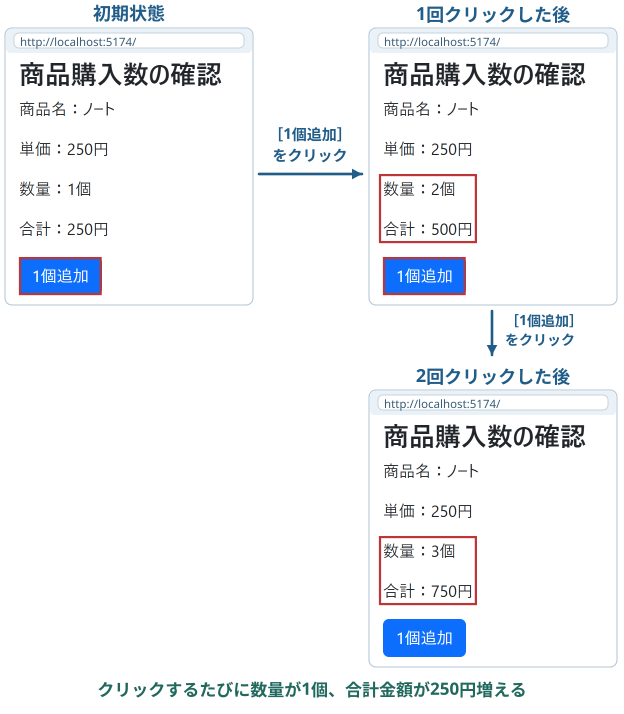{#ch02-state-exercise-result}

::: {#ch02-state-exercise-result-caption .paragraph}
［1個追加］を2回クリックしたときの数量と合計金額
:::
::::

:::: {#page-32 .source-page}
::: {#ch02-23-paragraph-64 .paragraph keep-next="2"}
次の2点を確認できれば、演習完了です。
:::

::: {#ch02-23-paragraph-65 .paragraph}
● ボタンをクリックするたびに、数量が1個ずつ増える。
:::

::: {#ch02-23-paragraph-66 .paragraph}
● 数量に応じて合計金額が更新される。
:::

::: {#ch02-23-paragraph-67 .paragraph}
画面に変更が反映されない場合は、ブラウザーの画面を再読み込みして、もう一度操作してください。
:::

::: {#ch02-23-section-points-01 .section-points}
この節のポイント

● stateを使用すると、コンポーネントが再レンダリングされても更新後の値を保持できる。

● `useState()` は、現在のstateの値と更新用の関数を返す。

● stateを更新するときは、変数への直接代入ではなく、更新用の関数を使用する。

● stateの更新に応じてReactが再レンダリングし、必要な画面の変更を反映する。

● 変更しない固定値や、既存のデータから計算できる値を、すべてstateとして管理する必要はない。
:::
::::

:::: {#page-33 .source-page}
::: {#ch02-events-title .heading}
2.4. イベント処理
:::

::: {#ch02-events-slide .slide layout="illustration"}
イベント処理


:::

::: {#ch02-24-heading-01 .heading level="minor"}
イベント処理とは
:::

::: {#ch02-24-paragraph-01 .paragraph}
前節では、`useState()` を使用して商品の数量を管理し、［1個追加］ボタンをクリックすると、数量と合計金額が変わる画面を確認しました。
:::

::: {#ch02-24-paragraph-02 .paragraph}
このとき、ボタンをクリックしたことをきっかけに、数量を更新する関数が実行されています。
:::

::: {#ch02-24-paragraph-03 .paragraph}
Webアプリケーションでは、ボタンのクリック以外にも、さまざまな操作をきっかけに処理を実行することがあります。
:::

::: {#ch02-24-paragraph-04 .paragraph}
例えば、次のような操作が考えられます。
:::

::: {#ch02-24-paragraph-05 .paragraph}
● ボタンをクリックすると、選択した商品の情報を表示する。
:::

::: {#ch02-24-paragraph-06 .paragraph}
● 入力欄に文字を入力すると、入力内容を確認エリアに表示する。
:::

::: {#ch02-24-paragraph-07 .paragraph}
● フォームを送信すると、入力された情報を登録する。
:::
::::

:::: {#page-34 .source-page}
::: {#ch02-24-paragraph-08 .paragraph punctuation-font="inherit"}
このようなクリックや入力など、プログラムが処理するきっかけとなる出来事を **イベント（Event）** と呼びます。
:::

::: {#ch02-24-paragraph-09 .paragraph punctuation-font="inherit"}
また、**イベントが発生したときに実行する関数を、イベントハンドラー（Event Handler）** と呼びます。
:::

::: {#ch02-24-paragraph-10 .paragraph}
Reactでは、JSXの `onClick` などの属性に関数を指定することで、ユーザーの操作と、実行する処理を結び付けることができます。
:::

::: {#ch02-24-paragraph-11 .paragraph}
この節では、クリックされたボタンに応じて処理を実行する方法と、イベントハンドラーに値を渡す方法を学習します。
:::

::: {#ch02-24-heading-02 .heading level="minor"}
【サンプル】商品の選択と表示
:::

::: {#ch02-24-paragraph-12 .paragraph}
今回は、商品を選択するための2つのボタンと、選択を解除するためのボタンを用意します。
:::

::: {#ch02-24-paragraph-13 .paragraph}
［ノートを選択］または［ボールペンを選択］をクリックすると、選択した商品名が画面に表示されます。また、［選択を解除］をクリックすると、表示が「未選択」に戻ります。
:::
::::

:::: {#page-35 .source-page}
::: {#ch02-24-code-01 .code filename="ch02-basic/src/components/Sample2_4.tsx"}
~~~tsx
import { useState } from 'react'

export default function Sample2_4() {
  const [selectedName, setSelectedName] = useState('未選択')

  const showSelection = (name: string) => {
    setSelectedName(name)
  }

  const clearSelection = () => {
    setSelectedName('未選択')
  }

  return (
    <main className="container mt-4">
      <h1>商品の選択</h1>
      <p>選択中の商品：{selectedName}</p>

      <button className="btn btn-outline-primary me-2"
        onClick={() => showSelection('ノート')}>
        ノートを選択
      </button>
      <button className="btn btn-outline-primary me-2"
        onClick={() => showSelection('ボールペン')}>
        ボールペンを選択
      </button>
      <button className="btn btn-secondary"
        onClick={clearSelection}>
        選択を解除
      </button>
    </main>
  )
}
~~~
:::
::::

:::: {#page-36 .source-page}
::: {#ch02-24-paragraph-14 .paragraph}
配布サンプルの `ch02-basic` の開発サーバーを起動し、ブラウザーのメニューから「2.4 イベント処理」を選択してください。
:::

{#ch02-events-sample-initial}

::: {#ch02-events-sample-initial-caption .paragraph}
商品の選択画面の初期状態
:::

::: {#ch02-24-paragraph-15 .paragraph}
今回のサンプルでは、選択中の商品名を管理するために、stateを使用しています。
:::

::: {#ch02-24-paragraph-16 .paragraph}
また、商品を選択する処理と、選択を解除する処理を、それぞれ関数として定義しています。各ボタンと関数をどのように結び付けているのか、順番に確認していきましょう。
:::

::: {#ch02-24-heading-03 .heading level="minor"}
構文の解説
:::

::: {#ch02-24-step-01 .step}
**① onClickにイベントハンドラーを指定する**
:::

::: {#ch02-24-paragraph-17 .paragraph}
まずは、［選択を解除］ボタンをクリックしたときの処理を確認します。
:::

::: {#ch02-24-code-02 .code filename="ch02-basic/src/components/Sample2_4.tsx" start-line="10"}
~~~tsx
  const clearSelection = () => {
    setSelectedName('未選択')
  }
~~~
:::

::: {#ch02-24-paragraph-18 .paragraph}
`clearSelection` は、選択中の商品名を「未選択」に戻すための関数です。商品名などの値を受け取る必要がないため、引数を定義していません。
:::
::::

:::: {#page-37 .source-page}
::: {#ch02-24-paragraph-19 .paragraph}
この関数を、［選択を解除］ボタンがクリックされたときに実行するため、次のように記述します。
:::

::: {#ch02-24-code-03 .code filename="ch02-basic/src/components/Sample2_4.tsx" start-line="27"}
~~~tsx
      <button className="btn btn-secondary"
        onClick={clearSelection}>
        選択を解除
      </button>
~~~
:::

::: {#ch02-24-paragraph-20 .paragraph}
Reactでは、**`onClick` 属性に、クリック時に実行する関数を指定します。**
:::

::: {#ch02-24-paragraph-21 .paragraph}
今回のサンプルでは `onClick={clearSelection}` と記述しているため、ボタンをクリックすると、`clearSelection` 関数が実行されます。
:::

::: {#ch02-24-paragraph-22 .paragraph}
ここで注意したいのが、`onClick` に関数を指定する際の書き方です。
:::

::: {#ch02-24-paragraph-23 .paragraph}
次の2つの記述を比較してください。
:::

::: {#ch02-24-paragraph-24 .step keep-next="1"}
**正しい書き方**
:::

::: {#ch02-24-code-04 .code example="true"}
~~~tsx
<button onClick={clearSelection}>選択を解除</button>
~~~
:::

::: {#ch02-24-paragraph-25 .paragraph}
この記述では、`clearSelection` という関数そのものを `onClick` に渡しています。この時点では、関数の中の処理は実行されません。ボタンがクリックされたときに、Reactが関数を呼び出します。
:::

::: {#ch02-24-paragraph-26 .step keep-next="1"}
**誤った書き方**
:::

::: {#ch02-24-code-05 .code example="true" highlight-tokens="clearSelection()"}
~~~tsx
<button onClick={clearSelection()}>選択を解除</button>
~~~
:::

::: {#ch02-24-paragraph-27 .paragraph}
JavaScriptでは、関数名の後ろに丸括弧 `()` を付けると、その関数を呼び出します。
:::

::: {#ch02-24-paragraph-28 .paragraph}
そのため、このように記述すると、クリックを待たず、Reactが画面を作成する途中（レンダリング中）に `clearSelection()` が実行されてしまいます。
:::

::: {#ch02-24-paragraph-29 .paragraph}
また、今回の `clearSelection` は関数を戻り値として返さないため、`onClick` に必要な関数を指定できません。TypeScriptの型チェックでもエラーになります。
:::
::::

:::: {#page-38 .source-page}
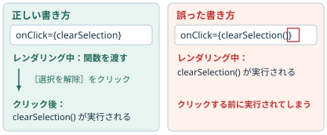{#ch02-events-handler-timing}

::: {#ch02-events-handler-timing-caption .paragraph}
括弧の有無による関数の実行タイミングの違い
:::

::: {#ch02-24-paragraph-30 .paragraph}
このように、クリックされたときに処理を実行するためには、**関数をその場で呼び出すのではなく、後から実行できるように関数を渡す**ことが重要です。
:::

::: {#ch02-24-step-02 .step}
**② 商品名を受け取る共通の関数を定義する**
:::

::: {#ch02-24-paragraph-31 .paragraph}
次に、商品を選択する場合の処理を考えてみましょう。
:::

::: {#ch02-24-paragraph-32 .paragraph}
今回のサンプルでは、［ノートを選択］と［ボールペンを選択］という2つのボタンを用意しています。
:::

::: {#ch02-24-paragraph-33 .paragraph}
どちらのボタンも、選択中の商品名をstateに設定するという点では、同じ処理を行います。異なるのは、設定する商品名だけです。
:::

::: {#ch02-24-paragraph-34 .paragraph}
そこで、商品名を引数として受け取る関数を1つ定義し、2つのボタンで共通して使用します。
:::

::: {#ch02-24-code-06 .code filename="ch02-basic/src/components/Sample2_4.tsx" start-line="6"}
~~~tsx
  const showSelection = (name: string) => {
    setSelectedName(name)
  }
~~~
:::

::: {#ch02-24-paragraph-35 .paragraph}
`showSelection` は、引数 `name` として受け取った商品名を、`setSelectedName()` を使ってstateに設定するための関数です。
:::

::: {#ch02-24-paragraph-36 .paragraph}
例えば、`showSelection('ノート')` が呼び出されると、引数 `name` には「ノート」が入ります。その値を `setSelectedName(name)` に渡すため、選択中の商品名を「ノート」に変更できます。
:::

::: {#ch02-24-paragraph-37 .paragraph}
同じ関数に「ボールペン」を渡せば、選択中の商品名を「ボールペン」に変更できます。
:::

::: {#ch02-24-paragraph-38 .paragraph}
このように、**共通する処理を1つの関数にまとめ、処理に必要なデータを引数として渡す**ことで、ボタンごとに別の関数を作成する必要がなくなります。
:::
::::

::::: {#page-39 .source-page}
:::: {#ch02-24-training-note-01 .training-note}
**【補足】TypeScriptで引数の型を指定する**

上のコードでは、引数を `(name: string)` と記述しています。

- `name`：引数の名前
- `string`：受け取るデータの型（文字列）

このように引数の型を指定しておくと、誤った型のデータを渡した場合に、TypeScriptの型チェックで不一致を検出できます。

::: {#ch02-24-table-01 .table column-widths="36 64"}
| 記述 | 型チェックの結果 |
|---|---|
| `showSelection('ノート')` | 文字列を渡しているため、問題ない。 |
| `showSelection(1)` | 数値を渡しているため、型が一致しない。 |
:::

TypeScriptでは、文脈から引数の型を推論できる場合もあります。ただし、本研修では、自分で定義する関数が引数としてデータを受け取る場合は、`name: string` や `id: number` のように、必要な型を明示することを基本とします。
::::

::: {#ch02-24-step-03 .step}
**③ アロー関数を使用してクリック時に引数を渡す**
:::

::: {#ch02-24-paragraph-39 .paragraph}
先ほど定義した `showSelection` 関数を、ボタンがクリックされたときに実行したいとします。
:::

::: {#ch02-24-paragraph-40 .paragraph}
この関数は商品名を引数として受け取るため、商品名も指定する必要があります。しかし、次のように記述してはいけません。
:::

::: {#ch02-24-code-07 .code example="true" highlight-tokens="showSelection('ノート')"}
~~~tsx
<button onClick={showSelection('ノート')}>
  ノートを選択
</button>
~~~
:::

::: {#ch02-24-paragraph-41 .paragraph}
この記述では、①で確認した誤った書き方と同様に、ボタンをクリックする前に `showSelection('ノート')` が実行されてしまいます。
:::
:::::

:::: {#page-40 .source-page}
::: {#ch02-24-paragraph-42 .paragraph}
そこで、今回のサンプルでは、次のようにアロー関数を使用します。
:::

::: {#ch02-24-code-08 .code filename="ch02-basic/src/components/Sample2_4.tsx" start-line="19"}
~~~tsx
      <button className="btn btn-outline-primary me-2"
        onClick={() => showSelection('ノート')}>
        ノートを選択
      </button>
      <button className="btn btn-outline-primary me-2"
        onClick={() => showSelection('ボールペン')}>
        ボールペンを選択
      </button>
~~~
:::

::: {#ch02-24-paragraph-43 .paragraph}
まず、20行目の `onClick` に指定している、次のアロー関数に注目してください。
:::

::: {#ch02-24-code-09 .code example="true"}
~~~tsx
() => showSelection('ノート')
~~~
:::

::: {#ch02-24-paragraph-44 .paragraph}
この記述は、JavaScriptのアロー関数の構文です。関数の中で実行する処理として、`showSelection('ノート')` を指定しています。
:::

::: {#ch02-24-table-02 .table}
| 記述 | 意味 |
|---|---|
| `()` | アロー関数の引数を記述する部分。今回、ここでは引数を使用しない。 |
| `=>` | アロー関数を表す記号。 |
| `showSelection('ノート')` | このアロー関数が呼び出されたときに実行する処理。 |
:::
::::

:::: {#page-41 .source-page}
::: {#ch02-24-paragraph-45 .paragraph}
例えば、次のように波括弧を使って記述しても、今回のクリック処理は同じように動作します。
:::

::: {#ch02-24-code-10 .code example="true"}
~~~tsx
() => {
  showSelection('ノート')
}
~~~
:::

::: {#ch02-24-paragraph-46 .paragraph}
`onClick` にアロー関数を指定した時点では、その中の `showSelection('ノート')` は実行されません。［ノートを選択］ボタンをクリックすると、Reactがアロー関数を呼び出し、その中で `showSelection('ノート')` が実行されます。
:::

::: {#ch02-24-paragraph-47 .paragraph}
つまり、**クリックされたときに、指定した引数で関数を実行するようにしたい場合は、アロー関数を使用できます。**
:::

::: {#ch02-24-paragraph-48 .paragraph}
［ボールペンを選択］ボタンも同じ仕組みです。ただし、`showSelection` 関数に渡す値が「ボールペン」になります。
:::

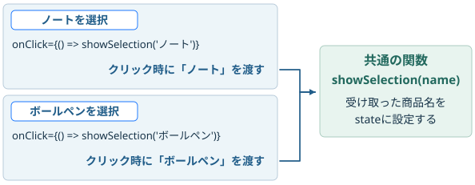{#ch02-events-handler-arguments}

::: {#ch02-events-handler-arguments-caption .paragraph}
ボタンごとに異なる商品名を同じ関数に渡す
:::

::: {#ch02-24-paragraph-49 .paragraph}
ここまでに学習した、イベントハンドラーの指定方法を整理すると、次のようになります。
:::

::: {#ch02-24-table-03 .table column-widths="48 52"}
| 記述 | 意味 |
|---|---|
| `onClick={clearSelection}` | クリック時に、指定した関数を実行する。 |
| `onClick={() => showSelection('ノート')}` | クリック時に、引数を渡して関数を実行する。 |
| `onClick={showSelection('ノート')}` | レンダリング中に関数を実行してしまう（今回の用途では誤り）。 |
:::

::: {#ch02-24-paragraph-50 .paragraph}
実際のReact開発では、1つ目と2つ目の書き方を頻繁に使用します。
:::
::::

:::: {#page-42 .source-page}
::: {#ch02-24-step-04 .step}
**④ イベント処理の結果を画面に反映する**
:::

::: {#ch02-24-paragraph-51 .paragraph}
ここまでで、ボタンがクリックされたときに関数を実行する方法を確認しました。最後に、関数の実行結果がどのように画面へ反映されるのかを確認しましょう。
:::

::: {#ch02-24-code-11 .code filename="ch02-basic/src/components/Sample2_4.tsx"}
~~~tsx
4:  const [selectedName, setSelectedName] = useState('未選択')
17:      <p>選択中の商品：{selectedName}</p>
~~~
:::

::: {#ch02-24-paragraph-52 .paragraph}
`selectedName` は、選択中の商品名を管理するstateです。初期値に「未選択」を指定しているため、最初の画面には「選択中の商品：未選択」と表示されます。
:::

::: {#ch02-24-paragraph-53 .paragraph}
例えば、［ノートを選択］ボタンをクリックすると、次のように処理が行われます。
:::

::: {#ch02-24-paragraph-54 .paragraph numbered="true"}
1\. `onClick` に指定したアロー関数が実行される。
:::

::: {#ch02-24-paragraph-55 .paragraph numbered="true"}
2\. `showSelection('ノート')` が呼び出される。
:::

::: {#ch02-24-paragraph-56 .paragraph numbered="true"}
3\. `setSelectedName(name)` によって、選択中の商品名を「ノート」に更新する。
:::

::: {#ch02-24-paragraph-57 .paragraph numbered="true"}
4\. Reactがコンポーネントを再レンダリングする。
:::

::: {#ch02-24-paragraph-58 .paragraph numbered="true"}
5\. JSXの `{selectedName}` に新しい値が使用され、「選択中の商品：ノート」と表示される。
:::

{#ch02-events-selection-flow}

::: {#ch02-events-selection-flow-caption .paragraph}
クリックイベントから選択中の商品名が画面に反映されるまでの流れ
:::
::::

::::: {#page-43 .source-page}
::: {#ch02-24-paragraph-59 .paragraph}
［選択を解除］ボタンをクリックした場合も、`clearSelection` 関数の中でstateを更新することで、表示が「未選択」に戻ります。
:::

::: {#ch02-24-paragraph-60 .paragraph}
このように、イベント処理はユーザーの操作をきっかけに関数を実行するための仕組みであり、stateは画面に反映するデータを管理するための仕組みです。**イベント処理とstateを組み合わせることで、ユーザーの操作に応じた画面の更新を実装できます。**
:::

:::: {#ch02-24-training-note-02 .training-note}
**【補足】その他のイベント**

ここまではクリックイベントを中心に学習しましたが、Reactでは次のようなイベントも扱えます。

::: {#ch02-24-table-04 .table column-widths="36 64"}
| イベント名 | イベントが発生するタイミング |
|---|---|
| `onClick` | 要素をクリックしたとき。 |
| `onDoubleClick` | 要素をダブルクリックしたとき。 |
| `onMouseEnter` | マウスポインターが要素に入ったとき。 |
| `onMouseLeave` | マウスポインターが要素から離れたとき。 |
| `onChange` | フォームの値が変更されたとき。 |
| `onSubmit` | フォームが送信されたとき。 |
:::

イベントによって実行されるタイミングは異なりますが、JSXの属性に関数を指定するという考え方は同じです。

フォームの入力処理で使用する `onChange` については、2.7節で詳しく学習します。
::::

::: {#ch02-24-heading-04 .heading level="minor"}
【確認演習】商品の選択イベントを実装する
:::

::: {#ch02-24-paragraph-61 .paragraph}
ボタンをクリックすると、選択中の商品名が切り替わる画面を完成させます。
:::

::: {#ch02-24-paragraph-62 .paragraph}
商品名を管理するstateやイベントハンドラーは、あらかじめ用意されています。それぞれのボタンに `onClick` 属性を記述し、クリック時に対応する処理が実行されるようにしましょう。
:::
:::::

:::: {#page-44 .source-page}
::: {#ch02-24-paragraph-63 .paragraph numbered="true"}
1．`ch02-basic-q` プロジェクトの `src/components/Q2_4.tsx` を開いてください。
:::

::: {#ch02-24-paragraph-64 .paragraph numbered="true"}
2．コード内の➀～➄の番号付きコメントを確認し、指示された箇所を実装してください。➀・➁はイベントハンドラーの確認、➂～➄は `onClick` 属性の実装です。コメントに指定されていないコードや、ほかのファイルは変更する必要はありません。
:::

::: {#ch02-24-paragraph-65 .paragraph numbered="true"}
3．編集したファイルを保存してください。
:::

::: {#ch02-24-paragraph-66 .paragraph numbered="true"}
4．`ch02-basic-q` の開発サーバーを起動し、ターミナルに表示されたURLを開いてください。すでに開発サーバーを起動している場合は、ブラウザーの画面に戻ってください。
:::

::: {#ch02-24-paragraph-67 .paragraph numbered="true"}
5．メニューから「2.4 イベント処理」を選択してください。
:::

::: {#ch02-24-heading-05 .heading level="minor"}
動作確認
:::

::: {#ch02-24-paragraph-68 .paragraph numbered="true"}
6．初期状態では、「選択中の商品：未選択」と表示されます。次の図の順番でボタンをクリックし、選択中の商品名が正しく切り替わることを確認してください。
:::

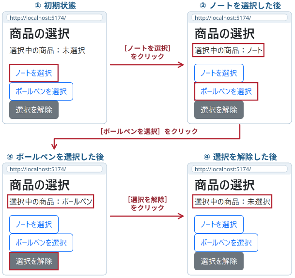{#ch02-events-exercise-result}

::: {#ch02-events-exercise-result-caption .paragraph}
クリックしたボタンに応じて選択中の商品名が切り替わる
:::
::::

:::: {#page-45 .source-page}
::: {#ch02-24-paragraph-69 .paragraph}
［ノートを選択］で「ノート」、［ボールペンを選択］で「ボールペン」と表示され、最後に［選択を解除］で「未選択」に戻れば、演習完了です。
:::

::: {#ch02-24-paragraph-70 .paragraph}
画面に変更が反映されない場合は、ブラウザーの画面を再読み込みして、もう一度操作してください。
:::

::: {#ch02-24-paragraph-71 .paragraph}
ここまでの学習で、ユーザーの操作に応じてデータを変更し、その値を画面に表示できるようになりました。次の2.5節では、データの内容に応じて、表示するメッセージや要素を切り替える方法を学習します。
:::

::: {#ch02-24-section-points-01 .section-points}
この節のポイント

● イベントとは、クリックや入力など、処理のきっかけとなる出来事である。

● イベントハンドラーとは、イベントが発生したときに実行する関数である。

● `onClick={関数名}` と記述すると、クリック時に実行する関数を指定できる。

● クリック時に引数を渡して関数を実行する場合は、`onClick={() => 関数名(引数)}` のようにアロー関数を使用できる。

● イベント処理とstateを組み合わせることで、ユーザーの操作に応じて画面を更新できる。
:::
::::

:::: {#page-46 .source-page}
::: {#ch02-stock-title .heading}
2.5. 条件に応じた表示
:::

::: {#ch02-stock-slide .slide layout="illustration"}
条件に応じた表示


:::

::: {#ch02-25-heading-01 .heading level="minor"}
Reactで条件に応じた表示を行う
:::

::: {#ch02-25-paragraph-01 .paragraph}
前節までに、`useState()` を使用してデータを管理し、ボタンのクリックなどのイベントに応じて画面を更新する方法を学習しました。
:::

::: {#ch02-25-paragraph-02 .paragraph}
実際のWebアプリケーションでは、データの値を画面に表示するだけでなく、**条件に応じて処理や表示内容を切り替える** 必要があります。
:::

::: {#ch02-25-paragraph-03 .paragraph}
例えば、ショッピングサイトで商品を購入する画面を考えてみましょう。
:::

::: {#ch02-25-paragraph-04 .paragraph}
● 在庫がある場合は、購入できることを表示する。
:::

::: {#ch02-25-paragraph-05 .paragraph}
● 在庫が残り1個になった場合は、注意メッセージを追加で表示する。
:::

::: {#ch02-25-paragraph-06 .paragraph}
● 在庫が0個になった場合は、在庫切れであることを表示し、購入できないようにする。
:::

::: {#ch02-25-paragraph-07 .paragraph}
このような画面を作成するには、メッセージを切り替えるだけでなく、購入処理を実行してよいかどうかも判断する必要があります。
:::

::: {#ch02-25-paragraph-08 .paragraph}
Reactでは、JavaScriptのif文、三項演算子（`? :`）、論理AND演算子（`&&`）などを使用して、条件に応じた処理や表示を実装できます。
:::

::: {#ch02-25-paragraph-09 .paragraph}
この節では、商品の在庫数を例に、それぞれの構文の特徴と使い分けを学習します。
:::
::::

:::: {#page-47 .source-page}
::: {#ch02-25-heading-02 .heading level="minor"}
【サンプル】商品の在庫状況を表示する
:::

::: {#ch02-25-paragraph-10 .paragraph}
今回は、最初の在庫数を2個とします。［1個購入］ボタンをクリックするたびに在庫数を1個減らし、その値に応じてメッセージやボタンの状態が変わる画面を作成します。
:::

::: {#ch02-25-code-01 .code filename="ch02-basic/src/components/Sample2_5.tsx"}
~~~tsx
import { useState } from 'react'

export default function Sample2_5() {
  const [stock, setStock] = useState(2)

  const purchaseOne = () => {
    if (stock > 0) {
      setStock(stock - 1)
    }
  }

  return (
    <main className="container mt-4">
      <h1>商品の在庫確認</h1>
      <p>商品名：ノート</p>
      <p>在庫数：{stock}個</p>
      <p>在庫状況：{stock > 0 ? '在庫あり' : '在庫切れ'}</p>

      <p className={stock > 0 ? 'text-success fw-bold'
        : 'text-danger fw-bold'}>
        {stock > 0 ? '購入できます' : '購入できません'}
      </p>

      {stock === 1 && (
        <p className="alert alert-warning">残り1個です</p>
      )}

      <button className="btn btn-primary" onClick={purchaseOne}
        disabled={stock === 0}>
        1個購入
      </button>
    </main>
  )
}
~~~
:::

::: {#ch02-25-paragraph-11 .paragraph}
配布サンプルの `ch02-basic` の開発サーバーを起動し、ブラウザーのメニューから「2.5 条件に応じた表示」を選択してください。
:::
::::

:::: {#page-48 .source-page}
::: {#ch02-25-heading-03 .heading level="minor"}
構文の解説
:::

::: {#ch02-25-step-01 .step}
**① if文で購入処理を実行するか判断する**
:::

::: {#ch02-25-paragraph-12 .paragraph}
今回のサンプルでは、商品の在庫数を `stock` というstateで管理しています。初期値は2です。
:::

::: {#ch02-25-code-02 .code filename="ch02-basic/src/components/Sample2_5.tsx" start-line="4"}
~~~tsx
  const [stock, setStock] = useState(2)
~~~
:::

::: {#ch02-25-paragraph-13 .paragraph}
［1個購入］ボタンをクリックすると、次の `purchaseOne` 関数が実行されます。
:::

::: {#ch02-25-code-03 .code filename="ch02-basic/src/components/Sample2_5.tsx" start-line="6"}
~~~tsx
  const purchaseOne = () => {
    if (stock > 0) {
      setStock(stock - 1)
    }
  }
~~~
:::

::: {#ch02-25-paragraph-14 .paragraph}
JavaScriptで学習したif文は、条件に応じてプログラムの処理を実行したり、実行しなかったりする場合に使用します。
:::

::: {#ch02-25-paragraph-15 .paragraph}
ここでは、`stock > 0` という条件式を使用して、商品が在庫に残っているかどうかを判断しています。
:::

::: {#ch02-25-paragraph-16 .paragraph}
● 条件がtrueの場合：`setStock(stock - 1)` を実行し、在庫数を1個減らす。
:::

::: {#ch02-25-paragraph-17 .paragraph}
● 条件がfalseの場合：`setStock()` を実行せず、在庫数を変更しない。
:::

{#ch02-stock-if-flow}

::: {#ch02-stock-if-flow-caption .paragraph}
if文で在庫数を更新する処理の実行可否を判断する
:::
::::

:::: {#page-49 .source-page}
::: {#ch02-25-paragraph-18 .paragraph}
このように、在庫数が0個の場合には在庫数を減らす処理を実行しないため、在庫数がマイナスになることを防げます。
:::

::: {#ch02-25-paragraph-19 .paragraph}
ここで重要なのは、**if文によって表示する文字列を選んでいるのではなく、stateを更新する処理を実行するかどうかを判断している** という点です。
:::

::: {#ch02-25-paragraph-20 .paragraph}
if文は、条件を満たした場合に複数の処理をまとめて実行するときにも便利です。また、`else if` や `else` を組み合わせることで、3つ以上の場合に分けて処理を記述することもできます。
:::

::: {#ch02-25-paragraph-21 .step}
**JSXの波括弧内にif文を直接記述することはできない**
:::

::: {#ch02-25-paragraph-22 .paragraph}
2.2節では、JSXの波括弧 `{ }` の中にJavaScriptの式を記述できることを学習しました。
:::

::: {#ch02-25-paragraph-23 .paragraph}
ここで、if文を使用して、在庫がある場合に「在庫あり」と表示することを考えてみましょう。
:::

::: {#ch02-25-paragraph-24 .paragraph}
例えば、次のような書き方はできません。
:::

::: {#ch02-25-code-04 .code example="true"}
~~~tsx
<p>
  {if (stock > 0) {
    '在庫あり'
  }}
</p>
~~~
:::

::: {#ch02-25-paragraph-25 .paragraph}
if文は、条件によって処理の流れを制御するJavaScriptの「文」です。一方、JSXの波括弧内には、値を求める「式」を記述します。
:::

::: {#ch02-25-paragraph-26 .paragraph}
そのため、if文を使用する場合は、イベントハンドラーの中や、JSXを返す前のJavaScriptの処理部分などに記述します。
:::

::: {#ch02-25-paragraph-27 .paragraph}
JSXの中で直接表示内容を切り替えたい場合には、次に学習する三項演算子や論理AND演算子を使用できます。
:::
::::

:::: {#page-50 .source-page}
::: {#ch02-25-step-02 .step}
**② 三項演算子で在庫状況を切り替える**
:::

::: {#ch02-25-paragraph-28 .paragraph}
三項演算子は、**条件に応じて2つの値から1つを選ぶための演算子** です。JavaScriptの構文の一つで、Reactでは条件に応じて表示内容を切り替える際によく使用します。
:::

::: {#ch02-25-paragraph-29 .paragraph}
基本構文は次のとおりです。
:::

::: {#ch02-25-code-05 .code example="true" code-label="TSXの記述例"}
~~~text
条件式 ? 条件がtrueの場合の値 : 条件がfalseの場合の値
~~~
:::

::: {#ch02-25-paragraph-30 .paragraph}
条件式の結果がtrueの場合は `?` の後ろの値を、falseの場合は `:` の後ろの値を選びます。
:::

::: {#ch02-25-paragraph-31 .paragraph}
今回のサンプルでは、在庫状況を表示するために三項演算子を使用しています。
:::

::: {#ch02-25-code-06 .code filename="ch02-basic/src/components/Sample2_5.tsx" start-line="17"}
~~~tsx
      <p>在庫状況：{stock > 0 ? '在庫あり' : '在庫切れ'}</p>
~~~
:::

::: {#ch02-25-paragraph-32 .paragraph}
この記述を、次の3つの部分に分けて確認しましょう。
:::

::: {#ch02-25-paragraph-33 .paragraph}
● `stock > 0`：在庫があるかどうかを判断する条件式。
:::

::: {#ch02-25-paragraph-34 .paragraph}
● `'在庫あり'`：条件がtrueの場合に選択する文字列。
:::

::: {#ch02-25-paragraph-35 .paragraph}
● `'在庫切れ'`：条件がfalseの場合に選択する文字列。
:::

{#ch02-stock-ternary}

::: {#ch02-stock-ternary-caption .paragraph}
三項演算子の構文と条件に応じて選択される値
:::

::: {#ch02-25-paragraph-36 .paragraph}
例えば、`stock` の値が2の場合、`stock > 0` はtrueになります。そのため、「在庫あり」という文字列が選ばれ、画面には「在庫状況：在庫あり」と表示されます。
:::

::: {#ch02-25-paragraph-37 .paragraph}
一方、`stock` の値が0の場合はfalseになり、「在庫状況：在庫切れ」と表示されます。
:::

::: {#ch02-25-paragraph-38 .paragraph}
三項演算子は値を求めるJavaScriptの式であるため、**JSXの波括弧内に直接記述できます。** あらかじめ別の変数に表示用の文字列を格納しなくても、表示したい場所で値を選択できます。
:::

::: {#ch02-25-step-03 .step}
**③ 三項演算子で表示内容と文字色を切り替える**
:::

::: {#ch02-25-paragraph-39 .paragraph}
三項演算子は、表示する文字列だけでなく、HTML要素の属性に設定する値を切り替える場合にも使用できます。
:::

::: {#ch02-25-paragraph-40 .paragraph}
例えば、在庫がある場合は緑の太字で「購入できます」、在庫がない場合は赤の太字で「購入できません」と表示したいとします。
:::

::: {#ch02-25-paragraph-41 .paragraph}
今回のサンプルでは、次のように記述しています。
:::

::: {#ch02-25-code-07 .code filename="ch02-basic/src/components/Sample2_5.tsx" start-line="19"}
~~~tsx
      <p className={stock > 0 ? 'text-success fw-bold'
        : 'text-danger fw-bold'}>
        {stock > 0 ? '購入できます' : '購入できません'}
      </p>
~~~
:::

::: {#ch02-25-paragraph-42 .paragraph}
このコードでは、同じ条件式 `stock > 0` を、次の2か所で使用しています。
:::

::: {#ch02-25-paragraph-43 .paragraph}
● `className` 属性：条件に応じて、適用するCSSのクラス名を切り替える。
:::

::: {#ch02-25-paragraph-44 .paragraph}
● `<p>` 要素の内容：条件に応じて、表示するメッセージを切り替える。
:::

::: {#ch02-25-paragraph-45 .paragraph}
`text-success`、`text-danger`、`fw-bold` は、Bootstrapで用意されているCSSのクラスです。`text-success` は緑色、`text-danger` は赤色、`fw-bold` は太字を指定します。
:::

::: {#ch02-25-paragraph-46 .paragraph}
在庫数によって、次のように表示が変わります。
:::

::: {#ch02-25-table-01 .table column-widths="19 42 39"}
| 在庫数 | classNameに設定される値 | 表示内容 |
|---|---|---|
| 1個以上 | `text-success fw-bold` | 購入できます（緑の太字） |
| 0個 | `text-danger fw-bold` | 購入できません（赤の太字） |
:::
::::

:::: {#page-51 .source-page}
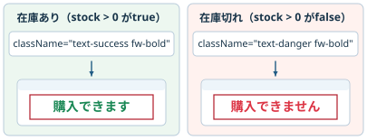{#ch02-stock-message-color}

::: {#ch02-stock-message-color-caption .paragraph}
三項演算子による文字色とメッセージの切り替え
:::

::: {#ch02-25-paragraph-47 .paragraph}
このように、**三項演算子を使用すると、1つのHTML要素の表示内容とデザインを条件に応じて切り替えることができます。**
:::

::: {#ch02-25-step-04 .step punctuation-font="inherit"}
**④ 論理AND演算子（&&）で必要な場合だけ表示する**
:::

::: {#ch02-25-paragraph-48 .paragraph}
ここまで、三項演算子を使用して、条件に応じて2つの表示を切り替える方法を学習しました。
:::

::: {#ch02-25-paragraph-49 .paragraph}
しかし、条件を満たす場合にだけメッセージを表示し、それ以外の場合には何も表示しない、という機能が必要になることもあります。
:::

::: {#ch02-25-paragraph-50 .paragraph}
例えば、今回のサンプルでは、在庫数が1個になった場合だけ「残り1個です」という注意メッセージを表示します。
:::

::: {#ch02-25-paragraph-51 .paragraph}
このような場合に便利なのが、論理AND演算子（`&&`）です。
:::

::: {#ch02-25-paragraph-52 .paragraph}
基本的な記述方法は次のとおりです。
:::

::: {#ch02-25-code-08 .code example="true" code-label="TSXの記述例"}
~~~text
{条件式 && 表示したいJSX}
~~~
:::

::: {#ch02-25-paragraph-53 .paragraph}
今回のサンプルでは、次のように記述しています。
:::

::: {#ch02-25-code-09 .code filename="ch02-basic/src/components/Sample2_5.tsx" start-line="24"}
~~~tsx
      {stock === 1 && (
        <p className="alert alert-warning">残り1個です</p>
      )}
~~~
:::
::::

:::: {#page-52 .source-page}
::: {#ch02-25-paragraph-54 .paragraph}
JavaScriptの `&&` には、左側の式の結果によって、右側の式を評価するかどうかを決める仕組みがあります。
:::

::: {#ch02-25-paragraph-55 .paragraph}
今回のように、左側にtrueまたはfalseになる条件式を記述した場合は、次のようになります。
:::

::: {#ch02-25-paragraph-56 .paragraph}
● 条件がtrueの場合：右側のJSXが評価され、その要素が画面に表示される。
:::

::: {#ch02-25-paragraph-57 .paragraph}
● 条件がfalseの場合：右側のJSXは評価されず、この式の結果はfalseになる。Reactはfalseを画面に表示しないため、その要素は表示されない。
:::

::: {#ch02-25-paragraph-58 .paragraph}
今回の条件式は `stock === 1` です。在庫数が1個の場合だけ、右側の `<p>` 要素が表示されます。
:::

::: {#ch02-25-paragraph-59 .paragraph}
なお、Bootstrapの `alert` と `alert-warning` を指定しているため、注意メッセージには黄色の背景が付きます。
:::

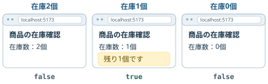{#ch02-stock-and-screens}

::: {#ch02-stock-and-screens-caption .paragraph}
在庫数が1個のときだけ注意メッセージが表示される（画面の一部）
:::

::: {#ch02-25-paragraph-60 .paragraph}
三項演算子と論理AND演算子は、どちらもJSXの波括弧内に記述できます。ただし、用途が異なります。
:::

::: {#ch02-25-paragraph-61 .paragraph}
**2つの表示を切り替える場合は三項演算子、条件を満たす場合だけ要素を表示する場合は `&&`** を使用すると、コードを分かりやすく記述できます。
:::
::::

:::: {#page-54 .source-page}
::::

:::: {#page-55 .source-page}
::: {#ch02-25-step-05 .step}
**⑤ 在庫が0個の場合は購入ボタンを無効にする**
:::

::: {#ch02-25-paragraph-62 .paragraph}
在庫が0個の場合には、購入ボタンをクリックできない状態にします。
:::

::: {#ch02-25-code-12 .code filename="ch02-basic/src/components/Sample2_5.tsx" start-line="28"}
~~~tsx
      <button className="btn btn-primary" onClick={purchaseOne}
        disabled={stock === 0}>
        1個購入
      </button>
~~~
:::

::: {#ch02-25-paragraph-63 .paragraph}
`disabled` は、ボタンや入力欄などを操作できない状態にするためのHTML属性です。
:::

::: {#ch02-25-paragraph-64 .paragraph}
ReactのJSXでは、`disabled` 属性にtrueまたはfalseを指定できます。今回のサンプルでは、`stock === 0` という条件式を指定しています。
:::

::: {#ch02-25-table-02 .table}
| 在庫数 | 条件式 `stock === 0` の結果 | ボタンの状態 |
|---|---|---|
| 1個以上 | false | クリックできる。 |
| 0個 | true | クリックできない。 |
:::

::: {#ch02-25-paragraph-65 .paragraph}
ここで、①で学習したif文との違いを確認しましょう。
:::

::: {#ch02-25-paragraph-66 .paragraph}
● **disabled属性：** ユーザーが購入ボタンを操作できるかどうかを制御する。
:::

::: {#ch02-25-paragraph-67 .paragraph}
● **if文：** `purchaseOne` 関数内で、在庫数を減らす処理を実行するかどうかを制御する。
:::

::: {#ch02-25-paragraph-68 .paragraph}
今回のサンプルでは、在庫がなくなったときにボタンを無効にするとともに、関数内でも在庫数を確認しています。このように、画面上の操作とプログラム内の処理を分けて制御しています。
:::
::::

:::: {#page-56 .source-page}
::: {#ch02-25-heading-04 .heading level="minor"}
条件に応じた処理と表示の使い分け
:::

::: {#ch02-25-paragraph-69 .paragraph}
ここまでに学習したif文、三項演算子、論理AND演算子は、いずれも条件を扱うJavaScriptの構文です。
:::

::: {#ch02-25-paragraph-70 .paragraph}
今回のように、Reactで処理や画面の表示を切り替える場合には、次のように使い分けるとよいでしょう。
:::

::: {#ch02-25-table-03 .table column-widths="28 45 27"}
| 構文 | 適している場面 | JSXの波括弧内に直接記述 |
|---|---|---|
| if / else文 | 条件に応じて処理を実行したり、複数の処理に分岐したりする。 | できない |
| 三項演算子（`? :`） | 条件に応じて2つの値や表示を切り替える。 | できる |
| 論理AND演算子（`&&`） | 条件を満たす場合だけ要素を表示する。 | できる |
:::

::: {#ch02-25-paragraph-71 .paragraph}
なお、三項演算子や論理AND演算子はJSX専用の構文ではありません。JSX以外のJavaScriptの処理部分でも使用できます。
:::

::: {#ch02-25-paragraph-72 .paragraph keep-next="1"}
それでは、今回のサンプルで、在庫数が2個から1個に変わるときの処理の流れを確認しましょう。
:::

{#ch02-stock-display-flow}

::: {#ch02-stock-display-flow-caption .paragraph}
在庫数の更新によって、条件に応じた表示とボタンの状態が変わる仕組み
:::

::: {#ch02-25-paragraph-73 .paragraph}
このように、`useState()` とイベント処理、条件に応じた表示を組み合わせることで、ユーザーの操作によって変化するデータに合わせて、画面の表示や操作できる状態を更新できます。
:::

::: {#ch02-25-heading-05 .heading level="minor"}
【確認演習】商品の在庫表示を実装する
:::

::: {#ch02-25-paragraph-74 .paragraph}
在庫数に応じて、在庫状況や購入可否のメッセージを切り替える画面を作成します。
:::

::: {#ch02-25-paragraph-75 .paragraph}
在庫数を管理するstateや画面の基本構成は、あらかじめ用意されています。if文、三項演算子、論理AND演算子、`disabled` 属性を使用して、在庫数に応じた処理と表示を実装しましょう。
:::
::::

:::: {#page-57 .source-page}
::: {#ch02-25-paragraph-76 .paragraph numbered="true"}
1．`ch02-basic-q` プロジェクトの `src/components/Q2_5.tsx` を開いてください。
:::

::: {#ch02-25-paragraph-77 .paragraph numbered="true"}
2．コード内の➀～➄の番号付きコメントを確認し、指示された箇所を実装してください。➀は既存コードの確認、➁～➄は実装問題です。コメントに指定されていないコードや、ほかのファイルは変更する必要はありません。
:::

::: {#ch02-25-paragraph-78 .paragraph numbered="true"}
3．編集したファイルを保存してください。
:::

::: {#ch02-25-paragraph-79 .paragraph numbered="true"}
4．`ch02-basic-q` の開発サーバーを起動し、ターミナルに表示されたURLを開いてください。起動済みの場合は、開いているブラウザーの画面に戻ってください。
:::

::: {#ch02-25-paragraph-80 .paragraph numbered="true"}
5．メニューから「2.5 条件に応じた表示」を選んでください。
:::

::: {#ch02-25-heading-06 .heading level="minor"}
動作確認
:::

::: {#ch02-25-paragraph-81 .paragraph numbered="true"}
6．［1個購入］ボタンをクリックし、在庫数に応じて、次のように画面の表示が変わることを確認してください。
:::

::: {#ch02-25-paragraph-82 .paragraph}
● 初期状態：在庫数は2個で、「在庫あり」と緑の太字の「購入できます」が表示される。
:::

::: {#ch02-25-paragraph-83 .paragraph}
● 1回クリックした後：在庫数が1個になり、黄色の背景付きで「残り1個です」が表示される。
:::

::: {#ch02-25-paragraph-84 .paragraph}
● 2回クリックした後：在庫数が0個になり、「在庫切れ」と赤の太字の「購入できません」が表示される。注意メッセージは表示されなくなり、［1個購入］ボタンも操作できなくなる。
:::
::::

:::: {#page-58 .source-page}
{#ch02-stock-purchase-states}

::: {#ch02-stock-purchase-states-caption .paragraph}
購入ボタンを2回クリックし、在庫数・注意メッセージ・ボタンの状態が変わることを確認する
:::
::::

:::: {#page-59 .source-page}
::: {#ch02-25-paragraph-85 .paragraph}
在庫数が0個の状態で、購入ボタンを操作できないことも確認してください。
:::

::: {#ch02-25-paragraph-86 .paragraph}
すべての表示とボタンの状態が正しく切り替われば、演習完了です。
:::

::: {#ch02-25-paragraph-87 .paragraph}
画面に変更が反映されない場合は、ブラウザーの画面を再読み込みして、もう一度操作してください。
:::

::: {#ch02-25-section-points-01 .section-points}
この節のポイント

● if文は、条件に応じて処理を実行したり分岐したりする場合に使用する。JSXの波括弧内には直接記述できない。

● 三項演算子は、条件に応じて2つの値から1つを選ぶ場合に使用する。表示内容だけでなく、属性の値にも使用できる。

● 論理AND演算子（`&&`）は、条件を満たす場合だけ要素を表示するときに便利である。

● `disabled={条件式}` を使用すると、条件に応じてボタンなどの操作を制限できる。

● stateを更新すると、Reactが新しい値をもとに画面の表示を求め直すため、条件に応じた表示やボタンの状態を更新できる。
:::
::::

:::: {#page-60 .source-page}
::: {#ch02-list-title .heading}
2.6. 配列データの一覧表示
:::

::: {#ch02-list-slide .slide layout="illustration"}
配列データの一覧表示


:::

::: {#ch02-26-heading-01 .heading level="minor"}
複数のデータを画面に表示するには
:::

::: {#ch02-26-paragraph-01 .paragraph}
これまでの学習では、商品名や単価などのデータをJSXで表示したり、商品の数量や在庫数に応じて画面を更新したりする方法を学習しました。
:::

::: {#ch02-26-paragraph-02 .paragraph}
実際のWebアプリケーションでは、1件の商品情報だけでなく、商品一覧や社員一覧のように、複数のデータをまとめて表示する場面が多くあります。
:::

::: {#ch02-26-paragraph-03 .paragraph}
例えば、商品一覧をテーブル形式で表示する画面を考えてみましょう。
:::

::: {#ch02-26-paragraph-04 .paragraph}
HTMLで商品一覧を作成する場合は、商品ごとに `<tr>` 要素や `<td>` 要素を記述して、テーブルの行を用意する必要があります。
:::

::: {#ch02-26-paragraph-05 .paragraph}
しかし、商品が100件、1,000件と増えると、商品ごとにHTMLを記述するのは大変です。また、商品が追加されたり削除されたりするたびに、HTMLを修正しなければなりません。
:::

::: {#ch02-26-paragraph-06 .paragraph}
そこでReactでは、**配列に格納されたデータの件数に応じて、必要な数のJSX要素を生成する** という方法を使用します。
:::

::: {#ch02-26-paragraph-07 .paragraph}
このときに使用するのが、JavaScriptの配列の `map()` メソッドです。
:::
::::

:::: {#page-61 .source-page}
::: {#ch02-26-heading-02 .heading level="minor"}
【サンプル】商品データをテーブルで一覧表示する
:::

::: {#ch02-26-paragraph-08 .paragraph}
今回は、商品番号・商品名・単価を持つ3件の商品データを配列として定義し、`map()` を使用してテーブル形式で一覧表示します。
:::

::: {#ch02-26-code-01 .code filename="ch02-basic/src/components/Sample2_6.tsx"}
~~~tsx
export default function Sample2_6() {
  const products = [
    { id: 101, name: 'ノート', price: 250 },
    { id: 102, name: 'ボールペン', price: 120 },
    { id: 103, name: '消しゴム', price: 100 }
  ]

  return (
    <main className="container mt-4">
      <h1>商品一覧</h1>
      <table className="table table-bordered w-auto">
        <thead className="table-light">
          <tr>
            <th>商品番号</th>
            <th>商品名</th>
            <th>単価</th>
          </tr>
        </thead>
        <tbody>
          {products.map((product) => (
            <tr key={product.id}>
              <td>{product.id}</td>
              <td>{product.name}</td>
              <td>{product.price}円</td>
            </tr>
          ))}
        </tbody>
      </table>
    </main>
  )
}
~~~
:::
::::

:::: {#page-62 .source-page}
::: {#ch02-26-paragraph-09 .paragraph}
配布サンプルの `ch02-basic` の開発サーバーを起動し、ブラウザーのメニューから「2.6 配列データの一覧表示」を選択してください。
:::

{#ch02-list-table-match}

::: {#ch02-list-table-match-caption .paragraph}
完成サンプルの商品一覧（3件）
:::

::: {#ch02-26-paragraph-10 .paragraph}
画面には、配列に格納した3件の商品が表示されます。テーブルの見出しを除くと、ソースコードに記述されている商品データの行（`<tr>` 要素）は1つ分だけです。
:::

::: {#ch02-26-paragraph-11 .paragraph}
ここからは、1つ分の記述で複数の商品を表示できる仕組みを確認しましょう。
:::

::: {#ch02-26-heading-03 .heading level="minor"}
構文の解説
:::

::: {#ch02-26-step-01 .step}
**① 商品データを配列で定義する**
:::

::: {#ch02-26-paragraph-12 .paragraph}
まず、一覧表示の対象となる商品データを確認します。
:::

::: {#ch02-26-code-02 .code filename="ch02-basic/src/components/Sample2_6.tsx" start-line="2"}
~~~tsx
  const products = [
    { id: 101, name: 'ノート', price: 250 },
    { id: 102, name: 'ボールペン', price: 120 },
    { id: 103, name: '消しゴム', price: 100 }
  ]
~~~
:::

::: {#ch02-26-paragraph-13 .paragraph}
2.2節では、1件の商品情報をオブジェクトとして定義しました。今回は、同じ形式で複数の商品情報を用意し、それらを1つの配列 `products` に格納しています。
:::
::::

:::: {#page-63 .source-page}
::: {#ch02-26-paragraph-14 .paragraph}
それぞれの商品オブジェクトは、次の3つのプロパティを持っています。
:::

::: {#ch02-26-table-01 .table}
| プロパティ | 意味 | 1件目の商品の値 |
|---|---|---|
| `id` | 商品番号 | 101 |
| `name` | 商品名 | 'ノート' |
| `price` | 単価 | 250 |
:::

::: {#ch02-26-paragraph-15 .paragraph}
このように、1件の商品情報をオブジェクトとしてまとめ、そのオブジェクトを配列に格納することで、複数の商品をまとめて扱うことができます。
:::

::: {#ch02-26-paragraph-16 .paragraph}
今回は、一覧表示の仕組みを学習するために、商品データをコンポーネント内に直接定義しています。後続の章では、REST APIから取得した商品データを配列として扱う方法を学習します。
:::

::: {#ch02-26-step-02 .step}
**② map()で配列データを繰り返し処理する**
:::

::: {#ch02-26-paragraph-17 .paragraph}
`map()` は、**配列の各要素に対して指定した関数を実行し、その戻り値を新しい配列として返すJavaScriptのメソッド** です。React独自の機能ではなく、通常のJavaScriptでも使用できます。
:::

::: {#ch02-26-paragraph-18 .paragraph}
Reactでは、この仕組みを利用して、配列の各要素から表示用のJSXを生成します。
:::

::: {#ch02-26-paragraph-19 .paragraph}
今回のサンプルでは、テーブルの `<tbody>` の中に、次のように記述しています。
:::

::: {#ch02-26-code-03 .code filename="ch02-basic/src/components/Sample2_6.tsx" start-line="20"}
~~~tsx
          {products.map((product) => (
            <tr key={product.id}>
              <td>{product.id}</td>
              <td>{product.name}</td>
              <td>{product.price}円</td>
            </tr>
          ))}
~~~
:::
::::

:::: {#page-64 .source-page}
::: {#ch02-26-paragraph-20 .paragraph}
少し複雑に見えるかもしれませんが、JavaScriptで学習した配列やアロー関数と、これまでに学習したJSXを組み合わせた記述です。
:::

::: {#ch02-26-paragraph-21 .paragraph}
それぞれの部分には、次のような役割があります。
:::

::: {#ch02-26-table-02 .table column-widths="23 77"}
| 記述 | 意味 |
|---|---|
| `products` | 繰り返し処理の対象となる配列。 |
| `.map()` | 配列の各要素に対して関数を実行し、戻り値を新しい配列として返すメソッド。 |
| `product` | アロー関数の引数。配列の要素である商品オブジェクトを1件ずつ受け取る。 |
| `=>` | アロー関数を定義する記号。 |
| `<tr>...</tr>` | アロー関数が返す、商品1件分の表示に使用するJSX。 |
:::

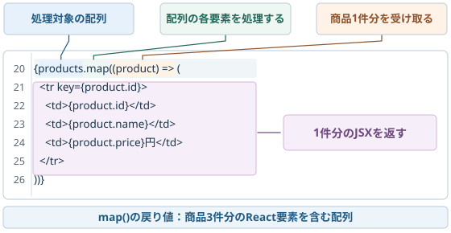{#ch02-list-map-anatomy}

::: {#ch02-list-map-anatomy-caption .paragraph}
map()の構文と各部分の役割
:::

::: {#ch02-26-paragraph-22 .paragraph}
`map()` に渡したアロー関数は、配列の要素ごとに呼び出されます。引数 `product` には、そのときに処理している1件分の商品オブジェクトが渡されます。
:::

::: {#ch02-26-paragraph-23 .paragraph}
そして、その商品情報を使用して、1行分のJSXを返しています。
:::

::: {#ch02-26-paragraph-24 .paragraph}
ここで注目したいのが、アロー関数の記述方法です。
:::

::: {#ch02-26-paragraph-25 .paragraph}
今回のサンプルでは、`=>` の後ろに丸括弧 `( )` を記述し、その中にJSXを書いています。
:::

::: {#ch02-26-paragraph-26 .paragraph}
アロー関数の本体を式として記述する場合は、`return` を省略して、その式の結果を返すことができます。複数行のJSXも、丸括弧でまとめることで1つの式として返せます。
:::

::: {#ch02-26-paragraph-27 .paragraph}
一方、`=>` の後ろに波括弧 `{ }` を記述して処理を書く場合は、戻り値を返すために `return` を明示します。
:::
::::

:::: {#page-65 .source-page}
::: {#ch02-26-paragraph-28 .step punctuation-font="inherit" keep-next="1"}
**returnを省略する書き方（今回のサンプルと同じ形式）**
:::

::: {#ch02-26-code-04 .code example="true"}
~~~tsx
products.map((product) => (
  <tr key={product.id}>
    <td>{product.id}</td>
    <td>{product.name}</td>
    <td>{product.price}円</td>
  </tr>
))
~~~
:::

::: {#ch02-26-paragraph-29 .step keep-next="1"}
**returnを明示する書き方**
:::

::: {#ch02-26-code-05 .code example="true"}
~~~tsx
products.map((product) => {
  return (
    <tr key={product.id}>
      <td>{product.id}</td>
      <td>{product.name}</td>
      <td>{product.price}円</td>
    </tr>
  )
})
~~~
:::

::: {#ch02-26-paragraph-30 .paragraph}
どちらも、アロー関数の戻り値として1件分のReact要素を返す記述です。今回は、表示用のJSXを返すだけなので、`return` を省略する書き方を使用しています。
:::
::::

:::: {#page-66 .source-page}
::: {#ch02-26-step-03 .step}
**③ 配列の各要素からテーブルの行を生成する**
:::

::: {#ch02-26-paragraph-31 .paragraph}
それでは、`map()` が商品データを1件ずつ処理するときに、どのような値が使用されるのかを確認しましょう。
:::

::: {#ch02-26-paragraph-32 .paragraph}
最初に処理されるのは、配列の1件目のデータです。
:::

::: {#ch02-26-code-06 .code filename="ch02-basic/src/components/Sample2_6.tsx" start-line="3"}
~~~tsx
    { id: 101, name: 'ノート', price: 250 },
~~~
:::

::: {#ch02-26-paragraph-33 .paragraph}
この商品オブジェクトが、アロー関数の引数 `product` に渡されます。
:::

::: {#ch02-26-paragraph-34 .paragraph}
次に、テーブルの1行分の表示を記述した部分を確認します。
:::

::: {#ch02-26-code-07 .code filename="ch02-basic/src/components/Sample2_6.tsx" start-line="21"}
~~~tsx
            <tr key={product.id}>
              <td>{product.id}</td>
              <td>{product.name}</td>
              <td>{product.price}円</td>
            </tr>
~~~
:::

::: {#ch02-26-paragraph-35 .paragraph}
2.2節で学習したJSXの波括弧を使用して、商品オブジェクトの各プロパティを表示しています。
:::

::: {#ch02-26-paragraph-36 .paragraph}
1件目の商品を処理する場合は、次の値が使用されます。
:::

::: {#ch02-26-paragraph-37 .paragraph}
● `product.id`：101
:::

::: {#ch02-26-paragraph-38 .paragraph}
● `product.name`：ノート
:::

::: {#ch02-26-paragraph-39 .paragraph}
● `product.price`：250
:::

::: {#ch02-26-paragraph-40 .paragraph}
そのため、1行目には、商品番号101、商品名「ノート」、単価250円が表示されることになります。
:::

::: {#ch02-26-paragraph-41 .paragraph}
2件目を処理する際には、引数 `product` にボールペンの商品情報が渡されるため、同じJSXの記述から、商品番号102、商品名「ボールペン」、単価120円に対応する行が生成されます。
:::

::: {#ch02-26-paragraph-42 .paragraph}
3件目の消しゴムについても、同じように処理されます。
:::
::::

:::: {#page-67 .source-page}
{#ch02-list-table-flow}

::: {#ch02-list-table-flow-caption .paragraph}
配列の各商品から1行分のJSXを生成し、一覧表示する仕組み
:::

::: {#ch02-26-paragraph-43 .paragraph}
このように、`map()` は商品データを1件ずつ処理し、商品3件分のReact要素を含む新しい配列を返します。
:::

::: {#ch02-26-paragraph-44 .paragraph}
Reactは、JSXの波括弧内に記述された式の結果が、このようなReact要素の配列である場合、それぞれの要素を画面に表示できます。
:::

::: {#ch02-26-paragraph-45 .paragraph}
つまり、**商品1件分の表示を記述するだけで、配列に格納されている商品データの件数に応じた一覧を表示できる** ということです。
:::

::: {#ch02-26-paragraph-46 .paragraph}
例えば、配列の商品データが4件になれば、`map()` によって生成される表示も4行になります。商品ごとに `<tr>` 要素や `<td>` 要素を追加する必要はありません。
:::
::::

:::: {#page-68 .source-page}
::: {#ch02-26-step-04 .step}
**④ key属性で繰り返し生成した要素を識別する**
:::

::: {#ch02-26-paragraph-47 .paragraph}
ここまでのコードには、まだ説明していない属性がありました。
:::

::: {#ch02-26-code-08 .code filename="ch02-basic/src/components/Sample2_6.tsx" start-line="21"}
~~~tsx
            <tr key={product.id}>
~~~
:::

::: {#ch02-26-paragraph-48 .paragraph}
`key` は、**Reactが繰り返し生成された要素を識別するために使用する特別な属性** です。
:::

::: {#ch02-26-paragraph-49 .paragraph}
例えば、商品一覧からある商品が削除されたり、表示順序が変更されたりする場合を考えてみましょう。
:::

::: {#ch02-26-paragraph-50 .paragraph}
このような場合、Reactは、変更前と変更後の各要素が、どの商品に対応しているのかを識別する必要があります。そのときに使用されるのが `key` です。
:::

::: {#ch02-26-paragraph-51 .paragraph}
今回のサンプルでは、各商品の商品番号を `key` として使用しています。
:::

::: {#ch02-26-table-03 .table}
| 商品名 | keyに指定される値 |
|---|---|
| ノート | 101 |
| ボールペン | 102 |
| 消しゴム | 103 |
:::

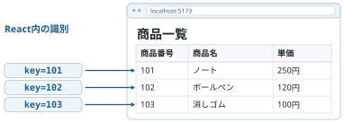{#ch02-list-key-rows}

::: {#ch02-list-key-rows-caption .paragraph}
商品番号をkeyに指定すると、一覧の変更後も同じ商品を識別できる
:::
::::

:::: {#page-69 .source-page}
::: {#ch02-26-paragraph-52 .paragraph}
`key` に値を指定する際には、次の2点に注意してください。
:::

::: {#ch02-26-paragraph-53 .paragraph}
● **同じ一覧内で重複しない値を使用する。** 商品番号や社員番号など、データを一意に識別できる値を使用する。
:::

::: {#ch02-26-paragraph-54 .paragraph}
● **同じデータには安定した値を使用する。** 一覧の表示順序が変わっても、同じ商品には同じ `key` を指定する。
:::

::: {#ch02-26-paragraph-55 .paragraph}
なお、`key` は、Reactが内部で要素を識別するために使用するものであり、HTMLの属性としてブラウザーに渡されるわけではありません。画面の商品番号は、`key` ではなく `<td>{product.id}</td>` によって表示されています。
:::

::::

:::: {#page-70 .source-page}
::: {#ch02-26-heading-04 .heading level="minor"}
【確認演習】商品一覧を表示する
:::

::: {#ch02-26-paragraph-56 .paragraph}
配列に格納されている商品データを、テーブル形式で一覧表示します。
:::

::: {#ch02-26-paragraph-57 .paragraph}
商品データの配列やテーブルの見出しは、あらかじめ用意されています。`map()` を使用して商品データの件数に応じた行を生成し、`key` 属性と商品の各プロパティを設定しましょう。
:::

::: {#ch02-26-paragraph-58 .paragraph numbered="true"}
1．`ch02-basic-q` プロジェクトの `src/components/Q2_6.tsx` を開いてください。
:::

::: {#ch02-26-paragraph-59 .paragraph numbered="true"}
2．コード内の➀～➄の番号付きコメントを確認し、指示された箇所を実装してください。➀と➁は既存コードの確認、➂～➄は実装問題です。コメントに指定されていないコードや、ほかのファイルは変更する必要はありません。
:::

::: {#ch02-26-paragraph-60 .paragraph numbered="true"}
3．編集したファイルを保存してください。
:::

::: {#ch02-26-paragraph-61 .paragraph numbered="true"}
4．`ch02-basic-q` の開発サーバーを起動し、ターミナルに表示されたURLを開いてください。起動済みの場合は、開いているブラウザーの画面に戻ってください。
:::

::: {#ch02-26-paragraph-62 .paragraph numbered="true"}
5．メニューから「2.6 配列データの一覧表示」を選んでください。
:::
::::

:::: {#page-71 .source-page}
::: {#ch02-26-heading-05 .heading level="minor"}
動作確認
:::

::: {#ch02-26-paragraph-63 .paragraph numbered="true"}
6．画面に、次の4件の商品データが表示されることを確認してください。
:::

::: {#ch02-26-table-05 .table}
| 商品番号 | 商品名 | 単価 |
|---|---|---:|
| 201 | ファイル | 600円 |
| 202 | クリップ | 180円 |
| 203 | 付箋 | 240円 |
| 204 | 封筒 | 100円 |
:::

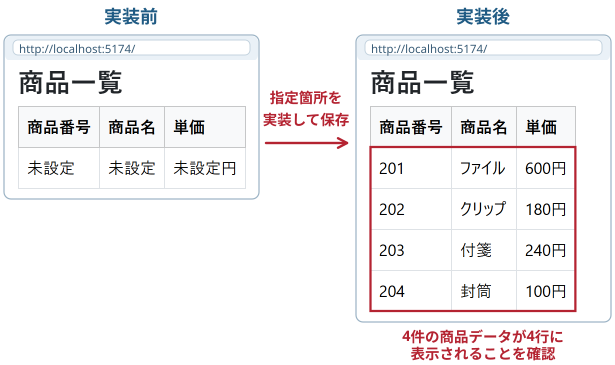{#ch02-list-exercise-result}

::: {#ch02-list-exercise-result-caption .paragraph}
map()によって4件の商品データが4行に表示されることを確認する
:::
::::

:::: {#page-72 .source-page}
::: {#ch02-26-paragraph-64 .paragraph}
テーブルの見出しを除いて4行表示されており、それぞれの商品番号・商品名・単価が正しければ、一覧表示は完成です。
:::

::: {#ch02-26-paragraph-65 .paragraph}
また、ブラウザーの開発者ツールのコンソールを開き、`key` に関する警告が表示されていないことも確認してください。
:::

::: {#ch02-26-paragraph-66 .paragraph}
画面に変更が反映されない場合は、ブラウザーの画面を再読み込みして、もう一度操作してください。
:::

::: {#ch02-26-section-points-01 .section-points}
この節のポイント

● `map()` は、配列の各要素に対して関数を実行し、その戻り値を新しい配列として返すJavaScriptのメソッドである。

● `map()` のアロー関数で1件分のJSXを返すことで、配列のデータ件数に応じた一覧を表示できる。

● `key` は、Reactが繰り返し生成された要素を識別するための特別な属性である。

● `key` には、商品番号のように、同じ一覧内で重複しない一意で安定した値を指定する。

● `map()` は一覧表示に使用するデータを変換するための処理であり、`useState()` は変化するデータを管理するための仕組みである。
:::
::::

:::: {#page-73 .source-page}

::: {#ch02-form-title .heading}
2.7. フォーム入力と状態の連動
:::

::: {#ch02-form-slide .slide layout="illustration"}
フォーム入力と状態の連動

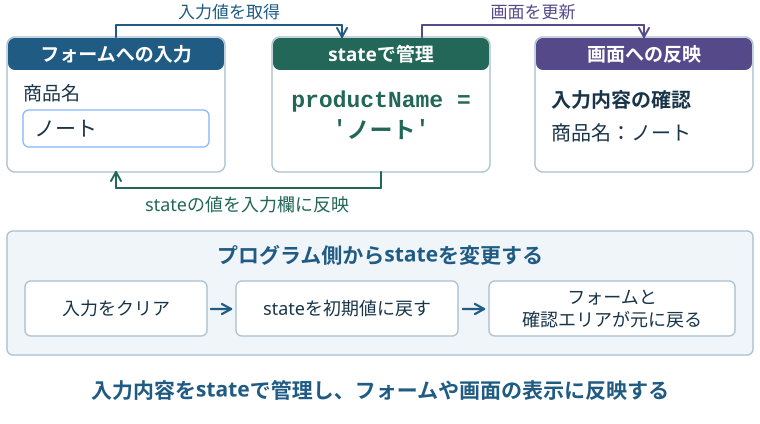
:::

::: {#ch02-form-intro .heading level="minor"}
フォームの入力値をReactで管理するには
:::

::: {#ch02-form-line-59 .paragraph}
これまでの学習では、ボタンのクリックなどのイベントに応じてstateを更新し、その結果を画面に反映する方法を確認しました。
:::

::: {#ch02-form-line-61 .paragraph}
実際のWebアプリケーションでは、ユーザーが入力した情報を使用して処理を行う場面が多くあります。例えば、商品管理システムに商品を登録する場合は、次のような情報をフォームから入力する必要があります。
:::

::: {#ch02-form-line-63 .paragraph}
● 商品名をテキスト入力欄に入力する。
:::

::: {#ch02-form-line-64 .paragraph}
● 商品のカテゴリをセレクトボックスから選択する。
:::

::: {#ch02-form-line-65 .paragraph}
● 販売中かどうかをチェックボックスで指定する。
:::

::: {#ch02-form-line-67 .paragraph}
HTMLを使用すれば、これらの入力要素を作成できます。しかし、入力された情報を確認画面に表示したり、入力内容に応じて別の処理を行ったりするには、プログラムからその値を扱えるようにする必要があります。
:::

::: {#ch02-form-line-69 .paragraph}
Reactでは、その方法の一つとして、**フォームの入力値をstateで管理する** ことができます。
:::

::: {#ch02-form-line-71 .paragraph}
例えば、商品名の入力欄に「ノート」と入力したとき、その値をstateに保存すれば、画面の別の場所にも「ノート」と表示できます。また、プログラム側からstateを変更することで、入力欄の表示を変更することもできます。
:::

::: {#ch02-form-line-73 .paragraph}
この節では、フォームの入力値とstateを連動させるための記述方法を学習します。
:::
::::

:::: {#page-74 .source-page}

::: {#ch02-form-sample .heading level="minor"}
【サンプル】商品情報の入力フォーム
:::

::: {#ch02-form-line-77 .paragraph}
今回は、商品名・カテゴリ・販売状態を入力するフォームを作成します。入力した内容は、画面下部の「入力内容の確認」に反映されます。
:::

::: {#ch02-form-line-79 .paragraph}
また、［入力をクリア］ボタンをクリックすると、すべての入力項目と確認エリアの表示が初期状態に戻るようにします。
:::

::: {#ch02-form-sample-code-1 .code filename="ch02-basic/src/components/Sample2_7.tsx" start-line="1"}
```tsx
import { useState } from 'react'

export default function Sample2_7() {
  const [productName, setProductName] = useState('')
  const [category, setCategory] = useState('文房具')
  const [isAvailable, setIsAvailable] = useState(false)

  const clearInputs = () => {
    setProductName('')
    setCategory('文房具')
    setIsAvailable(false)
  }

  return (
    <main className="container mt-4">
      <h1>商品情報の入力</h1>

      <div className="mb-3">
        <label htmlFor="productName" className="form-label">
          商品名
        </label>
        <input
          id="productName"
          type="text"
          className="form-control"
          value={productName}
          onChange={(e) => setProductName(e.target.value)}
        />
      </div>
```
:::
::::

:::: {#page-75 .source-page}

::: {#ch02-form-sample-code-2 .code filename="ch02-basic/src/components/Sample2_7.tsx" start-line="30"}
```tsx

      <div className="mb-3">
        <label htmlFor="category" className="form-label">
          カテゴリ
        </label>
        <select
          id="category"
          className="form-select"
          value={category}
          onChange={(e) => setCategory(e.target.value)}
        >
          <option value="文房具">文房具</option>
          <option value="事務用品">事務用品</option>
          <option value="電子機器">電子機器</option>
        </select>
      </div>

      <div className="form-check mb-3">
        <input
          id="isAvailable"
          type="checkbox"
          className="form-check-input"
          checked={isAvailable}
          onChange={(e) => setIsAvailable(e.target.checked)}
        />
        <label htmlFor="isAvailable"
          className="form-check-label">
          販売中
        </label>
      </div>
```
:::
::::

:::: {#page-76 .source-page}

::: {#ch02-form-sample-code-3 .code filename="ch02-basic/src/components/Sample2_7.tsx" start-line="60"}
```tsx

      <button className="btn btn-secondary mb-3"
        onClick={clearInputs}>
        入力をクリア
      </button>

      <h2 className="h5">入力内容の確認</h2>
      <p>商品名：{productName || '未入力'}</p>
      <p>カテゴリ：{category}</p>
      <p>販売状態：{isAvailable ? '販売中' : '販売停止'}</p>
    </main>
  )
}
```
:::

::: {#ch02-form-line-159 .paragraph}
配布サンプルの `ch02-basic` の開発サーバーを起動し、ブラウザーのメニューから「2.7 フォーム入力と状態の連動」を選択してください。
:::

{#ch02-form-product-browser}

::: {#ch02-form-product-browser-caption .caption}
フォームで入力・選択した内容が画面下部の確認エリアに表示される
:::
::::

:::: {#page-77 .source-page}

::: {#ch02-form-syntax .heading level="minor"}
構文の解説
:::

::: {#ch02-form-syntax-① .step}
**① フォームの入力値を管理するstateを定義する**
:::

::: {#ch02-form-line-182 .paragraph}
まず、フォームで扱う3つの入力項目に対応するstateを定義します。
:::

::: {#ch02-form-line-184 .code filename="ch02-basic/src/components/Sample2_7.tsx" start-line="4"}
```tsx
  const [productName, setProductName] = useState('')
  const [category, setCategory] = useState('文房具')
  const [isAvailable, setIsAvailable] = useState(false)
```
:::

::: {#ch02-form-line-191 .paragraph}
今回は、次のように初期値を設定しています。
:::

::: {#ch02-form-line-193 .table column-widths="30 26 44"}
| state | 初期値 | 管理するデータ |
|---|---|---|
| `productName` | `''`（空文字列） | 入力された商品名 |
| `category` | `'文房具'` | 選択されたカテゴリ |
| `isAvailable` | `false` | 販売中かどうか |
:::

::: {#ch02-form-line-199 .paragraph}
商品名とカテゴリは文字列で管理します。一方、販売状態は、チェックが付いているかどうかを表す真偽値（`true` または `false`）で管理します。
:::

::: {#ch02-form-line-201 .paragraph}
`useState()` に初期値を指定することで、最初の画面に表示する内容も決められます。
:::

::: {#ch02-form-line-203 .paragraph}
例えば、`productName` の初期値は空文字列なので、商品名の入力欄には何も表示されません。`category` の初期値は「文房具」、`isAvailable` の初期値は `false` なので、最初は「文房具」が選択され、販売中のチェックは外れた状態になります。
:::
::::

:::: {#page-78 .source-page}

::: {#ch02-form-syntax-② .step}
**② テキスト入力欄とstateを連動させる**
:::

::: {#ch02-form-line-207 .paragraph}
次に、商品名の入力欄に注目しましょう。
:::

::: {#ch02-form-line-209 .code filename="ch02-basic/src/components/Sample2_7.tsx" start-line="22"}
```tsx
        <input
          id="productName"
          type="text"
          className="form-control"
          value={productName}
          onChange={(e) => setProductName(e.target.value)}
        />
```
:::

::: {#ch02-form-line-220 .paragraph}
このコードでは、`value` 属性と `onChange` 属性を使用して、テキスト入力欄とstateを連動させています。
:::

::: {#ch02-form-line-222 .step keep-next="1"}
**value属性でstateの値を表示する**
:::

::: {#ch02-form-line-224 .code filename="ch02-basic/src/components/Sample2_7.tsx" start-line="26"}
```tsx
          value={productName}
```
:::

::: {#ch02-form-line-229 .paragraph}
`value` 属性は、入力欄の値を指定するための属性です。
:::

::: {#ch02-form-line-231 .paragraph}
ここでは、`productName` を指定しているため、そのstateの値が入力欄に表示されます。例えば、`productName` の値が「ノート」であれば、入力欄にも「ノート」と表示されます。
:::

::: {#ch02-form-line-233 .paragraph}
ただし、`value` 属性だけでは、ユーザーが入力した値をstateに保存できません。そのための処理を、次の `onChange` で記述します。
:::
::::

:::: {#page-79 .source-page}

::: {#ch02-form-line-235 .step keep-next="1"}
**onChangeで入力値を取得し、stateを更新する**
:::

::: {#ch02-form-line-237 .code filename="ch02-basic/src/components/Sample2_7.tsx" start-line="27"}
```tsx
          onChange={(e) => setProductName(e.target.value)}
```
:::

::: {#ch02-form-line-242 .paragraph}
2.4節では、`onClick` 属性に関数を指定し、ボタンをクリックしたときに処理を実行する方法を学習しました。
:::

::: {#ch02-form-line-244 .paragraph}
`onChange` も、イベントが発生したときに実行する関数を指定するための属性です。Reactのテキスト入力欄では、ユーザーが文字を入力したり削除したりして入力内容が変わると、指定したイベントハンドラーが実行されます。
:::

::: {#ch02-form-line-246 .paragraph}
ここで、`(e) =>` の `e` に注目してください。
:::

::: {#ch02-form-line-248 .paragraph}
Reactはイベントハンドラーを呼び出す際に、発生したイベントに関する情報を持つ **イベントオブジェクト** を引数として渡します。今回のコードでは、そのオブジェクトを `e` という名前の引数で受け取っています。
:::

::: {#ch02-form-line-250 .paragraph}
このイベントオブジェクトを使用することで、どの入力要素でイベントが発生したのか、その入力要素にどのような値が入力されているのかを取得できます。
:::

::: {#ch02-form-line-252 .paragraph}
今回のコードを分解すると、次のようになります。
:::

::: {#ch02-form-line-254 .table column-widths="24 76"}
| 記述 | 役割 |
|---|---|
| `onChange` | 入力値が変更されたときに実行するイベントハンドラーを指定する。 |
| `(e) =>` | イベントオブジェクトを引数として受け取るアロー関数を定義する。 |
| `e` | 発生したイベントに関する情報を持つオブジェクトを受け取る。 |
| `e.target` | 今回は、イベントが発生したテキスト入力欄を参照する。 |
| `e.target.value` | 入力欄の現在の値を文字列として取得する。 |
| `setProductName(...)` | 取得した入力値で商品名のstateを更新する。 |
:::

::: {#ch02-form-line-263 .paragraph}
例えば、入力欄の内容が「ノート」になったときの処理を考えてみましょう。
:::

::: {#ch02-form-line-265 .paragraph numbered="true"}
1\. 入力値が変更され、`onChange` に指定したアロー関数が実行されます。
:::

::: {#ch02-form-line-266 .paragraph numbered="true"}
2\. `e.target.value` から、入力欄の現在の値である「ノート」を取得します。
:::

::: {#ch02-form-line-267 .paragraph numbered="true"}
3\. `setProductName('ノート')` に相当する処理が実行され、商品名のstateが更新されます。
:::

{#ch02-form-onchange-parts}

::: {#ch02-form-onchange-parts-caption .caption}
onChangeに指定した関数で入力値を取得し、stateを更新する
:::

::: {#ch02-form-line-284 .paragraph}
なお、`e` はイベントオブジェクトを受け取る引数の名前です。`event` など、別の名前にすることもできます。
:::

::: {#ch02-form-line-286 .paragraph}
この例では、TypeScriptが `onChange` に指定する関数の引数の型を推論できるため、`e` に対して型を明示する必要はありません。
:::

::: {#ch02-form-label-note .training-note}
**【補足】label要素と入力要素を関連付ける**

```{#ch02-form-label-code .tsx filename="ch02-basic/src/components/Sample2_7.tsx" start-line="19"}
        <label htmlFor="productName" className="form-label">
          商品名
        </label>
        <input
          id="productName"
```

HTMLでは、`label` 要素の `for` 属性と入力要素の `id` 属性に同じ値を指定すると、ラベルと入力要素を関連付けることができます。

ReactのJSXでは、`for` の代わりに **htmlFor** を使用します。今回のように `htmlFor="productName"` と `id="productName"` を指定すると、［商品名］というラベルをクリックして入力欄にフォーカスを移せるようになります。セレクトボックスやチェックボックスのラベルでも、同じ考え方を使用しています。
:::
::::

:::: {#page-80 .source-page}

::: {#ch02-form-syntax-③ .step}
**③ value属性とonChangeを組み合わせる理由**
:::

::: {#ch02-form-line-305 .paragraph}
ここまでで、`value` と `onChange` のそれぞれの役割を確認しました。では、なぜこの2つを組み合わせて記述する必要があるのでしょうか。
:::

::: {#ch02-form-line-307 .paragraph}
例えば、商品名のstateに「ノート」という値が格納されているとします。
:::

::: {#ch02-form-line-309 .step keep-next="1"}
**value属性だけを指定した場合**
:::

::: {#ch02-form-line-311 .code example="true"}
```tsx
<input type="text" value={productName} />
```
:::

::: {#ch02-form-line-316 .paragraph}
この場合、入力欄にはstateの値である「ノート」が表示されます。
:::

::: {#ch02-form-line-318 .paragraph}
しかし、ユーザーが「ノートPC」と入力しようとしても、stateを更新する処理がありません。Reactは `value` に指定されたstateの値を入力欄に反映するため、ユーザーが入力した変更を保持できません。
:::

::: {#ch02-form-line-320 .paragraph}
その結果、入力欄は、ユーザーが編集できない状態になります。このように `value` を指定し、入力を更新するための `onChange` がなく、`readOnly` も指定していない場合、開発時にはReactから警告が表示されることがあります。
:::

::: {#ch02-form-line-322 .step keep-next="1"}
**value属性とonChangeを指定した場合**
:::

::: {#ch02-form-line-324 .code example="true"}
```tsx
<input
  type="text"
  value={productName}
  onChange={(e) => setProductName(e.target.value)}
/>
```
:::

::: {#ch02-form-line-333 .paragraph}
`onChange` を追加することで、ユーザーが入力した値をstateに保存できるようになります。そして、更新されたstateの値が `value` 属性を通じて入力欄に反映されます。
:::

::: {#ch02-form-line-335 .paragraph}
つまり、2つの記述には次のような役割があります。
:::

::: {#ch02-form-line-337 .paragraph}
● **value属性：stateの値を入力欄に反映する。**
:::

::: {#ch02-form-line-338 .paragraph}
● **onChange：入力された値を取得し、stateを更新する。**
:::

{#ch02-form-controlled-compare}

::: {#ch02-form-controlled-compare-caption .caption}
valueとonChangeを組み合わせることで、入力欄とstateを連動させる
:::

::: {#ch02-form-line-357 .paragraph punctuation-font="inherit"}
このように、Reactのstateなどによって入力要素の値を制御する方法を、**制御された入力要素（Controlled Input）** と呼びます。
:::

::: {#ch02-form-line-359 .paragraph}
なお、Reactのすべてのフォームで、入力値をstateとして管理しなければならないわけではありません。本研修では、入力内容をほかの表示や処理に利用したり、プログラムから入力欄の値を変更したりするために、この方法を使用します。
:::
::::

:::: {#page-81 .source-page}

::: {#ch02-form-syntax-④ .step}
**④ セレクトボックスとstateを連動させる**
:::

::: {#ch02-form-line-363 .paragraph}
テキスト入力欄だけでなく、セレクトボックスも同じ考え方でstateと連動させることができます。
:::

::: {#ch02-form-line-365 .code filename="ch02-basic/src/components/Sample2_7.tsx" start-line="35"}
```tsx
        <select
          id="category"
          className="form-select"
          value={category}
          onChange={(e) => setCategory(e.target.value)}
        >
          <option value="文房具">文房具</option>
          <option value="事務用品">事務用品</option>
          <option value="電子機器">電子機器</option>
        </select>
```
:::

::: {#ch02-form-line-379 .paragraph}
ここで注目したいのは、`select` 要素と、その中に記述されている `option` 要素の両方に `value` 属性が指定されていることです。
:::

::: {#ch02-form-line-381 .paragraph}
それぞれの `value` 属性には、次のような役割があります。
:::

::: {#ch02-form-line-383 .table column-widths="51 49"}
| 記述 | 役割 |
|---|---|
| `select` 要素の `value={category}` | 現在選択する値を指定する。 |
| `option` 要素の `value="文房具"` など | 各選択肢に対応する値を指定する。 |
:::

::: {#ch02-form-line-388 .paragraph}
Reactでは、`select` 要素に指定した値と一致する `option` が選択されます。今回の `category` の初期値は「文房具」なので、最初は「文房具」が選択された状態で表示されます。
:::

::: {#ch02-form-line-390 .paragraph}
ユーザーが「電子機器」を選択した場合は、`onChange` に指定した関数が実行されます。`e.target.value` で取得できる値は「電子機器」です。その値を `setCategory()` に渡すことで、`category` が「電子機器」に更新されます。
:::

{#ch02-form-category-states}

::: {#ch02-form-category-states-caption .caption}
セレクトボックスで選択した値をstateに保存し、確認エリアにも反映する
:::

::: {#ch02-form-line-404 .paragraph}
なお、`option` の開始タグと終了タグの間に記述する文字列は、選択肢として画面に表示される文字列です。`value` 属性の値とは別のものです。
:::

::: {#ch02-form-line-406 .paragraph}
今回のサンプルでは、画面に表示する文字列と `value` 属性の値を同じにしていますが、例えばカテゴリ名を画面に表示し、カテゴリ番号を値として扱うこともできます。
:::
::::

:::: {#page-82 .source-page}

::: {#ch02-form-syntax-⑤ .step}
**⑤ チェックボックスとstateを連動させる**
:::

::: {#ch02-form-line-410 .paragraph}
チェックボックスでは、文字列ではなく、チェックの有無を管理します。
:::

::: {#ch02-form-line-412 .code filename="ch02-basic/src/components/Sample2_7.tsx" start-line="48"}
```tsx
        <input
          id="isAvailable"
          type="checkbox"
          className="form-check-input"
          checked={isAvailable}
          onChange={(e) => setIsAvailable(e.target.checked)}
        />
```
:::

::: {#ch02-form-line-423 .paragraph}
テキスト入力欄やセレクトボックスとは異なり、チェックボックスのチェックの有無を制御する場合は、**value属性ではなくchecked属性を使用します。**
:::

::: {#ch02-form-line-425 .paragraph}
`checked` に `true` を指定するとチェックが付き、`false` を指定するとチェックが外れます。今回のサンプルでは `checked={isAvailable}` と記述しているため、`isAvailable` の値に応じてチェックの状態が決まります。
:::

::: {#ch02-form-line-427 .paragraph}
また、ユーザーがチェックを付けたり外したりすると、`onChange` に指定した関数が実行されます。
:::

::: {#ch02-form-line-429 .paragraph}
その際、チェックの有無を取得するために使用するのが、`e.target.checked` です。
:::

::: {#ch02-form-line-431 .paragraph}
● チェックを付けた場合：`e.target.checked` の値は `true`
:::

::: {#ch02-form-line-432 .paragraph}
● チェックを外した場合：`e.target.checked` の値は `false`
:::

::: {#ch02-form-line-434 .paragraph}
取得した真偽値を `setIsAvailable()` に渡すことで、販売状態のstateを更新しています。
:::

::: {#ch02-form-line-436 .paragraph}
テキスト入力欄、セレクトボックス、チェックボックスの記述方法を比較すると、次のようになります。
:::

::: {#ch02-form-line-438 .table column-widths="33 37 30"}
| 比較項目 | テキスト入力欄・セレクトボックス | チェックボックス |
|---|---|---|
| 表示を制御する属性 | `value` | `checked` |
| 変更後の値を取得する方法 | `e.target.value` | `e.target.checked` |
| 今回管理する値の型 | 文字列（string） | 真偽値（boolean） |
:::

{#ch02-form-available-states}

::: {#ch02-form-available-states-caption .caption}
チェックの有無を真偽値で管理し、販売状態を表示する
:::
::::

:::: {#page-83 .source-page}

::: {#ch02-form-syntax-⑥ .step}
**⑥ 入力内容を確認エリアに表示する**
:::

::: {#ch02-form-line-460 .paragraph}
これまでの構文によって、フォームに入力・選択された値をstateとして管理できるようになりました。
:::

::: {#ch02-form-line-462 .paragraph}
あとは、第2章で学習したJSXによるデータ表示の方法を使用すれば、stateの値を画面の別の場所にも表示できます。
:::

::: {#ch02-form-line-464 .code filename="ch02-basic/src/components/Sample2_7.tsx" start-line="66"}
```tsx
      <h2 className="h5">入力内容の確認</h2>
      <p>商品名：{productName || '未入力'}</p>
      <p>カテゴリ：{category}</p>
      <p>販売状態：{isAvailable ? '販売中' : '販売停止'}</p>
```
:::

::: {#ch02-form-line-472 .paragraph}
商品名の表示には、論理OR演算子（`||`）を使用しています。
:::

::: {#ch02-form-line-474 .paragraph}
JavaScriptの `||` は、左側の値が真として扱われる場合はその値を返し、そうでない場合は右側の値を返します。
:::

::: {#ch02-form-line-476 .paragraph}
今回の `productName` は文字列なので、商品名が入力されている場合はその値が使用され、空文字列の場合は右側の「未入力」が使用されます。
:::

::: {#ch02-form-line-478 .table column-widths="27 42 31"}
| `productName` の値 | `productName || '未入力'` の結果 | 画面の表示 |
|---|---|---|
| `''`（空文字列） | `'未入力'` | 商品名：未入力 |
| `'ノート'` | `'ノート'` | 商品名：ノート |
:::

::: {#ch02-form-line-483 .paragraph}
販売状態については、2.5節で学習した三項演算子を使用して、`isAvailable` が `true` の場合は「販売中」、`false` の場合は「販売停止」と表示しています。
:::

::: {#ch02-form-line-485 .paragraph}
ユーザーがフォームを操作するとstateが更新され、Reactがコンポーネントを再レンダリングします。その際、新しいstateの値がフォームと確認エリアの両方に使用されます。
:::

::: {#ch02-form-line-487 .paragraph}
**入力欄と確認エリアで同じstateを使用しているため、確認エリアを個別に書き換える処理を記述する必要はありません。**
:::
::::

:::: {#page-84 .source-page}

::: {#ch02-form-syntax-⑦ .step}
**⑦ 入力内容をクリアする**
:::

::: {#ch02-form-line-491 .paragraph}
ここまでは、ユーザーが入力した値を使用してstateを更新する方法を確認しました。
:::

::: {#ch02-form-line-493 .paragraph}
では、プログラム側からstateを変更した場合は、フォームの表示も変わるのでしょうか。
:::

::: {#ch02-form-line-495 .paragraph}
今回のサンプルでは、［入力をクリア］ボタンをクリックすると、`clearInputs` 関数が実行されるようにしています。
:::

::: {#ch02-form-line-497 .code filename="ch02-basic/src/components/Sample2_7.tsx" start-line="8"}
```tsx
  const clearInputs = () => {
    setProductName('')
    setCategory('文房具')
    setIsAvailable(false)
  }
```
:::

::: {#ch02-form-line-506 .paragraph}
この関数では、3つのstateに、それぞれの初期値と同じ値を設定しています。
:::

::: {#ch02-form-line-508 .paragraph}
それぞれのstateが更新されると、`value` 属性や `checked` 属性を通じて、フォームの表示も更新されます。
:::

::: {#ch02-form-line-510 .table column-widths="27 20 53"}
| 更新するstate | 設定する値 | フォームの表示 |
|---|---|---|
| `productName` | `''` | 商品名の入力欄が空欄になる。 |
| `category` | `'文房具'` | 「文房具」が選択される。 |
| `isAvailable` | `false` | 「販売中」のチェックが外れる。 |
:::

{#ch02-form-render-flow}

::: {#ch02-form-render-flow-caption .caption}
プログラム側からstateを変更すると、フォームと確認エリアの表示も更新される
:::

::: {#ch02-form-line-530 .paragraph}
ここで重要なのは、入力要素を一つずつ取得し、その値を書き換える処理を記述していないことです。
:::

::: {#ch02-form-line-532 .paragraph}
**フォームの表示をstateで制御しているため、stateを変更するだけで、入力欄の内容や選択状態を変更できます。**
:::

::: {#ch02-form-line-534 .paragraph}
この仕組みは、後続の章でREST APIから取得した商品情報を編集フォームに表示するときにも利用します。
:::
::::

::::: {#page-85 .source-page}

:::: {#ch02-form-radio-note .training-note breakable="true"}
【補足】ラジオボタンの場合

ラジオボタンは、複数の選択肢から1つを選ぶための入力要素です。

例えば、商品の販売方法を「店頭販売」と「オンライン販売」から選択する場合を考えてみましょう。

この場合、チェックボックスのようにチェックの有無を個別に管理するのではなく、**現在選択されている値を1つのstateで管理します。**

次のコードは、`useState` をインポートした関数コンポーネント内に記述する例です。

```{#ch02-form-line-546 .tsx example="true"}
const [salesMethod, setSalesMethod] = useState('店頭販売')
return (
  <div>
    <label>
      <input
        type="radio"
        name="salesMethod"
        value="店頭販売"
        checked={salesMethod === '店頭販売'}
        onChange={(e) => setSalesMethod(e.target.value)}
      />
      店頭販売
    </label>
    <label>
      <input
        type="radio"
        name="salesMethod"
        value="オンライン販売"
        checked={salesMethod === 'オンライン販売'}
        onChange={(e) => setSalesMethod(e.target.value)}
      />
      オンライン販売
    </label>
    <p>選択中の販売方法：{salesMethod}</p>
  </div>
)
```

`name` 属性に同じ値を指定することで、2つのラジオボタンを同じグループとして扱います。また、それぞれのラジオボタンの `value` 属性には、選択肢に対応する値を指定します。

::: {#ch02-form-radio-state .step}
**選択された値をstateに保存する**
:::

```{#ch02-form-line-604 .tsx example="true"}
onChange={(e) => setSalesMethod(e.target.value)}
```

チェックボックスでは、`e.target.checked` を使用してチェックの有無を取得しました。

一方、今回のラジオボタンでは、どちらの販売方法が選択されたのかを文字列として管理する必要があります。そのため、`e.target.value` を使用して、選択したラジオボタンの `value` 属性に対応する値を取得します。

例えば、初期状態から「オンライン販売」を選択した場合は、次のように処理が行われます。

1. 「オンライン販売」のラジオボタンで `onChange` イベントが発生します。

2. `e.target.value` から「オンライン販売」を取得し、`setSalesMethod('オンライン販売')` に相当する処理を実行します。

3. stateが更新され、Reactがコンポーネントを再レンダリングします。

4. 選択状態が切り替わり、画面下部の「選択中の販売方法」も更新されます。

::: {#ch02-form-radio-states .note-figure}
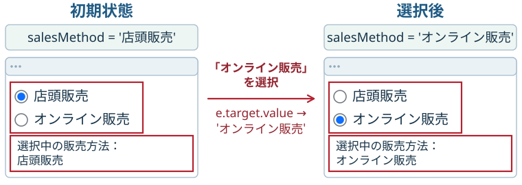
:::

チェックボックスと今回のラジオボタンの使い分けを整理すると、次のようになります。

::: {#ch02-form-line-632 .table column-widths="26 32 42"}
| 比較項目 | チェックボックス | 今回のラジオボタン |
|---|---|---|
| stateで管理する値 | チェックの有無 | 選択中の値 |
| データ型 | 真偽値（boolean） | 文字列（string） |
| `checked` 属性 | stateの値を指定する。 | stateと選択肢の値を比較する。 |
| `onChange` で取得する値 | `e.target.checked` | `e.target.value` |
:::
::::
:::::

:::: {#page-86 .source-page}

::: {#ch02-form-practice .heading level="minor"}
【確認演習】商品情報の入力フォームを作成する
:::

::: {#ch02-form-line-641 .paragraph}
商品名・カテゴリ・販売状態を入力するフォームを作成します。フォームの基本構成や、入力値を管理するstateは、あらかじめ用意されています。
:::

::: {#ch02-form-line-643 .paragraph}
今回は、**value属性・checked属性・onChange** を使用して、フォームの入力値とstateを連動させましょう。
:::

::: {#ch02-form-line-645 .paragraph numbered="true"}
1\. `ch02-basic-q` プロジェクトの `src/components/Q2_7.tsx` を開いてください。
:::

::: {#ch02-form-line-647 .paragraph numbered="true"}
2\. コード内の➀～➅の番号付きコメントを確認し、指示された箇所を実装してください。➀と➄は既存コードの確認、➁～➃と➅は実装問題です。コメントに指定されていないコードや、ほかのファイルは変更する必要はありません。
:::

::: {#ch02-form-line-649 .paragraph numbered="true"}
3\. 編集したファイルを保存してください。
:::

::: {#ch02-form-line-651 .paragraph numbered="true"}
4\. `ch02-basic-q` の開発サーバーを起動し、ターミナルに表示されたURLを開いてください。起動済みの場合は、開いているブラウザーの画面に戻ってください。
:::

::: {#ch02-form-line-653 .paragraph numbered="true"}
5\. メニューから「2.7 フォーム入力と状態の連動」を選んでください。
:::
::: {#ch02-form-verify .heading level="minor"}
動作確認
:::
::::

:::: {#page-87 .source-page}

::: {#ch02-form-line-657 .paragraph numbered="true"}
6\. 次の操作を行い、フォームの入力内容が確認エリアに正しく反映されることを確認してください。
:::

::: {#ch02-form-line-659 .paragraph nested-bullet="true"}
● 商品名に「ノート」と入力すると、確認エリアにも「商品名：ノート」と表示される。
:::

::: {#ch02-form-line-660 .paragraph nested-bullet="true"}
● カテゴリを「事務用品」に変更すると、確認エリアのカテゴリも「事務用品」に変わる。
:::

::: {#ch02-form-line-661 .paragraph nested-bullet="true"}
● ［販売中］にチェックを付けると、確認エリアに「販売状態：販売中」と表示される。
:::

::: {#ch02-form-line-662 .paragraph nested-bullet="true"}
● ［販売中］のチェックを外すと、確認エリアの販売状態が「販売停止」に戻る。
:::

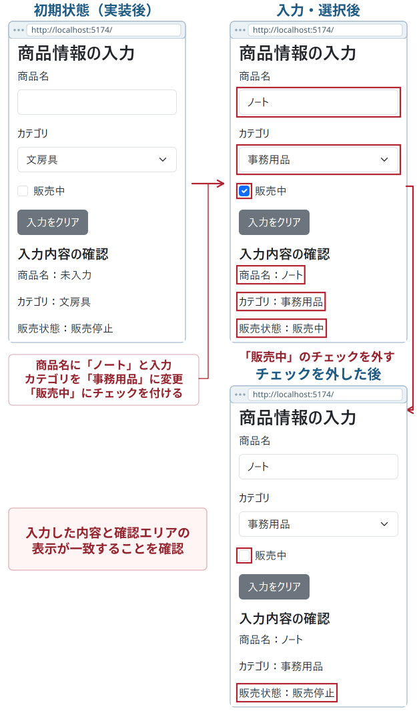{#ch02-form-exercise-entry}

::: {#ch02-form-exercise-entry-caption .caption}
フォームの入力・選択・チェックの切り替えが確認エリアに反映されることを確認する
:::

::: {#ch02-form-line-692 .paragraph}
続いて、［販売中］にもう一度チェックを付けたうえで、［入力をクリア］ボタンをクリックしてください。すべての入力項目が初期状態に戻ることを確認します。
:::

::: {#ch02-form-line-694 .table column-widths="38 62"}
| 確認する項目 | クリア後の表示 |
|---|---|
| 商品名の入力欄 | 空欄 |
| カテゴリのセレクトボックス | 文房具 |
| 販売中のチェックボックス | チェックなし |
| 入力内容の確認 | 商品名：未入力、カテゴリ：文房具、販売状態：販売停止 |
:::

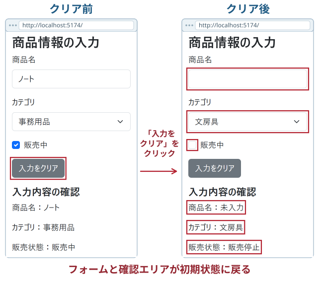{#ch02-form-exercise-clear}

::: {#ch02-form-exercise-clear-caption .caption}
クリア操作によって、すべての入力項目と確認エリアが初期状態に戻ることを確認する
:::

::: {#ch02-form-line-722 .paragraph keep-next="2"}
すべての操作で、フォームと確認エリアの表示が正しく連動すれば、演習完了です。
:::

::: {#ch02-form-line-724 .paragraph}
画面に変更が反映されない場合は、ブラウザーの画面を再読み込みして、もう一度操作してください。
:::

::: {#ch02-form-points .section-points}
この節のポイント

● フォームの入力値をstateとして管理することで、入力内容を画面の表示やプログラムの処理に利用できる。

● テキスト入力欄やセレクトボックスでは、**value属性とonChange** を組み合わせてstateと連動させる。

● `e.target.value` を使用すると、入力・選択された値を取得できる。

● チェックボックスのチェックの有無は、**checked属性とe.target.checked** を使用して管理する。

● ラジオボタンでは、選択中の値と各選択肢の値を比較することで選択状態を制御できる。

● フォームの表示をstateで制御すると、プログラムからstateを変更するだけで入力欄の値や選択状態を変更できる。
:::
::::

:::: {#page-88 .source-page}

::: {#ch02-summary-title .heading}
章のまとめ
:::

::: {#ch02-summary-slide .slide layout="summary"}
章のまとめ

■ ReactコンポーネントとJSXの基本

■ JSXによるデータ表示と属性の設定

■ 状態の管理（useState）

■ イベント処理

■ 条件に応じた表示

■ 配列データの一覧表示

■ フォーム入力と状態の連動
:::

::: {#ch02-summary-1 .paragraph}
この章では、Reactを使用して画面を作成し、ユーザーの操作に応じて表示を更新するための基本的な方法を学習しました。
:::

::: {#ch02-summary-2 .paragraph}
最初に、ReactコンポーネントとJSXの基本を確認し、変数や計算結果を画面に表示する方法や、HTML属性に値を設定する方法を学びました。
:::

::: {#ch02-summary-3 .paragraph}
続いて、useStateを使用した状態管理とイベント処理を学習し、ボタン操作による画面の更新や、条件に応じた表示の切り替えを実装しました。また、map()を使用して配列データを一覧表示する方法も確認しました。
:::

::: {#ch02-summary-4 .paragraph}
最後に、value属性やonChangeイベント、checked属性を使用し、フォームの入力値とstateを連動させる方法を学習しました。
:::

::: {#ch02-summary-5 .paragraph}
次の第3章では、React Routerを使用して、URLに応じた画面の切り替えや画面遷移を実装し、複数の画面を持つSPAの構成を学習します。
:::

::::
