:::: {#page-1 .source-page}

::: {#ch02-number .paragraph}
2
:::

::: {#ch02-title .heading}
第2章 Reactによる画面表示と入力処理
:::

::: {#ch02-goals .heading}
章の目標
:::

::: {#ch02-goal-1 .paragraph}
◼ ReactのコンポーネントとJSXの基本的な書き方を理解し、画面を作成できる
:::

::: {#ch02-goal-2 .paragraph}
◼ JSXで変数や計算結果を表示し、HTML属性に値を設定できる
:::

::: {#ch02-goal-3 .paragraph}
◼ `useState`を使って状態を管理し、値の変更を画面に反映できる
:::

::: {#ch02-goal-4 .paragraph}
◼ イベント処理と条件分岐を使って、ユーザーの操作に応じた表示を実装できる
:::

::: {#ch02-goal-5 .paragraph}
◼ 配列データを一覧表示できる
:::

::: {#ch02-goal-6 .paragraph}
◼ フォームの入力値を状態と連動させ、画面に表示できる
:::

::::

:::: {#page-2 .source-page}

::: {#ch02-overview-title .heading}
章の概要
:::

::: {#ch02-overview-slide .slide layout="summary"}
章の概要

■ ReactコンポーネントとJSXの基本

■ JSXによるデータ表示と属性の設定

■ 状態の管理（useState）

■ イベント処理

■ 条件に応じた表示

■ 配列データの一覧表示

■ フォーム入力と状態の連動
:::

::: {#ch02-overview-1 .paragraph}
この章では、Reactで画面を作成し、ユーザーの操作に応じて表示を変更するための基本構文を学習します。
:::

::: {#ch02-overview-2 .paragraph}
最初に、Reactの画面を構成する「コンポーネント」と、HTMLに似た記述方法である「JSX」の基本を確認します。続いて、変数や計算結果を画面に表示する方法と、画像のパスやCSSのクラスなどを属性に設定する方法を学びます。
:::

::: {#ch02-overview-3 .paragraph}
次に、`useState`を使用して画面の状態を管理し、ボタンのクリックなどのイベントに応じてデータと表示を更新する方法を学習します。さらに、条件に応じた表示の切り替えや、配列データの一覧表示にも取り組みます。
:::

::: {#ch02-overview-4 .paragraph}
最後に、フォームに入力された値をReactの状態と連動させ、入力内容を画面へ反映する方法を学びます。
:::

::: {#ch02-overview-5 .paragraph}
本章では、まず1つのコンポーネントで基本構文を学習します。複数のコンポーネントの連携や画面遷移については、後続の章で扱います。
:::

::::

:::: {#page-3 .source-page}

::: {#ch02-jsx-intro-title .heading}
2.1. ReactコンポーネントとJSXの基本
:::

::: {#ch02-jsx-intro-slide .slide layout="illustration"}
ReactコンポーネントとJSXの基本


:::

::: {#ch02-jsx-intro-definition .heading level="minor"}
ReactコンポーネントとJSXとは
:::

::: {#ch02-jsx-intro-intro-1 .paragraph}
第1章では、`App.tsx` の変数の値を変更すると、ブラウザーの表示も変わることを確認しました。この章では、Reactで画面を作成するための基本構文を学習します。
:::

::: {#ch02-jsx-intro-intro-2 .paragraph}
Reactでは、画面を **コンポーネント** という部品に分けて作成できます。例えば、商品管理システムのヘッダー、メニュー、商品一覧などを、それぞれ独立したコンポーネントとして作成し、組み合わせて1つの画面を構築できます。
:::

::: {#ch02-jsx-intro-intro-3 .paragraph}
本研修では、コンポーネントをJavaScriptやTypeScriptの関数として定義します。関数の中では、HTMLに似た **JSX（JavaScript XML）** という構文を使って画面の内容を記述します。TypeScriptでJSXを使用するファイルの拡張子は `.tsx` です。
:::

::: {#ch02-jsx-intro-intro-4 .paragraph}
本章では、まず1つのコンポーネントで基本構文を学習します。複数のコンポーネントに分割する方法は、第3章で学習します。
:::

::::

:::: {#page-4 .source-page}

::: {#ch02-jsx-sample .heading level="minor"}
【サンプル】関数コンポーネントで画面を表示する
:::

::: {#ch02-jsx-sample-intro .paragraph}
第1章で使用した `App.tsx` も、Reactのコンポーネントです。次のソースコードを確認しながら、画面を作成するための基本的な構成を理解しましょう。
:::

::: {#ch02-full-ch01-source .code filename="ch01-setup/src/App.tsx"}
```tsx
export default function App() {
  // 画面に表示するデータ
  const courseName = 'React開発入門'
  const message = 'Reactの動作確認をしています'
  const lessonNumber = 1

  return (
    <main>
      <h1>{courseName}</h1>
      <p>{message}</p>
      <p>現在の学習：第{lessonNumber}章</p>
    </main>
  )
}
```
:::

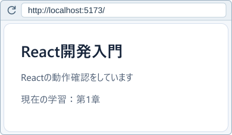{#ch02-jsx-app-screen}

::: {#ch02-jsx-app-screen-caption .paragraph}
第1章で使用した App.tsx の表示結果
:::

::::

:::: {#page-5 .source-page}

::: {#ch02-jsx-syntax .heading level="minor"}
構文の解説
:::

::: {#ch02-jsx-syntax-function .step}
**① コンポーネントを定義する**
:::

::: {#ch02-jsx-function-source .code filename="ch01-setup/src/App.tsx"}
```tsx
export default function App() {
```
:::

::: {#ch02-jsx-function-1 .paragraph}
`function App()` は、`App` という名前の関数を定義しています。Reactでは、コンポーネント名の先頭を大文字にします。
:::

::: {#ch02-jsx-function-2 .paragraph}
`export default` は、コンポーネントを別のファイルから読み込んで使用できるようにするための記述です。第1章の `main.tsx` では、この `App` コンポーネントを読み込んで画面に表示しています。
:::

::: {#ch02-jsx-syntax-return .step}
**② 変数を定義し、画面に表示する**
:::

::: {#ch02-jsx-return-source .code filename="ch01-setup/src/App.tsx" start-line="7"}
```tsx
  return (
    <main>
      <h1>{courseName}</h1>
      <p>{message}</p>
      <p>現在の学習：第{lessonNumber}章</p>
    </main>
  )
```
:::

::: {#ch02-jsx-return-1 .paragraph}
関数内では、通常のJavaScriptやTypeScriptと同様に `const` などを使って変数を定義できます。
:::

::: {#ch02-jsx-return-2 .paragraph}
`return` に記述したJSXは、画面に表示する内容を表します。例えば、`{courseName}` と記述すると、変数に格納された「React開発入門」という文字列が見出しに表示されます。
:::

::: {#ch02-jsx-return-3 .paragraph}
JSXの中で波括弧 `{ }` を使って変数や計算結果を表示する方法は、次の2.2節で詳しく学習します。
:::

::::

:::: {#page-6 .source-page}

::: {#ch02-jsx-html .step}
**③ JSXとHTMLの主な違い**
:::

::: {#ch02-jsx-html-1 .paragraph}
JSXはHTMLに似ていますが、記述する際には次のルールがあります。
:::

::: {#ch02-jsx-html-rules .table column-widths="1 2.1"}
| ルール | 記述方法・例 |
|---|---|
| 複数の要素をまとめる | `<main>` など1つの親要素で囲む |
| タグを必ず閉じる | ``、`<input type="text" />`、`<br />` |
| 一部の属性名が異なる | HTMLの `class` はJSXでは `className` と記述する |
:::

::: {#ch02-jsx-html-example-1 .paragraph}
例えば、`return` の中に複数のJSX要素を直接並べるとエラーになります。複数の要素を表示する場合は、次のように1つにまとめます。
:::

::: {#ch02-jsx-html-invalid-title .step}
誤った例
:::

::: {#ch02-jsx-html-invalid .code example="true"}
```tsx
return (
  <h1>商品管理システム</h1>
  <p>商品一覧を表示します</p>
)
```
:::

::: {#ch02-jsx-html-valid-title .step}
正しい例
:::

::: {#ch02-jsx-html-valid .code example="true"}
```tsx
return (
  <main>
    <h1>商品管理システム</h1>
    <p>商品一覧を表示します</p>
  </main>
)
```
:::

::: {#ch02-jsx-fragment-1 .paragraph}
また、不要なHTML要素を増やしたくない場合は、`<>` と `</>` で囲むこともできます。この記述を **フラグメント（Fragment）** と呼びます。
:::

::::

:::: {#page-7 .source-page}

::: {#ch02-jsx-practice .heading level="minor"}
【確認演習】変数をJSXに表示する
:::

::: {#ch02-jsx-practice-intro .paragraph}
関数コンポーネント内にあらかじめ定義されている変数を使用して、社員管理システムの見出しと案内文を表示します。
:::

::: {#ch02-jsx-practice-1 .paragraph numbered="true"}
1．　`ch02-basic-q` プロジェクトの `src/components/Q2_1.tsx` を開いてください。
:::

::: {#ch02-jsx-practice-2 .paragraph numbered="true"}
2．　コード内の➀～➂の番号付きコメントを確認し、指示された箇所を実装してください。コメントに指定されていないコードや、ほかのファイルは変更する必要はありません。
:::

::: {#ch02-jsx-practice-3 .paragraph numbered="true"}
3．　編集したファイルを保存してください。
:::

::: {#ch02-jsx-practice-4 .paragraph numbered="true"}
4．　初回は `ch02-basic-q` フォルダーで `npm install` を実行してください。1.5節と同じ手順で開発サーバーを起動し、ターミナルに表示されたURLを開いてください。起動済みの場合は、開いているブラウザーの画面に戻ってください。
:::

::: {#ch02-jsx-practice-5 .paragraph numbered="true"}
5．　メニューから「2.1 ReactコンポーネントとJSXの基本」を選んでください。
:::

::: {#ch02-jsx-practice-check .heading level="minor"}
動作確認
:::

::: {#ch02-jsx-practice-result .paragraph numbered="true"}
6．　見出しに「社員管理システム」、案内文に「社員情報を確認できます。」と表示されることを確認してください。
:::

::: {#ch02-jsx-practice-note-1 .paragraph}
画面に変更が反映されない場合は、ブラウザーの画面を再読み込みして、もう一度確認してください。
:::

::: {#ch02-jsx-points .section-points}
この節のポイント

● Reactでは、画面をコンポーネントという部品に分けて作成できる。

● コンポーネントは関数として定義し、`return` にJSXを記述する。

● JSXは、JavaScriptの中にHTMLに似た記述を書くための構文である。

● JSXでは親要素やタグの閉じ方に注意し、CSSのクラスには `className` を使用する。
:::

::::

:::: {#page-12 .source-page}

::: {#ch02-values-title .heading}
2.2. JSXによるデータ表示と属性の設定
:::

::: {#ch02-values-slide .slide layout="illustration"}
JSXによるデータ表示と属性の設定

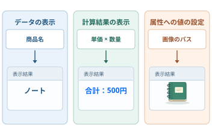
:::

::: {#ch02-values-definition .heading level="minor"}
JSXでデータと属性を設定する
:::

::: {#ch02-values-intro-1 .paragraph}
前節では、JSXの中に `{変数名}` と記述すると、変数の値を画面に表示できることを学習しました。
:::

::: {#ch02-values-intro-2 .paragraph}
実際のWebアプリケーションでは、商品名や単価などをデータとして管理し、数量から合計金額を計算したり、商品ごとに表示する画像を変更したりする必要があります。
:::

::: {#ch02-values-intro-3 .paragraph}
JSXでは、波括弧 `{ }` の中に変数や計算式、オブジェクトのプロパティなどを記述できます。さらに、HTML要素の本文だけでなく、画像のパスやCSSのクラスなど、属性にもJavaScriptの値を設定できます。
:::

::: {#ch02-values-intro-4 .paragraph}
この節では、商品情報を表示するサンプルを使い、これらの記述方法をまとめて確認します。
:::

::::

:::: {#page-13 .source-page}

::: {#ch02-product-sample .heading level="minor"}
【サンプル】商品情報を表示する
:::

::: {#ch02-product-sample-intro .paragraph}
今回は、商品名・単価・画像のパスをオブジェクトで管理し、数量と合計金額を画面に表示します。合計金額はBootstrapを使用して青い太字で表示します。
:::

::: {#ch02-product-source .code filename="ch02-basic/src/components/Sample2_2.tsx"}
```tsx
export default function Sample2_2() {
  // 商品情報
  const product = {
    name: 'ノート',
    price: 250,
    imagePath: '/images/notebook.png'
  }

  // 数量とデザイン
  const quantity = 2
  const totalClass = 'text-primary fw-bold'

  return (
    <main className="container mt-4">
      <h1>商品情報</h1>

      

      <p>商品名：{product.name}</p>
      <p>単価：{product.price}円</p>
      <p>数量：{quantity}個</p>

      <p className={totalClass}>
        合計：{product.price * quantity}円
      </p>
    </main>
  )
}
```
:::

::: {#ch02-product-sample-run .paragraph}
配布サンプルの `ch02-basic` フォルダーで、初回は `npm install` を実行してください。1.5節と同じ手順で開発サーバーを起動し、ブラウザーのメニューから「2.2 JSXによるデータ表示と属性の設定」を選択してください。
:::

::::

:::: {#page-14 .source-page}

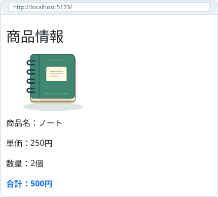{#ch02-product-display}

::: {#ch02-product-display-caption .paragraph}
商品情報の表示結果
:::

::: {#ch02-values-syntax .heading level="minor"}
構文の解説
:::

::: {#ch02-values-syntax-property .step}
**① オブジェクトのプロパティや変数を表示する**
:::

::: {#ch02-product-property-source .code filename="ch02-basic/src/components/Sample2_2.tsx" start-line="23"}
```tsx
      <p>商品名：{product.name}</p>
      <p>単価：{product.price}円</p>
      <p>数量：{quantity}個</p>
```
:::

::: {#ch02-product-property-1 .paragraph}
サンプルでは、商品情報を `product` というオブジェクトにまとめています。オブジェクトの値は、`オブジェクト名.プロパティ名` の形式で取得できます。例えば `product.name` は商品名、`product.price` は単価を表します。
:::

::: {#ch02-product-property-2 .paragraph}
JSXの中でこれらの値や `quantity` を `{ }` で囲むと、商品名・単価・数量が画面に表示されます。
:::

::: {#ch02-product-property-3 .paragraph}
なお、`{ }` の中には値を求めるJavaScriptの式を記述できますが、`if` 文や `for` 文をそのまま記述することはできません。条件分岐や繰り返し表示については後続の節で学習します。
:::

::::

:::: {#page-15 .source-page}

::: {#ch02-values-syntax-calculation .step}
**② 計算結果を表示し、CSSのクラスを指定する**
:::

::: {#ch02-product-calculation-source .code filename="ch02-basic/src/components/Sample2_2.tsx" start-line="27"}
```tsx
      <p className={totalClass}>
        合計：{product.price * quantity}円
      </p>
```
:::

::: {#ch02-product-calculation-1 .paragraph}
`{product.price * quantity}` では、商品の単価250円と数量2個を掛け算し、計算結果の500を表示しています。計算結果を事前に別の変数へ格納する必要はありません。
:::

::: {#ch02-product-calculation-2 .paragraph}
また、`className={totalClass}` は、変数に格納されているCSSのクラス名を属性に設定する記述です。`totalClass` の値は `'text-primary fw-bold'` です。Bootstrapでは `text-primary` で文字色を青くし、`fw-bold` で文字を太字にできます。
:::

::: {#ch02-product-calculation-3 .paragraph}
このように、属性に変数を設定することで、デザインもJavaScriptの値から指定できます。
:::

::: {#ch02-values-syntax-attributes .step}
**③ HTML属性に値を設定する**
:::

::: {#ch02-product-image-source .code filename="ch02-basic/src/components/Sample2_2.tsx" start-line="17"}
```tsx
      
```
:::

::: {#ch02-product-image-1 .paragraph}
`src` に商品画像のパス、`alt` に商品名、`width` に画像の幅を指定しています。
:::

::::

:::: {#page-16 .source-page}

::: {#ch02-product-image-2 .paragraph}
JSXでは、属性に固定の文字列を指定する場合は `" "`、JavaScriptの変数や数値などの式を使用する場合は `{ }` を使います。
:::

::: {#ch02-product-attributes .table column-widths="1 1.7"}
| 記述例 | 意味 |
|---|---|
| `src="/images/notebook.png"` | 画像パスを固定文字列で指定する |
| `src={product.imagePath}` | オブジェクトのプロパティを画像パスとして使用する |
| `width={180}` | 数値を指定する |
:::

::: {#ch02-product-supplement .training-note}
【補足】画像ファイルとBootstrapのCSS

今回使用する画像 `notebook.png` は、配布サンプルの `public/images` フォルダーに用意されています。JSXからは `/images/notebook.png` で参照できます。

BootstrapのCSSは、次のように `main.tsx` で読み込むことで画面に適用されます。
:::

::: {#ch02-product-bootstrap-source .code filename="ch02-basic/src/main.tsx" start-line="3"}
```tsx
import 'bootstrap/dist/css/bootstrap.min.css'
```
:::

::: {#ch02-product-bootstrap-note .paragraph}
配布サンプルにはこの記述が用意されているため、受講者が追加する必要はありません。
:::

::::

:::: {#page-17 .source-page}

::: {#ch02-values-practice .heading level="minor"}
【確認演習】商品情報の表示と属性を設定する
:::

::: {#ch02-values-practice-intro .paragraph}
商品データやクラス名の変数を、JSXの本文とHTML属性に設定します。単価300円、数量3個、合計を青い太字にするクラス名は、あらかじめ定義されています。
:::

::: {#ch02-values-practice-1 .paragraph numbered="true"}
1．　`ch02-basic-q` プロジェクトの `src/components/Q2_2.tsx` を開いてください。
:::

::: {#ch02-values-practice-2 .paragraph numbered="true"}
2．　コード内の➀～➃の番号付きコメントを確認し、指示された箇所を実装してください。コメントに指定されていないコードや、ほかのファイルは変更する必要はありません。
:::

::: {#ch02-values-practice-3 .paragraph numbered="true"}
3．　編集したファイルを保存してください。
:::

::: {#ch02-values-practice-4 .paragraph numbered="true"}
4．　`ch02-basic-q` の開発サーバーを起動し、ターミナルに表示されたURLを開いてください。起動済みの場合は、開いているブラウザーの画面に戻ってください。
:::

::: {#ch02-values-practice-5 .paragraph numbered="true"}
5．　メニューから「2.2 JSXによるデータ表示と属性の設定」を選んでください。
:::

::: {#ch02-values-practice-check .heading level="minor"}
動作確認
:::

::: {#ch02-values-practice-result .paragraph numbered="true" keep-lines="true"}
6．　ノートの画像と商品名「ノート」、単価300円、数量3個を確認してください。<br>合計は **青い太字で900円** と表示されます。
:::

::: {#ch02-values-practice-note-1 .paragraph}
画面に変更が反映されない場合は、ブラウザーの画面を再読み込みして、もう一度確認してください。
:::

::: {#ch02-values-practice-note-2 .paragraph}
今回は、ソースコードを編集して保存したことで、Viteの機能によって画面が更新されました。次の節では、ボタン操作などによって実行中にデータを変更し、画面に反映するための `useState` を学習します。
:::

::: {#ch02-values-points .section-points}
この節のポイント

● JSXでは `{ }` を使用して、変数・計算結果・オブジェクトのプロパティを表示できる。

● 属性に固定の文字列を設定する場合は引用符を、JavaScriptの値を設定する場合は `{ }` を使用する。

● `src` や `className` などの属性にも変数の値を設定できる。

● Bootstrapのクラスを指定すると、文字色やデザインを簡単に変更できる。
:::

::::

:::: {#page-21 .source-page}

::: {#ch02-state-title .heading}
2.3. 状態の管理（useState）
:::

::: {#ch02-state-slide .slide layout="illustration"}
状態の管理（useState）


:::

::: {#ch02-state-definition .heading level="minor"}
状態（state）とは
:::

::: {#ch02-state-definition-1 .paragraph}
前節では、JSXを使用して、変数やオブジェクトの値を画面に表示する方法を学習しました。
:::

::: {#ch02-state-definition-2 .paragraph}
例えば、次のように変数を定義すると、
:::

::: {#ch02-state-definition-3 .code example="true"}
```tsx
const quantity = 1
```
:::

::: {#ch02-state-definition-4 .paragraph}
JSXの中で `{quantity}` と記述することで、数量を画面に表示できました。
:::

::: {#ch02-state-definition-5 .paragraph}
しかし、実際のWebアプリケーションでは、最初に表示したデータをそのまま表示し続けるだけではありません。
:::

::::

:::: {#page-22 .source-page}

::: {#ch02-state-in-practice-1 .paragraph}
例えば、ショッピングサイトでは、ユーザーが「1個追加」ボタンをクリックすると、商品の数量が1個から2個に増え、それに合わせて合計金額も変わります。
:::

::: {#ch02-state-in-practice-2 .paragraph}
このように、**ユーザーの操作などによって変化し、その変化を画面に反映させたいデータ**を、Reactでは**状態（state：ステート）**として管理します。
:::

::: {#ch02-state-in-practice-3 .paragraph}
Reactでは、このstateを管理するために、主に `useState()` という関数を使用します。
:::

::: {#ch02-state-plain .heading level="minor"}
なぜ通常の変数ではダメなのか
:::

::: {#ch02-state-plain-1 .paragraph}
では、なぜReactでは `useState()` を使用するのでしょうか。
:::

::: {#ch02-state-plain-2 .paragraph keep-lines="true"}
まずは、通常のJavaScriptの変数を使って、<br>商品の数量を変更するコードを考えてみましょう。
:::

::: {#ch02-state-plain-3 .paragraph}
**通常の変数を使用した比較例**
:::

::: {#ch02-state-plain-4 .code example="true"}
```tsx
export default function App() {
  let quantity = 1
  const price = 250

  const addOne = () => {
    quantity = quantity + 1
  }

  return (
    <main>
      <h1>商品の数量変更</h1>
      <p>数量：{quantity}個</p>
      <p>合計：{price * quantity}円</p>
      <button onClick={addOne}>1個追加</button>
    </main>
  )
}
```
:::

::: {#ch02-state-plain-5 .paragraph}
このコードでは、`quantity` という変数を宣言し、初期値として1を代入しています。
:::

::: {#ch02-state-plain-6 .paragraph keep-lines="true"}
そして、「1個追加」ボタンをクリックすると、<br>`addOne` という関数が実行されるようになっています。
:::

::::

:::: {#page-23 .source-page}

::: {#ch02-state-plain-handler-1 .paragraph}
`addOne` の中では、次の処理を行っています。
:::

::: {#ch02-state-plain-handler-2 .code example="true"}
```tsx
quantity = quantity + 1
```
:::

::: {#ch02-state-plain-handler-3 .paragraph}
つまり、ボタンをクリックすると、変数 `quantity` の値が1増えるはずです。
:::

::: {#ch02-state-plain-handler-4 .paragraph}
ところが、実際にボタンをクリックしても、**画面には「数量：1個」「合計：250円」と表示されたままになります。**
:::

::: {#ch02-state-plain-handler-5 .paragraph}
なぜでしょうか。
:::

::: {#ch02-state-plain-handler-6 .paragraph}
これは、**通常の変数の値を変更しただけでは、Reactが画面を再表示する必要があることを認識できないため**です。
:::

::: {#ch02-state-plain-handler-7 .paragraph}
Reactは、コンポーネントの処理を実行して画面を作成しますが、通常の変数を変更しても、それだけではコンポーネントを再実行しません。
:::

::: {#ch02-state-plain-handler-8 .paragraph}
さらに、通常のローカル変数はコンポーネントが再実行されたときに改めて初期化されるため、変更後の値を保持する用途にも適していません。
:::

::: {#ch02-state-plain-handler-9 .paragraph}
そこで必要になるのが、`useState()` です。
:::

{#ch02-state-plain-screen}

::: {#ch02-state-plain-screen-caption .paragraph}
通常の変数の値を増やしても、画面の数量と合計は同じままになる
:::

::::

:::: {#page-24 .source-page}

::: {#ch02-state-api .heading level="minor"}
useState()とは
:::

::: {#ch02-state-api-1 .paragraph}
`useState()` は、Reactでstateを管理するための関数です。
:::

::: {#ch02-state-api-2 .paragraph}
主に次の2つの役割があります。
:::

::: {#ch02-state-api-3-1 .paragraph numbered="true" keep-lines="true"}
1．　**データの値を保持する**：<br>コンポーネントが再レンダリングされても、更新した値を保持する
:::

::: {#ch02-state-api-3-2 .paragraph numbered="true" keep-lines="true"}
2．　**データの更新をReactに知らせる**：<br>値を変更した際に、Reactが画面を再表示できるようにする
:::

::: {#ch02-state-api-5 .paragraph}
Reactでは、このような特別な関数を**Hooks（フック）**と呼びます。
:::

::: {#ch02-state-api-6 .paragraph}
`useState()` はHooksの一つです。
:::

::: {#ch02-state-api-7 .paragraph}
まずは、基本構文を確認してみましょう。
:::

::: {#ch02-state-basic-label .step}
**基本構文**
:::

::: {#ch02-state-syntax .code filename="ch02-basic/src/components/Sample2_3.tsx"}
```tsx
1:import { useState } from 'react'
7:  const [quantity, setQuantity] = useState(1)
```
:::

::: {#ch02-state-basic-1 .paragraph}
`useState()` を使用するためには、最初に `react` からインポートする必要があります。
:::

::: {#ch02-state-basic-2 .paragraph}
次の行では、数量を管理するstateを定義しています。
:::

::: {#ch02-state-basic-3 .paragraph}
少し複雑な書き方ですが、次のように分解すると理解しやすくなります。
:::

::: {#ch02-state-basic-4 .table}
| 記述 | 意味 |
|---|---|
| `useState(1)` | stateの初期値を1にする |
| `quantity` | 現在のstateの値を取得するための変数 |
| `setQuantity` | stateを更新するための関数 |
:::

::: {#ch02-state-basic-5 .paragraph}
`useState()` は、現在の値と更新用の関数をセットにして返します。
:::

::: {#ch02-state-basic-6 .paragraph}
それらを `[quantity, setQuantity]` のように受け取っています。
:::

::: {#ch02-state-basic-7 .paragraph}
この `[ ]` を使った書き方は、JavaScriptの**分割代入**という構文です。
:::

::::

:::: {#page-25 .source-page}

{#ch02-state-pair}

::: {#ch02-state-pair-caption .paragraph}
useStateの初期値・現在の値・更新用の関数
:::

::: {#ch02-state-setter .heading level="minor"}
useState()で値を変更する方法
:::

::: {#ch02-state-setter-1 .paragraph}
通常の変数では、値を変更するために次のように記述していました。
:::

::: {#ch02-state-setter-2 .code example="true"}
```tsx
quantity = quantity + 1
```
:::

::: {#ch02-state-setter-3 .paragraph}
しかし、`useState()` で管理しているstateは、この方法で直接変更してはいけません。
:::

::: {#ch02-state-setter-4 .paragraph}
代わりに、`useState()` から取得した更新用の関数を使用します。
:::

::: {#ch02-state-setter-5 .code filename="ch02-basic/src/components/Sample2_3.tsx" start-line="10" highlight-lines="11-11"}
```tsx
    //quantity = quantity + 1
    setQuantity(quantity + 1)
```
:::

::: {#ch02-state-setter-6 .paragraph}
10行目は、通常の変数と比較するためのコメントです。11行目では、現在の `quantity` に1を加えた値を、新しいstateとしてReactに渡します。
:::

::: {#ch02-state-setter-7 .paragraph}
例えば、現在の数量が1であれば、`setQuantity(2)` に相当する処理になります。
:::

::: {#ch02-state-setter-8 .paragraph keep-lines="true"}
Reactはstateの更新を受けてコンポーネントを再レンダリングし、<br>新しい値を使って画面を作成します。
:::

::: {#ch02-state-setter-9 .paragraph}
その結果、画面の数量も2個に更新されるわけです。
:::

::::

:::: {#page-26 .source-page}

::: {#ch02-state-initial .training-note}
【補足】useStateの初期値は毎回適用される？

`useState(1)` と書かれていると、コンポーネントが再実行されるたびに数量が1に戻るように感じるかもしれません。

しかし、引数の1は初回の表示で使用する初期値です。

その後は、Reactが更新後のstateを保持するため、ボタンをクリックするたびに1へ戻ることはありません。
:::

::: {#ch02-state-example .heading level="minor"}
【サンプル】useStateで商品の数量を変更する
:::

::: {#ch02-state-example-1 .paragraph}
それでは、先ほどのサンプルを `useState()` を使用したコードに修正してみましょう。
:::

::: {#ch02-state-example-2 .paragraph}
今回は、商品の数量を増やすと、合計金額も自動的に変更される画面を作成します。
:::

::: {#ch02-state-sample .code filename="ch02-basic/src/components/Sample2_3.tsx"}
```tsx
import { useState } from 'react'

export default function Sample2_3() {
  const productName = 'ノート'
  const price = 250
  //let quantity = 1
  const [quantity, setQuantity] = useState(1)

  const addOne = () => {
    //quantity = quantity + 1
    setQuantity(quantity + 1)
  }

  return (
    <main className="container mt-4">
      <h1>商品購入数の確認</h1>
      <p>商品名：{productName}</p>
      <p>単価：{price}円</p>
      <p>数量：{quantity}個</p>
      <p>合計：{price * quantity}円</p>
      <button className="btn btn-primary" onClick={addOne}>
        1個追加
      </button>
    </main>
  )
}
```
:::

::::

:::: {#page-27 .source-page}

::: {#ch02-state-check .step}
**動作確認**
:::

::: {#ch02-state-check-1 .paragraph}
開発サーバーを起動し、ブラウザーで動作を確認してください。`ch02-basic` のメニューで「2.3 状態の管理（useState）」を選択します。
:::

::: {#ch02-state-check-2 .paragraph}
初期状態では、次の情報が表示されます。
:::

::: {#ch02-state-check-3-1 .paragraph}
● 商品名：ノート
:::

::: {#ch02-state-check-3-2 .paragraph}
● 単価：250円
:::

::: {#ch02-state-check-3-3 .paragraph}
● 数量：1個
:::

::: {#ch02-state-check-3-4 .paragraph}
● 合計：250円
:::

::: {#ch02-state-check-7 .paragraph}
「1個追加」ボタンをクリックするたびに、数量と合計金額が変わります。
:::

::: {#ch02-state-check-8 .table}
| ボタンの操作 | 数量 | 合計金額 |
|---|---:|---:|
| 初期状態 | 1個 | 250円 |
| 1回クリック | 2個 | 500円 |
| 2回クリック | 3個 | 750円 |
:::

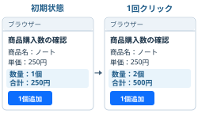{#ch02-state-click-states}

::: {#ch02-state-click-states-caption .paragraph}
「1個追加」をクリックしたときの数量と合計金額
:::

::::

:::: {#page-28 .source-page}

::: {#ch02-state-code-review .heading level="minor"}
構文の解説
:::

::: {#ch02-state-code-review-1 .paragraph}
ここからは、サンプルコードの重要な部分を確認していきます。
:::

::: {#ch02-state-review-import .step}
**➀ useStateをインポートする**
:::

::: {#ch02-state-review-import-2 .code filename="ch02-basic/src/components/Sample2_3.tsx"}
```tsx
import { useState } from 'react'
```
:::

::: {#ch02-state-review-import-3 .paragraph}
`useState()` を使用するために、Reactのライブラリからインポートしています。
:::

::: {#ch02-state-review-import-4 .paragraph}
Reactでは、必要な機能を `import` で読み込んで使用します。
:::

::: {#ch02-state-review-definition .step}
**➁ stateを定義する**
:::

::: {#ch02-state-review-definition-2 .code filename="ch02-basic/src/components/Sample2_3.tsx" start-line="6"}
```tsx
  //let quantity = 1
  const [quantity, setQuantity] = useState(1)
```
:::

::: {#ch02-state-review-definition-3 .paragraph}
6行目は、通常の変数で試すときに使うコメントです。7行目で、商品の数量を管理するstateを定義しています。
:::

::: {#ch02-state-review-definition-4 .paragraph}
`quantity` には現在の数量が入り、`setQuantity` は数量を更新するための関数です。
:::

::: {#ch02-state-review-definition-5 .paragraph}
`useState(1)` の引数には初期値を指定しているので、最初の数量は1個になります。
:::

::: {#ch02-state-review-definition-6 .paragraph}
なお、stateを定義する際は、通常、`const` を使用します。
:::

::: {#ch02-state-review-definition-7 .paragraph keep-lines="true"}
stateの値を更新する場合は `quantity` に直接代入するのではなく、<br>`setQuantity` を呼び出します。
:::

::::

:::: {#page-29 .source-page}

::: {#ch02-state-review-handler .step}
**➂ ボタンをクリックしたときにstateを更新する**
:::

::: {#ch02-state-review-handler-2 .code filename="ch02-basic/src/components/Sample2_3.tsx" start-line="9" highlight-lines="11-11"}
```tsx
  const addOne = () => {
    //quantity = quantity + 1
    setQuantity(quantity + 1)
  }
```
:::

::: {#ch02-state-review-handler-3 .paragraph}
この部分では、`addOne` という関数を定義しています。
:::

::: {#ch02-state-review-handler-4 .paragraph keep-lines="true"}
11行目の `setQuantity(quantity + 1)` によって、<br>現在の数量に1を加えた値をstateに設定します。
:::

::: {#ch02-state-review-handler-5 .paragraph}
今回は、ボタンのクリック時にこの関数が実行されるようにしています。
:::

::: {#ch02-state-review-handler-6 .paragraph keep-lines="true"}
なお、ボタンのクリックを検知する `onClick` の詳しい書き方については、<br>次の2.4節で学習します。
:::

::: {#ch02-state-review-display .step}
**➃ stateの値を画面に表示する**
:::

::: {#ch02-state-review-display-2 .code filename="ch02-basic/src/components/Sample2_3.tsx" start-line="19"}
```tsx
      <p>数量：{quantity}個</p>
      <p>合計：{price * quantity}円</p>
```
:::

::: {#ch02-state-review-display-3 .paragraph}
19行目では、`quantity` の値を画面に表示しています。
:::

::: {#ch02-state-review-display-4 .paragraph}
20行目では、商品の単価 `price` と数量 `quantity` を掛け算し、合計金額を表示しています。
:::

::: {#ch02-state-review-display-5 .paragraph keep-lines="true"}
ここで重要なのは、**数量が変更されると、<br>合計金額も新しい数量を使って計算される**という点です。
:::

::: {#ch02-state-review-display-6 .paragraph}
そのため、合計金額を別のstateで管理する必要はありません。
:::

::::

:::: {#page-30 .source-page}

::: {#ch02-state-review-click .step}
**➄ ボタンから関数を呼び出す**
:::

::: {#ch02-state-review-click-2 .code filename="ch02-basic/src/components/Sample2_3.tsx" start-line="21" highlight-lines="21-21"}
```tsx
      <button className="btn btn-primary" onClick={addOne}>
        1個追加
      </button>
```
:::

::: {#ch02-state-review-click-3 .paragraph}
`onClick={addOne}` は、ボタンをクリックしたときに `addOne` 関数を呼び出すための記述です。
:::

::: {#ch02-state-review-click-4 .paragraph}
関数が実行されると、先ほどの `setQuantity()` によりstateが更新されます。
:::

::: {#ch02-state-review-click-5 .paragraph}
その結果、Reactが再レンダリングを行い、画面に新しい数量と合計金額を表示します。
:::

{#ch02-state-update-flow}

::: {#ch02-state-update-flow-caption .paragraph}
ボタンのクリックから表示の更新までの流れ
:::

::::

:::: {#page-31 .source-page}

::: {#ch02-state-or-variable .heading level="minor"}
通常の変数とstateの使い分け
:::

::: {#ch02-state-or-variable-1 .paragraph}
ここまでの説明で、すべての変数を `useState()` で定義する必要があるのか、疑問に思うかもしれません。
:::

::: {#ch02-state-or-variable-2 .paragraph}
結論として、**すべての変数をstateとして管理する必要はありません。**
:::

::: {#ch02-state-or-variable-3 .paragraph}
今回のサンプルでは、次のように使い分けています。
:::

::: {#ch02-state-or-variable-4 .table}
| 変数 | 定義方法 | 理由 |
|---|---|---|
| `productName` | `const` | 商品名は変更しないため |
| `price` | `const` | 単価は変更しないため |
| `quantity` | `useState()` | ボタン操作で数量が変化し、画面を更新する必要があるため |
:::

::: {#ch02-state-or-variable-5 .paragraph}
このように、変更されない固定値は通常の変数として定義し、ユーザーの操作などによって変化して画面に反映させたい値をstateで管理します。
:::

::: {#ch02-state-or-variable-6 .paragraph}
また、合計金額のように、既存の値から計算できるものは、必ずしも別のstateとして定義する必要はありません。
:::

::: {#ch02-state-types .training-note}
【補足】useStateで管理できるデータ型

`useState()` では、数値だけでなく、文字列や真偽値なども管理できます。
:::

::: {#ch02-state-types-1 .code example="true"}
```tsx
const [count, setCount] = useState(0)
const [name, setName] = useState('田中')
const [isActive, setIsActive] = useState(true)
```
:::

::: {#ch02-state-types-2 .paragraph}
TypeScriptでは、これらの初期値から基本的なデータ型が自動的に推論されます。例えば数値を入れるべき `count` に文字列の `'田中'` を設定しようとすると、VS Codeの型チェックなどで型の不一致を確認できます。
:::

::: {#ch02-state-types-3 .paragraph}
なお、`useState()` は、コンポーネントの関数内のトップレベルで呼び出します。`if` 文や繰り返し処理の中で呼び出すことはできません。
:::

::::

:::: {#page-32 .source-page}

::: {#ch02-state-practice .heading level="minor"}
【確認演習】useStateで商品の数量を1個ずつ増やす
:::

::: {#ch02-state-practice-open-1 .paragraph}
`useState()` を使って商品の数量を管理します。ボタンをクリックするたびに、数量が1個ずつ増えるようにしてください。
:::

::: {#ch02-state-practice-open-file .paragraph numbered="true"}
1．　`ch02-basic-q` プロジェクトの `src/components/Q2_3.tsx` を開いてください。
:::

::: {#ch02-state-practice-follow-comments .paragraph numbered="true"}
2．　コード内の➀～➄の番号付きコメントに従ってください。➀・➄は確認、➁～➃は実装です。指定された箇所を編集してください。
:::

::: {#ch02-state-practice-save .paragraph numbered="true"}
3．　編集したファイルを保存してください。
:::

::: {#ch02-state-practice-run .paragraph numbered="true"}
4．　`ch02-basic-q` の開発サーバーを起動し、ターミナルに表示されたURLを開いてください。起動済みの場合は、開いているブラウザーの画面に戻ってください。
:::

::: {#ch02-state-practice-menu .paragraph numbered="true"}
5．　メニューから **「2.3 状態の管理（useState）」** を選んでください。
:::

::: {#ch02-state-practice-result .paragraph numbered="true" keep-lines="true"}
6．　「1個追加」ボタンをクリックし、<br>数量と合計金額が次の表のとおり変わることを確認してください。
:::

::: {#ch02-state-practice-check-4 .table}
| 操作 | 数量 | 合計金額 |
|---|---:|---:|
| 初期状態 | 1個 | 250円 |
| 1回クリック | 2個 | 500円 |
| 2回クリック | 3個 | 750円 |
:::

::: {#ch02-state-practice-check-5 .paragraph}
期待どおりの結果になれば、演習完了です。正しく表示されない場合は、➀～➄のコメントと実装した構文を確認してください。
:::

::: {#ch02-state-practice-check-6 .paragraph}
※ この演習では、完成版の `Sample2_3.tsx` を直接編集する必要はありません。問題用の `Q2_3.tsx` に指定された部分だけを記述します。
:::

::: {#ch02-state-points .section-points}
この節のポイント

● **state**とは、ユーザーの操作などによって変化し、画面の表示に反映させたいデータのことである。

● Reactでは、**`useState()`** を使用してstateを管理できる。

● `useState()` は、現在のstateの値と、更新用の関数を返す。

● stateを変更するときは、**`setQuantity()`** のような更新用の関数を使用する。

● stateの更新に応じて、Reactがコンポーネントを再レンダリングし、必要な画面の変更を反映する。

● 変更しない固定値や、既存のデータから計算できる値を、<br>すべてstateで管理する必要はない。
:::

::::

:::: {#page-33 .source-page}

::: {#ch02-events-title .heading}
2.4. イベント処理
:::

::: {#ch02-events-slide .slide layout="illustration"}
イベント処理

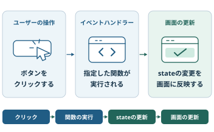
:::

::: {#ch02-events-intro .heading level="minor"}
イベント処理とは
:::

::: {#ch02-events-intro-p1 .paragraph}
前節では、`useState()` を使って商品の数量を管理し、ボタンをクリックすると数量が増えるサンプルを作成しました。
:::

::: {#ch02-events-intro-p2 .paragraph}
ここで、少し振り返ってみましょう。
:::

::: {#ch02-events-intro-p3 .paragraph}
前節のサンプルでは、次のように記述していました。
:::

::: {#ch02-events-recap-code .code filename="ch02-basic/src/components/Sample2_3.tsx" start-line="21" highlight-lines="21-21"}
```tsx
      <button className="btn btn-primary" onClick={addOne}>
        1個追加
      </button>
```
:::

::: {#ch02-events-intro-p4 .paragraph}
この `onClick` は、何を意味しているのでしょうか。
:::

::::

:::: {#page-34 .source-page}

::: {#ch02-events-intro-p5 .paragraph}
Webアプリケーションでは、ボタンのクリック、マウスの移動、キーボードからの入力など、ユーザーのさまざまな操作をきっかけに処理を実行することがあります。
:::

::: {#ch02-events-intro-p6 .paragraph}
このような操作や出来事を**イベント**と呼びます。
:::

::: {#ch02-events-intro-p7 .paragraph}
また、イベントが発生したときに実行する処理を**イベントハンドラー**と呼びます。
:::

::: {#ch02-events-intro-p8 .paragraph keep-lines="true"}
Reactでは、JSXに `onClick` などの属性を記述することで、<br>イベントと関数を結びつけることができます。
:::

::: {#ch02-events-onclick .heading level="minor"}
onClickによるクリックイベント
:::

::: {#ch02-events-onclick-p1 .paragraph}
最も基本的なイベントが、ボタンのクリックです。
:::

::: {#ch02-events-onclick-p2 .paragraph}
Reactでは、`onClick` という属性を使って、クリック時に実行する関数を指定します。
:::

::: {#ch02-events-onclick-syntax .step}
**基本構文**
:::

::: {#ch02-events-onclick-syntax-code .code example="true"}
```tsx
<button onClick={関数名}>ボタン</button>
```
:::

::: {#ch02-events-onclick-syntax-p1 .paragraph}
例えば、次のように記述します。
:::

::: {#ch02-events-onclick-demo .code example="true"}
```tsx
const showMessage = () => {
  alert('ボタンがクリックされました')
}

return (
  <button onClick={showMessage}>クリック</button>
)
```
:::

::: {#ch02-events-onclick-syntax-p2 .paragraph}
`showMessage` は、メッセージを表示するための関数です。
:::

::: {#ch02-events-onclick-syntax-p3 .paragraph keep-lines="true"}
`onClick={showMessage}` と指定することで、<br>ボタンをクリックしたときに、この関数が実行されます。
:::

::::

:::: {#page-35 .source-page}

{#ch02-events-click-action}

::: {#ch02-events-click-action-caption .caption}
onClickに指定した関数でメッセージを表示する
:::

::: {#ch02-events-timing .heading level="minor"}
関数を指定するときは、()を付けない
:::

::: {#ch02-events-timing-p1 .paragraph}
イベント処理で注意したいのが、関数の指定方法です。
:::

::: {#ch02-events-timing-p2 .paragraph}
次の2つのコードを比較してください。
:::

::: {#ch02-events-timing-label-3 .step}
**正しい書き方**
:::

::: {#ch02-events-timing-correct-code .code example="true"}
```tsx
<button onClick={showMessage}>クリック</button>
```
:::

::: {#ch02-events-timing-label-4 .step}
**誤った書き方**
:::

::: {#ch02-events-timing-incorrect-code .code example="true"}
```tsx
<button onClick={showMessage()}>クリック</button>
```
:::

::: {#ch02-events-timing-p5 .paragraph}
見た目は似ていますが、意味が異なります。
:::

::: {#ch02-events-timing-p6 .paragraph}
`onClick={showMessage}` は、クリックされたときに実行する関数を指定しています。
:::

::: {#ch02-events-timing-p7 .paragraph keep-lines="true"}
一方、`onClick={showMessage()}` は、<br>画面を作成する処理の途中で関数を呼び出してしまいます。
:::

::: {#ch02-events-timing-p8 .paragraph}
そのため、クリックする前に関数が実行されてしまい、意図した動作になりません。
:::

::: {#ch02-events-timing-p9 .paragraph keep-lines="true"}
**イベントハンドラーに関数を指定するときは、<br>基本的に関数名だけを記述する**と覚えておきましょう。
:::

::::

:::: {#page-36 .source-page}

{#ch02-events-handler-timing}

::: {#ch02-events-handler-timing-caption .caption}
括弧の有無による関数の実行タイミングの違い
:::

::: {#ch02-events-arguments .heading level="minor"}
イベントハンドラーに引数を渡す方法
:::

::: {#ch02-events-arguments-p1 .paragraph}
ここまでは、引数のない関数をイベントハンドラーとして指定していました。
:::

::: {#ch02-events-arguments-p2 .paragraph}
しかし、実際のアプリケーションでは、**どのボタンがクリックされたのかによって、関数に渡す値を変えたい場合**があります。
:::

::: {#ch02-events-arguments-p3 .paragraph keep-lines="true"}
例えば、商品一覧に「ノートを選択」<br>「ボールペンを選択」という2つのボタンがあるとします。
:::

::: {#ch02-events-arguments-p4 .paragraph keep-lines="true"}
それぞれ別の関数を作成することもできますが、<br>商品名を引数として渡せば、同じ関数を使い回せます。
:::

::: {#ch02-events-arguments-p5 .paragraph}
まずは、次の関数を考えてみましょう。
:::

::: {#ch02-events-arguments-demo-function .code example="true"}
```tsx
const showSelection = (name: string) => {
  alert(name + 'が選択されました')
}
```
:::

::: {#ch02-events-arguments-p6 .paragraph}
この関数は、引数として受け取った商品名をメッセージで表示します。
:::

::: {#ch02-events-arguments-p7 .paragraph}
では、ボタンをクリックしたときに「ノート」という文字列を渡すには、どのようにすればよいのでしょうか。
:::

::::

:::: {#page-37 .source-page}

::: {#ch02-events-arguments-syntax .step}
**引数を渡す場合の構文**
:::

::: {#ch02-events-arguments-demo-button .code example="true"}
```tsx
<button onClick={() => showSelection('ノート')}>
  ノートを選択
</button>
```
:::

::: {#ch02-events-arguments-syntax-p1 .paragraph}
ここでは、`onClick` の中にアロー関数を記述しています。
:::

::: {#ch02-events-arguments-demo-arrow .code example="true"}
```tsx
() => showSelection('ノート')
```
:::

::: {#ch02-events-arguments-syntax-p2 .paragraph}
これは、「クリックされたら、`showSelection('ノート')` を実行する」という意味です。
:::

::: {#ch02-events-arguments-syntax-p3 .paragraph}
例えば、2つのボタンに同じ関数を指定する場合は、次のように記述できます。
:::

::: {#ch02-events-arguments-two-buttons .code example="true"}
```tsx
<button onClick={() => showSelection('ノート')}>
  ノートを選択
</button>

<button onClick={() => showSelection('ボールペン')}>
  ボールペンを選択
</button>
```
:::

::: {#ch02-events-arguments-syntax-p4 .paragraph}
どちらも `showSelection` という同じ関数を使用していますが、渡している引数が異なります。
:::

::: {#ch02-events-arguments-syntax-p5 .paragraph keep-lines="true"}
このように、引数を使うことで、ボタンごとに別の関数を作成しなくても、<br>共通の処理を実行できます。
:::

{#ch02-events-handler-arguments}

::: {#ch02-events-handler-arguments-caption .caption}
ボタンごとに異なる商品名を同じ関数に渡す
:::

::::

:::: {#page-38 .source-page}

::: {#ch02-events-typescript-note .training-note}
【補足】TypeScriptでは引数に型を指定する

今回のサンプルでは、関数の引数を `(name: string)` と記述しています。`string` は、文字列を扱う型です。
:::

::: {#ch02-events-typescript-example .code example="true"}
```tsx
const showSelection = (name: string) => {
  alert(name + 'が選択されました')
}
```
:::

::: {#ch02-events-typescript-p1 .paragraph}
JavaScriptでは `name` とだけ記述することもできますが、TypeScriptでは、引数がどのようなデータを受け取るのかを型で表します。
:::

::: {#ch02-events-typescript-p2 .paragraph}
このように自分で定義する関数では、TypeScriptが引数の型を推論できない場合があります。今回の研修では、**関数が引数としてデータを受け取る場合は、`name: string` や `id: number` のように型を明示する**ことを基本とします。これにより、指定した型と異なる値を渡した場合に、開発中に型の不一致を検出しやすくなります。
:::

::: {#ch02-events-typescript-p3 .paragraph}
※TypeScriptの引数すべてに型注釈が必須というわけではありません。文脈から型を推論できる場合もありますが、まずは今回の書き方を覚えましょう。
:::

::: {#ch02-events-sample .heading level="minor"}
【サンプル】商品の選択と表示
:::

::: {#ch02-events-sample-p1 .paragraph}
それでは、ここまで学習したイベント処理と、前節の `useState` を組み合わせてみましょう。
:::

::: {#ch02-events-sample-p2 .paragraph}
今回は、「ノートを選択」「ボールペンを選択」の2つのボタンを用意します。
:::

::: {#ch02-events-sample-p3 .paragraph}
ボタンをクリックすると、その商品名を画面に表示します。
:::

::: {#ch02-events-sample-p4 .paragraph}
また、「選択を解除」ボタンをクリックすると、表示を「未選択」に戻します。
:::

::::

:::: {#page-39 .source-page}

::: {#ch02-events-sample-code .code filename="ch02-basic/src/components/Sample2_4.tsx"}
```tsx
import { useState } from 'react'

export default function Sample2_4() {
  const [selectedName, setSelectedName] = useState('未選択')

  const showSelection = (name: string) => {
    setSelectedName(name)
  }

  const clearSelection = () => {
    setSelectedName('未選択')
  }

  return (
    <main className="container mt-4">
      <h1>商品の選択</h1>
      <p>選択中の商品：{selectedName}</p>

      <button className="btn btn-outline-primary me-2"
        onClick={() => showSelection('ノート')}>
        ノートを選択
      </button>
      <button className="btn btn-outline-primary me-2"
        onClick={() => showSelection('ボールペン')}>
        ボールペンを選択
      </button>
      <button className="btn btn-secondary"
        onClick={clearSelection}>
        選択を解除
      </button>
    </main>
  )
}
```
:::

::::

:::: {#page-40 .source-page}

::: {#ch02-events-sample-check .step}
**動作確認**
:::

::: {#ch02-events-sample-check-p1 .paragraph}
開発サーバーを起動し、「2.4 イベント処理」の画面を開いてください。
:::

{#ch02-events-selection-browser}

::: {#ch02-events-selection-browser-caption .caption}
商品の選択画面の初期表示
:::

::: {#ch02-events-sample-check-p2 .paragraph}
それぞれのボタンをクリックすると、次のように表示が変わります。
:::

::: {#ch02-events-sample-check-table-1 .table}
| 操作 | 画面に表示される内容 |
|---|---|
| 初期状態 | 選択中の商品：未選択 |
| ノートを選択 | 選択中の商品：ノート |
| ボールペンを選択 | 選択中の商品：ボールペン |
| 選択を解除 | 選択中の商品：未選択 |
:::

{#ch02-events-selection-states}

::: {#ch02-events-selection-states-caption .caption}
ボタンをクリックすると選択中の商品名が切り替わる
:::

::::

:::: {#page-41 .source-page}

::: {#ch02-events-review .heading level="minor"}
構文の解説
:::

::: {#ch02-events-review-p1 .paragraph}
ここからは、サンプルコードの重要な部分を確認します。
:::

::: {#ch02-events-review-state .step}
**① 選択中の商品名を管理するstate**
:::

::: {#ch02-events-review-state-code .code filename="ch02-basic/src/components/Sample2_4.tsx" start-line="4"}
```tsx
  const [selectedName, setSelectedName] = useState('未選択')
```
:::

::: {#ch02-events-review-state-p2 .paragraph}
`selectedName` は、現在選択されている商品名を管理するstateです。
:::

::: {#ch02-events-review-state-p3 .paragraph}
初期値は「未選択」としています。
:::

::: {#ch02-events-review-state-p4 .paragraph}
`setSelectedName` を使用してstateを更新すると、画面に表示する商品名も更新されます。
:::

::: {#ch02-events-review-state-p5 .paragraph}
これは、前節で学習した `useState` の使い方と同じです。
:::

::: {#ch02-events-review-select .step}
**② 商品名を受け取る関数**
:::

::: {#ch02-events-review-select-code .code filename="ch02-basic/src/components/Sample2_4.tsx" start-line="6"}
```tsx
  const showSelection = (name: string) => {
    setSelectedName(name)
  }
```
:::

::: {#ch02-events-review-select-p2 .paragraph}
この関数は、引数として商品名を受け取ります。
:::

::: {#ch02-events-review-select-p3 .paragraph}
6行目の `name: string` は、TypeScriptの型注釈です。
:::

::: {#ch02-events-review-select-p4 .paragraph}
受け取った商品名を、7行目の `setSelectedName(name)` でstateに設定しています。
:::

::: {#ch02-events-review-select-p5 .paragraph keep-lines="true"}
例えば、`showSelection('ノート')` が実行された場合、<br>`selectedName` の値が「ノート」に変更されます。
:::

::::

:::: {#page-42 .source-page}

::: {#ch02-events-review-clear .step}
**③ 選択を解除する関数**
:::

::: {#ch02-events-review-clear-code .code filename="ch02-basic/src/components/Sample2_4.tsx" start-line="10"}
```tsx
  const clearSelection = () => {
    setSelectedName('未選択')
  }
```
:::

::: {#ch02-events-review-clear-p2 .paragraph}
この関数は、選択中の商品名を「未選択」に戻すためのものです。
:::

::: {#ch02-events-review-clear-p3 .paragraph}
引数を必要としないため、`()` の中には何も指定していません。
:::

::: {#ch02-events-review-arguments .step}
**④ 引数を渡して関数を実行する**
:::

::: {#ch02-events-review-arguments-code .code filename="ch02-basic/src/components/Sample2_4.tsx" start-line="19"}
```tsx
      <button className="btn btn-outline-primary me-2"
        onClick={() => showSelection('ノート')}>
        ノートを選択
      </button>
      <button className="btn btn-outline-primary me-2"
        onClick={() => showSelection('ボールペン')}>
        ボールペンを選択
      </button>
```
:::

::: {#ch02-events-review-arguments-p2 .paragraph}
この2つのボタンは、どちらも `showSelection` 関数を使用しています。
:::

::: {#ch02-events-review-arguments-p3 .paragraph}
違いは、関数に渡す引数です。
:::

::: {#ch02-events-review-arguments-p4 .paragraph keep-lines="true"}
「ノートを選択」ボタンでは `'ノート'`、<br>「ボールペンを選択」ボタンでは `'ボールペン'` を渡しています。
:::

::: {#ch02-events-review-arguments-p5 .paragraph}
`onClick` にアロー関数を指定することで、ボタンがクリックされたタイミングで、引数を付けて関数を実行できます。
:::

::::

:::: {#page-43 .source-page}

::: {#ch02-events-review-direct .step}
**⑤ 引数を必要としない関数を実行する**
:::

::: {#ch02-events-review-direct-code .code filename="ch02-basic/src/components/Sample2_4.tsx" start-line="27"}
```tsx
      <button className="btn btn-secondary"
        onClick={clearSelection}>
        選択を解除
      </button>
```
:::

::: {#ch02-events-review-direct-p2 .paragraph}
こちらは、引数を必要としない `clearSelection` 関数を実行するボタンです。
:::

::: {#ch02-events-review-direct-p3 .paragraph}
そのため、`onClick={clearSelection}` と関数名だけを指定しています。
:::

::: {#ch02-events-review-direct-p4 .paragraph}
今回のサンプルには、2種類の書き方が登場しました。
:::

::: {#ch02-events-review-direct-table-1 .table}
| 書き方 | 主な用途 |
|---|---|
| `onClick={clearSelection}` | 引数を指定せず、関数を実行したい場合 |
| `onClick={() => showSelection('ノート')}` | 引数を渡して関数を実行したい場合 |
:::

::: {#ch02-events-review-direct-p5 .paragraph}
実際の開発でも、どちらの書き方も頻繁に使用します。
:::

{#ch02-events-selection-flow}

::: {#ch02-events-selection-flow-caption .caption}
商品を選択してから選択中の商品名が表示されるまでの流れ
:::

::::

:::: {#page-44 .source-page}

::: {#ch02-events-more-events-note .training-note}
【補足】その他のイベント

ここまでは、クリックイベントを中心に学習しましたが、Reactで扱えるイベントはほかにもあります。
:::

::: {#ch02-events-more-events-table-1 .table}
| イベント名 | 実行されるタイミング |
|---|---|
| `onClick` | 要素がクリックされたとき |
| `onDoubleClick` | 要素がダブルクリックされたとき |
| `onMouseEnter` | マウスポインターが要素に入ったとき |
| `onMouseLeave` | マウスポインターが要素から離れたとき |
| `onChange` | フォームの値が変更されたとき |
| `onSubmit` | フォームが送信されたとき |
:::

::: {#ch02-events-more-events-p1 .paragraph}
例えば、マウスポインターが要素の上に入ったときの処理は、次のように記述できます。
:::

::: {#ch02-events-more-events-example .code example="true"}
```tsx
<button onMouseEnter={showMessage}>
  マウスを重ねてください
</button>
```
:::

::: {#ch02-events-more-events-p2 .paragraph}
なお、フォームの入力処理で使用する `onChange` については、2.7節で詳しく説明します。
:::

::::

:::: {#page-45 .source-page}

::: {#ch02-events-practice .heading level="minor"}
【確認演習】商品の選択イベントを実装する
:::

::: {#ch02-events-practice-p1 .paragraph}
ここまで学習したイベント処理を、実際に記述してみましょう。
:::

::: {#ch02-events-practice-p2 .paragraph}
今回は、完成済みのサンプルを参考に、イベントハンドラーの穴埋め問題を行います。
:::

::: {#ch02-events-practice-open-file .paragraph numbered="true"}
1．　`ch02-basic-q` プロジェクトの `src/components/Q2_4.tsx` を開いてください。
:::

::: {#ch02-events-practice-follow-comments .paragraph numbered="true"}
2．　コード内の➀～➄の番号付きコメントを確認し、指示された箇所を実装してください。コメントに指定されていないコードや、ほかのファイルは変更する必要はありません。
:::

::: {#ch02-events-practice-save .paragraph numbered="true"}
3．　編集したファイルを保存してください。
:::

::: {#ch02-events-practice-run .paragraph numbered="true"}
4．　`ch02-basic-q` の開発サーバーを起動し、ターミナルに表示されたURLを開いてください。起動済みの場合は、開いているブラウザーの画面に戻ってください。
:::

::: {#ch02-events-practice-menu .paragraph numbered="true"}
5．　メニューから **「2.4 イベント処理」** を選んでください。
:::

::: {#ch02-events-practice-result .paragraph numbered="true"}
6．　「ノートを選択」「ボールペンを選択」「選択を解除」の順にクリックしてください。「選択中の商品」が **未選択 → ノート → ボールペン → 未選択** の順に変わることを確認してください。
:::

::: {#ch02-events-practice-check-p3 .paragraph}
※完成済みの講義サンプルは `ch02-basic`、穴埋め問題は `ch02-basic-q` を使用します。両者を混同しないようにしてください。
:::

::: {#ch02-events-points .section-points}
この節のポイント

● **イベント**とは、クリックやキーボード入力など、ユーザーの操作や出来事のことである。

● **イベントハンドラー**とは、イベントが発生したときに実行する処理のことである。

● Reactでは、**`onClick`** などの属性を使用してイベントハンドラーを指定できる。

● 引数を渡さない場合は、`onClick={関数名}` の形式で記述できる。

● 引数を渡す場合は、`onClick={() => 関数名(引数)}` のようにアロー関数を使用できる。

● イベント処理と `useState` を組み合わせることで、<br>ユーザーの操作に応じて画面を更新できる。
:::

::::

:::: {#page-46 .source-page}

::: {#ch02-stock-title .heading}
2.5. 条件に応じた表示
:::

::: {#ch02-stock-slide .slide layout="illustration"}
条件に応じた表示


:::

::: {#ch02-stock-intro .heading level="minor"}
Reactで条件に応じた表示を行う
:::

::: {#ch02-stock-intro-text-1 .paragraph}
Webアプリケーションでは、データの内容によって画面に表示する情報を変更することがあります。
:::

::: {#ch02-stock-intro-text-2 .paragraph}
例えば、ショッピングサイトでは、商品の在庫数に応じて次のように表示を切り替えることがあります。
:::

::: {#ch02-stock-intro-table-1 .table}
| 在庫数 | 画面に表示する内容 |
|---|---|
| 2個以上 | 「在庫あり」「購入できます」 |
| 1個 | 「在庫あり」「残り1個です」 |
| 0個 | 「在庫切れ」「購入できません」 |
:::

::::

:::: {#page-47 .source-page}

::: {#ch02-stock-intro-text-3 .paragraph}
また、在庫がない商品については、購入処理そのものを実行しないようにする必要があります。
:::

::: {#ch02-stock-intro-text-4 .paragraph}
このように、Webアプリケーションでは、条件によって**画面の表示を切り替える処理**と、**プログラムの処理を分岐させること**の両方が必要になります。
:::

::: {#ch02-stock-intro-text-5 .paragraph}
Reactでは、JavaScriptの条件分岐を利用して、これらを実現できます。
:::

::: {#ch02-stock-intro-text-6 .paragraph}
今回は、`if`文・三項演算子・論理AND演算子の3つを学習し、それぞれの使い分けを理解していきましょう。
:::

::: {#ch02-stock-if .heading level="minor"}
if文を使用して処理を分岐する
:::

::: {#ch02-stock-if-text-1 .paragraph}
まずは、JavaScriptで学習した`if`文です。
:::

::: {#ch02-stock-if-text-2 .paragraph}
`if`文は、条件によってプログラムの処理を実行したり、実行しなかったりする場合に使用します。
:::

::: {#ch02-stock-if-text-3 .paragraph}
例えば、商品を購入する際に、在庫が残っている場合だけ在庫数を1個減らしたいとします。
:::

::: {#ch02-stock-if-text-4 .paragraph}
次のように記述できます。
:::

::: {#ch02-stock-if-example .code example="true"}
```tsx
const purchaseOne = () => {
  if (stock > 0) {
    setStock(stock - 1)
  }
}
```
:::

::: {#ch02-stock-if-text-5 .paragraph}
このコードでは、`if (stock > 0)`で在庫が1個以上あるかを判定しています。
:::

::: {#ch02-stock-if-text-6 .paragraph}
条件がtrueの場合は、`setStock(stock - 1)`が実行され、在庫数が1減ります。
:::

::: {#ch02-stock-if-text-7 .paragraph}
一方、条件がfalseの場合は、`setStock()`は実行されません。
:::

::: {#ch02-stock-if-text-8 .paragraph}
そのため、在庫数が0個のときに購入処理を実行しても、在庫がマイナスになることを防げます。
:::

::: {#ch02-stock-if-text-9 .paragraph}
つまり、ここでの`if`文は、単に文字列の表示を変更しているのではなく、**在庫数を変更する処理を実行するかどうかを判断している**のです。
:::

::::

:::: {#page-48 .source-page}

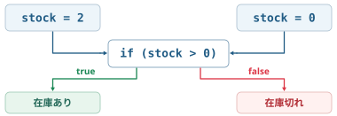{#ch02-stock-if-flow}

::: {#ch02-stock-if-flow-caption .caption}
if文で購入処理を実行するか判断する
:::

::: {#ch02-stock-if-use .step}
**if文が適している場面**
:::

::: {#ch02-stock-if-use-text-1 .paragraph}
`if`文は、条件に応じて複数の処理をまとめて実行したり、3つ以上の条件に分岐したりする場合にも便利です。
:::

::: {#ch02-stock-if-use-text-2 .paragraph}
例えば、在庫数に応じて3種類のメッセージを設定したい場合は、次のように記述できます。
:::

::: {#ch02-stock-if-use-example .code example="true"}
```tsx
let stockMessage = ''

if (stock === 0) {
  stockMessage = '在庫切れ'
} else if (stock === 1) {
  stockMessage = '残りわずか'
} else {
  stockMessage = '在庫あり'
}
```
:::

::: {#ch02-stock-if-use-text-3 .paragraph}
このように複数の条件を順番に判定する処理は、`if / else if / else`を使用すると分かりやすくなります。
:::

::::

:::: {#page-49 .source-page}

::: {#ch02-stock-jsx-expression .heading level="minor"}
JSXの中ではif文を直接記述できない
:::

::: {#ch02-stock-jsx-expression-text-1 .paragraph}
ここで注意したいのは、`if`文を記述する場所です。
:::

::: {#ch02-stock-jsx-expression-text-2 .paragraph}
JSXでは、`{ }`の中にJavaScriptの式を記述できますが、`if`文を直接記述することはできません。
:::

::: {#ch02-stock-jsx-expression-text-3 .paragraph}
例えば、次の書き方はエラーになります。
:::

::: {#ch02-stock-jsx-if-error .code example="true"}
```tsx
<p>
  {if (stock > 0) {
    '在庫あり'
  }}
</p>
```
:::

::: {#ch02-stock-jsx-expression-text-4 .paragraph}
`if`文はJavaScriptの「文」であり、JSXの`{ }`の中で直接使用することはできないためです。
:::

::: {#ch02-stock-jsx-expression-text-5 .paragraph}
そのため、`if`文は、先ほどのようにイベントハンドラーの内部や、JSXを返す`return`より前のJavaScriptの処理部分などで使用します。
:::

::: {#ch02-stock-jsx-expression-text-6 .paragraph}
一方、**JSXの中で条件に応じて表示内容を切り替えたい場合**は、次に紹介する三項演算子や論理AND演算子が便利です。
:::

::: {#ch02-stock-ternary .heading level="minor"}
三項演算子（? :）による表示の切り替え
:::

::: {#ch02-stock-ternary-text-1 .paragraph}
三項演算子は、条件に応じて2つの値から1つを選ぶための構文です。
:::

::: {#ch02-stock-ternary-text-2 .paragraph}
JavaScriptでも使用できる構文ですが、ReactではJSXの中でよく利用します。
:::

::: {#ch02-stock-ternary-text-3 .paragraph}
例えば、在庫数が0より大きい場合は「在庫あり」、そうでなければ「在庫切れ」と表示したいとします。
:::

::: {#ch02-stock-ternary-basic .step}
**基本構文**
:::

::: {#ch02-stock-ternary-syntax .code example="true"}
```tsx
条件式 ? 条件がtrueの場合の値 : 条件がfalseの場合の値
```
:::

::: {#ch02-stock-ternary-basic-text-1 .paragraph}
先ほどの在庫状況を三項演算子で記述すると、次のようになります。
:::

::: {#ch02-stock-ternary-example .code example="true"}
```tsx
<p>
  {stock > 0 ? '在庫あり' : '在庫切れ'}
</p>
```
:::

::::

:::: {#page-50 .source-page}

::: {#ch02-stock-ternary-basic-text-2 .paragraph}
このコードは、次のように読みます。
:::

::: {#ch02-stock-ternary-basic-bullet-1 .paragraph}
● `stock > 0`：在庫が1個以上あるかを判定する
:::

::: {#ch02-stock-ternary-basic-bullet-2 .paragraph}
● `? '在庫あり'`：条件がtrueの場合に選択する文字列
:::

::: {#ch02-stock-ternary-basic-bullet-3 .paragraph}
● `: '在庫切れ'`：条件がfalseの場合に選択する文字列
:::

::: {#ch02-stock-ternary-basic-text-3 .paragraph}
つまり、**在庫数が0より大きければ「在庫あり」、そうでなければ「在庫切れ」を表示する**という意味です。
:::

::: {#ch02-stock-ternary-basic-text-4 .paragraph}
ここで注目したいのは、三項演算子をJSXの`{ }`に直接記述していることです。
:::

::: {#ch02-stock-ternary-basic-text-5 .paragraph}
`if`文を使用する場合とは異なり、表示したい場所にそのまま条件式を記述できます。
:::

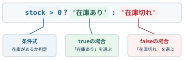{#ch02-stock-ternary-parts}

::: {#ch02-stock-ternary-parts-caption .caption}
条件式の結果によって選ぶ文字列が変わる
:::

::: {#ch02-stock-attribute .step}
**HTML属性にも三項演算子を使用できる**
:::

::: {#ch02-stock-attribute-text-1 .paragraph}
三項演算子は、表示する文字列だけでなく、HTML属性の値を切り替える場合にも使用できます。
:::

::: {#ch02-stock-attribute-text-2 .paragraph}
例えば、在庫がある場合は緑色、在庫がない場合は赤色でメッセージを表示したいとします。
:::

::: {#ch02-stock-attribute-text-3 .paragraph}
その場合は、次のように記述できます。
:::

::: {#ch02-stock-attribute-example .code example="true"}
```tsx
<p className={stock > 0 ? 'text-success' : 'text-danger'}>
  {stock > 0 ? '購入できます' : '購入できません'}
</p>
```
:::

::::

:::: {#page-51 .source-page}

::: {#ch02-stock-attribute-text-4 .paragraph}
ここでは、`className`の値と、`<p>`の中に表示する文字列の両方を条件によって切り替えています。
:::

::: {#ch02-stock-attribute-text-5 .paragraph}
`text-success`と`text-danger`はBootstrapで用意されているCSSのクラスです。
:::

::: {#ch02-stock-attribute-table-1 .table}
| 条件 | 文字色 | 表示する内容 |
|---|---|---|
| `stock > 0`がtrue | 緑色 | 購入できます |
| `stock > 0`がfalse | 赤色 | 購入できません |
:::

::: {#ch02-stock-attribute-text-6 .paragraph}
このように、三項演算子を使用すると、**1つのHTML要素の中で表示内容やデザインを切り替えられます。**
:::

::: {#ch02-stock-and .heading level="minor"}
論理AND演算子（&&）による条件付き表示
:::

::: {#ch02-stock-and-text-1 .paragraph}
ここまでの三項演算子では、条件によって2つの表示を切り替えていました。
:::

::: {#ch02-stock-and-text-2 .paragraph}
しかし、実際のWebアプリケーションでは、**条件を満たした場合だけ、特定のメッセージを表示したい**こともあります。
:::

::: {#ch02-stock-and-text-3 .paragraph}
例えば、商品の在庫数が1個になったときだけ、「残り1個です」という注意メッセージを表示したいとします。
:::

::: {#ch02-stock-and-text-4 .paragraph}
このような場合に便利なのが、論理AND演算子の`&&`です。
:::

::: {#ch02-stock-and-basic .step}
**基本構文**
:::

::: {#ch02-stock-and-syntax .code example="true"}
```tsx
{条件式 && 表示したいJSX}
```
:::

::: {#ch02-stock-and-basic-text-1 .paragraph}
例えば、次のように記述できます。
:::

::: {#ch02-stock-and-example .code example="true"}
```tsx
{stock === 1 && (
  <p className="alert alert-warning">
    残り1個です
  </p>
)}
```
:::

::: {#ch02-stock-and-style .paragraph}
Bootstrapの `alert` と `alert-warning` を指定すると、注意メッセージを黄色の背景付きで表示できます。
:::

::::

:::: {#page-52 .source-page}

::: {#ch02-stock-and-basic-text-2 .paragraph}
このコードでは、`stock === 1`という条件を判定しています。
:::

::: {#ch02-stock-and-basic-text-3 .paragraph}
条件がtrueの場合は、右側に記述した`<p>`要素を表示します。
:::

::: {#ch02-stock-and-basic-text-4 .paragraph}
一方、条件がfalseの場合は、その`<p>`要素を表示しません。
:::

::: {#ch02-stock-and-basic-table-1 .table}
| 在庫数 | 条件 `stock === 1` | 注意メッセージ |
|---|---|---|
| 2個 | false | 表示しない |
| 1個 | true | 「残り1個です」を表示 |
| 0個 | false | 表示しない |
:::

::: {#ch02-stock-and-basic-text-5 .paragraph}
三項演算子がtrueとfalseの2つの表示を切り替えるのに対し、`&&`は**条件を満たすときだけ要素を表示したい場合**に適しています。
:::

::: {#ch02-stock-and-basic-text-6 .paragraph}
また、三項演算子と同様に、JSXの`{ }`へ直接記述できます。
:::

{#ch02-stock-and-warning}

::: {#ch02-stock-and-warning-caption .caption}
在庫数が1個のときだけ注意メッセージを表示する
:::

::: {#ch02-stock-comparison .heading level="minor"}
3つの条件分岐の使い分け
:::

::: {#ch02-stock-comparison-text-1 .paragraph}
ここまでに学習した3つの構文は、すべて条件を扱うものですが、得意とする処理が異なります。
:::

::: {#ch02-stock-comparison-table-1 .table column-widths="26 43 31"}
| 構文 | 適している場面 | JSXの`{ }`に直接記述 |
|---|---|---|
| `if / else` | 条件に応じて処理を実行・分岐させたい | できない |
| 三項演算子 `? :` | 条件によって2つの表示を切り替えたい | できる |
| 論理AND演算子 `&&` | 条件を満たすときだけ表示したい | できる |
:::

::: {#ch02-stock-comparison-text-2 .paragraph}
例えば、今回の商品管理画面では、次のように使い分けます。
:::

::::

:::: {#page-53 .source-page}

::: {#ch02-stock-comparison-if .step}
**① if文：在庫がある場合だけ購入処理を実行する**
:::

::: {#ch02-stock-comparison-if-example .code example="true"}
```tsx
if (stock > 0) {
  setStock(stock - 1)
}
```
:::

::: {#ch02-stock-comparison-ternary .step}
**② 三項演算子：在庫状況の表示を切り替える**
:::

::: {#ch02-stock-comparison-ternary-example .code example="true"}
```tsx
{stock > 0 ? '在庫あり' : '在庫切れ'}
```
:::

::: {#ch02-stock-comparison-and .step}
**③ &&：在庫が1個のときだけ注意文を表示する**
:::

::: {#ch02-stock-comparison-and-example .code example="true"}
```tsx
{stock === 1 && <p>残り1個です</p>}
```
:::

::: {#ch02-stock-comparison-and-text-1 .paragraph}
このように、`if`文はプログラムの処理を制御したいとき、三項演算子や`&&`はJSXの中で表示を切り替えたいときに使うと、コードを分かりやすく整理できます。
:::

::: {#ch02-stock-comparison-and-text-2 .paragraph}
なお、三項演算子や`&&`もJavaScriptの構文なので、JSX以外の場所で使用できます。ただし、条件によって複数の処理を実行する場合などは、`if`文の方が読みやすくなることが一般的です。
:::

::: {#ch02-stock-and-note .training-note}
【補足】&&を使用するときの注意点

`&&`の左側には、基本的にtrueまたはfalseとなる条件式を指定します。

例えば、`stock === 1`や`stock > 0`です。

単に`stock && <p>在庫あり</p>`とすると、`stock`が0の場合、画面に数字の「0」が表示されることがあります。

そのため、本研修では、`stock > 0`のように条件式を明確に記述することをおすすめします。
:::

::::

:::: {#page-54 .source-page}

::: {#ch02-stock-sample .heading level="minor"}
【サンプル】商品の在庫状況を表示する
:::

::: {#ch02-stock-sample-text-1 .paragraph}
それでは、ここまでに学習した3つの条件分岐の方法を組み合わせて、商品の在庫管理画面を作成してみましょう。
:::

::: {#ch02-stock-sample-text-2 .paragraph}
今回は、最初の在庫数を2個とします。
:::

::: {#ch02-stock-sample-text-3 .paragraph}
「1個購入」ボタンをクリックするたびに在庫数が1個減り、在庫数に応じて画面の表示が切り替わるようにします。
:::

::: {#ch02-stock-sample-text-4 .paragraph}
今回のポイントは、次の3つです。
:::

::: {#ch02-stock-sample-bullet-1 .paragraph}
● **if文**：在庫がある場合だけ、購入処理を実行する
:::

::: {#ch02-stock-sample-bullet-2 .paragraph}
● **三項演算子**：「在庫あり」「在庫切れ」などの表示を切り替える
:::

::: {#ch02-stock-sample-bullet-3 .paragraph}
● **&&**：在庫が1個になったときだけ注意メッセージを表示する
:::

::: {#ch02-stock-sample-code-p1 .code filename="ch02-basic/src/components/Sample2_5.tsx"}
```tsx
import { useState } from 'react'

export default function Sample2_5() {
  const [stock, setStock] = useState(2)

  const purchaseOne = () => {
    if (stock > 0) {
      setStock(stock - 1)
    }
  }

  return (
    <main className="container mt-4">
      <h1>商品の在庫確認</h1>
      <p>商品名：ノート</p>
      <p>在庫数：{stock}個</p>
      <p>在庫状況：{stock > 0 ? '在庫あり' : '在庫切れ'}</p>

      <p className={stock > 0 ? 'text-success fw-bold'
        : 'text-danger fw-bold'}>
        {stock > 0 ? '購入できます' : '購入できません'}
      </p>

      {stock === 1 && (
        <p className="alert alert-warning">残り1個です</p>
      )}
```
:::

::::

:::: {#page-55 .source-page}

::: {#ch02-stock-sample-code-p2 .code filename="ch02-basic/src/components/Sample2_5.tsx" start-line="27"}
```tsx

      <button className="btn btn-primary" onClick={purchaseOne}
        disabled={stock === 0}>
        1個購入
      </button>
    </main>
  )
}
```
:::

::: {#ch02-stock-sample-check .step}
**動作確認**
:::

::: {#ch02-stock-sample-check-text-1 .paragraph}
`ch02-basic`の開発サーバーを起動し、メニューから「2.5 条件に応じた表示」を選択してください。
:::

::: {#ch02-stock-sample-check-text-2 .paragraph}
購入ボタンをクリックするたびに、次のように画面の状態が変わります。
:::

::: {#ch02-stock-sample-check-table-1 .table column-widths="27 16 43 14"}
| 状態 | 在庫状況 | メッセージ | ボタン |
|---|---|---|---|
| 初期状態（2個） | 在庫あり | 購入できます | 押せる |
| 1回クリック（1個） | 在庫あり | 購入できます／残り1個です | 押せる |
| 2回クリック（0個） | 在庫切れ | 購入できません | 押せない |
:::

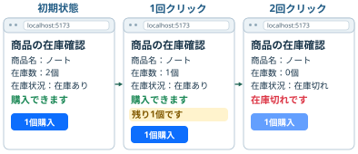{#ch02-stock-purchase-states}

::: {#ch02-stock-purchase-states-caption .caption}
在庫数が2個、1個、0個と変わったときの表示
:::

::::

:::: {#page-56 .source-page}

::: {#ch02-stock-review .heading level="minor"}
構文の解説
:::

::: {#ch02-stock-review-text-1 .paragraph}
ここからは、サンプルコードの重要な部分を確認します。
:::

::: {#ch02-stock-review-state .step}
**① 在庫数をstateで管理する**
:::

::: {#ch02-stock-review-state-code .code filename="ch02-basic/src/components/Sample2_5.tsx" start-line="4"}
```tsx
  const [stock, setStock] = useState(2)
```
:::

::: {#ch02-stock-review-state-text-1 .paragraph}
商品の在庫数を`stock`というstateで管理します。
:::

::: {#ch02-stock-review-state-text-2 .paragraph}
初期値は2個です。
:::

::: {#ch02-stock-review-state-text-3 .paragraph}
`setStock`を使用して在庫数を変更すると、Reactが再レンダリングし、画面の表示も新しい在庫数に応じて変化します。
:::

::: {#ch02-stock-review-purchase .step}
**② if文で購入処理を実行するか判断する**
:::

::: {#ch02-stock-review-purchase-code .code filename="ch02-basic/src/components/Sample2_5.tsx" start-line="6"}
```tsx
  const purchaseOne = () => {
    if (stock > 0) {
      setStock(stock - 1)
    }
  }
```
:::

::: {#ch02-stock-review-purchase-text-1 .paragraph}
この関数は、商品を1個購入するための処理です。
:::

::: {#ch02-stock-review-purchase-text-2 .paragraph}
`if (stock > 0)`で在庫が残っていることを確認してから、在庫数を1減らしています。
:::

::: {#ch02-stock-review-purchase-text-3 .paragraph}
在庫数が0の場合は、`setStock()`が実行されないため、在庫がマイナスになることを防げます。
:::

::: {#ch02-stock-review-purchase-text-4 .paragraph}
ここでの`if`文は、画面に表示する文字列を選んでいるのではなく、**stateを更新する処理を実行するかどうかを判断しています。**
:::

::::

:::: {#page-57 .source-page}

::: {#ch02-stock-review-message .step}
**③ 三項演算子で在庫状況を表示する**
:::

::: {#ch02-stock-review-message-code .code filename="ch02-basic/src/components/Sample2_5.tsx" start-line="17"}
```tsx
      <p>在庫状況：{stock > 0 ? '在庫あり' : '在庫切れ'}</p>
```
:::

::: {#ch02-stock-review-message-text-1 .paragraph}
在庫数が0より大きい場合は「在庫あり」、在庫数が0の場合は「在庫切れ」と表示します。
:::

::: {#ch02-stock-review-message-text-2 .paragraph}
条件によって表示する文字列を2つから選び、JSXの中に直接表示しています。
:::

::: {#ch02-stock-review-ternary .step}
**④ 三項演算子で表示内容と文字色を切り替える**
:::

::: {#ch02-stock-review-ternary-code .code filename="ch02-basic/src/components/Sample2_5.tsx" start-line="19"}
```tsx
      <p className={stock > 0 ? 'text-success fw-bold'
        : 'text-danger fw-bold'}>
        {stock > 0 ? '購入できます' : '購入できません'}
      </p>
```
:::

::: {#ch02-stock-review-ternary-text-1 .paragraph}
在庫数が0より大きい場合は、緑色で「購入できます」と表示します。
:::

::: {#ch02-stock-review-ternary-text-2 .paragraph}
在庫数が0の場合は、赤色で「購入できません」と表示します。
:::

::: {#ch02-stock-review-ternary-text-3 .paragraph}
三項演算子を使用することで、同じ`<p>`要素の中で表示内容と文字色を切り替えています。
:::

::::

:::: {#page-58 .source-page}

::: {#ch02-stock-review-and .step}
**⑤ &&で注意メッセージを表示する**
:::

::: {#ch02-stock-review-and-code .code filename="ch02-basic/src/components/Sample2_5.tsx" start-line="24"}
```tsx
      {stock === 1 && (
        <p className="alert alert-warning">残り1個です</p>
      )}
```
:::

::: {#ch02-stock-review-and-text-1 .paragraph}
在庫数が1個の場合だけ、注意メッセージを表示します。
:::

::: {#ch02-stock-review-and-text-2 .paragraph}
在庫数が2個以上、または0個の場合は、この要素は表示されません。
:::

::: {#ch02-stock-review-disabled .step}
**⑥ 在庫が0個の場合は購入ボタンを無効にする**
:::

::: {#ch02-stock-review-disabled-code .code filename="ch02-basic/src/components/Sample2_5.tsx" start-line="28" highlight-lines="29-29"}
```tsx
      <button className="btn btn-primary" onClick={purchaseOne}
        disabled={stock === 0}>
        1個購入
      </button>
```
:::

::: {#ch02-stock-review-disabled-text-1 .paragraph}
`disabled`は、ボタンを操作できない状態にするためのHTML属性です。
:::

::: {#ch02-stock-review-disabled-text-2 .paragraph}
`disabled={stock === 0}`と指定すると、在庫数が0の場合にボタンが無効になります。
:::

::: {#ch02-stock-review-disabled-text-3 .paragraph}
ここでは、`disabled`でユーザーの操作を制限するとともに、`purchaseOne`関数内の`if`文でも在庫数が0未満にならないようにしています。
:::

::: {#ch02-stock-review-disabled-text-4 .paragraph}
**disabledはボタンの操作を制御し、if文は実行する処理を制御する**という役割の違いがあります。
:::

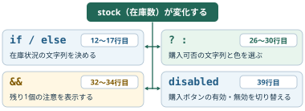{#ch02-stock-display-flow}

::: {#ch02-stock-display-flow-caption .caption}
購入ボタンを押した後、在庫数と画面の表示が更新される流れ
:::

::::

:::: {#page-59 .source-page}

::: {#ch02-stock-practice .heading level="minor"}
【確認演習】商品の在庫表示を実装する
:::

::: {#ch02-stock-practice-text-1 .paragraph}
在庫数に応じて「在庫あり」「在庫切れ」などのメッセージを切り替える画面を作成します。
:::

::: {#ch02-stock-practice-text-2 .paragraph}
在庫数を管理するstateや画面の基本構成は、あらかじめ用意されています。
:::

::: {#ch02-stock-practice-text-3 .paragraph}
今回は、`if`文で購入処理の実行を制御し、三項演算子・論理AND演算子・`disabled`属性を使用して、在庫数に応じた表示を実装しましょう。
:::

::: {#ch02-stock-practice-steps .step}
**作業手順・動作確認**
:::

::: {#ch02-stock-practice-step-1 .paragraph numbered="true"}
1．　`ch02-basic-q`プロジェクトの`src/components/Q2_5.tsx`を開いてください。
:::

::: {#ch02-stock-practice-step-2 .paragraph numbered="true"}
2．　コード内の➀～➄の番号付きコメントを確認し、指示された箇所を実装してください。➀は既存コードの確認、➁～➄は実装問題です。コメントに指定されていないコードや、ほかのファイルは変更する必要はありません。
:::

::: {#ch02-stock-practice-step-3 .paragraph numbered="true"}
3．　編集したファイルを保存してください。
:::

::: {#ch02-stock-practice-step-4 .paragraph numbered="true"}
4．　`ch02-basic-q`の開発サーバーを起動し、ターミナルに表示されたURLを開いてください。起動済みの場合は、開いているブラウザーの画面に戻ってください。
:::

::: {#ch02-stock-practice-step-5 .paragraph numbered="true"}
5．　メニューから「2.5 条件に応じた表示」を選んでください。
:::

::: {#ch02-stock-practice-step-6 .paragraph numbered="true" keep-lines="true"}
6．　次の動作を確認してください。<br>● **初期状態**：在庫数2個。「在庫あり」「購入できます」と表示されます。<br>● **1回クリック**：在庫数1個。「在庫あり」「購入できます」に加えて、黄色の背景付きで「残り1個です」と表示されます。<br>● **2回クリック**：在庫数0個。「在庫切れ」「購入できません」と表示され、「1個購入」ボタンが押せなくなります。
:::

::: {#ch02-stock-practice-steps-text-1 .paragraph}
在庫数に応じて表示内容やボタンの状態が正しく切り替われば、演習完了です。
:::

::: {#ch02-stock-points .section-points}
この節のポイント

● Reactでは、JavaScriptの条件分岐を使用して、処理や画面の表示を切り替えられる。

● **if / else文**は、条件に応じて処理を実行・分岐させたい場合に適している。

● **三項演算子（? :）**は、条件に応じて2つの表示を切り替える場合に便利である。

● **論理AND演算子（&&）**は、条件を満たした場合だけ要素を表示したいときに便利である。

● `if`文はJSXの`{ }`内に直接記述できないが、三項演算子と`&&`はJSXの中に記述できる。

● `disabled={条件式}`を使用すると、条件によってボタンを操作できない状態にできる。

● `useState()`と組み合わせることで、データの変化に応じて画面の表示を切り替えられる。
:::

::::

:::: {#page-60 .source-page}

::: {#ch02-list-title .heading}
2.6. 配列データの一覧表示
:::

::: {#ch02-list-slide .slide layout="illustration"}
配列データの一覧表示

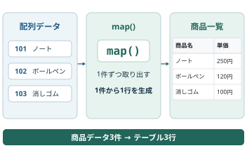
:::

::: {#ch02-list-intro .heading level="minor"}
複数のデータを画面に表示するには
:::

::: {#ch02-list-intro-text-1 .paragraph}
これまでの学習では、商品名や単価などのデータをJSXに埋め込み、画面に表示する方法を学習しました。
:::

::: {#ch02-list-intro-text-2 .paragraph}
しかし、実際のWebアプリケーションでは、1件だけではなく、複数のデータをまとめて表示する場面が多くあります。
:::

::: {#ch02-list-intro-text-3 .paragraph}
例えば、商品管理システムでは、次のような商品一覧画面が必要になることがあります。
:::

::: {#ch02-list-intro-table-1 .table}
| 商品番号 | 商品名 | 単価 |
|---|---|---:|
| 101 | ノート | 250円 |
| 102 | ボールペン | 120円 |
| 103 | 消しゴム | 100円 |
:::

::::

:::: {#page-61 .source-page}

::: {#ch02-list-intro-text-4 .paragraph}
このような画面を通常のHTMLで作成する場合、商品ごとに`<tr>`と`<td>`を記述して、テーブルの行を作成します。
:::

::: {#ch02-list-intro-text-5 .paragraph}
例えば、次のようなコードです。
:::

::: {#ch02-list-html-rows .code example="true"}
```html
<tr>
  <td>101</td>
  <td>ノート</td>
  <td>250円</td>
</tr>
<tr>
  <td>102</td>
  <td>ボールペン</td>
  <td>120円</td>
</tr>
<tr>
  <td>103</td>
  <td>消しゴム</td>
  <td>100円</td>
</tr>
```
:::

::: {#ch02-list-intro-text-6 .paragraph}
この方法でも商品一覧を表示できますが、商品が100件、1,000件と増えていくと、商品ごとにHTMLを書くのは大変です。
:::

::: {#ch02-list-intro-text-7 .paragraph}
また、商品が追加・削除された際にも、それに合わせてHTMLを修正しなければなりません。
:::

::: {#ch02-list-intro-text-8 .paragraph}
そこでReactでは、**配列に格納されたデータをもとに、必要な数のHTML要素を自動的に生成する**という方法を使用します。
:::

::: {#ch02-list-intro-text-9 .paragraph}
このときに使用するのが、JavaScriptの`map()`というメソッドです。
:::

::::

:::: {#page-62 .source-page}

::: {#ch02-list-map .heading level="minor"}
map()とは
:::

::: {#ch02-list-map-text-1 .paragraph}
`map()`は、配列の要素を1つずつ取り出して処理し、その結果を新しい配列として返すJavaScriptのメソッドです。
:::

::: {#ch02-list-map-text-2 .paragraph}
React独自の関数ではなく、通常のJavaScriptでも使用できます。
:::

::: {#ch02-list-map-text-3 .paragraph}
Reactでは、この`map()`を利用して、配列の要素からJSXを繰り返し生成します。
:::

::: {#ch02-list-map-syntax .step}
**基本構文**
:::

::: {#ch02-list-map-syntax-text-1 .paragraph}
まずは、次のコードを確認してください。
:::

::: {#ch02-list-map-array-example .code example="true"}
```tsx
const products = [
  { id: 101, name: 'ノート' },
  { id: 102, name: 'ボールペン' },
  { id: 103, name: '消しゴム' }
]
```
:::

::: {#ch02-list-map-syntax-text-2 .paragraph}
この配列には、3件の商品オブジェクトが格納されています。
:::

::: {#ch02-list-map-syntax-text-3 .paragraph}
これらの商品名を繰り返し表示する場合は、次のように記述します。
:::

::: {#ch02-list-map-list-example .code example="true"}
```tsx
<ul>
  {products.map((product) => (
    <li key={product.id}>{product.name}</li>
  ))}
</ul>
```
:::

::: {#ch02-list-map-syntax-text-4 .paragraph}
このコードを実行すると、画面には次のように表示されます。
:::

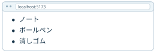{#ch02-list-list-preview}

::: {#ch02-list-list-preview-caption .caption}
3件の商品名をリストに表示した画面
:::

::::

:::: {#page-63 .source-page}

::: {#ch02-list-map-syntax-text-5 .paragraph}
`<li>`要素は1つしか記述していませんが、配列に3件のデータがあるため、3つの`<li>`要素が生成されます。
:::

::: {#ch02-list-map-breakdown .step}
**map()の構文を分解してみよう**
:::

::: {#ch02-list-map-breakdown-code .code example="true"}
```tsx
products.map((product) => (
  <li key={product.id}>{product.name}</li>
))
```
:::

::: {#ch02-list-map-breakdown-text-1 .paragraph}
それぞれの意味は、次のとおりです。
:::

::: {#ch02-list-map-breakdown-table-1 .table}
| 記述 | 意味 |
|---|---|
| `products` | 繰り返し処理する配列 |
| `.map()` | 配列の要素を順番に処理するメソッド |
| `product` | 配列から取り出した1件分の商品データ |
| `=>` | アロー関数を表す記号 |
| `<li>...</li>` | 商品1件分として生成するJSX |
:::

::: {#ch02-list-map-breakdown-text-2 .paragraph}
`map()`は、配列内のデータを1件ずつ`product`という変数に渡し、アロー関数を実行します。
:::

::: {#ch02-list-map-breakdown-text-3 .paragraph}
今回は、そのアロー関数が`<li>`要素を返しています。
:::

::: {#ch02-list-map-breakdown-text-4 .paragraph}
この処理が配列の要素数だけ繰り返されるため、商品データの数に応じて表示されるHTML要素も増えるわけです。
:::

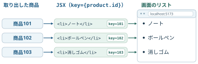{#ch02-list-map-items}

::: {#ch02-list-map-items-caption .caption}
商品1件から1つのリスト要素を生成する
:::

::::

:::: {#page-64 .source-page}

::: {#ch02-list-key .heading level="minor"}
key属性とは
:::

::: {#ch02-list-key-text-1 .paragraph}
ところで、先ほどのコードには、まだ説明していない記述がありました。
:::

::: {#ch02-list-key-list-example .code example="true"}
```tsx
<li key={product.id}>{product.name}</li>
```
:::

::: {#ch02-list-key-text-2 .paragraph}
この`key`は、**Reactが繰り返し表示した要素を区別するために使用する特別な属性**です。
:::

::: {#ch02-list-key-text-3 .paragraph}
例えば、商品一覧に3つの商品が表示されているとします。
:::

::: {#ch02-list-key-text-4 .paragraph}
その後、商品が1件削除されたり、表示する順番が変更されたりする場合があります。
:::

::: {#ch02-list-key-text-5 .paragraph}
このとき、Reactがそれぞれの商品を正しく識別するために使用するのが`key`です。
:::

::: {#ch02-list-key-unique .step}
**keyには一意な値を指定する**
:::

::: {#ch02-list-key-unique-text-1 .paragraph}
基本的には、商品番号や社員番号など、データを一意に識別できる値を指定します。
:::

::: {#ch02-list-key-row-example .code example="true"}
```tsx
<tr key={product.id}>
```
:::

::: {#ch02-list-key-unique-text-2 .paragraph}
例えば、商品番号が101、102、103であれば、それぞれ異なる`key`が設定されます。
:::

::: {#ch02-list-key-unique-table-1 .table}
| 商品名 | keyに指定する値 |
|---|---|
| ノート | 101 |
| ボールペン | 102 |
| 消しゴム | 103 |
:::

::: {#ch02-list-key-unique-text-3 .paragraph}
Reactはこれらの値を利用して、どの商品がどの要素に対応しているかを判断します。
:::

::: {#ch02-list-key-unique-text-4 .paragraph}
なお、`key`は画面に表示される属性ではありません。Reactが内部で要素を識別するために使用するものです。
:::

::::

:::: {#page-65 .source-page}

{#ch02-list-key-rows}

::: {#ch02-list-key-rows-caption .caption}
商品番号をkeyに使い、Reactが各行を識別する
:::

::: {#ch02-list-key-note .training-note}
【補足】keyを省略するとどうなる？

`map()`で複数のJSX要素を生成する際に`key`を指定しないと、Reactから警告が表示されます。

また、配列の順番を表す番号を`key`として使用する方法もありますが、データの追加や削除、並べ替えが発生する場合には問題につながることがあります。

そのため、本研修では、商品番号のように**データごとに決まっている一意な値をkeyに指定する**方法を使用します。
:::

::: {#ch02-list-sample .heading level="minor"}
【サンプル】商品データをテーブルで一覧表示する
:::

::: {#ch02-list-sample-text-1 .paragraph}
それでは、`map()`を使用して、商品一覧画面を作成してみましょう。
:::

::: {#ch02-list-sample-text-2 .paragraph keep-lines="true"}
今回は、3件の商品情報を配列として定義し、<br>Bootstrapのテーブルを使用して一覧表示します。
:::

::::

:::: {#page-66 .source-page}

::: {#ch02-list-sample-code .code filename="ch02-basic/src/components/Sample2_6.tsx"}
```tsx
export default function Sample2_6() {
  const products = [
    { id: 101, name: 'ノート', price: 250 },
    { id: 102, name: 'ボールペン', price: 120 },
    { id: 103, name: '消しゴム', price: 100 }
  ]

  return (
    <main className="container mt-4">
      <h1>商品一覧</h1>
      <table className="table table-bordered w-auto">
        <thead className="table-light">
          <tr>
            <th>商品番号</th>
            <th>商品名</th>
            <th>単価</th>
          </tr>
        </thead>
        <tbody>
          {products.map((product) => (
            <tr key={product.id}>
              <td>{product.id}</td>
              <td>{product.name}</td>
              <td>{product.price}円</td>
            </tr>
          ))}
        </tbody>
      </table>
    </main>
  )
}
```
:::

::::

:::: {#page-67 .source-page}

::: {#ch02-list-sample-check .step}
**動作確認**
:::

::: {#ch02-list-sample-check-text-1 .paragraph}
`ch02-basic`の開発サーバーを起動し、メニューから「2.6 配列データの一覧表示」を選択してください。
:::

::: {#ch02-list-sample-check-text-2 .paragraph}
次のように、配列に格納した3件の商品がテーブル形式で表示されます。
:::

::: {#ch02-list-sample-browser-label .step}
【ブラウザー画面の表示イメージ】
:::

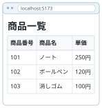{#ch02-list-table-match}

::: {#ch02-list-table-match-caption .caption}
配列の3件が一覧画面の3行に対応する
:::

::::

:::: {#page-68 .source-page}

::: {#ch02-list-review .heading level="minor"}
構文の解説
:::

::: {#ch02-list-review-text-1 .paragraph}
ここからは、サンプルコードの重要な部分を確認します。
:::

::: {#ch02-list-review-array .step}
**① 商品データを配列で定義する**
:::

::: {#ch02-list-review-array-code .code filename="ch02-basic/src/components/Sample2_6.tsx" start-line="2"}
```tsx
  const products = [
    { id: 101, name: 'ノート', price: 250 },
    { id: 102, name: 'ボールペン', price: 120 },
    { id: 103, name: '消しゴム', price: 100 }
  ]
```
:::

::: {#ch02-list-review-array-text-1 .paragraph}
ここでは、`products`という配列に3件の商品データを格納しています。
:::

::: {#ch02-list-review-array-text-2 .paragraph}
それぞれの商品は、次の3つのプロパティを持つオブジェクトです。
:::

::: {#ch02-list-review-array-table-1 .table}
| プロパティ | 意味 |
|---|---|
| `id` | 商品番号 |
| `name` | 商品名 |
| `price` | 単価 |
:::

::: {#ch02-list-review-array-text-3 .paragraph}
今回は、Reactの中で商品データを直接定義しています。
:::

::: {#ch02-list-review-array-text-4 .paragraph}
実際のWebアプリケーションでは、データベースやREST APIから取得した商品データを、同じような配列として扱うこともあります。
:::

::::

:::: {#page-69 .source-page}

::: {#ch02-list-review-map .step}
**② map()で商品データを繰り返し処理する**
:::

::: {#ch02-list-review-map-code .code filename="ch02-basic/src/components/Sample2_6.tsx" start-line="20"}
```tsx
          {products.map((product) => (
            <tr key={product.id}>
              <td>{product.id}</td>
              <td>{product.name}</td>
              <td>{product.price}円</td>
            </tr>
          ))}
```
:::

::: {#ch02-list-review-map-text-1 .paragraph}
20行目では、`products`配列に対して`map()`を実行しています。
:::

::: {#ch02-list-review-map-text-2 .paragraph}
`map()`は、配列から商品データを1件ずつ取り出して、`product`という変数に渡します。
:::

::: {#ch02-list-review-map-text-3 .paragraph}
そして、21～25行目の`<tr>`要素を、商品データ1件につき1つ生成します。
:::

::: {#ch02-list-review-map-text-4 .paragraph}
今回の配列には3件の商品データがあるため、テーブルには3行のデータが表示されます。
:::

::: {#ch02-list-review-map-text-5 .paragraph}
ここでは、`map()`のアロー関数でJSXを返しています。
:::

::: {#ch02-list-review-map-text-6 .paragraph keep-lines="true"}
なお、`=> (`のように記述した場合は、<br>`return`を明示的に記述しなくても、括弧内のJSXが返されます。
:::

::: {#ch02-list-review-key .step}
**③ key属性で各行を識別する**
:::

::: {#ch02-list-review-key-code .code filename="ch02-basic/src/components/Sample2_6.tsx" start-line="21"}
```tsx
            <tr key={product.id}>
```
:::

::: {#ch02-list-review-key-text-1 .paragraph}
`<tr>`要素には、商品番号を使用した`key`属性を設定しています。
:::

::: {#ch02-list-review-key-text-2 .paragraph}
この`key`によって、Reactは各行を区別できます。
:::

::: {#ch02-list-review-key-text-3 .paragraph}
今回の商品番号は101、102、103なので、それぞれ異なる`key`が割り当てられます。
:::

::: {#ch02-list-review-key-text-4 .paragraph}
`map()`で繰り返し生成する要素には、このように適切な`key`を指定してください。
:::

::::

:::: {#page-70 .source-page}

::: {#ch02-list-review-cell .step}
**④ 商品の各プロパティを表示する**
:::

::: {#ch02-list-review-cell-code .code filename="ch02-basic/src/components/Sample2_6.tsx" start-line="22"}
```tsx
              <td>{product.id}</td>
              <td>{product.name}</td>
              <td>{product.price}円</td>
```
:::

::: {#ch02-list-review-cell-text-1 .paragraph keep-lines="true"}
ここでは、`map()`で取り出した商品データの各プロパティを、<br>JSXの`{ }`を使って表示しています。
:::

::: {#ch02-list-review-cell-text-2 .paragraph}
例えば、最初の商品では、次のような値が使用されます。
:::

::: {#ch02-list-review-cell-reading-1 .paragraph}
● `product.id`：101
:::

::: {#ch02-list-review-cell-reading-2 .paragraph}
● `product.name`：ノート
:::

::: {#ch02-list-review-cell-reading-3 .paragraph}
● `product.price`：250
:::

::: {#ch02-list-review-cell-text-3 .paragraph}
次の商品を処理すると、`product`に格納されるデータも変わるため、2行目にはボールペンの情報が表示されます。
:::

::: {#ch02-list-review-cell-text-4 .paragraph}
このように、**同じJSXの記述を使いながら、データに応じて異なる内容を繰り返し表示できる**ことが`map()`の特徴です。
:::

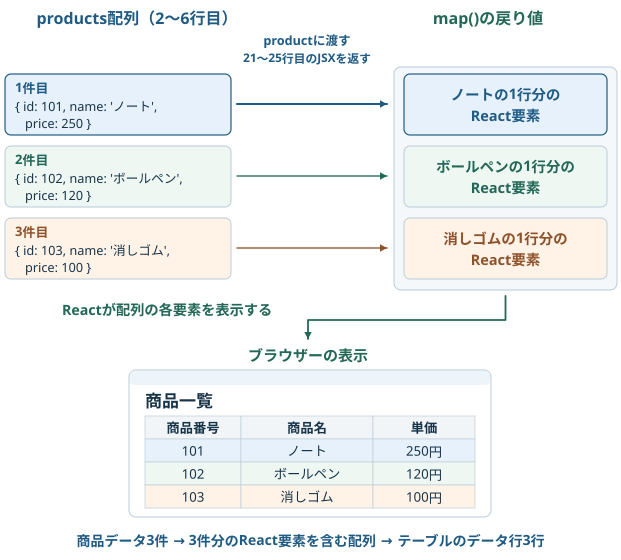{#ch02-list-table-flow}

::: {#ch02-list-table-flow-caption .caption}
配列から一覧の行を生成する流れ
:::

::::

:::: {#page-71 .source-page}

::: {#ch02-list-state-note .training-note}
【補足】map()とuseState()の違い

ここまでのサンプルでは、`useState()`を使用していません。

なぜなら、今回の商品一覧は、最初に用意した配列データを画面に表示するだけだからです。

`map()`は配列の要素から表示用のJSXを生成するための処理であり、`useState()`は、変化するデータをReactで管理するための仕組みです。

例えば、商品を追加・削除するボタンを用意し、操作に応じて一覧を更新したい場合は、`useState()`などによる状態管理と`map()`を組み合わせることができます。

今回は、まず**配列のデータを繰り返し表示する方法**を理解しましょう。
:::

::: {#ch02-list-practice .heading level="minor"}
【確認演習】商品一覧を表示する
:::

::: {#ch02-list-practice-text-1 .paragraph}
配列に格納された商品データを、`map()`を使用してテーブル形式で表示する演習です。
:::

::: {#ch02-list-practice-text-2 .paragraph}
商品データの配列や、テーブルの見出しはあらかじめ用意されています。
:::

::: {#ch02-list-practice-text-3 .paragraph keep-lines="true"}
今回は、**map()による繰り返し処理、key属性、<br>オブジェクトのプロパティの表示**を実装します。
:::

::::

:::: {#page-72 .source-page}

::: {#ch02-list-practice-steps .step}
**作業手順・動作確認**
:::

::: {#ch02-list-practice-step-1 .paragraph numbered="true"}
1．　`ch02-basic-q`プロジェクトの`src/components/Q2_6.tsx`を開いてください。
:::

::: {#ch02-list-practice-step-2 .paragraph numbered="true"}
2．　コード内の➀～➄の番号付きコメントを確認し、指示された箇所を実装してください。➀と➁は確認、➂～➄は実装問題です。コメントに指定されていないコードや、ほかのファイルは変更する必要はありません。
:::

::: {#ch02-list-practice-step-3 .paragraph numbered="true"}
3．　編集したファイルを保存してください。
:::

::: {#ch02-list-practice-step-4 .paragraph numbered="true"}
4．　`ch02-basic-q`の開発サーバーを起動し、ターミナルに表示されたURLを開いてください。起動済みの場合は、開いているブラウザーの画面に戻ってください。
:::

::: {#ch02-list-practice-step-5 .paragraph numbered="true"}
5．　メニューから「2.6 配列データの一覧表示」を選んでください。
:::

::: {#ch02-list-practice-step-6 .paragraph numbered="true"}
6．　商品データが次のようにテーブル形式で表示されることを確認してください。
:::

::: {#ch02-list-practice-steps-table-1 .table}
| 商品番号 | 商品名 | 単価 |
|---|---|---:|
| 201 | ファイル | 600円 |
| 202 | クリップ | 180円 |
| 203 | 付箋 | 240円 |
| 204 | 封筒 | 100円 |
:::

::: {#ch02-list-practice-steps-text-1 .paragraph}
**4件の商品データが4行に表示されていれば、演習完了です。**
:::

::: {#ch02-list-practice-steps-text-2 .paragraph keep-lines="true"}
また、ブラウザーの開発者ツールに<br>`key`に関する警告が表示されていないことも確認してください。
:::

::: {#ch02-list-points .section-points}
この節のポイント

● Reactでは、JavaScriptの**`map()`**を使って配列データから複数のJSX要素を生成できる。

● `map()`では、配列の要素を1件ずつ取り出し、同じ処理を繰り返すことができる。

● 配列の要素数に応じて、テーブルの行などを自動的に生成できる。

● **`key`属性**は、Reactが繰り返し生成された要素を区別するために使用する。

● `key`には、商品番号などの一意で安定した値を指定する。

● `map()`とJSXの`{ }`を組み合わせることで、<br>商品一覧や社員一覧などの画面を作成できる。
:::

::::

:::: {#page-73 .source-page}

::: {#ch02-form-title .heading}
2.7. フォーム入力と状態の連動
:::

::: {#ch02-form-slide .slide layout="illustration"}
フォーム入力と状態の連動


:::

::: {#ch02-form-intro .heading level="minor"}
フォームの入力値をReactで管理するには
:::

::: {#ch02-form-intro-text-1 .paragraph}
Webアプリケーションでは、ユーザーがフォームに入力した情報を利用して、さまざまな処理を行います。
:::

::: {#ch02-form-intro-text-2 .paragraph}
例えば、商品管理システムでは、商品名の入力やカテゴリの選択、販売状態の設定などが必要になります。
:::

::: {#ch02-form-intro-text-3 .paragraph}
通常のHTMLでは、次のように入力欄を作成できます。
:::

::: {#ch02-form-html-input .code example="true"}
```html
<input type="text">
```
:::

::: {#ch02-form-intro-text-4 .paragraph}
この入力欄に文字を入力することはできますが、Reactで入力内容を管理するには、入力値をstateと連動させる仕組みが必要です。
:::

::::

:::: {#page-74 .source-page}

::: {#ch02-form-intro-text-5 .paragraph}
例えば、商品名の入力欄に「ノート」と入力すると、画面の別の場所にも「ノート」と表示される機能を考えてみましょう。
:::

::: {#ch02-form-intro-text-6 .paragraph}
Reactでは、次のような流れで実現できます。
:::

::: {#ch02-form-intro-flow .paragraph keep-lines="true"}
① ユーザーが入力欄に「ノート」と入力する<br>　↓<br>② 入力された値をstateに保存する<br>　↓<br>③ Reactがstateの変更を受けて再レンダリングする<br>　↓<br>④ 画面の確認エリアにも「ノート」と表示される
:::

::: {#ch02-form-intro-text-7 .paragraph}
このように、フォームの入力値とReactのstateを連動させるために使用するのが、**value属性とonChangeイベント**です。
:::

::: {#ch02-form-binding .heading level="minor"}
value属性とonChangeイベント
:::

::: {#ch02-form-binding-text-1 .paragraph}
まずは、テキスト入力欄をReactのstateと連動させる基本的な方法を確認しましょう。
:::

::: {#ch02-form-binding-app .code example="true"}
```tsx
import { useState } from 'react'

export default function App() {
  const [productName, setProductName] = useState('')

  return (
    <main>
      <input
        type="text"
        value={productName}
        onChange={(e) => setProductName(e.target.value)}
      />

      <p>商品名：{productName}</p>
    </main>
  )
}
```
:::

::::

:::: {#page-75 .source-page}

::: {#ch02-form-binding-text-2 .paragraph}
このコードには、3つの重要な部分があります。
:::

::: {#ch02-form-binding-state .step}
**① useStateで入力値を管理する**
:::

::: {#ch02-form-binding-state-code .code filename="ch02-basic/src/components/Sample2_7.tsx" start-line="4"}
```tsx
  const [productName, setProductName] = useState('')
```
:::

::: {#ch02-form-binding-state-text-1 .paragraph}
`productName`は、現在入力されている商品名を保持するstateです。
:::

::: {#ch02-form-binding-state-text-2 .paragraph}
初期値は空文字列の`''`なので、最初は何も入力されていません。
:::

::: {#ch02-form-binding-state-text-3 .paragraph}
`setProductName`は、商品名を更新するための関数です。
:::

::: {#ch02-form-binding-value .step}
**② value属性にstateを設定する**
:::

::: {#ch02-form-binding-value-code .code filename="ch02-basic/src/components/Sample2_7.tsx" start-line="26"}
```tsx
          value={productName}
```
:::

::: {#ch02-form-binding-value-text-1 .paragraph}
`value`属性は、入力欄に表示する値を指定するための属性です。
:::

::: {#ch02-form-binding-value-text-2 .paragraph}
ここでは`productName`を指定しているため、stateの値が入力欄に表示されます。
:::

::: {#ch02-form-binding-value-text-3 .paragraph}
例えば、`productName`の値が「ノート」であれば、入力欄にも「ノート」が表示されます。
:::

::::

:::: {#page-76 .source-page}

::: {#ch02-form-binding-event .step}
**③ onChangeで入力値を更新する**
:::

::: {#ch02-form-binding-event-code .code filename="ch02-basic/src/components/Sample2_7.tsx" start-line="27"}
```tsx
          onChange={(e) => setProductName(e.target.value)}
```
:::

::: {#ch02-form-binding-event-text-1 .paragraph}
この部分が、フォーム入力とstateを連動させるための重要な処理です。
:::

::: {#ch02-form-binding-event-text-2 .paragraph}
`onChange`は、入力値の変更を検知するイベントです。
:::

::: {#ch02-form-binding-event-text-3 .paragraph}
テキスト入力の場合、Reactでは文字を入力したり削除したりするたびに処理が実行されます。
:::

::: {#ch02-form-binding-event-text-4 .paragraph}
ここで、`e`にはイベントに関する情報が渡されます。
:::

::: {#ch02-form-binding-event-text-5 .paragraph}
そして、`e.target.value`によって、入力欄の現在の値を取得できます。
:::

::: {#ch02-form-binding-event-table-1 .table column-widths="33 67"}
| 記述 | 意味 |
|---|---|
| `onChange` | 入力値が変更されたときに実行されるイベント |
| `e` | 発生したイベントの情報 |
| `e.target` | イベントが発生した入力要素 |
| `e.target.value` | 入力欄の現在の値 |
| `setProductName(...)` | 取得した入力値をstateに設定する |
:::

::: {#ch02-form-binding-event-text-6 .paragraph}
例えば、入力欄に「ノート」と入力すると、`e.target.value`には「ノート」という文字列が入ります。
:::

::: {#ch02-form-binding-event-text-7 .paragraph}
そして、`setProductName('ノート')`に相当する処理が実行され、stateが更新されます。
:::

{#ch02-form-onchange-parts}

::: {#ch02-form-onchange-parts-caption .caption}
onChangeで入力値を取得し、stateを更新する
:::

::::

:::: {#page-77 .source-page}

::: {#ch02-form-controlled .heading level="minor"}
valueとonChangeはセットで使用する
:::

::: {#ch02-form-controlled-text-1 .paragraph}
ここで注意したいのが、`value`と`onChange`の関係です。
:::

::: {#ch02-form-controlled-text-2 .paragraph}
例えば、次のように`value`だけを指定した場合を考えてみましょう。
:::

::: {#ch02-form-value-only-code .code example="true"}
```tsx
<input type="text" value={productName} />
```
:::

::: {#ch02-form-controlled-text-3 .paragraph}
この場合、入力欄にはstateの値が表示されます。
:::

::: {#ch02-form-controlled-text-4 .paragraph}
しかし、`onChange`によるstateの更新処理がないため、ユーザーが文字を入力しても、その変更を保持できません。
:::

::: {#ch02-form-controlled-text-5 .paragraph}
その結果、入力欄の値が固定されたような状態になります。
:::

::: {#ch02-form-controlled-text-6 .paragraph}
そのため、Reactで入力値をstateによって管理する場合は、通常、次の2つをセットで記述します。
:::

::: {#ch02-form-controlled-code .code example="true"}
```tsx
<input
  type="text"
  value={productName}
  onChange={(e) => setProductName(e.target.value)}
/>
```
:::

::: {#ch02-form-controlled-text-7 .paragraph}
このように、Reactのstateによって入力値を管理するフォーム要素を、**制御された入力要素（Controlled Input）**と呼びます。
:::

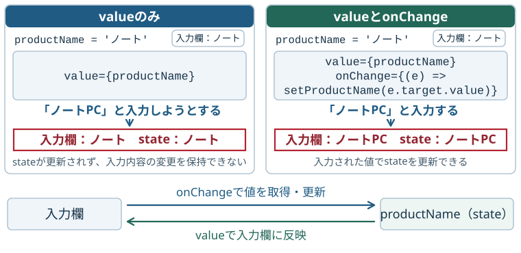{#ch02-form-controlled-compare}

::: {#ch02-form-controlled-compare-caption .caption}
「ノート」と表示された入力欄に「ノートPC」と入力した場合
:::

::::

:::: {#page-78 .source-page}

::: {#ch02-form-category .heading level="minor"}
セレクトボックスの入力値を管理する
:::

::: {#ch02-form-category-text-1 .paragraph}
テキスト入力欄だけでなく、セレクトボックスもstateで管理できます。
:::

::: {#ch02-form-category-text-2 .paragraph}
例えば、商品のカテゴリを「文房具」「事務用品」「電子機器」から選択する場合を考えてみましょう。
:::

::: {#ch02-form-category-text-3 .paragraph}
まず、カテゴリを管理するstateを定義します。
:::

::: {#ch02-form-category-state-code .code filename="ch02-basic/src/components/Sample2_7.tsx" start-line="5"}
```tsx
  const [category, setCategory] = useState('文房具')
```
:::

::: {#ch02-form-category-text-4 .paragraph}
初期値は「文房具」としています。
:::

::: {#ch02-form-category-text-5 .paragraph}
そして、セレクトボックスを次のように記述します。
:::

::: {#ch02-form-category-example .code example="true"}
```tsx
<select
  value={category}
  onChange={(e) => setCategory(e.target.value)}
>
  <option value="文房具">文房具</option>
  <option value="事務用品">事務用品</option>
  <option value="電子機器">電子機器</option>
</select>
```
:::

::: {#ch02-form-category-text-6 .paragraph}
基本的な仕組みは、テキスト入力欄と同じです。
:::

::: {#ch02-form-category-text-7 .paragraph}
`value={category}`で現在選択されている値を指定し、`onChange`で新しく選択された値をstateに保存します。
:::

::: {#ch02-form-category-text-8 .paragraph}
例えば、「電子機器」を選択すると、`category`の値も「電子機器」に更新されます。
:::

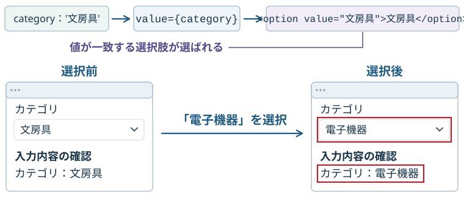{#ch02-form-category-states}

::: {#ch02-form-category-states-caption .caption}
選択を変えると、確認エリアのカテゴリも変わる
:::

::::

:::: {#page-79 .source-page}

::: {#ch02-form-checked .heading level="minor"}
チェックボックスの状態を管理する
:::

::: {#ch02-form-checked-text-1 .paragraph}
次に、商品の販売状態をチェックボックスで管理してみましょう。
:::

::: {#ch02-form-checked-text-2 .paragraph}
例えば、チェックが付いている場合は「販売中」、チェックを外した場合は「販売停止」と表示する仕組みを考えます。
:::

::: {#ch02-form-checked-text-3 .paragraph}
チェックボックスの場合は、trueまたはfalseで状態を管理します。
:::

::: {#ch02-form-checked-state-code .code filename="ch02-basic/src/components/Sample2_7.tsx" start-line="6"}
```tsx
  const [isAvailable, setIsAvailable] = useState(false)
```
:::

::: {#ch02-form-checked-text-4 .paragraph}
初期値がfalseなので、最初はチェックが付いていない状態です。
:::

::: {#ch02-form-checked-text-5 .paragraph}
チェックボックスは、次のように記述します。
:::

::: {#ch02-form-checked-example .code example="true"}
```tsx
<input
  type="checkbox"
  checked={isAvailable}
  onChange={(e) => setIsAvailable(e.target.checked)}
/>
```
:::

::: {#ch02-form-checked-text-6 .paragraph}
ここで注目してほしいのは、テキスト入力欄とは異なり、**valueではなくchecked属性を使用している**ことです。
:::

::: {#ch02-form-checked-table-1 .table column-widths="36 28 36"}
| 比較項目 | テキスト入力 | チェックボックス |
|---|---|---|
| 表示を制御する属性 | `value` | `checked` |
| 変更後の値を取得 | `e.target.value` | `e.target.checked` |
| 主なデータ型 | string | boolean |
:::

::: {#ch02-form-checked-text-7 .paragraph}
チェックボックスにチェックを付けると`e.target.checked`はtrue、チェックを外すとfalseになります。
:::

::: {#ch02-form-checked-text-8 .paragraph}
そして、`setIsAvailable()`を使ってstateを更新します。
:::

::::

:::: {#page-80 .source-page}

::: {#ch02-form-checked-text-9 .paragraph}
画面には、2.5で学習した三項演算子を使用して、次のように表示できます。
:::

::: {#ch02-form-checked-result-code .code filename="ch02-basic/src/components/Sample2_7.tsx" start-line="69"}
```tsx
      <p>販売状態：{isAvailable ? '販売中' : '販売停止'}</p>
```
:::

{#ch02-form-available-states}

::: {#ch02-form-available-states-caption .caption}
チェックの有無をcheckedで管理し、販売状態を表示する
:::

::: {#ch02-form-radio-note .training-note}
【補足】ラジオボタンの場合

ラジオボタンは、**複数の選択肢から1つを選ぶ**ための入力要素です。ここでは、商品の販売方法を「店頭販売」と「オンライン販売」から選びます。

選択中の値は、`useState('店頭販売')` で用意する `salesMethod` に保存します。初期値が「店頭販売」なので、最初は店頭販売が選択されます。

同じ `name` で2つのボタンを1つのグループにまとめ、`value` で選択肢を区別します。次のコードは、`useState` をインポートした関数コンポーネントに記述します。
:::

::: {#ch02-form-radio-example .code example="true"}
```tsx
const [salesMethod, setSalesMethod] = useState('店頭販売')

return (
  <div>
    <label>
      <input
        type="radio"
        name="salesMethod"
        value="店頭販売"
        checked={salesMethod === '店頭販売'}
        onChange={(e) => setSalesMethod(e.target.value)}
      />
      店頭販売
    </label>

    <label>
      <input
        type="radio"
        name="salesMethod"
        value="オンライン販売"
        checked={salesMethod === 'オンライン販売'}
        onChange={(e) => setSalesMethod(e.target.value)}
      />
      オンライン販売
    </label>

    <p>選択中の販売方法：{salesMethod}</p>
  </div>
)
```
:::

::: {#ch02-form-radio-checked .paragraph}
**`checked` に `true` を指定するとチェックが付き、`false` を指定すると外れます。** `salesMethod` は選択中の文字列なので、`salesMethod === '店頭販売'` のように各ボタンの `value` と比較します。値が一致するボタンの `checked` だけが `true` になります。
:::

::: {#ch02-form-radio-change .step}
**「オンライン販売」を選択したときの動作**
:::

::: {#ch02-form-radio-change-steps .paragraph keep-lines="true"}
1．「オンライン販売」のボタンで `onChange` イベントが発生します。<br>2．`setSalesMethod('オンライン販売')` に相当する処理を実行します。<br>3．stateが更新され、Reactがコンポーネントを再レンダリングします。<br>4．チェックが移り、下に「選択中の販売方法：オンライン販売」と表示されます。
:::

::: {#ch02-form-radio-compare .paragraph}
チェックボックスでは、`e.target.checked` からチェックの有無（`true` または `false`）を取得しました。ここでは、`onChange` の中で `e.target.value` から選択肢の値を文字列として取り出し、`setSalesMethod()` に渡します。
:::

::::

:::: {#page-81 .source-page}

::: {#ch02-form-sample .heading level="minor"}
【サンプル】商品情報の入力フォーム
:::

::: {#ch02-form-sample-text-1 .paragraph}
それでは、ここまで学習した内容を組み合わせて、商品情報の入力フォームを作成してみましょう。
:::

::: {#ch02-form-sample-text-2 .paragraph}
今回は、商品名・カテゴリ・販売状態をフォームで設定し、入力内容を画面の下部にリアルタイムで表示します。
:::

::: {#ch02-form-sample-text-3 .paragraph}
さらに、「入力をクリア」ボタンを押すと、stateを初期値に戻し、フォームの表示も元に戻るようにします。
:::

::: {#ch02-form-sample-code-p1 .code filename="ch02-basic/src/components/Sample2_7.tsx"}
```tsx
import { useState } from 'react'

export default function Sample2_7() {
  const [productName, setProductName] = useState('')
  const [category, setCategory] = useState('文房具')
  const [isAvailable, setIsAvailable] = useState(false)

  const clearInputs = () => {
    setProductName('')
    setCategory('文房具')
    setIsAvailable(false)
  }

  return (
    <main className="container mt-4">
      <h1>商品情報の入力</h1>

      <div className="mb-3">
        <label htmlFor="productName" className="form-label">
          商品名
        </label>
        <input
          id="productName"
          type="text"
          className="form-control"
          value={productName}
          onChange={(e) => setProductName(e.target.value)}
        />
      </div>

```
:::

::::

:::: {#page-82 .source-page}

::: {#ch02-form-sample-code-p2 .code filename="ch02-basic/src/components/Sample2_7.tsx" start-line="31"}
```tsx
      <div className="mb-3">
        <label htmlFor="category" className="form-label">
          カテゴリ
        </label>
        <select
          id="category"
          className="form-select"
          value={category}
          onChange={(e) => setCategory(e.target.value)}
        >
          <option value="文房具">文房具</option>
          <option value="事務用品">事務用品</option>
          <option value="電子機器">電子機器</option>
        </select>
      </div>

      <div className="form-check mb-3">
        <input
          id="isAvailable"
          type="checkbox"
          className="form-check-input"
          checked={isAvailable}
          onChange={(e) => setIsAvailable(e.target.checked)}
        />
        <label htmlFor="isAvailable"
          className="form-check-label">
          販売中
        </label>
      </div>

      <button className="btn btn-secondary mb-3"
        onClick={clearInputs}>
        入力をクリア
      </button>
```
:::

::::

:::: {#page-83 .source-page}

::: {#ch02-form-sample-code-p3 .code filename="ch02-basic/src/components/Sample2_7.tsx" start-line="65"}
```tsx

      <h2 className="h5">入力内容の確認</h2>
      <p>商品名：{productName || '未入力'}</p>
      <p>カテゴリ：{category}</p>
      <p>販売状態：{isAvailable ? '販売中' : '販売停止'}</p>
    </main>
  )
}
```
:::

::: {#ch02-form-sample-check .step}
**動作確認**
:::

::: {#ch02-form-sample-check-text-1 .paragraph}
`ch02-basic`の開発サーバーを起動し、メニューから「2.7 フォーム入力と状態の連動」を選択してください。
:::

::: {#ch02-form-sample-check-text-2 .paragraph}
初期状態では、商品名は空欄、カテゴリは「文房具」、販売中のチェックは外れています。
:::

::: {#ch02-form-sample-check-text-3 .paragraph}
フォームを操作すると、入力内容が画面下部の確認エリアへ反映されます。
:::

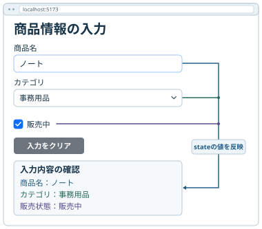{#ch02-form-product-browser}

::: {#ch02-form-product-browser-caption .caption}
フォームで設定した値が下部の確認エリアに表示される
:::

::::

:::: {#page-84 .source-page}

::: {#ch02-form-review .heading level="minor"}
構文の解説
:::

::: {#ch02-form-review-text-1 .paragraph}
ここからは、サンプルコードの重要な部分を確認します。
:::

::: {#ch02-form-review-state .step}
**① 入力値を管理するstateを定義する**
:::

::: {#ch02-form-review-state-code .code filename="ch02-basic/src/components/Sample2_7.tsx" start-line="4"}
```tsx
  const [productName, setProductName] = useState('')
  const [category, setCategory] = useState('文房具')
  const [isAvailable, setIsAvailable] = useState(false)
```
:::

::: {#ch02-form-review-state-text-1 .paragraph}
3つの入力項目に対応するstateを定義しています。
:::

::: {#ch02-form-review-state-table-1 .table column-widths="40 26 34"}
| state | 初期値 | 用途 |
|---|---|---|
| `productName` | `''` | 商品名 |
| `category` | `'文房具'` | カテゴリ |
| `isAvailable` | `false` | 販売状態 |
:::

::: {#ch02-form-review-state-text-2 .paragraph}
それぞれの入力内容を、対応するstateで管理しています。
:::

::: {#ch02-form-review-text-input .step}
**② テキスト入力欄とstateを連動させる**
:::

::: {#ch02-form-review-text-input-code .code filename="ch02-basic/src/components/Sample2_7.tsx" start-line="22"}
```tsx
        <input
          id="productName"
          type="text"
          className="form-control"
          value={productName}
          onChange={(e) => setProductName(e.target.value)}
        />
```
:::

::: {#ch02-form-review-text-input-text-1 .paragraph}
`value={productName}`で、stateの値を入力欄に表示しています。
:::

::: {#ch02-form-review-text-input-text-2 .paragraph}
`onChange`では、ユーザーが入力した文字列を取得し、`setProductName()`でstateに設定しています。
:::

::: {#ch02-form-review-text-input-text-3 .paragraph}
これにより、テキスト入力とstateの値が連動します。
:::

::::

:::: {#page-85 .source-page}

::: {#ch02-form-review-category .step}
**③ セレクトボックスとstateを連動させる**
:::

::: {#ch02-form-review-category-code .code filename="ch02-basic/src/components/Sample2_7.tsx" start-line="35"}
```tsx
        <select
          id="category"
          className="form-select"
          value={category}
          onChange={(e) => setCategory(e.target.value)}
        >
          <option value="文房具">文房具</option>
          <option value="事務用品">事務用品</option>
          <option value="電子機器">電子機器</option>
        </select>
```
:::

::: {#ch02-form-review-category-text-1 .paragraph}
`value={category}`で現在のカテゴリを指定し、`onChange`で選択変更時に新しいカテゴリをstateへ設定しています。
:::

::: {#ch02-form-review-category-text-2 .paragraph}
`<option>`の`value`属性には、各選択肢に対応する値が記述されています。
:::

::: {#ch02-form-review-checked .step}
**④ チェックボックスの状態を連動させる**
:::

::: {#ch02-form-review-checked-code .code filename="ch02-basic/src/components/Sample2_7.tsx" start-line="48"}
```tsx
        <input
          id="isAvailable"
          type="checkbox"
          className="form-check-input"
          checked={isAvailable}
          onChange={(e) => setIsAvailable(e.target.checked)}
        />
        <label htmlFor="isAvailable"
          className="form-check-label">
          販売中
        </label>
```
:::

::: {#ch02-form-review-checked-text-1 .paragraph}
`checked={isAvailable}`で、チェックの有無をstateと連動させています。
:::

::: {#ch02-form-review-checked-text-2 .paragraph}
`onChange`では、チェックが変更されたときに`e.target.checked`からtrueまたはfalseを取得しています。
:::

::::

:::: {#page-86 .source-page}

::: {#ch02-form-review-clear .step}
**⑤ 入力をクリアする**
:::

::: {#ch02-form-review-clear-code .code filename="ch02-basic/src/components/Sample2_7.tsx" start-line="8"}
```tsx
  const clearInputs = () => {
    setProductName('')
    setCategory('文房具')
    setIsAvailable(false)
  }
```
:::

::: {#ch02-form-review-clear-text-1 .paragraph}
「入力をクリア」ボタンをクリックすると、この関数が実行されます。
:::

::: {#ch02-form-review-clear-text-2 .paragraph}
各stateを初期値に戻すことで、フォームの表示も元に戻ります。
:::

::: {#ch02-form-review-clear-text-3 .paragraph}
つまり、**ユーザーの入力によってstateを更新するだけでなく、プログラム側からstateを変更してフォームの表示を更新することもできます。**
:::

::: {#ch02-form-review-preview .step}
**⑥ 入力内容を画面に表示する**
:::

::: {#ch02-form-review-preview-code .code filename="ch02-basic/src/components/Sample2_7.tsx" start-line="66"}
```tsx
      <h2 className="h5">入力内容の確認</h2>
      <p>商品名：{productName || '未入力'}</p>
      <p>カテゴリ：{category}</p>
      <p>販売状態：{isAvailable ? '販売中' : '販売停止'}</p>
```
:::

::: {#ch02-form-review-preview-text-1 .paragraph}
ここでは、フォームで管理している3つのstateを画面に表示しています。
:::

::: {#ch02-form-review-preview-text-2 .paragraph}
商品名には、論理OR演算子の`||`を使用しています。`productName`が空文字列の場合は「未入力」を表示し、それ以外の場合は入力された商品名を表示します。
:::

::: {#ch02-form-review-preview-text-3 .paragraph}
また、販売状態は三項演算子を使用し、trueの場合は「販売中」、falseの場合は「販売停止」と表示しています。
:::

{#ch02-form-render-flow}

::: {#ch02-form-render-flow-caption .caption}
入力時とクリア時のstateの更新から画面に反映されるまでの流れ
:::

::::

:::: {#page-87 .source-page}

::: {#ch02-form-practice .heading level="minor"}
【確認演習】商品情報の入力フォームを作成する
:::

::: {#ch02-form-practice-text-1 .paragraph}
商品名・カテゴリ・販売状態を入力するフォームを作成します。
:::

::: {#ch02-form-practice-text-2 .paragraph}
フォームの基本構成やstateは、あらかじめ用意されています。
:::

::: {#ch02-form-practice-text-3 .paragraph}
今回は、`value`属性・`onChange`イベント・`checked`属性を使用して、入力値とstateを連動させましょう。
:::

::: {#ch02-form-practice-steps .step}
**作業手順・動作確認**
:::

::: {#ch02-form-practice-step-1 .paragraph numbered="true"}
1．　`ch02-basic-q`プロジェクトの`src/components/Q2_7.tsx`を開いてください。
:::

::: {#ch02-form-practice-step-2 .paragraph numbered="true"}
2．　コード内の➀～➅の番号付きコメントを確認し、指示された箇所を実装してください。➀と➄は既存コードの確認、➁～➃と➅は実装問題です。コメントに指定されていないコードや、ほかのファイルは変更する必要はありません。
:::

::: {#ch02-form-practice-step-3 .paragraph numbered="true"}
3．　編集したファイルを保存してください。
:::

::: {#ch02-form-practice-step-4 .paragraph numbered="true"}
4．　`ch02-basic-q`の開発サーバーを起動し、ターミナルに表示されたURLを開いてください。起動済みの場合は、開いているブラウザーの画面に戻ってください。
:::

::: {#ch02-form-practice-step-5 .paragraph numbered="true"}
5．　メニューから「2.7 フォーム入力と状態の連動」を選んでください。
:::

::: {#ch02-form-practice-step-6 .paragraph numbered="true" keep-lines="true"}
6．　次の操作を行い、フォームの入力内容が正しく反映されることを確認してください。<br>● 商品名に「ノート」と入力すると、確認エリアにも「ノート」と表示されます。<br>● カテゴリを「事務用品」に変更すると、確認エリアのカテゴリも「事務用品」に変わります。<br>● 「販売中」にチェックを付けると、販売状態が「販売中」と表示されます。<br>● 「販売中」のチェックを外すと、販売状態が「販売停止」に戻ります。<br>● 「入力をクリア」をクリックすると、商品名が空欄、カテゴリが「文房具」、チェックが外れた状態に戻ります。
:::

::: {#ch02-form-practice-steps-text-1 .paragraph}
すべての操作で、フォームと確認エリアが正しく連動すれば演習完了です。
:::

::: {#ch02-form-points .section-points}
この節のポイント

● Reactでは、フォームの入力値を**useState()**で管理できる。

● **value属性**は、テキスト入力欄やセレクトボックスの値をstateと連動させるために使用する。

● **onChangeイベント**は、フォームの値が変更されたときに実行される。

● **e.target.value**を使用すると、入力・選択された値を取得できる。

● チェックボックスでは**checked属性**と**e.target.checked**を使用する。

● stateの変更に応じて、フォームの表示や入力内容の確認エリアが更新される。
:::

::::

:::: {#page-88 .source-page}

::: {#ch02-summary-title .heading}
章のまとめ
:::

::: {#ch02-summary-slide .slide layout="summary"}
章のまとめ

■ ReactコンポーネントとJSXの基本

■ JSXによるデータ表示と属性の設定

■ 状態の管理（useState）

■ イベント処理

■ 条件に応じた表示

■ 配列データの一覧表示

■ フォーム入力と状態の連動
:::

::: {#ch02-summary-1 .paragraph}
この章では、Reactを使用して画面を作成し、ユーザーの操作に応じて表示を更新するための基本的な方法を学習しました。
:::

::: {#ch02-summary-2 .paragraph}
最初に、ReactコンポーネントとJSXの基本を確認し、変数や計算結果を画面に表示する方法や、HTML属性に値を設定する方法を学びました。
:::

::: {#ch02-summary-3 .paragraph}
続いて、useStateを使用した状態管理とイベント処理を学習し、ボタン操作による画面の更新や、条件に応じた表示の切り替えを実装しました。また、map()を使用して配列データを一覧表示する方法も確認しました。
:::

::: {#ch02-summary-4 .paragraph}
最後に、value属性やonChangeイベント、checked属性を使用し、フォームの入力値とstateを連動させる方法を学習しました。
:::

::: {#ch02-summary-5 .paragraph}
次の第3章では、React Routerを使用して、URLに応じた画面の切り替えや画面遷移を実装し、複数の画面を持つSPAの構成を学習します。
:::

::::
