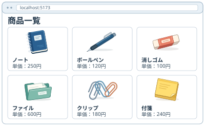
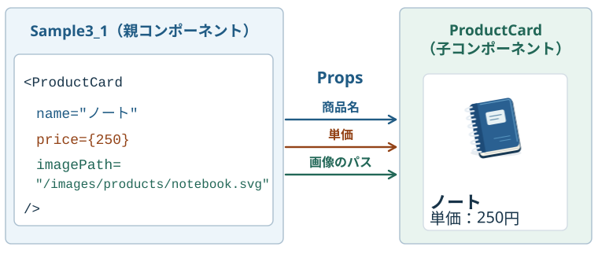
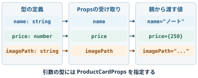
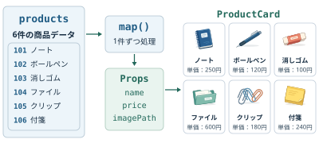
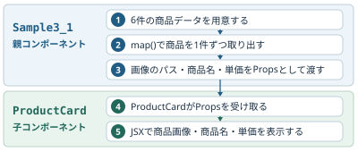
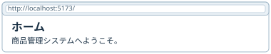
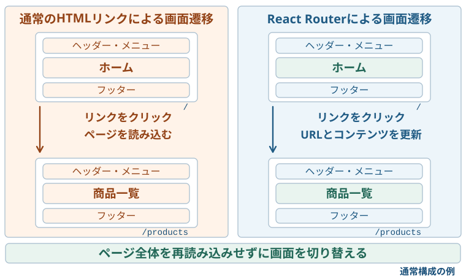
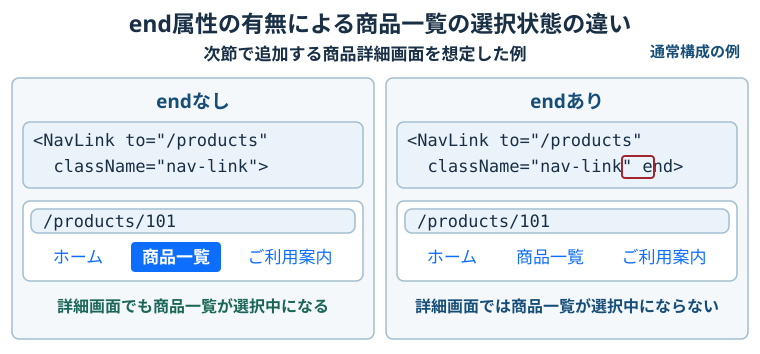
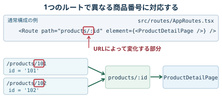
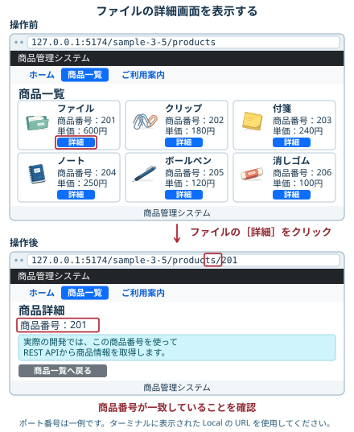

:::: {#page-1 .source-page}

::: {#ch03-number .paragraph}
3
:::

::: {#ch03-title .heading}
第3章 ルーティングと画面構成
:::

::: {#ch03-goals .heading}
章の目標
:::

::: {#ch03-goal-1 .paragraph}
◼ コンポーネントを分割し、Propsを使ってデータを渡せる
:::

::: {#ch03-goal-2 .paragraph}
◼ React Routerを使用して、URLに応じた画面表示を実装できる
:::

::: {#ch03-goal-3 .paragraph}
◼ LinkやNavLinkを使用して、SPAの画面遷移を実装できる
:::

::: {#ch03-goal-4 .paragraph}
◼ URLパラメータを取得し、商品番号などを画面で利用できる
:::

::: {#ch03-goal-5 .paragraph}
◼ useNavigateを使用して、プログラムから画面遷移できる
:::

::: {#ch03-goal-6 .paragraph}
◼ 共通レイアウトを作成し、ヘッダーやメニューを維持したまま画面を切り替えられる
:::

::::

:::: {#page-2 .source-page}

::: {#ch03-overview-title .heading}
章の概要
:::

::: {#ch03-overview-slide .slide layout="summary"}
章の概要

■ コンポーネントの分割とProps

■ React Routerによるルーティング

■ 共通レイアウトの作成

■ SPAの画面遷移（LinkとNavLink）

■ URLパラメータの取得

■ プログラムによる画面遷移
:::

::: {#ch03-overview-1 .paragraph}
この章では、Reactを使用して複数の画面を持つSPAを作成する方法を学習します。
:::

::: {#ch03-overview-2 .paragraph}
第2章では、基本的に1つのコンポーネントの中で画面を作成してきました。この章では、最初に画面の一部を別のコンポーネントとして分割し、Propsを使ってデータを渡す方法を確認します。
:::

::: {#ch03-overview-3 .paragraph}
続いて、React Routerを使用し、URLに応じて表示するコンポーネントを切り替える方法を学習します。さらに、ヘッダーやメニューなどの共通レイアウトを作成し、画面全体の構成を整理します。
:::

::: {#ch03-overview-4 .paragraph}
その後、LinkやNavLinkを使用して、ページ全体を再読み込みせずに画面を切り替えるSPAの画面遷移を実装します。また、URLから商品番号などの値を取得する方法や、ボタン操作によってプログラムから画面遷移する方法も学習します。
:::

::: {#ch03-overview-5 .paragraph}
本章では、あらかじめ用意した商品データを使用し、コンポーネントの構成と画面遷移の仕組みを理解することに集中します。REST APIを利用したデータの取得や更新については、後続の章で学習します。
:::

::::

:::: {#page-3 .source-page}

::: {#ch03-props-title .heading}
3.1. コンポーネントの分割とProps
:::

::: {#ch03-props-slide .slide layout="illustration"}
コンポーネントの分割とProps


:::

::: {#ch03-reasons-heading .heading level="minor"}
コンポーネントを分割する理由
:::

::: {#ch03-reasons-1 .paragraph}
第2章では、ReactのコンポーネントやJSXの基本を学習し、商品情報や商品一覧を画面に表示しました。
:::

::: {#ch03-reasons-2 .paragraph}
これまでのサンプルは、基本的に1つのコンポーネントの中で画面を作成していました。
:::

::: {#ch03-reasons-3 .paragraph}
しかし、実際のWebアプリケーションでは、同じデザインの部品を何度も使用することがあります。
:::

::: {#ch03-reasons-4 .paragraph}
例えば、ショッピングサイトの商品一覧を考えてみましょう。
:::

::: {#ch03-reasons-5-table .table column-widths="26 47 27"}
| 商品番号 | 商品名 | 単価 |
|---|---|---:|
| 101 | ノート | 250円 |
| 102 | ボールペン | 120円 |
| 103 | 消しゴム | 100円 |
| 104 | ファイル | 600円 |
| 105 | クリップ | 180円 |
| 106 | 付箋 | 240円 |
:::

::: {#ch03-reasons-6 .paragraph}
第2章では、商品データを`map()`によってテーブル形式で表示しました。
:::

::: {#ch03-reasons-7 .paragraph}
今度は、それぞれの商品画像・商品名・単価を表示するカードを、**3列×2行**で並べたいとします。
:::

{#ch03-preview}

::: {#ch03-preview-caption .caption}
同じデザインで画像・商品名・単価が異なる6枚の商品カード
:::

::: {#ch03-reasons-9 .paragraph}
この画面を作成する場合、商品ごとに同じようなHTMLを繰り返し記述する方法もあります。
:::

::: {#ch03-reasons-10 .paragraph}
しかし、この方法では、商品の数が増えるほど同じ構造のHTMLが増えていきます。
:::

::: {#ch03-reasons-11 .paragraph}
また、カードのデザインを変更したい場合は、複数の箇所を修正しなければなりません。
:::

::: {#ch03-reasons-12 .paragraph}
そこでReactでは、**繰り返し使用する画面の部品を、独立したコンポーネントとして作成する**ことができます。
:::

::: {#ch03-reasons-13 .paragraph}
例えば、商品カードを`ProductCard`というコンポーネントとして作成すれば、同じ部品を使い回して、複数の商品を表示できます。
:::

::: {#ch03-reasons-14 .paragraph}
この方法には、次のようなメリットがあります。
:::

::: {#ch03-reasons-15-bullet-1 .paragraph}
● 同じHTML構造を何度も記述する必要がなくなる
:::

::: {#ch03-reasons-15-bullet-2 .paragraph}
● カードのデザインを変更する場合、共通のコンポーネントを修正すればよい
:::

::: {#ch03-reasons-15-bullet-3 .paragraph}
● 商品データが増えても、同じコンポーネントを再利用できる
:::

::: {#ch03-reasons-16 .paragraph}
つまり、**共通する画面の部品をまとめて管理できる**ということです。
:::

::: {#ch03-reasons-17 .paragraph}
ただし、すべてのHTML要素を細かくコンポーネントに分割する必要はありません。
:::

::: {#ch03-reasons-18 .paragraph}
本研修では、商品カードのように、同じ構造を繰り返し使用する部分をコンポーネントとして分割する方法を学習します。
:::

::: {#ch03-separate-files-heading .heading level="minor"}
コンポーネントを別のファイルに分ける
:::

::: {#ch03-separate-files-1 .paragraph}
Reactでは、コンポーネントを別のTSXファイルに定義し、ほかのコンポーネントから読み込んで使用できます。
:::

::: {#ch03-separate-files-2 .paragraph}
まずは、商品画像付きカードを表示するコンポーネントを作成してみましょう。
:::

::: {#ch03-separate-files-3-code .code example="true" filename="ch03-basic/src/components/ProductCard.tsx"}
```tsx
export default function ProductCard() {
  return (
    <div className="card">
      
      <div className="card-body">
        <h2 className="h5">ノート</h2>
        <p>単価：250円</p>
      </div>
    </div>
  )
}
```
:::

::: {#ch03-separate-files-4 .paragraph}
このコードでは、`ProductCard`という関数コンポーネントを定義しています。
:::

::: {#ch03-separate-files-5 .paragraph}
`return`の中には、画像・商品名・単価を表示するJSXを記述しています。
:::

::: {#ch03-place-product-card .heading level="minor" keep-next="2"}
ProductCardを親コンポーネントに配置する
:::

::: {#ch03-separate-files-6 .paragraph}
この`ProductCard`を別のファイルから使用する場合は、`import`で読み込みます。
:::

::: {#ch03-separate-files-7-code .code filename="ch03-basic/src/components/Sample3_1.tsx"}
```tsx
import ProductCard from './ProductCard'
```
:::

::: {#ch03-separate-files-8 .paragraph}
そして、JSXの中に次のように記述します。
:::

::: {#ch03-separate-files-9-code .code example="true" filename="ch03-basic/src/components/Sample3_1.tsx"}
```tsx
<ProductCard />
```
:::

::: {#ch03-separate-files-10 .paragraph}
これにより、`ProductCard`コンポーネントが作成する商品カードを表示できます。
:::

::: {#ch03-separate-files-11 .paragraph}
`<h1>`や`<p>`などのHTML要素と似た書き方ですが、`ProductCard`は自分で作成したReactコンポーネントです。
:::

::: {#ch03-separate-files-12 .paragraph}
なお、第2章で学習したとおり、Reactのコンポーネント名は、HTML要素と区別するために先頭を大文字にします。
:::

{#ch03-files}

::: {#ch03-files-caption .caption}
Sample3_1.tsxからProductCard.tsxを読み込む
:::

::: {#ch03-separate-files-14 .paragraph}
ところで、先ほどの`ProductCard`では、商品画像・商品名・単価を直接記述していました。
:::

::: {#ch03-separate-files-15 .paragraph}
このままでは、何度使用しても同じ商品が表示されます。
:::

::: {#ch03-separate-files-16 .paragraph}
商品ごとに異なる画像・商品名・単価を表示するには、**親コンポーネントから商品データを渡す仕組み**が必要です。
:::

::: {#ch03-separate-files-17 .paragraph}
そこで使用するのが、Propsです。
:::

::: {#ch03-definition-heading .heading level="minor"}
Propsとは
:::

::: {#ch03-definition-1 .paragraph}
Props（プロップス）とは、**親コンポーネントから子コンポーネントへデータを渡すための仕組み**です。
:::

::: {#ch03-definition-2 .paragraph}
ここでいう親コンポーネントとは、別のコンポーネントを呼び出して使用する側のコンポーネントです。
:::

::: {#ch03-definition-3 .paragraph}
一方、呼び出される側のコンポーネントを子コンポーネントと呼びます。
:::

::: {#ch03-definition-4 .paragraph}
例えば、商品一覧のコンポーネントから商品カードへ、商品名・単価・画像のパスを渡したいとします。
:::

::: {#ch03-definition-5 .paragraph}
その場合は、次のように記述します。
:::

::: {#ch03-definition-6-code .code example="true" filename="ch03-basic/src/components/Sample3_1.tsx"}
```tsx
<ProductCard name="ノート" price={250} imagePath="/images/products/notebook.svg" />
```
:::

::: {#ch03-definition-7 .paragraph}
ここでは、`ProductCard`に3つの値を渡しています。
:::

::: {#ch03-definition-8-table .table column-widths="23 55 22"}
| Propsの名前 | 渡す値 | 意味 |
|---|---|---|
| `name` | `'ノート'` | 商品名 |
| `price` | `250` | 単価 |
| `imagePath` | `'/images/products/notebook.svg'` | 商品画像のパス |
:::

::: {#ch03-definition-9 .paragraph}
Propsは、HTMLの属性と似た書き方で指定できます。
:::

::: {#ch03-definition-10 .paragraph}
例えば、`name="ノート"`や`imagePath="/images/products/notebook.svg"`では、文字列を直接指定しています。
:::

::: {#ch03-definition-11 .paragraph}
一方、`price={250}`では、数値をJavaScriptの式として指定しています。
:::

::: {#ch03-definition-12 .paragraph}
これは、第2章で学習したJSXの属性への値の設定と同じ考え方です。
:::

::: {#ch03-definition-13 .paragraph}
また、Propsには変数の値を渡すこともできます。
:::

::: {#ch03-definition-14-code .code example="true"}
```tsx
const productName = 'ノート'
const productPrice = 250
const productImage = '/images/products/notebook.svg'

return (
  <ProductCard name={productName} price={productPrice} imagePath={productImage} />
)
```
:::

::: {#ch03-definition-15 .paragraph}
この場合、3つの変数に格納されている値が、子コンポーネントへ渡されます。
:::

{#ch03-transfer}

::: {#ch03-transfer-caption .caption}
親から渡した商品情報を子コンポーネントで表示する
:::

::: {#ch03-receiving-heading .heading level="minor"}
子コンポーネントでPropsを受け取る
:::

::: {#ch03-receiving-1 .paragraph}
親コンポーネントから値を渡しただけでは、子コンポーネントで使用できません。
:::

::: {#ch03-receiving-2 .paragraph}
子コンポーネント側でも、渡されたPropsを受け取るための記述が必要です。
:::

::: {#ch03-receiving-3 .paragraph}
例えば、次のように記述できます。
:::

::: {#ch03-receiving-4-code .code example="true"}
```tsx
type ProductCardProps = {
  name: string
  price: number
  imagePath: string
}

export default function ProductCard({ name, price, imagePath }: ProductCardProps) {
  return (
    <div className="card">
      
      <div className="card-body">
        <h2 className="h5">{name}</h2>
        <p>単価：{price}円</p>
      </div>
    </div>
  )
}
```
:::

::: {#ch03-receiving-5 .paragraph}
先ほどのコードと比べると、固定されていた画像パス・商品名・単価が、`{imagePath}`・`{name}`・`{price}`に変更されています。
:::

::: {#ch03-receiving-6 .paragraph}
これにより、**親コンポーネントから渡された値を画面に表示できる**ようになりました。
:::

::: {#ch03-receiving-7 .paragraph}
ただし、コードの先頭には、まだ説明していない`type`という記述があります。
:::

::: {#ch03-receiving-8 .paragraph}
これは、TypeScriptでPropsの型を指定するためのものです。
:::

::: {#ch03-types-heading .heading level="minor"}
TypeScriptでPropsの型を定義する
:::

::: {#ch03-types-1 .paragraph}
本研修ではTypeScriptを使用しているため、Propsとして受け取るデータの型を指定します。
:::

::: {#ch03-types-2 .paragraph}
まず、次の部分に注目してください。
:::

::: {#ch03-types-3-code .code filename="ch03-basic/src/components/ProductCard.tsx"}
```tsx
type ProductCardProps = {
  name: string
  price: number
  imagePath: string
}
```
:::

::: {#ch03-types-4 .paragraph}
`type`は、TypeScriptで型に名前を付けるための構文です。
:::

::: {#ch03-types-5 .paragraph}
ここでは、`ProductCardProps`という名前の型を定義しています。
:::

::: {#ch03-types-6 .paragraph}
この型は、次の3つのプロパティを持つオブジェクトを表します。
:::

::: {#ch03-types-7-table .table column-widths="27 19 54"}
| プロパティ | 型 | 意味 |
|---|---|---|
| `name` | `string` | 商品名を文字列で受け取る |
| `price` | `number` | 単価を数値で受け取る |
| `imagePath` | `string` | 商品画像のパスを文字列で受け取る |
:::

::: {#ch03-types-8 .paragraph}
例えば、単価は`number`型として定義されているため、誤って文字列を渡そうとすると、TypeScriptの型チェックで不一致を検出できます。
:::

::: {#ch03-types-9 .paragraph}
次に、コンポーネントの引数を確認してください。
:::

::: {#ch03-types-10-code .code filename="ch03-basic/src/components/ProductCard.tsx" start-line="7"}
```tsx
function ProductCard({ name, price, imagePath }: ProductCardProps) {
```
:::

::: {#ch03-types-11 .paragraph}
少し複雑に見えますが、次の2つに分けて考えると分かりやすくなります。
:::

::: {#ch03-types-12-heading .step}
**① Propsから必要な値を取り出す**
:::

::: {#ch03-types-13-code .code filename="ch03-basic/src/components/ProductCard.tsx" start-line="7"}
```tsx
{ name, price, imagePath }
```
:::

::: {#ch03-types-14 .paragraph}
これは、Propsとして渡されたデータから、`name`・`price`・`imagePath`を取り出すための記述です。
:::

::: {#ch03-types-15 .paragraph}
JavaScriptの**分割代入**という構文を使用しています。
:::

::: {#ch03-types-16-heading .step}
**② 受け取るPropsの型を指定する**
:::

::: {#ch03-types-17-code .code filename="ch03-basic/src/components/ProductCard.tsx" start-line="7"}
```tsx
: ProductCardProps
```
:::

::: {#ch03-types-18 .paragraph}
先ほど定義した`ProductCardProps`を指定することで、受け取るデータの型を明示しています。
:::

::: {#ch03-types-19 .paragraph}
したがって、
:::

::: {#ch03-types-20-code .code filename="ch03-basic/src/components/ProductCard.tsx" start-line="7"}
```tsx
function ProductCard({ name, price, imagePath }: ProductCardProps) {
```
:::

::: {#ch03-types-21 .paragraph}
は、**「ProductCardPropsで定義した型のデータを受け取り、その中から3つの値を取り出す」**という意味になります。
:::

{#ch03-type-relations}

::: {#ch03-type-relations-caption .caption}
型の定義、Propsの受け取り、親から渡す値の対応
:::

::: {#ch03-types-23-note .training-note keep-next="1"}
【補足】Propsを受け取る別の書き方

Propsは、次のように1つのオブジェクトとして受け取ることもできます。
:::

::: {#ch03-types-25-code .code example="true"}
```tsx
function ProductCard(props: ProductCardProps) {
  return (
    <div>
      
      <p>{props.name}：{props.price}円</p>
    </div>
  )
}
```
:::

::: {#ch03-types-26 .paragraph}
この場合は、`props.name`や`props.price`、`props.imagePath`のように、オブジェクトのプロパティとして値を取得します。
:::

::: {#ch03-types-27 .paragraph}
一方、分割代入を使用すれば、`name`や`price`、`imagePath`と直接記述できます。
:::

::: {#ch03-types-28 .paragraph}
本研修では、分割代入を使用する書き方を基本とします。
:::

::: {#ch03-state-heading .heading level="minor"}
Propsとstateの違い
:::

::: {#ch03-state-1 .paragraph}
ここまでの説明で、Propsと第2章で学習したstateは何が違うのか、疑問に思うかもしれません。
:::

::: {#ch03-state-2 .paragraph}
どちらもReactでデータを扱うための仕組みですが、役割が異なります。
:::

::: {#ch03-state-3-table .table column-widths="21 39 40"}
| 比較項目 | Props | state |
|---|---|---|
| 主な役割 | 親から子へデータを渡す | コンポーネントの状態を管理する |
| 値の取得 | 親コンポーネントから渡される | `useState()`などで管理する |
| 値の変更 | 子コンポーネントから直接変更しない | 更新用の関数で変更する |
| 使用例 | 商品カードへ商品画像・商品名・単価を渡す | ボタン操作によって商品の数量を変更する |
:::

::: {#ch03-state-4 .paragraph}
例えば、今回の商品カードでは、親コンポーネントから画像・商品名・単価を受け取り、それを表示します。
:::

::: {#ch03-state-5 .paragraph}
そのため、商品カード自身が商品情報を変更する必要はありません。
:::

::: {#ch03-state-6 .paragraph}
一方、商品数を増減するボタンなど、ユーザーの操作に応じて値が変化する場合は、`useState()`を使って状態を管理できます。
:::

::: {#ch03-state-7 .paragraph}
また、Propsは**子コンポーネントから直接変更しない**という点も重要です。
:::

::: {#ch03-state-8 .paragraph}
親コンポーネントから新しいPropsが渡されれば、子コンポーネントにも新しい値を表示できます。
:::

::: {#ch03-state-9 .paragraph}
つまり、Propsは値が変化しない仕組みというわけではなく、**値を渡す側と受け取る側の役割が決まっている**ということです。
:::

::: {#ch03-mapping-heading .heading level="minor"}
map()とPropsを組み合わせる
:::

::: {#ch03-mapping-1 .paragraph}
第2章の2.6節では、`map()`を使って配列データからテーブルの行を繰り返し生成しました。
:::

::: {#ch03-mapping-2 .paragraph}
同じ方法で、商品カードを繰り返し生成することもできます。
:::

::: {#ch03-mapping-3 .paragraph}
例えば、次のような商品データがあるとします。
:::

::: {#ch03-mapping-4-code .code filename="ch03-basic/src/components/Sample3_1.tsx" start-line="4"}
```tsx
const products = [
  { id: 101, name: 'ノート', price: 250, imagePath: '/images/products/notebook.svg' },
  { id: 102, name: 'ボールペン', price: 120, imagePath: '/images/products/ballpoint-pen.svg' },
  { id: 103, name: '消しゴム', price: 100, imagePath: '/images/products/eraser.svg' },
  { id: 104, name: 'ファイル', price: 600, imagePath: '/images/products/file-folder.svg' },
  { id: 105, name: 'クリップ', price: 180, imagePath: '/images/products/paper-clips.svg' },
  { id: 106, name: '付箋', price: 240, imagePath: '/images/products/sticky-notes.svg' }
]
```
:::

::: {#ch03-mapping-5 .paragraph}
この配列に対して、次のように`map()`を使用します。
:::

::: {#ch03-mapping-6-code .code filename="ch03-basic/src/components/Sample3_1.tsx" start-line="18"}
```tsx
{products.map((product) => (
  <ProductCard
    key={product.id}
    name={product.name}
    price={product.price}
    imagePath={product.imagePath}
  />
))}
```
:::

::: {#ch03-mapping-7 .paragraph}
このコードでは、`map()`によって商品データを1件ずつ取り出しています。
:::

::: {#ch03-mapping-8 .paragraph}
そして、商品ごとに`ProductCard`コンポーネントを生成し、`name`・`price`・`imagePath`をPropsとして渡しています。
:::

::: {#ch03-mapping-9 .paragraph}
例えば、最初の商品を処理するときは、次のような値が渡されます。
:::

::: {#ch03-mapping-10-code .code example="true"}
```tsx
<ProductCard
  key={101}
  name="ノート"
  price={250}
  imagePath="/images/products/notebook.svg"
/>
```
:::

::: {#ch03-mapping-11 .paragraph}
次にボールペンを処理するときは、画像・商品名・単価が変わります。
:::

::: {#ch03-mapping-12 .paragraph}
このように、**同じコンポーネントを使用しながら、データに応じて異なるカードを表示できる**わけです。
:::

::: {#ch03-mapping-13 .paragraph}
なお、`key`属性は第2章で学習したReactの特別な属性です。
:::

::: {#ch03-mapping-14 .paragraph}
`key={product.id}`を指定することで、Reactが繰り返し生成した各コンポーネントを区別できます。
:::

::: {#ch03-mapping-15 .paragraph}
ただし、`key`はReactが内部で使用するものであり、通常のPropsとして子コンポーネントへ渡されるわけではありません。
:::

{#ch03-map-flow}

::: {#ch03-map-flow-caption .caption}
6件の商品データからmap()とPropsで6枚のカードを作る
:::

::: {#ch03-sample-heading .heading level="minor"}
【サンプル】Propsを使用した商品カードの表示
:::

::: {#ch03-sample-1 .paragraph}
それでは、ここまで学習したコンポーネントの分割とPropsを組み合わせて、商品一覧をカード形式で表示してみましょう。
:::

::: {#ch03-sample-2 .paragraph}
今回は、商品画像・商品名・単価を表示するカードを別のコンポーネントとして作成します。商品一覧側では、6件の配列データを`map()`で繰り返し処理し、商品ごとに異なるPropsを渡します。**画面はPCの幅で3列×2行に並び、画面幅が狭い場合は列数を減らす構成**とします。このサンプルでは、次の2つのファイルを使用します。
:::

::: {#ch03-sample-6-table .table column-widths="38 62" keep-next="1"}
| ファイル | 役割 |
|---|---|
| `ProductCard.tsx` | 1件分の画像付き商品カードを表示する |
| `Sample3_1.tsx` | 6件の商品データを管理し、カードを繰り返し表示する |
:::

::: {#ch03-sample-8-code .code filename="ch03-basic/src/components/ProductCard.tsx"}
```tsx
type ProductCardProps = {
  name: string
  price: number
  imagePath: string
}

export default function ProductCard({ name, price, imagePath }: ProductCardProps) {
  return (
    <div className="col-12 col-sm-6 col-lg-4">
      <div className="card h-100">
        
        <div className="card-body">
          <h2 className="h5 card-title">{name}</h2>
          <p className="card-text">単価：{price}円</p>
        </div>
      </div>
    </div>
  )
}
```
:::

::: {#ch03-sample-10-code .code filename="ch03-basic/src/components/Sample3_1.tsx"}
```tsx
import ProductCard from './ProductCard'

export default function Sample3_1() {
  const products = [
    { id: 101, name: 'ノート', price: 250, imagePath: '/images/products/notebook.svg' },
    { id: 102, name: 'ボールペン', price: 120, imagePath: '/images/products/ballpoint-pen.svg' },
    { id: 103, name: '消しゴム', price: 100, imagePath: '/images/products/eraser.svg' },
    { id: 104, name: 'ファイル', price: 600, imagePath: '/images/products/file-folder.svg' },
    { id: 105, name: 'クリップ', price: 180, imagePath: '/images/products/paper-clips.svg' },
    { id: 106, name: '付箋', price: 240, imagePath: '/images/products/sticky-notes.svg' }
  ]

  return (
    <main className="container mt-4">
      <h1>商品一覧</h1>

      <div className="row g-3">
        {products.map((product) => (
          <ProductCard
            key={product.id}
            name={product.name}
            price={product.price}
            imagePath={product.imagePath}
          />
        ))}
      </div>
    </main>
  )
}
```
:::

::: {#ch03-sample-11-note .training-note}
【補足】Bootstrapによるカード型デザイン

上記のコードでは、Bootstrapが用意している`card`や`row`などのクラスを使用しています。

これらのクラスを指定することで、カードの枠や余白、複数列の並び方を簡単に整えることができます。今回は**Propsによるコンポーネントの再利用**が学習の中心なので、Bootstrapの各クラスの詳しい構文は扱いません。
:::

::: {#ch03-sample-check .step}
**動作確認**
:::

::: {#ch03-sample-15 .paragraph}
`ch03-basic`の開発サーバーを起動し、メニューから「3.1 コンポーネントの分割とProps」を選択してください。
:::

::: {#ch03-sample-16 .paragraph}
PCのブラウザーでは、次の6件の商品が**3列×2行**の画像付きカードとして表示されます。
:::

::: {#ch03-sample-17-table .table column-widths="33 34 33"}
| 上段左 | 上段中央 | 上段右 |
|---|---|---|
| ノート：250円 | ボールペン：120円 | 消しゴム：100円 |
:::

::: {#ch03-sample-18-table .table column-widths="33 34 33"}
| 下段左 | 下段中央 | 下段右 |
|---|---|---|
| ファイル：600円 | クリップ：180円 | 付箋：240円 |
:::

{#ch03-result}

::: {#ch03-result-caption .caption}
完成サンプルの表示結果。6枚の商品カードが3列×2行に並ぶ
:::

::: {#ch03-sample-20 .paragraph}
表示する商品画像・商品名・単価は異なりますが、6つのカードはすべて同じ`ProductCard`コンポーネントを使用しています。また、商品データは`Sample3_1.tsx`にまとめて定義されており、そこから各カードへPropsとして渡されています。
:::

::: {#ch03-syntax-heading .heading level="minor"}
構文の解説
:::

::: {#ch03-syntax-1 .paragraph}
ここからは、2つのソースファイルの役割と、重要な構文を確認します。
:::

::: {#ch03-syntax-2-heading .step}
**① Propsの型を定義する**
:::

::: {#ch03-syntax-3-code .code filename="ch03-basic/src/components/ProductCard.tsx"}
```tsx
type ProductCardProps = {
  name: string
  price: number
  imagePath: string
}
```
:::

::: {#ch03-syntax-4 .paragraph}
`ProductCard`が受け取るPropsの名前と型を定義しています。`name`と`imagePath`は文字列、`price`は数値として受け取ります。
:::

::: {#ch03-syntax-5-heading .step}
**② Propsを受け取るコンポーネントを定義する**
:::

::: {#ch03-syntax-6-code .code filename="ch03-basic/src/components/ProductCard.tsx" start-line="7"}
```tsx
export default function ProductCard({ name, price, imagePath }: ProductCardProps) {
```
:::

::: {#ch03-syntax-7 .paragraph}
親コンポーネントから渡された`name`・`price`・`imagePath`を受け取っています。
:::

::: {#ch03-syntax-8 .paragraph}
また、`ProductCardProps`を指定することで、受け取るデータの型を明示しています。
:::

::: {#ch03-syntax-9-heading .step}
**③ Propsの値を画面に表示する**
:::

::: {#ch03-syntax-10-code .code filename="ch03-basic/src/components/ProductCard.tsx"}
```tsx
11:
18:<h2 className="h5 card-title">{name}</h2>
19:<p className="card-text">単価：{price}円</p>
```
:::

::: {#ch03-syntax-11 .paragraph}
受け取ったPropsをJSXに設定し、商品画像・商品名・単価を表示しています。
:::

::: {#ch03-syntax-12 .paragraph}
`src={imagePath}`は商品画像のパス、`alt={name}`は画像の代替テキストです。
:::

::: {#ch03-syntax-13 .paragraph}
この部分のコードは、どの商品カードでも共通です。
:::

::: {#ch03-syntax-14-heading .step}
**④ 別ファイルのコンポーネントを読み込む**
:::

::: {#ch03-syntax-15-code .code filename="ch03-basic/src/components/Sample3_1.tsx"}
```tsx
import ProductCard from './ProductCard'
```
:::

::: {#ch03-syntax-16 .paragraph}
`ProductCard.tsx`で定義されたコンポーネントを、`Sample3_1.tsx`から使用できるようにしています。
:::

::: {#ch03-syntax-17 .paragraph}
`./ProductCard`は、同じフォルダーにある`ProductCard.tsx`を指定しています。
:::

::: {#ch03-syntax-18-heading .step}
**⑤ map()でコンポーネントを繰り返し生成する**
:::

::: {#ch03-syntax-19-code .code filename="ch03-basic/src/components/Sample3_1.tsx" start-line="18"}
```tsx
{products.map((product) => (
  <ProductCard
    key={product.id}
    name={product.name}
    price={product.price}
    imagePath={product.imagePath}
  />
))}
```
:::

::: {#ch03-syntax-20 .paragraph}
`products`配列から商品を1件ずつ取り出して、`ProductCard`コンポーネントを生成しています。
:::

::: {#ch03-syntax-21 .paragraph}
このとき、`name`・`price`・`imagePath`をPropsとして渡すことで、カードごとに異なる商品情報を表示できます。
:::

{#ch03-code-flow}

::: {#ch03-code-flow-caption .caption}
Sample3_1からProductCardへPropsが渡り、カードが表示される流れ
:::

::::

:::: {#page-4 .source-page}

::: {#ch03-practice-heading .heading level="minor"}
【確認演習】Propsを使って商品カードを表示する
:::

::: {#ch03-practice-1 .paragraph}
商品一覧に複数の商品カードを表示する演習を行います。
:::

::: {#ch03-practice-2 .paragraph}
商品データの配列や、カードの基本的なレイアウト、`map()`による繰り返し処理は、あらかじめ用意されています。
:::

::: {#ch03-practice-3 .paragraph}
今回は、Propsの型の定義、親コンポーネントからの値の受け渡し、子コンポーネントでの値の表示を実装します。
:::

::: {#ch03-practice-4 .paragraph}
今回の演習では、**親コンポーネントと子コンポーネントの2つのファイルを編集します。**
:::

::: {#ch03-practice-5 .paragraph numbered="true" keep-lines="true"}
1．　`ch03-basic-q`プロジェクトの次の2つのファイルを開いてください。<br>● `src/components/Q3_1.tsx`<br>● `src/components/ProductCardQ.tsx`
:::

::: {#ch03-practice-6 .paragraph numbered="true"}
2．　2つのファイルに記載された➀～➄の番号付きコメントを確認し、指示された箇所を実装してください。➀は既存コードの確認、➁～➄は実装問題です。コメントに指定されていないコードや、ほかのファイルは変更する必要はありません。
:::

::: {#ch03-practice-7 .paragraph numbered="true"}
3．　編集した2つのファイルを保存してください。
:::

::: {#ch03-practice-8 .paragraph numbered="true"}
4．　`ch03-basic-q`の開発サーバーを起動し、ターミナルに表示されたURLを開いてください。起動済みの場合は、開いているブラウザーの画面に戻ってください。
:::

::: {#ch03-practice-9 .paragraph numbered="true"}
5．　メニューから「3.1 コンポーネントの分割とProps」を選択してください。
:::

::: {#ch03-practice-10 .paragraph numbered="true" keep-next="4"}
6．　商品一覧に、次の6件の商品画像付きカードが**3列×2行**で表示されることを確認してください。
:::

::: {#ch03-practice-11-table .table column-widths="33 34 33"}
| 上段左 | 上段中央 | 上段右 |
|---|---|---|
| ファイル：600円 | クリップ：180円 | 付箋：240円 |
:::

::: {#ch03-practice-12-table .table column-widths="33 34 33"}
| 下段左 | 下段中央 | 下段右 |
|---|---|---|
| ノート：250円 | ボールペン：120円 | 消しゴム：100円 |
:::

::: {#ch03-practice-13 .paragraph}
6枚のカードに、それぞれ正しい画像・商品名・単価が表示されていれば、演習完了です。
:::

::: {#ch03-props-points .section-points}
この節のポイント

● Reactでは、画面の一部を独立したコンポーネントとして作成できる。

● **Props**を使うと、親コンポーネントから子コンポーネントへデータを渡せる。

● 同じコンポーネントを再利用することで、異なる画像や商品情報を同じデザインで表示できる。

● TypeScriptでは、`type`などを使用してPropsの型を定義できる。

● 子コンポーネントは、受け取ったPropsを直接変更しない。

● `map()`とPropsを組み合わせることで、配列のデータから複数のコンポーネントを生成できる。
:::

::::

:::: {#page-5 .source-page}

::: {#ch03-router-title .heading}
3.2. React Routerによるルーティング
:::

::: {#ch03-router-slide .slide layout="illustration"}
React Routerによるルーティング


:::

::: {#ch03-router-screens-heading .heading level="minor"}
複数の画面を持つアプリケーションを作るには
:::

::: {#ch03-router-screens-1 .paragraph}
前節では、商品カードを独立したコンポーネントとして作成し、Propsを使用して商品名・単価・画像を渡す方法を学習しました。
:::

::: {#ch03-router-screens-2 .paragraph}
これにより、共通の商品カードを再利用して、6件の商品を一覧表示できるようになりました。
:::

::: {#ch03-router-screens-3 .paragraph}
しかし、実際の商品管理システムには、商品一覧以外にもさまざまな画面が必要です。
:::

::: {#ch03-router-screens-4 .paragraph}
例えば、次のような画面を考えてみましょう。
:::

::: {#ch03-router-screens-5-table .table column-widths="31 69"}
| 画面 | 主な役割 |
|---|---|
| ホーム画面 | システムのトップページを表示する |
| 商品一覧画面 | 登録されている商品を一覧表示する |
| ご利用案内画面 | システムの使い方などを表示する |
:::

::: {#ch03-router-screens-6 .paragraph}
これらの画面は、それぞれ別のReactコンポーネントとして作成できます。
:::

::: {#ch03-router-screens-7 .paragraph}
では、どの画面を表示するかは、どのように決めればよいのでしょうか。
:::

::: {#ch03-router-screens-8 .paragraph}
例えば、ユーザーが次のURLにアクセスしたとします。
:::

::: {#ch03-router-screens-9-url .paragraph keep-lines="true"}
**`http://localhost:5173/products`**
:::

::: {#ch03-router-screens-10 .paragraph}
このとき、商品一覧画面を表示するようにしたいわけです。
:::

::: {#ch03-router-screens-11 .paragraph}
このように、**URLに応じて表示する画面を決定する仕組み**を、ルーティングと呼びます。
:::

::: {#ch03-router-screens-12 .paragraph}
Reactでは、このルーティングを実現するために、React Routerというライブラリを使用できます。
:::

::: {#ch03-router-library-heading .heading level="minor"}
React Routerとは
:::

::: {#ch03-router-library-1 .paragraph}
React Routerは、ReactアプリケーションでURLと画面を対応付けるためのライブラリです。
:::

::: {#ch03-router-library-2 .paragraph}
第1章では、SPA（Single Page Application）について学習しました。
:::

::: {#ch03-router-library-3 .paragraph}
SPAでは、画面を切り替えるたびにHTMLページ全体を読み込み直すのではなく、必要な表示部分を更新することで画面を切り替えられます。
:::

::: {#ch03-router-library-4 .paragraph}
ただし、Reactは画面を作成・更新するためのライブラリであり、**URLに応じた画面の切り替えを、React単体ですべて自動的に行うわけではありません。**
:::

::: {#ch03-router-library-5 .paragraph}
そこで、React Routerを使用します。
:::

::: {#ch03-router-library-6 .paragraph}
React Routerを使用すると、例えば次のような対応関係を定義できます。
:::

::: {#ch03-router-library-7-table .table column-widths="38 62"}
| URLのパス | 表示するコンポーネント |
|---|---|
| `/` | `HomePage` |
| `/products` | `Sample3_1` |
| `/guide` | `GuidePage` |
:::

::: {#ch03-router-library-8 .paragraph}
ここでいうURLのパスとは、URLの中で画面を区別する部分です。
:::

::: {#ch03-router-library-9 .paragraph}
例えば、次のURLを見てください。
:::

::: {#ch03-router-library-10-url .paragraph keep-lines="true"}
**`http://localhost:5173/products`**
:::

::: {#ch03-router-library-11 .paragraph}
このURLは、次の部分に分けられます。
:::

::: {#ch03-router-library-12-table .table column-widths="34 27 39"}
| 部分 | 例 | 意味 |
|---|---|---|
| ホスト名とポート番号 | `localhost:5173` | アクセス先の開発サーバー |
| パス | `/products` | 表示したい画面を表す部分 |
:::

::: {#ch03-router-library-13 .paragraph}
React Routerは、このパスを確認して、どのコンポーネントを表示するかを判断します。
:::

{#ch03-router-figure-path}

::: {#ch03-router-figure-path-caption .caption}
URLのパスを確認し、商品一覧を表示する
:::

::: {#ch03-router-install-heading .heading level="minor"}
React Routerをインストールする
:::

::: {#ch03-router-install-1 .paragraph}
React Routerは、Reactとは別のライブラリです。そのため、React Routerを使用するには、プロジェクトにライブラリを導入する必要があります。
:::

::: {#ch03-router-install-3 .paragraph}
第1章で学習したnpmを使用し、次のコマンドでインストールできます。
:::

::: {#ch03-router-install-4-command .code example="true"}
```console
npm install react-router
```
:::

::: {#ch03-router-install-5 .paragraph}
このコマンドを実行すると、React Routerがインストールされ、`package.json`にも依存ライブラリとして登録されます。
:::

::: {#ch03-router-install-6 .paragraph}
本研修では、React Routerの基本的な画面遷移の仕組みを学ぶため、**Declarative Mode（宣言的なルーティング方式）**を使用します。
:::

::: {#ch03-router-install-7 .paragraph}
この方式では、主に次の3つのコンポーネントを使用します。
:::

::: {#ch03-router-install-8-table .table column-widths="29 71"}
| コンポーネント | 役割 |
|---|---|
| `BrowserRouter` | ブラウザーのURLを利用してルーティングを管理する |
| `Routes` | URLと画面の対応関係をまとめる |
| `Route` | 特定のURLに対して、表示するコンポーネントを指定する |
:::

::: {#ch03-router-install-9 .paragraph}
まずは、この3つの役割を理解しましょう。
:::

::: {#ch03-router-browserrouter-heading .heading level="minor"}
BrowserRouterとは
:::

::: {#ch03-router-browserrouter-1 .paragraph}
`BrowserRouter`は、ブラウザーのURLを使用してルーティングを管理するためのコンポーネントです。
:::

::: {#ch03-router-browserrouter-2 .paragraph}
React Routerで画面を切り替える仕組みを使用するためには、アプリケーションを`BrowserRouter`で囲みます。
:::

::: {#ch03-router-browserrouter-7 .paragraph}
通常、`BrowserRouter`はReactアプリケーションの起動処理で設定します。
:::

::: {#ch03-router-browserrouter-8 .paragraph}
今回のプロジェクトでは、`main.tsx`で設定します。
:::

::: {#ch03-router-browserrouter-10-code .code filename="ch03-basic/src/main.tsx"}
```tsx
import { StrictMode } from 'react'
import { createRoot } from 'react-dom/client'
import { BrowserRouter } from 'react-router'
import App from './App'
import 'bootstrap/dist/css/bootstrap.min.css'

createRoot(document.getElementById('root')!).render(
  <StrictMode>
    <BrowserRouter>
      <App />
    </BrowserRouter>
  </StrictMode>
)
```
:::

::: {#ch03-router-browserrouter-11 .paragraph}
このコードで特に注目したいのは、次の部分です。
:::

::: {#ch03-router-browserrouter-12-code .code filename="ch03-basic/src/main.tsx" start-line="9"}
```tsx
<BrowserRouter>
  <App />
</BrowserRouter>
```
:::

::: {#ch03-router-browserrouter-13 .paragraph}
アプリケーションを`BrowserRouter`で囲むことで、内部のコンポーネントからURLに応じた画面の切り替えができるようになります。
:::

::: {#ch03-router-browserrouter-14 .paragraph}
なお、`BrowserRouter`はアプリケーション全体に対して基本的に1つ設定します。
:::

{#ch03-router-figure-nesting}

::: {#ch03-router-figure-nesting-caption .caption}
main.tsxでBrowserRouterがアプリケーション全体を囲む
:::

::: {#ch03-router-routes-heading .heading level="minor"}
RoutesとRouteによる画面の設定
:::

::: {#ch03-router-routes-1 .paragraph}
続いて、URLとコンポーネントの対応関係を定義します。
:::

::: {#ch03-router-routes-2 .paragraph}
このときに使用するのが、`Routes`と`Route`です。
:::

::: {#ch03-router-routes-3 .paragraph}
例えば、次のコードを確認してください。
:::

::: {#ch03-router-routes-4-code .code filename="ch03-basic/src/components/Sample3_2.tsx" start-line="24"}
```tsx
<Routes>
  <Route path="/" element={<HomePage />} />
  <Route path="/products" element={<Sample3_1 />} />
  <Route path="/guide" element={<GuidePage />} />
</Routes>
```
:::

::: {#ch03-router-routes-5 .paragraph}
ここでは、3つのURLに対して、表示するコンポーネントを指定しています。
:::

::: {#ch03-router-routes-6 .paragraph}
それぞれの役割を確認しましょう。
:::

::: {#ch03-router-routes-7-heading .step}
**Routesの役割**
:::

::: {#ch03-router-routes-8 .paragraph}
`Routes`は、複数の`Route`をまとめるためのコンポーネントです。
:::

::: {#ch03-router-routes-9 .paragraph}
React Routerは、`Routes`の中に定義された`Route`を確認し、現在のURLに対応するものを選択します。
:::

::: {#ch03-router-routes-10-heading .step}
**Routeの役割**
:::

::: {#ch03-router-routes-11 .paragraph}
`Route`は、特定のURLに対して表示するコンポーネントを定義するものです。
:::

::: {#ch03-router-routes-12 .paragraph}
基本構文は、次のとおりです。
:::

::: {#ch03-router-routes-13-code .code example="true"}
```tsx
<Route path="URLのパス" element={<表示するコンポーネント />} />
```
:::

::: {#ch03-router-routes-14 .paragraph}
`Route`では、主に2つの属性を指定します。
:::

::: {#ch03-router-routes-15-table .table column-widths="24 76"}
| 属性 | 意味 |
|---|---|
| `path` | どのURLに対応するかを指定する |
| `element` | そのURLにアクセスしたときに表示するReact要素を指定する |
:::

::: {#ch03-router-routes-16 .paragraph}
例えば、次のコードを見てください。
:::

::: {#ch03-router-routes-17-code .code filename="ch03-basic/src/components/Sample3_2.tsx" start-line="26"}
```tsx
<Route path="/products" element={<Sample3_1 />} />
```
:::

::: {#ch03-router-routes-18 .paragraph}
これは、**URLのパスが`/products`の場合に、`Sample3_1`コンポーネントを表示する**という意味です。
:::

::: {#ch03-router-routes-19 .paragraph}
前節で作成した`Sample3_1`には、6件の商品をカード形式で表示する処理が記述されています。
:::

::: {#ch03-router-routes-20 .paragraph}
そのため、`/products`にアクセスすると、商品カードの一覧画面が表示されます。
:::

{#ch03-router-figure-attributes}

::: {#ch03-router-figure-attributes-caption .caption}
pathで指定したURLとelementで指定したReact要素の対応
:::

::: {#ch03-router-multiple-heading .heading level="minor"}
複数のRouteを定義する
:::

::: {#ch03-router-multiple-1 .paragraph}
1つのアプリケーションで複数の画面を扱う場合は、`Route`を複数記述します。
:::

::: {#ch03-router-multiple-2-code .code filename="ch03-basic/src/components/Sample3_2.tsx" start-line="24"}
```tsx
<Routes>
  <Route path="/" element={<HomePage />} />
  <Route path="/products" element={<Sample3_1 />} />
  <Route path="/guide" element={<GuidePage />} />
</Routes>
```
:::

::: {#ch03-router-multiple-3 .paragraph}
例えば、次のURLにアクセスした場合を考えてみましょう。
:::

::: {#ch03-router-multiple-4-url .paragraph keep-lines="true"}
**`http://localhost:5173/`**
:::

::: {#ch03-router-multiple-5 .paragraph}
この場合は、`path="/"`に対応する`HomePage`が表示されます。
:::

::: {#ch03-router-multiple-6 .paragraph}
一方、次のURLにアクセスすると、
:::

::: {#ch03-router-multiple-7-url .paragraph keep-lines="true"}
**`http://localhost:5173/products`**
:::

::: {#ch03-router-multiple-8 .paragraph}
`path="/products"`に対応する`Sample3_1`が表示されます。
:::

::: {#ch03-router-multiple-9 .paragraph}
このように、`Route`を追加することで、URLごとに異なる画面を表示できます。
:::

::: {#ch03-router-multiple-10 .paragraph}
ここで重要なのは、**表示するコンポーネントをURLによって決定している**ということです。
:::

::: {#ch03-router-multiple-11 .paragraph}
なお、現時点では画面を切り替えるためのリンクやメニューは、まだ作成していません。
:::

::: {#ch03-router-multiple-12 .paragraph}
まずは、URLと表示するコンポーネントの関係を確認します。
:::

::: {#ch03-router-multiple-13 .paragraph}
リンクによるSPAの画面遷移は、3.4節で学習します。
:::

::::

:::: {#page-6 .source-page}

::: {#ch03-router-sample-heading .heading level="minor"}
【サンプル】URLに応じた画面の切り替え
:::

::: {#ch03-router-sample-1 .paragraph}
それでは、React Routerを使用して、URLに応じて画面を切り替えるサンプルを作成してみましょう。
:::

::: {#ch03-router-sample-2 .paragraph}
今回は、次の3つの画面を用意します。
:::

::: {#ch03-router-sample-3-item-1 .paragraph}
● ホーム画面
:::

::: {#ch03-router-sample-3-item-2 .paragraph}
● 商品一覧画面
:::

::: {#ch03-router-sample-3-item-3 .paragraph}
● ご利用案内画面
:::

::: {#ch03-router-sample-4 .paragraph}
商品一覧画面には、前節で作成した`Sample3_1`を使用します。
:::

::: {#ch03-router-sample-5 .paragraph}
このように、すでに作成したコンポーネントを、React Routerで表示する画面として利用できます。
:::

::: {#ch03-router-sample-6 .paragraph}
今回のサンプルでは、次のファイルを使用します。
:::

::: {#ch03-router-sample-7-table .table column-widths="30 70"}
| ファイル | 役割 |
|---|---|
| `main.tsx` | `BrowserRouter`を設定する |
| `Sample3_2.tsx` | `Routes`と`Route`でURLと画面の対応関係を定義する |
| `Sample3_1.tsx` | 前節で作成した商品一覧画面を表示する |
:::

::: {#ch03-router-sample-9-code .code filename="ch03-basic/src/components/Sample3_2.tsx"}
```tsx
import { Routes, Route } from 'react-router'
import Sample3_1 from './Sample3_1'

function HomePage() {
  return (
    <main className="container mt-4">
      <h1>ホーム</h1>
      <p>商品管理システムへようこそ。</p>
    </main>
  )
}

function GuidePage() {
  return (
    <main className="container mt-4">
      <h1>ご利用案内</h1>
      <p>このシステムでは商品情報を確認できます。</p>
    </main>
  )
}

export default function Sample3_2() {
  return (
    <Routes>
      <Route path="/" element={<HomePage />} />
      <Route path="/products" element={<Sample3_1 />} />
      <Route path="/guide" element={<GuidePage />} />
    </Routes>
  )
}
```
:::

::: {#ch03-router-sample-10 .paragraph}
`HomePage`と`GuidePage`は、今回のルーティングを確認するために用意した簡単なコンポーネントです。
:::

::: {#ch03-router-sample-11 .paragraph}
`Sample3_1`は、前節で作成した商品一覧のコンポーネントです。
:::

::: {#ch03-router-sample-12 .paragraph}
`Sample3_2`では、これら3つのコンポーネントを`Route`に指定しています。
:::

::: {#ch03-router-sample-13 .paragraph}
このため、アクセスしたURLに応じて、対応する画面が表示されます。
:::

::: {#ch03-router-check-heading .heading level="minor"}
動作確認
:::

::: {#ch03-router-check-1 .paragraph}
`ch03-basic`の開発サーバーを起動し、React Routerを使用した3.2のサンプルを表示してください。
:::

::: {#ch03-router-check-2 .paragraph}
今回は、ブラウザーのアドレスバーへURLを直接入力して、表示される画面を確認します。
:::

::: {#ch03-router-check-3-heading .step}
**① ホーム画面を表示する**
:::

::: {#ch03-router-check-4 .paragraph}
ブラウザーのアドレスバーに、次のURLを入力してください。
:::

::: {#ch03-router-check-5-url .paragraph keep-lines="true"}
**`http://localhost:5173/`**
:::

::: {#ch03-router-check-6 .paragraph keep-next="1"}
次の内容が表示されることを確認します。
:::

{#ch03-router-figure-home}

::: {#ch03-router-figure-home-caption .caption}
/ にアクセスしたときの表示
:::

::: {#ch03-router-check-8-heading .step}
**② 商品一覧画面を表示する**
:::

::: {#ch03-router-check-9 .paragraph}
続いて、次のURLにアクセスしてください。
:::

::: {#ch03-router-check-10-url .paragraph keep-lines="true"}
**`http://localhost:5173/products`**
:::

::: {#ch03-router-check-11 .paragraph}
前節で作成した、6件の商品カードが表示されることを確認します。
:::

::: {#ch03-router-check-12 .paragraph}
商品画像と商品名、単価が表示され、PCの画面では3列×2行に並びます。
:::

::: {#ch03-router-check-13-heading .step}
**③ ご利用案内画面を表示する**
:::

::: {#ch03-router-check-14 .paragraph}
最後に、次のURLにアクセスしてください。
:::

::: {#ch03-router-check-15-url .paragraph keep-lines="true"}
**`http://localhost:5173/guide`**
:::

::: {#ch03-router-check-16 .paragraph keep-next="1"}
次の内容が表示されることを確認します。
:::

{#ch03-router-figure-guide}

::: {#ch03-router-figure-guide-caption .caption}
/guide にアクセスしたときの表示
:::

{#ch03-router-figure-screens}

::: {#ch03-router-figure-screens-caption .caption}
3つのURLで表示されるホーム・商品一覧・ご利用案内
:::

::: {#ch03-router-check-19-note .training-note}
【補足】アドレスバーからの移動とSPAの画面遷移

今回は、URLとコンポーネントの対応関係を確認するため、ブラウザーのアドレスバーから直接アクセスしました。

ただし、アドレスバーにURLを入力してEnterキーを押した場合は、ブラウザーがそのURLへ新たにアクセスするため、ページの読み込みが発生します。

SPAの特徴である、**ページ全体を再読み込みせずに画面を切り替える動作**については、3.4節で`Link`や`NavLink`を使用して確認します。
:::

::: {#ch03-router-syntax-heading .heading level="minor"}
構文の解説
:::

::: {#ch03-router-syntax-1 .paragraph}
ここからは、サンプルコードの重要な部分を確認します。
:::

::: {#ch03-router-syntax-2-heading .step}
**① React Routerのコンポーネントを読み込む**
:::

::: {#ch03-router-syntax-3-code .code filename="ch03-basic/src/components/Sample3_2.tsx"}
```tsx
import { Routes, Route } from 'react-router'
```
:::

::: {#ch03-router-syntax-4 .paragraph}
React Routerのライブラリから、`Routes`と`Route`を読み込んでいます。
:::

::: {#ch03-router-syntax-5 .paragraph}
これらを使用して、URLと画面の対応関係を定義します。
:::

::: {#ch03-router-syntax-6 .paragraph}
なお、`BrowserRouter`は`main.tsx`で読み込んで使用しています。
:::

::: {#ch03-router-syntax-7-heading .step}
**② 前節の商品一覧コンポーネントを読み込む**
:::

::: {#ch03-router-syntax-8-code .code filename="ch03-basic/src/components/Sample3_2.tsx" start-line="2"}
```tsx
import Sample3_1 from './Sample3_1'
```
:::

::: {#ch03-router-syntax-9 .paragraph}
3.1節で作成した商品一覧コンポーネントを読み込んでいます。
:::

::: {#ch03-router-syntax-10 .paragraph}
これにより、商品一覧画面を新しく作り直すことなく、ルーティングの対象として使用できます。
:::

::: {#ch03-router-syntax-11-heading .step}
**③ 画面用のコンポーネントを定義する**
:::

::: {#ch03-router-syntax-12-code .code filename="ch03-basic/src/components/Sample3_2.tsx" start-line="4"}
```tsx
function HomePage() {
  return (
    <main className="container mt-4">
      <h1>ホーム</h1>
      <p>商品管理システムへようこそ。</p>
    </main>
  )
}
```
:::

::: {#ch03-router-syntax-13 .paragraph}
この部分では、ホーム画面を表示する`HomePage`コンポーネントを定義しています。
:::

::: {#ch03-router-syntax-14 .paragraph}
同様に、ご利用案内を表示する`GuidePage`も定義しています。
:::

::: {#ch03-router-syntax-15 .paragraph}
これらは通常のReactコンポーネントであり、React Router専用の特別な書き方ではありません。
:::

::: {#ch03-router-syntax-16-heading .step}
**④ RoutesでRouteをまとめる**
:::

::: {#ch03-router-syntax-17-code .code filename="ch03-basic/src/components/Sample3_2.tsx" start-line="24"}
```tsx
<Routes>
  <Route path="/" element={<HomePage />} />
  <Route path="/products" element={<Sample3_1 />} />
  <Route path="/guide" element={<GuidePage />} />
</Routes>
```
:::

::: {#ch03-router-syntax-18 .paragraph}
3つの`Route`を`Routes`の中にまとめています。
:::

::: {#ch03-router-syntax-19 .paragraph}
React Routerは、現在のURLに対応する`Route`を選び、指定されたコンポーネントを表示します。
:::

::: {#ch03-router-syntax-20-heading .step}
**⑤ pathとelementで表示する画面を指定する**
:::

::: {#ch03-router-syntax-21-code .code filename="ch03-basic/src/components/Sample3_2.tsx" start-line="26"}
```tsx
<Route path="/products" element={<Sample3_1 />} />
```
:::

::: {#ch03-router-syntax-22 .paragraph}
`path`には、対応するURLのパスを指定します。
:::

::: {#ch03-router-syntax-23 .paragraph}
`element`には、そのパスにアクセスしたときに表示するReact要素を指定します。
:::

::: {#ch03-router-syntax-24 .paragraph}
この例では、`/products`にアクセスしたときに、`Sample3_1`を表示します。
:::

{#ch03-router-figure-flow}

::: {#ch03-router-figure-flow-caption .caption}
/productsへのアクセスから画像付き商品カードが表示されるまでの流れ
:::

::::

:::: {#page-7 .source-page}

::: {#ch03-router-practice-heading .heading level="minor"}
【確認演習】URLに応じて表示する画面を設定する
:::

::: {#ch03-router-practice-1 .paragraph}
React Routerを使用して、URLに応じた画面の切り替えを実装します。`BrowserRouter`の設定や、各画面を表示するコンポーネントは、あらかじめ用意されています。今回は、**`Route`の`path`属性と`element`属性を使用し、3つのURLに対応する画面を設定する**演習です。
:::

::: {#ch03-router-practice-4 .paragraph numbered="true"}
1．　`ch03-basic-q`プロジェクトの`src/components/Q3_2.tsx`を開いてください。
:::

::: {#ch03-router-practice-5 .paragraph numbered="true"}
2．　コード内の➀～➄の番号付きコメントを確認し、指示された箇所を実装してください。➀と➁は既存コードの確認、➂～➄は実装問題です。コメントに指定されていないコードや、ほかのファイルは変更する必要はありません。
:::

::: {#ch03-router-practice-6 .paragraph numbered="true"}
3．　編集したファイルを保存してください。
:::

::: {#ch03-router-practice-7 .paragraph numbered="true"}
4．　`ch03-basic-q`の開発サーバーを起動し、ターミナルに表示されたURLを開いてください。起動済みの場合は、開いているブラウザーの画面に戻ってください。
:::

::: {#ch03-router-practice-8 .paragraph numbered="true"}
5．　メニューから「3.2 React Routerによるルーティング」を選んでください。
:::

::: {#ch03-router-practice-9 .paragraph numbered="true" keep-next="3"}
6．　ブラウザーのアドレスバーから次のURLにアクセスし、それぞれ正しい画面が表示されることを確認してください。
:::

::: {#ch03-router-practice-10-table .table column-widths="20 80"}
| URLのパス | 期待する画面 |
|---|---|
| `/` | ホーム画面。「商品管理システムへようこそ。」と表示される |
| `/products` | 商品一覧画面。6件の画像付き商品カードが表示される |
| `/guide` | ご利用案内画面。「このシステムでは商品情報を確認できます。」と表示される |
:::

::: {#ch03-router-practice-reuse .paragraph}
商品一覧の画像・商品名・単価には、3.1節の確認演習で実装した内容が表示されます。3つのURLで、それぞれ正しい画面が表示されれば演習完了です。
:::

::: {#ch03-router-points .section-points}
この節のポイント

● **ルーティング**とは、URLに応じて表示する画面を決定する仕組みである。

● **React Router**を使用すると、ReactアプリケーションでURLとコンポーネントを対応付けられる。

● `BrowserRouter`は、ブラウザーのURLを使用してルーティングを管理する。

● `Routes`は、複数の`Route`をまとめるためのコンポーネントである。

● `Route`の`path`にはURLのパス、`element`には表示するReact要素を指定する。

● 既存のコンポーネントも、`Route`の`element`に指定して画面として利用できる。

● リンクによるSPAの画面遷移については、3.4節で学習する。
:::

::::

:::: {#page-8 .source-page}

::: {#ch03-layout-title .heading}
3.3. 共通レイアウトの作成
:::

::: {#ch03-layout-slide .slide layout="illustration"}
共通レイアウトの作成


:::

::: {#ch03-layout-background-heading .heading level="minor"}
共通レイアウトとは
:::

::: {#ch03-layout-background-1 .paragraph}
前節では、React Routerを使用して、URLに応じてホーム画面や商品一覧画面などを表示する方法を学習しました。実際のWebアプリケーションでは、画面が異なっていても、ヘッダーやメニュー、フッターなどは同じデザインで表示されることが一般的です。
:::

::: {#ch03-layout-background-2 .paragraph}
これらを各画面のコンポーネントに個別に記述すると、メニューの項目を追加したり、ヘッダーのデザインを変更したりする際に、すべての画面を修正する必要があります。そこで、複数の画面で使用する部分を1つのコンポーネントにまとめます。このような画面の共通構成を、**共通レイアウト**と呼びます。
:::

::: {#ch03-layout-background-3 .paragraph}
React Routerでは、共通レイアウトのルートを親ルートとし、その中に各画面のルートを子ルートとして定義できます。そして、共通レイアウトの中に`Outlet`を配置することで、子ルートに対応するコンポーネントを指定した位置に表示できます。
:::

::::

:::: {#page-9 .source-page}

::: {#ch03-layout-sample-heading .heading level="minor"}
【サンプル】共通レイアウトを作成する
:::

::: {#ch03-layout-sample-intro .paragraph}
前節の商品管理システムに、ヘッダー・メニュー・フッターを追加してみましょう。今回は、次の2つのファイルを使用します。
:::

::: {#ch03-layout-files .table column-widths="36 64"}
| ファイル | 役割 |
|---|---|
| `Layout3_3.tsx` | 共通レイアウトと、各画面を表示する位置を定義する |
| `Sample3_3.tsx` | 親ルートと子ルートを定義する |
:::

::: {#ch03-layout-layout-code .code filename="ch03-basic/src/components/Layout3_3.tsx"}
```tsx
import { Outlet } from 'react-router'

export default function Layout3_3() {
  return (
    <>
      <header className="bg-dark text-white p-3">
        商品管理システム
      </header>

      <nav className="nav nav-pills bg-light p-3 gap-2"
           aria-label="商品管理システムのメニュー">
        <span className="nav-link text-dark">ホーム</span>
        <span className="nav-link text-dark">商品一覧</span>
        <span className="nav-link text-dark">ご利用案内</span>
      </nav>

      <Outlet />

      <footer className="bg-light text-center p-3 mt-4">
        商品管理システム
      </footer>
    </>
  )
}
```
:::

::::

:::: {#page-10 .source-page}

::: {#ch03-layout-sample-code .code filename="ch03-basic/src/components/Sample3_3.tsx"}
```tsx
import { Routes, Route } from 'react-router'
import Layout3_3 from './Layout3_3'
import Sample3_1 from './Sample3_1'

function HomePage() {
  return (
    <main className="container mt-4">
      <h1>ホーム</h1>
      <p>商品管理システムへようこそ。</p>
    </main>
  )
}

function GuidePage() {
  return (
    <main className="container mt-4">
      <h1>ご利用案内</h1>
      <p>このシステムでは商品情報を確認できます。</p>
    </main>
  )
}

export default function Sample3_3() {
  return (
    <Routes>
      <Route element={<Layout3_3 />}>
        <Route index element={<HomePage />} />
        <Route path="products" element={<Sample3_1 />} />
        <Route path="guide" element={<GuidePage />} />
      </Route>
    </Routes>
  )
}
```
:::

::: {#ch03-layout-sample-notes .paragraph}
今回のサンプルでは、Bootstrapを使用してヘッダーやメニューのデザインを整えています。なお、現時点ではメニューをクリックしても画面は切り替わりません。メニューから画面を切り替える方法については、次の3.4節で学習します。
:::

::::

:::: {#page-11 .source-page}

::: {#ch03-layout-syntax-heading .heading level="minor"}
構文の解説
:::

::: {#ch03-layout-parent-heading .step}
**① 親ルートと子ルートを定義する**
:::

::: {#ch03-layout-parent-code .code filename="ch03-basic/src/components/Sample3_3.tsx" start-line="25"}
```tsx
<Routes>
  <Route element={<Layout3_3 />}>
    <Route index element={<HomePage />} />
    <Route path="products" element={<Sample3_1 />} />
    <Route path="guide" element={<GuidePage />} />
  </Route>
</Routes>
```
:::

::: {#ch03-layout-parent-1 .paragraph}
前節では、`Routes`の中に複数の`Route`を並べて記述していました。今回は、`Route`の中に、さらに別の`Route`を記述しています。
:::

::: {#ch03-layout-parent-2 .paragraph}
外側の`Route`を**親ルート**、内側の`Route`を**子ルート**と呼びます。親ルートには共通レイアウトの`Layout3_3`を指定し、子ルートにはそれぞれの画面を指定しています。このようにルートを階層構造にすることを、ネストされたルーティング（Nested Routing）と呼びます。
:::

::: {#ch03-layout-parent-3 .paragraph}
今回の親ルートには`path`属性を指定していません。そのため、親ルートはURLのパスを追加せず、子ルートに共通するレイアウトを提供します。
:::

::: {#ch03-layout-outlet-heading .step}
**② Outletで子ルートの画面を表示する**
:::

::: {#ch03-layout-outlet-import-code .code filename="ch03-basic/src/components/Layout3_3.tsx" start-line="1"}
```tsx
import { Outlet } from 'react-router'
```
:::

::: {#ch03-layout-outlet-code .code filename="ch03-basic/src/components/Layout3_3.tsx" start-line="17"}
```tsx
<Outlet />
```
:::

::: {#ch03-layout-outlet-1 .paragraph}
`Outlet`は、親ルートのコンポーネント内で、**子ルートに対応するコンポーネントを表示する位置を指定するもの**です。今回のサンプルでは、メニューとフッターの間に`Outlet`を配置しています。
:::

::: {#ch03-layout-outlet-2 .paragraph}
例えば、商品一覧に対応するURLにアクセスすると、この位置に`Sample3_1`が表示されます。一方、ご利用案内に対応するURLにアクセスすると、同じ位置に`GuidePage`が表示されます。
:::

::: {#ch03-layout-outlet-3 .paragraph}
このように、共通部分を個別の画面に記述する必要がなくなります。
:::

{#ch03-layout-route-flow}

::: {#ch03-layout-route-flow-caption .caption}
親ルートと子ルートが表示する位置
:::

::: {#ch03-layout-index-heading .step}
**③ indexで最初に表示する画面を指定する**
:::

::: {#ch03-layout-index-code .code filename="ch03-basic/src/components/Sample3_3.tsx" start-line="27"}
```tsx
<Route index element={<HomePage />} />
<Route path="products" element={<Sample3_1 />} />
<Route path="guide" element={<GuidePage />} />
```
:::

::: {#ch03-layout-index-1 .paragraph}
`index`は、親ルートのURLにアクセスしたときに、最初に表示する子ルートを指定する属性です。また、子ルートの`path`には、先頭に`/`を付けずに`products`や`guide`と記述しています。このように記述すると、親のURLを基準としたパスになります。例えば、3.3のサンプルの入口となるURLのパスが`/sample-3-3`の場合、次のように画面が表示されます。
:::

::: {#ch03-layout-index-paths .table column-widths="44 56"}
| URLのパス | Outletに表示するコンポーネント |
|---|---|
| `/sample-3-3` | `HomePage` |
| `/sample-3-3/products` | `Sample3_1` |
| `/sample-3-3/guide` | `GuidePage` |
:::

::: {#ch03-layout-index-end .paragraph}
どのURLにアクセスしても、共通レイアウトが適用されます。なお、3.3のサンプルへアクセスするための入口は、配布プロジェクトのルーティングにあらかじめ設定されています。
:::

::: {#ch03-layout-practice-heading .heading level="minor"}
【確認演習】共通レイアウトを作成する
:::

::: {#ch03-layout-practice-intro .paragraph}
ヘッダー・メニュー・フッターを持つ共通レイアウトを作成し、URLに応じて各画面が表示されるようにします。共通レイアウトのデザインや、各画面のコンポーネントは、あらかじめ用意されています。今回は、`Outlet`の配置と、既存の子ルートを囲む親ルートを実装しましょう。
:::

::: {#ch03-layout-practice-step-1 .paragraph numbered="true" keep-lines="true"}
1．　`ch03-basic-q`プロジェクトの次の2つのファイルを開いてください。<br>● `src/components/Layout3_3Q.tsx`<br>● `src/components/Q3_3.tsx`
:::

::: {#ch03-layout-practice-step-2 .paragraph numbered="true"}
2．　2つのファイルに記載された➀～➄の番号付きコメントを確認し、指示された箇所を実装してください。コメントに指定されていないコードや、ほかのファイルは変更する必要はありません。
:::

::: {#ch03-layout-practice-step-3 .paragraph numbered="true"}
3．　編集したファイルを保存してください。
:::

::: {#ch03-layout-practice-step-4 .paragraph numbered="true"}
4．　`ch03-basic-q`の開発サーバーを起動し、ターミナルに表示されたURLを開いてください。起動済みの場合は、開いているブラウザーの画面に戻ってください。
:::

::: {#ch03-layout-practice-step-5 .paragraph numbered="true"}
5．　メニューから「3.3 共通レイアウトの作成」を選んでください。
:::

::: {#ch03-layout-check-heading .heading level="minor"}
動作確認
:::

::: {#ch03-layout-practice-step-6 .paragraph numbered="true"}
6．　ブラウザーのアドレスバーから、以下のURLにアクセスしてください。
:::

::: {#ch03-layout-expected .table column-widths="44 56"}
| URLのパス | 画面の中央に表示される内容 |
|---|---|
| `/sample-3-3` | ホーム画面 |
| `/sample-3-3/products` | 商品一覧画面 |
| `/sample-3-3/guide` | ご利用案内画面 |
:::

::::

:::: {#page-12 .source-page}

{#ch03-layout-check-browser}

::: {#ch03-layout-check-browser-caption .caption}
アドレスバーでURLを変更し、ホームからご利用案内へ切り替える
:::

::: {#ch03-layout-check-result .paragraph}
どの画面でも同じヘッダー・メニュー・フッターが表示され、中央のコンテンツ部分だけが異なることを確認してください。
:::

::: {#ch03-layout-reload .paragraph}
画面に変更が反映されない場合は、ブラウザーの画面を再読み込みして、もう一度操作してください。
:::

::: {#ch03-layout-finish .paragraph}
これで、共通レイアウトを持つアプリケーションを作成できました。次の3.4節では、メニューをクリックすることで、ページ全体を再読み込みせずに画面を切り替える方法を学習します。
:::

::: {#ch03-layout-points .section-points}
この節のポイント

● 複数の画面で共通するヘッダーやメニューなどは、共通レイアウトとして管理できる。

● `Route`を階層構造にすることで、親ルートと子ルートを定義できる。

● `Outlet`は、子ルートのコンポーネントを表示する位置を指定する。

● `index`を指定すると、親ルートのURLにアクセスした際の表示画面を設定できる。
:::

::::

:::: {#page-13 .source-page}

::: {#ch03-navigation-title .heading}
3.4. SPAの画面遷移（LinkとNavLink）
:::

::: {#ch03-navigation-slide .slide layout="illustration"}
SPAの画面遷移（LinkとNavLink）


:::

::: {#ch03-navigation-background-heading .heading level="minor"}
SPAにおける画面遷移
:::

::: {#ch03-navigation-background-1 .paragraph}
前節では、親ルートと子ルートを定義し、`Outlet`を使用して共通レイアウトの中に各画面を表示する方法を学習しました。しかし、前節で作成したメニューは文字を表示しているだけなので、クリックしても画面は切り替わりません。別の画面を表示するには、ブラウザーのアドレスバーからURLを変更する必要がありました。そこで、今回は共通メニューにリンクを配置し、クリックすることで画面を切り替えられるようにします。
:::

::: {#ch03-navigation-background-2 .paragraph}
通常のHTMLでは、画面を移動するために`<a>`タグを使用しますが、通常のリンクによる移動ではページの読み込みが発生します。一方、React Routerが提供する`Link`や`NavLink`を使用すると、**ページ全体を再読み込みせずにURLを変更し、対応するコンポーネントを表示できます。**
:::

::: {#ch03-navigation-background-3 .paragraph}
これが、第1章で学習したSPAにおける画面遷移です。React Routerでは、リンクの用途に応じて、次の2つのコンポーネントを使い分けます。
:::

::: {#ch03-navigation-link-types .table column-widths="28 72"}
| コンポーネント | 用途 |
|---|---|
| Link | 別の画面へ移動するためのリンク |
| NavLink | 現在表示している画面に対応するリンクを強調できるリンク |
:::

::: {#ch03-navigation-background-example .paragraph}
例えば、画面内の「商品一覧へ戻る」などのリンクには`Link`を、現在表示している画面を強調したい共通メニューには`NavLink`を使用します。
:::

::: {#ch03-navigation-sample-heading .heading level="minor"}
【サンプル】共通メニューから画面を切り替える
:::

::: {#ch03-navigation-sample-intro .paragraph}
前節の共通レイアウトに画面遷移を追加します。主に変更する`Layout3_4.tsx`では、ヘッダーのシステム名に`Link`を、ホーム・商品一覧・ご利用案内のメニューに`NavLink`を使用します。使用するファイルは次の2つです。
:::

::: {#ch03-navigation-sample-files .table column-widths="37 63"}
| ファイル | 役割 |
|---|---|
| `Layout3_4.tsx` | 共通レイアウトと画面遷移用のリンクを定義する |
| `Sample3_4.tsx` | 親ルートと子ルートを定義する |
:::

::: {#ch03-navigation-layout-code .code filename="ch03-basic/src/components/Layout3_4.tsx" start-line="1"}
```tsx
import { Link, NavLink, Outlet } from 'react-router'

export default function Layout3_4() {
  return (
    <>
      <header className="bg-dark text-white p-3">
        <Link
          to="/sample-3-4"
          className="text-white text-decoration-none"
        >
          商品管理システム
        </Link>
      </header>

      <nav className="nav nav-pills bg-light p-3 gap-2"
           aria-label="商品管理システムのメニュー">
        <NavLink to="/sample-3-4" className="nav-link" end>
          ホーム
        </NavLink>
        <NavLink to="/sample-3-4/products" className="nav-link">
          商品一覧
        </NavLink>
        <NavLink to="/sample-3-4/guide" className="nav-link">
          ご利用案内
        </NavLink>
      </nav>
```
:::

::: {#ch03-navigation-layout-code-continued .code filename="ch03-basic/src/components/Layout3_4.tsx" start-line="27"}
```tsx

      <Outlet />

      <footer className="bg-light text-center p-3 mt-4">
        商品管理システム
      </footer>
    </>
  )
}
```
:::

::: {#ch03-navigation-routes-intro .paragraph}
前節のルート構成を使い、親ルートに`Layout3_4`を指定します。
:::

::: {#ch03-navigation-routes-code .code filename="ch03-basic/src/components/Sample3_4.tsx" start-line="25"}
```tsx
<Routes>
  <Route element={<Layout3_4 />}>
    <Route index element={<HomePage />} />
    <Route path="products" element={<Sample3_1 />} />
    <Route path="guide" element={<GuidePage />} />
  </Route>
</Routes>
```
:::

::: {#ch03-navigation-routes-result .paragraph}
各画面のURLは、この節の「動作確認」の表で確認できます。
:::

{#ch03-navigation-browser}

::: {#ch03-navigation-browser-caption .caption}
商品一覧を選択した画面
:::

::: {#ch03-navigation-syntax-heading .heading level="minor"}
構文の解説
:::

::: {#ch03-navigation-link-heading .step}
**① Linkによる画面遷移**
:::

::: {#ch03-navigation-link-code .code filename="ch03-basic/src/components/Layout3_4.tsx" start-line="7"}
```tsx
<Link
  to="/sample-3-4"
  className="text-white text-decoration-none"
>
  商品管理システム
</Link>
```
:::

::: {#ch03-navigation-link .paragraph}
`Link`は、React Routerが提供する画面遷移用のコンポーネントです。HTMLのリンクとReact Routerの`Link`では、移動先を指定する属性が異なります。
:::

::: {#ch03-navigation-link-attributes .table column-widths="50 50"}
| HTMLのリンク | React RouterのLink |
|---|---|
| `<a href="移動先">` | `<Link to="移動先">` |
:::

::: {#ch03-navigation-link-result .paragraph}
`Link`では、**to属性に移動先のURLを指定します。**今回のサンプルでは、ヘッダーの「商品管理システム」をクリックすると、`/sample-3-4`に対応するホーム画面が表示されます。このとき、通常のクリック操作ではページ全体を再読み込みしません。
:::

::: {#ch03-navigation-navlink-heading .step}
**② NavLinkによる画面遷移とメニューの強調**
:::

::: {#ch03-navigation-navlink-code .code filename="ch03-basic/src/components/Layout3_4.tsx" start-line="20"}
```tsx
<NavLink to="/sample-3-4/products" className="nav-link">
  商品一覧
</NavLink>
```
:::

::: {#ch03-navigation-navlink .paragraph}
`NavLink`も、`Link`と同様に`to`属性で移動先を指定します。ただし、`NavLink`には、現在のURLがリンク先に対応している場合に、**activeというCSSのクラスを自動的に追加する機能**があります。例えば、商品一覧のリンクには、現在のURLに応じて次のようにクラスが設定されます。
:::

::: {#ch03-navigation-active-classes .table column-widths="49 51"}
| 現在のURL | 商品一覧のリンクに設定されるクラス |
|---|---|
| `/sample-3-4` | nav-link |
| `/sample-3-4/products` | nav-link active |
| `/sample-3-4/guide` | nav-link |
:::

::: {#ch03-navigation-navlink-result .paragraph}
今回のサンプルでは、Bootstrapの機能によって、`active`が設定されたメニューが青い背景で表示されます。そのため、自分で条件分岐を記述してメニューの色を変更する必要はありません。
:::

::: {#ch03-navigation-end-heading .step}
**③ end属性でURLの一致範囲を指定する**
:::

::: {#ch03-navigation-end-code .code filename="ch03-basic/src/components/Layout3_4.tsx" start-line="17"}
```tsx
<NavLink to="/sample-3-4" className="nav-link" end>
  ホーム
</NavLink>
```
:::

::: {#ch03-navigation-end-1 .paragraph}
ホームの`NavLink`には、`end`という属性を指定しています。`NavLink`は、通常、リンク先のパスに続く子のパスにアクセスしている場合も、リンクが選択されていると判断します。
:::

::: {#ch03-navigation-end-2 .paragraph}
そのため、今回のホームのリンクに`end`を指定しないと、商品一覧やご利用案内を表示しているときにも、ホームのリンクが強調されてしまいます。`end`を指定すると、リンク先のパスと現在のパスが一致するときだけ、リンクが強調されます。
:::

::: {#ch03-navigation-end-match .table column-widths="46 27 27"}
| 現在のURL | ホーム（endなし） | ホーム（endあり） |
|---|---|---|
| `/sample-3-4` | 強調する | 強調する |
| `/sample-3-4/products` | 強調する | 強調しない |
| `/sample-3-4/guide` | 強調する | 強調しない |
:::

{#ch03-navigation-end-menu}

::: {#ch03-navigation-end-menu-caption .caption}
商品一覧画面でのend属性の有無によるメニューの違い
:::

::: {#ch03-navigation-flow-heading .step}
**④ リンクとルーティングの関係**
:::

::: {#ch03-navigation-flow-intro .paragraph}
商品一覧のメニューをクリックすると、次のような流れで画面が切り替わります。
:::

::: {#ch03-navigation-flow-steps .paragraph keep-lines="true"}
1．　`NavLink`のクリックによってURLが`/sample-3-4/products`に変更される。<br>2．　React Routerが商品一覧に対応する子ルートを選択する。<br>3．　`Outlet`の位置に`Sample3_1`が表示される。
:::

::: {#ch03-navigation-flow-result .paragraph}
このとき、共通ヘッダーやメニュー、フッターは維持されます。また、現在のURLに合わせてメニューの強調表示も更新されます。つまり、前節で学習した共通レイアウトとルーティングに、`Link`や`NavLink`を組み合わせることで、SPAの画面遷移を実装できます。
:::

::::

:::: {#page-14 .source-page}

::: {#ch03-navigation-practice-heading .heading level="minor"}
【確認演習】共通メニューから画面遷移する
:::

::: {#ch03-navigation-practice-intro .paragraph}
前節の共通レイアウトをベースに、ヘッダーとメニューから各画面へ移動できるようにします。ルーティングの設定、共通レイアウトの基本構成、各画面のコンポーネントは、あらかじめ用意されています。
:::

::: {#ch03-navigation-practice-step-1 .paragraph numbered="true"}
1．　`ch03-basic-q`プロジェクトの`src/components/Layout3_4Q.tsx`を開いてください。
:::

::: {#ch03-navigation-practice-step-2 .paragraph numbered="true"}
2．　コード内の➀～➄の番号付きコメントを確認し、指示された箇所を実装してください。コメントに指定されていないコードや、ほかのファイルは変更する必要はありません。
:::

::: {#ch03-navigation-practice-step-3 .paragraph numbered="true"}
3．　編集したファイルを保存してください。
:::

::: {#ch03-navigation-practice-step-4 .paragraph numbered="true"}
4．　`ch03-basic-q`の開発サーバーを起動し、ターミナルに表示されたURLを開いてください。起動済みの場合は、開いているブラウザーの画面に戻ってください。
:::

::: {#ch03-navigation-practice-step-5 .paragraph numbered="true"}
5．　メニューから「3.4 SPAの画面遷移（LinkとNavLink）」を選んでください。
:::

::: {#ch03-navigation-check-heading .heading level="minor"}
動作確認
:::

::: {#ch03-navigation-practice-step-6 .paragraph numbered="true"}
6．　以下の操作を行い、URLと表示画面が正しく切り替わることを確認してください。
:::

::: {#ch03-navigation-expected .table column-widths="31 45 24"}
| クリックする項目 | URLのパス | 表示される画面 |
|---|---|---|
| ホーム | `/sample-3-4` | ホーム画面 |
| 商品一覧 | `/sample-3-4/products` | 商品一覧画面 |
| ご利用案内 | `/sample-3-4/guide` | ご利用案内画面 |
| 商品管理システム | `/sample-3-4` | ホーム画面 |
:::

::::

:::: {#page-15 .source-page}

{#ch03-navigation-check-browser}

::: {#ch03-navigation-check-browser-caption .caption}
「商品一覧」をクリックし、画面とメニューの強調が切り替わることを確認する
:::

::: {#ch03-navigation-check-other .paragraph}
また、以下の2点も確認してください。
:::

::: {#ch03-navigation-check-result-1 .paragraph}
● 現在表示している画面に対応するメニューだけが青い背景で強調される。
:::

::: {#ch03-navigation-check-result-2 .paragraph}
● 共通ヘッダーやメニュー、フッターを維持したまま、コンテンツ部分が切り替わる。
:::

::: {#ch03-navigation-reload .paragraph}
画面に変更が反映されない場合は、ブラウザーの画面を再読み込みして、もう一度操作してください。
:::

::: {#ch03-navigation-points .section-points}
この節のポイント

● LinkやNavLinkを使用すると、ページ全体を再読み込みせずに画面遷移できる。

● 移動先のURLはto属性で指定する。

● NavLinkは、現在のURLに対応するリンクへactiveクラスを追加する。

● end属性によって、リンク先のパスと現在のパスが一致する場合だけ強調できる。
:::

::::

:::: {#page-16 .source-page}

::: {#ch03-params-title .heading}
3.5. URLパラメータの取得
:::

::: {#ch03-params-slide .slide layout="illustration"}
URLパラメータの取得


:::

::: {#ch03-params-background .heading level="minor"}
商品ごとの詳細画面を表示するには
:::

::: {#ch03-params-004 .paragraph}
前節では、`Link` や `NavLink` を使用して、ページ全体を再読み込みせずに画面を切り替える方法を学習しました。
:::

::: {#ch03-params-005 .paragraph}
今回は、商品一覧から、選択した商品の詳細画面へ移動する方法を学習します。
:::

::: {#ch03-params-006 .paragraph}
例えば、商品一覧でノートの［詳細］をクリックした場合はノートの詳細画面を、ボールペンの［詳細］をクリックした場合はボールペンの詳細画面を表示したいとします。
:::

::: {#ch03-params-007 .paragraph}
商品ごとに異なるコンポーネントやルートを用意することもできます。しかし、商品が追加されるたびにソースコードを修正する必要があるため、実際の開発では適切な方法とはいえません。
:::

::: {#ch03-params-008 .paragraph}
そこで、**商品詳細画面を1つのコンポーネントとして作成し、商品番号によって表示する内容を切り替える** という方法を考えます。
:::

::: {#ch03-params-009 .paragraph}
表示する商品を区別するために、今回はURLの末尾に商品番号を含めます。
:::

::: {#ch03-params-010 .table column-widths="54 46"}
| URLのパス | 対象の商品 |
|---|---|
| `/sample-3-5/products/101` | ノート |
| `/sample-3-5/products/102` | ボールペン |
| `/sample-3-5/products/103` | 消しゴム |
:::

::: {#ch03-params-011 .paragraph}
React Routerでは、このようにURLのパスに可変部分を定義し、その部分の値を取得できます。取得した値を **ルートパラメータ（Route Params）** と呼びます。本研修では、URLパラメータと表記します。
:::

::: {#ch03-params-012 .paragraph}
実際の商品詳細画面では、取得した商品番号を使ってREST APIから商品情報を取得し、画面に表示します。
:::

::: {#ch03-params-013 .paragraph}
ただし、REST APIとの連携については後続の章で学習するため、**この節では、URLから商品番号を取得し、画面に表示するところまで** を実装します。
:::

::: {#ch03-params-sample .heading level="minor"}
【サンプル】URLから商品番号を取得する
:::

::: {#ch03-params-015 .paragraph}
前節の商品管理システムを基に、商品一覧の各カードに［詳細］を追加します。
:::

::: {#ch03-params-016 .paragraph}
［詳細］をクリックすると、選択した商品の番号を含むURLへ移動します。商品詳細画面には、URLから取得した商品番号を表示します。また、［商品一覧へ戻る］をクリックすると、商品一覧画面へ戻ります。
:::

::: {#ch03-params-017 .paragraph}
今回使用するファイルは、次のとおりです。
:::

::: {#ch03-params-018 .table column-widths="37 63"}
| ファイル | 役割 |
|---|---|
| `ProductCard3_5.tsx` | 商品カードを表示し、商品ごとの詳細画面へのリンクを配置する。 |
| `ProductDetail3_5.tsx` | URLから商品番号を取得し、画面に表示する。 |
| `Sample3_5.tsx` | 商品一覧を作成し、各画面のルートを定義する。 |
| `products3_5.ts` | 商品一覧で使用する6件の商品データを定義する。 |
| `Layout3_5.tsx` | ヘッダー・メニュー・フッターなどの共通レイアウトを定義する。 |
:::

::: {#ch03-params-019 .paragraph}
商品データと共通レイアウトは、前節までと同じ考え方で作成しています。そのため、この節では新しく学習する構文を含む3つのファイルのソースコードを確認します。
:::

::: {#ch03-params-card .step keep-next="2"}
**① 商品カードの作成**
:::

::: {#ch03-params-021 .paragraph}
3.1節で作成した商品カードに、商品番号を表示する部分と［詳細］リンクを追加します。
:::

::: {#ch03-params-022 .code filename="ch03-basic/src/components/ProductCard3_5.tsx" start-line="1"}
```tsx
import { Link } from 'react-router'

type ProductCard3_5Props = {
  id: number
  name: string
  price: number
  imagePath: string
}

export default function ProductCard3_5(
  { id, name, price, imagePath }: ProductCard3_5Props
) {
  return (
    <div className="col-12 col-sm-6 col-lg-4">
      <div className="card h-100">
        
        <div className="card-body">
          <h2 className="h5 card-title">{name}</h2>
          <p className="card-text">商品番号：{id}</p>
          <p className="card-text">単価：{price}円</p>
          <Link to={`/sample-3-5/products/${id}`}
                className="btn btn-primary">
            詳細
          </Link>
        </div>
      </div>
    </div>
  )
}
```
:::

::: {#ch03-params-detail .step keep-next="2"}
**② 商品詳細画面の作成**
:::

::: {#ch03-params-024 .paragraph}
商品詳細画面では、URLから取得した商品番号を表示します。商品情報を取得する処理は、後続の章で追加します。
:::

::: {#ch03-params-025 .code filename="ch03-basic/src/components/ProductDetail3_5.tsx" start-line="1"}
```tsx
import { Link, useParams } from 'react-router'

export default function ProductDetail3_5() {
  const { id } = useParams()

  // 実際の開発では、idを使ってREST APIから商品情報を取得する。

  return (
    <main className="container mt-4">
      <h1>商品詳細</h1>
      <p>商品番号：{id}</p>
      <p className="alert alert-info">
        実際の開発では、この商品番号を使ってREST APIから商品情報を取得します。
      </p>
      <Link to="/sample-3-5/products" className="btn btn-secondary">
        商品一覧へ戻る
      </Link>
    </main>
  )
}
```
:::

::: {#ch03-params-routes .step keep-next="2"}
**③ ルーティングの設定**
:::

::: {#ch03-params-027 .paragraph}
`Sample3_5.tsx` では、前節までのルートに商品詳細画面のルートを追加します。また、商品一覧を表示する `ProductListPage` から各商品カードへ、商品番号を含む商品データをPropsとして渡します。
:::

::: {#ch03-params-028 .code filename="ch03-basic/src/components/Sample3_5.tsx" start-line="1"}
```tsx
import { Routes, Route } from 'react-router'
import Layout3_5 from './Layout3_5'
import ProductCard3_5 from './ProductCard3_5'
import ProductDetail3_5 from './ProductDetail3_5'
import { products } from '../data/products3_5'

```
:::

::: {#ch03-params-028-continued .code filename="ch03-basic/src/components/Sample3_5.tsx" start-line="7"}
```tsx
function HomePage() {
  return (
    <main className="container mt-4">
      <h1>ホーム</h1>
      <p>商品管理システムへようこそ。</p>
    </main>
  )
}

function GuidePage() {
  return (
    <main className="container mt-4">
      <h1>ご利用案内</h1>
      <p>このシステムでは商品情報を確認できます。</p>
    </main>
  )
}

function ProductListPage() {
  return (
    <main className="container mt-4">
      <h1>商品一覧</h1>
      <div className="row g-3">
        {products.map((product) => (
          <ProductCard3_5
            key={product.id}
            id={product.id}
            name={product.name}
            price={product.price}
            imagePath={product.imagePath}
          />
        ))}
      </div>
    </main>
  )
}
```
:::

::: {#ch03-params-028-routes .code filename="ch03-basic/src/components/Sample3_5.tsx" start-line="43"}
```tsx

export default function Sample3_5() {
  return (
    <Routes>
      <Route element={<Layout3_5 />}>
        <Route index element={<HomePage />} />
        <Route path="products" element={<ProductListPage />} />
        <Route path="products/:id" element={<ProductDetail3_5 />} />
        <Route path="guide" element={<GuidePage />} />
      </Route>
    </Routes>
  )
}
```
:::

::: {#ch03-params-029 .paragraph}
今回は、次の3つの記述がどのようにつながっているのかに注目してください。
:::

::: {#ch03-params-030 .paragraph}
● 商品詳細画面のルートの定義
:::

::: {#ch03-params-031 .paragraph}
● 商品番号を含むリンク先の指定
:::

::: {#ch03-params-032 .paragraph}
● 詳細画面でのURLパラメータの取得
:::

::: {#ch03-params-syntax .heading level="minor"}
構文の解説
:::

::: {#ch03-params-route-parameter .step}
**① URLのパスに可変部分を定義する**
:::

::: {#ch03-params-035 .code filename="ch03-basic/src/components/Sample3_5.tsx" start-line="50"}
```tsx
        <Route path="products/:id" element={<ProductDetail3_5 />} />
```
:::

::: {#ch03-params-036 .paragraph}
前節までは、`products` や `guide` のように、あらかじめ決められたパスに対してルートを定義していました。
:::

::: {#ch03-params-037 .paragraph}
一方、商品詳細画面では、選択した商品によってURLの末尾が変わります。このような場合に、商品番号ごとにルートを定義する必要はありません。
:::

::: {#ch03-params-038 .paragraph}
React Routerでは、**パスの一部分をコロン（`:`）から始めることで、その部分をURLパラメータとして扱うことができます。**
:::

::: {#ch03-params-039 .paragraph}
例えば、今回の `path="products/:id"` は、`products` に続く1つのパスの部分を、`id` という名前のURLパラメータとして扱う設定です。
:::

::: {#ch03-params-040 .table column-widths="40 25 35"}
| URLのパス | 取得する `id` の値 | 表示するコンポーネント |
|---|---|---|
| `/sample-3-5/products/101` | `'101'` | `ProductDetail3_5` |
| `/sample-3-5/products/102` | `'102'` | `ProductDetail3_5` |
| `/sample-3-5/products/103` | `'103'` | `ProductDetail3_5` |
:::

{#ch03-params-figure-1}

::: {#ch03-params-figure-1-caption .caption}
商品番号が異なるURLでも、同じ商品詳細コンポーネントを表示できる
:::

::: {#ch03-params-042 .paragraph}
なお、`id` はReact Routerで決められた特別な名前ではありません。例えば、`:productId` と定義することもできます。その場合は、値を取得する際にも `productId` という名前を使用します。
:::

::: {#ch03-params-link .step}
**② 商品ごとに異なるURLをLinkに指定する**
:::

::: {#ch03-params-044 .paragraph}
商品一覧から詳細画面へ移動する際は、選択した商品の番号をURLに含める必要があります。
:::

::: {#ch03-params-045 .paragraph}
まず、商品一覧側のコードを確認しましょう。
:::

::: {#ch03-params-046 .code filename="ch03-basic/src/components/Sample3_5.tsx" start-line="30"}
```tsx
        {products.map((product) => (
          <ProductCard3_5
            key={product.id}
            id={product.id}
            name={product.name}
            price={product.price}
            imagePath={product.imagePath}
          />
        ))}
```
:::

::: {#ch03-params-047 .paragraph}
3.1節で学習したPropsを使用して、商品名・単価・画像のパスに加え、商品番号（`id`）を商品カードへ渡しています。
:::

::: {#ch03-params-048 .paragraph}
次に、商品カード側のコードを確認します。
:::

::: {#ch03-params-049 .code filename="ch03-basic/src/components/ProductCard3_5.tsx" start-line="26"}
```tsx
          <Link to={`/sample-3-5/products/${id}`}
                className="btn btn-primary">
            詳細
          </Link>
```
:::

::: {#ch03-params-050 .paragraph}
前節で学習したとおり、`Link` の `to` 属性には、移動先のURLを指定します。
:::

::: {#ch03-params-051 .paragraph}
今回は、商品ごとに異なるURLを指定する必要があるため、Propsで受け取った `id` の値を使用してURLを組み立てます。
:::

::: {#ch03-params-052 .paragraph}
JavaScriptでは、文字列をバッククォート（`` ` ``）で囲み、その中に `${式}` と記述することで、式の値を文字列に埋め込むことができます。この書き方を **テンプレートリテラル** と呼びます。
:::

::: {#ch03-params-053 .paragraph}
例えば、`id` の値が101の場合、次の2つの記述で指定される移動先は同じです。
:::

::: {#ch03-params-054 .table column-widths="53 47"}
| 記述例 | 特徴 |
|---|---|
| ``to={`/sample-3-5/products/${id}`} `` | `id` の値に応じて移動先が変わる。 |
| `to="/sample-3-5/products/101"` | 常に同じURLへ移動する。 |
:::

{#ch03-params-figure-2}

::: {#ch03-params-figure-2-caption .caption}
同じLinkの記述でも、商品番号によって移動先が変わる
:::

::: {#ch03-params-056 .paragraph}
このように、**テンプレートリテラルを使用すると、商品ごとに異なるリンク先を、1つの記述で指定できます。**
:::

::: {#ch03-params-useparams .step}
**③ useParams()でURLパラメータを取得する**
:::

::: {#ch03-params-058 .paragraph}
詳細画面に移動した後は、URLから商品番号を取得します。
:::

::: {#ch03-params-059 .paragraph}
そのために使用するのが、React Routerが提供する **useParams()** です。
:::

::: {#ch03-params-060 .code filename="ch03-basic/src/components/ProductDetail3_5.tsx" start-line="1"}
```tsx
import { Link, useParams } from 'react-router'
```
:::

::: {#ch03-params-061 .paragraph}
`useParams` はReact Routerが提供するHookです。`react-router` からインポートし、商品詳細を表示するコンポーネントの関数内で使用します。
:::

::: {#ch03-params-062 .code filename="ch03-basic/src/components/ProductDetail3_5.tsx" start-line="4"}
```tsx
  const { id } = useParams()
```
:::

::: {#ch03-params-063 .paragraph}
`useParams()` は、現在のURLに対応するルートのURLパラメータをオブジェクトとして返します。
:::

::: {#ch03-params-064 .paragraph}
例えば、`/sample-3-5/products/101` にアクセスした場合は、次のようなオブジェクトを取得できます。
:::

::: {#ch03-params-065 .code example="true" code-label="取得結果のイメージ（JavaScript）"}
```js
{ id: '101' }
```
:::

::: {#ch03-params-066 .paragraph}
今回のコードでは、3.1節で学習したオブジェクトの分割代入を使用して、このオブジェクトから `id` の値を取り出しています。
:::

{#ch03-params-figure-3}

::: {#ch03-params-figure-3-caption .caption}
ルートで定義したidの値をuseParams()で取得する
:::

::: {#ch03-params-068 .paragraph}
ここで注意してほしいのは、URLの末尾が101という数字であっても、**useParams()で取得する値は文字列である** という点です。
:::

::: {#ch03-params-069 .paragraph}
また、TypeScriptでは、パラメータが取得できない場合も考慮するため、`id` は `string | undefined` という型で扱われます。これは、文字列または `undefined` のいずれかになる可能性があるという意味です。
:::

::: {#ch03-params-070 .paragraph}
今回の `products/:id` に一致するURLには、商品番号に相当する部分が含まれています。商品番号を指定せずに `/sample-3-5/products` にアクセスした場合は、商品一覧画面が表示されます。
:::

::: {#ch03-params-number .step}
**④ 取得した商品番号を画面に表示する**
:::

::: {#ch03-params-072 .code filename="ch03-basic/src/components/ProductDetail3_5.tsx" start-line="11"}
```tsx
      <p>商品番号：{id}</p>
```
:::

::: {#ch03-params-073 .paragraph}
URLから取得した `id` の値を、JSXの波括弧内に記述します。これは、2.2節で学習した変数の値を画面に表示する方法と同じです。
:::

::: {#ch03-params-074 .paragraph}
例えば、ノートの［詳細］から移動した場合は「商品番号：101」、ボールペンの［詳細］から移動した場合は「商品番号：102」と表示されます。
:::

::: {#ch03-params-075 .paragraph}
**商品詳細画面のコンポーネントは同じですが、URLに含まれる商品番号によって表示内容が変わります。**
:::

::: {#ch03-params-076 .paragraph}
なお、商品詳細画面でも、共通ヘッダーやメニュー、フッターは引き続き表示されます。商品一覧の `NavLink` には `end` 属性を指定していないため、商品詳細画面でも「商品一覧」のメニューが強調されます。
:::

::: {#ch03-params-077 .paragraph}
［商品一覧へ戻る］の `Link` には、商品一覧に対応する固定のURLを指定しています。
:::

::: {#ch03-params-078 .code filename="ch03-basic/src/components/ProductDetail3_5.tsx" start-line="15"}
```tsx
      <Link to="/sample-3-5/products" className="btn btn-secondary">
        商品一覧へ戻る
      </Link>
```
:::

::: {#ch03-params-note .training-note}
【補足】実際の商品詳細画面では

今回の商品詳細画面には、取得した商品番号だけを表示しています。

しかし、実際の商品管理システムでは、商品番号だけでなく、商品名や単価、商品画像なども表示する必要があります。

REST APIとデータベースを連携させるアプリケーションでは、一般的に、**URLから取得した商品番号を使ってREST APIにリクエストを送信し、該当する商品情報を取得します。**

例えば、商品番号101の詳細画面を表示する場合は、次のような流れになります。
:::

::: {#ch03-params-084 .paragraph numbered="true"}
1．Reactで `useParams()` を使用し、URLから商品番号を取得する。
:::

::: {#ch03-params-085 .paragraph numbered="true"}
2．取得した商品番号を使用して、REST APIにリクエストを送信する。
:::

::: {#ch03-params-086 .paragraph numbered="true"}
3．REST API側で商品番号を受け取り、データベースから該当する商品情報を取得する。
:::

::: {#ch03-params-087 .paragraph numbered="true"}
4．REST APIから返された商品情報をReactで受け取り、商品詳細画面に表示する。
:::

{#ch03-params-figure-4}

::: {#ch03-params-figure-4-caption .caption}
取得した商品番号を使ってREST APIから商品情報を取得する流れ（後続の章で実装）
:::

::: {#ch03-params-089 .paragraph}
ここで、ブラウザーに表示されるURLは、React Routerが画面を切り替えるために使用します。一方、図に示した `/api/products/101` は、商品情報を取得するためにREST APIへ送信するリクエスト先の例です。両者は用途が異なります。
:::

::: {#ch03-params-090 .paragraph}
今回のサンプルでは、商品情報を取得する処理をまだ記述していません。ソースコードには、実際の開発でREST APIを利用する箇所をコメントとして記載しています。また、商品詳細画面にも、その旨を表示しています。
:::

::: {#ch03-params-091 .code filename="ch03-basic/src/components/ProductDetail3_5.tsx" start-line="6"}
```tsx
  // 実際の開発では、idを使ってREST APIから商品情報を取得する。
```
:::

::: {#ch03-params-092 .paragraph}
なお、URLから商品番号を取得できたとしても、その商品がデータベースに存在するとは限りません。商品の存在確認や、不正な商品番号が指定された場合の処理については、REST APIと連携する際に考慮する必要があります。
:::

::: {#ch03-params-093 .paragraph}
この節では、後続の章で商品情報を取得するための準備として、URLから商品番号を取得する方法を理解しておきましょう。
:::

::: {#ch03-params-practice .heading level="minor"}
【確認演習】URLパラメータを取得する
:::

::: {#ch03-params-095 .paragraph}
商品一覧の［詳細］をクリックすると、選択した商品の番号を含むURLへ移動し、詳細画面にその商品番号が表示されるようにしましょう。
:::

::: {#ch03-params-096 .paragraph}
商品データ、共通レイアウト、商品カードのデザイン、商品詳細画面の基本構成は、あらかじめ用意されています。今回は、商品詳細画面のルートの定義、商品番号に応じたリンク先の設定、URLパラメータの取得を実装します。
:::

::: {#ch03-params-097 .paragraph numbered="true"}
1．`ch03-basic-q` プロジェクトの次の3つのファイルを開いてください。
:::

::: {#ch03-params-098 .paragraph}
● `src/components/Q3_5.tsx`
:::

::: {#ch03-params-099 .paragraph}
● `src/components/ProductCard3_5Q.tsx`
:::

::: {#ch03-params-100 .paragraph}
● `src/components/ProductDetail3_5Q.tsx`
:::

::: {#ch03-params-101 .paragraph numbered="true"}
2．3つのファイルに記載された➀～➄の番号付きコメントを確認し、指示された箇所を実装してください。コメントに指定されていないコードや、ほかのファイルは変更する必要はありません。
:::

::: {#ch03-params-102 .paragraph numbered="true"}
3．編集したファイルを保存してください。
:::

::: {#ch03-params-103 .paragraph numbered="true"}
4．`ch03-basic-q` の開発サーバーを起動し、ターミナルに表示されたURLを開いてください。起動済みの場合は、開いているブラウザーの画面に戻ってください。
:::

::: {#ch03-params-104 .paragraph numbered="true"}
5．メニューから「3.5 URLパラメータの取得」を選んでください。
:::

::: {#ch03-params-check .heading level="minor"}
動作確認
:::

::: {#ch03-params-106 .paragraph numbered="true"}
6．共通メニューの［商品一覧］をクリックしてください。次に、ファイルの［詳細］をクリックし、次の内容を確認します。
:::

::: {#ch03-params-107 .paragraph}
● URLのパスが `/sample-3-5/products/201` になっていること。
:::

::: {#ch03-params-108 .paragraph}
● 詳細画面に「商品番号：201」と表示されていること。
:::

{#ch03-params-figure-5}

::: {#ch03-params-figure-5-caption .caption}
ファイルの［詳細］をクリックし、URLと取得した商品番号を確認する
:::

::: {#ch03-params-110 .paragraph}
続いて、［商品一覧へ戻る］をクリックしてください。商品一覧画面に戻ったら、今度はクリップの［詳細］をクリックします。
:::

::: {#ch03-params-111 .paragraph}
URLのパスが `/sample-3-5/products/202` となり、「商品番号：202」と表示されることを確認してください。
:::

{#ch03-params-figure-6}

::: {#ch03-params-figure-6-caption .caption}
商品を変更すると、URLパラメータとして取得する商品番号も変わる
:::

::: {#ch03-params-113 .paragraph}
どちらの商品を選択しても、URLに含まれる商品番号と詳細画面に表示される商品番号が一致していれば、演習完了です。
:::

::: {#ch03-params-114 .paragraph}
※ 今回は商品情報の取得や商品の存在確認は行いません。詳細画面に商品名や単価、商品画像が表示されていないのは、意図した動作です。
:::

::: {#ch03-params-115 .paragraph}
画面に変更が反映されない場合は、ブラウザーの画面を再読み込みして、もう一度操作してください。
:::

::: {#ch03-params-116 .paragraph}
次の3.6節では、リンクのクリックだけでなく、プログラムの処理に応じて画面遷移を行う方法を学習します。
:::

::: {#ch03-params-points .section-points}
この節のポイント

● `Route` の `path` で `:id` のように可変部分を定義すると、URLパラメータとして値を取得できる。

● テンプレートリテラルを使用すると、商品番号に応じて `Link` の移動先を組み立てられる。

● `useParams()` を使用すると、現在のURLに対応するルートのURLパラメータを取得できる。取得する値は文字列である。

● 実際の詳細画面では、取得した商品番号をREST APIへのリクエストに使用し、商品情報を取得して表示できる。
:::

::::

:::: {#page-17 .source-page}

::: {#ch03-programmatic-title .heading}
3.6. プログラムによる画面遷移
:::

::: {#ch03-programmatic-slide .slide layout="illustration"}
プログラムによる画面遷移


:::

::: {#ch03-programmatic-background .heading level="minor"}
プログラムの処理に応じて画面を切り替えるには
:::

::: {#ch03-programmatic-004 .paragraph}
3.4節では、`Link` や `NavLink` を使用して、画面遷移を行う方法を学習しました。3.5節では、商品一覧の［詳細］をクリックすると、商品番号を含むURLへ移動するようにしました。
:::

::: {#ch03-programmatic-005 .paragraph}
これらは、リンクをクリックすることで、指定したURLへ移動する仕組みです。
:::

::: {#ch03-programmatic-006 .paragraph}
しかし、実際のアプリケーションでは、**プログラムで何らかの処理を行った後に、別の画面へ移動したい場合** があります。
:::

::: {#ch03-programmatic-007 .paragraph}
例えば、商品登録画面で［登録］ボタンをクリックした場合、一般的に次のような処理を行います。
:::

::: {#ch03-programmatic-008 .paragraph numbered="true"}
1．入力された商品情報を使用して、商品を登録する。
:::

::: {#ch03-programmatic-009 .paragraph numbered="true"}
2．商品が正常に登録されたことを確認する。
:::

::: {#ch03-programmatic-010 .paragraph numbered="true"}
3．商品一覧画面へ移動する。
:::

{#ch03-programmatic-figure-1}

::: {#ch03-programmatic-figure-1-caption .caption}
登録が正常に完了した後で商品一覧画面へ移動する
:::

::: {#ch03-programmatic-012 .paragraph}
`Link` を使用すると、リンクのクリックによって移動先の画面が表示されます。しかし、登録処理の結果を確認し、その結果に応じて画面遷移を行うには、プログラムから画面遷移を実行できるようにする必要があります。
:::

::: {#ch03-programmatic-013 .paragraph}
そこで使用するのが、React Routerが提供する **useNavigate()** です。
:::

::: {#ch03-programmatic-014 .paragraph}
`useNavigate()` を使用すると、画面遷移を行うための関数を取得できます。この関数をプログラムの任意の処理の中で呼び出すことで、指定したURLへ移動できます。
:::

::: {#ch03-programmatic-015 .paragraph}
商品登録処理やREST APIとの連携については後続の章で学習します。この節では、商品登録画面の［登録］ボタンをクリックしたときに、イベントハンドラーから商品一覧画面へ移動する方法を学習します。
:::

::: {#ch03-programmatic-sample .heading level="minor"}
【サンプル】登録ボタンをクリックして商品一覧画面へ移動する
:::

::: {#ch03-programmatic-017 .paragraph}
前節の商品管理システムに、商品登録画面を追加します。
:::

::: {#ch03-programmatic-018 .paragraph}
商品一覧画面の［商品登録］をクリックすると商品登録画面へ移動し、商品登録画面で［登録］ボタンをクリックすると商品一覧画面へ戻ります。
:::

::: {#ch03-programmatic-019 .paragraph}
また、［キャンセル］をクリックした場合も、商品一覧画面へ戻ります。［キャンセル］では登録処理を行わずに画面を移動するため、これまでに学習した `Link` を使用します。
:::

::: {#ch03-programmatic-020 .paragraph}
今回は画面遷移の仕組みに集中するため、商品情報の入力や登録処理は実装しません。
:::

::: {#ch03-programmatic-021 .paragraph}
使用するファイルは、次のとおりです。
:::

::: {#ch03-programmatic-022 .table column-widths="38 62"}
| ファイル | 役割 |
|---|---|
| `ProductRegister3_6.tsx` | 商品登録画面を表示し、登録ボタンのクリック時に画面遷移を行う。 |
| `Sample3_6.tsx` | 商品登録画面へのリンクとルートを定義する。 |
| `ProductCard3_6.tsx` | 商品カードを表示する。 |
| `ProductDetail3_6.tsx` | URLから商品番号を取得し、画面に表示する。 |
| `products3_6.ts` | 商品一覧で使用する6件の商品データを定義する。 |
| `Layout3_6.tsx` | ヘッダー・メニュー・フッターなどの共通レイアウトを定義する。 |
:::

::: {#ch03-programmatic-023 .paragraph}
商品カード、商品詳細画面、商品データ、共通レイアウトは、前節までと同じ考え方で作成しています。
:::

::: {#ch03-programmatic-register .step keep-next="2"}
**① 商品登録画面の作成**
:::

::: {#ch03-programmatic-025 .paragraph}
商品登録画面には、［登録］ボタンと［キャンセル］リンクを配置します。
:::

::: {#ch03-programmatic-026 .code filename="ch03-basic/src/components/ProductRegister3_6.tsx" start-line="1"}
```tsx
import { Link, useNavigate } from 'react-router'

export default function ProductRegister3_6() {
  const navigate = useNavigate()

  function handleRegister() {
    // 実際の開発では、REST APIで商品を登録し、成功を確認する。
    navigate('/sample-3-6/products')
  }

```
:::

::: {#ch03-programmatic-026-continued .code filename="ch03-basic/src/components/ProductRegister3_6.tsx" start-line="11"}
```tsx
  return (
    <main className="container mt-4">
      <h1>商品登録</h1>
      <p className="alert alert-info">
        この節では、商品登録処理は行わず、画面遷移のみを確認します。
      </p>
      <div className="d-flex gap-2">
        <button type="button" className="btn btn-primary"
                onClick={handleRegister}>
          登録
        </button>
        <Link to="/sample-3-6/products" className="btn btn-secondary">
          キャンセル
        </Link>
      </div>
    </main>
  )
}
```
:::

::: {#ch03-programmatic-list-link .step keep-next="2"}
**② 商品一覧画面へのリンクの追加**
:::

::: {#ch03-programmatic-028 .paragraph}
`Sample3_6.tsx` の商品一覧画面に、商品登録画面へ移動するための［商品登録］リンクを追加します。
:::

::: {#ch03-programmatic-029 .code filename="ch03-basic/src/components/Sample3_6.tsx" start-line="29"}
```tsx
      <h1>商品一覧</h1>
      <Link to="/sample-3-6/products/new" className="btn btn-primary mb-3">
        商品登録
      </Link>
```
:::

::: {#ch03-programmatic-030 .paragraph}
このリンクのクリックによって、商品登録画面のURLへ移動します。
:::

::: {#ch03-programmatic-route .step keep-next="2"}
**③ ルーティングの設定**
:::

::: {#ch03-programmatic-032 .paragraph}
前節までのルートに、商品登録画面のルートを追加します。
:::

::: {#ch03-programmatic-033 .code filename="ch03-basic/src/components/Sample3_6.tsx" start-line="54"}
```tsx
        <Route path="products/new" element={<ProductRegister3_6 />} />
```
:::

::: {#ch03-programmatic-034 .paragraph}
各画面のURLとコンポーネントの対応は、次のとおりです。
:::

::: {#ch03-programmatic-035 .table column-widths="53 47"}
| URLのパス | 表示される画面 |
|---|---|
| `/sample-3-6` | ホーム画面 |
| `/sample-3-6/products` | 商品一覧画面 |
| `/sample-3-6/products/new` | 商品登録画面 |
| `/sample-3-6/products/101` | 商品番号101の詳細画面 |
| `/sample-3-6/guide` | ご利用案内画面 |
:::

{#ch03-programmatic-figure-2}

::: {#ch03-programmatic-figure-2-caption .caption}
Linkを使用して商品登録画面へ移動する
:::

::: {#ch03-programmatic-syntax .heading level="minor"}
構文の解説
:::

::: {#ch03-programmatic-hook .step}
**① useNavigate()で画面遷移用の関数を取得する**
:::

::: {#ch03-programmatic-039 .paragraph}
まず、`react-router` から `useNavigate` をインポートします。
:::

::: {#ch03-programmatic-040 .code filename="ch03-basic/src/components/ProductRegister3_6.tsx" start-line="1"}
```tsx
import { Link, useNavigate } from 'react-router'
```
:::

::: {#ch03-programmatic-041 .paragraph}
`useNavigate` は、React Routerが提供するHookです。前節で学習した `useParams` と同様に、コンポーネントの関数内で使用します。
:::

::: {#ch03-programmatic-042 .code filename="ch03-basic/src/components/ProductRegister3_6.tsx" start-line="4"}
```tsx
  const navigate = useNavigate()
```
:::

::: {#ch03-programmatic-043 .paragraph}
`useNavigate()` を呼び出すと、画面遷移を行うための関数が返されます。今回は、その関数を `navigate` という名前の変数に格納しています。
:::

::: {#ch03-programmatic-044 .paragraph}
この時点では、まだ画面遷移は行われません。取得した関数を、画面遷移が必要になったときに呼び出します。
:::

{#ch03-programmatic-figure-3}

::: {#ch03-programmatic-figure-3-caption .caption}
useNavigate()で関数を取得し、navigate()で画面遷移を実行する
:::

::: {#ch03-programmatic-046 .paragraph}
なお、`navigate` は決められた特別な名前ではありません。`useNavigate()` から返された関数を格納する変数名です。
:::

::: {#ch03-programmatic-event .step keep-next="2"}
**② イベントハンドラーから画面遷移を行う**
:::

::: {#ch03-programmatic-048 .paragraph}
次に、［登録］ボタンがクリックされたときに実行する関数を確認しましょう。
:::

::: {#ch03-programmatic-049 .code filename="ch03-basic/src/components/ProductRegister3_6.tsx" start-line="6"}
```tsx
  function handleRegister() {
    // 実際の開発では、REST APIで商品を登録し、成功を確認する。
    navigate('/sample-3-6/products')
  }
```
:::

::: {#ch03-programmatic-050 .paragraph}
`navigate()` の引数には、移動先のURLを指定します。今回は、商品一覧画面に対応する `/sample-3-6/products` を指定しています。
:::

::: {#ch03-programmatic-051 .paragraph}
そして、この関数を［登録］ボタンの `onClick` に設定します。
:::

::: {#ch03-programmatic-052 .code filename="ch03-basic/src/components/ProductRegister3_6.tsx" start-line="18"}
```tsx
        <button type="button" className="btn btn-primary"
                onClick={handleRegister}>
          登録
        </button>
```
:::

::: {#ch03-programmatic-053 .paragraph}
これは、2.4節で学習したイベント処理の記述方法と同じです。
:::

::: {#ch03-programmatic-054 .paragraph}
［登録］ボタンをクリックすると `handleRegister` が実行され、その中で `navigate()` が呼び出されます。React RouterがURLに対応するルートを選択することで、商品一覧画面が表示されます。
:::

{#ch03-programmatic-figure-4}

::: {#ch03-programmatic-figure-4-caption .caption}
イベントハンドラー内でnavigate()を呼び出すと、商品一覧画面へ移動する
:::

::: {#ch03-programmatic-056 .paragraph}
このとき、`Link` を使用した画面遷移と同様に、ページ全体を再読み込みすることなく、表示する画面が切り替わります。
:::

::: {#ch03-programmatic-057 .paragraph}
**useNavigate()はコンポーネントの関数内で呼び出し、取得したnavigate()は画面遷移を行いたい処理の中で呼び出します。**
:::

::: {#ch03-programmatic-comparison .step}
**③ LinkとuseNavigate()の使い分け**
:::

::: {#ch03-programmatic-059 .paragraph}
今回のサンプルでは、［登録］ボタンと［キャンセル］リンクは、どちらも商品一覧画面へ移動します。しかし、画面遷移の記述方法は異なります。
:::

::: {#ch03-programmatic-060 .code filename="ch03-basic/src/components/ProductRegister3_6.tsx" start-line="22"}
```tsx
        <Link to="/sample-3-6/products" className="btn btn-secondary">
          キャンセル
        </Link>
```
:::

::: {#ch03-programmatic-061 .paragraph}
［キャンセル］では、特別な処理を行わずに商品一覧画面へ移動するため、`Link` を使用しています。
:::

::: {#ch03-programmatic-062 .paragraph}
一方、［登録］では、実際の開発において商品を登録し、その結果に応じて画面遷移を行う必要があります。そのため、イベントハンドラー内から `navigate()` を呼び出す構成にしています。
:::

::: {#ch03-programmatic-063 .table column-widths="27 35 38"}
| 使用する機能 | 使用する場面 | 例 |
|---|---|---|
| `Link` / `NavLink` | リンクのクリックで画面を移動する。 | 商品一覧へ移動する、詳細画面を表示する、キャンセルする。 |
| `useNavigate()` で取得した関数 | プログラムの処理に応じて画面を移動する。 | 登録や更新が成功した後で一覧画面へ移動する。 |
:::

::: {#ch03-programmatic-note .training-note}
【補足】実際の商品登録画面では

今回のサンプルでは、［登録］ボタンをクリックすると、商品を登録する処理を行わずに商品一覧画面へ移動します。そのため、商品一覧に新しい商品が追加されることはありません。

実際の商品登録画面では、入力された商品情報をREST APIへ送信し、商品が正常に登録されたことを確認した後に `navigate()` を呼び出します。登録に失敗した場合は、商品登録画面に留まり、エラーメッセージを表示するなどの処理が必要です。

商品を登録する処理は、今回のサンプルの次のコメント部分に追加します。その際は、登録が成功した場合にのみ `navigate()` が呼び出されるように変更します。

```{#ch03-programmatic-068 .tsx filename="ch03-basic/src/components/ProductRegister3_6.tsx" start-line="6"}
  function handleRegister() {
    // 実際の開発では、REST APIで商品を登録し、成功を確認する。
    navigate('/sample-3-6/products')
  }
```

後続の章では、REST APIと連携して、実際にデータを登録した後で一覧画面へ移動する処理を学習します。
:::

::: {#ch03-programmatic-practice .heading level="minor" keep-next="2"}
【確認演習】プログラムから画面遷移を行う
:::

::: {#ch03-programmatic-071 .paragraph}
商品登録画面の［登録］ボタンをクリックしたときに、商品一覧画面へ移動するようにしましょう。
:::

::: {#ch03-programmatic-072 .paragraph}
商品一覧画面、商品登録画面の基本構成、ルーティングの設定、登録ボタンのイベント処理は、あらかじめ用意されています。今回は、`useNavigate()` を使用して画面遷移を行うための記述を実装します。
:::

::: {#ch03-programmatic-073 .paragraph numbered="true"}
1．`ch03-basic-q` プロジェクトの次のファイルを開いてください。
:::

::: {#ch03-programmatic-074 .paragraph}
● `src/components/ProductRegister3_6Q.tsx`
:::

::: {#ch03-programmatic-075 .paragraph numbered="true"}
2．コード内の➀～➂の番号付きコメントを確認し、指示された箇所を実装してください。コメントに指定されていないコードや、ほかのファイルは変更する必要はありません。
:::

::: {#ch03-programmatic-076 .paragraph numbered="true"}
3．編集したファイルを保存してください。
:::

::: {#ch03-programmatic-077 .paragraph numbered="true"}
4．`ch03-basic-q` の開発サーバーを起動し、ターミナルに表示されたURLを開いてください。起動済みの場合は、開いているブラウザーの画面に戻ってください。
:::

::: {#ch03-programmatic-078 .paragraph numbered="true"}
5．メニューから「3.6 プログラムによる画面遷移」を選んでください。
:::

::: {#ch03-programmatic-check .heading level="minor"}
動作確認
:::

::: {#ch03-programmatic-080 .paragraph numbered="true"}
6．共通メニューの［商品一覧］をクリックしてください。次に、［商品登録］をクリックして、商品登録画面を表示します。
:::

::: {#ch03-programmatic-081 .paragraph}
商品登録画面の［登録］ボタンをクリックし、次の内容を確認してください。
:::

::: {#ch03-programmatic-082 .paragraph}
● URLのパスが `/sample-3-6/products` になっていること。
:::

::: {#ch03-programmatic-083 .paragraph}
● 商品一覧画面が表示されていること。
:::

::: {#ch03-programmatic-084 .paragraph}
● 共通ヘッダー、メニュー、フッターが引き続き表示されていること。
:::

{#ch03-programmatic-figure-5}

::: {#ch03-programmatic-figure-5-caption .caption}
登録ボタンのイベント処理から商品一覧画面へ移動する
:::

::: {#ch03-programmatic-086 .paragraph}
もう一度［商品登録］をクリックし、商品登録画面を表示してください。今度は［キャンセル］をクリックし、商品一覧画面へ戻ることを確認してください。
:::

::: {#ch03-programmatic-087 .paragraph keep-next="3"}
［登録］ボタンと［キャンセル］リンクのどちらを使用しても、商品一覧画面へ移動できれば、演習完了です。
:::

::: {#ch03-programmatic-088 .paragraph}
※ 今回は商品登録処理を実装していないため、［登録］ボタンをクリックしても、商品一覧に新しい商品は追加されません。
:::

::: {#ch03-programmatic-089 .paragraph}
画面に変更が反映されない場合は、ブラウザーの画面を再読み込みして、もう一度操作してください。
:::

::: {#ch03-programmatic-points .section-points}
この節のポイント

● `useNavigate()` を使用すると、画面遷移を行うための関数を取得できる。

● 取得した関数の引数に移動先のURLを指定して呼び出すと、プログラムから画面遷移を行える。

● イベントハンドラー内で `navigate()` を呼び出すことで、ボタンのクリック後の処理に応じて画面を切り替えられる。

● `Link` や `NavLink` と、`useNavigate()` で取得した関数は、画面遷移を行う場面に応じて使い分ける。
:::

::::

:::: {#page-18 .source-page}

::: {#ch03-summary-title .heading}
章のまとめ
:::

::: {#ch03-summary-slide .slide layout="summary"}
章のまとめ

■ コンポーネントの分割とProps

■ React Routerによるルーティング

■ 共通レイアウトの作成

■ SPAの画面遷移（LinkとNavLink）

■ URLパラメータの取得

■ プログラムによる画面遷移
:::

::: {#ch03-summary-1 .paragraph}
この章では、Reactを使用して複数の画面を持つSPAを作成する方法を学習しました。
:::

::: {#ch03-summary-2 .paragraph}
最初に、コンポーネントを分割し、Propsを使用して親コンポーネントから子コンポーネントへデータを渡す方法を学習しました。
:::

::: {#ch03-summary-3 .paragraph}
続いて、React Routerを使用してURLに応じた画面表示を実装しました。また、共通レイアウトを作成し、ヘッダーやメニュー、フッターを維持したまま、コンテンツ部分を切り替える方法を確認しました。
:::

::: {#ch03-summary-4 .paragraph}
さらに、LinkやNavLinkを使用した画面遷移や、useParams()を使用してURLから商品番号などの値を取得する方法を学習しました。
:::

::: {#ch03-summary-5 .paragraph}
最後に、useNavigate()を使用して、プログラムの処理に応じて画面遷移を行う方法を学習しました。
:::

::: {#ch03-summary-6 .paragraph}
次の第4章では、Contextを使用して、複数のコンポーネントから共通のデータを参照・更新する方法を学習します。
:::

::::
