:::: {#page-1 .source-page}

::: {#ch03-number .paragraph}
3
:::

::: {#ch03-title .heading}
第3章 ルーティングと画面構成
:::

::: {#ch03-goals .heading}
章の目標
:::

::: {#ch03-goal-1 .paragraph}
◼ コンポーネントを分割し、Propsを使ってデータを渡せる
:::

::: {#ch03-goal-2 .paragraph}
◼ React Routerを使用して、URLに応じた画面表示を実装できる
:::

::: {#ch03-goal-3 .paragraph}
◼ LinkやNavLinkを使用して、SPAの画面遷移を実装できる
:::

::: {#ch03-goal-4 .paragraph}
◼ URLパラメータを取得し、商品番号などを画面で利用できる
:::

::: {#ch03-goal-5 .paragraph}
◼ useNavigateを使用して、プログラムから画面遷移できる
:::

::: {#ch03-goal-6 .paragraph}
◼ 共通レイアウトを作成し、ヘッダーやメニューを維持したまま画面を切り替えられる
:::

::::

:::: {#page-2 .source-page}

::: {#ch03-overview-title .heading}
章の概要
:::

::: {#ch03-overview-slide .slide layout="summary"}
章の概要

■ コンポーネントの分割とProps

■ React Routerによるルーティング

■ 共通レイアウトの作成

■ SPAの画面遷移（LinkとNavLink）

■ URLパラメータの取得

■ プログラムによる画面遷移
:::

::: {#ch03-overview-1 .paragraph}
この章では、Reactを使用して複数の画面を持つSPAを作成する方法を学習します。
:::

::: {#ch03-overview-2 .paragraph}
第2章では、基本的に1つのコンポーネントの中で画面を作成してきました。この章では、最初に画面の一部を別のコンポーネントとして分割し、Propsを使ってデータを渡す方法を確認します。
:::

::: {#ch03-overview-3 .paragraph}
続いて、React Routerを使用し、URLに応じて表示するコンポーネントを切り替える方法を学習します。さらに、ヘッダーやメニューなどの共通レイアウトを作成し、画面全体の構成を整理します。
:::

::: {#ch03-overview-4 .paragraph}
その後、LinkやNavLinkを使用して、ページ全体を再読み込みせずに画面を切り替えるSPAの画面遷移を実装します。また、URLから商品番号などの値を取得する方法や、ボタン操作によってプログラムから画面遷移する方法も学習します。
:::

::: {#ch03-overview-5 .paragraph}
本章では、あらかじめ用意した商品データを使用し、コンポーネントの構成と画面遷移の仕組みを理解することに集中します。REST APIを利用したデータの取得や更新については、後続の章で学習します。
:::

::::

:::: {#page-3 .source-page}

::: {#ch03-props-title .heading}
3.1. コンポーネントの分割とProps
:::

::: {#ch03-props-slide .slide layout="illustration"}
コンポーネントの分割とProps


:::

::: {#ch03-props-line-54 .heading level="minor"}
コンポーネントを分割する理由
:::

::: {#ch03-props-line-56 .paragraph}
第2章では、1つのコンポーネントの中に画面の構成やデータを記述し、商品一覧などの画面を作成しました。
:::

::: {#ch03-props-line-58 .paragraph}
実際のWebアプリケーションでは、同じデザインの部品を複数の場所で使用することがあります。例えば、ショッピングサイトでは、商品画像・商品名・単価を表示するカードが、商品一覧画面や検索結果画面などで使用されています。
:::

::: {#ch03-props-line-60 .paragraph}
第2章で学習した `map()` を使えば、同じ構造のカードを繰り返し表示できます。ただし、カードの構造が複雑になったり、別の画面でも同じカードを使用したくなったりすると、カードの表示部分を独立させて管理した方が便利です。
:::

::: {#ch03-props-line-62 .paragraph}
そこで、Reactでは、**繰り返し使用する画面の部品を独立したコンポーネントとして作成し、再利用する** ことができます。
:::

::: {#ch03-props-line-64 .paragraph}
例えば、商品カードを `ProductCard` というコンポーネントとして定義し、商品一覧から使用することを考えてみましょう。
:::

::: {#ch03-props-line-66 .paragraph}
このようにコンポーネントを分割することで、次のようなメリットがあります。
:::

::: {#ch03-props-line-68 .paragraph keep-next="2"}
● 商品一覧と商品カードの役割を分けて管理できる。
:::

::: {#ch03-props-line-69 .paragraph}
● 同じ商品カードをほかの画面でも再利用できる。
:::

::: {#ch03-props-line-70 .paragraph}
● 共通するカードのデザインを変更する場合は、1か所を修正すればよい。
:::

{#ch03-card-division}

::: {#ch03-card-division-caption .caption}
商品一覧と商品カードを別々のコンポーネントとして管理する
:::

::: {#ch03-props-line-81 .paragraph}
ただし、すべてのカードに同じ商品を表示するわけにはいきません。共通のコンポーネントを使用しながら、商品ごとに異なる画像・商品名・単価を表示できるようにする必要があります。
:::

::: {#ch03-props-line-83 .paragraph punctuation-font="inherit"}
この節では、コンポーネントを分割する方法と、**Props（プロップス）** を使用して、別のコンポーネントへデータを渡す方法を学習します。
:::

::: {#ch03-props-line-85 .heading level="minor"}
【サンプル】Propsを使用した商品カードの表示
:::

::: {#ch03-props-line-87 .paragraph}
今回は、6件の商品を画像付きのカードとして一覧表示します。
:::

::: {#ch03-props-line-89 .paragraph}
商品カードの構造は共通のコンポーネントにまとめ、商品ごとに異なるデータを渡すことで、次のような商品一覧を作成します。
:::

{#ch03-preview}

::: {#ch03-preview-caption .caption}
完成サンプルの表示結果（6枚の商品カード）
:::

::: {#ch03-props-line-100 .paragraph}
今回のサンプルでは、次の2つのファイルを使用します。
:::

::: {#ch03-props-line-102 .table column-widths="30 70"}
| ファイル | 役割 |
|---|---|
| `ProductCard.tsx` | 画像・商品名・単価を使用して、商品1件分のカードを表示する。 |
| `Sample3_1.tsx` | 6件の商品データを管理し、商品ごとにカードを表示する。 |
:::

::: {#ch03-props-line-107 .paragraph keep-next="1"}
まず、商品1件分のカードを表示する `ProductCard.tsx` を確認してください。
:::

::: {#ch03-props-line-109 .code filename="ch03-basic/src/components/ProductCard.tsx" start-line="1"}
```tsx
type ProductCardProps = {
  name: string
  price: number
  imagePath: string
}

export default function ProductCard({ name, price, imagePath }: ProductCardProps) {
  return (
    <div className="col-12 col-sm-6 col-lg-4">
      <div className="card h-100">
        
        <div className="card-body">
          <h2 className="h5 card-title">{name}</h2>
          <p className="card-text">単価：{price}円</p>
        </div>
      </div>
    </div>
  )
}
```
:::

::: {#ch03-props-line-137 .paragraph keep-next="1"}
次に、商品一覧を表示する `Sample3_1.tsx` を確認してください。
:::

::: {#ch03-props-line-139 .code filename="ch03-basic/src/components/Sample3_1.tsx" start-line="1"}
```tsx
import ProductCard from './ProductCard'

export default function Sample3_1() {
  const products = [
    { id: 101, name: 'ノート', price: 250, imagePath: '/images/products/notebook.svg' },
    { id: 102, name: 'ボールペン', price: 120, imagePath: '/images/products/ballpoint-pen.svg' },
    { id: 103, name: '消しゴム', price: 100, imagePath: '/images/products/eraser.svg' },
    { id: 104, name: 'ファイル', price: 600, imagePath: '/images/products/file-folder.svg' },
    { id: 105, name: 'クリップ', price: 180, imagePath: '/images/products/paper-clips.svg' },
    { id: 106, name: '付箋', price: 240, imagePath: '/images/products/sticky-notes.svg' }
  ]

  return (
    <main className="container mt-4">
      <h1>商品一覧</h1>

      <div className="row g-3">
        {products.map((product) => (
          <ProductCard
            key={product.id}
            name={product.name}
            price={product.price}
            imagePath={product.imagePath}
          />
        ))}
      </div>
    </main>
  )
}
```
:::

::: {#ch03-props-line-172 .paragraph}
`ch03-basic` の開発サーバーを起動し、メニューから「3.1 コンポーネントの分割とProps」を選択してください。
:::

::: {#ch03-props-line-174 .paragraph}
ブラウザーでは、6件の商品が画像付きカードとして表示されます。十分な画面幅では3列×2行に並び、画面幅が狭くなると列数が減ります。
:::

::: {#ch03-props-line-176 .paragraph}
それでは、2つのコンポーネントがどのように連携して商品一覧を表示しているのか、重要な構文を確認しましょう。
:::

::: {#ch03-props-line-178 .heading level="minor"}
構文の解説
:::

::: {#ch03-props-line-180 .step}
**① 別のファイルに定義したコンポーネントを読み込む**
:::

::: {#ch03-props-line-182 .code filename="ch03-basic/src/components/Sample3_1.tsx" start-line="1"}
```tsx
import ProductCard from './ProductCard'
```
:::

::: {#ch03-props-line-187 .paragraph}
Reactでは、別のTSXファイルに定義したコンポーネントを読み込んで使用できます。
:::

::: {#ch03-props-line-189 .paragraph}
今回のサンプルでは、`ProductCard.tsx` で商品カードを定義し、`Sample3_1.tsx` から `import` を使って読み込んでいます。
:::

::: {#ch03-props-line-191 .paragraph}
`ProductCard` は `export default` によって公開されているため、次のように、コンポーネント名と読み込むファイルを指定することで使用できます。
:::

::: {#ch03-props-line-193 .table column-widths="34 66"}
| 記述 | 意味 |
|---|---|
| `import ProductCard` | `ProductCard` という名前でコンポーネントを読み込む。 |
| `from './ProductCard'` | 同じフォルダーにある `ProductCard.tsx` から読み込む。 |
:::

::: {#ch03-props-line-198 .paragraph}
読み込んだコンポーネントは、JSXの中にタグのような形式で記述して使用します。`<h1>` や `<p>` といったHTML要素とは異なり、`ProductCard` は自分で定義したReactコンポーネントです。
:::

::: {#ch03-props-line-200 .paragraph}
このとき、**別のコンポーネントを使用する側を親コンポーネント、使用される側を子コンポーネント** と呼びます。
:::

::: {#ch03-props-line-202 .paragraph}
今回のサンプルでは、`Sample3_1` が親コンポーネント、`ProductCard` が子コンポーネントです。
:::

{#ch03-files}

::: {#ch03-files-caption .caption}
別のファイルに定義した子コンポーネントを親コンポーネントから使用する
:::

::: {#ch03-props-line-213 .step}
**② 親コンポーネントからPropsを渡す**
:::

::: {#ch03-props-line-215 .paragraph}
子コンポーネントを再利用する際に、商品名や単価などを子コンポーネント内に直接記述してしまうと、何度使用しても同じ商品が表示されます。
:::

::: {#ch03-props-line-217 .paragraph}
商品ごとに異なる情報を表示するには、親コンポーネントから子コンポーネントへデータを渡す必要があります。
:::

::: {#ch03-props-line-219 .paragraph}
**Propsとは、親コンポーネントから子コンポーネントへデータを渡すための仕組みです。** 親コンポーネントが値を指定し、子コンポーネントがそれらの値を受け取ります。
:::

::: {#ch03-props-line-221 .paragraph}
例えば、ノートの商品カードを表示するために、親コンポーネントから値を直接渡す場合は、次のように記述します。
:::

::: {#ch03-props-line-223 .code example="true" code-label="TSXの記述例"}
```tsx
<ProductCard
  name="ノート"
  price={250}
  imagePath="/images/products/notebook.svg"
/>
```
:::

::: {#ch03-props-line-232 .paragraph}
この記述では、次の3つの値を `ProductCard` に渡しています。
:::

::: {#ch03-props-line-234 .table column-widths="25 54 21"}
| Propsの名前 | 渡す値 | 意味 |
|---|---|---|
| `name` | `'ノート'` | 商品名 |
| `price` | `250` | 単価 |
| `imagePath` | `'/images/products/notebook.svg'` | 商品画像のパス |
:::

::: {#ch03-props-line-240 .paragraph}
Propsは、HTMLの属性と似た形式で指定します。第2章で学習したJSXの属性に値を設定する方法と、同じ考え方で記述できます。
:::

::: {#ch03-props-line-242 .paragraph}
● 固定の文字列を渡す場合は、`name="ノート"` のように引用符で囲む。
:::

::: {#ch03-props-line-243 .paragraph}
● 数値や変数の値を渡す場合は、`price={250}` のように波括弧 `{ }` を使用する。
:::

::: {#ch03-props-line-245 .paragraph}
なお、`name` や `price` は `ProductCard` が受け取るデータの名前です。HTML要素にあらかじめ用意されている属性ではなく、コンポーネントの役割に合わせて定義した名前です。
:::

::: {#ch03-props-line-247 .paragraph}
今回のサンプルでは、固定値を直接渡すのではなく、商品データの配列から取り出した値を渡しています。その方法については、⑤で説明します。
:::

{#ch03-transfer}

::: {#ch03-transfer-caption .caption}
親コンポーネントから渡されたPropsを使用して商品カードを表示する
:::

::: {#ch03-props-line-258 .step}
**③ TypeScriptでPropsの型を定義する**
:::

::: {#ch03-props-line-260 .paragraph}
ここからは、子コンポーネントである `ProductCard.tsx` の記述を確認します。
:::

::: {#ch03-props-line-262 .code filename="ch03-basic/src/components/ProductCard.tsx" start-line="1"}
```tsx
type ProductCardProps = {
  name: string
  price: number
  imagePath: string
}
```
:::

::: {#ch03-props-line-271 .paragraph}
本研修ではTypeScriptを使用しているため、子コンポーネントがどのようなデータを受け取るのか、型を定義しています。
:::

::: {#ch03-props-line-273 .paragraph}
`type` は、TypeScriptで型に名前を付けるための構文です。このように定義した型の名前を **型エイリアス** と呼びます。
:::

::: {#ch03-props-line-275 .paragraph}
今回のサンプルでは、商品カードが受け取るPropsの型として、`ProductCardProps` という型を定義しています。
:::

::: {#ch03-props-line-277 .paragraph}
波括弧の中には、受け取るオブジェクトのプロパティ名と、それぞれのデータ型を記述します。
:::

::: {#ch03-props-line-279 .table column-widths="28 22 50"}
| プロパティ名 | データ型 | 意味 |
|---|---|---|
| `name` | `string` | 商品名を文字列で受け取る。 |
| `price` | `number` | 単価を数値で受け取る。 |
| `imagePath` | `string` | 商品画像のパスを文字列で受け取る。 |
:::

::: {#ch03-props-line-285 .paragraph}
例えば、`price: number` と記述することで、単価を数値として受け取ることを指定しています。
:::

::: {#ch03-props-line-287 .paragraph}
Propsを渡す側で誤って文字列を指定すると、TypeScriptの型チェックによって型の不一致を検出できます。
:::

::: {#ch03-props-line-289 .code example="true" code-label="TSXの記述例"}
```tsx
price={250}    // 数値を指定する（正しい例）
price="250"    // 文字列を指定する（誤った例）
```
:::

::: {#ch03-props-line-295 .paragraph}
このように、**受け取るPropsの名前や型をあらかじめ定義しておくことで、誤ったデータを渡すミスを開発中に検出できます。**
:::

::: {#ch03-props-line-297 .paragraph}
なお、今回定義した3つのプロパティはすべて必須です。親コンポーネントで値の指定を忘れた場合も、型チェックで検出できます。
:::

::: {#ch03-props-line-299 .step}
**④ 子コンポーネントでPropsを受け取り、画面に表示する**
:::

::: {#ch03-props-line-301 .code filename="ch03-basic/src/components/ProductCard.tsx" start-line="7"}
```tsx
export default function ProductCard({ name, price, imagePath }: ProductCardProps) {
```
:::

::: {#ch03-props-line-306 .paragraph}
親コンポーネントから渡されたPropsは、子コンポーネントの関数で受け取ります。
:::

::: {#ch03-props-line-308 .paragraph}
この記述は少し複雑に見えますが、次の2つの部分に分けると理解しやすくなります。
:::

::: {#ch03-props-line-310 .table column-widths="42 58"}
| 記述 | 意味 |
|---|---|
| `{ name, price, imagePath }` | Propsのオブジェクトから3つのプロパティを取り出す。 |
| `: ProductCardProps` | 関数が受け取るPropsの型を指定する。 |
:::

::: {#ch03-props-line-315 .paragraph}
Reactでは、親コンポーネントから指定されたPropsが、**1つのオブジェクトとして子コンポーネントに渡されます。**
:::

::: {#ch03-props-line-317 .paragraph}
例えば、②のようにノートの情報を渡した場合、子コンポーネントは次のようなオブジェクトを受け取ります。
:::

::: {#ch03-props-line-319 .code example="true" code-label="TSXの記述例"}
```tsx
{
  name: 'ノート',
  price: 250,
  imagePath: '/images/products/notebook.svg'
}
```
:::

::: {#ch03-props-line-328 .paragraph}
このオブジェクトから必要な値を取り出すために、JavaScriptの **オブジェクトの分割代入** を使用しています。
:::

::: {#ch03-props-line-330 .paragraph}
`{ name, price, imagePath }` と記述すると、同じ名前のプロパティの値を、それぞれ `name`、`price`、`imagePath` として扱えるようになります。
:::

::: {#ch03-props-line-332 .paragraph}
また、引数に `: ProductCardProps` を記述することで、③で定義した型のデータを受け取ることをTypeScriptに伝えています。
:::

{#ch03-type-relations}

::: {#ch03-type-relations-caption .caption}
Propsのオブジェクトから必要な値を取り出し、受け取るデータの型を指定する
:::

::: {#ch03-props-line-343 .paragraph}
受け取った値は、通常の変数と同じようにJSXの中で使用できます。
:::

::: {#ch03-props-line-345 .code filename="ch03-basic/src/components/ProductCard.tsx" start-line="11"}
```tsx
        
        <div className="card-body">
          <h2 className="h5 card-title">{name}</h2>
          <p className="card-text">単価：{price}円</p>
```
:::

::: {#ch03-props-line-358 .paragraph}
今回のサンプルでは、`imagePath` を画像の `src` 属性に、`name` を `alt` 属性と見出しに、`price` を単価の表示に使用しています。
:::

::: {#ch03-props-line-360 .paragraph}
子コンポーネントのJSXには、特定の商品名や単価を直接記述していません。そのため、親コンポーネントから異なる値を渡せば、**同じJSXの構造で異なる商品を表示できます。**
:::

{#ch03-code-flow}

::: {#ch03-code-flow-caption .caption}
子コンポーネントで受け取った値とカードの表示内容の対応
:::

::: {#ch03-props-receive-note .training-note}
**【補足】Propsを受け取る別の書き方**

Propsは、分割代入を使用せず、1つのオブジェクトとして受け取ることもできます。

```{#ch03-props-line-373 .tsx example="true" code-label="TSXの記述例"}
function ProductCard(props: ProductCardProps) {
  return (
    <div>
      
      <p>{props.name}：{props.price}円</p>
    </div>
  )
}
```

この場合、`props` は親コンポーネントから渡されたPropsのオブジェクトです。商品名や単価を使用する際には、`props.name` や `props.price` のように、プロパティ名を指定します。

一方、分割代入を使用すれば、`name` や `price` と直接記述できます。どちらの方法でも、親コンポーネントから渡されるデータは同じです。

本研修では、子コンポーネントで必要な値を簡潔に参照できるよう、分割代入を使用する書き方を基本とします。
:::

::: {#ch03-props-line-391 .step}
**⑤ map()とPropsを組み合わせて商品カードを表示する**
:::

::: {#ch03-props-line-393 .paragraph}
続いて、親コンポーネントである `Sample3_1.tsx` を確認しましょう。
:::

::: {#ch03-props-line-395 .paragraph}
親コンポーネントでは、次のように6件の商品データを配列として定義しています。
:::

::: {#ch03-props-line-397 .code filename="ch03-basic/src/components/Sample3_1.tsx" start-line="4"}
```tsx
  const products = [
    { id: 101, name: 'ノート', price: 250, imagePath: '/images/products/notebook.svg' },
    { id: 102, name: 'ボールペン', price: 120, imagePath: '/images/products/ballpoint-pen.svg' },
    { id: 103, name: '消しゴム', price: 100, imagePath: '/images/products/eraser.svg' },
    { id: 104, name: 'ファイル', price: 600, imagePath: '/images/products/file-folder.svg' },
    { id: 105, name: 'クリップ', price: 180, imagePath: '/images/products/paper-clips.svg' },
    { id: 106, name: '付箋', price: 240, imagePath: '/images/products/sticky-notes.svg' }
  ]
```
:::

::: {#ch03-props-line-409 .paragraph}
第2章では、`map()` を使って商品データからテーブルの行を生成しました。今回は、同じ方法で商品カードを生成します。
:::

::: {#ch03-props-line-411 .code filename="ch03-basic/src/components/Sample3_1.tsx" start-line="18"}
```tsx
        {products.map((product) => (
          <ProductCard
            key={product.id}
            name={product.name}
            price={product.price}
            imagePath={product.imagePath}
          />
        ))}
```
:::

::: {#ch03-props-line-423 .paragraph}
`map()` に指定したアロー関数には、配列内の商品データが1件ずつ渡されます。
:::

::: {#ch03-props-line-425 .paragraph}
例えば、1件目の商品データを処理する際には、`product.name` は「ノート」、`product.price` は250、`product.imagePath` はノートの画像のパスになります。
:::

::: {#ch03-props-line-427 .paragraph}
これらの値を `ProductCard` に渡すことで、ノートのカードが表示されます。
:::

::: {#ch03-props-line-429 .paragraph}
2件目を処理する際には、ボールペンの商品データが `product` に渡されるため、同じ `ProductCard` を使用してボールペンのカードを表示できます。
:::

::: {#ch03-props-line-431 .table column-widths="22 25 22 31"}
| 処理する商品 | `name` に渡す値 | `price` に渡す値 | `imagePath` に渡す値 |
|---|---|---|---|
| 1件目 | `'ノート'` | `250` | ノートの画像のパス |
| 2件目 | `'ボールペン'` | `120` | ボールペンの画像のパス |
:::

::: {#ch03-props-line-436 .paragraph}
残りの4件の商品についても、同様の処理が行われます。
:::

::: {#ch03-props-line-438 .paragraph}
このように、**カード1件分のコンポーネントを定義しておけば、配列のデータ数に応じて複数の商品カードを表示できます。**
:::

{#ch03-map-flow}

::: {#ch03-map-flow-caption .caption}
6件の商品データからmap()とPropsを使って6枚の商品カードを表示する
:::

::: {#ch03-props-line-449 .paragraph}
なお、`key={product.id}` は、第2章で学習した、繰り返し生成される要素を識別するための指定です。
:::

::: {#ch03-props-line-451 .paragraph}
`key` はReactが内部で使用する特別な属性であり、`name` や `price` などの通常のPropsとは異なります。子コンポーネントで商品番号を使用したい場合は、商品番号を別のPropsとして渡す必要があります。
:::

::: {#ch03-props-bootstrap-note .training-note}
**【補足】Bootstrapによるカード型デザイン**

今回のサンプルでは、Bootstrapの `card` や `row` などのクラスを使用し、カードの枠や余白、並び方を整えています。

また、`style={{ height: '180px', objectFit: 'contain' }}` では、画像の表示領域の高さなどを指定しています。外側の波括弧はJSXでJavaScriptの値を指定するためのもの、内側の波括弧はスタイルを表すオブジェクトです。

この節では、コンポーネントの分割とPropsによるデータの受け渡しが学習の中心なので、個々のデザインに関する詳しい指定方法は扱いません。
:::
::::

:::: {#page-4 .source-page}

::: {#ch03-props-line-492 .heading level="minor"}
【確認演習】Propsを使って商品カードを表示する
:::

::: {#ch03-props-line-494 .paragraph}
商品データを親コンポーネントから子コンポーネントへ渡し、画像付きの商品カードを表示する演習を行います。
:::

::: {#ch03-props-line-496 .paragraph}
商品データの配列、カードの基本的なレイアウト、`map()` による繰り返し処理は、あらかじめ用意されています。
:::

::: {#ch03-props-line-498 .paragraph}
今回は、Propsの型の定義、値の受け取りと表示、親コンポーネントからの値の受け渡しを実装しましょう。
:::

::: {#ch03-props-line-500 .paragraph numbered="true"}
1．`ch03-basic-q` プロジェクトの次の2つのファイルを開いてください。
:::

::: {#ch03-props-line-502 .paragraph nested-bullet="true"}
● `src/components/Q3_1.tsx`
:::

::: {#ch03-props-line-503 .paragraph nested-bullet="true"}
● `src/components/ProductCardQ.tsx`
:::

::: {#ch03-props-line-505 .paragraph numbered="true"}
2．2つのファイルに記載された➀～➄の番号付きコメントを確認し、指示された箇所を実装してください。➀は既存コードの確認、➁～➄は実装問題です。コメントに指定されていないコードや、ほかのファイルは変更する必要はありません。
:::

::: {#ch03-props-line-507 .paragraph numbered="true"}
3．編集した2つのファイルを保存してください。
:::

::: {#ch03-props-line-509 .paragraph numbered="true"}
4．初回は `ch03-basic-q` フォルダーで `npm install` を実行してください。1.5節と同じ手順で開発サーバーを起動し、ターミナルに表示されたURLを開いてください。起動済みの場合は、開いているブラウザーの画面に戻ってください。
:::

::: {#ch03-props-line-511 .paragraph numbered="true"}
5．メニューから［3.1 コンポーネントの分割とProps］を選択してください。
:::

::: {#ch03-props-line-513 .heading level="minor"}
動作確認
:::

::: {#ch03-props-line-515 .paragraph numbered="true"}
6．商品一覧に、次の6件の商品が画像付きカードとして表示されることを確認してください。
:::

::: {#ch03-props-line-517 .table column-widths="20 26 27 27"}
| 表示位置 | 左 | 中央 | 右 |
|---|---|---|---|
| 上段 | ファイル：600円 | クリップ：180円 | 付箋：240円 |
| 下段 | ノート：250円 | ボールペン：120円 | 消しゴム：100円 |
:::

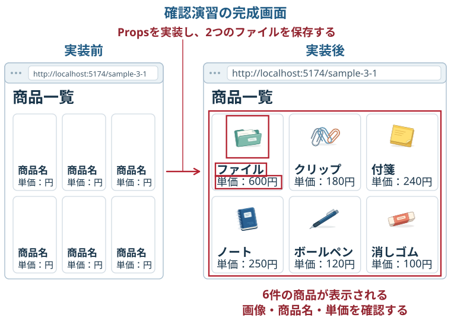{#ch03-props-practice-result}

::: {#ch03-props-practice-result-caption .caption}
確認演習の6件の商品画像・商品名・単価が正しく表示されることを確認する
:::

::: {#ch03-props-line-531 .paragraph keep-next="2"}
商品ごとに正しい画像・商品名・単価が表示されていることを確認してください。また、十分な画面幅では、カードが3列×2行に並びます。
:::

::: {#ch03-props-line-533 .paragraph}
画面に変更が反映されない場合は、ブラウザーの画面を再読み込みして、もう一度操作してください。
:::

::: {#ch03-props-points .section-points}
この節のポイント

● コンポーネントを分割することで、同じ画面の部品を複数の場所で再利用できる。

● Propsは、親コンポーネントから子コンポーネントへデータを渡すための仕組みである。

● TypeScriptでは、`type` などを使用してPropsの型を定義できる。

● 子コンポーネントでは、Propsのオブジェクトを分割代入などによって受け取り、JSXで使用できる。

● `map()` とPropsを組み合わせることで、配列のデータ数に応じて複数のコンポーネントを表示できる。

● 子コンポーネントは、受け取ったPropsを直接変更しない。
:::
::::

:::: {#page-5 .source-page}
::: {#ch03-router-title .heading}
3.2. React Routerによるルーティング
:::

::: {#ch03-router-slide .slide layout="illustration"}
React Routerによるルーティング


:::

::: {#ch03-router-m44 .heading level="minor"}
複数の画面を持つアプリケーションを作るには
:::

::: {#ch03-router-m46 .paragraph}
前節では、商品カードを独立したコンポーネントとして作成し、Propsを使用して、商品ごとに異なる情報を表示する方法を学習しました。
:::

::: {#ch03-router-m48 .paragraph}
実際の商品管理システムには、商品一覧以外にも、さまざまな画面が必要です。例えば、次の3つの画面を持つシステムを考えてみましょう。
:::

::: {#ch03-router-m50 .table column-widths="27 73"}
| 画面 | 主な役割 |
|---|---|
| ホーム画面 | システムのトップページを表示する。 |
| 商品一覧画面 | 登録されている商品を一覧表示する。 |
| ご利用案内画面 | システムの使い方などを表示する。 |
:::

::: {#ch03-router-m56 .paragraph}
これらの画面は、それぞれReactのコンポーネントとして作成できます。
:::

::: {#ch03-router-m58 .paragraph}
では、ユーザーが商品一覧のURLにアクセスした場合に、どのようにして商品一覧画面を表示すればよいのでしょうか。
:::

::: {#ch03-router-m60 .paragraph punctuation-font="inherit"}
このように、**アクセスしたURLに応じて表示する画面を決定する仕組み**を、ルーティングと呼びます。
:::

::: {#ch03-router-m62 .heading level="minor"}
React Routerとは
:::

::: {#ch03-router-m64 .paragraph}
Reactは、画面を作成したり、データの変更を画面に反映したりするためのライブラリです。しかし、React単体では、URLと表示する画面の対応関係まで自動的に管理するわけではありません。
:::

::: {#ch03-router-m66 .paragraph punctuation-font="inherit"}
そこで、本研修では **React Router（リアクトルーター）** というライブラリを使用します。
:::

::: {#ch03-router-m68 .paragraph}
React Routerを使用すると、次のように、URLのパスと表示するコンポーネントを対応付けることができます。
:::

::: {#ch03-router-m70 .table column-widths="30 46 24"}
| URLのパス | 表示するコンポーネント | 画面 |
|---|---|---|
| `/sample-3-2` | `HomePage` | ホーム |
| `/sample-3-2/products` | `ProductListPage` | 商品一覧 |
| `/sample-3-2/guide` | `GuidePage` | ご利用案内 |
:::

::: {#ch03-router-m76 .paragraph}
例えば、次のURLのうち、`/sample-3-2/products` がパスに該当します。
:::

::: {#ch03-router-m78 .paragraph}
`http://localhost:5173/sample-3-2/products`
:::

::: {#ch03-router-m80 .table column-widths="17 28 55"}
| 部分 | 例 | 意味 |
|---|---|---|
| スキーム | `http` | 通信に使用する方式。 |
| ホスト名 | `localhost` | 接続先のコンピューター。 |
| ポート番号 | `5173` | 接続先のプログラムを区別する番号。 |
| パス | `/sample-3-2/products` | 今回、表示する画面を区別するために使用する部分。 |
:::

::: {#ch03-router-m87 .paragraph}
React Routerは、現在のURLのパスに対応するルートを選択し、そのルートに指定されたコンポーネントを表示します。
:::

{#ch03-router-figure-path}

::: {#ch03-router-figure-path-caption .caption}
URLのパスに対応する画面のコンポーネントを表示する
:::

::: {#ch03-router-m95 .heading level="minor"}
React Routerの導入
:::

::: {#ch03-router-m97 .paragraph}
React RouterはReactとは別のライブラリです。新しいプロジェクトで使用する場合は、次のコマンドを実行してインストールします。
:::

::: {#ch03-router-m100 .code example="true" code-label="コンソールの記述例"}
~~~bash
npm install react-router
~~~
:::

::: {#ch03-router-m104 .paragraph}
このコマンドを実行すると、React Routerがインストールされ、プロジェクトの `package.json` に依存ライブラリとして登録されます。
:::

::: {#ch03-router-m106 .paragraph}
本研修では、React Routerがあらかじめ登録されたプロジェクトを使用します。初回の起動時に `npm install` を実行すれば、必要なライブラリがインストールされるため、React Routerを個別にインストールする必要はありません。
:::

::: {#ch03-router-m108 .paragraph punctuation-font="inherit"}
React Routerには、いくつかの利用方式があります。本研修では、JSXでルートを定義する **Declarative Mode（宣言的なルーティング方式）** を使用します。
:::

::: {#ch03-router-m110 .paragraph}
この節では、主に次の3つのコンポーネントを学習します。
:::

::: {#ch03-router-m112 .table column-widths="28 72"}
| コンポーネント | 役割 |
|---|---|
| `BrowserRouter` | ブラウザーのURLを利用してルーティングを管理する。 |
| `Routes` | ルートの定義をまとめ、現在のURLに対応するルートを選択する。 |
| `Route` | URLのパスと表示するReact要素の対応関係を定義する。 |
:::

::: {#ch03-router-m118 .heading level="minor"}
画面とルーティングの設定を別々に管理する
:::

::: {#ch03-router-m120 .paragraph}
ここからは、複数の画面を持つアプリケーションを開発します。そのため、これまでのように1つのファイルに画面の構成をまとめるのではなく、ファイルを役割ごとに分けて管理します。
:::

::: {#ch03-router-m122 .paragraph}
例えば、商品一覧を表示する画面と、その画面へのURLを設定する処理は、別々の役割を持っています。これらを別のファイルとして管理すると、画面の内容を修正する場合と、画面を追加・変更する場合とで、編集するファイルを区別できます。
:::

::: {#ch03-router-m124 .paragraph}
本研修では、次のフォルダー構成を基本とします。
:::

::: {#ch03-router-m126 .table column-widths="24 76"}
| フォルダー | 格納するファイル |
|---|---|
| `components` | 商品カードなど、画面を構成する再利用可能な部品。 |
| `pages` | ホーム画面や商品一覧画面など、ルーティングの対象となる画面。 |
| `routes` | URLと画面の対応関係を定義するファイル。 |
| `layouts` | 複数の画面で使用する共通レイアウト。次の3.3節で追加する。 |
:::

::: {#ch03-router-m133 .paragraph punctuation-font="inherit"}
`pages` に配置する画面も、`components` に配置する部品も、Reactのコンポーネントです。**フォルダーを分けているのは、それぞれの役割を明確にするためです。**
:::

::: {#ch03-router-m135 .paragraph}
なお、Reactには、このフォルダー名やファイルの分け方を必ず使用しなければならないというルールはありません。今回は、今後の機能追加や修正を行いやすい構成として、この分け方を採用します。
:::
::::

:::: {#page-6 .source-page}
::: {#ch03-router-m137 .heading level="minor"}
【サンプル】URLに応じた画面の切り替え
:::

::: {#ch03-router-m139 .paragraph}
今回は、ホーム・商品一覧・ご利用案内の3つの画面を別々のファイルとして用意し、ルーティングを設定します。
:::

::: {#ch03-router-m141 .paragraph}
配布サンプルの `ch03-basic` プロジェクトを開き、次のファイル構成を確認してください。
:::

::: {#ch03-router-m144 .code example="true" code-label="フォルダー構成"}
~~~text
ch03-basic/
└─ src/
   ├─ components/
   │  ├─ ProductCard.tsx       （3.1）
   │  ├─ Sample3_1.tsx        （3.1）
   │  └─ Sample3_2.tsx        （教材メニューとの接続用）
   ├─ samples/
   │  └─ sample3_2/
   │     ├─ components/
   │     │  └─ ProductCard.tsx
   │     ├─ pages/
   │     │  ├─ HomePage.tsx
   │     │  ├─ ProductListPage.tsx
   │     │  └─ GuidePage.tsx
   │     └─ routes/
   │        └─ AppRoutes.tsx
   ├─ App.tsx
   └─ main.tsx
~~~
:::

::: {#ch03-router-m165 .paragraph}
※ 3.2に関係するファイルのみを抜粋しています。
:::

::: {#ch03-router-m167 .paragraph}
本研修では、前の節の完成サンプルを残しながら学習できるように、`samples` の下に節ごとのフォルダーを用意します。今回使用するフォルダーは `sample3_2` です。
:::

::: {#ch03-router-m169 .paragraph punctuation-font="inherit"}
通常のアプリケーションでは、学習する節ごとにフォルダーを分ける必要はありません。今回は、**各節のサンプルを独立して実行するための研修用の構成**として用意しています。
:::

::: {#ch03-router-m171 .training-note}
**【補足】3.1で作成した商品カードの再利用**

`sample3_2/components/ProductCard.tsx` は、3.1節で使用した `src/components/ProductCard.tsx` と同じソースコードです。

また、`sample3_2/pages/ProductListPage.tsx` は、3.1節の `Sample3_1.tsx` を基に、商品一覧画面として用意したものです。コンポーネント名と商品カードの読み込み先を変更していますが、商品データやPropsの受け渡し、カードの表示処理は同じです。

同じ名前の `ProductCard.tsx` が複数存在しますが、格納されているフォルダーが異なるため、別々のファイルとして管理できます。3.2のサンプルで使用するのは、`sample3_2` 内のファイルです。
:::

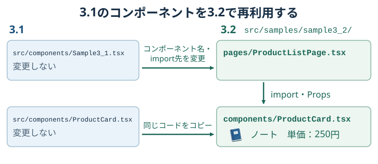{#ch03-router-figure-reuse}

::: {#ch03-router-figure-reuse-caption .caption}
3.1の画面表示を維持し、3.2のサンプル内で独立して使用する
:::

::: {#ch03-router-m185 .step}
**画面を定義するファイル**
:::

::: {#ch03-router-m187 .paragraph}
まず、ホーム画面を定義する `HomePage.tsx` と、ご利用案内画面を定義する `GuidePage.tsx` を確認しましょう。
:::

::: {#ch03-router-m190 .code filename="ch03-basic/src/samples/sample3_2/pages/HomePage.tsx" start-line="1"}
~~~tsx
export default function HomePage() {
  return (
    <main className="container mt-4">
      <h1>ホーム</h1>
      <p>商品管理システムへようこそ。</p>
    </main>
  )
}
~~~
:::

::: {#ch03-router-m202 .code filename="ch03-basic/src/samples/sample3_2/pages/GuidePage.tsx" start-line="1"}
~~~tsx
export default function GuidePage() {
  return (
    <main className="container mt-4">
      <h1>ご利用案内</h1>
      <p>このシステムでは商品情報を確認できます。</p>
    </main>
  )
}
~~~
:::

::: {#ch03-router-m213 .paragraph}
商品一覧画面は `ProductListPage.tsx` に定義しています。商品カードを読み込む部分は、次のとおりです。
:::

::: {#ch03-router-m216 .code filename="ch03-basic/src/samples/sample3_2/pages/ProductListPage.tsx" start-line="1"}
~~~tsx
import ProductCard from '../components/ProductCard'

export default function ProductListPage() {
~~~
:::

::: {#ch03-router-m222 .paragraph}
これらの画面は、これまでに学習したReactのコンポーネントと同じ方法で定義しています。
:::

::: {#ch03-router-m224 .step}
**ルーティングを定義するファイル**
:::

::: {#ch03-router-m226 .paragraph}
次に、3つの画面をURLに応じて表示するための `AppRoutes.tsx` を確認してください。
:::

::: {#ch03-router-m229 .code filename="ch03-basic/src/samples/sample3_2/routes/AppRoutes.tsx" start-line="1"}
~~~tsx
import { Routes, Route } from 'react-router'
import HomePage from '../pages/HomePage'
import ProductListPage from '../pages/ProductListPage'
import GuidePage from '../pages/GuidePage'

export default function AppRoutes() {
  return (
    <Routes>
      <Route path="" element={<HomePage />} />
      <Route path="products" element={<ProductListPage />} />
      <Route path="guide" element={<GuidePage />} />
    </Routes>
  )
}
~~~
:::

::: {#ch03-router-m246 .paragraph}
このファイルには、各画面で表示する見出しや商品カードのデザインを記述していません。表示する画面のコンポーネントを読み込み、URLとの対応関係を定義しています。
:::

::: {#ch03-router-m248 .step}
**アプリケーションの起動処理**
:::

::: {#ch03-router-m250 .paragraph}
最後に、`main.tsx` の起動処理を確認してください。
:::

::: {#ch03-router-m253 .code filename="ch03-basic/src/main.tsx" start-line="1"}
~~~tsx
import { StrictMode } from 'react'
import { createRoot } from 'react-dom/client'
import { BrowserRouter } from 'react-router'
import App from './App'
import 'bootstrap/dist/css/bootstrap.min.css'

createRoot(document.getElementById('root')!).render(
  <StrictMode>
    <BrowserRouter>
      <App />
    </BrowserRouter>
  </StrictMode>
)
~~~
:::

::: {#ch03-router-m269 .paragraph}
第1章で確認した起動処理に、`BrowserRouter` が追加されています。
:::

::: {#ch03-router-m271 .paragraph}
ここまでのファイルは、配布サンプルにあらかじめ用意されています。`ch03-basic` の開発サーバーを起動し、メニューから「3.2 React Routerによるルーティング」を選択してください。
:::

::: {#ch03-router-m273 .paragraph}
この節では、アドレスバーからURLを変更して3つの画面を表示します。リンクをクリックして画面を切り替える方法は、3.4節で学習します。
:::

::: {#ch03-router-m275 .heading level="minor"}
構文の解説
:::

::: {#ch03-router-m277 .step}
**① BrowserRouterを設定する**
:::

::: {#ch03-router-m279 .paragraph}
React Routerの機能を使用するには、アプリケーションの中でルーティングを利用できるように設定する必要があります。
:::

::: {#ch03-router-m281 .paragraph}
まず、`main.tsx` では、React Routerから `BrowserRouter` を読み込んでいます。
:::

::: {#ch03-router-m284 .code filename="ch03-basic/src/main.tsx" start-line="3"}
~~~tsx
import { BrowserRouter } from 'react-router'
~~~
:::

::: {#ch03-router-m288 .paragraph}
続いて、次のように、アプリケーションのルートとなる `App` コンポーネントを囲んでいます。
:::

::: {#ch03-router-m291 .code filename="ch03-basic/src/main.tsx" start-line="9"}
~~~tsx
    <BrowserRouter>
      <App />
    </BrowserRouter>
~~~
:::

::: {#ch03-router-m297 .paragraph}
`BrowserRouter` は、ブラウザーの現在のURLなどの情報を扱うためのコンポーネントです。
:::

::: {#ch03-router-m299 .paragraph}
`App` を `BrowserRouter` で囲むことによって、その内側のコンポーネントで、React Routerのルーティングの機能を使用できるようになります。
:::

::: {#ch03-router-m301 .paragraph punctuation-font="inherit"}
**本研修では、アプリケーション全体を囲むBrowserRouterを、main.tsxに1つだけ設定します。** 各画面や各節の `AppRoutes.tsx` に、別の `BrowserRouter` を追加する必要はありません。
:::

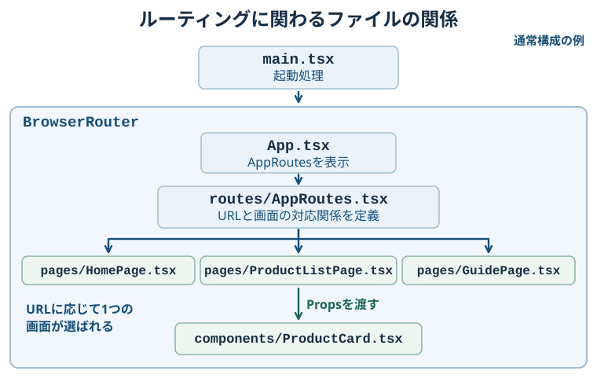{#ch03-router-figure-nesting}

::: {#ch03-router-figure-nesting-caption .caption}
BrowserRouterでアプリケーションを囲み、内部でルーティングを利用する
:::

::: {#ch03-router-m309 .step}
**② 各画面のコンポーネントを読み込む**
:::

::: {#ch03-router-m311 .paragraph}
画面のコンポーネントを別々のファイルに定義したため、ルーティングを定義するファイルでは、必要なコンポーネントを読み込んで使用します。
:::

::: {#ch03-router-m314 .code filename="ch03-basic/src/samples/sample3_2/routes/AppRoutes.tsx" start-line="1"}
~~~tsx
import { Routes, Route } from 'react-router'
import HomePage from '../pages/HomePage'
import ProductListPage from '../pages/ProductListPage'
import GuidePage from '../pages/GuidePage'
~~~
:::

::: {#ch03-router-m321 .paragraph}
1行目では、React Routerの `Routes` と `Route` を読み込んでいます。
:::

::: {#ch03-router-m323 .paragraph}
2～4行目では、`pages` フォルダーにある3つのコンポーネントを読み込んでいます。
:::

::: {#ch03-router-m325 .paragraph}
ここで、import先のパスに注目してください。`AppRoutes.tsx` は `routes` フォルダーにあります。そのため、`../pages/HomePage` と記述することで、1つ上のフォルダーに移動し、`pages` フォルダーにある `HomePage.tsx` を読み込むことができます。
:::

::: {#ch03-router-m327 .paragraph}
`ProductListPage.tsx` から商品カードを読み込む際も、同じ考え方で `../components/ProductCard` と記述しています。
:::

{#ch03-router-figure-imports}

::: {#ch03-router-figure-imports-caption .caption}
役割ごとに分けたファイルをimportで読み込む
:::

::: {#ch03-router-m335 .paragraph}
このように、ファイルを別々のフォルダーに分けて管理している場合でも、importを使用して必要なコンポーネントを組み合わせることができます。
:::

::: {#ch03-router-m337 .step}
**③ RoutesとRouteでURLと画面を対応付ける**
:::

::: {#ch03-router-m339 .paragraph}
ここからは、`AppRoutes.tsx` に記述されているルートの定義を確認します。
:::

::: {#ch03-router-m342 .code filename="ch03-basic/src/samples/sample3_2/routes/AppRoutes.tsx" start-line="8"}
~~~tsx
    <Routes>
      <Route path="" element={<HomePage />} />
      <Route path="products" element={<ProductListPage />} />
      <Route path="guide" element={<GuidePage />} />
    </Routes>
~~~
:::

::: {#ch03-router-m350 .paragraph}
`Routes` は、複数の `Route` をまとめるためのコンポーネントです。
:::

::: {#ch03-router-m352 .paragraph}
`Route` は、URLのパスと、表示するReact要素の対応関係を定義するために使用します。
:::

::: {#ch03-router-m354 .paragraph}
例えば、商品一覧画面に対応するルートは、次のように記述しています。
:::

::: {#ch03-router-m357 .code filename="ch03-basic/src/samples/sample3_2/routes/AppRoutes.tsx" start-line="10"}
~~~tsx
      <Route path="products" element={<ProductListPage />} />
~~~
:::

::: {#ch03-router-m361 .paragraph}
この記述では、`Route` に次の2つの属性を指定しています。
:::

::: {#ch03-router-m363 .table column-widths="22 78"}
| 属性 | 役割 |
|---|---|
| `path` | どのURLのパスに対応するかを指定する。 |
| `element` | そのルートに一致したときに表示するReact要素を指定する。 |
:::

::: {#ch03-router-m368 .paragraph}
`path="products"` は、今回のサンプルの入口に続く `products` というパスを指定しています。
:::

::: {#ch03-router-m370 .paragraph}
また、`element={<ProductListPage />}` では、表示する画面として `ProductListPage` コンポーネントを指定しています。`element` に設定するのはコンポーネントの名前を表す文字列ではなく、JSXで記述したReact要素です。
:::

{#ch03-router-figure-attributes}

::: {#ch03-router-figure-attributes-caption .caption}
pathとelementでURLのパスと画面を対応付ける
:::

::: {#ch03-router-m378 .step}
**④ サンプルの入口と各画面のURLの関係**
:::

::: {#ch03-router-m380 .paragraph}
ここで、1つ注意しておきたいことがあります。`AppRoutes.tsx` では、商品一覧のルートの `path` を `products` と記述しています。しかし、ブラウザーでアクセスするURLのパスは `/sample-3-2/products` です。
:::

::: {#ch03-router-m382 .paragraph}
これは、本研修の配布プロジェクトでは、節ごとにサンプルの入口となるルートを用意しているためです。
:::

::: {#ch03-router-m384 .paragraph}
例えば、3.2のサンプルへ接続する設定は、次のようになります。
:::

::: {#ch03-router-m387 .code example="true" code-label="TSXの記述例（教材メニューとの接続設定・一部）"}
~~~tsx
<Route path="/sample-3-2/*" element={<Sample3_2 />} />
~~~
:::

::: {#ch03-router-m391 .paragraph}
この設定は、3.2のサンプルの入口である `/sample-3-2` と、それに続くパスに対応するためのものです。末尾の `/*` を指定することで、その先にある商品一覧やご利用案内のパスも扱えるようにしています。
:::

::: {#ch03-router-m393 .paragraph}
`Sample3_2.tsx` は、教材用メニューと、3.2のルーティングを定義した `AppRoutes.tsx` を接続するためのファイルです。この設定は配布プロジェクトに用意されているため、受講者が変更する必要はありません。
:::

::: {#ch03-router-m395 .paragraph}
`AppRoutes.tsx` の中では、入口に続く部分を指定します。今回の3つのルートと実際のURLとの関係は、次のとおりです。
:::

::: {#ch03-router-m397 .table column-widths="39 36 25"}
| AppRoutes.tsxで指定するpath | 実際のURLのパス | 表示する画面 |
|---|---|---|
| `""`（空文字列） | `/sample-3-2` | ホーム |
| `"products"` | `/sample-3-2/products` | 商品一覧 |
| `"guide"` | `/sample-3-2/guide` | ご利用案内 |
:::

::: {#ch03-router-m403 .paragraph punctuation-font="inherit"}
このように、基準となるルートのパスに続く部分を指定する方法を、**相対パスによるルートの指定**といいます。
:::

::: {#ch03-router-m405 .paragraph}
ホーム画面では、入口に続くパスがないため、`path=""` と記述しています。次の3.3節では、共通レイアウトを追加し、その入口に対応する画面を `index` という属性で指定する方法も学習します。
:::

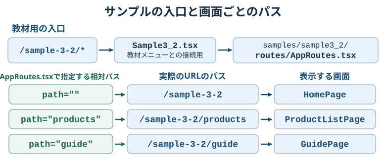{#ch03-router-figure-relative-path}

::: {#ch03-router-figure-relative-path-caption .caption}
教材用の入口を基準に、各画面のルートを定義する
:::

::: {#ch03-router-m413 .step}
**⑤ URLに対応する画面が表示されるまでの流れ**
:::

::: {#ch03-router-m415 .paragraph}
例えば、ブラウザーのアドレスバーに `/sample-3-2/products` を含むURLを入力した場合は、次のように処理されます。
:::

::: {#ch03-router-m417-1 .paragraph numbered="true"}
1\. `BrowserRouter` のもとで、現在のURLを扱う。
:::

::: {#ch03-router-m417-2 .paragraph numbered="true"}
2\. 教材用のルート設定によって3.2のサンプルが表示される。
:::

::: {#ch03-router-m417-3 .paragraph numbered="true"}
3\. `AppRoutes` の `Routes` が、残りのパス `products` に対応する `Route` を選択する。
:::

::: {#ch03-router-m417-4 .paragraph numbered="true"}
4\. `element` に指定された `ProductListPage` が表示される。
:::

::: {#ch03-router-m417-5 .paragraph numbered="true"}
5\. `ProductListPage` が、6件の商品データを使用して商品カードを表示する。
:::

{#ch03-router-figure-flow}

::: {#ch03-router-figure-flow-caption .caption}
URLに対応する画面を選択し、画面のコンポーネントを表示する
:::

::: {#ch03-router-m429 .paragraph}
このように、各画面のコンポーネントとルーティングの設定を分けて管理することで、画面の表示内容を変更する場合は `pages` や `components`、URLとの対応関係を変更する場合は `routes` を編集するという形で、作業する場所を区別できます。
:::

::: {#ch03-router-m431 .training-note}
**【補足】アドレスバーからの移動とSPAの画面遷移**

今回は、ブラウザーのアドレスバーからURLを入力して、ルーティングの動作を確認します。この操作ではページの読み込みが発生します。

SPAの特徴である、ページ全体を再読み込みせずに画面を切り替える方法については、3.4節で学習します。
:::
::::

:::: {#page-7 .source-page}
::: {#ch03-router-m437 .heading level="minor"}
【確認演習】URLに応じて表示する画面を設定する
:::

::: {#ch03-router-m439 .paragraph}
ホーム・商品一覧・ご利用案内の3つの画面をURLに応じて表示できるように、ルーティングを設定します。
:::

::: {#ch03-router-m441 .paragraph}
確認演習用のフォルダーには、3つの画面と商品カードの完成済みコンポーネントが用意されています。3.1節の確認演習が未完成でも、今回の確認演習に取り組むことができます。
:::

::: {#ch03-router-m443 .paragraph numbered="true"}
1．`ch03-basic-q` プロジェクトの次のファイルを開いてください。
:::

::: {#ch03-router-m445 .paragraph}
`src/exercises/q3_2/routes/AppRoutes.tsx`
:::

::: {#ch03-router-m447 .paragraph numbered="true"}
2．コード内の➀～➄の番号付きコメントを確認し、指示された箇所を実装してください。➀は既存コードの確認、➁～➄は実装問題です。
:::

::: {#ch03-router-m449 .table column-widths="12 88"}
| 番号 | 作業内容 |
|---|---|
| ➀ | React RouterのRoutesとRouteが読み込まれていることを確認する。 |
| ➁ | pagesフォルダーから3つの画面のコンポーネントを読み込む。 |
| ➂ | ホーム画面に対応するRouteを記述する。 |
| ➃ | 商品一覧画面に対応するRouteを記述する。 |
| ➄ | ご利用案内画面に対応するRouteを記述する。 |
:::

::: {#ch03-router-m457 .paragraph}
「ルートを設定してください。」と表示するための補助ルートは、あらかじめ用意されています。変更する必要はありません。コメントに指定されていないコードや、ほかのファイルも変更する必要はありません。
:::

::: {#ch03-router-m459 .paragraph numbered="true"}
3．編集したファイルを保存してください。
:::

::: {#ch03-router-m461 .paragraph numbered="true"}
4．`ch03-basic-q` の開発サーバーを起動し、ターミナルに表示されたURLを開いてください。起動済みの場合は、開いているブラウザーの画面に戻ってください。
:::

::: {#ch03-router-m463 .paragraph numbered="true"}
5．メニューから「3.2 React Routerによるルーティング」を選択してください。
:::

::: {#ch03-router-m465 .heading level="minor"}
動作確認
:::

::: {#ch03-router-m467 .paragraph numbered="true"}
6．ブラウザーのアドレスバーから、次の3つのURLにアクセスし、それぞれに対応する画面が表示されることを確認してください。
:::

::: {#ch03-router-m469 .table column-widths="28 72"}
| URLのパス | 確認する画面 |
|---|---|
| `/sample-3-2` | ホーム。「商品管理システムへようこそ。」と表示される。 |
| `/sample-3-2/products` | 商品一覧。6件の画像付き商品カードが表示される。 |
| `/sample-3-2/guide` | ご利用案内。「このシステムでは商品情報を確認できます。」と表示される。 |
:::

::: {#ch03-router-m475 .paragraph}
ホスト名とポート番号には、開発サーバーの起動時に表示されたURLのものを使用してください。
:::

{#ch03-router-figure-screens}

::: {#ch03-router-figure-screens-caption .caption}
アドレスバーに入力したURLに応じて表示する画面が変わることを確認する
:::

::: {#ch03-router-m483 .paragraph}
3つのURLでそれぞれ正しい画面が表示されれば、演習完了です。
:::

::: {#ch03-router-m485 .paragraph}
画面に変更が反映されない場合は、ブラウザーの画面を再読み込みして、もう一度操作してください。
:::

::: {#ch03-router-points .section-points}
この節のポイント

● ルーティングとは、URLに応じて表示する画面を決定する仕組みである。

● React Routerを使用すると、URLと表示するコンポーネントを対応付けられる。

● `BrowserRouter` は、ブラウザーのURLを使用するルーティングのためのコンポーネントである。

● `Routes` の中に `Route` を定義し、`path` に対応するパス、`element` に表示するReact要素を指定する。

● 各画面を `pages`、画面の部品を `components`、ルーティングの設定を `routes` に分けて管理することで、ファイルの役割を明確にできる。
:::
::::

:::: {#page-8 .source-page}
::: {#ch03-layout-title .heading}
3.3. 共通レイアウトの作成
:::

::: {#ch03-layout-slide .slide layout="illustration"}
共通レイアウトの作成

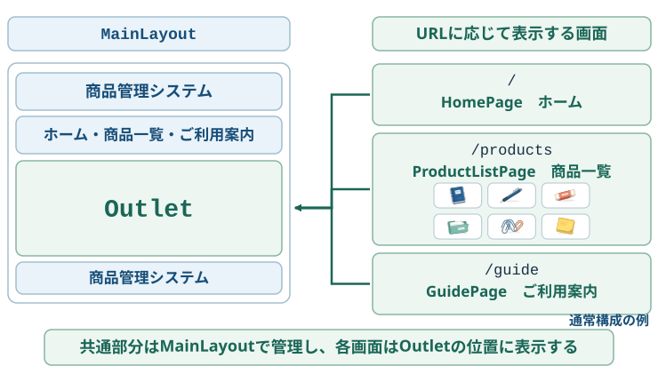
:::

::: {#ch03-layout-m503 .heading level="minor"}
共通レイアウトとは
:::

::: {#ch03-layout-m505 .paragraph}
前節では、各画面のコンポーネントとルーティングの設定を別々のファイルに分けて管理し、URLに応じて画面を表示する方法を学習しました。
:::

::: {#ch03-layout-m507 .paragraph}
実際のWebアプリケーションでは、表示する画面が変わっても、ヘッダーやメニュー、フッターなどは共通していることが一般的です。
:::

::: {#ch03-layout-m509 .paragraph}
例えば、商品管理システムのホーム画面と商品一覧画面では、中央に表示する内容は異なりますが、上部には同じシステム名とメニューを表示します。
:::

::: {#ch03-layout-m511 .paragraph}
これらの共通部分を各画面のコンポーネントに個別に記述すると、次のような問題が発生します。
:::

::: {#ch03-layout-m513-1 .paragraph}
● メニューの項目を追加する際に、すべての画面を修正する必要がある。
:::

::: {#ch03-layout-m513-2 .paragraph}
● ヘッダーやフッターのデザインを変更する際に、同じ修正を繰り返す必要がある。
:::

::: {#ch03-layout-m516 .paragraph punctuation-font="inherit"}
そこで、**複数の画面で使用する共通部分を1つのコンポーネントにまとめて管理する**方法を考えます。このような画面の共通構成を、共通レイアウトと呼びます。
:::

::: {#ch03-layout-m518 .paragraph}
React Routerには、共通レイアウトの中に、URLに応じた画面を表示する仕組みがあります。この節では、その仕組みを利用して、複数の画面を持つアプリケーションに共通レイアウトを適用します。
:::

::: {#ch03-layout-m520 .heading level="minor"}
【サンプル】共通レイアウトを作成する
:::

::: {#ch03-layout-m522 .paragraph}
前節の商品管理システムに、共通のヘッダー・メニュー・フッターを追加します。ホーム・商品一覧・ご利用案内の各画面は、共通レイアウトの中央に表示します。
:::

{#ch03-layout-product-screen}

::: {#ch03-layout-product-screen-caption .caption}
共通レイアウトの中に商品一覧画面を表示する
:::

::: {#ch03-layout-m530 .step}
**3.3で使用するフォルダー構成**
:::
::::

:::: {#page-9 .source-page}
::: {#ch03-layout-m532 .paragraph}
今回は、`sample3_2` を基にした `sample3_3` フォルダーを使用します。前節までのフォルダーに加え、共通レイアウトを格納する `layouts` フォルダーを用意しています。
:::

::: {#ch03-layout-m535 .code example="true" code-label="フォルダー構成"}
~~~text
ch03-basic/src/samples/sample3_3/
├─ components/
│  └─ ProductCard.tsx
├─ pages/
│  ├─ HomePage.tsx
│  ├─ ProductListPage.tsx
│  └─ GuidePage.tsx
├─ layouts/
│  └─ MainLayout.tsx
└─ routes/
   └─ AppRoutes.tsx
~~~
:::

::: {#ch03-layout-m549 .paragraph}
`components` と `pages` の各ファイルは、前節の `sample3_2` と同じ内容です。3.3のサンプルを独立して利用するため、それぞれのファイルを `sample3_3` に用意しています。
:::

::: {#ch03-layout-m551 .paragraph}
今回、新しく作成するファイルと、変更するファイルは次の2つです。
:::

::: {#ch03-layout-m553 .table column-widths="34 66"}
| ファイル | 役割 |
|---|---|
| `layouts/MainLayout.tsx` | 共通のヘッダー・メニュー・フッターと、各画面を表示する位置を定義する。 |
| `routes/AppRoutes.tsx` | 共通レイアウトの中に、URLに応じて各画面が表示されるようにルートを定義する。 |
:::

::: {#ch03-layout-m558 .paragraph}
各画面のコンポーネント自体には、ヘッダーやメニューを追加する必要はありません。
:::

::: {#ch03-layout-m560 .step}
**共通レイアウトを定義するファイル**
:::

::: {#ch03-layout-m562 .paragraph}
まず、`MainLayout.tsx` を確認してください。
:::

::: {#ch03-layout-m565 .code filename="ch03-basic/src/samples/sample3_3/layouts/MainLayout.tsx" start-line="1"}
~~~tsx
import { Outlet } from 'react-router'

export default function MainLayout() {
  return (
    <>
      <header className="bg-dark text-white p-3">
        商品管理システム
      </header>

      <nav className="nav nav-pills bg-light p-3 gap-2"
           aria-label="商品管理システムのメニュー">
        <span className="nav-link text-dark">ホーム</span>
        <span className="nav-link text-dark">商品一覧</span>
        <span className="nav-link text-dark">ご利用案内</span>
      </nav>

      <Outlet />

      <footer className="bg-light text-center p-3 mt-4">
        商品管理システム
      </footer>
    </>
  )
}
~~~
:::

::: {#ch03-layout-m592 .paragraph}
このファイルには、各画面で共通して使用するヘッダー・メニュー・フッターを記述しています。また、メニューとフッターの間に、React Routerが提供する `Outlet` を配置しています。
:::

::: {#ch03-layout-m594 .step}
**ルーティングを定義するファイル**
:::

::: {#ch03-layout-m596 .paragraph}
次に、`AppRoutes.tsx` を確認してください。
:::

::: {#ch03-layout-m599 .code filename="ch03-basic/src/samples/sample3_3/routes/AppRoutes.tsx" start-line="1"}
~~~tsx
import { Routes, Route } from 'react-router'
import HomePage from '../pages/HomePage'
import ProductListPage from '../pages/ProductListPage'
import GuidePage from '../pages/GuidePage'
import MainLayout from '../layouts/MainLayout'

export default function AppRoutes() {
  return (
    <Routes>
      <Route element={<MainLayout />}>
        <Route index element={<HomePage />} />
        <Route path="products" element={<ProductListPage />} />
        <Route path="guide" element={<GuidePage />} />
      </Route>
    </Routes>
  )
}
~~~
:::

::: {#ch03-layout-m619 .paragraph}
前節との主な違いは、3つの画面の `Route` を、`MainLayout` を表示する `Route` で囲んでいることです。また、ホーム画面のルートの指定方法も変更しています。
:::

::: {#ch03-layout-m621 .paragraph}
配布サンプルの `ch03-basic` の開発サーバーを起動し、メニューから「3.3 共通レイアウトの作成」を選択してください。
:::

::: {#ch03-layout-m623 .paragraph}
今回のサンプルでは、共通メニューの項目は文字として表示しています。メニューをクリックして画面を切り替える機能は、次の3.4節で追加します。
:::

::: {#ch03-layout-m625 .heading level="minor"}
構文の解説
:::

::: {#ch03-layout-m627 .step}
**① 親ルートと子ルートを定義する**
:::
::::

:::: {#page-10 .source-page}
::: {#ch03-layout-m629 .paragraph}
まず、`AppRoutes.tsx` のルートの定義を確認します。
:::

::: {#ch03-layout-m632 .code filename="ch03-basic/src/samples/sample3_3/routes/AppRoutes.tsx" start-line="9"}
~~~tsx
    <Routes>
      <Route element={<MainLayout />}>
        <Route index element={<HomePage />} />
        <Route path="products" element={<ProductListPage />} />
        <Route path="guide" element={<GuidePage />} />
      </Route>
    </Routes>
~~~
:::

::: {#ch03-layout-m642 .paragraph}
前節では、`Routes` の中に3つの `Route` を並べて記述し、URLごとに表示する画面を指定しました。
:::

::: {#ch03-layout-m644 .paragraph}
今回は、複数の画面で共通レイアウトを使用するため、`Route` の中に別の `Route` を記述しています。
:::

::: {#ch03-layout-m646 .paragraph}
このようにルートを階層構造にすると、それぞれのルートに異なる役割を持たせることができます。
:::

::: {#ch03-layout-m648-1 .paragraph punctuation-font="inherit"}
● **親ルート**：複数の画面で使用する共通レイアウトを指定する。
:::

::: {#ch03-layout-m648-2 .paragraph punctuation-font="inherit"}
● **子ルート**：共通レイアウトの中に表示する各画面を指定する。
:::

::: {#ch03-layout-m651 .paragraph}
今回の親ルートは、`element={<MainLayout />}` を指定した `Route` です。この `Route` の内側に、ホーム・商品一覧・ご利用案内の子ルートを記述しています。
:::

::: {#ch03-layout-m653 .paragraph}
このように、ルートを階層構造にすることを、ネストされたルーティング（Nested Routing）と呼びます。
:::

::: {#ch03-layout-m655 .step}
**② Outletで子ルートの画面を表示する**
:::

::: {#ch03-layout-m657 .paragraph}
親ルートと子ルートを定義しただけでは、共通レイアウトのどこに子ルートの画面を表示するのかが決まりません。
:::

::: {#ch03-layout-m659 .paragraph}
例えば、ヘッダーとメニューを画面上部に、フッターを画面下部に配置する場合は、その間に各画面の内容を表示する必要があります。
:::

::: {#ch03-layout-m661 .paragraph punctuation-font="inherit"}
そこで使用するのが、**Outlet（アウトレット）** です。
:::

::: {#ch03-layout-m663 .paragraph}
`MainLayout.tsx` では、React Routerから `Outlet` を読み込んでいます。
:::

::: {#ch03-layout-m666 .code filename="ch03-basic/src/samples/sample3_3/layouts/MainLayout.tsx" start-line="1"}
~~~tsx
import { Outlet } from 'react-router'
~~~
:::

::: {#ch03-layout-m670 .paragraph}
続いて、メニューとフッターの間に配置しています。
:::

::: {#ch03-layout-m673 .code filename="ch03-basic/src/samples/sample3_3/layouts/MainLayout.tsx" start-line="17"}
~~~tsx
      <Outlet />
~~~
:::

::: {#ch03-layout-m677 .paragraph}
`Outlet` は、親ルートのコンポーネント内で、現在のURLに対応する子ルートのReact要素を表示するためのコンポーネントです。
:::

::: {#ch03-layout-m679 .paragraph}
例えば、商品一覧のURLにアクセスすると、親ルートの `MainLayout` が表示され、その `Outlet` の位置に子ルートの `ProductListPage` が表示されます。
:::

::: {#ch03-layout-m681 .paragraph}
ご利用案内のURLにアクセスした場合も、共通レイアウトには同じ `MainLayout` を使用します。ただし、`Outlet` の位置には `GuidePage` が表示されます。
:::

{#ch03-layout-route-flow}

::: {#ch03-layout-route-flow-caption .caption}
親ルートに指定した共通レイアウトのOutletに子ルートの画面を表示する
:::

::: {#ch03-layout-m689 .paragraph}
なお、`MainLayout` に `Outlet` を配置しなかった場合は、対応する子ルートが選択されても、その画面を共通レイアウト内に表示できません。
:::

::: {#ch03-layout-m691 .paragraph punctuation-font="inherit"}
**親ルートに共通レイアウトを指定することと、共通レイアウトの中にOutletを配置することの両方が必要です。**
:::

::: {#ch03-layout-m693 .step}
**③ 共通レイアウトを使用するルートのパスを指定する**
:::

::: {#ch03-layout-m695 .paragraph}
今回の親ルートには、`path` 属性を指定していません。
:::

::: {#ch03-layout-m698 .code filename="ch03-basic/src/samples/sample3_3/routes/AppRoutes.tsx" start-line="10"}
~~~tsx
      <Route element={<MainLayout />}>
~~~
:::

::: {#ch03-layout-m702 .paragraph}
通常、`Route` には `path` を指定します。しかし、共通レイアウトを適用することだけが目的の場合には、パスを指定しないルートを使用できます。
:::

::: {#ch03-layout-m704 .paragraph punctuation-font="inherit"}
このようなルートは、子ルートをまとめて共通レイアウトを適用しますが、**URLに新しいパスの部分を追加しません。**
:::

::: {#ch03-layout-m706 .paragraph}
一方、商品一覧とご利用案内の子ルートには、前節と同じように `products` や `guide` という相対パスを指定しています。
:::

::: {#ch03-layout-m709 .code filename="ch03-basic/src/samples/sample3_3/routes/AppRoutes.tsx" start-line="12"}
~~~tsx
        <Route path="products" element={<ProductListPage />} />
        <Route path="guide" element={<GuidePage />} />
~~~
:::

::: {#ch03-layout-m714 .paragraph}
3.3のサンプルには、配布プロジェクト側で `/sample-3-3` という入口が設定されています。
:::

::: {#ch03-layout-m716 .paragraph}
親ルートに `path` を指定していないため、商品一覧のURLには、共通レイアウトを表す名前などが追加されることはありません。商品一覧のパスは `/sample-3-3/products`、ご利用案内のパスは `/sample-3-3/guide` になります。
:::

::: {#ch03-layout-m718 .step}
**④ indexで親ルートのURLに対応する画面を指定する**
:::

::: {#ch03-layout-m720 .paragraph}
ホーム画面のルートには、前節とは異なる記述を使用しています。
:::

::: {#ch03-layout-m723 .code filename="ch03-basic/src/samples/sample3_3/routes/AppRoutes.tsx" start-line="11"}
~~~tsx
        <Route index element={<HomePage />} />
~~~
:::

::: {#ch03-layout-m727 .paragraph}
`index` は、親ルートに対応するURLにアクセスした場合に表示する、デフォルトの子ルートを指定するための属性です。
:::

::: {#ch03-layout-m729 .paragraph}
今回の場合は、子ルートのパスを追加せずに `/sample-3-3` にアクセスすると、`MainLayout` の `Outlet` の位置に `HomePage` が表示されます。
:::

::: {#ch03-layout-m731 .paragraph}
前節では、入口に対応するホーム画面を `path=""` で指定していました。今回は、共通レイアウトの子ルートとしてホーム画面を指定するため、`index` を使用しています。
:::

::: {#ch03-layout-m733 .paragraph}
`index` を指定するルートには、`path` を指定しません。
:::

::: {#ch03-layout-m735 .paragraph}
ここまでのルートの設定と、実際に表示される画面との対応関係を整理しましょう。
:::

::: {#ch03-layout-m737 .table column-widths="29 24 47"}
| URLのパス | 共通レイアウト | Outletに表示するコンポーネント |
|---|---|---|
| `/sample-3-3` | `MainLayout` | `HomePage`（index） |
| `/sample-3-3/products` | `MainLayout` | `ProductListPage` |
| `/sample-3-3/guide` | `MainLayout` | `GuidePage` |
:::

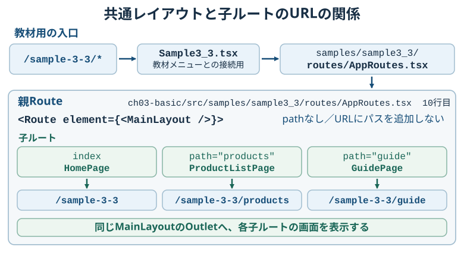{#ch03-layout-relative-path}

::: {#ch03-layout-relative-path-caption .caption}
親ルートで共通レイアウトを指定し、子ルートで中央に表示する画面を決定する
:::

::: {#ch03-layout-m749 .paragraph}
このように、共通レイアウトとルーティングの設定を分けて管理すれば、共通部分を変更する際は `layouts/MainLayout.tsx`、表示する画面の対応関係を変更する際は `routes/AppRoutes.tsx` を編集することができます。
:::
::::

:::: {#page-11 .source-page}
::: {#ch03-layout-m751 .heading level="minor"}
【確認演習】共通レイアウトを作成する
:::

::: {#ch03-layout-m753 .paragraph}
ホーム・商品一覧・ご利用案内の3画面に、共通のヘッダー・メニュー・フッターを適用します。
:::

::: {#ch03-layout-m755 .paragraph}
確認演習用のフォルダーには、前節と同じ3つの画面と、共通レイアウトの基本構成が用意されています。前節の確認演習が未完成でも、今回の演習に取り組むことができます。
:::

::: {#ch03-layout-m757 .paragraph numbered="true"}
1．`ch03-basic-q` プロジェクトの次の2つのファイルを開いてください。
:::

::: {#ch03-layout-m759-1 .paragraph}
● `src/exercises/q3_3/layouts/MainLayout.tsx`
:::

::: {#ch03-layout-m759-2 .paragraph}
● `src/exercises/q3_3/routes/AppRoutes.tsx`
:::

::: {#ch03-layout-m762 .paragraph numbered="true"}
2．2つのファイルに記載された➀～➅の番号付きコメントを確認し、指示された箇所を実装してください。➁は既存コードの確認、それ以外は実装問題です。
:::

::: {#ch03-layout-m764 .table column-widths="12 25 63"}
| 番号 | 編集するファイル | 作業内容 |
|---|---|---|
| ➀ | `MainLayout.tsx` | Outletを読み込む。 |
| ➁ | `MainLayout.tsx` | ヘッダー・メニュー・フッターが定義されていることを確認する。 |
| ➂ | `MainLayout.tsx` | メニューとフッターの間にOutletを配置する。 |
| ➃ | `AppRoutes.tsx` | layoutsフォルダーのMainLayoutを読み込む。 |
| ➄ | `AppRoutes.tsx` | 既存の3つのRouteを、MainLayoutを表示する親Routeで囲む。親Routeにはpathを指定しない。 |
| ➅ | `AppRoutes.tsx` | ホームのRouteを、indexを使用する記述に変更する。 |
:::

::: {#ch03-layout-m773 .paragraph}
コメントに指定されていないコードや、ほかのファイルは変更する必要はありません。
:::

::: {#ch03-layout-m775 .paragraph numbered="true"}
3．編集した2つのファイルを保存してください。
:::

::: {#ch03-layout-m777 .paragraph numbered="true"}
4．`ch03-basic-q` の開発サーバーを起動し、ターミナルに表示されたURLを開いてください。起動済みの場合は、開いているブラウザーの画面に戻ってください。
:::

::: {#ch03-layout-m779 .paragraph numbered="true"}
5．メニューから「3.3 共通レイアウトの作成」を選択してください。
:::

::: {#ch03-layout-m781 .heading level="minor"}
動作確認
:::
::::

:::: {#page-12 .source-page}
::: {#ch03-layout-m783 .paragraph numbered="true"}
6．ブラウザーのアドレスバーから、次の3つのURLにアクセスしてください。
:::

::: {#ch03-layout-m785 .table column-widths="33 67"}
| URLのパス | 画面の中央に表示される内容 |
|---|---|
| `/sample-3-3` | ホーム画面 |
| `/sample-3-3/products` | 商品一覧画面（6枚の商品カード） |
| `/sample-3-3/guide` | ご利用案内画面 |
:::

::: {#ch03-layout-m791 .paragraph}
次の図と見比べながら、すべての画面に同じヘッダー・メニュー・フッターが表示されていることを確認しましょう。
:::

{#ch03-layout-check-browser}

::: {#ch03-layout-check-browser-caption .caption}
3つの画面で共通部分が同じであり、中央に異なる画面が表示されることを確認する
:::

::: {#ch03-layout-m799 .paragraph}
次の2点を確認できれば、演習完了です。
:::

::: {#ch03-layout-m801-1 .paragraph}
● 3つのURLにアクセスしたとき、同じ共通レイアウトが表示される。
:::

::: {#ch03-layout-m801-2 .paragraph}
● 中央には、それぞれのURLに対応する画面が表示される。
:::

::: {#ch03-layout-m804 .paragraph}
画面に変更が反映されない場合は、ブラウザーの画面を再読み込みして、もう一度操作してください。
:::

::: {#ch03-layout-m806 .paragraph}
今回は、アドレスバーからURLを変更して画面を表示しました。次の3.4節では、共通レイアウトのメニューにリンクを配置し、ページ全体を再読み込みせずに画面を切り替える方法を学習します。
:::

::: {#ch03-layout-points .section-points}
この節のポイント

● 共通するヘッダー・メニュー・フッターなどは、共通レイアウトとして管理できる。

● 親ルートに共通レイアウト、子ルートに各画面を指定することで、ルートを階層構造にできる。

● `Outlet` は、共通レイアウトの中に子ルートの画面を表示するためのコンポーネントである。

● `path` を指定しない親ルートは、URLのパスを追加せず、子ルートに共通レイアウトを適用できる。

● `index` は、親ルートのURLに対応するデフォルトの子ルートを指定する。
:::
::::

:::: {#page-13 .source-page}
::: {#ch03-navigation-title .heading}
3.4. SPAの画面遷移（LinkとNavLink）
:::

::: {#ch03-navigation-slide .slide layout="illustration"}
SPAの画面遷移（LinkとNavLink）


:::

::: {#ch03-navigation-m42 .heading level="minor"}
SPAにおける画面遷移
:::

::: {#ch03-navigation-m44 .paragraph}
前節では、親ルートと子ルートを定義し、`Outlet` を使用して、共通レイアウトの中に各画面を表示する方法を学習しました。
:::

::: {#ch03-navigation-m46 .paragraph}
ただし、前節で作成した共通メニューは、文字を表示しているだけのものでした。別の画面を表示するには、ブラウザーのアドレスバーからURLを変更する必要がありました。
:::

::: {#ch03-navigation-m48 .paragraph}
実際のWebアプリケーションでは、メニューやリンクをクリックするだけで、目的の画面に移動できるようにする必要があります。
:::

::: {#ch03-navigation-m50 .paragraph}
通常のHTMLでは、別のページへ移動するために `<a>` タグを使用します。この方法で別のパスへ移動する場合、通常はブラウザーによるページの読み込みが発生します。
:::

::: {#ch03-navigation-m52 .paragraph}
一方、React Routerでは、画面遷移のために `Link`（リンク）や `NavLink`（ナビリンク）というコンポーネントを使用できます。
:::

::: {#ch03-navigation-m54 .paragraph punctuation-font="inherit"}
これらを使用すると、**ページ全体を再読み込みせずにURLを変更し、対応するコンポーネントを表示できます。**
:::

::: {#ch03-navigation-m56 .paragraph}
これが、第1章で学習したSPAにおける画面遷移です。
:::

::: {#ch03-navigation-m58 .paragraph}
この節では、前節の共通レイアウトを使用しながら、メニューをクリックして画面を切り替える方法と、現在表示している画面に対応するメニューを強調する方法を学習します。
:::

::: {#ch03-navigation-m60 .heading level="minor"}
【サンプル】共通メニューから画面を切り替える
:::

::: {#ch03-navigation-m62 .paragraph}
前節で作成した共通レイアウトを基に、次の機能を追加します。
:::

::: {#ch03-navigation-m64-1 .paragraph}
● ヘッダーのシステム名をクリックすると、ホーム画面に戻る。
:::

::: {#ch03-navigation-m64-2 .paragraph}
● 共通メニューをクリックすると、対応する画面が表示される。
:::

::: {#ch03-navigation-m64-3 .paragraph}
● 現在表示している画面に対応するメニューが強調される。
:::

{#ch03-navigation-browser}

::: {#ch03-navigation-browser-caption .caption}
商品一覧を表示し、現在の画面に対応するメニューを強調する完成サンプル
:::

::: {#ch03-navigation-m75 .paragraph punctuation-font="inherit"}
**前節のフォルダー構成を引き継ぐ**
:::

::: {#ch03-navigation-m77 .paragraph}
前節で使用した `sample3_3` を基に、3.4のサンプルを `ch03-basic/src/samples/sample3_4` に用意しています。
:::

::: {#ch03-navigation-m79 .code example="true" code-label="フォルダー構成"}
~~~text
src/samples/sample3_4/
├── components/
│   └── ProductCard.tsx
├── pages/
│   ├── HomePage.tsx
│   ├── ProductListPage.tsx
│   └── GuidePage.tsx
├── layouts/
│   └── MainLayout.tsx
└── routes/
    └── AppRoutes.tsx
~~~
:::

::: {#ch03-navigation-m93 .table column-widths="42 58"}
| ファイル・フォルダー | 前節からの変更 |
|---|---|
| `components/ProductCard.tsx` | 変更なし。3.1の完成コードと同じ商品カードを使用する。 |
| `pages/` の3ファイル | 変更なし。ホーム・商品一覧・ご利用案内を表示する。 |
| `layouts/MainLayout.tsx` | ヘッダーのシステム名と共通メニューをリンクに変更する。 |
| `routes/AppRoutes.tsx` | 変更なし。親ルート・子ルートの定義を使用する。 |
:::

::: {#ch03-navigation-m100 .paragraph punctuation-font="inherit"}
この節では、**共通レイアウトのファイルを変更するだけで、すべての画面で使用するメニューに画面遷移の機能を追加できます。**
:::

::: {#ch03-navigation-m102 .paragraph}
なお、研修用の入口は `/sample-3-4` です。3.3のファイルを直接変更するのではなく、3.4用に複製したファイルを使用します。
:::

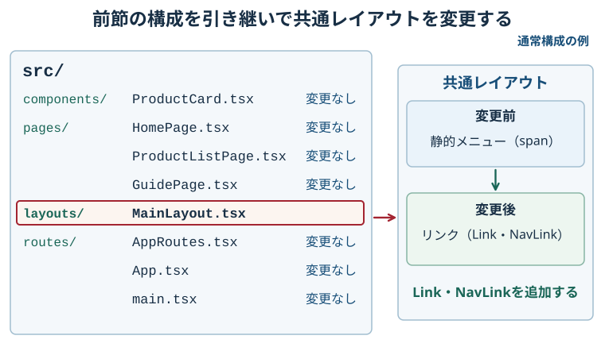{#ch03-navigation-folder-structure}

::: {#ch03-navigation-folder-structure-caption .caption}
3.4では共通レイアウトの変更に集中する
:::

::: {#ch03-navigation-m110 .paragraph punctuation-font="inherit"}
**共通レイアウトのソースコード**
:::

::: {#ch03-navigation-m112 .paragraph}
まず、今回の学習対象となる `layouts/MainLayout.tsx` を確認してください。
:::

::: {#ch03-navigation-m114 .paragraph}
前節では、ヘッダーのシステム名やメニューを文字として表示していました。今回は、ヘッダーに `Link`、3つのメニューに `NavLink` を使用しています。
:::

::: {#ch03-navigation-m117 .code filename="ch03-basic/src/samples/sample3_4/layouts/MainLayout.tsx" start-line="1"}
~~~tsx
import { Link, NavLink, Outlet } from 'react-router'

export default function MainLayout() {
  return (
    <>
      <header className="bg-dark text-white p-3">
        <Link
          to="/sample-3-4"
          className="text-white text-decoration-none"
        >
          商品管理システム
        </Link>
      </header>

      <nav className="nav nav-pills bg-light p-3 gap-2"
           aria-label="商品管理システムのメニュー">
        <NavLink to="/sample-3-4" className="nav-link" end>
          ホーム
        </NavLink>
        <NavLink to="/sample-3-4/products" className="nav-link">
          商品一覧
        </NavLink>
        <NavLink to="/sample-3-4/guide" className="nav-link">
          ご利用案内
        </NavLink>
      </nav>

      <Outlet />

      <footer className="bg-light text-center p-3 mt-4">
        商品管理システム
      </footer>
    </>
  )
}
~~~
:::

::: {#ch03-navigation-m155 .paragraph}
ルーティングの設定は、前節と同じ構成です。`routes/AppRoutes.tsx` には、`MainLayout` を表示する親ルートと、3つの画面を表示する子ルートを定義しています。今回はその全体コードを再掲載しません。
:::

::: {#ch03-navigation-m157 .paragraph}
3.4のサンプルの入口は `/sample-3-4` です。前節で学習した相対パスとindexルートの設定により、次の3つのURLに対応しています。
:::

::: {#ch03-navigation-m159 .table column-widths="48 52"}
| URLのパス | 表示する画面 |
|---|---|
| `/sample-3-4` | ホーム画面 |
| `/sample-3-4/products` | 商品一覧画面 |
| `/sample-3-4/guide` | ご利用案内画面 |
:::

::: {#ch03-navigation-m165 .paragraph}
配布サンプルの `ch03-basic` の開発サーバーを起動し、ブラウザーのメニューから「3.4 SPAの画面遷移（LinkとNavLink）」を選択してください。
:::

::: {#ch03-navigation-m167 .paragraph}
今回は、共通メニューの項目をクリックすると、アドレスバーのURLと画面の表示が変わります。
:::

::: {#ch03-navigation-m169 .paragraph}
それぞれのリンクをどのように記述しているのか、順番に確認していきましょう。
:::
::::

:::: {#page-14 .source-page}
::: {#ch03-navigation-m171 .heading level="minor"}
構文の解説
:::

::: {#ch03-navigation-m173 .step}
**① Linkを使用して画面を切り替える**
:::

::: {#ch03-navigation-m175 .paragraph}
`Link` は、React Routerが提供する画面遷移用のコンポーネントです。
:::

::: {#ch03-navigation-m177 .paragraph}
`Link` を使用するには、`react-router` からインポートします。今回のサンプルでは、1行目で `Link`、`NavLink`、`Outlet` をまとめてインポートしています。
:::

::: {#ch03-navigation-m180 .code filename="ch03-basic/src/samples/sample3_4/layouts/MainLayout.tsx" start-line="1"}
~~~tsx
import { Link, NavLink, Outlet } from 'react-router'
~~~
:::

::: {#ch03-navigation-m184 .paragraph}
まず、ヘッダーのシステム名をクリックすると、ホーム画面に移動する部分を確認しましょう。
:::

::: {#ch03-navigation-m187 .code filename="ch03-basic/src/samples/sample3_4/layouts/MainLayout.tsx" start-line="7"}
~~~tsx
        <Link
          to="/sample-3-4"
          className="text-white text-decoration-none"
        >
          商品管理システム
        </Link>
~~~
:::

::: {#ch03-navigation-m196 .paragraph}
`Link` では、HTMLの `<a>` タグと同じように、開始タグと終了タグの間にリンクとして表示する文字などを記述できます。
:::

::: {#ch03-navigation-m198 .paragraph}
ただし、移動先の指定方法が異なります。
:::

::: {#ch03-navigation-m200 .table column-widths="51 49"}
| 記述する要素・コンポーネント | 移動先を指定する属性 |
|---|---|
| HTMLの `<a>` | `href` |
| React Routerの `Link` | `to` |
:::

::: {#ch03-navigation-m205 .paragraph}
例えば、ホーム画面へ移動するリンクを記述する場合は、次のようになります。
:::

::: {#ch03-navigation-m207 .paragraph punctuation-font="inherit"}
**通常のHTMLのリンク**
:::

::: {#ch03-navigation-m210 .code example="true" code-label="HTMLの記述例"}
~~~html
<a href="/sample-3-4">商品管理システム</a>
~~~
:::

::: {#ch03-navigation-m214 .paragraph punctuation-font="inherit"}
**React RouterのLink**
:::

::: {#ch03-navigation-m217 .code example="true" code-label="TSXの記述例"}
~~~tsx
<Link to="/sample-3-4">商品管理システム</Link>
~~~
:::

::: {#ch03-navigation-m221 .paragraph}
どちらも画面にはリンクとして表示されます。React Routerの `Link` も、ブラウザーには `<a>` 要素として反映されます。
:::

::: {#ch03-navigation-m223 .paragraph}
ただし、アプリケーション内の別の画面へ通常のクリック操作で移動する場合、`Link` ではReact Routerが画面遷移を処理します。
:::

::: {#ch03-navigation-m225 .paragraph punctuation-font="inherit"}
そのため、**ページ全体を読み込み直すことなく、移動先のURLに対応する画面を表示できます。**
:::

::: {#ch03-navigation-m227 .paragraph}
今回のサンプルでは、`to="/sample-3-4"` と記述しているため、ヘッダーの「商品管理システム」をクリックすると、3.4のホーム画面へ移動します。
:::

::: {#ch03-navigation-m229 .paragraph}
なお、`className` には、ヘッダーに合わせた文字色とデザインを設定するためのBootstrapのクラスを指定しています。
:::

::: {#ch03-navigation-m231 .step}
**② NavLinkを使用して現在の画面に対応するメニューを強調する**
:::

::: {#ch03-navigation-m233 .paragraph}
共通メニューにも `Link` を使用すれば、クリックして各画面へ移動できます。
:::

::: {#ch03-navigation-m235 .paragraph}
しかし、実際のWebアプリケーションでは、ホーム、商品一覧、ご利用案内のうち、現在どの画面を表示しているのかが一目で分かると便利です。
:::

::: {#ch03-navigation-m237 .paragraph}
そのような場合に使用するのが、`NavLink` です。
:::

::: {#ch03-navigation-m239 .paragraph punctuation-font="inherit"}
`NavLink` は、`Link` と同様に画面遷移を行うコンポーネントです。さらに、**現在のURLに応じて、リンクが選択中かどうかを判定する機能** が用意されています。
:::

::: {#ch03-navigation-m241 .paragraph}
今回のサンプルでは、商品一覧のメニューを次のように記述しています。
:::

::: {#ch03-navigation-m244 .code filename="ch03-basic/src/samples/sample3_4/layouts/MainLayout.tsx" start-line="20"}
~~~tsx
        <NavLink to="/sample-3-4/products" className="nav-link">
          商品一覧
        </NavLink>
~~~
:::

::: {#ch03-navigation-m250 .paragraph}
`to` 属性には移動先のURL、`className` 属性にはデザインに使用するCSSのクラス名を指定しています。
:::

::: {#ch03-navigation-m252 .paragraph}
ここで、商品一覧の画面に移動したときに、メニューの背景色が青色になる仕組みを確認しましょう。
:::

::: {#ch03-navigation-m254 .paragraph}
今回のように `className` に固定のクラス名を指定している場合、`NavLink` は、現在のURLがリンク先に対応していると判断すると、指定したクラス名に `active` というクラスを自動的に追加します。
:::

::: {#ch03-navigation-m256 .paragraph}
商品一覧のメニューの場合、設定されるCSSのクラスは次のように変化します。
:::

::: {#ch03-navigation-m258 .table column-widths="45 55"}
| 現在のURLのパス | 商品一覧のリンクに設定されるクラス |
|---|---|
| `/sample-3-4` | `nav-link` |
| `/sample-3-4/products` | `nav-link active` |
| `/sample-3-4/guide` | `nav-link` |
:::

::: {#ch03-navigation-m264 .paragraph}
例えば、商品一覧画面を表示している場合、ブラウザーのHTMLでは、主な属性が次のように設定されます。
:::

::: {#ch03-navigation-m267 .code example="true" code-label="HTMLの表示イメージ（主な属性のみ）"}
~~~html
<a href="/sample-3-4/products" class="nav-link active">
  商品一覧
</a>
~~~
:::

::: {#ch03-navigation-m273 .paragraph}
ここで重要なのは、`active` クラスを付ける処理と、メニューを青い背景で表示する処理は、別の役割だという点です。
:::

::: {#ch03-navigation-m275 .paragraph}
今回のサンプルでは、メニュー全体にBootstrapの `nav-pills` クラスを指定しています。これによって、`active` クラスが付いた `nav-link` のデザインが変わります。
:::

::: {#ch03-navigation-m277-1 .paragraph punctuation-font="inherit"}
● **React Routerの役割**：現在のURLを確認し、選択中のリンクに `active` クラスを追加する。
:::

::: {#ch03-navigation-m277-2 .paragraph punctuation-font="inherit"}
● **Bootstrapの役割**：`active` クラスが付いたメニューに、選択中のデザインを適用する。
:::

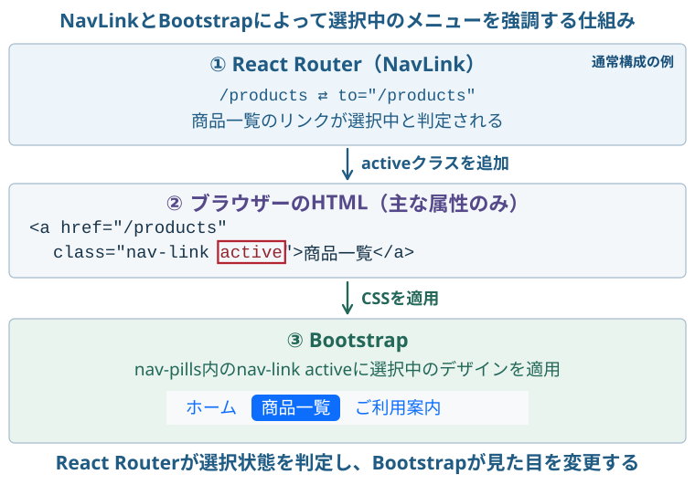{#ch03-navigation-active-flow}

::: {#ch03-navigation-active-flow-caption .caption}
NavLinkが追加するactiveクラスとBootstrapによる強調表示の関係
:::

::: {#ch03-navigation-m290 .paragraph}
このように、`NavLink` とBootstrapを組み合わせることで、現在表示している画面に対応するメニューを強調できます。自分で現在のURLを取得して条件分岐を記述する必要はありません。
:::

::: {#ch03-navigation-m292 .paragraph}
なお、`Link` と `NavLink` は、次のように用途に応じて使い分けます。
:::

::: {#ch03-navigation-m294 .table column-widths="28 72"}
| コンポーネント | 使用する場面 |
|---|---|
| `Link` | ヘッダーのシステム名や「商品一覧へ戻る」など、別の画面へ移動するリンクを配置する。 |
| `NavLink` | 共通メニューなど、画面を移動するだけでなく、現在選択中の項目を強調する。 |
:::

::: {#ch03-navigation-m299 .step}
**③ end属性で選択中と判断する範囲を指定する**
:::

::: {#ch03-navigation-m301 .paragraph}
次に、ホームのメニューを確認しましょう。
:::

::: {#ch03-navigation-m304 .code filename="ch03-basic/src/samples/sample3_4/layouts/MainLayout.tsx" start-line="17"}
~~~tsx
        <NavLink to="/sample-3-4" className="nav-link" end>
          ホーム
        </NavLink>
~~~
:::

::: {#ch03-navigation-m310 .paragraph}
ホームの `NavLink` には、ほかのメニューにはない `end` という属性が指定されています。
:::

::: {#ch03-navigation-m312 .paragraph}
なぜ、ホームだけに `end` を指定しているのでしょうか。
:::

::: {#ch03-navigation-m314 .paragraph}
`NavLink` は、通常、現在のURLのパスがリンク先のパスと一致している場合だけでなく、リンク先のパスに続く子のパスを表示している場合も、選択中のリンクとして扱います。
:::

::: {#ch03-navigation-m316 .paragraph}
例えば、ホームの `to` に `/sample-3-4` を指定し、`end` を指定しなかった場合を考えてみましょう。
:::

::: {#ch03-navigation-m318 .paragraph}
現在のパスが `/sample-3-4/products` であっても、ホームのリンク先である `/sample-3-4` に続くパスなので、ホームのリンクにも `active` クラスが追加されます。
:::

::: {#ch03-navigation-m320 .paragraph}
その結果、商品一覧を表示しているときに、ホームと商品一覧の両方が強調されてしまいます。
:::

{#ch03-navigation-end-menu}

::: {#ch03-navigation-end-menu-caption .caption}
商品一覧画面を表示した場合の、ホームのend属性の有無による強調表示の違い
:::

::: {#ch03-navigation-m331 .paragraph}
このような場合に使用するのが、`end` 属性です。
:::

::: {#ch03-navigation-m333 .paragraph}
今回のホームのように `end` を指定すると、リンク先のパスの先に別のパスが続く場合は、そのリンクを選択中として扱いません。
:::

::: {#ch03-navigation-m335 .table column-widths="39 31 30"}
| 現在のURLのパス | ホーム（endなし） | ホーム（endあり） |
|---|---|---|
| `/sample-3-4` | 強調される | 強調される |
| `/sample-3-4/products` | 強調される | 強調されない |
| `/sample-3-4/guide` | 強調される | 強調されない |
:::

::: {#ch03-navigation-m341 .paragraph}
これにより、ホームのパスに対応する画面を表示している場合だけ、ホームのメニューが強調されます。
:::

::: {#ch03-navigation-m343 .paragraph}
なお、`end` は、`end={true}` と記述することもできます。今回は、真偽値の `true` を指定するためのJSXの省略形を使用しています。
:::

::: {#ch03-navigation-m345 .paragraph punctuation-font="inherit"}
**`end` が変更するのは、NavLinkが選択中と判断する範囲です。** リンクの移動先や、`Route` によって表示する画面が変わるわけではありません。
:::

::: {#ch03-navigation-m347 .step}
**④ リンクとルーティングを組み合わせて画面を切り替える**
:::

::: {#ch03-navigation-m349 .paragraph}
ここまでに学習した内容を組み合わせて、商品一覧のメニューをクリックしたときの処理の流れを確認しましょう。
:::

::: {#ch03-navigation-m351-1 .paragraph numbered="true"}
1\. `layouts/MainLayout.tsx` の［商品一覧］をクリックする。
:::

::: {#ch03-navigation-m351-2 .paragraph numbered="true"}
2\. `NavLink` の `to` に指定された `/sample-3-4/products` にURLが変更される。
:::

::: {#ch03-navigation-m351-3 .paragraph numbered="true"}
3\. React Routerが、`routes/AppRoutes.tsx` で定義されている商品一覧の子ルートに対応することを判断する。
:::

::: {#ch03-navigation-m351-4 .paragraph numbered="true"}
4\. `layouts/MainLayout.tsx` の `Outlet` の位置に `ProductListPage` が表示される。
:::

::: {#ch03-navigation-m356 .paragraph}
また、現在のURLに応じて `NavLink` の選択状態も更新されるため、商品一覧のメニューが強調されます。
:::

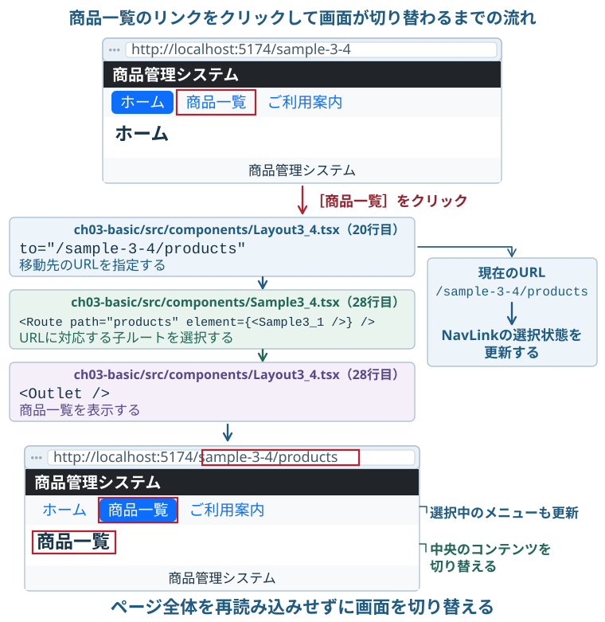{#ch03-navigation-route-flow}

::: {#ch03-navigation-route-flow-caption .caption}
LinkやNavLinkによるURLの変更と、ルートの選択・Outletへの画面表示の関係
:::

::: {#ch03-navigation-m371 .paragraph}
このとき、ページ全体を再読み込みする必要はありません。共通レイアウトを維持したまま、中央のコンテンツ部分を切り替えられます。
:::

::: {#ch03-navigation-m373 .paragraph}
前節で学習した共通レイアウトとルーティングに、今回の `Link` や `NavLink` を組み合わせることで、複数の画面を持つSPAを構築できます。
:::
::::

:::: {#page-15 .source-page}
::: {#ch03-navigation-m375 .heading level="minor"}
【確認演習】共通メニューから画面遷移する
:::

::: {#ch03-navigation-m377 .paragraph}
共通レイアウトのヘッダーやメニューをクリックすると、対応する画面へ移動できるようにします。
:::

::: {#ch03-navigation-m379 .paragraph}
ルーティングの設定や `Outlet`、各画面のコンポーネント、共通レイアウトの基本構成は、あらかじめ用意されています。
:::

::: {#ch03-navigation-m381 .paragraph}
今回は、ヘッダーのシステム名に `Link` を、3つのメニューに `NavLink` を使用して、画面遷移とメニューの強調表示を実装しましょう。
:::

::: {#ch03-navigation-m383 .paragraph}
演習用の `q3_4` には、前節までの完成済みのルーティングや画面のコードを用意しています。3.3の確認演習が未完成でも取り組めます。編集するのは、次の1ファイルだけです。
:::

::: {#ch03-navigation-m385 .paragraph numbered="true"}
1．`ch03-basic-q` プロジェクトの `src/exercises/q3_4/layouts/MainLayout.tsx` を開いてください。
:::

::: {#ch03-navigation-m387 .paragraph numbered="true"}
2．コード内の➀～➄の番号付きコメントを確認し、指示された箇所を実装してください。すべて実装問題です。コメントに指定されていないコードや、ほかのファイルは変更する必要はありません。
:::

::: {#ch03-navigation-m389 .paragraph numbered="true"}
3．編集したファイルを保存してください。
:::

::: {#ch03-navigation-m391 .paragraph numbered="true"}
4．`ch03-basic-q` の開発サーバーを起動し、ターミナルに表示されたURLを開いてください。起動済みの場合は、ブラウザーの画面に戻ってください。
:::

::: {#ch03-navigation-m393 .paragraph numbered="true"}
5．メニューから「3.4 SPAの画面遷移（LinkとNavLink）」を選択してください。
:::

::: {#ch03-navigation-m395 .heading level="minor"}
動作確認
:::

::: {#ch03-navigation-m397 .paragraph numbered="true"}
6．共通メニューの［ホーム］をクリックし、ホーム画面が表示されていることを確認してください。
:::

::: {#ch03-navigation-m399 .paragraph}
続いて、［商品一覧］、［ご利用案内］、ヘッダーの［商品管理システム］の順にクリックし、URLと表示する画面が次のように変わることを確認してください。
:::

::: {#ch03-navigation-m401 .table column-widths="34 40 26"}
| クリックする項目 | URLのパス | 表示される画面 |
|---|---|---|
| ホーム | `/sample-3-4` | ホーム画面 |
| 商品一覧 | `/sample-3-4/products` | 商品一覧画面 |
| ご利用案内 | `/sample-3-4/guide` | ご利用案内画面 |
| 商品管理システム | `/sample-3-4` | ホーム画面 |
:::

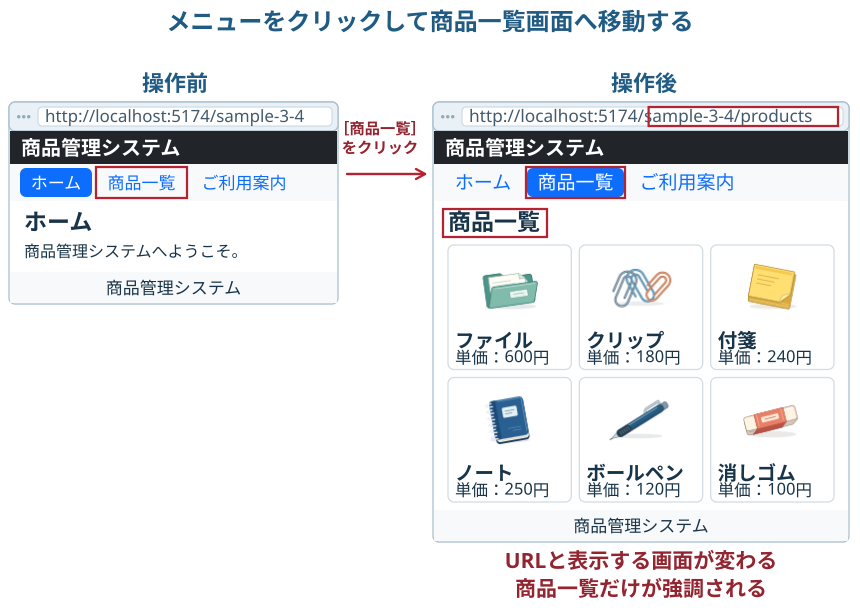{#ch03-navigation-check-browser}

::: {#ch03-navigation-check-browser-caption .caption}
商品一覧のメニューをクリックし、画面とメニューの強調表示が切り替わることを確認する
:::

{#ch03-navigation-return}

::: {#ch03-navigation-return-caption .caption}
ご利用案内へ移動し、ヘッダーのリンクからホーム画面へ戻ることを確認する
:::

::: {#ch03-navigation-m429 .paragraph}
次の3点を確認できれば、演習完了です。
:::

::: {#ch03-navigation-m431-1 .paragraph}
● メニューをクリックすると、URLと表示する画面が正しく切り替わる。
:::

::: {#ch03-navigation-m431-2 .paragraph}
● 現在表示している画面に対応するメニューだけが、青い背景で強調される。
:::

::: {#ch03-navigation-m431-3 .paragraph}
● ヘッダーのシステム名をクリックすると、ホーム画面に戻る。
:::

::: {#ch03-navigation-m435 .paragraph}
また、どの画面にも同じ共通レイアウトが適用されていることを確認してください。
:::

::: {#ch03-navigation-m437 .paragraph}
画面に変更が反映されない場合は、ブラウザーの画面を再読み込みして、もう一度操作してください。
:::

::: {#ch03-navigation-m439 .paragraph}
次の3.5節では、商品一覧から選択した商品の詳細画面へ移動するために、URLに商品番号を含める方法を学習します。
:::

::: {#ch03-navigation-points .section-points}
この節のポイント

● `Link` や `NavLink` を使用すると、ページ全体を再読み込みせずに画面遷移できる。

● 移動先のURLは `to` 属性に指定する。

● `NavLink` は、現在のURLに応じて選択状態を判定し、選択中のリンクに `active` クラスを追加できる。

● 今回は、`NavLink` とBootstrapを組み合わせて、選択中のメニューを強調している。

● `end` 属性は、`NavLink` が選択中と判断するパスの範囲を制御するために使用する。

● 共通レイアウト・ルーティング・リンクを組み合わせることで、複数の画面を持つSPAを構築できる。
:::
::::

:::: {#page-16 .source-page}
::: {#ch03-params-title .heading}
3.5. URLパラメータの取得
:::

::: {#ch03-params-slide .slide layout="illustration"}
URLパラメータの取得

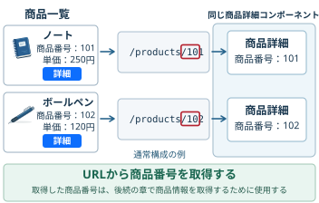
:::

::: {#ch03-params-m462 .heading level="minor"}
商品ごとの詳細画面を表示するには
:::

::: {#ch03-params-m464 .paragraph}
前節では、`Link` や `NavLink` を使用して、ページ全体を再読み込みせずに画面を切り替える方法を学習しました。
:::

::: {#ch03-params-m466 .paragraph}
今回は、商品一覧から、選択した商品の詳細画面へ移動する方法を学習します。
:::

::: {#ch03-params-m468 .paragraph}
例えば、商品一覧でノートの［詳細］をクリックした場合はノートの詳細画面を、ボールペンの［詳細］をクリックした場合はボールペンの詳細画面を表示したいとします。
:::

::: {#ch03-params-m470 .paragraph}
商品ごとに異なるコンポーネントやルートを用意することもできます。しかし、商品が追加されるたびにソースコードを修正する必要があるため、実際の開発では適切な方法とはいえません。
:::

::: {#ch03-params-m472 .paragraph punctuation-font="inherit"}
そこで、**商品詳細画面を1つのコンポーネントとして作成し、商品番号によって表示する内容を切り替える** という方法を考えます。
:::

::: {#ch03-params-m474 .paragraph}
表示する商品を区別するために、今回はURLの末尾に商品番号を含めます。
:::

::: {#ch03-params-m476 .table column-widths="63 37"}
| URLのパス | 対象の商品 |
|---|---|
| `/sample-3-5/products/101` | ノート |
| `/sample-3-5/products/102` | ボールペン |
| `/sample-3-5/products/103` | 消しゴム |
:::

::: {#ch03-params-m482 .paragraph punctuation-font="inherit"}
React Routerでは、このようにURLのパスに可変部分を定義し、その部分の値を取得できます。取得した値を **ルートパラメータ（Route Params）** と呼びます。本研修では、URLパラメータと表記します。
:::

::: {#ch03-params-m484 .paragraph}
実際の商品詳細画面では、取得した商品番号を使ってREST APIから商品情報を取得し、画面に表示します。
:::

::: {#ch03-params-m486 .paragraph punctuation-font="inherit"}
ただし、REST APIとの連携については後続の章で学習するため、**この節では、URLから商品番号を取得し、画面に表示するところまで** を実装します。
:::

::: {#ch03-params-m488 .heading level="minor"}
【サンプル】URLから商品番号を取得する
:::

::: {#ch03-params-m490 .paragraph}
前節の商品管理システムを基に、商品一覧の各カードに［詳細］を追加します。
:::

::: {#ch03-params-m492 .paragraph}
［詳細］をクリックすると、選択した商品の番号を含むURLへ移動します。商品詳細画面には、URLから取得した商品番号を表示します。また、［商品一覧へ戻る］をクリックすると、商品一覧画面へ戻ります。
:::

::: {#ch03-params-m494 .paragraph punctuation-font="inherit"}
**前節のフォルダー構成を引き継ぐ**
:::

::: {#ch03-params-m496 .paragraph}
3.5では、前節の `sample3_4` を基に、`ch03-basic/src/samples/sample3_5` を用意しています。
:::

::: {#ch03-params-m498 .code example="true" code-label="フォルダー構成"}
~~~text
src/samples/sample3_5/
├── components/
│   └── ProductCard.tsx
├── pages/
│   ├── HomePage.tsx
│   ├── ProductListPage.tsx
│   ├── ProductDetailPage.tsx
│   └── GuidePage.tsx
├── layouts/
│   └── MainLayout.tsx
└── routes/
    └── AppRoutes.tsx
~~~
:::

::: {#ch03-params-m513 .table column-widths="41 59"}
| ファイル | 前節からの変更 |
|---|---|
| `components/ProductCard.tsx` | 商品番号のPropsと表示、商品ごとの［詳細］リンクを追加する。 |
| `pages/ProductListPage.tsx` | 各商品カードへ商品番号もPropsとして渡す。 |
| `pages/ProductDetailPage.tsx` | 新規作成。URLから取得した商品番号を表示する。 |
| `routes/AppRoutes.tsx` | 商品詳細画面をインポートし、対応する子ルートを追加する。 |
| `layouts/MainLayout.tsx` | 3.5のURLに合わせてリンク先を変更する。 |
| `pages/HomePage.tsx`・`pages/GuidePage.tsx` | 変更なし。 |
:::

::: {#ch03-params-m522 .paragraph}
商品一覧で使用する6件の商品データは、前節と同じように `pages/ProductListPage.tsx` に定義しています。今回は、商品詳細画面で商品データの検索を行わないため、別の画面と商品配列を共有する必要はありません。
:::

{#ch03-params-folder-structure}

::: {#ch03-params-folder-structure-caption .caption}
商品詳細画面の追加に伴い変更するファイルと、新たに作成するファイル
:::

::: {#ch03-params-m530 .paragraph punctuation-font="inherit"}
**商品カードのソースコード**
:::

::: {#ch03-params-m532 .paragraph}
3.1節から使用してきた商品カードに、商品番号を表示する部分と［詳細］リンクを追加します。
:::

::: {#ch03-params-m535 .code filename="ch03-basic/src/samples/sample3_5/components/ProductCard.tsx" start-line="1"}
~~~tsx
import { Link } from 'react-router'

type ProductCardProps = {
  id: number
  name: string
  price: number
  imagePath: string
}

export default function ProductCard(
  { id, name, price, imagePath }: ProductCardProps
) {
  return (
    <div className="col-12 col-sm-6 col-lg-4">
      <div className="card h-100">
        
        <div className="card-body">
          <h2 className="h5 card-title">{name}</h2>
          <p className="card-text">商品番号：{id}</p>
          <p className="card-text">単価：{price}円</p>
          <Link to={`/sample-3-5/products/${id}`}
                className="btn btn-primary">
            詳細
          </Link>
        </div>
      </div>
    </div>
  )
}
~~~
:::

::: {#ch03-params-m572 .paragraph punctuation-font="inherit"}
**商品詳細画面のソースコード**
:::

::: {#ch03-params-m574 .paragraph}
商品詳細画面は、新しく `pages/ProductDetailPage.tsx` として作成します。ここでは、URLから取得した商品番号だけを表示します。商品情報を取得する処理は、後続の章で学習します。
:::

::: {#ch03-params-m577 .code filename="ch03-basic/src/samples/sample3_5/pages/ProductDetailPage.tsx" start-line="1"}
~~~tsx
import { Link, useParams } from 'react-router'

export default function ProductDetailPage() {
  const { id } = useParams()

  // 実際の開発では、idを使ってREST APIから商品情報を取得する。

  return (
    <main className="container mt-4">
      <h1>商品詳細</h1>
      <p>商品番号：{id}</p>
      <p className="alert alert-info">
        実際の開発では、この商品番号を使ってREST APIから商品情報を取得します。
      </p>
      <Link to="/sample-3-5/products" className="btn btn-secondary">
        商品一覧へ戻る
      </Link>
    </main>
  )
}
~~~
:::

::: {#ch03-params-m600 .paragraph punctuation-font="inherit"}
**ルーティングの設定**
:::

::: {#ch03-params-m602 .paragraph}
`routes/AppRoutes.tsx` に、新たに作成した商品詳細画面をインポートし、商品詳細画面のルートを追加します。
:::

::: {#ch03-params-m605 .code filename="ch03-basic/src/samples/sample3_5/routes/AppRoutes.tsx" start-line="1"}
~~~tsx
import { Routes, Route } from 'react-router'
import HomePage from '../pages/HomePage'
import ProductListPage from '../pages/ProductListPage'
import GuidePage from '../pages/GuidePage'
import MainLayout from '../layouts/MainLayout'
import ProductDetailPage from '../pages/ProductDetailPage'

export default function AppRoutes() {
  return (
    <Routes>
      <Route element={<MainLayout />}>
        <Route index element={<HomePage />} />
        <Route path="products" element={<ProductListPage />} />
        <Route path="products/:id" element={<ProductDetailPage />} />
        <Route path="guide" element={<GuidePage />} />
      </Route>
    </Routes>
  )
}
~~~
:::

::: {#ch03-params-m627 .paragraph}
商品一覧側の `pages/ProductListPage.tsx` については、商品番号をPropsとして渡す変更箇所を、後ほど構文解説で確認します。共通レイアウトも前節と同じ構造のため、全体コードの再掲載は行いません。
:::

::: {#ch03-params-m629 .paragraph}
配布サンプルの `ch03-basic` の開発サーバーを起動し、ブラウザーのメニューから「3.5 URLパラメータの取得」を選択してください。共通メニューの［商品一覧］をクリックすると、各商品カードに［詳細］が表示されます。
:::

::: {#ch03-params-m631 .paragraph}
今回は、次の3つの記述がどのようにつながっているのかに注目してください。
:::

::: {#ch03-params-m633-1 .paragraph}
● 商品詳細画面のルートの定義
:::

::: {#ch03-params-m633-2 .paragraph}
● 商品番号を含むリンク先の指定
:::

::: {#ch03-params-m633-3 .paragraph}
● 詳細画面でのURLパラメータの取得
:::

::: {#ch03-params-m637 .heading level="minor"}
構文の解説
:::

::: {#ch03-params-m639 .step}
**① URLのパスに可変部分を定義する**
:::

::: {#ch03-params-m642 .code filename="ch03-basic/src/samples/sample3_5/routes/AppRoutes.tsx" start-line="14"}
~~~tsx
        <Route path="products/:id" element={<ProductDetailPage />} />
~~~
:::

::: {#ch03-params-m646 .paragraph}
前節までは、`products` や `guide` のように、あらかじめ決められたパスに対してルートを定義していました。
:::

::: {#ch03-params-m648 .paragraph}
一方、商品詳細画面では、選択した商品によってURLの末尾が変わります。このような場合に、商品番号ごとにルートを定義する必要はありません。
:::

::: {#ch03-params-m650 .paragraph punctuation-font="inherit"}
React Routerでは、**パスの一部分をコロン（`:`）から始めることで、その部分をURLパラメータとして扱うことができます。**
:::

::: {#ch03-params-m652 .paragraph}
例えば、今回の `path="products/:id"` は、`products` に続く1つのパスの部分を、`id` という名前のURLパラメータとして扱う設定です。
:::

::: {#ch03-params-m654 .table column-widths="45 21 34"}
| URLのパス | 取得する `id` の値 | 表示するコンポーネント |
|---|---|---|
| `/sample-3-5/products/101` | `'101'` | `ProductDetailPage` |
| `/sample-3-5/products/102` | `'102'` | `ProductDetailPage` |
| `/sample-3-5/products/103` | `'103'` | `ProductDetailPage` |
:::

{#ch03-params-figure-1}

::: {#ch03-params-figure-1-caption .caption}
商品番号が異なるURLでも、同じ商品詳細コンポーネントを表示できる
:::

::: {#ch03-params-m668 .paragraph}
なお、`id` はReact Routerで決められた特別な名前ではありません。例えば、`:productId` と定義することもできます。その場合は、値を取得する際にも `productId` という名前を使用します。
:::

::: {#ch03-params-m670 .step}
**② 商品ごとに異なるURLをLinkに指定する**
:::

::: {#ch03-params-m672 .paragraph}
商品一覧から詳細画面へ移動する際は、選択した商品の番号をURLに含める必要があります。
:::

::: {#ch03-params-m674 .paragraph}
まず、商品一覧側のコードを確認しましょう。
:::

::: {#ch03-params-m677 .code filename="ch03-basic/src/samples/sample3_5/pages/ProductListPage.tsx" start-line="18"}
~~~tsx
        {products.map((product) => (
          <ProductCard
            key={product.id}
            id={product.id}
            name={product.name}
            price={product.price}
            imagePath={product.imagePath}
          />
        ))}
~~~
:::

::: {#ch03-params-m689 .paragraph}
3.1節で学習したPropsを使用して、商品名・単価・画像のパスに加え、商品番号（`id`）を商品カードへ渡しています。
:::

::: {#ch03-params-m691 .paragraph}
ここで、同じ `product.id` を2回使用していることに注目してください。それぞれの役割は異なります。
:::

::: {#ch03-params-m693 .table column-widths="27 73"}
| 記述 | 役割 |
|---|---|
| `key={product.id}` | Reactが繰り返し生成した商品カードを識別するために使用する。 |
| `id={product.id}` | 商品番号をPropsとして子コンポーネントに渡す。 |
:::

::: {#ch03-params-m698 .paragraph punctuation-font="inherit"}
**`key` は通常のPropsとして子コンポーネントに渡されません。** そのため、子コンポーネントの中で商品番号を使用するには、`id` というPropsを別に指定する必要があります。
:::

::: {#ch03-params-m700 .paragraph}
`components/ProductCard.tsx` では、受け取るPropsの型に `id: number` を追加し、関数の引数で `id` も受け取るようにしています。
:::

::: {#ch03-params-m702 .paragraph}
次に、`components/ProductCard.tsx` で、受け取った商品番号をリンク先に使用している部分を確認します。
:::

::: {#ch03-params-m705 .code filename="ch03-basic/src/samples/sample3_5/components/ProductCard.tsx" start-line="26"}
~~~tsx
          <Link to={`/sample-3-5/products/${id}`}
                className="btn btn-primary">
            詳細
          </Link>
~~~
:::

::: {#ch03-params-m712 .paragraph}
前節で学習したとおり、`Link` の `to` 属性には、移動先のURLを指定します。
:::

::: {#ch03-params-m714 .paragraph}
今回は、商品ごとに異なるURLを指定する必要があるため、Propsで受け取った `id` の値を使用してURLを組み立てます。
:::

::: {#ch03-params-m716 .paragraph punctuation-font="inherit"}
JavaScriptでは、文字列をバッククォート（`` ` ``）で囲み、その中に `${式}` と記述することで、式の値を文字列に埋め込むことができます。この書き方を **テンプレートリテラル** と呼びます。
:::

::: {#ch03-params-m718 .paragraph}
例えば、`id` の値が101の場合、次の2つの記述で指定される移動先は同じです。
:::

::: {#ch03-params-m720 .table column-widths="51 49"}
| 記述例 | 特徴 |
|---|---|
| ``to={`/sample-3-5/products/${id}`} `` | `id` の値に応じて移動先が変わる。 |
| `to="/sample-3-5/products/101"` | 常に同じURLへ移動する。 |
:::

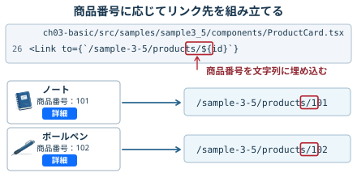{#ch03-params-figure-2}

::: {#ch03-params-figure-2-caption .caption}
同じLinkの記述でも、商品番号によって移動先が変わる
:::

::: {#ch03-params-m733 .paragraph punctuation-font="inherit"}
このように、**テンプレートリテラルを使用すると、商品ごとに異なるリンク先を、1つの記述で指定できます。**
:::

::: {#ch03-params-m735 .step}
**③ useParams()でURLパラメータを取得する**
:::

::: {#ch03-params-m737 .paragraph}
詳細画面に移動した後は、URLから商品番号を取得します。
:::

::: {#ch03-params-m739 .paragraph punctuation-font="inherit"}
そのために使用するのが、React Routerが提供する **useParams()** です。
:::

::: {#ch03-params-m742 .code filename="ch03-basic/src/samples/sample3_5/pages/ProductDetailPage.tsx" start-line="1"}
~~~tsx
import { Link, useParams } from 'react-router'
~~~
:::

::: {#ch03-params-m746 .paragraph}
`useParams` はReact Routerが提供するHookです。`react-router` からインポートし、商品詳細を表示する関数コンポーネントのトップレベルで使用します。
:::

::: {#ch03-params-m749 .code filename="ch03-basic/src/samples/sample3_5/pages/ProductDetailPage.tsx" start-line="4"}
~~~tsx
  const { id } = useParams()
~~~
:::

::: {#ch03-params-m753 .paragraph}
`useParams()` は、現在のURLに対応するルートのURLパラメータをオブジェクトとして返します。
:::

::: {#ch03-params-m755 .paragraph}
例えば、`/sample-3-5/products/101` にアクセスした場合は、取得したオブジェクトの `id` プロパティに文字列の `'101'` が格納されます。今回使用するプロパティだけを抜き出すと、次のようになります。
:::

::: {#ch03-params-m758 .code example="true" code-label="取得結果の一部（JavaScript）"}
~~~js
{ id: '101' }
~~~
:::

::: {#ch03-params-m762 .paragraph}
今回のコードでは、3.1節で学習したオブジェクトの分割代入を使用して、このオブジェクトから `id` の値を取り出しています。
:::

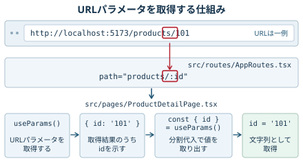{#ch03-params-figure-3}

::: {#ch03-params-figure-3-caption .caption}
ルートで定義したidの値をuseParams()で取得する
:::

::: {#ch03-params-m772 .paragraph punctuation-font="inherit"}
ここで注意してほしいのは、URLの末尾が101という数字であっても、**useParams()で取得する値は文字列である** という点です。
:::

::: {#ch03-params-m774 .paragraph}
また、TypeScriptでは、パラメータが取得できない場合も考慮するため、`id` は `string | undefined` という型で扱われます。これは、文字列または `undefined` のいずれかになる可能性があるという意味です。
:::

::: {#ch03-params-m776 .paragraph}
今回の `products/:id` に一致するURLには、商品番号に相当する部分が含まれています。商品番号を指定せずに `/sample-3-5/products` にアクセスした場合は、商品一覧画面が表示されます。
:::

::: {#ch03-params-m778 .step}
**④ 取得した商品番号を画面に表示する**
:::

::: {#ch03-params-m781 .code filename="ch03-basic/src/samples/sample3_5/pages/ProductDetailPage.tsx" start-line="11"}
~~~tsx
      <p>商品番号：{id}</p>
~~~
:::

::: {#ch03-params-m785 .paragraph}
URLから取得した `id` の値を、JSXの波括弧内に記述します。これは、2.2節で学習した変数の値を画面に表示する方法と同じです。
:::

::: {#ch03-params-m787 .paragraph}
例えば、ノートの［詳細］から移動した場合は「商品番号：101」、ボールペンの［詳細］から移動した場合は「商品番号：102」と表示されます。
:::

::: {#ch03-params-m789 .paragraph punctuation-font="inherit"}
**商品詳細画面のコンポーネントは同じですが、URLに含まれる商品番号によって表示内容が変わります。**
:::

::: {#ch03-params-m791 .paragraph}
なお、商品詳細画面でも、共通ヘッダーやメニュー、フッターは引き続き表示されます。商品一覧の `NavLink` には `end` 属性を指定していないため、商品詳細画面でも「商品一覧」のメニューが強調されます。
:::

::: {#ch03-params-m793 .paragraph}
［商品一覧へ戻る］の `Link` には、商品一覧に対応する固定のURLを指定しています。
:::

::: {#ch03-params-m796 .code filename="ch03-basic/src/samples/sample3_5/pages/ProductDetailPage.tsx" start-line="15"}
~~~tsx
      <Link to="/sample-3-5/products" className="btn btn-secondary">
        商品一覧へ戻る
      </Link>
~~~
:::

::: {#ch03-params-m802 .training-note breakable="true"}
【補足】実際の商品詳細画面では

今回の商品詳細画面には、取得した商品番号だけを表示しています。

しかし、実際の商品管理システムでは、商品番号だけでなく、商品名や単価、商品画像なども表示する必要があります。

REST APIとデータベースを連携させるアプリケーションでは、一般的に、**URLから取得した商品番号を使ってREST APIにリクエストを送信し、該当する商品情報を取得します。**

例えば、商品番号101の詳細画面を表示する場合は、次のような流れになります。
:::

::: {#ch03-params-m812 .paragraph numbered="true"}
1．Reactで `useParams()` を使用し、URLから商品番号を取得する。
:::

::: {#ch03-params-m814 .paragraph numbered="true"}
2．取得した商品番号を使用して、REST APIにリクエストを送信する。
:::

::: {#ch03-params-m816 .paragraph numbered="true"}
3．REST API側で商品番号を受け取り、データベースから該当する商品情報を取得する。
:::

::: {#ch03-params-m818 .paragraph numbered="true"}
4．REST APIから返された商品情報をReactで受け取り、商品詳細画面に表示する。
:::

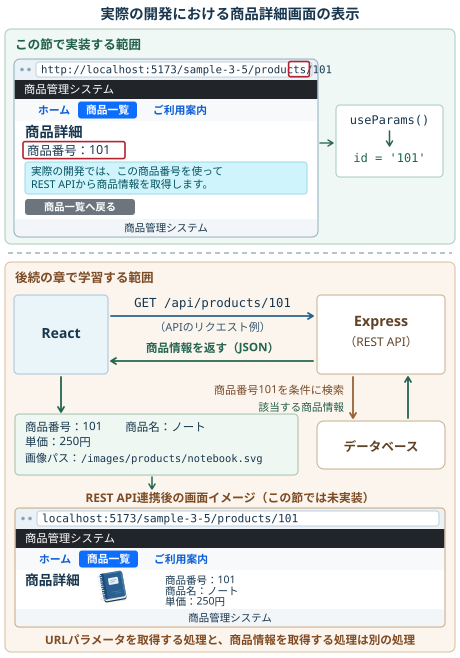{#ch03-params-figure-4}

::: {#ch03-params-figure-4-caption .caption}
取得した商品番号を使ってREST APIから商品情報を取得する流れ（後続の章で実装）
:::

::: {#ch03-params-m834 .paragraph}
ここで、ブラウザーに表示されるURLは、React Routerが画面を切り替えるために使用します。一方、図に示した `/api/products/101` は、商品情報を取得するためにREST APIへ送信するリクエスト先の例です。両者は用途が異なります。
:::

::: {#ch03-params-m836 .paragraph}
今回のサンプルでは、商品情報を取得する処理をまだ記述していません。ソースコードには、実際の開発でREST APIを利用する箇所をコメントとして記載しています。また、商品詳細画面にも、その旨を表示しています。
:::

::: {#ch03-params-m839 .code filename="ch03-basic/src/samples/sample3_5/pages/ProductDetailPage.tsx" start-line="6"}
~~~tsx
  // 実際の開発では、idを使ってREST APIから商品情報を取得する。
~~~
:::

::: {#ch03-params-m843 .paragraph}
なお、URLから商品番号を取得できたとしても、その商品がデータベースに存在するとは限りません。商品の存在確認や、不正な商品番号が指定された場合の処理については、REST APIと連携する際に考慮する必要があります。
:::

::: {#ch03-params-m845 .paragraph}
この節では、後続の章で商品情報を取得するための準備として、URLから商品番号を取得する方法を理解しておきましょう。
:::

::: {#ch03-params-m847 .heading level="minor"}
【確認演習】URLパラメータを取得する
:::

::: {#ch03-params-m849 .paragraph}
商品一覧の［詳細］をクリックすると、選択した商品の番号を含むURLへ移動し、詳細画面にその商品番号が表示されるようにしましょう。
:::

::: {#ch03-params-m851 .paragraph}
商品データ、共通レイアウト、商品カードのデザイン、商品詳細画面の基本構成は、あらかじめ用意されています。今回は、商品詳細画面のルートの定義、商品番号に応じたリンク先の設定、URLパラメータの取得を実装します。
:::

::: {#ch03-params-m853 .paragraph}
演習用の `q3_5` には、前節までの機能を完成済みの状態で用意しています。前節までの確認演習が未完成でも取り組めます。
:::

::: {#ch03-params-m855 .paragraph numbered="true"}
1．`ch03-basic-q` プロジェクトの次の3つのファイルを開いてください。
:::

::: {#ch03-params-m857-1 .paragraph}
● `src/exercises/q3_5/routes/AppRoutes.tsx`
:::

::: {#ch03-params-m857-2 .paragraph}
● `src/exercises/q3_5/components/ProductCard.tsx`
:::

::: {#ch03-params-m857-3 .paragraph}
● `src/exercises/q3_5/pages/ProductDetailPage.tsx`
:::

::: {#ch03-params-m861 .paragraph numbered="true"}
2．3つのファイルに記載された➀～➄の番号付きコメントを確認し、指示された箇所を実装してください。すべて実装問題です。コメントに指定されていないコードや、ほかのファイルは変更する必要はありません。
:::

::: {#ch03-params-m863 .paragraph numbered="true"}
3．編集したファイルを保存してください。
:::

::: {#ch03-params-m865 .paragraph numbered="true"}
4．`ch03-basic-q` の開発サーバーを起動し、ターミナルに表示されたURLを開いてください。起動済みの場合は、開いているブラウザーの画面に戻ってください。
:::

::: {#ch03-params-m867 .paragraph numbered="true"}
5．メニューから「3.5 URLパラメータの取得」を選んでください。
:::

::: {#ch03-params-m869 .heading level="minor"}
動作確認
:::

::: {#ch03-params-m871 .paragraph numbered="true"}
6．共通メニューの［商品一覧］をクリックしてください。次に、ファイルの［詳細］をクリックし、次の内容を確認します。
:::

::: {#ch03-params-m873-1 .paragraph}
● URLのパスが `/sample-3-5/products/201` になっていること。
:::

::: {#ch03-params-m873-2 .paragraph}
● 詳細画面に「商品番号：201」と表示されていること。
:::

{#ch03-params-figure-5}

::: {#ch03-params-figure-5-caption .caption}
ファイルの［詳細］をクリックし、URLと取得した商品番号を確認する
:::

::: {#ch03-params-m886 .paragraph}
続いて、［商品一覧へ戻る］をクリックしてください。商品一覧画面に戻ったら、今度はクリップの［詳細］をクリックします。
:::

::: {#ch03-params-m888 .paragraph}
URLのパスが `/sample-3-5/products/202` となり、「商品番号：202」と表示されることを確認してください。
:::

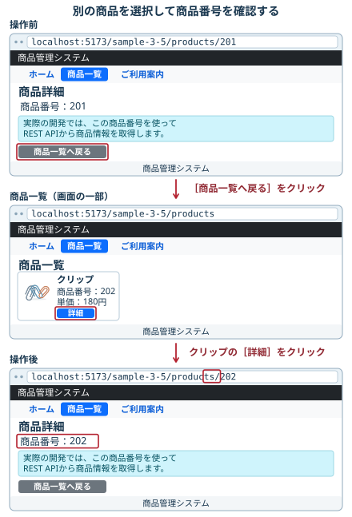{#ch03-params-figure-6}

::: {#ch03-params-figure-6-caption .caption}
商品を変更すると、URLパラメータとして取得する商品番号も変わる
:::

::: {#ch03-params-m898 .paragraph}
どちらの商品を選択しても、URLに含まれる商品番号と詳細画面に表示される商品番号が一致していれば、演習完了です。
:::

::: {#ch03-params-m900 .paragraph}
※ 今回は商品情報の取得や商品の存在確認は行いません。詳細画面に商品名や単価、商品画像が表示されていないのは、意図した動作です。
:::

::: {#ch03-params-m902 .paragraph}
画面に変更が反映されない場合は、ブラウザーの画面を再読み込みして、もう一度操作してください。
:::

::: {#ch03-params-m904 .paragraph}
次の3.6節では、リンクのクリックだけでなく、プログラムの処理に応じて画面遷移を行う方法を学習します。
:::

::: {#ch03-params-points .section-points}
この節のポイント

● `Route` の `path` で `:id` のように可変部分を定義すると、URLパラメータとして値を取得できる。

● テンプレートリテラルを使用すると、商品番号に応じて `Link` の移動先を組み立てられる。

● `useParams()` を使用すると、現在のURLに対応するルートのURLパラメータを取得できる。取得する値は文字列である。

● 実際の詳細画面では、取得した商品番号をREST APIへのリクエストに使用し、商品情報を取得して表示できる。
:::
::::

:::: {#page-17 .source-page}

::: {#ch03-programmatic-title .heading}
3.6. プログラムによる画面遷移
:::

::: {#ch03-programmatic-slide .slide layout="illustration"}
プログラムによる画面遷移


:::

::: {#ch03-programmatic-background .heading level="minor"}
プログラムの処理に応じて画面を切り替えるには
:::

::: {#ch03-programmatic-004 .paragraph}
3.4節では、`Link` や `NavLink` を使用して、画面遷移を行う方法を学習しました。3.5節では、商品一覧の［詳細］をクリックすると、商品番号を含むURLへ移動するようにしました。
:::

::: {#ch03-programmatic-005 .paragraph}
これらは、リンクをクリックすることで、指定したURLへ移動する仕組みです。
:::

::: {#ch03-programmatic-006 .paragraph}
しかし、実際のアプリケーションでは、**プログラムで何らかの処理を行った後に、別の画面へ移動したい場合** があります。
:::

::: {#ch03-programmatic-007 .paragraph}
例えば、商品登録画面で［登録］ボタンをクリックした場合、一般的に次のような処理を行います。
:::

::: {#ch03-programmatic-008 .paragraph numbered="true"}
1．入力された商品情報を使用して、商品を登録する。
:::

::: {#ch03-programmatic-009 .paragraph numbered="true"}
2．商品が正常に登録されたことを確認する。
:::

::: {#ch03-programmatic-010 .paragraph numbered="true"}
3．商品一覧画面へ移動する。
:::

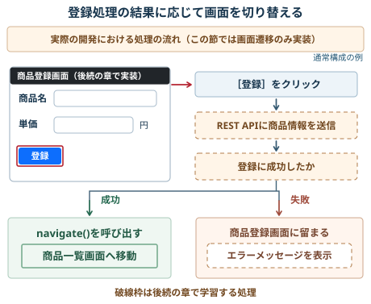{#ch03-programmatic-figure-1}

::: {#ch03-programmatic-figure-1-caption .caption}
登録が正常に完了した後で商品一覧画面へ移動する
:::

::: {#ch03-programmatic-012 .paragraph}
`Link` を使用すると、リンクのクリックによって移動先の画面が表示されます。しかし、登録処理の結果を確認し、その結果に応じて画面遷移を行うには、プログラムから画面遷移を実行できるようにする必要があります。
:::

::: {#ch03-programmatic-013 .paragraph}
そこで使用するのが、React Routerが提供する **useNavigate()** です。
:::

::: {#ch03-programmatic-014 .paragraph}
`useNavigate()` を使用すると、画面遷移を行うための関数を取得できます。この関数をプログラムの任意の処理の中で呼び出すことで、指定したURLへ移動できます。
:::

::: {#ch03-programmatic-015 .paragraph}
商品登録処理やREST APIとの連携については後続の章で学習します。この節では、商品登録画面の［登録］ボタンをクリックしたときに、イベントハンドラーから商品一覧画面へ移動する方法を学習します。
:::

::: {#ch03-programmatic-sample .heading level="minor"}
【サンプル】登録ボタンをクリックして商品一覧画面へ移動する
:::

::: {#ch03-programmatic-017 .paragraph}
前節の商品管理システムに、商品登録画面を追加します。
:::

::: {#ch03-programmatic-018 .paragraph}
商品一覧画面の［商品登録］をクリックすると商品登録画面へ移動し、商品登録画面で［登録］ボタンをクリックすると商品一覧画面へ戻ります。
:::

::: {#ch03-programmatic-019 .paragraph}
また、［キャンセル］をクリックした場合も、商品一覧画面へ戻ります。［キャンセル］では登録処理を行わずに画面を移動するため、これまでに学習した `Link` を使用します。
:::

::: {#ch03-programmatic-020 .paragraph}
今回は画面遷移の仕組みに集中するため、商品情報の入力や登録処理は実装しません。
:::

::: {#ch03-programmatic-021 .paragraph}
使用するファイルは、次のとおりです。
:::

::: {#ch03-programmatic-022 .table column-widths="38 62"}
| ファイル | 役割 |
|---|---|
| `ProductRegister3_6.tsx` | 商品登録画面を表示し、登録ボタンのクリック時に画面遷移を行う。 |
| `Sample3_6.tsx` | 商品登録画面へのリンクとルートを定義する。 |
| `ProductCard3_6.tsx` | 商品カードを表示する。 |
| `ProductDetail3_6.tsx` | URLから商品番号を取得し、画面に表示する。 |
| `products3_6.ts` | 商品一覧で使用する6件の商品データを定義する。 |
| `Layout3_6.tsx` | ヘッダー・メニュー・フッターなどの共通レイアウトを定義する。 |
:::

::: {#ch03-programmatic-023 .paragraph}
商品カード、商品詳細画面、商品データ、共通レイアウトは、前節までと同じ考え方で作成しています。
:::

::: {#ch03-programmatic-register .step keep-next="2"}
**① 商品登録画面の作成**
:::

::: {#ch03-programmatic-025 .paragraph}
商品登録画面には、［登録］ボタンと［キャンセル］リンクを配置します。
:::

::: {#ch03-programmatic-026 .code filename="ch03-basic/src/components/ProductRegister3_6.tsx" start-line="1"}
```tsx
import { Link, useNavigate } from 'react-router'

export default function ProductRegister3_6() {
  const navigate = useNavigate()

  function handleRegister() {
    // 実際の開発では、REST APIで商品を登録し、成功を確認する。
    navigate('/sample-3-6/products')
  }

```
:::

::: {#ch03-programmatic-026-continued .code filename="ch03-basic/src/components/ProductRegister3_6.tsx" start-line="11"}
```tsx
  return (
    <main className="container mt-4">
      <h1>商品登録</h1>
      <p className="alert alert-info">
        この節では、商品登録処理は行わず、画面遷移のみを確認します。
      </p>
      <div className="d-flex gap-2">
        <button type="button" className="btn btn-primary"
                onClick={handleRegister}>
          登録
        </button>
        <Link to="/sample-3-6/products" className="btn btn-secondary">
          キャンセル
        </Link>
      </div>
    </main>
  )
}
```
:::

::: {#ch03-programmatic-list-link .step keep-next="2"}
**② 商品一覧画面へのリンクの追加**
:::

::: {#ch03-programmatic-028 .paragraph}
`Sample3_6.tsx` の商品一覧画面に、商品登録画面へ移動するための［商品登録］リンクを追加します。
:::

::: {#ch03-programmatic-029 .code filename="ch03-basic/src/components/Sample3_6.tsx" start-line="29"}
```tsx
      <h1>商品一覧</h1>
      <Link to="/sample-3-6/products/new" className="btn btn-primary mb-3">
        商品登録
      </Link>
```
:::

::: {#ch03-programmatic-030 .paragraph}
このリンクのクリックによって、商品登録画面のURLへ移動します。
:::

::: {#ch03-programmatic-route .step keep-next="2"}
**③ ルーティングの設定**
:::

::: {#ch03-programmatic-032 .paragraph}
前節までのルートに、商品登録画面のルートを追加します。
:::

::: {#ch03-programmatic-033 .code filename="ch03-basic/src/components/Sample3_6.tsx" start-line="54"}
```tsx
        <Route path="products/new" element={<ProductRegister3_6 />} />
```
:::

::: {#ch03-programmatic-034 .paragraph}
各画面のURLとコンポーネントの対応は、次のとおりです。
:::

::: {#ch03-programmatic-035 .table column-widths="53 47"}
| URLのパス | 表示される画面 |
|---|---|
| `/sample-3-6` | ホーム画面 |
| `/sample-3-6/products` | 商品一覧画面 |
| `/sample-3-6/products/new` | 商品登録画面 |
| `/sample-3-6/products/101` | 商品番号101の詳細画面 |
| `/sample-3-6/guide` | ご利用案内画面 |
:::

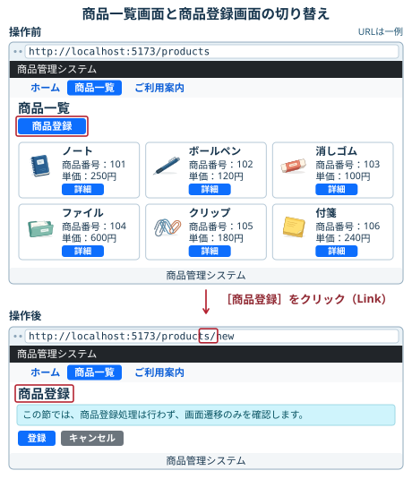{#ch03-programmatic-figure-2}

::: {#ch03-programmatic-figure-2-caption .caption}
Linkを使用して商品登録画面へ移動する
:::

::: {#ch03-programmatic-syntax .heading level="minor"}
構文の解説
:::

::: {#ch03-programmatic-hook .step}
**① useNavigate()で画面遷移用の関数を取得する**
:::

::: {#ch03-programmatic-039 .paragraph}
まず、`react-router` から `useNavigate` をインポートします。
:::

::: {#ch03-programmatic-040 .code filename="ch03-basic/src/components/ProductRegister3_6.tsx" start-line="1"}
```tsx
import { Link, useNavigate } from 'react-router'
```
:::

::: {#ch03-programmatic-041 .paragraph}
`useNavigate` は、React Routerが提供するHookです。前節で学習した `useParams` と同様に、コンポーネントの関数内で使用します。
:::

::: {#ch03-programmatic-042 .code filename="ch03-basic/src/components/ProductRegister3_6.tsx" start-line="4"}
```tsx
  const navigate = useNavigate()
```
:::

::: {#ch03-programmatic-043 .paragraph}
`useNavigate()` を呼び出すと、画面遷移を行うための関数が返されます。今回は、その関数を `navigate` という名前の変数に格納しています。
:::

::: {#ch03-programmatic-044 .paragraph}
この時点では、まだ画面遷移は行われません。取得した関数を、画面遷移が必要になったときに呼び出します。
:::

{#ch03-programmatic-figure-3}

::: {#ch03-programmatic-figure-3-caption .caption}
useNavigate()で関数を取得し、navigate()で画面遷移を実行する
:::

::: {#ch03-programmatic-046 .paragraph}
なお、`navigate` は決められた特別な名前ではありません。`useNavigate()` から返された関数を格納する変数名です。
:::

::: {#ch03-programmatic-event .step keep-next="2"}
**② イベントハンドラーから画面遷移を行う**
:::

::: {#ch03-programmatic-048 .paragraph}
次に、［登録］ボタンがクリックされたときに実行する関数を確認しましょう。
:::

::: {#ch03-programmatic-049 .code filename="ch03-basic/src/components/ProductRegister3_6.tsx" start-line="6"}
```tsx
  function handleRegister() {
    // 実際の開発では、REST APIで商品を登録し、成功を確認する。
    navigate('/sample-3-6/products')
  }
```
:::

::: {#ch03-programmatic-050 .paragraph}
`navigate()` の引数には、移動先のURLを指定します。今回は、商品一覧画面に対応する `/sample-3-6/products` を指定しています。
:::

::: {#ch03-programmatic-051 .paragraph}
そして、この関数を［登録］ボタンの `onClick` に設定します。
:::

::: {#ch03-programmatic-052 .code filename="ch03-basic/src/components/ProductRegister3_6.tsx" start-line="18"}
```tsx
        <button type="button" className="btn btn-primary"
                onClick={handleRegister}>
          登録
        </button>
```
:::

::: {#ch03-programmatic-053 .paragraph}
これは、2.4節で学習したイベント処理の記述方法と同じです。
:::

::: {#ch03-programmatic-054 .paragraph}
［登録］ボタンをクリックすると `handleRegister` が実行され、その中で `navigate()` が呼び出されます。React RouterがURLに対応するルートを選択することで、商品一覧画面が表示されます。
:::

{#ch03-programmatic-figure-4}

::: {#ch03-programmatic-figure-4-caption .caption}
イベントハンドラー内でnavigate()を呼び出すと、商品一覧画面へ移動する
:::

::: {#ch03-programmatic-056 .paragraph}
このとき、`Link` を使用した画面遷移と同様に、ページ全体を再読み込みすることなく、表示する画面が切り替わります。
:::

::: {#ch03-programmatic-057 .paragraph}
**useNavigate()はコンポーネントの関数内で呼び出し、取得したnavigate()は画面遷移を行いたい処理の中で呼び出します。**
:::

::: {#ch03-programmatic-comparison .step}
**③ LinkとuseNavigate()の使い分け**
:::

::: {#ch03-programmatic-059 .paragraph}
今回のサンプルでは、［登録］ボタンと［キャンセル］リンクは、どちらも商品一覧画面へ移動します。しかし、画面遷移の記述方法は異なります。
:::

::: {#ch03-programmatic-060 .code filename="ch03-basic/src/components/ProductRegister3_6.tsx" start-line="22"}
```tsx
        <Link to="/sample-3-6/products" className="btn btn-secondary">
          キャンセル
        </Link>
```
:::

::: {#ch03-programmatic-061 .paragraph}
［キャンセル］では、特別な処理を行わずに商品一覧画面へ移動するため、`Link` を使用しています。
:::

::: {#ch03-programmatic-062 .paragraph}
一方、［登録］では、実際の開発において商品を登録し、その結果に応じて画面遷移を行う必要があります。そのため、イベントハンドラー内から `navigate()` を呼び出す構成にしています。
:::

::: {#ch03-programmatic-063 .table column-widths="27 35 38"}
| 使用する機能 | 使用する場面 | 例 |
|---|---|---|
| `Link` / `NavLink` | リンクのクリックで画面を移動する。 | 商品一覧へ移動する、詳細画面を表示する、キャンセルする。 |
| `useNavigate()` で取得した関数 | プログラムの処理に応じて画面を移動する。 | 登録や更新が成功した後で一覧画面へ移動する。 |
:::

::: {#ch03-programmatic-note .training-note}
【補足】実際の商品登録画面では

今回のサンプルでは、［登録］ボタンをクリックすると、商品を登録する処理を行わずに商品一覧画面へ移動します。そのため、商品一覧に新しい商品が追加されることはありません。

実際の商品登録画面では、入力された商品情報をREST APIへ送信し、商品が正常に登録されたことを確認した後に `navigate()` を呼び出します。登録に失敗した場合は、商品登録画面に留まり、エラーメッセージを表示するなどの処理が必要です。

商品を登録する処理は、今回のサンプルの次のコメント部分に追加します。その際は、登録が成功した場合にのみ `navigate()` が呼び出されるように変更します。

```{#ch03-programmatic-068 .tsx filename="ch03-basic/src/components/ProductRegister3_6.tsx" start-line="6"}
  function handleRegister() {
    // 実際の開発では、REST APIで商品を登録し、成功を確認する。
    navigate('/sample-3-6/products')
  }
```

後続の章では、REST APIと連携して、実際にデータを登録した後で一覧画面へ移動する処理を学習します。
:::

::: {#ch03-programmatic-practice .heading level="minor" keep-next="2"}
【確認演習】プログラムから画面遷移を行う
:::

::: {#ch03-programmatic-071 .paragraph}
商品登録画面の［登録］ボタンをクリックしたときに、商品一覧画面へ移動するようにしましょう。
:::

::: {#ch03-programmatic-072 .paragraph}
商品一覧画面、商品登録画面の基本構成、ルーティングの設定、登録ボタンのイベント処理は、あらかじめ用意されています。今回は、`useNavigate()` を使用して画面遷移を行うための記述を実装します。
:::

::: {#ch03-programmatic-073 .paragraph numbered="true"}
1．`ch03-basic-q` プロジェクトの次のファイルを開いてください。
:::

::: {#ch03-programmatic-074 .paragraph}
● `src/components/ProductRegister3_6Q.tsx`
:::

::: {#ch03-programmatic-075 .paragraph numbered="true"}
2．コード内の➀～➂の番号付きコメントを確認し、指示された箇所を実装してください。コメントに指定されていないコードや、ほかのファイルは変更する必要はありません。
:::

::: {#ch03-programmatic-076 .paragraph numbered="true"}
3．編集したファイルを保存してください。
:::

::: {#ch03-programmatic-077 .paragraph numbered="true"}
4．`ch03-basic-q` の開発サーバーを起動し、ターミナルに表示されたURLを開いてください。起動済みの場合は、開いているブラウザーの画面に戻ってください。
:::

::: {#ch03-programmatic-078 .paragraph numbered="true"}
5．メニューから「3.6 プログラムによる画面遷移」を選んでください。
:::

::: {#ch03-programmatic-check .heading level="minor"}
動作確認
:::

::: {#ch03-programmatic-080 .paragraph numbered="true"}
6．共通メニューの［商品一覧］をクリックしてください。次に、［商品登録］をクリックして、商品登録画面を表示します。
:::

::: {#ch03-programmatic-081 .paragraph}
商品登録画面の［登録］ボタンをクリックし、次の内容を確認してください。
:::

::: {#ch03-programmatic-082 .paragraph}
● URLのパスが `/sample-3-6/products` になっていること。
:::

::: {#ch03-programmatic-083 .paragraph}
● 商品一覧画面が表示されていること。
:::

::: {#ch03-programmatic-084 .paragraph}
● 共通ヘッダー、メニュー、フッターが引き続き表示されていること。
:::

{#ch03-programmatic-figure-5}

::: {#ch03-programmatic-figure-5-caption .caption}
登録ボタンのイベント処理から商品一覧画面へ移動する
:::

::: {#ch03-programmatic-086 .paragraph}
もう一度［商品登録］をクリックし、商品登録画面を表示してください。今度は［キャンセル］をクリックし、商品一覧画面へ戻ることを確認してください。
:::

::: {#ch03-programmatic-087 .paragraph keep-next="3"}
［登録］ボタンと［キャンセル］リンクのどちらを使用しても、商品一覧画面へ移動できれば、演習完了です。
:::

::: {#ch03-programmatic-088 .paragraph}
※ 今回は商品登録処理を実装していないため、［登録］ボタンをクリックしても、商品一覧に新しい商品は追加されません。
:::

::: {#ch03-programmatic-089 .paragraph}
画面に変更が反映されない場合は、ブラウザーの画面を再読み込みして、もう一度操作してください。
:::

::: {#ch03-programmatic-points .section-points}
この節のポイント

● `useNavigate()` を使用すると、画面遷移を行うための関数を取得できる。

● 取得した関数の引数に移動先のURLを指定して呼び出すと、プログラムから画面遷移を行える。

● イベントハンドラー内で `navigate()` を呼び出すことで、ボタンのクリック後の処理に応じて画面を切り替えられる。

● `Link` や `NavLink` と、`useNavigate()` で取得した関数は、画面遷移を行う場面に応じて使い分ける。
:::

::::

:::: {#page-18 .source-page}

::: {#ch03-summary-title .heading}
章のまとめ
:::

::: {#ch03-summary-slide .slide layout="summary"}
章のまとめ

■ コンポーネントの分割とProps

■ React Routerによるルーティング

■ 共通レイアウトの作成

■ SPAの画面遷移（LinkとNavLink）

■ URLパラメータの取得

■ プログラムによる画面遷移
:::

::: {#ch03-summary-1 .paragraph}
この章では、Reactを使用して複数の画面を持つSPAを作成する方法を学習しました。
:::

::: {#ch03-summary-2 .paragraph}
最初に、コンポーネントを分割し、Propsを使用して親コンポーネントから子コンポーネントへデータを渡す方法を学習しました。
:::

::: {#ch03-summary-3 .paragraph}
続いて、React Routerを使用してURLに応じた画面表示を実装しました。また、共通レイアウトを作成し、ヘッダーやメニュー、フッターを維持したまま、コンテンツ部分を切り替える方法を確認しました。
:::

::: {#ch03-summary-4 .paragraph}
さらに、LinkやNavLinkを使用した画面遷移や、useParams()を使用してURLから商品番号などの値を取得する方法を学習しました。
:::

::: {#ch03-summary-5 .paragraph}
最後に、useNavigate()を使用して、プログラムの処理に応じて画面遷移を行う方法を学習しました。
:::

::: {#ch03-summary-6 .paragraph}
次の第4章では、REST APIと通信し、取得したデータを画面に反映する方法を学習します。
:::

::::
