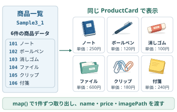
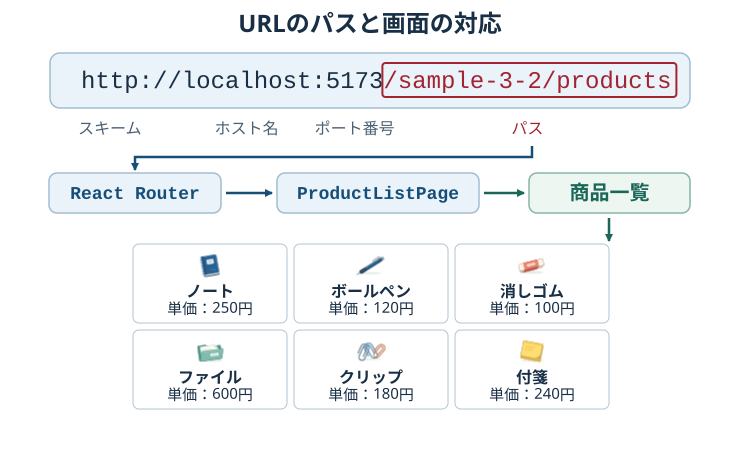
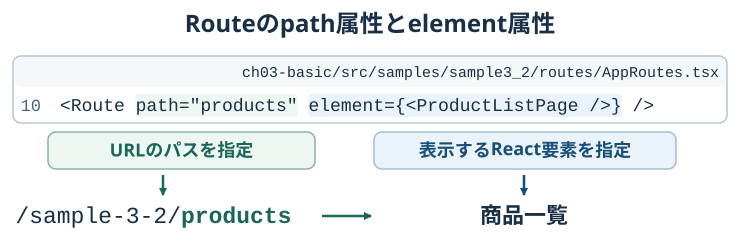
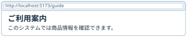
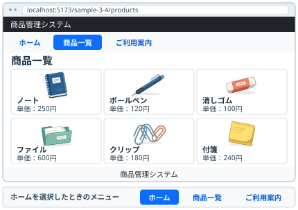

:::: {#page-1 .source-page}

::: {#ch03-number .paragraph}
3
:::

::: {#ch03-title .heading}
第3章 ルーティングと画面構成
:::

::: {#ch03-goals .heading}
章の目標
:::

::: {#ch03-goal-1 .paragraph}
◼ コンポーネントを分割し、Propsを使ってデータを渡せる
:::

::: {#ch03-goal-2 .paragraph}
◼ React Routerを使用して、URLに応じた画面表示を実装できる
:::

::: {#ch03-goal-3 .paragraph}
◼ LinkやNavLinkを使用して、SPAの画面遷移を実装できる
:::

::: {#ch03-goal-4 .paragraph}
◼ URLパラメータを取得し、商品番号などを画面で利用できる
:::

::: {#ch03-goal-5 .paragraph}
◼ useNavigateを使用して、プログラムから画面遷移できる
:::

::: {#ch03-goal-6 .paragraph}
◼ 共通レイアウトを作成し、ヘッダーやメニューを維持したまま画面を切り替えられる
:::

::::

:::: {#page-2 .source-page}

::: {#ch03-overview-title .heading}
章の概要
:::

::: {#ch03-overview-slide .slide layout="summary"}
章の概要

■ コンポーネントの分割とProps

■ React Routerによるルーティング

■ 共通レイアウトの作成

■ SPAの画面遷移（LinkとNavLink）

■ URLパラメータの取得

■ プログラムによる画面遷移
:::

::: {#ch03-overview-1 .paragraph}
この章では、Reactを使用して複数の画面を持つSPAを作成する方法を学習します。
:::

::: {#ch03-overview-2 .paragraph}
第2章では、基本的に1つのコンポーネントの中で画面を作成してきました。この章では、最初に画面の一部を別のコンポーネントとして分割し、Propsを使ってデータを渡す方法を確認します。
:::

::: {#ch03-overview-3 .paragraph}
続いて、React Routerを使用し、URLに応じて表示するコンポーネントを切り替える方法を学習します。さらに、ヘッダーやメニューなどの共通レイアウトを作成し、画面全体の構成を整理します。
:::

::: {#ch03-overview-4 .paragraph}
その後、LinkやNavLinkを使用して、ページ全体を再読み込みせずに画面を切り替えるSPAの画面遷移を実装します。また、URLから商品番号などの値を取得する方法や、ボタン操作によってプログラムから画面遷移する方法も学習します。
:::

::: {#ch03-overview-5 .paragraph}
本章では、あらかじめ用意した商品データを使用し、コンポーネントの構成と画面遷移の仕組みを理解することに集中します。REST APIを利用したデータの取得や更新については、後続の章で学習します。
:::

::::

:::: {#page-3 .source-page}

::: {#ch03-props-title .heading}
3.1. コンポーネントの分割とProps
:::

::: {#ch03-props-slide .slide layout="illustration"}
コンポーネントの分割とProps


:::

::: {#ch03-reasons-heading .heading level="minor"}
コンポーネントを分割する理由
:::

::: {#ch03-reasons-1 .paragraph}
第2章では、ReactのコンポーネントやJSXの基本を学習し、商品情報や商品一覧を画面に表示しました。
:::

::: {#ch03-reasons-2 .paragraph}
これまでのサンプルは、基本的に1つのコンポーネントの中で画面を作成していました。
:::

::: {#ch03-reasons-3 .paragraph}
しかし、実際のWebアプリケーションでは、同じデザインの部品を何度も使用することがあります。
:::

::: {#ch03-reasons-4 .paragraph}
例えば、ショッピングサイトの商品一覧を考えてみましょう。
:::

::: {#ch03-reasons-5-table .table column-widths="26 47 27"}
| 商品番号 | 商品名 | 単価 |
|---|---|---:|
| 101 | ノート | 250円 |
| 102 | ボールペン | 120円 |
| 103 | 消しゴム | 100円 |
| 104 | ファイル | 600円 |
| 105 | クリップ | 180円 |
| 106 | 付箋 | 240円 |
:::

::: {#ch03-reasons-6 .paragraph}
第2章では、商品データを`map()`によってテーブル形式で表示しました。
:::

::: {#ch03-reasons-7 .paragraph}
今度は、それぞれの商品画像・商品名・単価を表示するカードを、**3列×2行**で並べたいとします。
:::

{#ch03-preview}

::: {#ch03-preview-caption .caption}
同じデザインで画像・商品名・単価が異なる6枚の商品カード
:::

::: {#ch03-reasons-9 .paragraph}
この画面を作成する場合、商品ごとに同じようなHTMLを繰り返し記述する方法もあります。
:::

::: {#ch03-reasons-10 .paragraph}
しかし、この方法では、商品の数が増えるほど同じ構造のHTMLが増えていきます。
:::

::: {#ch03-reasons-11 .paragraph}
また、カードのデザインを変更したい場合は、複数の箇所を修正しなければなりません。
:::

::: {#ch03-reasons-12 .paragraph}
そこでReactでは、**繰り返し使用する画面の部品を、独立したコンポーネントとして作成する**ことができます。
:::

::: {#ch03-reasons-13 .paragraph}
例えば、商品カードを`ProductCard`というコンポーネントとして作成すれば、同じ部品を使い回して、複数の商品を表示できます。
:::

::: {#ch03-reasons-14 .paragraph}
この方法には、次のようなメリットがあります。
:::

::: {#ch03-reasons-15-bullet-1 .paragraph}
● 同じHTML構造を何度も記述する必要がなくなる
:::

::: {#ch03-reasons-15-bullet-2 .paragraph}
● カードのデザインを変更する場合、共通のコンポーネントを修正すればよい
:::

::: {#ch03-reasons-15-bullet-3 .paragraph}
● 商品データが増えても、同じコンポーネントを再利用できる
:::

::: {#ch03-reasons-16 .paragraph}
つまり、**共通する画面の部品をまとめて管理できる**ということです。
:::

::: {#ch03-reasons-17 .paragraph}
ただし、すべてのHTML要素を細かくコンポーネントに分割する必要はありません。
:::

::: {#ch03-reasons-18 .paragraph}
本研修では、商品カードのように、同じ構造を繰り返し使用する部分をコンポーネントとして分割する方法を学習します。
:::

::: {#ch03-separate-files-heading .heading level="minor"}
コンポーネントを別のファイルに分ける
:::

::: {#ch03-separate-files-1 .paragraph}
Reactでは、コンポーネントを別のTSXファイルに定義し、ほかのコンポーネントから読み込んで使用できます。
:::

::: {#ch03-separate-files-2 .paragraph}
まずは、商品画像付きカードを表示するコンポーネントを作成してみましょう。
:::

::: {#ch03-separate-files-3-code .code example="true" filename="ch03-basic/src/components/ProductCard.tsx"}
```tsx
export default function ProductCard() {
  return (
    <div className="card">
      
      <div className="card-body">
        <h2 className="h5">ノート</h2>
        <p>単価：250円</p>
      </div>
    </div>
  )
}
```
:::

::: {#ch03-separate-files-4 .paragraph}
このコードでは、`ProductCard`という関数コンポーネントを定義しています。
:::

::: {#ch03-separate-files-5 .paragraph}
`return`の中には、画像・商品名・単価を表示するJSXを記述しています。
:::

::: {#ch03-place-product-card .heading level="minor" keep-next="2"}
ProductCardを親コンポーネントに配置する
:::

::: {#ch03-separate-files-6 .paragraph}
この`ProductCard`を別のファイルから使用する場合は、`import`で読み込みます。
:::

::: {#ch03-separate-files-7-code .code filename="ch03-basic/src/components/Sample3_1.tsx"}
```tsx
import ProductCard from './ProductCard'
```
:::

::: {#ch03-separate-files-8 .paragraph}
そして、JSXの中に次のように記述します。
:::

::: {#ch03-separate-files-9-code .code example="true" filename="ch03-basic/src/components/Sample3_1.tsx"}
```tsx
<ProductCard />
```
:::

::: {#ch03-separate-files-10 .paragraph}
これにより、`ProductCard`コンポーネントが作成する商品カードを表示できます。
:::

::: {#ch03-separate-files-11 .paragraph}
`<h1>`や`<p>`などのHTML要素と似た書き方ですが、`ProductCard`は自分で作成したReactコンポーネントです。
:::

::: {#ch03-separate-files-12 .paragraph}
なお、第2章で学習したとおり、Reactのコンポーネント名は、HTML要素と区別するために先頭を大文字にします。
:::

{#ch03-files}

::: {#ch03-files-caption .caption}
Sample3_1.tsxからProductCard.tsxを読み込む
:::

::: {#ch03-separate-files-14 .paragraph}
ところで、先ほどの`ProductCard`では、商品画像・商品名・単価を直接記述していました。
:::

::: {#ch03-separate-files-15 .paragraph}
このままでは、何度使用しても同じ商品が表示されます。
:::

::: {#ch03-separate-files-16 .paragraph}
商品ごとに異なる画像・商品名・単価を表示するには、**親コンポーネントから商品データを渡す仕組み**が必要です。
:::

::: {#ch03-separate-files-17 .paragraph}
そこで使用するのが、Propsです。
:::

::: {#ch03-definition-heading .heading level="minor"}
Propsとは
:::

::: {#ch03-definition-1 .paragraph}
Props（プロップス）とは、**親コンポーネントから子コンポーネントへデータを渡すための仕組み**です。
:::

::: {#ch03-definition-2 .paragraph}
ここでいう親コンポーネントとは、別のコンポーネントを呼び出して使用する側のコンポーネントです。
:::

::: {#ch03-definition-3 .paragraph}
一方、呼び出される側のコンポーネントを子コンポーネントと呼びます。
:::

::: {#ch03-definition-4 .paragraph}
例えば、商品一覧のコンポーネントから商品カードへ、商品名・単価・画像のパスを渡したいとします。
:::

::: {#ch03-definition-5 .paragraph}
その場合は、次のように記述します。
:::

::: {#ch03-definition-6-code .code example="true" filename="ch03-basic/src/components/Sample3_1.tsx"}
```tsx
<ProductCard name="ノート" price={250} imagePath="/images/products/notebook.svg" />
```
:::

::: {#ch03-definition-7 .paragraph}
ここでは、`ProductCard`に3つの値を渡しています。
:::

::: {#ch03-definition-8-table .table column-widths="23 55 22"}
| Propsの名前 | 渡す値 | 意味 |
|---|---|---|
| `name` | `'ノート'` | 商品名 |
| `price` | `250` | 単価 |
| `imagePath` | `'/images/products/notebook.svg'` | 商品画像のパス |
:::

::: {#ch03-definition-9 .paragraph}
Propsは、HTMLの属性と似た書き方で指定できます。
:::

::: {#ch03-definition-10 .paragraph}
例えば、`name="ノート"`や`imagePath="/images/products/notebook.svg"`では、文字列を直接指定しています。
:::

::: {#ch03-definition-11 .paragraph}
一方、`price={250}`では、数値をJavaScriptの式として指定しています。
:::

::: {#ch03-definition-12 .paragraph}
これは、第2章で学習したJSXの属性への値の設定と同じ考え方です。
:::

::: {#ch03-definition-13 .paragraph}
また、Propsには変数の値を渡すこともできます。
:::

::: {#ch03-definition-14-code .code example="true"}
```tsx
const productName = 'ノート'
const productPrice = 250
const productImage = '/images/products/notebook.svg'

return (
  <ProductCard name={productName} price={productPrice} imagePath={productImage} />
)
```
:::

::: {#ch03-definition-15 .paragraph}
この場合、3つの変数に格納されている値が、子コンポーネントへ渡されます。
:::

{#ch03-transfer}

::: {#ch03-transfer-caption .caption}
親から渡した商品情報を子コンポーネントで表示する
:::

::: {#ch03-receiving-heading .heading level="minor"}
子コンポーネントでPropsを受け取る
:::

::: {#ch03-receiving-1 .paragraph}
親コンポーネントから値を渡しただけでは、子コンポーネントで使用できません。
:::

::: {#ch03-receiving-2 .paragraph}
子コンポーネント側でも、渡されたPropsを受け取るための記述が必要です。
:::

::: {#ch03-receiving-3 .paragraph}
例えば、次のように記述できます。
:::

::: {#ch03-receiving-4-code .code example="true"}
```tsx
type ProductCardProps = {
  name: string
  price: number
  imagePath: string
}

export default function ProductCard({ name, price, imagePath }: ProductCardProps) {
  return (
    <div className="card">
      
      <div className="card-body">
        <h2 className="h5">{name}</h2>
        <p>単価：{price}円</p>
      </div>
    </div>
  )
}
```
:::

::: {#ch03-receiving-5 .paragraph}
先ほどのコードと比べると、固定されていた画像パス・商品名・単価が、`{imagePath}`・`{name}`・`{price}`に変更されています。
:::

::: {#ch03-receiving-6 .paragraph}
これにより、**親コンポーネントから渡された値を画面に表示できる**ようになりました。
:::

::: {#ch03-receiving-7 .paragraph}
ただし、コードの先頭には、まだ説明していない`type`という記述があります。
:::

::: {#ch03-receiving-8 .paragraph}
これは、TypeScriptでPropsの型を指定するためのものです。
:::

::: {#ch03-types-heading .heading level="minor"}
TypeScriptでPropsの型を定義する
:::

::: {#ch03-types-1 .paragraph}
本研修ではTypeScriptを使用しているため、Propsとして受け取るデータの型を指定します。
:::

::: {#ch03-types-2 .paragraph}
まず、次の部分に注目してください。
:::

::: {#ch03-types-3-code .code filename="ch03-basic/src/components/ProductCard.tsx"}
```tsx
type ProductCardProps = {
  name: string
  price: number
  imagePath: string
}
```
:::

::: {#ch03-types-4 .paragraph}
`type`は、TypeScriptで型に名前を付けるための構文です。
:::

::: {#ch03-types-5 .paragraph}
ここでは、`ProductCardProps`という名前の型を定義しています。
:::

::: {#ch03-types-6 .paragraph}
この型は、次の3つのプロパティを持つオブジェクトを表します。
:::

::: {#ch03-types-7-table .table column-widths="27 19 54"}
| プロパティ | 型 | 意味 |
|---|---|---|
| `name` | `string` | 商品名を文字列で受け取る |
| `price` | `number` | 単価を数値で受け取る |
| `imagePath` | `string` | 商品画像のパスを文字列で受け取る |
:::

::: {#ch03-types-8 .paragraph}
例えば、単価は`number`型として定義されているため、誤って文字列を渡そうとすると、TypeScriptの型チェックで不一致を検出できます。
:::

::: {#ch03-types-9 .paragraph}
次に、コンポーネントの引数を確認してください。
:::

::: {#ch03-types-10-code .code filename="ch03-basic/src/components/ProductCard.tsx" start-line="7"}
```tsx
function ProductCard({ name, price, imagePath }: ProductCardProps) {
```
:::

::: {#ch03-types-11 .paragraph}
少し複雑に見えますが、次の2つに分けて考えると分かりやすくなります。
:::

::: {#ch03-types-12-heading .step}
**① Propsから必要な値を取り出す**
:::

::: {#ch03-types-13-code .code filename="ch03-basic/src/components/ProductCard.tsx" start-line="7"}
```tsx
{ name, price, imagePath }
```
:::

::: {#ch03-types-14 .paragraph}
これは、Propsとして渡されたデータから、`name`・`price`・`imagePath`を取り出すための記述です。
:::

::: {#ch03-types-15 .paragraph}
JavaScriptの**分割代入**という構文を使用しています。
:::

::: {#ch03-types-16-heading .step}
**② 受け取るPropsの型を指定する**
:::

::: {#ch03-types-17-code .code filename="ch03-basic/src/components/ProductCard.tsx" start-line="7"}
```tsx
: ProductCardProps
```
:::

::: {#ch03-types-18 .paragraph}
先ほど定義した`ProductCardProps`を指定することで、受け取るデータの型を明示しています。
:::

::: {#ch03-types-19 .paragraph}
したがって、
:::

::: {#ch03-types-20-code .code filename="ch03-basic/src/components/ProductCard.tsx" start-line="7"}
```tsx
function ProductCard({ name, price, imagePath }: ProductCardProps) {
```
:::

::: {#ch03-types-21 .paragraph}
は、**「ProductCardPropsで定義した型のデータを受け取り、その中から3つの値を取り出す」**という意味になります。
:::

{#ch03-type-relations}

::: {#ch03-type-relations-caption .caption}
型の定義、Propsの受け取り、親から渡す値の対応
:::

::: {#ch03-types-23-note .training-note keep-next="1"}
【補足】Propsを受け取る別の書き方

Propsは、次のように1つのオブジェクトとして受け取ることもできます。
:::

::: {#ch03-types-25-code .code example="true"}
```tsx
function ProductCard(props: ProductCardProps) {
  return (
    <div>
      
      <p>{props.name}：{props.price}円</p>
    </div>
  )
}
```
:::

::: {#ch03-types-26 .paragraph}
この場合は、`props.name`や`props.price`、`props.imagePath`のように、オブジェクトのプロパティとして値を取得します。
:::

::: {#ch03-types-27 .paragraph}
一方、分割代入を使用すれば、`name`や`price`、`imagePath`と直接記述できます。
:::

::: {#ch03-types-28 .paragraph}
本研修では、分割代入を使用する書き方を基本とします。
:::

::: {#ch03-state-heading .heading level="minor"}
Propsとstateの違い
:::

::: {#ch03-state-1 .paragraph}
ここまでの説明で、Propsと第2章で学習したstateは何が違うのか、疑問に思うかもしれません。
:::

::: {#ch03-state-2 .paragraph}
どちらもReactでデータを扱うための仕組みですが、役割が異なります。
:::

::: {#ch03-state-3-table .table column-widths="21 39 40"}
| 比較項目 | Props | state |
|---|---|---|
| 主な役割 | 親から子へデータを渡す | コンポーネントの状態を管理する |
| 値の取得 | 親コンポーネントから渡される | `useState()`などで管理する |
| 値の変更 | 子コンポーネントから直接変更しない | 更新用の関数で変更する |
| 使用例 | 商品カードへ商品画像・商品名・単価を渡す | ボタン操作によって商品の数量を変更する |
:::

::: {#ch03-state-4 .paragraph}
例えば、今回の商品カードでは、親コンポーネントから画像・商品名・単価を受け取り、それを表示します。
:::

::: {#ch03-state-5 .paragraph}
そのため、商品カード自身が商品情報を変更する必要はありません。
:::

::: {#ch03-state-6 .paragraph}
一方、商品数を増減するボタンなど、ユーザーの操作に応じて値が変化する場合は、`useState()`を使って状態を管理できます。
:::

::: {#ch03-state-7 .paragraph}
また、Propsは**子コンポーネントから直接変更しない**という点も重要です。
:::

::: {#ch03-state-8 .paragraph}
親コンポーネントから新しいPropsが渡されれば、子コンポーネントにも新しい値を表示できます。
:::

::: {#ch03-state-9 .paragraph}
つまり、Propsは値が変化しない仕組みというわけではなく、**値を渡す側と受け取る側の役割が決まっている**ということです。
:::

::: {#ch03-mapping-heading .heading level="minor"}
map()とPropsを組み合わせる
:::

::: {#ch03-mapping-1 .paragraph}
第2章の2.6節では、`map()`を使って配列データからテーブルの行を繰り返し生成しました。
:::

::: {#ch03-mapping-2 .paragraph}
同じ方法で、商品カードを繰り返し生成することもできます。
:::

::: {#ch03-mapping-3 .paragraph}
例えば、次のような商品データがあるとします。
:::

::: {#ch03-mapping-4-code .code filename="ch03-basic/src/components/Sample3_1.tsx" start-line="4"}
```tsx
const products = [
  { id: 101, name: 'ノート', price: 250, imagePath: '/images/products/notebook.svg' },
  { id: 102, name: 'ボールペン', price: 120, imagePath: '/images/products/ballpoint-pen.svg' },
  { id: 103, name: '消しゴム', price: 100, imagePath: '/images/products/eraser.svg' },
  { id: 104, name: 'ファイル', price: 600, imagePath: '/images/products/file-folder.svg' },
  { id: 105, name: 'クリップ', price: 180, imagePath: '/images/products/paper-clips.svg' },
  { id: 106, name: '付箋', price: 240, imagePath: '/images/products/sticky-notes.svg' }
]
```
:::

::: {#ch03-mapping-5 .paragraph}
この配列に対して、次のように`map()`を使用します。
:::

::: {#ch03-mapping-6-code .code filename="ch03-basic/src/components/Sample3_1.tsx" start-line="18"}
```tsx
{products.map((product) => (
  <ProductCard
    key={product.id}
    name={product.name}
    price={product.price}
    imagePath={product.imagePath}
  />
))}
```
:::

::: {#ch03-mapping-7 .paragraph}
このコードでは、`map()`によって商品データを1件ずつ取り出しています。
:::

::: {#ch03-mapping-8 .paragraph}
そして、商品ごとに`ProductCard`コンポーネントを生成し、`name`・`price`・`imagePath`をPropsとして渡しています。
:::

::: {#ch03-mapping-9 .paragraph}
例えば、最初の商品を処理するときは、次のような値が渡されます。
:::

::: {#ch03-mapping-10-code .code example="true"}
```tsx
<ProductCard
  key={101}
  name="ノート"
  price={250}
  imagePath="/images/products/notebook.svg"
/>
```
:::

::: {#ch03-mapping-11 .paragraph}
次にボールペンを処理するときは、画像・商品名・単価が変わります。
:::

::: {#ch03-mapping-12 .paragraph}
このように、**同じコンポーネントを使用しながら、データに応じて異なるカードを表示できる**わけです。
:::

::: {#ch03-mapping-13 .paragraph}
なお、`key`属性は第2章で学習したReactの特別な属性です。
:::

::: {#ch03-mapping-14 .paragraph}
`key={product.id}`を指定することで、Reactが繰り返し生成した各コンポーネントを区別できます。
:::

::: {#ch03-mapping-15 .paragraph}
ただし、`key`はReactが内部で使用するものであり、通常のPropsとして子コンポーネントへ渡されるわけではありません。
:::

{#ch03-map-flow}

::: {#ch03-map-flow-caption .caption}
6件の商品データからmap()とPropsで6枚のカードを作る
:::

::: {#ch03-sample-heading .heading level="minor"}
【サンプル】Propsを使用した商品カードの表示
:::

::: {#ch03-sample-1 .paragraph}
それでは、ここまで学習したコンポーネントの分割とPropsを組み合わせて、商品一覧をカード形式で表示してみましょう。
:::

::: {#ch03-sample-2 .paragraph}
今回は、商品画像・商品名・単価を表示するカードを別のコンポーネントとして作成します。商品一覧側では、6件の配列データを`map()`で繰り返し処理し、商品ごとに異なるPropsを渡します。**画面はPCの幅で3列×2行に並び、画面幅が狭い場合は列数を減らす構成**とします。このサンプルでは、次の2つのファイルを使用します。
:::

::: {#ch03-sample-6-table .table column-widths="38 62" keep-next="1"}
| ファイル | 役割 |
|---|---|
| `ProductCard.tsx` | 1件分の画像付き商品カードを表示する |
| `Sample3_1.tsx` | 6件の商品データを管理し、カードを繰り返し表示する |
:::

::: {#ch03-sample-8-code .code filename="ch03-basic/src/components/ProductCard.tsx"}
```tsx
type ProductCardProps = {
  name: string
  price: number
  imagePath: string
}

export default function ProductCard({ name, price, imagePath }: ProductCardProps) {
  return (
    <div className="col-12 col-sm-6 col-lg-4">
      <div className="card h-100">
        
        <div className="card-body">
          <h2 className="h5 card-title">{name}</h2>
          <p className="card-text">単価：{price}円</p>
        </div>
      </div>
    </div>
  )
}
```
:::

::: {#ch03-sample-10-code .code filename="ch03-basic/src/components/Sample3_1.tsx"}
```tsx
import ProductCard from './ProductCard'

export default function Sample3_1() {
  const products = [
    { id: 101, name: 'ノート', price: 250, imagePath: '/images/products/notebook.svg' },
    { id: 102, name: 'ボールペン', price: 120, imagePath: '/images/products/ballpoint-pen.svg' },
    { id: 103, name: '消しゴム', price: 100, imagePath: '/images/products/eraser.svg' },
    { id: 104, name: 'ファイル', price: 600, imagePath: '/images/products/file-folder.svg' },
    { id: 105, name: 'クリップ', price: 180, imagePath: '/images/products/paper-clips.svg' },
    { id: 106, name: '付箋', price: 240, imagePath: '/images/products/sticky-notes.svg' }
  ]

  return (
    <main className="container mt-4">
      <h1>商品一覧</h1>

      <div className="row g-3">
        {products.map((product) => (
          <ProductCard
            key={product.id}
            name={product.name}
            price={product.price}
            imagePath={product.imagePath}
          />
        ))}
      </div>
    </main>
  )
}
```
:::

::: {#ch03-sample-11-note .training-note}
【補足】Bootstrapによるカード型デザイン

上記のコードでは、Bootstrapが用意している`card`や`row`などのクラスを使用しています。

これらのクラスを指定することで、カードの枠や余白、複数列の並び方を簡単に整えることができます。今回は**Propsによるコンポーネントの再利用**が学習の中心なので、Bootstrapの各クラスの詳しい構文は扱いません。
:::

::: {#ch03-sample-check .step}
**動作確認**
:::

::: {#ch03-sample-15 .paragraph}
`ch03-basic`の開発サーバーを起動し、メニューから「3.1 コンポーネントの分割とProps」を選択してください。
:::

::: {#ch03-sample-16 .paragraph}
PCのブラウザーでは、次の6件の商品が**3列×2行**の画像付きカードとして表示されます。
:::

::: {#ch03-sample-17-table .table column-widths="33 34 33"}
| 上段左 | 上段中央 | 上段右 |
|---|---|---|
| ノート：250円 | ボールペン：120円 | 消しゴム：100円 |
:::

::: {#ch03-sample-18-table .table column-widths="33 34 33"}
| 下段左 | 下段中央 | 下段右 |
|---|---|---|
| ファイル：600円 | クリップ：180円 | 付箋：240円 |
:::

{#ch03-result}

::: {#ch03-result-caption .caption}
完成サンプルの表示結果。6枚の商品カードが3列×2行に並ぶ
:::

::: {#ch03-sample-20 .paragraph}
表示する商品画像・商品名・単価は異なりますが、6つのカードはすべて同じ`ProductCard`コンポーネントを使用しています。また、商品データは`Sample3_1.tsx`にまとめて定義されており、そこから各カードへPropsとして渡されています。
:::

::: {#ch03-syntax-heading .heading level="minor"}
構文の解説
:::

::: {#ch03-syntax-1 .paragraph}
ここからは、2つのソースファイルの役割と、重要な構文を確認します。
:::

::: {#ch03-syntax-2-heading .step}
**① Propsの型を定義する**
:::

::: {#ch03-syntax-3-code .code filename="ch03-basic/src/components/ProductCard.tsx"}
```tsx
type ProductCardProps = {
  name: string
  price: number
  imagePath: string
}
```
:::

::: {#ch03-syntax-4 .paragraph}
`ProductCard`が受け取るPropsの名前と型を定義しています。`name`と`imagePath`は文字列、`price`は数値として受け取ります。
:::

::: {#ch03-syntax-5-heading .step}
**② Propsを受け取るコンポーネントを定義する**
:::

::: {#ch03-syntax-6-code .code filename="ch03-basic/src/components/ProductCard.tsx" start-line="7"}
```tsx
export default function ProductCard({ name, price, imagePath }: ProductCardProps) {
```
:::

::: {#ch03-syntax-7 .paragraph}
親コンポーネントから渡された`name`・`price`・`imagePath`を受け取っています。
:::

::: {#ch03-syntax-8 .paragraph}
また、`ProductCardProps`を指定することで、受け取るデータの型を明示しています。
:::

::: {#ch03-syntax-9-heading .step}
**③ Propsの値を画面に表示する**
:::

::: {#ch03-syntax-10-code .code filename="ch03-basic/src/components/ProductCard.tsx"}
```tsx
11:
18:<h2 className="h5 card-title">{name}</h2>
19:<p className="card-text">単価：{price}円</p>
```
:::

::: {#ch03-syntax-11 .paragraph}
受け取ったPropsをJSXに設定し、商品画像・商品名・単価を表示しています。
:::

::: {#ch03-syntax-12 .paragraph}
`src={imagePath}`は商品画像のパス、`alt={name}`は画像の代替テキストです。
:::

::: {#ch03-syntax-13 .paragraph}
この部分のコードは、どの商品カードでも共通です。
:::

::: {#ch03-syntax-14-heading .step}
**④ 別ファイルのコンポーネントを読み込む**
:::

::: {#ch03-syntax-15-code .code filename="ch03-basic/src/components/Sample3_1.tsx"}
```tsx
import ProductCard from './ProductCard'
```
:::

::: {#ch03-syntax-16 .paragraph}
`ProductCard.tsx`で定義されたコンポーネントを、`Sample3_1.tsx`から使用できるようにしています。
:::

::: {#ch03-syntax-17 .paragraph}
`./ProductCard`は、同じフォルダーにある`ProductCard.tsx`を指定しています。
:::

::: {#ch03-syntax-18-heading .step}
**⑤ map()でコンポーネントを繰り返し生成する**
:::

::: {#ch03-syntax-19-code .code filename="ch03-basic/src/components/Sample3_1.tsx" start-line="18"}
```tsx
{products.map((product) => (
  <ProductCard
    key={product.id}
    name={product.name}
    price={product.price}
    imagePath={product.imagePath}
  />
))}
```
:::

::: {#ch03-syntax-20 .paragraph}
`products`配列から商品を1件ずつ取り出して、`ProductCard`コンポーネントを生成しています。
:::

::: {#ch03-syntax-21 .paragraph}
このとき、`name`・`price`・`imagePath`をPropsとして渡すことで、カードごとに異なる商品情報を表示できます。
:::

{#ch03-code-flow}

::: {#ch03-code-flow-caption .caption}
Sample3_1からProductCardへPropsが渡り、カードが表示される流れ
:::

::::

:::: {#page-4 .source-page}

::: {#ch03-practice-heading .heading level="minor"}
【確認演習】Propsを使って商品カードを表示する
:::

::: {#ch03-practice-1 .paragraph}
商品一覧に複数の商品カードを表示する演習を行います。
:::

::: {#ch03-practice-2 .paragraph}
商品データの配列や、カードの基本的なレイアウト、`map()`による繰り返し処理は、あらかじめ用意されています。
:::

::: {#ch03-practice-3 .paragraph}
今回は、Propsの型の定義、親コンポーネントからの値の受け渡し、子コンポーネントでの値の表示を実装します。
:::

::: {#ch03-practice-4 .paragraph}
今回の演習では、**親コンポーネントと子コンポーネントの2つのファイルを編集します。**
:::

::: {#ch03-practice-5 .paragraph numbered="true" keep-lines="true"}
1．　`ch03-basic-q`プロジェクトの次の2つのファイルを開いてください。<br>● `src/components/Q3_1.tsx`<br>● `src/components/ProductCardQ.tsx`
:::

::: {#ch03-practice-6 .paragraph numbered="true"}
2．　2つのファイルに記載された➀～➄の番号付きコメントを確認し、指示された箇所を実装してください。➀は既存コードの確認、➁～➄は実装問題です。コメントに指定されていないコードや、ほかのファイルは変更する必要はありません。
:::

::: {#ch03-practice-7 .paragraph numbered="true"}
3．　編集した2つのファイルを保存してください。
:::

::: {#ch03-practice-8 .paragraph numbered="true"}
4．　`ch03-basic-q`の開発サーバーを起動し、ターミナルに表示されたURLを開いてください。起動済みの場合は、開いているブラウザーの画面に戻ってください。
:::

::: {#ch03-practice-9 .paragraph numbered="true"}
5．　メニューから「3.1 コンポーネントの分割とProps」を選択してください。
:::

::: {#ch03-practice-10 .paragraph numbered="true" keep-next="4"}
6．　商品一覧に、次の6件の商品画像付きカードが**3列×2行**で表示されることを確認してください。
:::

::: {#ch03-practice-11-table .table column-widths="33 34 33"}
| 上段左 | 上段中央 | 上段右 |
|---|---|---|
| ファイル：600円 | クリップ：180円 | 付箋：240円 |
:::

::: {#ch03-practice-12-table .table column-widths="33 34 33"}
| 下段左 | 下段中央 | 下段右 |
|---|---|---|
| ノート：250円 | ボールペン：120円 | 消しゴム：100円 |
:::

::: {#ch03-practice-13 .paragraph}
6枚のカードに、それぞれ正しい画像・商品名・単価が表示されていれば、演習完了です。
:::

::: {#ch03-props-points .section-points}
この節のポイント

● Reactでは、画面の一部を独立したコンポーネントとして作成できる。

● **Props**を使うと、親コンポーネントから子コンポーネントへデータを渡せる。

● 同じコンポーネントを再利用することで、異なる画像や商品情報を同じデザインで表示できる。

● TypeScriptでは、`type`などを使用してPropsの型を定義できる。

● 子コンポーネントは、受け取ったPropsを直接変更しない。

● `map()`とPropsを組み合わせることで、配列のデータから複数のコンポーネントを生成できる。
:::

::::

:::: {#page-5 .source-page}

::: {#ch03-router-title .heading}
3.2. React Routerによるルーティング
:::

::: {#ch03-router-slide .slide layout="illustration"}
React Routerによるルーティング


:::

::: {#ch03-router-screens-heading .heading level="minor"}
複数の画面を持つアプリケーションを作るには
:::

::: {#ch03-router-screens-1 .paragraph}
前節では、商品カードを独立したコンポーネントとして作成し、Propsを使用して商品名・単価・画像を渡す方法を学習しました。
:::

::: {#ch03-router-screens-2 .paragraph}
これにより、共通の商品カードを再利用して、6件の商品を一覧表示できるようになりました。
:::

::: {#ch03-router-screens-3 .paragraph}
しかし、実際の商品管理システムには、商品一覧以外にもさまざまな画面が必要です。
:::

::: {#ch03-router-screens-4 .paragraph}
例えば、次のような画面を考えてみましょう。
:::

::: {#ch03-router-screens-5-table .table column-widths="31 69"}
| 画面 | 主な役割 |
|---|---|
| ホーム画面 | システムのトップページを表示する |
| 商品一覧画面 | 登録されている商品を一覧表示する |
| ご利用案内画面 | システムの使い方などを表示する |
:::

::: {#ch03-router-screens-6 .paragraph}
これらの画面は、それぞれ別のReactコンポーネントとして作成できます。
:::

::: {#ch03-router-screens-7 .paragraph}
では、どの画面を表示するかは、どのように決めればよいのでしょうか。
:::

::: {#ch03-router-screens-8 .paragraph}
例えば、ユーザーが次のURLにアクセスしたとします。
:::

::: {#ch03-router-screens-9-url .paragraph keep-lines="true"}
**`http://localhost:5173/products`**
:::

::: {#ch03-router-screens-10 .paragraph}
このとき、商品一覧画面を表示するようにしたいわけです。
:::

::: {#ch03-router-screens-11 .paragraph}
このように、**URLに応じて表示する画面を決定する仕組み**を、ルーティングと呼びます。
:::

::: {#ch03-router-screens-12 .paragraph}
Reactでは、このルーティングを実現するために、React Routerというライブラリを使用できます。
:::

::: {#ch03-router-library-heading .heading level="minor"}
React Routerとは
:::

::: {#ch03-router-library-1 .paragraph}
React Routerは、ReactアプリケーションでURLと画面を対応付けるためのライブラリです。
:::

::: {#ch03-router-library-2 .paragraph}
第1章では、SPA（Single Page Application）について学習しました。
:::

::: {#ch03-router-library-3 .paragraph}
SPAでは、画面を切り替えるたびにHTMLページ全体を読み込み直すのではなく、必要な表示部分を更新することで画面を切り替えられます。
:::

::: {#ch03-router-library-4 .paragraph}
ただし、Reactは画面を作成・更新するためのライブラリであり、**URLに応じた画面の切り替えを、React単体ですべて自動的に行うわけではありません。**
:::

::: {#ch03-router-library-5 .paragraph}
そこで、React Routerを使用します。
:::

::: {#ch03-router-library-6 .paragraph}
React Routerを使用すると、例えば次のような対応関係を定義できます。
:::

::: {#ch03-router-library-7-table .table column-widths="38 62"}
| URLのパス | 表示するコンポーネント |
|---|---|
| `/` | `HomePage` |
| `/products` | `Sample3_1` |
| `/guide` | `GuidePage` |
:::

::: {#ch03-router-library-8 .paragraph}
ここでいうURLのパスとは、URLの中で画面を区別する部分です。
:::

::: {#ch03-router-library-9 .paragraph}
例えば、次のURLを見てください。
:::

::: {#ch03-router-library-10-url .paragraph keep-lines="true"}
**`http://localhost:5173/products`**
:::

::: {#ch03-router-library-11 .paragraph}
このURLは、次の部分に分けられます。
:::

::: {#ch03-router-library-12-table .table column-widths="34 27 39"}
| 部分 | 例 | 意味 |
|---|---|---|
| ホスト名とポート番号 | `localhost:5173` | アクセス先の開発サーバー |
| パス | `/products` | 表示したい画面を表す部分 |
:::

::: {#ch03-router-library-13 .paragraph}
React Routerは、このパスを確認して、どのコンポーネントを表示するかを判断します。
:::

{#ch03-router-figure-path}

::: {#ch03-router-figure-path-caption .caption}
URLのパスを確認し、商品一覧を表示する
:::

::: {#ch03-router-install-heading .heading level="minor"}
React Routerをインストールする
:::

::: {#ch03-router-install-1 .paragraph}
React Routerは、Reactとは別のライブラリです。そのため、React Routerを使用するには、プロジェクトにライブラリを導入する必要があります。
:::

::: {#ch03-router-install-3 .paragraph}
第1章で学習したnpmを使用し、次のコマンドでインストールできます。
:::

::: {#ch03-router-install-4-command .code example="true"}
```console
npm install react-router
```
:::

::: {#ch03-router-install-5 .paragraph}
このコマンドを実行すると、React Routerがインストールされ、`package.json`にも依存ライブラリとして登録されます。
:::

::: {#ch03-router-install-6 .paragraph}
本研修では、React Routerの基本的な画面遷移の仕組みを学ぶため、**Declarative Mode（宣言的なルーティング方式）**を使用します。
:::

::: {#ch03-router-install-7 .paragraph}
この方式では、主に次の3つのコンポーネントを使用します。
:::

::: {#ch03-router-install-8-table .table column-widths="29 71"}
| コンポーネント | 役割 |
|---|---|
| `BrowserRouter` | ブラウザーのURLを利用してルーティングを管理する |
| `Routes` | URLと画面の対応関係をまとめる |
| `Route` | 特定のURLに対して、表示するコンポーネントを指定する |
:::

::: {#ch03-router-install-9 .paragraph}
まずは、この3つの役割を理解しましょう。
:::

::: {#ch03-router-browserrouter-heading .heading level="minor"}
BrowserRouterとは
:::

::: {#ch03-router-browserrouter-1 .paragraph}
`BrowserRouter`は、ブラウザーのURLを使用してルーティングを管理するためのコンポーネントです。
:::

::: {#ch03-router-browserrouter-2 .paragraph}
React Routerで画面を切り替える仕組みを使用するためには、アプリケーションを`BrowserRouter`で囲みます。
:::

::: {#ch03-router-browserrouter-7 .paragraph}
通常、`BrowserRouter`はReactアプリケーションの起動処理で設定します。
:::

::: {#ch03-router-browserrouter-8 .paragraph}
今回のプロジェクトでは、`main.tsx`で設定します。
:::

::: {#ch03-router-browserrouter-10-code .code filename="ch03-basic/src/main.tsx"}
```tsx
import { StrictMode } from 'react'
import { createRoot } from 'react-dom/client'
import { BrowserRouter } from 'react-router'
import App from './App'
import 'bootstrap/dist/css/bootstrap.min.css'

createRoot(document.getElementById('root')!).render(
  <StrictMode>
    <BrowserRouter>
      <App />
    </BrowserRouter>
  </StrictMode>
)
```
:::

::: {#ch03-router-browserrouter-11 .paragraph}
このコードで特に注目したいのは、次の部分です。
:::

::: {#ch03-router-browserrouter-12-code .code filename="ch03-basic/src/main.tsx" start-line="9"}
```tsx
<BrowserRouter>
  <App />
</BrowserRouter>
```
:::

::: {#ch03-router-browserrouter-13 .paragraph}
アプリケーションを`BrowserRouter`で囲むことで、内部のコンポーネントからURLに応じた画面の切り替えができるようになります。
:::

::: {#ch03-router-browserrouter-14 .paragraph}
なお、`BrowserRouter`はアプリケーション全体に対して基本的に1つ設定します。
:::

{#ch03-router-figure-nesting}

::: {#ch03-router-figure-nesting-caption .caption}
main.tsxでBrowserRouterがアプリケーション全体を囲む
:::

::: {#ch03-router-routes-heading .heading level="minor"}
RoutesとRouteによる画面の設定
:::

::: {#ch03-router-routes-1 .paragraph}
続いて、URLとコンポーネントの対応関係を定義します。
:::

::: {#ch03-router-routes-2 .paragraph}
このときに使用するのが、`Routes`と`Route`です。
:::

::: {#ch03-router-routes-3 .paragraph}
例えば、次のコードを確認してください。
:::

::: {#ch03-router-routes-4-code .code filename="ch03-basic/src/components/Sample3_2.tsx" start-line="24"}
```tsx
<Routes>
  <Route path="/" element={<HomePage />} />
  <Route path="/products" element={<Sample3_1 />} />
  <Route path="/guide" element={<GuidePage />} />
</Routes>
```
:::

::: {#ch03-router-routes-5 .paragraph}
ここでは、3つのURLに対して、表示するコンポーネントを指定しています。
:::

::: {#ch03-router-routes-6 .paragraph}
それぞれの役割を確認しましょう。
:::

::: {#ch03-router-routes-7-heading .step}
**Routesの役割**
:::

::: {#ch03-router-routes-8 .paragraph}
`Routes`は、複数の`Route`をまとめるためのコンポーネントです。
:::

::: {#ch03-router-routes-9 .paragraph}
React Routerは、`Routes`の中に定義された`Route`を確認し、現在のURLに対応するものを選択します。
:::

::: {#ch03-router-routes-10-heading .step}
**Routeの役割**
:::

::: {#ch03-router-routes-11 .paragraph}
`Route`は、特定のURLに対して表示するコンポーネントを定義するものです。
:::

::: {#ch03-router-routes-12 .paragraph}
基本構文は、次のとおりです。
:::

::: {#ch03-router-routes-13-code .code example="true"}
```tsx
<Route path="URLのパス" element={<表示するコンポーネント />} />
```
:::

::: {#ch03-router-routes-14 .paragraph}
`Route`では、主に2つの属性を指定します。
:::

::: {#ch03-router-routes-15-table .table column-widths="24 76"}
| 属性 | 意味 |
|---|---|
| `path` | どのURLに対応するかを指定する |
| `element` | そのURLにアクセスしたときに表示するReact要素を指定する |
:::

::: {#ch03-router-routes-16 .paragraph}
例えば、次のコードを見てください。
:::

::: {#ch03-router-routes-17-code .code filename="ch03-basic/src/components/Sample3_2.tsx" start-line="26"}
```tsx
<Route path="/products" element={<Sample3_1 />} />
```
:::

::: {#ch03-router-routes-18 .paragraph}
これは、**URLのパスが`/products`の場合に、`Sample3_1`コンポーネントを表示する**という意味です。
:::

::: {#ch03-router-routes-19 .paragraph}
前節で作成した`Sample3_1`には、6件の商品をカード形式で表示する処理が記述されています。
:::

::: {#ch03-router-routes-20 .paragraph}
そのため、`/products`にアクセスすると、商品カードの一覧画面が表示されます。
:::

{#ch03-router-figure-attributes}

::: {#ch03-router-figure-attributes-caption .caption}
pathで指定したURLとelementで指定したReact要素の対応
:::

::: {#ch03-router-multiple-heading .heading level="minor"}
複数のRouteを定義する
:::

::: {#ch03-router-multiple-1 .paragraph}
1つのアプリケーションで複数の画面を扱う場合は、`Route`を複数記述します。
:::

::: {#ch03-router-multiple-2-code .code filename="ch03-basic/src/components/Sample3_2.tsx" start-line="24"}
```tsx
<Routes>
  <Route path="/" element={<HomePage />} />
  <Route path="/products" element={<Sample3_1 />} />
  <Route path="/guide" element={<GuidePage />} />
</Routes>
```
:::

::: {#ch03-router-multiple-3 .paragraph}
例えば、次のURLにアクセスした場合を考えてみましょう。
:::

::: {#ch03-router-multiple-4-url .paragraph keep-lines="true"}
**`http://localhost:5173/`**
:::

::: {#ch03-router-multiple-5 .paragraph}
この場合は、`path="/"`に対応する`HomePage`が表示されます。
:::

::: {#ch03-router-multiple-6 .paragraph}
一方、次のURLにアクセスすると、
:::

::: {#ch03-router-multiple-7-url .paragraph keep-lines="true"}
**`http://localhost:5173/products`**
:::

::: {#ch03-router-multiple-8 .paragraph}
`path="/products"`に対応する`Sample3_1`が表示されます。
:::

::: {#ch03-router-multiple-9 .paragraph}
このように、`Route`を追加することで、URLごとに異なる画面を表示できます。
:::

::: {#ch03-router-multiple-10 .paragraph}
ここで重要なのは、**表示するコンポーネントをURLによって決定している**ということです。
:::

::: {#ch03-router-multiple-11 .paragraph}
なお、現時点では画面を切り替えるためのリンクやメニューは、まだ作成していません。
:::

::: {#ch03-router-multiple-12 .paragraph}
まずは、URLと表示するコンポーネントの関係を確認します。
:::

::: {#ch03-router-multiple-13 .paragraph}
リンクによるSPAの画面遷移は、3.4節で学習します。
:::

::::

:::: {#page-6 .source-page}

::: {#ch03-router-sample-heading .heading level="minor"}
【サンプル】URLに応じた画面の切り替え
:::

::: {#ch03-router-sample-1 .paragraph}
それでは、React Routerを使用して、URLに応じて画面を切り替えるサンプルを作成してみましょう。
:::

::: {#ch03-router-sample-2 .paragraph}
今回は、次の3つの画面を用意します。
:::

::: {#ch03-router-sample-3-item-1 .paragraph}
● ホーム画面
:::

::: {#ch03-router-sample-3-item-2 .paragraph}
● 商品一覧画面
:::

::: {#ch03-router-sample-3-item-3 .paragraph}
● ご利用案内画面
:::

::: {#ch03-router-sample-4 .paragraph}
商品一覧画面には、前節で作成した`Sample3_1`を使用します。
:::

::: {#ch03-router-sample-5 .paragraph}
このように、すでに作成したコンポーネントを、React Routerで表示する画面として利用できます。
:::

::: {#ch03-router-sample-6 .paragraph}
今回のサンプルでは、次のファイルを使用します。
:::

::: {#ch03-router-sample-7-table .table column-widths="30 70"}
| ファイル | 役割 |
|---|---|
| `main.tsx` | `BrowserRouter`を設定する |
| `Sample3_2.tsx` | `Routes`と`Route`でURLと画面の対応関係を定義する |
| `Sample3_1.tsx` | 前節で作成した商品一覧画面を表示する |
:::

::: {#ch03-router-sample-9-code .code filename="ch03-basic/src/components/Sample3_2.tsx"}
```tsx
import { Routes, Route } from 'react-router'
import Sample3_1 from './Sample3_1'

function HomePage() {
  return (
    <main className="container mt-4">
      <h1>ホーム</h1>
      <p>商品管理システムへようこそ。</p>
    </main>
  )
}

function GuidePage() {
  return (
    <main className="container mt-4">
      <h1>ご利用案内</h1>
      <p>このシステムでは商品情報を確認できます。</p>
    </main>
  )
}

export default function Sample3_2() {
  return (
    <Routes>
      <Route path="/" element={<HomePage />} />
      <Route path="/products" element={<Sample3_1 />} />
      <Route path="/guide" element={<GuidePage />} />
    </Routes>
  )
}
```
:::

::: {#ch03-router-sample-10 .paragraph}
`HomePage`と`GuidePage`は、今回のルーティングを確認するために用意した簡単なコンポーネントです。
:::

::: {#ch03-router-sample-11 .paragraph}
`Sample3_1`は、前節で作成した商品一覧のコンポーネントです。
:::

::: {#ch03-router-sample-12 .paragraph}
`Sample3_2`では、これら3つのコンポーネントを`Route`に指定しています。
:::

::: {#ch03-router-sample-13 .paragraph}
このため、アクセスしたURLに応じて、対応する画面が表示されます。
:::

::: {#ch03-router-check-heading .heading level="minor"}
動作確認
:::

::: {#ch03-router-check-1 .paragraph}
`ch03-basic`の開発サーバーを起動し、React Routerを使用した3.2のサンプルを表示してください。
:::

::: {#ch03-router-check-2 .paragraph}
今回は、ブラウザーのアドレスバーへURLを直接入力して、表示される画面を確認します。
:::

::: {#ch03-router-check-3-heading .step}
**① ホーム画面を表示する**
:::

::: {#ch03-router-check-4 .paragraph}
ブラウザーのアドレスバーに、次のURLを入力してください。
:::

::: {#ch03-router-check-5-url .paragraph keep-lines="true"}
**`http://localhost:5173/`**
:::

::: {#ch03-router-check-6 .paragraph keep-next="1"}
次の内容が表示されることを確認します。
:::

{#ch03-router-figure-home}

::: {#ch03-router-figure-home-caption .caption}
/ にアクセスしたときの表示
:::

::: {#ch03-router-check-8-heading .step}
**② 商品一覧画面を表示する**
:::

::: {#ch03-router-check-9 .paragraph}
続いて、次のURLにアクセスしてください。
:::

::: {#ch03-router-check-10-url .paragraph keep-lines="true"}
**`http://localhost:5173/products`**
:::

::: {#ch03-router-check-11 .paragraph}
前節で作成した、6件の商品カードが表示されることを確認します。
:::

::: {#ch03-router-check-12 .paragraph}
商品画像と商品名、単価が表示され、PCの画面では3列×2行に並びます。
:::

::: {#ch03-router-check-13-heading .step}
**③ ご利用案内画面を表示する**
:::

::: {#ch03-router-check-14 .paragraph}
最後に、次のURLにアクセスしてください。
:::

::: {#ch03-router-check-15-url .paragraph keep-lines="true"}
**`http://localhost:5173/guide`**
:::

::: {#ch03-router-check-16 .paragraph keep-next="1"}
次の内容が表示されることを確認します。
:::

{#ch03-router-figure-guide}

::: {#ch03-router-figure-guide-caption .caption}
/guide にアクセスしたときの表示
:::

{#ch03-router-figure-screens}

::: {#ch03-router-figure-screens-caption .caption}
3つのURLで表示されるホーム・商品一覧・ご利用案内
:::

::: {#ch03-router-check-19-note .training-note}
【補足】アドレスバーからの移動とSPAの画面遷移

今回は、URLとコンポーネントの対応関係を確認するため、ブラウザーのアドレスバーから直接アクセスしました。

ただし、アドレスバーにURLを入力してEnterキーを押した場合は、ブラウザーがそのURLへ新たにアクセスするため、ページの読み込みが発生します。

SPAの特徴である、**ページ全体を再読み込みせずに画面を切り替える動作**については、3.4節で`Link`や`NavLink`を使用して確認します。
:::

::: {#ch03-router-syntax-heading .heading level="minor"}
構文の解説
:::

::: {#ch03-router-syntax-1 .paragraph}
ここからは、サンプルコードの重要な部分を確認します。
:::

::: {#ch03-router-syntax-2-heading .step}
**① React Routerのコンポーネントを読み込む**
:::

::: {#ch03-router-syntax-3-code .code filename="ch03-basic/src/components/Sample3_2.tsx"}
```tsx
import { Routes, Route } from 'react-router'
```
:::

::: {#ch03-router-syntax-4 .paragraph}
React Routerのライブラリから、`Routes`と`Route`を読み込んでいます。
:::

::: {#ch03-router-syntax-5 .paragraph}
これらを使用して、URLと画面の対応関係を定義します。
:::

::: {#ch03-router-syntax-6 .paragraph}
なお、`BrowserRouter`は`main.tsx`で読み込んで使用しています。
:::

::: {#ch03-router-syntax-7-heading .step}
**② 前節の商品一覧コンポーネントを読み込む**
:::

::: {#ch03-router-syntax-8-code .code filename="ch03-basic/src/components/Sample3_2.tsx" start-line="2"}
```tsx
import Sample3_1 from './Sample3_1'
```
:::

::: {#ch03-router-syntax-9 .paragraph}
3.1節で作成した商品一覧コンポーネントを読み込んでいます。
:::

::: {#ch03-router-syntax-10 .paragraph}
これにより、商品一覧画面を新しく作り直すことなく、ルーティングの対象として使用できます。
:::

::: {#ch03-router-syntax-11-heading .step}
**③ 画面用のコンポーネントを定義する**
:::

::: {#ch03-router-syntax-12-code .code filename="ch03-basic/src/components/Sample3_2.tsx" start-line="4"}
```tsx
function HomePage() {
  return (
    <main className="container mt-4">
      <h1>ホーム</h1>
      <p>商品管理システムへようこそ。</p>
    </main>
  )
}
```
:::

::: {#ch03-router-syntax-13 .paragraph}
この部分では、ホーム画面を表示する`HomePage`コンポーネントを定義しています。
:::

::: {#ch03-router-syntax-14 .paragraph}
同様に、ご利用案内を表示する`GuidePage`も定義しています。
:::

::: {#ch03-router-syntax-15 .paragraph}
これらは通常のReactコンポーネントであり、React Router専用の特別な書き方ではありません。
:::

::: {#ch03-router-syntax-16-heading .step}
**④ RoutesでRouteをまとめる**
:::

::: {#ch03-router-syntax-17-code .code filename="ch03-basic/src/components/Sample3_2.tsx" start-line="24"}
```tsx
<Routes>
  <Route path="/" element={<HomePage />} />
  <Route path="/products" element={<Sample3_1 />} />
  <Route path="/guide" element={<GuidePage />} />
</Routes>
```
:::

::: {#ch03-router-syntax-18 .paragraph}
3つの`Route`を`Routes`の中にまとめています。
:::

::: {#ch03-router-syntax-19 .paragraph}
React Routerは、現在のURLに対応する`Route`を選び、指定されたコンポーネントを表示します。
:::

::: {#ch03-router-syntax-20-heading .step}
**⑤ pathとelementで表示する画面を指定する**
:::

::: {#ch03-router-syntax-21-code .code filename="ch03-basic/src/components/Sample3_2.tsx" start-line="26"}
```tsx
<Route path="/products" element={<Sample3_1 />} />
```
:::

::: {#ch03-router-syntax-22 .paragraph}
`path`には、対応するURLのパスを指定します。
:::

::: {#ch03-router-syntax-23 .paragraph}
`element`には、そのパスにアクセスしたときに表示するReact要素を指定します。
:::

::: {#ch03-router-syntax-24 .paragraph}
この例では、`/products`にアクセスしたときに、`Sample3_1`を表示します。
:::

{#ch03-router-figure-flow}

::: {#ch03-router-figure-flow-caption .caption}
/productsへのアクセスから画像付き商品カードが表示されるまでの流れ
:::

::::

:::: {#page-7 .source-page}

::: {#ch03-router-practice-heading .heading level="minor"}
【確認演習】URLに応じて表示する画面を設定する
:::

::: {#ch03-router-practice-1 .paragraph}
React Routerを使用して、URLに応じた画面の切り替えを実装します。`BrowserRouter`の設定や、各画面を表示するコンポーネントは、あらかじめ用意されています。今回は、**`Route`の`path`属性と`element`属性を使用し、3つのURLに対応する画面を設定する**演習です。
:::

::: {#ch03-router-practice-4 .paragraph numbered="true"}
1．　`ch03-basic-q`プロジェクトの`src/components/Q3_2.tsx`を開いてください。
:::

::: {#ch03-router-practice-5 .paragraph numbered="true"}
2．　コード内の➀～➄の番号付きコメントを確認し、指示された箇所を実装してください。➀と➁は既存コードの確認、➂～➄は実装問題です。コメントに指定されていないコードや、ほかのファイルは変更する必要はありません。
:::

::: {#ch03-router-practice-6 .paragraph numbered="true"}
3．　編集したファイルを保存してください。
:::

::: {#ch03-router-practice-7 .paragraph numbered="true"}
4．　`ch03-basic-q`の開発サーバーを起動し、ターミナルに表示されたURLを開いてください。起動済みの場合は、開いているブラウザーの画面に戻ってください。
:::

::: {#ch03-router-practice-8 .paragraph numbered="true"}
5．　メニューから「3.2 React Routerによるルーティング」を選んでください。
:::

::: {#ch03-router-practice-9 .paragraph numbered="true" keep-next="3"}
6．　ブラウザーのアドレスバーから次のURLにアクセスし、それぞれ正しい画面が表示されることを確認してください。
:::

::: {#ch03-router-practice-10-table .table column-widths="20 80"}
| URLのパス | 期待する画面 |
|---|---|
| `/` | ホーム画面。「商品管理システムへようこそ。」と表示される |
| `/products` | 商品一覧画面。6件の画像付き商品カードが表示される |
| `/guide` | ご利用案内画面。「このシステムでは商品情報を確認できます。」と表示される |
:::

::: {#ch03-router-practice-reuse .paragraph}
商品一覧の画像・商品名・単価には、3.1節の確認演習で実装した内容が表示されます。3つのURLで、それぞれ正しい画面が表示されれば演習完了です。
:::

::: {#ch03-router-points .section-points}
この節のポイント

● **ルーティング**とは、URLに応じて表示する画面を決定する仕組みである。

● **React Router**を使用すると、ReactアプリケーションでURLとコンポーネントを対応付けられる。

● `BrowserRouter`は、ブラウザーのURLを使用してルーティングを管理する。

● `Routes`は、複数の`Route`をまとめるためのコンポーネントである。

● `Route`の`path`にはURLのパス、`element`には表示するReact要素を指定する。

● 既存のコンポーネントも、`Route`の`element`に指定して画面として利用できる。

● リンクによるSPAの画面遷移については、3.4節で学習する。
:::

::::

:::: {#page-8 .source-page}

::: {#ch03-navigation-title .heading}
3.4. SPAの画面遷移（LinkとNavLink）
:::

::: {#ch03-navigation-slide .slide layout="illustration"}
SPAの画面遷移（LinkとNavLink）


:::

::: {#ch03-navigation-background-heading .heading level="minor"}
SPAにおける画面遷移
:::

::: {#ch03-navigation-background-1 .paragraph}
複数の画面で共通するヘッダーやメニュー、フッターをまとめたレイアウトでは、`Outlet`の位置に画面ごとの内容を表示します。しかし、画面を切り替えるために、ユーザーが毎回ブラウザーのアドレスバーへURLを入力するのは不便です。そこで、共通メニューにリンクを配置し、クリックすることで画面を切り替えられるようにしましょう。
:::

::: {#ch03-navigation-background-4 .paragraph}
通常のHTMLでは、画面を移動するために`<a>`タグを使用します。Reactでも`<a>`タグを使用できますが、通常のリンクによる移動では、移動先のページを読み込み直すことになります。
:::

::: {#ch03-navigation-background-6 .paragraph}
一方、React Routerが提供する`Link`や`NavLink`を使用すると、ページ全体を再読み込みせずにURLを変更し、対応するコンポーネントを表示できます。これが、**SPAにおける画面遷移**です。React Routerでは、リンクの用途に応じて、主に次の2つのコンポーネントを使い分けます。
:::

::: {#ch03-navigation-link-types .table column-widths="28 72"}
| コンポーネント | 用途 |
|---|---|
| `Link` | 別の画面へ移動するためのリンク |
| `NavLink` | 現在表示している画面に対応するリンクを強調できるリンク |
:::

::: {#ch03-navigation-background-example .paragraph}
例えば、画面内に配置する「商品一覧へ戻る」などのリンクには`Link`、現在表示している画面を強調したい共通メニューには`NavLink`が適しています。
:::

::: {#ch03-navigation-sample-heading .heading level="minor"}
【サンプル】共通メニューから画面を切り替える
:::

::: {#ch03-navigation-sample-1 .paragraph}
共通レイアウトに、画面を切り替えるためのリンクを配置します。システム名には`Link`を、ホーム・商品一覧・ご利用案内のメニューには`NavLink`を使用します。
:::

::: {#ch03-navigation-sample-code .code filename="ch03-basic/src/components/Sample3_4.tsx"}
```tsx
import { Link, NavLink, Outlet } from 'react-router'

export default function Sample3_4() {
  return (
    <>
      <header className="bg-dark text-white p-3">
        <Link
          to="/sample-3-4"
          className="text-white text-decoration-none"
        >
          商品管理システム
        </Link>
      </header>

      <nav className="nav nav-pills bg-light p-3 gap-2"
           aria-label="商品管理システムのメニュー">
        <NavLink to="/sample-3-4" className="nav-link" end>
          ホーム
        </NavLink>
        <NavLink to="/sample-3-4/products" className="nav-link">
          商品一覧
        </NavLink>
        <NavLink to="/sample-3-4/guide" className="nav-link">
          ご利用案内
        </NavLink>
      </nav>
```
:::

::: {#ch03-navigation-sample-code-continued .code filename="ch03-basic/src/components/Sample3_4.tsx" start-line="27"}
```tsx

      <Outlet />

      <footer className="bg-light text-center p-3 mt-4">
        商品管理システム
      </footer>
    </>
  )
}
```
:::

{#ch03-navigation-browser}

::: {#ch03-navigation-browser-caption .caption}
商品一覧を選択した画面とホームを選択したときのメニュー
:::

::: {#ch03-navigation-bootstrap .paragraph}
なお、画面のデザインにはBootstrapを使用しています。
:::

::: {#ch03-navigation-syntax-heading .heading level="minor"}
構文の解説
:::

::: {#ch03-navigation-link-heading .step}
**① Linkによる画面遷移**
:::

::: {#ch03-navigation-link-code .code filename="ch03-basic/src/components/Sample3_4.tsx" start-line="7"}
```tsx
<Link
  to="/sample-3-4"
  className="text-white text-decoration-none"
>
  商品管理システム
</Link>
```
:::

::: {#ch03-navigation-link-1 .paragraph}
`Link`は、React Routerが提供する画面遷移用のコンポーネントです。
:::

::: {#ch03-navigation-link-2 .paragraph}
HTMLの`<a>`タグでは、移動先を`href`属性で指定しますが、`Link`では、**to属性に移動先のURLのパスを指定します。**
:::

::: {#ch03-navigation-link-attributes .table column-widths="50 50"}
| HTMLのリンク | React RouterのLink |
|---|---|
| `href="/sample-3-4"` | `to="/sample-3-4"` |
:::

::: {#ch03-navigation-link-result-1 .paragraph}
今回のサンプルでは、システム名をクリックすると、ホーム画面へ移動します。
:::

::: {#ch03-navigation-link-result-2 .paragraph}
通常のクリック操作では、HTMLページ全体の再読み込みは行われません。
:::

::: {#ch03-navigation-navlink-heading .step}
**② NavLinkによる画面遷移**
:::

::: {#ch03-navigation-navlink-code .code filename="ch03-basic/src/components/Sample3_4.tsx" start-line="20"}
```tsx
<NavLink to="/sample-3-4/products" className="nav-link">
  商品一覧
</NavLink>
```
:::

::: {#ch03-navigation-navlink-1 .paragraph}
`NavLink`も、`Link`と同様に`to`属性で移動先を指定します。
:::

::: {#ch03-navigation-navlink-2 .paragraph}
ただし、`NavLink`には、現在表示している画面に対応するリンクへ、自動的に`active`というCSSのクラスを追加する機能があります。
:::

::: {#ch03-navigation-navlink-3 .paragraph}
例えば、商品一覧画面を表示している場合、商品一覧のリンクには`nav-link`に加えて`active`が設定されます。
:::

::: {#ch03-navigation-active-classes .table column-widths="49 51"}
| 現在のURL | 商品一覧のリンクに設定されるクラス |
|---|---|
| `/sample-3-4` | `nav-link` |
| `/sample-3-4/products` | `nav-link active` |
| `/sample-3-4/guide` | `nav-link` |
:::

::: {#ch03-navigation-navlink-result-1 .paragraph}
今回のサンプルでは、Bootstrapの機能によって、`active`が設定されたメニューが青い背景で表示されます。
:::

::: {#ch03-navigation-navlink-result-2 .paragraph}
このように、`NavLink`を使用すると、現在表示している画面をメニュー上で分かりやすく示すことができます。
:::

::: {#ch03-navigation-navlink-end .paragraph}
ホームの`NavLink`には`end`を付け、ホームのURLと完全に一致するときだけ強調されるようにします。
:::

::: {#ch03-navigation-flow-heading .step keep-next="4"}
**③ URLと表示画面が切り替わる仕組み**
:::

::: {#ch03-navigation-flow-before .paragraph}
ユーザーが商品一覧の`NavLink`をクリックすると、次の流れで画面が切り替わります。
:::

::: {#ch03-navigation-flow-steps .paragraph keep-lines="true"}
① `NavLink`のクリックによってURLが`/sample-3-4/products`に変更される\
↓\
② React RouterがURLに対応するルートを選択する\
↓\
③ `Outlet`の位置に商品一覧コンポーネントが表示される\
↓\
④ 現在のURLに対応するメニューが強調される
:::

::: {#ch03-navigation-flow-after-1 .paragraph}
このとき、共通ヘッダーやメニュー、フッターは維持され、中央のコンテンツ部分が切り替わります。
:::

::: {#ch03-navigation-flow-after-2 .paragraph}
ページ全体を再読み込みする必要がないため、スムーズに画面を切り替えることができます。
:::

::::

:::: {#page-9 .source-page}

::: {#ch03-navigation-practice-heading .heading level="minor"}
【確認演習】共通メニューから画面遷移する
:::

::: {#ch03-navigation-practice-intro-1 .paragraph}
共通レイアウトに`Link`と`NavLink`を配置し、各画面へ移動できるようにします。ルーティングの設定、共通レイアウト、各画面のコンポーネントは、あらかじめ用意されています。
:::

::: {#ch03-navigation-practice-step-1 .paragraph numbered="true"}
1．　`ch03-basic-q`プロジェクトの`src/components/Q3_4.tsx`を開いてください。
:::

::: {#ch03-navigation-practice-step-2 .paragraph numbered="true"}
2．　コード内の➀～➄の番号付きコメントを確認し、指示された箇所を実装してください。コメントに指定されていないコードや、ほかのファイルは変更する必要はありません。
:::

::: {#ch03-navigation-practice-step-3 .paragraph numbered="true"}
3．　編集したファイルを保存してください。
:::

::: {#ch03-navigation-practice-step-4 .paragraph numbered="true"}
4．　`ch03-basic-q`の開発サーバーを起動し、ターミナルに表示されたURLを開いてください。起動済みの場合は、開いているブラウザーの画面に戻ってください。
:::

::: {#ch03-navigation-practice-step-5 .paragraph numbered="true"}
5．　メニューから「3.4 SPAの画面遷移（LinkとNavLink）」を選んでください。
:::

::: {#ch03-navigation-check-heading .heading level="minor"}
動作確認
:::

::: {#ch03-navigation-practice-step-6 .paragraph numbered="true"}
6．　以下の操作を行い、URLと表示画面が正しく切り替わることを確認してください。
:::

::: {#ch03-navigation-expected .table column-widths="31 45 24"}
| クリックする項目 | URLのパス | 表示される画面 |
|---|---|---|
| ホーム | `/sample-3-4` | ホーム画面 |
| 商品一覧 | `/sample-3-4/products` | 商品一覧画面 |
| ご利用案内 | `/sample-3-4/guide` | ご利用案内画面 |
| 商品管理システム | `/sample-3-4` | ホーム画面 |
:::

::: {#ch03-navigation-check-other .paragraph}
また、以下の2点も確認してください。
:::

::: {#ch03-navigation-check-result-1 .paragraph}
● 現在表示している画面に対応するメニューが強調される。
:::

::: {#ch03-navigation-check-result-2 .paragraph}
● 共通ヘッダーやメニュー、フッターを維持したまま、コンテンツ部分が切り替わる。
:::

::: {#ch03-navigation-reload .paragraph}
画面に変更が反映されない場合は、ブラウザーの画面を再読み込みして、もう一度操作してください。
:::

::: {#ch03-navigation-points .section-points}
この節のポイント

● `Link`や`NavLink`を使用すると、ページ全体を再読み込みせずに画面遷移できる。

● 移動先のURLのパスは`to`属性で指定する。

● `NavLink`は、現在のURLに対応するリンクへ`active`クラスを追加する。

● React Routerと共通レイアウトを組み合わせることで、SPAの画面遷移を実装できる。
:::

::::
