:::: {#page-1 .source-page}

::: {#ch03-number .paragraph}
3
:::

::: {#ch03-title .heading}
第3章 ルーティングと画面構成
:::

::: {#ch03-goals .heading}
章の目標
:::

::: {#ch03-goal-1 .paragraph}
◼ コンポーネントを分割し、Propsを使ってデータを渡せる
:::

::: {#ch03-goal-2 .paragraph}
◼ React Routerを使用して、URLに応じた画面表示を実装できる
:::

::: {#ch03-goal-3 .paragraph}
◼ LinkやNavLinkを使用して、SPAの画面遷移を実装できる
:::

::: {#ch03-goal-4 .paragraph}
◼ URLパラメータを取得し、商品番号などを画面で利用できる
:::

::: {#ch03-goal-5 .paragraph}
◼ useNavigateを使用して、プログラムから画面遷移できる
:::

::: {#ch03-goal-6 .paragraph}
◼ 共通レイアウトを作成し、ヘッダーやメニューを維持したまま画面を切り替えられる
:::

::::

:::: {#page-2 .source-page}

::: {#ch03-overview-title .heading}
章の概要
:::

::: {#ch03-overview-slide .slide layout="summary"}
章の概要

■ コンポーネントの分割とProps

■ React Routerによるルーティング

■ 共通レイアウトの作成

■ SPAの画面遷移（LinkとNavLink）

■ URLパラメータの取得

■ プログラムによる画面遷移
:::

::: {#ch03-overview-1 .paragraph}
この章では、Reactを使用して複数の画面を持つSPAを作成する方法を学習します。
:::

::: {#ch03-overview-2 .paragraph}
第2章では、基本的に1つのコンポーネントの中で画面を作成してきました。この章では、最初に画面の一部を別のコンポーネントとして分割し、Propsを使ってデータを渡す方法を確認します。
:::

::: {#ch03-overview-3 .paragraph}
続いて、React Routerを使用し、URLに応じて表示するコンポーネントを切り替える方法を学習します。さらに、ヘッダーやメニューなどの共通レイアウトを作成し、画面全体の構成を整理します。
:::

::: {#ch03-overview-4 .paragraph}
その後、LinkやNavLinkを使用して、ページ全体を再読み込みせずに画面を切り替えるSPAの画面遷移を実装します。また、URLから商品番号などの値を取得する方法や、ボタン操作によってプログラムから画面遷移する方法も学習します。
:::

::: {#ch03-overview-5 .paragraph}
本章では、あらかじめ用意した商品データを使用し、コンポーネントの構成と画面遷移の仕組みを理解することに集中します。REST APIを利用したデータの取得や更新については、後続の章で学習します。
:::

::::

:::: {#page-3 .source-page}

::: {#ch03-props-title .heading}
3.1. コンポーネントの分割とProps
:::

::: {#ch03-props-slide .slide layout="illustration"}
コンポーネントの分割とProps


:::

::: {#ch03-props-line-54 .heading level="minor"}
コンポーネントを分割する理由
:::

::: {#ch03-props-line-56 .paragraph}
第2章では、1つのコンポーネントの中に画面の構成やデータを記述し、商品一覧などの画面を作成しました。
:::

::: {#ch03-props-line-58 .paragraph}
実際のWebアプリケーションでは、同じデザインの部品を複数の場所で使用することがあります。例えば、ショッピングサイトでは、商品画像・商品名・単価を表示するカードが、商品一覧画面や検索結果画面などで使用されています。
:::

::: {#ch03-props-line-60 .paragraph}
第2章で学習した `map()` を使えば、同じ構造のカードを繰り返し表示できます。ただし、カードの構造が複雑になったり、別の画面でも同じカードを使用したくなったりすると、カードの表示部分を独立させて管理した方が便利です。
:::

::: {#ch03-props-line-62 .paragraph}
そこで、Reactでは、**繰り返し使用する画面の部品を独立したコンポーネントとして作成し、再利用する** ことができます。
:::

::: {#ch03-props-line-64 .paragraph}
例えば、商品カードを `ProductCard` というコンポーネントとして定義し、商品一覧から使用することを考えてみましょう。
:::

::: {#ch03-props-line-66 .paragraph}
このようにコンポーネントを分割することで、次のようなメリットがあります。
:::

::: {#ch03-props-line-68 .paragraph keep-next="2"}
● 商品一覧と商品カードの役割を分けて管理できる。
:::

::: {#ch03-props-line-69 .paragraph}
● 同じ商品カードをほかの画面でも再利用できる。
:::

::: {#ch03-props-line-70 .paragraph}
● 共通するカードのデザインを変更する場合は、1か所を修正すればよい。
:::

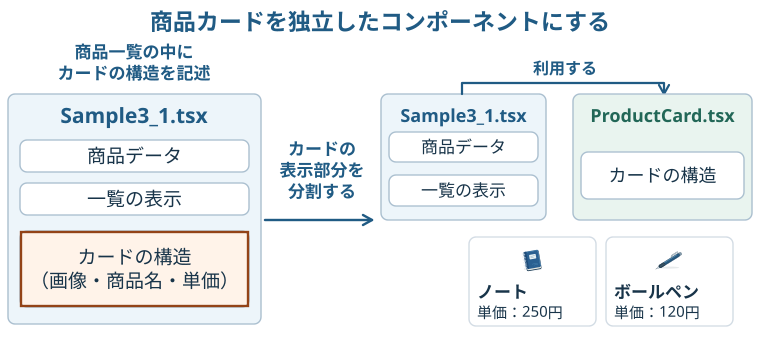{#ch03-card-division}

::: {#ch03-card-division-caption .caption}
商品一覧と商品カードを別々のコンポーネントとして管理する
:::

::: {#ch03-props-line-81 .paragraph}
ただし、すべてのカードに同じ商品を表示するわけにはいきません。共通のコンポーネントを使用しながら、商品ごとに異なる画像・商品名・単価を表示できるようにする必要があります。
:::

::: {#ch03-props-line-83 .paragraph punctuation-font="inherit"}
この節では、コンポーネントを分割する方法と、**Props（プロップス）** を使用して、別のコンポーネントへデータを渡す方法を学習します。
:::

::: {#ch03-props-line-85 .heading level="minor"}
【サンプル】Propsを使用した商品カードの表示
:::

::: {#ch03-props-line-87 .paragraph}
今回は、6件の商品を画像付きのカードとして一覧表示します。
:::

::: {#ch03-props-line-89 .paragraph}
商品カードの構造は共通のコンポーネントにまとめ、商品ごとに異なるデータを渡すことで、次のような商品一覧を作成します。
:::

{#ch03-preview}

::: {#ch03-preview-caption .caption}
完成サンプルの表示結果（6枚の商品カード）
:::

::: {#ch03-props-line-100 .paragraph}
今回のサンプルでは、次の2つのファイルを使用します。
:::

::: {#ch03-props-line-102 .table column-widths="30 70"}
| ファイル | 役割 |
|---|---|
| `ProductCard.tsx` | 画像・商品名・単価を使用して、商品1件分のカードを表示する。 |
| `Sample3_1.tsx` | 6件の商品データを管理し、商品ごとにカードを表示する。 |
:::

::: {#ch03-props-line-107 .paragraph keep-next="1"}
まず、商品1件分のカードを表示する `ProductCard.tsx` を確認してください。
:::

::: {#ch03-props-line-109 .code filename="ch03-basic/src/components/ProductCard.tsx" start-line="1"}
```tsx
type ProductCardProps = {
  name: string
  price: number
  imagePath: string
}

export default function ProductCard({ name, price, imagePath }: ProductCardProps) {
  return (
    <div className="col-12 col-sm-6 col-lg-4">
      <div className="card h-100">
        
        <div className="card-body">
          <h2 className="h5 card-title">{name}</h2>
          <p className="card-text">単価：{price}円</p>
        </div>
      </div>
    </div>
  )
}
```
:::

::: {#ch03-props-line-137 .paragraph keep-next="1"}
次に、商品一覧を表示する `Sample3_1.tsx` を確認してください。
:::

::: {#ch03-props-line-139 .code filename="ch03-basic/src/components/Sample3_1.tsx" start-line="1"}
```tsx
import ProductCard from './ProductCard'

export default function Sample3_1() {
  const products = [
    { id: 101, name: 'ノート', price: 250, imagePath: '/images/products/notebook.svg' },
    { id: 102, name: 'ボールペン', price: 120, imagePath: '/images/products/ballpoint-pen.svg' },
    { id: 103, name: '消しゴム', price: 100, imagePath: '/images/products/eraser.svg' },
    { id: 104, name: 'ファイル', price: 600, imagePath: '/images/products/file-folder.svg' },
    { id: 105, name: 'クリップ', price: 180, imagePath: '/images/products/paper-clips.svg' },
    { id: 106, name: '付箋', price: 240, imagePath: '/images/products/sticky-notes.svg' }
  ]

  return (
    <main className="container mt-4">
      <h1>商品一覧</h1>

      <div className="row g-3">
        {products.map((product) => (
          <ProductCard
            key={product.id}
            name={product.name}
            price={product.price}
            imagePath={product.imagePath}
          />
        ))}
      </div>
    </main>
  )
}
```
:::

::: {#ch03-props-line-172 .paragraph}
`ch03-basic` の開発サーバーを起動し、メニューから「3.1 コンポーネントの分割とProps」を選択してください。
:::

::: {#ch03-props-line-174 .paragraph}
ブラウザーでは、6件の商品が画像付きカードとして表示されます。十分な画面幅では3列×2行に並び、画面幅が狭くなると列数が減ります。
:::

::: {#ch03-props-line-176 .paragraph}
それでは、2つのコンポーネントがどのように連携して商品一覧を表示しているのか、重要な構文を確認しましょう。
:::

::: {#ch03-props-line-178 .heading level="minor"}
構文の解説
:::

::: {#ch03-props-line-180 .step}
**① 別のファイルに定義したコンポーネントを読み込む**
:::

::: {#ch03-props-line-182 .code filename="ch03-basic/src/components/Sample3_1.tsx" start-line="1"}
```tsx
import ProductCard from './ProductCard'
```
:::

::: {#ch03-props-line-187 .paragraph}
Reactでは、別のTSXファイルに定義したコンポーネントを読み込んで使用できます。
:::

::: {#ch03-props-line-189 .paragraph}
今回のサンプルでは、`ProductCard.tsx` で商品カードを定義し、`Sample3_1.tsx` から `import` を使って読み込んでいます。
:::

::: {#ch03-props-line-191 .paragraph}
`ProductCard` は `export default` によって公開されているため、次のように、コンポーネント名と読み込むファイルを指定することで使用できます。
:::

::: {#ch03-props-line-193 .table column-widths="34 66"}
| 記述 | 意味 |
|---|---|
| `import ProductCard` | `ProductCard` という名前でコンポーネントを読み込む。 |
| `from './ProductCard'` | 同じフォルダーにある `ProductCard.tsx` から読み込む。 |
:::

::: {#ch03-props-line-198 .paragraph}
読み込んだコンポーネントは、JSXの中にタグのような形式で記述して使用します。`<h1>` や `<p>` といったHTML要素とは異なり、`ProductCard` は自分で定義したReactコンポーネントです。
:::

::: {#ch03-props-line-200 .paragraph}
このとき、**別のコンポーネントを使用する側を親コンポーネント、使用される側を子コンポーネント** と呼びます。
:::

::: {#ch03-props-line-202 .paragraph}
今回のサンプルでは、`Sample3_1` が親コンポーネント、`ProductCard` が子コンポーネントです。
:::

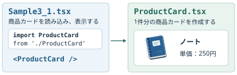{#ch03-files}

::: {#ch03-files-caption .caption}
別のファイルに定義した子コンポーネントを親コンポーネントから使用する
:::

::: {#ch03-props-line-213 .step}
**② 親コンポーネントからPropsを渡す**
:::

::: {#ch03-props-line-215 .paragraph}
子コンポーネントを再利用する際に、商品名や単価などを子コンポーネント内に直接記述してしまうと、何度使用しても同じ商品が表示されます。
:::

::: {#ch03-props-line-217 .paragraph}
商品ごとに異なる情報を表示するには、親コンポーネントから子コンポーネントへデータを渡す必要があります。
:::

::: {#ch03-props-line-219 .paragraph}
**Propsとは、親コンポーネントから子コンポーネントへデータを渡すための仕組みです。** 親コンポーネントが値を指定し、子コンポーネントがそれらの値を受け取ります。
:::

::: {#ch03-props-line-221 .paragraph}
例えば、ノートの商品カードを表示するために、親コンポーネントから値を直接渡す場合は、次のように記述します。
:::

::: {#ch03-props-line-223 .code example="true" code-label="TSXの記述例"}
```tsx
<ProductCard
  name="ノート"
  price={250}
  imagePath="/images/products/notebook.svg"
/>
```
:::

::: {#ch03-props-line-232 .paragraph}
この記述では、次の3つの値を `ProductCard` に渡しています。
:::

::: {#ch03-props-line-234 .table column-widths="25 54 21"}
| Propsの名前 | 渡す値 | 意味 |
|---|---|---|
| `name` | `'ノート'` | 商品名 |
| `price` | `250` | 単価 |
| `imagePath` | `'/images/products/notebook.svg'` | 商品画像のパス |
:::

::: {#ch03-props-line-240 .paragraph}
Propsは、HTMLの属性と似た形式で指定します。第2章で学習したJSXの属性に値を設定する方法と、同じ考え方で記述できます。
:::

::: {#ch03-props-line-242 .paragraph}
● 固定の文字列を渡す場合は、`name="ノート"` のように引用符で囲む。
:::

::: {#ch03-props-line-243 .paragraph}
● 数値や変数の値を渡す場合は、`price={250}` のように波括弧 `{ }` を使用する。
:::

::: {#ch03-props-line-245 .paragraph}
なお、`name` や `price` は `ProductCard` が受け取るデータの名前です。HTML要素にあらかじめ用意されている属性ではなく、コンポーネントの役割に合わせて定義した名前です。
:::

::: {#ch03-props-line-247 .paragraph}
今回のサンプルでは、固定値を直接渡すのではなく、商品データの配列から取り出した値を渡しています。その方法については、⑤で説明します。
:::

{#ch03-transfer}

::: {#ch03-transfer-caption .caption}
親コンポーネントから渡されたPropsを使用して商品カードを表示する
:::

::: {#ch03-props-line-258 .step}
**③ TypeScriptでPropsの型を定義する**
:::

::: {#ch03-props-line-260 .paragraph}
ここからは、子コンポーネントである `ProductCard.tsx` の記述を確認します。
:::

::: {#ch03-props-line-262 .code filename="ch03-basic/src/components/ProductCard.tsx" start-line="1"}
```tsx
type ProductCardProps = {
  name: string
  price: number
  imagePath: string
}
```
:::

::: {#ch03-props-line-271 .paragraph}
本研修ではTypeScriptを使用しているため、子コンポーネントがどのようなデータを受け取るのか、型を定義しています。
:::

::: {#ch03-props-line-273 .paragraph}
`type` は、TypeScriptで型に名前を付けるための構文です。このように定義した型の名前を **型エイリアス** と呼びます。
:::

::: {#ch03-props-line-275 .paragraph}
今回のサンプルでは、商品カードが受け取るPropsの型として、`ProductCardProps` という型を定義しています。
:::

::: {#ch03-props-line-277 .paragraph}
波括弧の中には、受け取るオブジェクトのプロパティ名と、それぞれのデータ型を記述します。
:::

::: {#ch03-props-line-279 .table column-widths="28 22 50"}
| プロパティ名 | データ型 | 意味 |
|---|---|---|
| `name` | `string` | 商品名を文字列で受け取る。 |
| `price` | `number` | 単価を数値で受け取る。 |
| `imagePath` | `string` | 商品画像のパスを文字列で受け取る。 |
:::

::: {#ch03-props-line-285 .paragraph}
例えば、`price: number` と記述することで、単価を数値として受け取ることを指定しています。
:::

::: {#ch03-props-line-287 .paragraph}
Propsを渡す側で誤って文字列を指定すると、TypeScriptの型チェックによって型の不一致を検出できます。
:::

::: {#ch03-props-line-289 .code example="true" code-label="TSXの記述例"}
```tsx
price={250}    // 数値を指定する（正しい例）
price="250"    // 文字列を指定する（誤った例）
```
:::

::: {#ch03-props-line-295 .paragraph}
このように、**受け取るPropsの名前や型をあらかじめ定義しておくことで、誤ったデータを渡すミスを開発中に検出できます。**
:::

::: {#ch03-props-line-297 .paragraph}
なお、今回定義した3つのプロパティはすべて必須です。親コンポーネントで値の指定を忘れた場合も、型チェックで検出できます。
:::

::: {#ch03-props-line-299 .step}
**④ 子コンポーネントでPropsを受け取り、画面に表示する**
:::

::: {#ch03-props-line-301 .code filename="ch03-basic/src/components/ProductCard.tsx" start-line="7"}
```tsx
export default function ProductCard({ name, price, imagePath }: ProductCardProps) {
```
:::

::: {#ch03-props-line-306 .paragraph}
親コンポーネントから渡されたPropsは、子コンポーネントの関数で受け取ります。
:::

::: {#ch03-props-line-308 .paragraph}
この記述は少し複雑に見えますが、次の2つの部分に分けると理解しやすくなります。
:::

::: {#ch03-props-line-310 .table column-widths="42 58"}
| 記述 | 意味 |
|---|---|
| `{ name, price, imagePath }` | Propsのオブジェクトから3つのプロパティを取り出す。 |
| `: ProductCardProps` | 関数が受け取るPropsの型を指定する。 |
:::

::: {#ch03-props-line-315 .paragraph}
Reactでは、親コンポーネントから指定されたPropsが、**1つのオブジェクトとして子コンポーネントに渡されます。**
:::

::: {#ch03-props-line-317 .paragraph}
例えば、②のようにノートの情報を渡した場合、子コンポーネントは次のようなオブジェクトを受け取ります。
:::

::: {#ch03-props-line-319 .code example="true" code-label="TSXの記述例"}
```tsx
{
  name: 'ノート',
  price: 250,
  imagePath: '/images/products/notebook.svg'
}
```
:::

::: {#ch03-props-line-328 .paragraph}
このオブジェクトから必要な値を取り出すために、JavaScriptの **オブジェクトの分割代入** を使用しています。
:::

::: {#ch03-props-line-330 .paragraph}
`{ name, price, imagePath }` と記述すると、同じ名前のプロパティの値を、それぞれ `name`、`price`、`imagePath` として扱えるようになります。
:::

::: {#ch03-props-line-332 .paragraph}
また、引数に `: ProductCardProps` を記述することで、③で定義した型のデータを受け取ることをTypeScriptに伝えています。
:::

{#ch03-type-relations}

::: {#ch03-type-relations-caption .caption}
Propsのオブジェクトから必要な値を取り出し、受け取るデータの型を指定する
:::

::: {#ch03-props-line-343 .paragraph}
受け取った値は、通常の変数と同じようにJSXの中で使用できます。
:::

::: {#ch03-props-line-345 .code filename="ch03-basic/src/components/ProductCard.tsx" start-line="11"}
```tsx
        
        <div className="card-body">
          <h2 className="h5 card-title">{name}</h2>
          <p className="card-text">単価：{price}円</p>
```
:::

::: {#ch03-props-line-358 .paragraph}
今回のサンプルでは、`imagePath` を画像の `src` 属性に、`name` を `alt` 属性と見出しに、`price` を単価の表示に使用しています。
:::

::: {#ch03-props-line-360 .paragraph}
子コンポーネントのJSXには、特定の商品名や単価を直接記述していません。そのため、親コンポーネントから異なる値を渡せば、**同じJSXの構造で異なる商品を表示できます。**
:::

{#ch03-code-flow}

::: {#ch03-code-flow-caption .caption}
子コンポーネントで受け取った値とカードの表示内容の対応
:::

::: {#ch03-props-receive-note .training-note}
**【補足】Propsを受け取る別の書き方**

Propsは、分割代入を使用せず、1つのオブジェクトとして受け取ることもできます。

```{#ch03-props-line-373 .tsx example="true" code-label="TSXの記述例"}
function ProductCard(props: ProductCardProps) {
  return (
    <div>
      
      <p>{props.name}：{props.price}円</p>
    </div>
  )
}
```

この場合、`props` は親コンポーネントから渡されたPropsのオブジェクトです。商品名や単価を使用する際には、`props.name` や `props.price` のように、プロパティ名を指定します。

一方、分割代入を使用すれば、`name` や `price` と直接記述できます。どちらの方法でも、親コンポーネントから渡されるデータは同じです。

本研修では、子コンポーネントで必要な値を簡潔に参照できるよう、分割代入を使用する書き方を基本とします。
:::

::: {#ch03-props-line-391 .step}
**⑤ map()とPropsを組み合わせて商品カードを表示する**
:::

::: {#ch03-props-line-393 .paragraph}
続いて、親コンポーネントである `Sample3_1.tsx` を確認しましょう。
:::

::: {#ch03-props-line-395 .paragraph}
親コンポーネントでは、次のように6件の商品データを配列として定義しています。
:::

::: {#ch03-props-line-397 .code filename="ch03-basic/src/components/Sample3_1.tsx" start-line="4"}
```tsx
  const products = [
    { id: 101, name: 'ノート', price: 250, imagePath: '/images/products/notebook.svg' },
    { id: 102, name: 'ボールペン', price: 120, imagePath: '/images/products/ballpoint-pen.svg' },
    { id: 103, name: '消しゴム', price: 100, imagePath: '/images/products/eraser.svg' },
    { id: 104, name: 'ファイル', price: 600, imagePath: '/images/products/file-folder.svg' },
    { id: 105, name: 'クリップ', price: 180, imagePath: '/images/products/paper-clips.svg' },
    { id: 106, name: '付箋', price: 240, imagePath: '/images/products/sticky-notes.svg' }
  ]
```
:::

::: {#ch03-props-line-409 .paragraph}
第2章では、`map()` を使って商品データからテーブルの行を生成しました。今回は、同じ方法で商品カードを生成します。
:::

::: {#ch03-props-line-411 .code filename="ch03-basic/src/components/Sample3_1.tsx" start-line="18"}
```tsx
        {products.map((product) => (
          <ProductCard
            key={product.id}
            name={product.name}
            price={product.price}
            imagePath={product.imagePath}
          />
        ))}
```
:::

::: {#ch03-props-line-423 .paragraph}
`map()` に指定したアロー関数には、配列内の商品データが1件ずつ渡されます。
:::

::: {#ch03-props-line-425 .paragraph}
例えば、1件目の商品データを処理する際には、`product.name` は「ノート」、`product.price` は250、`product.imagePath` はノートの画像のパスになります。
:::

::: {#ch03-props-line-427 .paragraph}
これらの値を `ProductCard` に渡すことで、ノートのカードが表示されます。
:::

::: {#ch03-props-line-429 .paragraph}
2件目を処理する際には、ボールペンの商品データが `product` に渡されるため、同じ `ProductCard` を使用してボールペンのカードを表示できます。
:::

::: {#ch03-props-line-431 .table column-widths="22 25 22 31"}
| 処理する商品 | `name` に渡す値 | `price` に渡す値 | `imagePath` に渡す値 |
|---|---|---|---|
| 1件目 | `'ノート'` | `250` | ノートの画像のパス |
| 2件目 | `'ボールペン'` | `120` | ボールペンの画像のパス |
:::

::: {#ch03-props-line-436 .paragraph}
残りの4件の商品についても、同様の処理が行われます。
:::

::: {#ch03-props-line-438 .paragraph}
このように、**カード1件分のコンポーネントを定義しておけば、配列のデータ数に応じて複数の商品カードを表示できます。**
:::

{#ch03-map-flow}

::: {#ch03-map-flow-caption .caption}
6件の商品データからmap()とPropsを使って6枚の商品カードを表示する
:::

::: {#ch03-props-line-449 .paragraph}
なお、`key={product.id}` は、第2章で学習した、繰り返し生成される要素を識別するための指定です。
:::

::: {#ch03-props-line-451 .paragraph}
`key` はReactが内部で使用する特別な属性であり、`name` や `price` などの通常のPropsとは異なります。子コンポーネントで商品番号を使用したい場合は、商品番号を別のPropsとして渡す必要があります。
:::

::: {#ch03-props-bootstrap-note .training-note}
**【補足】Bootstrapによるカード型デザイン**

今回のサンプルでは、Bootstrapの `card` や `row` などのクラスを使用し、カードの枠や余白、並び方を整えています。

また、`style={{ height: '180px', objectFit: 'contain' }}` では、画像の表示領域の高さなどを指定しています。外側の波括弧はJSXでJavaScriptの値を指定するためのもの、内側の波括弧はスタイルを表すオブジェクトです。

この節では、コンポーネントの分割とPropsによるデータの受け渡しが学習の中心なので、個々のデザインに関する詳しい指定方法は扱いません。
:::
::::

:::: {#page-4 .source-page}

::: {#ch03-props-line-492 .heading level="minor"}
【確認演習】Propsを使って商品カードを表示する
:::

::: {#ch03-props-line-494 .paragraph}
商品データを親コンポーネントから子コンポーネントへ渡し、画像付きの商品カードを表示する演習を行います。
:::

::: {#ch03-props-line-496 .paragraph}
商品データの配列、カードの基本的なレイアウト、`map()` による繰り返し処理は、あらかじめ用意されています。
:::

::: {#ch03-props-line-498 .paragraph}
今回は、Propsの型の定義、値の受け取りと表示、親コンポーネントからの値の受け渡しを実装しましょう。
:::

::: {#ch03-props-line-500 .paragraph numbered="true"}
1．`ch03-basic-q` プロジェクトの次の2つのファイルを開いてください。
:::

::: {#ch03-props-line-502 .paragraph nested-bullet="true"}
● `src/components/Q3_1.tsx`
:::

::: {#ch03-props-line-503 .paragraph nested-bullet="true"}
● `src/components/ProductCardQ.tsx`
:::

::: {#ch03-props-line-505 .paragraph numbered="true"}
2．2つのファイルに記載された➀～➄の番号付きコメントを確認し、指示された箇所を実装してください。➀は既存コードの確認、➁～➄は実装問題です。コメントに指定されていないコードや、ほかのファイルは変更する必要はありません。
:::

::: {#ch03-props-line-507 .paragraph numbered="true"}
3．編集した2つのファイルを保存してください。
:::

::: {#ch03-props-line-509 .paragraph numbered="true"}
4．初回は `ch03-basic-q` フォルダーで `npm install` を実行してください。1.5節と同じ手順で開発サーバーを起動し、ターミナルに表示されたURLを開いてください。起動済みの場合は、開いているブラウザーの画面に戻ってください。
:::

::: {#ch03-props-line-511 .paragraph numbered="true"}
5．メニューから［3.1 コンポーネントの分割とProps］を選択してください。
:::

::: {#ch03-props-line-513 .heading level="minor"}
動作確認
:::

::: {#ch03-props-line-515 .paragraph numbered="true"}
6．商品一覧に、次の6件の商品が画像付きカードとして表示されることを確認してください。
:::

::: {#ch03-props-line-517 .table column-widths="20 26 27 27"}
| 表示位置 | 左 | 中央 | 右 |
|---|---|---|---|
| 上段 | ファイル：600円 | クリップ：180円 | 付箋：240円 |
| 下段 | ノート：250円 | ボールペン：120円 | 消しゴム：100円 |
:::

{#ch03-props-practice-result}

::: {#ch03-props-practice-result-caption .caption}
確認演習の6件の商品画像・商品名・単価が正しく表示されることを確認する
:::

::: {#ch03-props-line-531 .paragraph keep-next="2"}
商品ごとに正しい画像・商品名・単価が表示されていることを確認してください。また、十分な画面幅では、カードが3列×2行に並びます。
:::

::: {#ch03-props-line-533 .paragraph}
画面に変更が反映されない場合は、ブラウザーの画面を再読み込みして、もう一度操作してください。
:::

::: {#ch03-props-points .section-points}
この節のポイント

● コンポーネントを分割することで、同じ画面の部品を複数の場所で再利用できる。

● Propsは、親コンポーネントから子コンポーネントへデータを渡すための仕組みである。

● TypeScriptでは、`type` などを使用してPropsの型を定義できる。

● 子コンポーネントでは、Propsのオブジェクトを分割代入などによって受け取り、JSXで使用できる。

● `map()` とPropsを組み合わせることで、配列のデータ数に応じて複数のコンポーネントを表示できる。

● 子コンポーネントは、受け取ったPropsを直接変更しない。
:::
::::

::::: {#page-5 .source-page}
::: {#ch03-router-title .heading}
3.2. React Routerによるルーティング
:::

::: {#ch03-router-slide .slide layout="illustration"}
React Routerによるルーティング

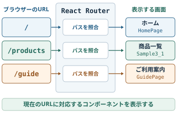
:::

::: {#ch03-router-r31 .heading level="minor"}
複数の画面を持つアプリケーションを作るには
:::

::: {#ch03-router-r33 .paragraph}
前節では、商品カードを独立したコンポーネントとして作成し、Propsを使用して、商品ごとに異なる情報を表示する方法を学習しました。
:::

::: {#ch03-router-r35 .paragraph}
実際の商品管理システムには、商品一覧以外にも、さまざまな画面が必要です。例えば、次の3つの画面を持つシステムを考えてみましょう。
:::

::: {#ch03-router-r37 .table column-widths="27 73"}
| 画面 | 主な役割 |
|---|---|
| ホーム画面 | システムのトップページを表示する。 |
| 商品一覧画面 | 登録されている商品を一覧表示する。 |
| ご利用案内画面 | システムの使い方などを表示する。 |
:::

::: {#ch03-router-r43 .paragraph}
これらの画面は、それぞれReactのコンポーネントとして作成できます。
:::

::: {#ch03-router-r45 .paragraph}
では、ユーザーが商品一覧のURLにアクセスした場合に、どのようにして商品一覧画面を表示すればよいのでしょうか。
:::

::: {#ch03-router-r47 .paragraph punctuation-font="inherit"}
このように、**アクセスしたURLに応じて表示する画面を決定する仕組み**を、ルーティングと呼びます。
:::

::: {#ch03-router-r49 .heading level="minor"}
React Routerとは
:::

::: {#ch03-router-r51 .paragraph}
Reactは、画面を作成したり、データの変更を画面に反映したりするためのライブラリです。しかし、React単体では、URLと表示する画面の対応関係まで自動的に管理するわけではありません。
:::

::: {#ch03-router-r53 .paragraph punctuation-font="inherit"}
そこで、本研修では **React Router（リアクトルーター）** というライブラリを使用します。
:::

::: {#ch03-router-r55 .paragraph}
例えば、1つの商品管理システムを開発する場合、次のように、URLのパスと表示するコンポーネントを対応付けることができます。
:::

::: {#ch03-router-r57 .table column-widths="30 46 24"}
| URLのパス | 表示するコンポーネント | 画面 |
|---|---|---|
| `/` | `HomePage` | ホーム |
| `/products` | `ProductListPage` | 商品一覧 |
| `/guide` | `GuidePage` | ご利用案内 |
:::

::: {#ch03-router-r63 .paragraph}
例えば、次のURLのうち、`/products` がパスに該当します。
:::

::: {#ch03-router-r65 .paragraph}
`http://localhost:5173/products`
:::

::: {#ch03-router-r67 .table column-widths="20 25 55"}
| 部分 | 例 | 意味 |
|---|---|---|
| スキーム | `http` | 通信に使用する方式。 |
| ホスト名 | `localhost` | 接続先のコンピューター。 |
| ポート番号 | `5173` | 接続先のプログラムを区別する番号。 |
| パス | `/products` | 今回、表示する画面を区別するために使用する部分。 |
:::

::: {#ch03-router-r74 .paragraph}
React Routerは、現在のURLのパスに対応するルートを選択し、そのルートに指定されたコンポーネントを表示します。
:::

{#ch03-router-figure-path}

::: {#ch03-router-figure-path-caption .caption}
URLのパスに対応する画面のコンポーネントを表示する
:::

::: {#ch03-router-r82 .heading level="minor"}
React Routerの導入
:::

::: {#ch03-router-r84 .paragraph}
React RouterはReactとは別のライブラリです。新しいプロジェクトで使用する場合は、次のコマンドを実行してインストールします。
:::

::: {#ch03-router-r87 .code code-label="コンソールの記述例" example="true"}
~~~bash
npm install react-router
~~~
:::

::: {#ch03-router-r91 .paragraph}
このコマンドを実行すると、React Routerがインストールされ、プロジェクトの `package.json` に依存ライブラリとして登録されます。
:::

::: {#ch03-router-r93 .paragraph}
本研修では、React Routerがあらかじめ登録されたプロジェクトを使用します。初回の起動時に `npm install` を実行すれば、必要なライブラリがインストールされるため、React Routerを個別にインストールする必要はありません。
:::

::: {#ch03-router-r95 .paragraph punctuation-font="inherit"}
React Routerには、いくつかの利用方式があります。本研修では、JSXでルートを定義する **Declarative Mode（宣言的なルーティング方式）** を使用します。
:::

::: {#ch03-router-r97 .paragraph}
この節では、主に次の3つのコンポーネントを学習します。
:::

::: {#ch03-router-r99 .table column-widths="29 71"}
| コンポーネント | 役割 |
|---|---|
| `BrowserRouter` | ブラウザーのURLを利用してルーティングを管理する。 |
| `Routes` | ルートの定義をまとめ、現在のURLに対応するルートを選択する。 |
| `Route` | URLのパスと表示するReact要素の対応関係を定義する。 |
:::

::: {#ch03-router-r105 .heading level="minor"}
画面とルーティングの設定を別々に管理する
:::

::: {#ch03-router-r107 .paragraph}
ここからは、複数の画面を持つアプリケーションを開発します。そのため、ファイルを役割ごとに分けて管理します。
:::

::: {#ch03-router-r109 .paragraph}
例えば、商品一覧を表示する画面と、その画面へのURLを設定する処理は、別々の役割を持っています。これらを別のファイルとして管理すると、画面の表示内容を修正する場合と、URLとの対応関係を変更する場合とで、編集するファイルを区別できます。
:::

::: {#ch03-router-r111 .paragraph}
本研修では、1つの商品管理システムを開発する場合に、次のようなフォルダー構成を基本とします。
:::

::: {#ch03-router-r114 .code code-label="通常のアプリケーションのフォルダー構成例" example="true" wide-code-label="true"}
~~~text
src/
├─ components/
│  └─ ProductCard.tsx
├─ pages/
│  ├─ HomePage.tsx
│  ├─ ProductListPage.tsx
│  └─ GuidePage.tsx
├─ routes/
│  └─ AppRoutes.tsx
├─ App.tsx
└─ main.tsx
~~~
:::

::: {#ch03-router-r128 .table column-widths="31 69"}
| フォルダー・ファイル | 役割 |
|---|---|
| `components/` | 商品カードなど、再利用する画面の部品を格納する。 |
| `pages/` | ホーム画面や商品一覧画面など、ルーティングの対象となる画面を格納する。 |
| `routes/` | URLと画面の対応関係を定義するファイルを格納する。 |
| `App.tsx` | アプリケーションのルートコンポーネントを定義する。 |
| `main.tsx` | アプリケーションの起動処理を記述する。 |
:::

::: {#ch03-router-r136 .paragraph punctuation-font="inherit"}
`pages` に配置する画面も、`components` に配置する部品も、Reactのコンポーネントです。**フォルダーを分けているのは、それぞれの役割を明確にするためです。**
:::

::: {#ch03-router-r138 .paragraph}
なお、Reactには、このフォルダー名やファイルの分け方を必ず使用しなければならないというルールはありません。本研修では、今後の機能追加や修正を行いやすい構成として、この分け方を採用します。次の3.3節では、共通レイアウトを格納する `layouts` フォルダーを追加します。
:::
:::::

::::: {#page-6 .source-page}
::: {#ch03-router-r140 .heading level="minor"}
【サンプル】URLに応じた画面の切り替え
:::

::: {#ch03-router-r142 .paragraph}
まず、1つの商品管理システムを開発する通常の構成で、ルーティングの書き方を確認しましょう。
:::

::: {#ch03-router-r144 .paragraph}
今回は、ホーム・商品一覧・ご利用案内の3つの画面を別々のファイルとして用意します。3.1節で学習した商品カードのコードはそのまま活用し、商品一覧画面には、前節の一覧表示と同じ処理を記述します。
:::

::: {#ch03-router-r146 .paragraph}
以下のコードは、先ほどの通常のフォルダー構成を使用する場合の記述例です。本研修の配布サンプルで動作を確認する方法については、構文の解説の後に説明します。
:::

::: {#ch03-router-r148 .step}
**画面を定義するファイル**
:::

::: {#ch03-router-r150 .paragraph}
`pages/HomePage.tsx` と `pages/GuidePage.tsx` では、それぞれホーム画面とご利用案内画面を定義します。
:::

::: {#ch03-router-r153 .code code-label="TSXの記述例（通常構成）" example="true" filename="src/pages/HomePage.tsx"}
~~~tsx
export default function HomePage() {
  return (
    <main className="container mt-4">
      <h1>ホーム</h1>
      <p>商品管理システムへようこそ。</p>
    </main>
  )
}
~~~
:::

::: {#ch03-router-r165 .code code-label="TSXの記述例（通常構成）" example="true" filename="src/pages/GuidePage.tsx"}
~~~tsx
export default function GuidePage() {
  return (
    <main className="container mt-4">
      <h1>ご利用案内</h1>
      <p>このシステムでは商品情報を確認できます。</p>
    </main>
  )
}
~~~
:::

::: {#ch03-router-r176 .paragraph}
商品一覧画面は `pages/ProductListPage.tsx` に定義します。このコンポーネントでは、前節までと同じ商品データと `map()` を使用して、商品カードを一覧表示します。商品カードを読み込む部分は、次のとおりです。
:::

::: {#ch03-router-r179 .code code-label="TSXの記述例（通常構成・抜粋）" example="true" filename="src/pages/ProductListPage.tsx"}
~~~tsx
import ProductCard from '../components/ProductCard'
~~~
:::

::: {#ch03-router-r183 .paragraph}
このように、ルーティングの対象となる画面も、これまでに学習したReactのコンポーネントと同じ方法で定義します。各画面にルーティング専用の処理を記述する必要はありません。
:::

::: {#ch03-router-r185 .step}
**ルーティングを定義するファイル**
:::

::: {#ch03-router-r187 .paragraph}
次に、3つの画面をURLに応じて表示するための `routes/AppRoutes.tsx` を用意します。
:::

::: {#ch03-router-r190 .code code-label="TSXの記述例（通常構成）" example="true" filename="src/routes/AppRoutes.tsx"}
~~~tsx
import { Routes, Route } from 'react-router'
import HomePage from '../pages/HomePage'
import ProductListPage from '../pages/ProductListPage'
import GuidePage from '../pages/GuidePage'

export default function AppRoutes() {
  return (
    <Routes>
      <Route path="/" element={<HomePage />} />
      <Route path="/products" element={<ProductListPage />} />
      <Route path="/guide" element={<GuidePage />} />
    </Routes>
  )
}
~~~
:::

::: {#ch03-router-r207 .paragraph punctuation-font="inherit"}
このファイルには、各画面で表示する見出しや商品カードのデザインを記述していません。**どのURLにアクセスしたときに、どの画面を表示するのか**を定義しています。
:::

::: {#ch03-router-r209 .step}
**ルーティングの設定を使用するファイル**
:::

::: {#ch03-router-r211 .paragraph}
`App.tsx` では、先ほど定義した `AppRoutes` コンポーネントを読み込み、使用します。
:::

::: {#ch03-router-r214 .code code-label="TSXの記述例（通常構成）" example="true" filename="src/App.tsx"}
~~~tsx
import AppRoutes from './routes/AppRoutes'

export default function App() {
  return <AppRoutes />
}
~~~
:::

::: {#ch03-router-r222 .paragraph}
この構成では、ルーティングの設定を `AppRoutes.tsx` にまとめているため、`App.tsx` に同じルートを記述する必要はありません。
:::

::: {#ch03-router-r224 .step}
**アプリケーションの起動処理**
:::

::: {#ch03-router-r226 .paragraph}
最後に、`main.tsx` で、アプリケーション全体を `BrowserRouter` で囲みます。
:::

::: {#ch03-router-r229 .code code-label="TSXの記述例（通常構成）" example="true" filename="src/main.tsx"}
~~~tsx
import { StrictMode } from 'react'
import { createRoot } from 'react-dom/client'
import { BrowserRouter } from 'react-router'
import App from './App'
import 'bootstrap/dist/css/bootstrap.min.css'

createRoot(document.getElementById('root')!).render(
  <StrictMode>
    <BrowserRouter>
      <App />
    </BrowserRouter>
  </StrictMode>
)
~~~
:::

::: {#ch03-router-r245 .paragraph}
第1章で確認した起動処理に、`BrowserRouter` が追加されています。
:::

::: {#ch03-router-r247 .paragraph}
ここまでの構成を整理すると、`main.tsx` でアプリケーションを起動し、`App.tsx` で `AppRoutes` を使用します。そして、`AppRoutes.tsx` でURLに応じて表示する画面を定義します。
:::

{#ch03-router-figure-nesting}

::: {#ch03-router-figure-nesting-caption .caption}
起動処理、ルーティングの設定、画面のコンポーネントを分けて管理する
:::

::: {#ch03-router-r255 .heading level="minor"}
構文の解説
:::

::: {#ch03-router-r257 .step}
**① BrowserRouterを設定する**
:::

::: {#ch03-router-r259 .paragraph}
React Routerの機能を使用するには、アプリケーションの中でルーティングを利用できるように設定する必要があります。
:::

::: {#ch03-router-r261 .paragraph}
まず、`main.tsx` では、React Routerから `BrowserRouter` を読み込んでいます。
:::

::: {#ch03-router-r264 .code code-label="TSXの記述例（通常構成・抜粋）" example="true" filename="src/main.tsx"}
~~~tsx
import { BrowserRouter } from 'react-router'
~~~
:::

::: {#ch03-router-r268 .paragraph}
続いて、次のように、アプリケーションのルートとなる `App` コンポーネントを囲んでいます。
:::

::: {#ch03-router-r271 .code code-label="TSXの記述例（通常構成・抜粋）" example="true" filename="src/main.tsx"}
~~~tsx
<BrowserRouter>
  <App />
</BrowserRouter>
~~~
:::

::: {#ch03-router-r277 .paragraph}
`BrowserRouter` は、ブラウザーの現在のURLなどの情報を扱うためのコンポーネントです。
:::

::: {#ch03-router-r279 .paragraph}
`App` を `BrowserRouter` で囲むことによって、その内側のコンポーネントでReact Routerの機能を使用できるようになります。
:::

::: {#ch03-router-r281 .paragraph punctuation-font="inherit"}
**本研修では、アプリケーション全体を囲むBrowserRouterをmain.tsxに1つ設定します。** 各画面や `AppRoutes.tsx` に別の `BrowserRouter` を追加する必要はありません。
:::

::: {#ch03-router-r283 .step}
**② 各画面のコンポーネントを読み込む**
:::

::: {#ch03-router-r285 .paragraph}
画面のコンポーネントを別々のファイルに定義したため、ルーティングを定義するファイルでは、必要なコンポーネントを読み込んで使用します。
:::

::: {#ch03-router-r288 .code code-label="TSXの記述例（通常構成・抜粋）" example="true" filename="src/routes/AppRoutes.tsx"}
~~~tsx
import { Routes, Route } from 'react-router'
import HomePage from '../pages/HomePage'
import ProductListPage from '../pages/ProductListPage'
import GuidePage from '../pages/GuidePage'
~~~
:::

::: {#ch03-router-r295 .paragraph}
最初の行では、React Routerの `Routes` と `Route` を読み込んでいます。続く3行では、`pages` フォルダーにある3つの画面のコンポーネントを読み込んでいます。
:::

::: {#ch03-router-r297 .paragraph}
ここで、import先のパスに注目してください。`AppRoutes.tsx` は `routes` フォルダーにあります。そのため、`../pages/HomePage` と記述することで、1つ上のフォルダーに移動し、`pages` フォルダーにある `HomePage.tsx` を読み込むことができます。
:::

::: {#ch03-router-r299 .paragraph}
`ProductListPage.tsx` から商品カードを読み込む際も、同じ考え方で `../components/ProductCard` と記述しています。
:::

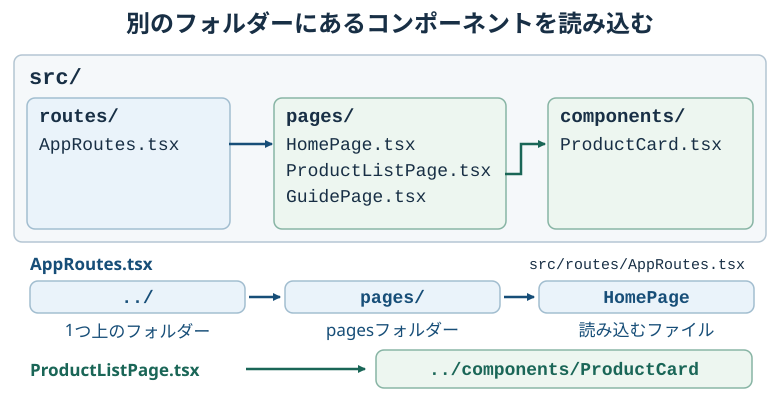{#ch03-router-figure-imports}

::: {#ch03-router-figure-imports-caption .caption}
役割ごとに分けたファイルをimportで読み込む
:::

::: {#ch03-router-r307 .step}
**③ RoutesとRouteでURLと画面を対応付ける**
:::

::: {#ch03-router-r309 .paragraph}
ここからは、通常のアプリケーションの `AppRoutes.tsx` に記述されているルートの定義を確認します。
:::

::: {#ch03-router-r312 .code code-label="TSXの記述例（通常構成・抜粋）" example="true" filename="src/routes/AppRoutes.tsx"}
~~~tsx
<Routes>
  <Route path="/" element={<HomePage />} />
  <Route path="/products" element={<ProductListPage />} />
  <Route path="/guide" element={<GuidePage />} />
</Routes>
~~~
:::

::: {#ch03-router-r320 .paragraph}
`Routes` は、複数の `Route` をまとめるためのコンポーネントです。React Routerは、`Routes` の中のルートの定義から、現在のURLに対応するものを選択します。
:::

::: {#ch03-router-r322 .paragraph}
`Route` は、URLのパスと、表示するReact要素の対応関係を定義するために使用します。
:::

::: {#ch03-router-r324 .paragraph}
例えば、商品一覧画面に対応するルートは、次のように記述しています。
:::

::: {#ch03-router-r327 .code code-label="TSXの記述例（通常構成・抜粋）" example="true" filename="src/routes/AppRoutes.tsx"}
~~~tsx
<Route path="/products" element={<ProductListPage />} />
~~~
:::

::: {#ch03-router-r331 .paragraph}
この記述では、`Route` に次の2つの属性を指定しています。
:::

::: {#ch03-router-r333 .table column-widths="27 73"}
| 属性 | 役割 |
|---|---|
| `path` | どのURLのパスに対応するかを指定する。 |
| `element` | そのルートに一致したときに表示するReact要素を指定する。 |
:::

::: {#ch03-router-r338 .paragraph}
`path="/products"` は、サイトのルートを基準とする商品一覧のURLのパスを指定しています。先頭の `/` から始まる、このような指定方法を絶対パスと呼びます。
:::

::: {#ch03-router-r340 .paragraph}
また、`element={<ProductListPage />}` では、表示する画面として `ProductListPage` コンポーネントを指定しています。`element` に設定するのはコンポーネントの名前を表す文字列ではなく、JSXで記述したReact要素です。
:::

{#ch03-router-figure-attributes}

::: {#ch03-router-figure-attributes-caption .caption}
pathとelementでURLのパスと画面を対応付ける
:::

::: {#ch03-router-r348 .paragraph}
ホーム画面の場合は `path="/"`、ご利用案内画面の場合は `path="/guide"` と指定します。このように、画面ごとのルートを追加することで、URLに応じて表示する画面を切り替えることができます。
:::

::: {#ch03-router-r350 .step}
**④ App.tsxからルーティングの設定を使用する**
:::

::: {#ch03-router-r352 .paragraph}
ここまでに定義した `AppRoutes` も、Reactのコンポーネントです。そのため、ほかのコンポーネントと同じように、`App.tsx` から読み込んで使用できます。
:::

::: {#ch03-router-r355 .code code-label="TSXの記述例（通常構成）" example="true" filename="src/App.tsx"}
~~~tsx
import AppRoutes from './routes/AppRoutes'

export default function App() {
  return <AppRoutes />
}
~~~
:::

::: {#ch03-router-r363 .paragraph}
`App` が表示されると、その中で `AppRoutes` が使用されます。そして、`AppRoutes` の中の `Routes` によって、現在のURLに対応する画面が表示されます。
:::

::: {#ch03-router-r365 .paragraph}
今回の構成では、`App.tsx` は `AppRoutes` を使用するだけです。URLと画面の対応関係を変更する場合は、`routes/AppRoutes.tsx` を編集します。
:::

::: {#ch03-router-r367 .paragraph}
例えば、新たに商品登録画面を追加する場合は、`pages` フォルダーに商品登録画面のコンポーネントを作成し、`AppRoutes.tsx` にそのコンポーネントを読み込む記述と、対応する `Route` を追加します。
:::

::: {#ch03-router-r369 .paragraph punctuation-font="inherit"}
このように、**画面のコンポーネントとルーティングの設定を役割ごとに分けて管理することで、機能を追加する際に変更する場所が明確になります。**
:::

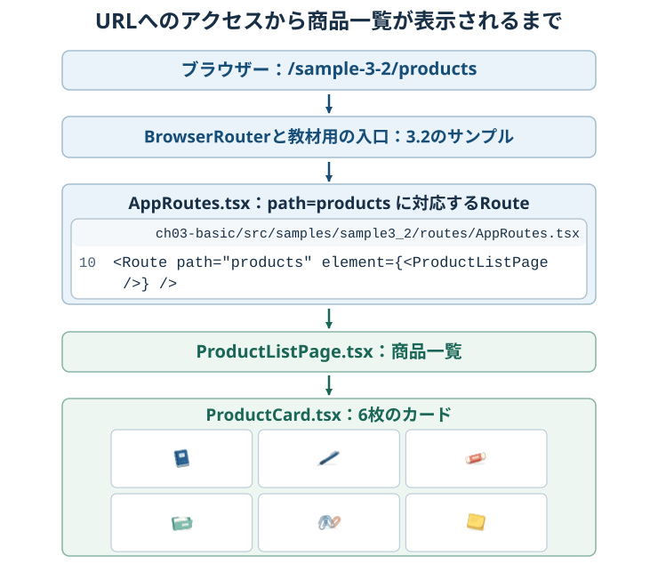{#ch03-router-figure-flow}

::: {#ch03-router-figure-flow-caption .caption}
通常のアプリケーションでURLに応じた画面を表示する流れ
:::

::: {#ch03-router-r387 .paragraph}
このように、React Routerを使用することで、URLに応じて表示する画面を切り替えることができます。
:::

:::: {#ch03-router-r389 .training-note breakable="true"}
【補足】本研修の配布サンプルの構成

ここまでに学習したのは、1つの商品管理システムを開発する場合の基本的な構成です。

一方、講義用の `ch03-basic` プロジェクトでは、各節の完成サンプルを残し、教材のメニューから選択して確認できるようにしています。そのため、節ごとにフォルダーとURLの入口を分けています。

**この構成は、本研修の配布サンプルを管理するためのものです。通常のアプリケーションを開発する際に、節ごとのフォルダーや教材メニューとの接続設定を用意する必要はありません。**

3.2で使用するのは、次のフォルダーです。

~~~{#ch03-router-r400 .text code-label="配布サンプルのフォルダー構成（抜粋）" example="true" wide-code-label="true"}
ch03-basic/src/samples/sample3_2/
├─ components/
│  └─ ProductCard.tsx
├─ pages/
│  ├─ HomePage.tsx
│  ├─ ProductListPage.tsx
│  └─ GuidePage.tsx
└─ routes/
   └─ AppRoutes.tsx
~~~

::: {#ch03-router-figure-relative-path .note-figure}

:::
::::

::: {#ch03-router-r483 .heading level="minor"}
配布サンプルの動作確認
:::

::: {#ch03-router-r485 .paragraph}
配布サンプルの `ch03-basic` の開発サーバーを起動し、メニューから「3.2 React Routerによるルーティング」を選択してください。
:::

::: {#ch03-router-r487 .paragraph}
ブラウザーのアドレスバーから、補足の図に示した配布サンプルの3つのパスにアクセスしてみましょう。ホスト名とポート番号は、開発サーバーの起動時に表示されたものを使用してください。
:::

:::: {#ch03-router-r495 .training-note breakable="true"}
**【補足】アドレスバーからの移動とSPAの画面遷移**

今回は、ブラウザーのアドレスバーからURLを入力して、ルーティングの動作を確認します。この操作ではページの読み込みが発生します。

SPAの特徴である、ページ全体を再読み込みせずに画面を切り替える方法については、3.4節で学習します。
::::
:::::

::::: {#page-7 .source-page}
::: {#ch03-router-r501 .heading level="minor"}
【確認演習】URLに応じて表示する画面を設定する
:::

::: {#ch03-router-r503 .paragraph}
ホーム・商品一覧・ご利用案内の3つの画面をURLに応じて表示できるように、ルーティングを設定します。
:::

::: {#ch03-router-r505 .paragraph}
確認演習用のフォルダーには、3つの画面と商品カードの完成済みコンポーネントが用意されています。3.1節の確認演習が未完成でも、今回の確認演習に取り組むことができます。
:::

::: {#ch03-router-r507 .paragraph}
この確認演習では、前の補足で確認した研修用のフォルダー構成とURLを使用します。ルートの定義には、入口以降の相対パスを指定してください。
:::

::: {#ch03-router-r509 .paragraph numbered="true"}
1．`ch03-basic-q` プロジェクトの次のファイルを開いてください。
:::

::: {#ch03-router-r511 .paragraph}
`src/exercises/q3_2/routes/AppRoutes.tsx`
:::

::: {#ch03-router-r513 .paragraph numbered="true"}
2．コード内の➀～➄の番号付きコメントを確認し、指示された箇所を実装してください。➀は既存コードの確認、➁～➄は実装問題です。
:::

::: {#ch03-router-r515 .table column-widths="12 88"}
| 番号 | 作業内容 |
|---|---|
| ➀ | React RouterのRoutesとRouteが読み込まれていることを確認する。 |
| ➁ | pagesフォルダーから3つの画面のコンポーネントを読み込む。 |
| ➂ | ホーム画面に対応するRouteを記述する。`path` は空文字列。 |
| ➃ | 商品一覧画面に対応するRouteを記述する。`path` は `products`。 |
| ➄ | ご利用案内画面に対応するRouteを記述する。`path` は `guide`。 |
:::

::: {#ch03-router-r523 .paragraph}
「ルートを設定してください。」と表示するための補助ルートは、あらかじめ用意されています。変更する必要はありません。コメントに指定されていないコードや、ほかのファイルも変更する必要はありません。
:::

::: {#ch03-router-r525 .paragraph numbered="true"}
3．編集したファイルを保存してください。
:::

::: {#ch03-router-r527 .paragraph numbered="true"}
4．`ch03-basic-q` の開発サーバーを起動し、ターミナルに表示されたURLを開いてください。起動済みの場合は、開いているブラウザーの画面に戻ってください。
:::

::: {#ch03-router-r529 .paragraph numbered="true"}
5．メニューから「3.2 React Routerによるルーティング」を選択してください。
:::

::: {#ch03-router-r531 .heading level="minor"}
動作確認
:::

::: {#ch03-router-r533 .paragraph numbered="true"}
6．ブラウザーのアドレスバーから、次の3つのURLにアクセスし、それぞれに対応する画面が表示されることを確認してください。
:::

::: {#ch03-router-r535 .table column-widths="44 56"}
| URLのパス | 確認する画面 |
|---|---|
| `/sample-3-2` | ホーム。「商品管理システムへようこそ。」と表示される。 |
| `/sample-3-2/products` | 商品一覧。6件の画像付き商品カードが表示される。 |
| `/sample-3-2/guide` | ご利用案内。「このシステムでは商品情報を確認できます。」と表示される。 |
:::

::: {#ch03-router-r541 .paragraph}
ホスト名とポート番号には、開発サーバーの起動時に表示されたURLのものを使用してください。
:::

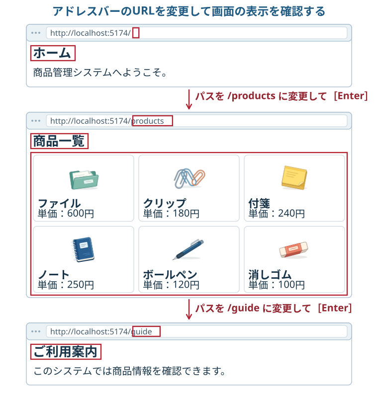{#ch03-router-figure-screens}

::: {#ch03-router-figure-screens-caption .caption}
アドレスバーに入力したURLに応じて表示する画面が変わることを確認する
:::

::: {#ch03-router-r549 .paragraph}
3つのURLでそれぞれ正しい画面が表示されれば、演習完了です。
:::

::: {#ch03-router-r551 .paragraph}
画面に変更が反映されない場合は、ブラウザーの画面を再読み込みして、もう一度操作してください。
:::

::: {#ch03-router-points .section-points}
この節のポイント

● ルーティングとは、URLに応じて表示する画面を決定する仕組みである。

● `BrowserRouter` でアプリケーションを囲むことで、その内側でReact Routerの機能を使用できる。

● `Routes` の中に `Route` を定義し、`path` に対応するパス、`element` に表示するReact要素を指定する。

● 画面を `pages`、再利用する部品を `components`、ルーティングの設定を `routes` に分けて管理すると、ファイルの役割を明確にできる。

● 本研修で採用する通常の構成では、`App.tsx` から `AppRoutes` を使用する。
:::
:::::

::::: {#page-8 .source-page}
::: {#ch03-layout-title .heading}
3.3. 共通レイアウトの作成
:::

::: {#ch03-layout-slide .slide layout="illustration"}
共通レイアウトの作成


:::

::: {#ch03-layout-r30 .heading level="minor"}
共通レイアウトとは
:::

::: {#ch03-layout-r32 .paragraph}
前節では、各画面のコンポーネントとルーティングの設定を別々のファイルに分けて管理し、URLに応じて画面を表示する方法を学習しました。
:::

::: {#ch03-layout-r34 .paragraph}
実際のWebアプリケーションでは、表示する画面が変わっても、ヘッダーやメニュー、フッターなどは共通していることが一般的です。
:::

::: {#ch03-layout-r36 .paragraph}
例えば、商品管理システムのホーム画面と商品一覧画面では、中央に表示する内容は異なりますが、上部には同じシステム名とメニューを表示します。
:::

::: {#ch03-layout-r38 .paragraph}
これらの共通部分を各画面のコンポーネントに個別に記述すると、次のような問題が発生します。
:::

::: {#ch03-layout-r40-1 .paragraph}
● メニューの項目を追加する際に、すべての画面を修正する必要がある。
:::

::: {#ch03-layout-r40-2 .paragraph}
● ヘッダーやフッターのデザインを変更する際に、同じ修正を繰り返す必要がある。
:::

::: {#ch03-layout-r43 .paragraph punctuation-font="inherit"}
そこで、**複数の画面で使用する共通部分を1つのコンポーネントにまとめて管理する**方法を考えます。このような画面の共通構成を、共通レイアウトと呼びます。
:::

::: {#ch03-layout-r45 .paragraph}
React Routerには、共通レイアウトの中に、URLに応じた画面を表示する仕組みがあります。この節では、その仕組みを利用して、複数の画面を持つアプリケーションに共通レイアウトを適用します。
:::
:::::

::::: {#page-9 .source-page}
::: {#ch03-layout-r47 .heading level="minor"}
【サンプル】共通レイアウトを作成する
:::

::: {#ch03-layout-r49 .paragraph}
前節で学習した通常のアプリケーション構成に、共通のヘッダー・メニュー・フッターを追加します。ホーム・商品一覧・ご利用案内の各画面は、共通レイアウトの中央に表示します。
:::

::: {#ch03-layout-r51 .paragraph}
以下では、1つの商品管理システムを開発する場合の記述例を使用します。実際の配布サンプルのフォルダーとURLについては、構文の解説の後に確認します。
:::

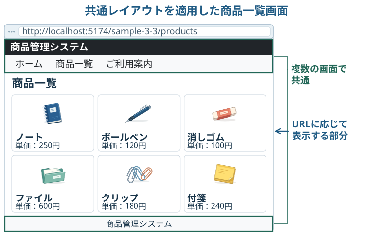{#ch03-layout-product-screen}

::: {#ch03-layout-product-screen-caption .caption}
共通レイアウトの中に商品一覧画面を表示する
:::

::: {#ch03-layout-r59 .step punctuation-font="inherit"}
**共通レイアウトを管理するフォルダーを追加する**
:::

::: {#ch03-layout-r61 .paragraph}
前節の通常構成に、共通レイアウトを格納する `layouts` フォルダーを追加します。その中に `MainLayout.tsx` を作成します。
:::

::: {#ch03-layout-r64 .code code-label="通常のアプリケーションのフォルダー構成例" example="true" wide-code-label="true"}
~~~text
src/
├─ components/
│  └─ ProductCard.tsx
├─ pages/
│  ├─ HomePage.tsx
│  ├─ ProductListPage.tsx
│  └─ GuidePage.tsx
├─ layouts/
│  └─ MainLayout.tsx
├─ routes/
│  └─ AppRoutes.tsx
├─ App.tsx
└─ main.tsx
~~~
:::

::: {#ch03-layout-r80 .paragraph}
`layouts` に格納する共通レイアウトも、`pages` に格納する各画面や `components` に格納する画面部品と同じReactのコンポーネントです。役割を明確にするため、別のフォルダーで管理します。
:::

::: {#ch03-layout-r82 .paragraph}
`components` と `pages` の各ファイルには、前節と同じコードを使用します。`App.tsx` と `main.tsx` の起動処理も前節から変更する必要はありません。
:::

::: {#ch03-layout-r84 .paragraph}
今回、新しく作成するファイルと、変更するファイルは次の2つです。
:::

::: {#ch03-layout-r86 .table column-widths="43 57"}
| ファイル | 役割 |
|---|---|
| `layouts/MainLayout.tsx`（新規作成） | 共通のヘッダー・メニュー・フッターと、各画面を表示する位置を定義する。 |
| `routes/AppRoutes.tsx`（変更） | 共通レイアウトの中に、URLに応じて各画面が表示されるようにルートを定義する。 |
:::

::: {#ch03-layout-r91 .paragraph}
各画面のコンポーネント自体には、ヘッダーやメニューを追加する必要はありません。
:::

::: {#ch03-layout-r93 .step punctuation-font="inherit"}
**共通レイアウトを定義するファイル**
:::

::: {#ch03-layout-r95 .paragraph}
まず、`MainLayout.tsx` を確認してください。
:::

::: {#ch03-layout-r98 .code code-label="TSXの記述例（通常構成）" filename="src/layouts/MainLayout.tsx" example="true"}
~~~tsx
import { Outlet } from 'react-router'

export default function MainLayout() {
  return (
    <>
      <header className="bg-dark text-white p-3">
        商品管理システム
      </header>

      <nav className="nav nav-pills bg-light p-3 gap-2"
           aria-label="商品管理システムのメニュー">
        <span className="nav-link text-dark">ホーム</span>
        <span className="nav-link text-dark">商品一覧</span>
        <span className="nav-link text-dark">ご利用案内</span>
      </nav>

      <Outlet />

      <footer className="bg-light text-center p-3 mt-4">
        商品管理システム
      </footer>
    </>
  )
}
~~~
:::

::: {#ch03-layout-r125 .paragraph}
このファイルには、各画面で共通して使用するヘッダー・メニュー・フッターを記述しています。また、メニューとフッターの間に、React Routerが提供する `Outlet` を配置しています。
:::

::: {#ch03-layout-r127 .step punctuation-font="inherit"}
**ルーティングを定義するファイル**
:::

::: {#ch03-layout-r129 .paragraph}
次に、`AppRoutes.tsx` を確認してください。
:::

::: {#ch03-layout-r132 .code code-label="TSXの記述例（通常構成）" filename="src/routes/AppRoutes.tsx" example="true"}
~~~tsx
import { Routes, Route } from 'react-router'
import HomePage from '../pages/HomePage'
import ProductListPage from '../pages/ProductListPage'
import GuidePage from '../pages/GuidePage'
import MainLayout from '../layouts/MainLayout'

export default function AppRoutes() {
  return (
    <Routes>
      <Route element={<MainLayout />}>
        <Route index element={<HomePage />} />
        <Route path="products" element={<ProductListPage />} />
        <Route path="guide" element={<GuidePage />} />
      </Route>
    </Routes>
  )
}
~~~
:::

::: {#ch03-layout-r152 .paragraph}
前節との主な違いは、3つの画面の `Route` を、`MainLayout` を表示する `Route` で囲んでいることです。また、ホーム画面のルートの指定方法も変更しています。
:::

::: {#ch03-layout-r154 .paragraph}
この例でも、前節と同じように `App.tsx` から `AppRoutes` を使用します。共通レイアウトの指定は `AppRoutes.tsx` にまとめているため、`App.tsx` に `MainLayout` を直接記述する必要はありません。
:::

::: {#ch03-layout-r156 .paragraph}
今回は、共通メニューの項目を文字として表示しています。メニューをクリックして画面を切り替える機能は、次の3.4節で追加します。
:::
:::::

::::: {#page-10 .source-page}
::: {#ch03-layout-r158 .heading level="minor"}
構文の解説
:::

::: {#ch03-layout-r160 .step}
**① 親ルートと子ルートを定義する**
:::

::: {#ch03-layout-r162 .paragraph}
まず、`AppRoutes.tsx` のルートの定義を確認します。
:::

::: {#ch03-layout-r165 .code code-label="TSXの記述例（通常構成・抜粋）" filename="src/routes/AppRoutes.tsx" example="true"}
~~~tsx
    <Routes>
      <Route element={<MainLayout />}>
        <Route index element={<HomePage />} />
        <Route path="products" element={<ProductListPage />} />
        <Route path="guide" element={<GuidePage />} />
      </Route>
    </Routes>
~~~
:::

::: {#ch03-layout-r175 .paragraph}
前節では、`Routes` の中に3つの `Route` を並べて記述し、`/`、`/products`、`/guide` に対応する画面を指定しました。
:::

::: {#ch03-layout-r177 .paragraph}
今回は、複数の画面で共通レイアウトを使用するため、`Route` の中に別の `Route` を記述しています。
:::

::: {#ch03-layout-r179 .paragraph}
このようにルートを階層構造にすると、それぞれのルートに異なる役割を持たせることができます。
:::

::: {#ch03-layout-r181-1 .paragraph punctuation-font="inherit"}
● **親ルート**：複数の画面で使用する共通レイアウトを指定する。
:::

::: {#ch03-layout-r181-2 .paragraph punctuation-font="inherit"}
● **子ルート**：共通レイアウトの中に表示する各画面を指定する。
:::

::: {#ch03-layout-r184 .paragraph}
今回の親ルートは、`element={<MainLayout />}` を指定した `Route` です。この `Route` の内側に、ホーム・商品一覧・ご利用案内の子ルートを記述しています。
:::

::: {#ch03-layout-r186 .paragraph}
このように、ルートを階層構造にすることを、ネストされたルーティング（Nested Routing）と呼びます。
:::

::: {#ch03-layout-r188 .step}
**② Outletで子ルートの画面を表示する**
:::

::: {#ch03-layout-r190 .paragraph}
親ルートと子ルートを定義しただけでは、共通レイアウトのどこに子ルートの画面を表示するのかが決まりません。
:::

::: {#ch03-layout-r192 .paragraph}
例えば、ヘッダーとメニューを画面上部に、フッターを画面下部に配置する場合は、その間に各画面の内容を表示する必要があります。
:::

::: {#ch03-layout-r194 .paragraph punctuation-font="inherit"}
そこで使用するのが、**Outlet（アウトレット）** です。
:::

::: {#ch03-layout-r196 .paragraph}
`MainLayout.tsx` では、React Routerから `Outlet` を読み込んでいます。
:::

::: {#ch03-layout-r199 .code code-label="TSXの記述例（通常構成・抜粋）" filename="src/layouts/MainLayout.tsx" example="true"}
~~~tsx
import { Outlet } from 'react-router'
~~~
:::

::: {#ch03-layout-r203 .paragraph}
続いて、メニューとフッターの間に配置しています。
:::

::: {#ch03-layout-r206 .code code-label="TSXの記述例（通常構成・抜粋）" filename="src/layouts/MainLayout.tsx" example="true"}
~~~tsx
      <Outlet />
~~~
:::

::: {#ch03-layout-r210 .paragraph}
`Outlet` は、親ルートのコンポーネント内で、現在のURLに対応する子ルートのReact要素を表示するためのコンポーネントです。
:::

::: {#ch03-layout-r212 .paragraph}
例えば、`/products` にアクセスすると、親ルートの `MainLayout` が表示され、その `Outlet` の位置に子ルートの `ProductListPage` が表示されます。
:::

::: {#ch03-layout-r214 .paragraph}
ご利用案内のURLにアクセスした場合も、共通レイアウトには同じ `MainLayout` を使用します。ただし、`Outlet` の位置には `GuidePage` が表示されます。
:::

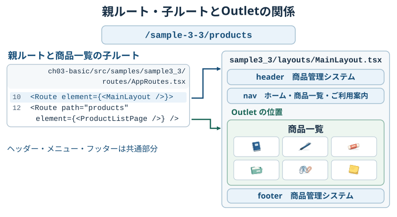{#ch03-layout-route-flow}

::: {#ch03-layout-route-flow-caption .caption}
親ルートに指定した共通レイアウトのOutletに子ルートの画面を表示する
:::

::: {#ch03-layout-r222 .paragraph}
なお、`MainLayout` に `Outlet` を配置しなかった場合は、対応する子ルートが選択されても、その画面を共通レイアウト内に表示できません。
:::

::: {#ch03-layout-r224 .paragraph punctuation-font="inherit"}
**親ルートに共通レイアウトを指定することと、共通レイアウトの中にOutletを配置することの両方が必要です。**
:::

::: {#ch03-layout-r226 .step}
**③ 共通レイアウトを使用するルートのパスを指定する**
:::

::: {#ch03-layout-r228 .paragraph}
今回の親ルートには、`path` 属性を指定していません。
:::

::: {#ch03-layout-r231 .code code-label="TSXの記述例（通常構成・抜粋）" filename="src/routes/AppRoutes.tsx" example="true"}
~~~tsx
      <Route element={<MainLayout />}>
~~~
:::

::: {#ch03-layout-r235 .paragraph}
通常、`Route` には `path` を指定します。しかし、共通レイアウトを適用することだけが目的の場合には、パスを指定しないルートを使用できます。
:::

::: {#ch03-layout-r237 .paragraph punctuation-font="inherit"}
このようなルートは、子ルートをまとめて共通レイアウトを適用しますが、**URLに新しいパスの部分を追加しません。**
:::

::: {#ch03-layout-r239 .paragraph}
一方、商品一覧とご利用案内の子ルートには、`products` や `guide` という相対パスを指定しています。
:::

::: {#ch03-layout-r242 .code code-label="TSXの記述例（通常構成・抜粋）" filename="src/routes/AppRoutes.tsx" example="true"}
~~~tsx
        <Route path="products" element={<ProductListPage />} />
        <Route path="guide" element={<GuidePage />} />
~~~
:::

::: {#ch03-layout-r247 .paragraph}
前節の通常構成では、商品一覧のルートを `path="/products"` と記述していました。今回は、子ルートのパスを `path="products"` と記述しています。
:::

::: {#ch03-layout-r249 .paragraph punctuation-font="inherit"}
先頭の `/` を付けずに、親のルートを基準としてパスを指定する方法を、**相対パス**と呼びます。ルートを階層構造にする際は、このように親のパスに続く部分を指定できます。
:::

::: {#ch03-layout-r251 .paragraph}
今回の親ルートには `path` を指定していません。また、前節の通常構成では、`App.tsx` から `AppRoutes` を直接使用しています。そのため、子ルートのパスの基準はサイトのルート（`/`）です。
:::

::: {#ch03-layout-r253 .paragraph}
商品一覧のURLのパスは `/products`、ご利用案内のURLのパスは `/guide` になります。共通レイアウトを追加しても、前節の通常構成で使用していたURLは変わりません。
:::

::: {#ch03-layout-r255 .table column-widths="16 30 31 23"}
| 画面 | 前節のルートの指定 | 今回の子ルートの指定 | 実際のURLのパス |
|---|---|---|---|
| 商品一覧 | `path="/products"` | `path="products"` | `/products` |
| ご利用案内 | `path="/guide"` | `path="guide"` | `/guide` |
:::

::: {#ch03-layout-r260 .paragraph}
なお、`layouts` や `pages` などのフォルダー名が、そのままブラウザーのURLに追加されるわけではありません。URLのパスは、ルーティングの設定によって決まります。
:::

::: {#ch03-layout-r262 .step}
**④ indexで親ルートのURLに対応する画面を指定する**
:::

::: {#ch03-layout-r264 .paragraph}
ホーム画面のルートには、前節とは異なる記述を使用しています。
:::

::: {#ch03-layout-r267 .code code-label="TSXの記述例（通常構成・抜粋）" filename="src/routes/AppRoutes.tsx" example="true"}
~~~tsx
        <Route index element={<HomePage />} />
~~~
:::

::: {#ch03-layout-r271 .paragraph}
`index` は、親ルートに対応するURLにアクセスした場合に表示する、デフォルトの子ルートを指定するための属性です。
:::

::: {#ch03-layout-r273 .paragraph}
今回の場合は、サイトのルートである `/` にアクセスすると、`MainLayout` の `Outlet` の位置に `HomePage` が表示されます。
:::

::: {#ch03-layout-r275 .paragraph}
前節の通常構成では、ホーム画面のルートを `path="/"` で指定していました。今回は、共通レイアウトのデフォルトの子ルートとしてホーム画面を指定するため、`index` を使用しています。
:::

::: {#ch03-layout-r277 .paragraph}
`index` を指定するルートには、`path` を指定しません。
:::

::: {#ch03-layout-r279 .paragraph}
ここまでのルートの設定と、実際に表示される画面との対応関係を整理しましょう。
:::

::: {#ch03-layout-r281 .table column-widths="26 26 48"}
| URLのパス | 共通レイアウト | Outletに表示するコンポーネント |
|---|---|---|
| `/` | `MainLayout` | `HomePage`（index） |
| `/products` | `MainLayout` | `ProductListPage` |
| `/guide` | `MainLayout` | `GuidePage` |
:::

{#ch03-layout-relative-path}

::: {#ch03-layout-relative-path-caption .caption}
親ルートで共通レイアウトを指定し、子ルートで中央に表示する画面を決定する
:::

::: {#ch03-layout-r293 .paragraph}
このように、共通レイアウトとルーティングの設定を分けて管理すれば、共通部分を変更する際は `layouts/MainLayout.tsx`、表示する画面の対応関係を変更する際は `routes/AppRoutes.tsx` を編集することができます。
:::

:::: {#ch03-layout-r295 .training-note breakable="true"}
【補足】本研修の配布サンプルの構成

3.2節で説明したように、配布プロジェクトでは、各節のサンプルを独立して確認できるようにフォルダーを分けています。

3.3の講義用サンプルは、`ch03-basic/src/samples/sample3_3/` に用意しています。この中に、`components`、`pages`、`layouts`、`routes` の各フォルダーがあります。`components` と `pages` の各ファイルは、3.2の講義用サンプルと同じ内容です。

今回学習した `layouts/MainLayout.tsx` と `routes/AppRoutes.tsx` は、通常構成と配布サンプルで同じコードを使用しています。異なるのは、アクセスするURLです。

::: {#ch03-layout-r303 .table column-widths="20 36 44"}
| 画面 | 通常構成のURLのパス | 配布サンプルのURLのパス |
|---|---|---|
| ホーム | `/` | `/sample-3-3` |
| 商品一覧 | `/products` | `/sample-3-3/products` |
| ご利用案内 | `/guide` | `/sample-3-3/guide` |
:::

配布サンプルでは、`/sample-3-3` があらかじめ入口として設定されています。相対パスを指定しているため、通常構成と同じルート定義で、上の表のようなURLに対応できます。

教材メニューとの接続に使用するファイルや設定は、変更する必要はありません。
::::
:::::

::::: {#page-11 .source-page}
::: {#ch03-layout-r313 .heading level="minor"}
配布サンプルの動作確認
:::

::: {#ch03-layout-r315 .paragraph}
配布サンプルの `ch03-basic` の開発サーバーを起動し、メニューから「3.3 共通レイアウトの作成」を選択してください。
:::

::: {#ch03-layout-r317 .paragraph}
ブラウザーのアドレスバーで、上の表の「配布サンプルのURLのパス」に示した3つのパスにアクセスし、各画面に共通レイアウトが適用されていることを確認しましょう。ホスト名とポート番号には、開発サーバーの起動時にターミナルに表示されたURLのものを使用してください。
:::

::: {#ch03-layout-r319 .paragraph}
この操作では、ページの読み込みが発生します。共通メニューはまだ文字表示なので、クリックしても画面は切り替わりません。次の節で、ページ全体を再読み込みせずにメニューから画面を切り替える方法を学習します。
:::
:::::

::::: {#page-12 .source-page}
::: {#ch03-layout-r321 .heading level="minor"}
【確認演習】共通レイアウトを作成する
:::

::: {#ch03-layout-r323 .paragraph}
ホーム・商品一覧・ご利用案内の3画面に、共通のヘッダー・メニュー・フッターを適用します。
:::

::: {#ch03-layout-r325 .paragraph}
確認演習用のフォルダーには、前節と同じ3つの画面と、共通レイアウトの基本構成が用意されています。前節の確認演習が未完成でも、今回の演習に取り組むことができます。
:::

::: {#ch03-layout-r327 .paragraph}
この確認演習では、上の補足で確認した研修用のフォルダーとURLを使用します。既存の相対パスを維持し、共通レイアウトを適用しましょう。
:::

::: {#ch03-layout-r329 .paragraph numbered="true"}
1．`ch03-basic-q` プロジェクトの次の2つのファイルを開いてください。
:::

::: {#ch03-layout-r331-1 .paragraph}
● `src/exercises/q3_3/layouts/MainLayout.tsx`
:::

::: {#ch03-layout-r331-2 .paragraph}
● `src/exercises/q3_3/routes/AppRoutes.tsx`
:::

::: {#ch03-layout-r334 .paragraph numbered="true"}
2．2つのファイルに記載された➀～➅の番号付きコメントを確認し、指示された箇所を実装してください。➁は既存コードの確認、それ以外は実装問題です。
:::

::: {#ch03-layout-r336 .table column-widths="11 28 61"}
| 番号 | 編集するファイル | 作業内容 |
|---|---|---|
| ➀ | `MainLayout.tsx` | Outletを読み込む。 |
| ➁ | `MainLayout.tsx` | ヘッダー・メニュー・フッターが定義されていることを確認する。 |
| ➂ | `MainLayout.tsx` | メニューとフッターの間にOutletを配置する。 |
| ➃ | `AppRoutes.tsx` | layoutsフォルダーのMainLayoutを読み込む。 |
| ➄ | `AppRoutes.tsx` | 既存の3つのRouteを、MainLayoutを表示する親Routeで囲む。親Routeにはpathを指定しない。 |
| ➅ | `AppRoutes.tsx` | ホームのRouteを、indexを使用する記述に変更する。 |
:::

::: {#ch03-layout-r345 .paragraph}
コメントに指定されていないコードや、ほかのファイルは変更する必要はありません。
:::

::: {#ch03-layout-r347 .paragraph numbered="true"}
3．編集した2つのファイルを保存してください。
:::

::: {#ch03-layout-r349 .paragraph numbered="true"}
4．`ch03-basic-q` の開発サーバーを起動し、ターミナルに表示されたURLを開いてください。起動済みの場合は、開いているブラウザーの画面に戻ってください。
:::

::: {#ch03-layout-r351 .paragraph numbered="true"}
5．メニューから「3.3 共通レイアウトの作成」を選択してください。
:::

::: {#ch03-layout-r353 .heading level="minor"}
動作確認
:::

::: {#ch03-layout-r355 .paragraph numbered="true"}
6．ブラウザーのアドレスバーから、次の3つのパスにアクセスしてください。ホスト名とポート番号には、手順4で開いた確認演習用の開発サーバーのURLのものを使用してください。
:::

::: {#ch03-layout-r357 .table column-widths="45 55"}
| URLのパス | 画面の中央に表示される内容 |
|---|---|
| `/sample-3-3` | ホーム画面 |
| `/sample-3-3/products` | 商品一覧画面（6枚の商品カード） |
| `/sample-3-3/guide` | ご利用案内画面 |
:::

::: {#ch03-layout-r363 .paragraph}
次の図と見比べながら、すべての画面に同じヘッダー・メニュー・フッターが表示されていることを確認しましょう。
:::

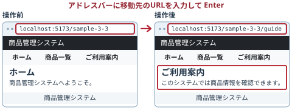{#ch03-layout-check-browser}

::: {#ch03-layout-check-browser-caption .caption}
3つの画面で共通部分が同じであり、中央に異なる画面が表示されることを確認する
:::

::: {#ch03-layout-r371 .paragraph}
次の2点を確認できれば、演習完了です。
:::

::: {#ch03-layout-r373-1 .paragraph}
● 3つのURLにアクセスしたとき、同じ共通レイアウトが表示される。
:::

::: {#ch03-layout-r373-2 .paragraph}
● 中央には、それぞれのURLに対応する画面が表示される。
:::

::: {#ch03-layout-r376 .paragraph}
画面に変更が反映されない場合は、`ch03-basic-q` の開発サーバーのURLを開いていることを確認したうえで、ブラウザーの画面を再読み込みし、もう一度操作してください。
:::

::: {#ch03-layout-r378 .paragraph}
今回は、アドレスバーからURLを変更して画面を表示しました。次の3.4節では、共通レイアウトのメニューにリンクを配置し、ページ全体を再読み込みせずに画面を切り替える方法を学習します。
:::

::: {#ch03-layout-points .section-points}
この節のポイント

● 共通するヘッダー・メニュー・フッターなどは、共通レイアウトとして管理できる。

● 親ルートに共通レイアウト、子ルートに各画面を指定することで、ルートを階層構造にできる。

● `Outlet` は、共通レイアウトの中に子ルートの画面を表示するためのコンポーネントである。

● `path` を指定しない親ルートは、URLのパスを追加せず、子ルートに共通レイアウトを適用できる。

● `index` は、親ルートのURLに対応するデフォルトの子ルートを指定する。
:::
:::::

::::: {#page-13 .source-page}
::: {#ch03-navigation-title .heading}
3.4. SPAの画面遷移（LinkとNavLink）
:::

::: {#ch03-navigation-slide .slide layout="illustration"}
SPAの画面遷移（LinkとNavLink）


:::

::: {#ch03-navigation-r399 .heading level="minor"}
SPAにおける画面遷移
:::

::: {#ch03-navigation-r401 .paragraph}
前節では、親ルートと子ルートを定義し、`Outlet` を使用して、共通レイアウトの中に各画面を表示する方法を学習しました。
:::

::: {#ch03-navigation-r403 .paragraph}
ただし、前節で作成した共通メニューは、文字を表示しているだけのものでした。別の画面を表示するには、ブラウザーのアドレスバーからURLを変更する必要がありました。
:::

::: {#ch03-navigation-r405 .paragraph}
実際のWebアプリケーションでは、メニューやリンクをクリックするだけで、目的の画面に移動できるようにする必要があります。
:::

::: {#ch03-navigation-r407 .paragraph}
通常のHTMLでは、別のページへ移動するために `<a>` タグを使用します。この方法で別のパスへ移動する場合、通常はブラウザーによるページの読み込みが発生します。
:::

::: {#ch03-navigation-r409 .paragraph}
一方、React Routerでは、画面遷移のために `Link`（リンク）や `NavLink`（ナビリンク）というコンポーネントを使用できます。
:::

::: {#ch03-navigation-r411 .paragraph punctuation-font="inherit"}
これらを使用すると、**ページ全体を再読み込みせずにURLを変更し、対応するコンポーネントを表示できます。**
:::

::: {#ch03-navigation-r413 .paragraph}
これが、第1章で学習したSPAにおける画面遷移です。
:::

::: {#ch03-navigation-r415 .paragraph}
この節では、前節の共通レイアウトを使用しながら、メニューをクリックして画面を切り替える方法と、現在表示している画面に対応するメニューを強調する方法を学習します。
:::

::: {#ch03-navigation-r417 .heading level="minor"}
【サンプル】共通メニューから画面を切り替える
:::

::: {#ch03-navigation-r419 .paragraph}
前節で学習した通常のアプリケーション構成を基に、共通レイアウトに次の機能を追加します。
:::

::: {#ch03-navigation-r421-1 .paragraph}
● ヘッダーのシステム名をクリックすると、ホーム画面に戻る。
:::

::: {#ch03-navigation-r421-2 .paragraph}
● 共通メニューをクリックすると、対応する画面が表示される。
:::

::: {#ch03-navigation-r421-3 .paragraph}
● 現在表示している画面に対応するメニューが強調される。
:::

{#ch03-navigation-browser}

::: {#ch03-navigation-browser-caption .caption}
商品一覧を表示し、現在の画面に対応するメニューを強調する
:::

::: {#ch03-navigation-r432 .step punctuation-font="inherit"}
**前節のフォルダー構成を引き継ぐ**
:::

::: {#ch03-navigation-r444 .paragraph punctuation-font="inherit"}
この節では、**共通レイアウトのファイルを変更するだけで、すべての画面で使用するメニューに画面遷移の機能を追加できます。**
:::

{#ch03-navigation-folder-structure}

::: {#ch03-navigation-folder-structure-caption .caption}
3.4では共通レイアウトの変更に集中する
:::

::: {#ch03-navigation-r452 .step punctuation-font="inherit"}
**共通レイアウトのソースコード**
:::

::: {#ch03-navigation-r454 .paragraph}
まず、今回の学習対象となる `layouts/MainLayout.tsx` を確認してください。
:::

::: {#ch03-navigation-r456 .paragraph}
前節では、ヘッダーのシステム名やメニューを文字として表示していました。今回は、ヘッダーに `Link`、3つのメニューに `NavLink` を使用しています。
:::

::: {#ch03-navigation-r461 .code code-label="TSXの記述例" filename="src/layouts/MainLayout.tsx" example="true"}
~~~tsx
import { Link, NavLink, Outlet } from 'react-router'

export default function MainLayout() {
  return (
    <>
      <header className="bg-dark text-white p-3">
        <Link
          to="/"
          className="text-reset text-decoration-none"
        >
          商品管理システム
        </Link>
      </header>
      <nav className="nav nav-pills bg-light p-3 gap-2"
           aria-label="商品管理システムのメニュー">
        <NavLink to="/" className="nav-link" end>
          ホーム
        </NavLink>
        <NavLink to="/products" className="nav-link">
          商品一覧
        </NavLink>
        <NavLink to="/guide" className="nav-link">
          ご利用案内
        </NavLink>
      </nav>
      <Outlet />
      <footer className="bg-light text-center p-3 mt-4">
        商品管理システム
      </footer>
    </>
  )
}
~~~
:::

::: {#ch03-navigation-r499 .paragraph}
ルーティングの設定は、前節と同じです。`routes/AppRoutes.tsx` には、`MainLayout` を表示する親ルートと、3つの画面を表示する子ルートを定義しています。今回はその全体コードを再掲載しません。
:::

::: {#ch03-navigation-r501 .paragraph}
アクセスするURLも、前節と同じです。
:::

::: {#ch03-navigation-r503 .table column-widths="42 58"}
| URLのパス | 表示する画面 |
|---|---|
| `/` | ホーム画面 |
| `/products` | 商品一覧画面 |
| `/guide` | ご利用案内画面 |
:::

::: {#ch03-navigation-r509 .paragraph}
それぞれのリンクをどのように記述するのか、順番に確認していきましょう。
:::
:::::

::::: {#page-14 .source-page}
::: {#ch03-navigation-r511 .heading level="minor"}
構文の解説
:::

::: {#ch03-navigation-r513 .step}
**① Linkを使用して画面を切り替える**
:::

::: {#ch03-navigation-r515 .paragraph}
`Link` は、React Routerが提供する画面遷移用のコンポーネントです。
:::

::: {#ch03-navigation-r517 .paragraph}
`Link` を使用するには、`react-router` からインポートします。今回の記述例では、`Link`、`NavLink`、`Outlet` をまとめてインポートしています。
:::

::: {#ch03-navigation-r520 .code code-label="TSXの記述例（抜粋）" filename="src/layouts/MainLayout.tsx" example="true"}
~~~tsx
import { Link, NavLink, Outlet } from 'react-router'
~~~
:::

::: {#ch03-navigation-r524 .paragraph}
まず、ヘッダーのシステム名をクリックすると、ホーム画面に移動する部分を確認しましょう。
:::

::: {#ch03-navigation-r527 .code code-label="TSXの記述例（抜粋）" filename="src/layouts/MainLayout.tsx" example="true"}
~~~tsx
        <Link
          to="/"
          className="text-reset text-decoration-none"
        >
          商品管理システム
        </Link>
~~~
:::

::: {#ch03-navigation-r536 .paragraph}
`Link` では、HTMLの `<a>` タグと同じように、開始タグと終了タグの間にリンクとして表示する文字などを記述できます。
:::

::: {#ch03-navigation-r538 .paragraph}
ただし、移動先の指定方法が異なります。
:::

::: {#ch03-navigation-r540 .table column-widths="53 47"}
| 記述する要素・コンポーネント | 移動先を指定する属性 |
|---|---|
| HTMLの `<a>` | `href` |
| React Routerの `Link` | `to` |
:::

::: {#ch03-navigation-r545 .paragraph}
例えば、ホーム画面へ移動するリンクを記述する場合は、次のようになります。
:::

::: {#ch03-navigation-r547 .step punctuation-font="inherit"}
**通常のHTMLのリンク**
:::

::: {#ch03-navigation-r550 .code code-label="HTMLの記述例" example="true"}
~~~html
<a href="/">商品管理システム</a>
~~~
:::

::: {#ch03-navigation-r554 .step punctuation-font="inherit"}
**React RouterのLink**
:::

::: {#ch03-navigation-r557 .code code-label="TSXの記述例" example="true"}
~~~tsx
<Link to="/">商品管理システム</Link>
~~~
:::

::: {#ch03-navigation-r561 .paragraph}
どちらも画面にはリンクとして表示されます。React Routerの `Link` も、ブラウザーには `<a>` 要素として反映されます。
:::

::: {#ch03-navigation-r563 .paragraph}
ただし、アプリケーション内の別の画面へ通常のクリック操作で移動する場合、`Link` ではReact Routerが画面遷移を処理します。
:::

::: {#ch03-navigation-r565 .paragraph punctuation-font="inherit"}
そのため、**ページ全体を読み込み直すことなく、移動先のURLに対応する画面を表示できます。**
:::

::: {#ch03-navigation-r567 .paragraph}
今回のサンプルでは、`to="/"` と記述しているため、ヘッダーの「商品管理システム」をクリックすると、ホーム画面へ移動します。
:::

::: {#ch03-navigation-r569 .paragraph}
Bootstrapの `text-reset` でヘッダーの文字色を引き継ぎ、`text-decoration-none` でリンクの下線を外します。
:::

::: {#ch03-navigation-r571 .step}
**② NavLinkを使用して現在の画面に対応するメニューを強調する**
:::

::: {#ch03-navigation-r573 .paragraph}
共通メニューにも `Link` を使用すれば、クリックして各画面へ移動できます。
:::

::: {#ch03-navigation-r575 .paragraph}
しかし、実際のWebアプリケーションでは、ホーム、商品一覧、ご利用案内のうち、現在どの画面を表示しているのかが一目で分かると便利です。
:::

::: {#ch03-navigation-r577 .paragraph}
そのような場合に使用するのが、`NavLink` です。
:::

::: {#ch03-navigation-r579 .paragraph punctuation-font="inherit"}
`NavLink` は、`Link` と同様に画面遷移を行うコンポーネントです。さらに、**現在のURLに応じて、リンクが選択中かどうかを判定する機能** が用意されています。
:::

::: {#ch03-navigation-r581 .paragraph}
今回のサンプルの共通メニューは、次のように記述しています。
:::

::: {#ch03-navigation-r584 .code code-label="TSXの記述例（抜粋）" filename="src/layouts/MainLayout.tsx" example="true"}
~~~tsx
      <nav className="nav nav-pills bg-light p-3 gap-2"
           aria-label="商品管理システムのメニュー">
        <NavLink to="/" className="nav-link" end>
          ホーム
        </NavLink>
        <NavLink to="/products" className="nav-link">
          商品一覧
        </NavLink>
        <NavLink to="/guide" className="nav-link">
          ご利用案内
        </NavLink>
      </nav>
~~~
:::

::: {#ch03-navigation-r590 .paragraph}
Bootstrapの `nav-pills` を親の `<nav>` に、`nav-link` を各 `NavLink` に指定すると、現在の画面に対応するメニューが自動で強調表示されます。
:::

::: {#ch03-navigation-home-end-intro .paragraph}
ホームのメニューに注目してください。
:::

::: {#ch03-navigation-home-end-code .code code-label="TSXの記述例（抜粋）" filename="src/layouts/MainLayout.tsx" example="true"}
~~~tsx
<NavLink to="/" className="nav-link" end>
  ホーム
</NavLink>
~~~
:::

::: {#ch03-navigation-home-end-explanation .paragraph punctuation-font="inherit"}
ホームの `NavLink` には、`end` 属性を指定しています。**`end` を指定すると、リンク先のパスと現在のURLのパスが一致する場合だけ、選択中として扱います。** ホーム画面を表示しているときだけホームのメニューを強調するため、本研修ではこの書き方を使用します。
:::

::: {#ch03-navigation-home-end-note .paragraph}
※ `to="/"` の場合は、`end` を省略しても同じ動作になります。
:::

::: {#ch03-navigation-r632 .paragraph}
なお、`Link` と `NavLink` は、次のように用途に応じて使い分けます。
:::

::: {#ch03-navigation-r634 .table column-widths="32 68"}
| コンポーネント | 使用する場面 |
|---|---|
| `Link` | ヘッダーのシステム名や「商品一覧へ戻る」など、別の画面へ移動するリンクを配置する。 |
| `NavLink` | 共通メニューなど、画面を移動するだけでなく、現在選択中の項目を強調する。 |
:::

::: {#ch03-navigation-r700 .step}
**③ リンクとルーティングを組み合わせて画面を切り替える**
:::

::: {#ch03-navigation-r702 .paragraph}
ここまでに学習した内容を組み合わせて、商品一覧のメニューをクリックしたときの処理の流れを確認しましょう。
:::

::: {#ch03-navigation-r704-1 .paragraph numbered="true"}
1\. `layouts/MainLayout.tsx` の［商品一覧］をクリックする。
:::

::: {#ch03-navigation-r704-2 .paragraph numbered="true"}
2\. `NavLink` の `to` に指定された `/products` にURLが変更される。
:::

::: {#ch03-navigation-r704-3 .paragraph numbered="true"}
3\. React Routerが、`routes/AppRoutes.tsx` で定義されている商品一覧の子ルートに対応することを判断する。
:::

::: {#ch03-navigation-r704-4 .paragraph numbered="true"}
4\. `layouts/MainLayout.tsx` の `Outlet` の位置に `ProductListPage` が表示される。
:::

::: {#ch03-navigation-r709 .paragraph}
また、現在のURLに応じて `NavLink` の選択状態も更新されるため、商品一覧のメニューが強調されます。
:::

{#ch03-navigation-route-flow}

::: {#ch03-navigation-route-flow-caption .caption}
LinkやNavLinkによるURLの変更と、ルートの選択・Outletへの画面表示の関係
:::

::: {#ch03-navigation-r724 .paragraph}
このとき、ページ全体を再読み込みする必要はありません。共通レイアウトを維持したまま、中央のコンテンツ部分を切り替えられます。
:::

::: {#ch03-navigation-r726 .paragraph}
前節で学習した共通レイアウトとルーティングに、今回の `Link` や `NavLink` を組み合わせることで、複数の画面を持つSPAを構築できます。
:::

:::::

::::: {#page-15 .source-page}
::: {#ch03-navigation-r782 .heading level="minor"}
配布サンプルの動作確認
:::

::: {#ch03-navigation-r784 .paragraph}
`ch03-basic` の開発サーバーを起動し、ブラウザーのメニューから「3.4 SPAの画面遷移（LinkとNavLink）」を選択してください。
:::

::: {#ch03-navigation-r786 .paragraph}
共通メニューからホーム・商品一覧・ご利用案内に移動し、URLのパスと画面の表示、選択中のメニューが切り替わることを確認しましょう。ヘッダーの「商品管理システム」をクリックするとホーム画面に戻ります。
:::

::: {#ch03-navigation-r788 .heading level="minor"}
【確認演習】共通メニューから画面遷移する
:::

::: {#ch03-navigation-r790 .paragraph}
共通レイアウトのヘッダーやメニューをクリックすると、対応する画面へ移動できるようにします。
:::

::: {#ch03-navigation-r792 .paragraph}
ルーティングの設定や `Outlet`、各画面のコンポーネント、共通レイアウトの基本構成は、あらかじめ用意されています。
:::

::: {#ch03-navigation-r794 .paragraph}
今回は、ヘッダーのシステム名に `Link` を、3つのメニューに `NavLink` を使用して、画面遷移とメニューの強調表示を実装しましょう。
:::

::: {#ch03-navigation-r796 .paragraph}
演習用の `q3_4` には、前節までの完成済みのルーティングや画面のコードを用意しています。3.3の確認演習が未完成でも取り組めます。編集するのは、次の1ファイルだけです。
:::

::: {#ch03-navigation-r798 .paragraph}
ホームの `NavLink` には、サンプルコードと同様に `end` を指定してください。
:::

::: {#ch03-navigation-r800 .paragraph numbered="true"}
1．`ch03-basic-q` プロジェクトの `src/exercises/q3_4/layouts/MainLayout.tsx` を開いてください。
:::

::: {#ch03-navigation-r802 .paragraph numbered="true"}
2．コード内の➀～➄の番号付きコメントを確認し、指示された箇所を実装してください。すべて実装問題です。
:::

::: {#ch03-navigation-r804 .table column-widths="13 87"}
| 番号 | 作業内容 |
|---|---|
| ➀ | LinkとNavLinkを追加で読み込む。 |
| ➁ | ヘッダーのシステム名をLinkに変更する。 |
| ➂ | ホームのメニューをNavLinkに変更し、endを指定する。 |
| ➃ | 商品一覧のメニューをNavLinkに変更する。 |
| ➄ | ご利用案内のメニューをNavLinkに変更する。 |
:::

::: {#ch03-navigation-r812 .paragraph}
コメントに指定されていないコードや、ほかのファイルは変更する必要はありません。
:::

::: {#ch03-navigation-r814 .paragraph numbered="true"}
3．編集したファイルを保存してください。
:::

::: {#ch03-navigation-r816 .paragraph numbered="true"}
4．`ch03-basic-q` の開発サーバーを起動し、ターミナルに表示されたURLを開いてください。起動済みの場合は、ブラウザーの画面に戻ってください。
:::

::: {#ch03-navigation-r818 .paragraph numbered="true"}
5．メニューから「3.4 SPAの画面遷移（LinkとNavLink）」を選択してください。
:::

::: {#ch03-navigation-r820 .heading level="minor"}
動作確認
:::

::: {#ch03-navigation-r822 .paragraph numbered="true"}
6．共通メニューの［ホーム］をクリックし、ホーム画面が表示されていることを確認してください。
:::

::: {#ch03-navigation-r824 .paragraph}
続いて、［商品一覧］、［ご利用案内］、ヘッダーの［商品管理システム］の順にクリックし、URLと表示する画面が次のように変わることを確認してください。
:::

::: {#ch03-navigation-r826 .table column-widths="38 37 25"}
| クリックする項目 | URLのパス | 表示される画面 |
|---|---|---|
| ホーム | `/sample-3-4` | ホーム画面 |
| 商品一覧 | `/sample-3-4/products` | 商品一覧画面 |
| ご利用案内 | `/sample-3-4/guide` | ご利用案内画面 |
| 商品管理システム | `/sample-3-4` | ホーム画面 |
:::

{#ch03-navigation-check-browser}

::: {#ch03-navigation-check-browser-caption .caption}
商品一覧のメニューをクリックし、画面とメニューの強調表示が切り替わることを確認する
:::

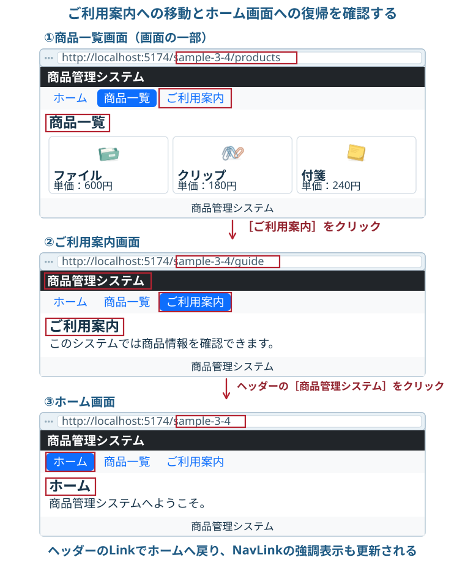{#ch03-navigation-return}

::: {#ch03-navigation-return-caption .caption}
ご利用案内へ移動し、ヘッダーのリンクからホーム画面へ戻ることを確認する
:::

::: {#ch03-navigation-r854 .paragraph}
次の3点を確認できれば、演習完了です。
:::

::: {#ch03-navigation-r856-1 .paragraph}
● メニューをクリックすると、URLと表示する画面が正しく切り替わる。
:::

::: {#ch03-navigation-r856-2 .paragraph}
● 現在表示している画面に対応するメニューだけが、青い背景で強調される。
:::

::: {#ch03-navigation-r856-3 .paragraph}
● ヘッダーのシステム名をクリックすると、ホーム画面に戻る。
:::

::: {#ch03-navigation-r860 .paragraph}
また、どの画面にも同じ共通レイアウトが適用されていることを確認してください。
:::

::: {#ch03-navigation-r862 .paragraph}
画面に変更が反映されない場合は、`ch03-basic-q` の開発サーバーのURLを開いていることを確認したうえで、ブラウザーの画面を再読み込みし、もう一度操作してください。
:::

::: {#ch03-navigation-r864 .paragraph}
次の3.5節では、商品一覧から選択した商品の詳細画面へ移動するために、URLに商品番号を含める方法を学習します。
:::

::: {#ch03-navigation-points .section-points}
この節のポイント

● `Link` や `NavLink` を使用すると、ページ全体を再読み込みせずに画面遷移できる。

● 移動先のURLは `to` 属性に指定する。

● `NavLink` は、現在のURLに応じて選択中のメニューを判定する。

● 親の `<nav>` に `nav-pills`、各 `NavLink` に `nav-link` を指定すると、選択中のメニューが強調表示される。

● `end` 属性を指定すると、リンク先のパスと現在のURLのパスが一致する場合だけ、選択中として扱う。

● 共通レイアウト・ルーティング・リンクを組み合わせることで、複数の画面を持つSPAを構築できる。
:::
:::::

::::: {#page-16 .source-page}
::: {#ch03-params-title .heading}
3.5. URLパラメータの取得
:::

::: {#ch03-params-slide .slide layout="illustration"}
URLパラメータの取得


:::

::: {#ch03-params-r35 .heading level="minor"}
商品ごとの詳細画面を表示するには
:::

::: {#ch03-params-r37 .paragraph}
前節では、`Link` や `NavLink` を使用して、ページ全体を再読み込みせずに画面を切り替える方法を学習しました。
:::

::: {#ch03-params-r39 .paragraph}
今回は、商品一覧から、選択した商品の詳細画面へ移動する方法を学習します。
:::

::: {#ch03-params-r41 .paragraph}
例えば、商品一覧でノートの［詳細］をクリックした場合はノートの詳細画面を、ボールペンの［詳細］をクリックした場合はボールペンの詳細画面を表示したいとします。
:::

::: {#ch03-params-r43 .paragraph}
商品ごとに異なるコンポーネントやルートを用意することもできます。しかし、商品が追加されるたびにソースコードを修正する必要があるため、実際の開発では適切な方法とはいえません。
:::

::: {#ch03-params-r45 .paragraph punctuation-font="inherit"}
そこで、**商品詳細画面を1つのコンポーネントとして作成し、商品番号によって表示する内容を切り替える** という方法を考えます。
:::

::: {#ch03-params-r47 .paragraph}
表示する商品を区別するために、今回はURLの末尾に商品番号を含めます。
:::

::: {#ch03-params-r49 .table column-widths="49 51"}
| URLのパス | 対象の商品 |
|---|---|
| `/products/101` | ノート |
| `/products/102` | ボールペン |
| `/products/103` | 消しゴム |
:::

::: {#ch03-params-r55 .paragraph punctuation-font="inherit"}
React Routerでは、このようにURLのパスに可変部分を定義し、その部分の値を取得できます。取得した値を **ルートパラメータ（Route Params）** と呼びます。本研修では、URLパラメータと表記します。
:::

::: {#ch03-params-r57 .paragraph}
実際の商品詳細画面では、取得した商品番号を使ってREST APIから商品情報を取得し、画面に表示します。
:::

::: {#ch03-params-r59 .paragraph punctuation-font="inherit"}
ただし、REST APIとの連携については後続の章で学習するため、**この節では、URLから商品番号を取得し、画面に表示するところまで** を実装します。
:::

::: {#ch03-params-r61 .heading level="minor"}
【サンプル】URLから商品番号を取得する
:::

::: {#ch03-params-r63 .paragraph}
前節の商品管理システムを基に、商品一覧の各カードに［詳細］を追加します。
:::

::: {#ch03-params-r65 .paragraph}
［詳細］をクリックすると、選択した商品の番号を含むURLへ移動します。商品詳細画面には、URLから取得した商品番号を表示します。また、［商品一覧へ戻る］をクリックすると、商品一覧画面へ戻ります。
:::

::: {#ch03-params-r67 .step punctuation-font="inherit"}
**前節のフォルダー構成を引き継ぐ**
:::

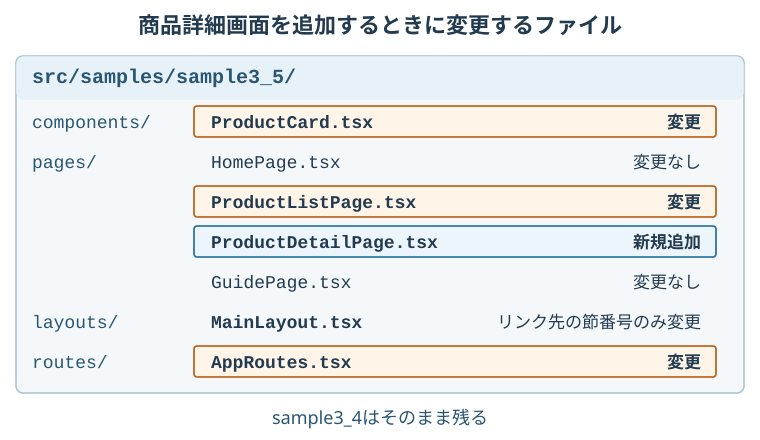{#ch03-params-folder-structure}

::: {#ch03-params-folder-structure-caption .caption}
商品詳細画面の追加に伴い変更するファイルと、新たに作成するファイル
:::

::: {#ch03-params-r111 .step punctuation-font="inherit"}
**商品カードのソースコード**
:::

::: {#ch03-params-r113 .paragraph}
3.1節から使用してきた商品カードに、商品番号を表示する部分と［詳細］リンクを追加します。
:::

::: {#ch03-params-r116 .code code-label="TSXの記述例（通常構成）" filename="src/components/ProductCard.tsx" example="true" wide-code-label="true"}
~~~tsx
import { Link } from 'react-router'

type ProductCardProps = {
  id: number
  name: string
  price: number
  imagePath: string
}

export default function ProductCard(
  { id, name, price, imagePath }: ProductCardProps
) {
  return (
    <div className="col-12 col-sm-6 col-lg-4">
      <div className="card h-100">
        
        <div className="card-body">
          <h2 className="h5 card-title">{name}</h2>
          <p className="card-text">商品番号：{id}</p>
          <p className="card-text">単価：{price}円</p>
          <Link to={`/products/${id}`}
                className="btn btn-primary">
            詳細
          </Link>
        </div>
      </div>
    </div>
  )
}
~~~
:::

::: {#ch03-params-r153 .step punctuation-font="inherit"}
**商品詳細画面のソースコード**
:::

::: {#ch03-params-r155 .paragraph}
商品詳細画面は、新しく `pages/ProductDetailPage.tsx` として作成します。ここでは、URLから取得した商品番号だけを表示します。商品情報を取得する処理は、後続の章で学習します。
:::

::: {#ch03-params-r158 .code code-label="TSXの記述例（通常構成）" filename="src/pages/ProductDetailPage.tsx" example="true" wide-code-label="true"}
~~~tsx
import { Link, useParams } from 'react-router'

export default function ProductDetailPage() {
  const { id } = useParams()

  // 実際の開発では、idを使ってREST APIから商品情報を取得する。

  return (
    <main className="container mt-4">
      <h1>商品詳細</h1>
      <p>商品番号：{id}</p>
      <p className="alert alert-info">
        実際の開発では、この商品番号を使ってREST APIから商品情報を取得します。
      </p>
      <Link to="/products" className="btn btn-secondary">
        商品一覧へ戻る
      </Link>
    </main>
  )
}
~~~
:::

::: {#ch03-params-r181 .step punctuation-font="inherit"}
**ルーティングの設定**
:::

::: {#ch03-params-r183 .paragraph}
`routes/AppRoutes.tsx` に、新たに作成した商品詳細画面をインポートし、商品詳細画面のルートを追加します。
:::

::: {#ch03-params-r186 .code code-label="TSXの記述例（通常構成）" filename="src/routes/AppRoutes.tsx" example="true" wide-code-label="true"}
~~~tsx
import { Routes, Route } from 'react-router'
import HomePage from '../pages/HomePage'
import ProductListPage from '../pages/ProductListPage'
import GuidePage from '../pages/GuidePage'
import MainLayout from '../layouts/MainLayout'
import ProductDetailPage from '../pages/ProductDetailPage'

export default function AppRoutes() {
  return (
    <Routes>
      <Route element={<MainLayout />}>
        <Route index element={<HomePage />} />
        <Route path="products" element={<ProductListPage />} />
        <Route path="products/:id" element={<ProductDetailPage />} />
        <Route path="guide" element={<GuidePage />} />
      </Route>
    </Routes>
  )
}
~~~
:::

::: {#ch03-params-r208 .paragraph}
商品一覧側の `pages/ProductListPage.tsx` については、商品番号をPropsとして渡す変更箇所を、後ほど構文解説で確認します。共通レイアウトも前節と同じ構造のため、全体コードの再掲載は行いません。
:::

::: {#ch03-params-r210 .paragraph}
今回は、次の3つの記述がどのようにつながっているのかに注目してください。
:::

::: {#ch03-params-r212-1 .paragraph}
● 商品詳細画面のルートの定義
:::

::: {#ch03-params-r212-2 .paragraph}
● 商品番号を含むリンク先の指定
:::

::: {#ch03-params-r212-3 .paragraph}
● 詳細画面でのURLパラメータの取得
:::

::: {#ch03-params-r216 .heading level="minor"}
構文の解説
:::

::: {#ch03-params-r218 .step}
**① URLのパスに可変部分を定義する**
:::

::: {#ch03-params-r221 .code code-label="TSXの記述例（通常構成・抜粋）" filename="src/routes/AppRoutes.tsx" example="true" wide-code-label="true"}
~~~tsx
        <Route path="products/:id" element={<ProductDetailPage />} />
~~~
:::

::: {#ch03-params-r225 .paragraph}
前節までは、`products` や `guide` のように、あらかじめ決められたパスに対してルートを定義していました。
:::

::: {#ch03-params-r227 .paragraph}
一方、商品詳細画面では、選択した商品によってURLの末尾が変わります。このような場合に、商品番号ごとにルートを定義する必要はありません。
:::

::: {#ch03-params-r229 .paragraph punctuation-font="inherit"}
React Routerでは、**パスの一部分をコロン（`:`）から始めることで、その部分をURLパラメータとして扱うことができます。**
:::

::: {#ch03-params-r231 .paragraph}
例えば、今回の `path="products/:id"` は、`products` に続く1つのパスの部分を、`id` という名前のURLパラメータとして扱う設定です。
:::

::: {#ch03-params-r233 .paragraph}
3.3節で学習したように、共通レイアウトを指定する親ルートには `path` を指定していません。そのため、通常構成では `/products/101` などのURLが、この子ルートに対応します。
:::

::: {#ch03-params-r235 .table column-widths="30 24 46"}
| URLのパス | 取得する `id` の値 | 表示するコンポーネント |
|---|---|---|
| `/products/101` | `'101'` | `ProductDetailPage` |
| `/products/102` | `'102'` | `ProductDetailPage` |
| `/products/103` | `'103'` | `ProductDetailPage` |
:::

{#ch03-params-figure-1}

::: {#ch03-params-figure-1-caption .caption}
商品番号が異なるURLでも、同じ商品詳細コンポーネントを表示できる
:::

::: {#ch03-params-r250 .paragraph}
なお、`id` はReact Routerで決められた特別な名前ではありません。例えば、`:productId` と定義することもできます。その場合は、値を取得する際にも `productId` という名前を使用します。
:::

::: {#ch03-params-r252 .step}
**② 商品ごとに異なるURLをLinkに指定する**
:::

::: {#ch03-params-r254 .paragraph}
商品一覧から詳細画面へ移動する際は、選択した商品の番号をURLに含める必要があります。
:::

::: {#ch03-params-r256 .paragraph}
まず、商品一覧側のコードを確認しましょう。
:::

::: {#ch03-params-r259 .code code-label="TSXの記述例（通常構成・抜粋）" filename="src/pages/ProductListPage.tsx" example="true" wide-code-label="true"}
~~~tsx
        {products.map((product) => (
          <ProductCard
            key={product.id}
            id={product.id}
            name={product.name}
            price={product.price}
            imagePath={product.imagePath}
          />
        ))}
~~~
:::

::: {#ch03-params-r271 .paragraph}
3.1節で学習したPropsを使用して、商品名・単価・画像のパスに加え、商品番号（`id`）を商品カードへ渡しています。ここで渡した商品番号は、商品カードの中で詳細画面へのリンク先を組み立てるために使用します。
:::

::: {#ch03-params-r273 .paragraph}
ここで、同じ `product.id` を2回使用していることに注目してください。それぞれの役割は異なります。
:::

::: {#ch03-params-r275 .table column-widths="27 73"}
| 記述 | 役割 |
|---|---|
| `key={product.id}` | Reactが繰り返し生成した商品カードを識別するために使用する。 |
| `id={product.id}` | 商品番号をPropsとして子コンポーネントに渡す。 |
:::

::: {#ch03-params-r280 .paragraph punctuation-font="inherit"}
**`key` は通常のPropsとして子コンポーネントに渡されません。** そのため、子コンポーネントの中で商品番号を使用するには、`id` というPropsを別に指定する必要があります。
:::

::: {#ch03-params-r282 .paragraph}
`components/ProductCard.tsx` では、受け取るPropsの型に `id: number` を追加し、関数の引数で `id` も受け取るようにしています。
:::

::: {#ch03-params-r284 .paragraph}
次に、`components/ProductCard.tsx` で、受け取った商品番号をリンク先に使用している部分を確認します。
:::

::: {#ch03-params-r287 .code code-label="TSXの記述例（通常構成・抜粋）" filename="src/components/ProductCard.tsx" example="true" wide-code-label="true"}
~~~tsx
          <Link to={`/products/${id}`}
                className="btn btn-primary">
            詳細
          </Link>
~~~
:::

::: {#ch03-params-r294 .paragraph}
前節で学習したとおり、`Link` の `to` 属性には、移動先のURLを指定します。
:::

::: {#ch03-params-r296 .paragraph}
今回は、商品ごとに異なるURLを指定する必要があるため、Propsで受け取った `id` の値を使用してURLを組み立てます。
:::

::: {#ch03-params-r298 .paragraph punctuation-font="inherit"}
JavaScriptでは、文字列をバッククォート（`` ` ``）で囲み、その中に `${式}` と記述することで、式の値を文字列に埋め込むことができます。この書き方を **テンプレートリテラル** と呼びます。
:::

::: {#ch03-params-r300 .paragraph}
例えば、`id` の値が101の場合、次の2つの記述で指定される移動先は同じです。
:::

::: {#ch03-params-r302 .table column-widths="50 50"}
| 記述例 | 特徴 |
|---|---|
| ``to={`/products/${id}`} `` | `id` の値に応じて移動先が変わる。 |
| `to="/products/101"` | 常に同じURLへ移動する。 |
:::

{#ch03-params-figure-2}

::: {#ch03-params-figure-2-caption .caption}
同じLinkの記述でも、商品番号によって移動先が変わる
:::

::: {#ch03-params-r316 .paragraph punctuation-font="inherit"}
このように、**テンプレートリテラルを使用すると、商品ごとに異なるリンク先を、1つの記述で指定できます。**
:::

::: {#ch03-params-r318 .paragraph}
ここでは、商品番号を商品詳細画面へPropsで直接渡しているわけではありません。商品番号を含むURLへ移動し、詳細画面でURLから値を取得します。
:::

::: {#ch03-params-r320 .step}
**③ useParams()でURLパラメータを取得する**
:::

::: {#ch03-params-r322 .paragraph}
詳細画面に移動した後は、URLから商品番号を取得します。
:::

::: {#ch03-params-r324 .paragraph punctuation-font="inherit"}
そのために使用するのが、React Routerが提供する **useParams()** です。
:::

::: {#ch03-params-r327 .code code-label="TSXの記述例（通常構成・抜粋）" filename="src/pages/ProductDetailPage.tsx" example="true" wide-code-label="true"}
~~~tsx
import { Link, useParams } from 'react-router'
~~~
:::

::: {#ch03-params-r331 .paragraph}
`useParams` はReact Routerが提供するHookです。`react-router` からインポートし、商品詳細を表示する関数コンポーネントのトップレベルで使用します。
:::

::: {#ch03-params-r334 .code code-label="TSXの記述例（通常構成・抜粋）" filename="src/pages/ProductDetailPage.tsx" example="true" wide-code-label="true"}
~~~tsx
  const { id } = useParams()
~~~
:::

::: {#ch03-params-r338 .paragraph}
`useParams()` は、現在のURLに対応するルートのURLパラメータをオブジェクトとして返します。
:::

::: {#ch03-params-r340 .paragraph}
例えば、`/products/101` にアクセスした場合は、取得したオブジェクトの `id` プロパティに文字列の `'101'` が格納されます。今回使用するプロパティだけを抜き出すと、次のようになります。
:::

::: {#ch03-params-r343 .code code-label="取得結果の一部（JavaScript）" example="true"}
~~~js
{ id: '101' }
~~~
:::

::: {#ch03-params-r347 .paragraph}
今回のコードでは、3.1節で学習したオブジェクトの分割代入を使用して、このオブジェクトから `id` の値を取り出しています。
:::

{#ch03-params-figure-3}

::: {#ch03-params-figure-3-caption .caption}
ルートで定義したidの値をuseParams()で取得する
:::

::: {#ch03-params-r358 .paragraph punctuation-font="inherit"}
ここで注意してほしいのは、URLの末尾が101という数字であっても、**useParams()で取得する値は文字列である** という点です。
:::

::: {#ch03-params-r360 .paragraph}
また、TypeScriptでは、パラメータが取得できない場合も考慮するため、`id` は `string | undefined` という型で扱われます。これは、文字列または `undefined` のいずれかになる可能性があるという意味です。
:::

::: {#ch03-params-r362 .paragraph}
今回の `products/:id` に一致するURLには、商品番号に相当する部分が含まれています。商品番号を指定せずに `/products` にアクセスした場合は、商品一覧画面が表示されます。
:::

::: {#ch03-params-r364 .step}
**④ 取得した商品番号を画面に表示する**
:::

::: {#ch03-params-r367 .code code-label="TSXの記述例（通常構成・抜粋）" filename="src/pages/ProductDetailPage.tsx" example="true" wide-code-label="true"}
~~~tsx
      <p>商品番号：{id}</p>
~~~
:::

::: {#ch03-params-r371 .paragraph}
URLから取得した `id` の値を、JSXの波括弧内に記述します。これは、2.2節で学習した変数の値を画面に表示する方法と同じです。
:::

::: {#ch03-params-r373 .paragraph}
例えば、ノートの［詳細］から移動した場合は「商品番号：101」、ボールペンの［詳細］から移動した場合は「商品番号：102」と表示されます。
:::

::: {#ch03-params-r375 .paragraph punctuation-font="inherit"}
**商品詳細画面のコンポーネントは同じですが、URLに含まれる商品番号によって表示内容が変わります。**
:::

::: {#ch03-params-r377 .paragraph}
なお、商品詳細画面でも、共通ヘッダーやメニュー、フッターは引き続き表示されます。商品一覧の `NavLink`（`to="/products"`）には `end` 属性を指定していません。そのため、`/products/101` など、商品一覧のパスに続くURLを表示している場合も、「商品一覧」のメニューが強調されます。
:::

::: {#ch03-params-r379 .paragraph}
［商品一覧へ戻る］の `Link` には、商品一覧に対応する固定のURLを指定しています。
:::

::: {#ch03-params-r382 .code code-label="TSXの記述例（通常構成・抜粋）" filename="src/pages/ProductDetailPage.tsx" example="true" wide-code-label="true"}
~~~tsx
      <Link to="/products" className="btn btn-secondary">
        商品一覧へ戻る
      </Link>
~~~
:::

:::: {#ch03-params-r388 .training-note breakable="true"}
【補足】実際の商品詳細画面では

今回の商品詳細画面では、商品情報として、取得した商品番号だけを表示しています。

しかし、実際の商品管理システムでは、商品番号だけでなく、商品名や単価、商品画像なども表示する必要があります。

REST APIとデータベースを連携させるアプリケーションでは、一般的に、**URLから取得した商品番号を使ってREST APIにリクエストを送信し、該当する商品情報を取得します。**

例えば、商品番号101の詳細画面を表示する場合は、次のような流れになります。

1．Reactで `useParams()` を使用し、URLから商品番号を取得する。

2．取得した商品番号を使用して、REST APIにリクエストを送信する。

3．REST API側で商品番号を受け取り、データベースから該当する商品情報を取得する。

4．REST APIから返された商品情報をReactで受け取り、商品詳細画面に表示する。

::: {#ch03-params-figure-4 .note-figure}

:::

~~~{#ch03-params-r426 .tsx code-label="TSXの記述例（通常構成・抜粋）" filename="src/pages/ProductDetailPage.tsx" example="true" wide-code-label="true"}
  // 実際の開発では、idを使ってREST APIから商品情報を取得する。
~~~

::::

:::: {#ch03-params-r434 .training-note breakable="true"}
【補足】本研修の配布サンプルの構成

3.5の講義用サンプルは、`ch03-basic/src/samples/sample3_5/` に用意しています。前節までの完成サンプルを残すため、3.5で使用するファイルをこのフォルダーにまとめています。

配布サンプルでは、3.2節で説明したように、節ごとにURLの入口を分けています。3.5の入口は `/sample-3-5` です。

::: {#ch03-params-r440 .table column-widths="32 31 37"}
| 画面 | 通常構成のURLのパス | 配布サンプルのURLのパス |
|---|---|---|
| ホーム | `/` | `/sample-3-5` |
| 商品一覧 | `/products` | `/sample-3-5/products` |
| 商品詳細（商品番号101） | `/products/101` | `/sample-3-5/products/101` |
| ご利用案内 | `/guide` | `/sample-3-5/guide` |
:::

::::

::: {#ch03-params-r470 .heading level="minor"}
配布サンプルの動作確認
:::

::: {#ch03-params-r472 .paragraph}
`ch03-basic` の開発サーバーを起動し、ターミナルに表示されたURLを開いてください。ブラウザーのメニューから「3.5 URLパラメータの取得」を選択します。
:::

::: {#ch03-params-r474 .paragraph}
共通メニューの［商品一覧］をクリックし、ノートの［詳細］をクリックしてください。URLのパスが `/sample-3-5/products/101` になり、詳細画面に「商品番号：101」と表示されることを確認しましょう。［商品一覧へ戻る］をクリックし、別の商品についても、URLと表示される商品番号の対応を確認してください。
:::

::: {#ch03-params-r476 .heading level="minor"}
【確認演習】URLパラメータを取得する
:::

::: {#ch03-params-r478 .paragraph}
商品一覧の［詳細］をクリックすると、選択した商品の番号を含むURLへ移動し、詳細画面にその商品番号が表示されるようにしましょう。
:::

::: {#ch03-params-r480 .paragraph}
商品データ、共通レイアウト、商品カードのデザイン、商品詳細画面の基本構成は、あらかじめ用意されています。今回は、商品詳細画面のルートの定義、商品番号に応じたリンク先の設定、URLパラメータの取得を実装します。
:::

::: {#ch03-params-r482 .paragraph}
演習用の `q3_5` には、前節までの機能を完成済みの状態で用意しています。前節までの確認演習が未完成でも取り組めます。
:::

::: {#ch03-params-r484 .paragraph}
この確認演習では、上の補足で確認した配布サンプルのURLを使用してください。商品詳細画面のルートは `products/:id` のまま、［詳細］のリンク先には `/sample-3-5/products/` に商品番号を続けたパスを指定します。
:::

::: {#ch03-params-r486 .paragraph numbered="true"}
1．`ch03-basic-q` プロジェクトの次の3つのファイルを開いてください。
:::

::: {#ch03-params-r488-1 .paragraph}
● `src/exercises/q3_5/routes/AppRoutes.tsx`
:::

::: {#ch03-params-r488-2 .paragraph}
● `src/exercises/q3_5/components/ProductCard.tsx`
:::

::: {#ch03-params-r488-3 .paragraph}
● `src/exercises/q3_5/pages/ProductDetailPage.tsx`
:::

::: {#ch03-params-r492 .paragraph numbered="true"}
2．3つのファイルに記載された➀～➄の番号付きコメントを確認し、指示された箇所を実装してください。すべて実装問題です。
:::

::: {#ch03-params-r494 .table column-widths="11 39 50"}
| 番号 | 編集するファイル | 作業内容 |
|---|---|---|
| ➀ | `routes/AppRoutes.tsx` | 商品詳細画面のコンポーネントをインポートする。 |
| ➁ | `routes/AppRoutes.tsx` | 商品詳細画面の子ルートを追加する。 |
| ➂ | `components/ProductCard.tsx` | 商品番号を含むリンク先を設定する。 |
| ➃ | `pages/ProductDetailPage.tsx` | useParamsを追加でインポートする。 |
| ➄ | `pages/ProductDetailPage.tsx` | useParams()を使用して商品番号を取得する。 |
:::

::: {#ch03-params-r502 .paragraph}
コメントに指定されていないコードや、ほかのファイルは変更する必要はありません。
:::

::: {#ch03-params-r504 .paragraph numbered="true"}
3．編集したファイルを保存してください。
:::

::: {#ch03-params-r506 .paragraph numbered="true"}
4．`ch03-basic-q` の開発サーバーを起動し、ターミナルに表示されたURLを開いてください。起動済みの場合は、開いているブラウザーの画面に戻ってください。
:::

::: {#ch03-params-r508 .paragraph numbered="true"}
5．メニューから「3.5 URLパラメータの取得」を選んでください。
:::

::: {#ch03-params-r510 .heading level="minor"}
動作確認
:::

::: {#ch03-params-r512 .paragraph numbered="true"}
6．共通メニューの［商品一覧］をクリックしてください。次に、ファイルの［詳細］をクリックし、次の内容を確認します。
:::

::: {#ch03-params-r514-1 .paragraph}
● URLのパスが `/sample-3-5/products/201` になっていること。
:::

::: {#ch03-params-r514-2 .paragraph}
● 詳細画面に「商品番号：201」と表示されていること。
:::

{#ch03-params-figure-5}

::: {#ch03-params-figure-5-caption .caption}
ファイルの［詳細］をクリックし、URLと取得した商品番号を確認する
:::

::: {#ch03-params-r528 .paragraph}
続いて、［商品一覧へ戻る］をクリックしてください。商品一覧画面に戻ったら、今度はクリップの［詳細］をクリックします。
:::

::: {#ch03-params-r530 .paragraph}
URLのパスが `/sample-3-5/products/202` となり、「商品番号：202」と表示されることを確認してください。
:::

::: {#ch03-params-r541 .paragraph}
どちらの商品を選択しても、URLに含まれる商品番号と詳細画面に表示される商品番号が一致していれば、演習完了です。
:::

::: {#ch03-params-r543 .paragraph}
※ 今回は商品情報の取得や商品の存在確認は行いません。詳細画面に商品名や単価、商品画像が表示されていないのは、意図した動作です。
:::

::: {#ch03-params-r545 .paragraph}
画面に変更が反映されない場合は、`ch03-basic-q` の開発サーバーに接続していることを確認してください。講義用と確認演習用の開発サーバーのURLは異なる場合があります。正しいURLを開いたうえで、ブラウザーの画面を再読み込みして、もう一度操作してください。
:::

::: {#ch03-params-r547 .paragraph}
次の3.6節では、リンクのクリックだけでなく、プログラムの処理に応じて画面遷移を行う方法を学習します。
:::

::: {#ch03-params-points .section-points}
この節のポイント

● `Route` の `path` で `:id` のように可変部分を定義すると、URLパラメータとして値を取得できる。

● テンプレートリテラルを使用すると、商品番号に応じて `Link` の移動先を組み立てられる。

● `useParams()` を使用すると、現在のURLに対応するルートのURLパラメータを取得できる。取得する値は文字列である。

● 実際の詳細画面では、取得した商品番号をREST APIへのリクエストに使用し、商品情報を取得して表示できる。
:::
:::::

::::: {#page-17 .source-page}
::: {#ch03-programmatic-title .heading}
3.6. プログラムによる画面遷移
:::

::: {#ch03-programmatic-slide .slide layout="illustration"}
プログラムによる画面遷移

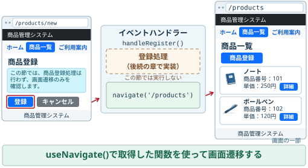
:::

::: {#ch03-programmatic-r571 .heading level="minor"}
プログラムの処理に応じて画面を切り替えるには
:::

::: {#ch03-programmatic-r573 .paragraph}
3.4節では、`Link` や `NavLink` を使用して、ページ全体を再読み込みせずに画面を切り替える方法を学習しました。また、前節では、商品一覧から商品番号を含むURLへ移動し、詳細画面でその商品番号を取得しました。
:::

::: {#ch03-programmatic-r575 .paragraph}
これらの画面遷移は、リンクをクリックすると、あらかじめ指定した移動先へ画面が切り替わる仕組みです。
:::

::: {#ch03-programmatic-r577 .paragraph punctuation-font="inherit"}
しかし、実際のWebアプリケーションでは、**プログラムで何らかの処理を行い、その結果に応じて画面を切り替えたい場合** があります。
:::

::: {#ch03-programmatic-r579 .paragraph}
例えば、商品管理システムの商品登録画面で［登録］ボタンをクリックした場合を考えてみましょう。一般的には、次のような処理が必要です。
:::

::: {#ch03-programmatic-r581-1 .paragraph numbered="true"}
1\. 入力された商品情報をサーバーへ送信し、商品を登録する。
:::

::: {#ch03-programmatic-r581-2 .paragraph numbered="true"}
2\. 商品が正常に登録されたかどうかを確認する。
:::

::: {#ch03-programmatic-r581-3 .paragraph numbered="true"}
3\. 登録に成功した場合は商品一覧画面へ移動する。失敗した場合は商品登録画面に留まり、エラーメッセージなどを表示する。
:::

{#ch03-programmatic-figure-1}

::: {#ch03-programmatic-figure-1-caption .caption}
実際の開発では、登録処理の結果に応じて画面遷移を行う
:::

::: {#ch03-programmatic-r595 .paragraph}
［登録］に通常のリンクを使用すると、リンクのクリックによって指定した画面へ移動します。しかし、登録の結果を確認してから移動先を決定するには、処理を実行するプログラムの中で画面遷移を行えるようにする必要があります。
:::

::: {#ch03-programmatic-r597 .paragraph punctuation-font="inherit"}
そこで使用するのが、React Routerが提供する **useNavigate()** です。
:::

::: {#ch03-programmatic-r599 .paragraph}
`useNavigate()` を使用すると、画面遷移を行うための関数を取得できます。その関数を、画面遷移が必要になったときに呼び出すことで、プログラムから指定した画面へ移動できます。
:::

::: {#ch03-programmatic-r601 .paragraph punctuation-font="inherit"}
商品登録処理やREST APIとの連携は、後続の章で学習します。この節では、登録処理を実装する前の準備として、**ボタンのイベントハンドラーから画面遷移を行う方法** を学習します。
:::

::: {#ch03-programmatic-r603 .heading level="minor"}
【サンプル】登録ボタンをクリックして商品一覧画面へ移動する
:::

::: {#ch03-programmatic-r605 .paragraph}
前節の商品管理システムを基に、新たに商品登録画面を追加します。
:::

::: {#ch03-programmatic-r607 .paragraph}
今回のサンプルでは、次の操作ができるようにします。
:::

::: {#ch03-programmatic-r609-1 .paragraph}
● 商品一覧画面の［商品登録］をクリックすると、商品登録画面へ移動する。
:::

::: {#ch03-programmatic-r609-2 .paragraph}
● 商品登録画面の［登録］ボタンをクリックすると、イベントハンドラーから商品一覧画面へ移動する。
:::

::: {#ch03-programmatic-r609-3 .paragraph}
● 商品登録画面の［キャンセル］をクリックすると、商品一覧画面へ戻る。
:::

::: {#ch03-programmatic-r613 .paragraph}
今回は画面遷移の仕組みに集中するため、商品の入力フォームや登録処理は実装しません。［登録］ボタンをクリックしても、商品一覧に新しい商品は追加されません。
:::

::: {#ch03-programmatic-r615 .step punctuation-font="inherit"}
**前節のフォルダー構成を引き継ぐ**
:::

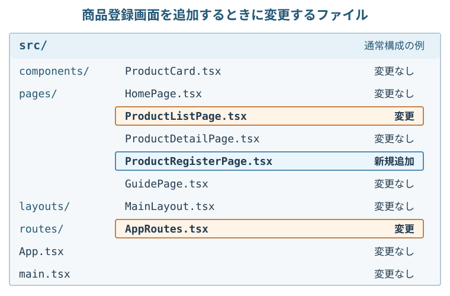{#ch03-programmatic-folder-structure}

::: {#ch03-programmatic-folder-structure-caption .caption}
商品登録画面の追加に伴い変更するファイルと、新たに作成するファイル
:::

::: {#ch03-programmatic-r661 .paragraph}
今回は新たに作成する商品登録画面と、その画面を表示するためのルーティングを中心に確認します。前節までと同じ処理については、全体ソースコードの掲載を省略します。
:::

::: {#ch03-programmatic-r663 .step punctuation-font="inherit"}
**商品登録画面のソースコード**
:::

::: {#ch03-programmatic-r665 .paragraph}
新たに作成する `pages/ProductRegisterPage.tsx` には、画面の表示と［登録］ボタンをクリックしたときの処理を記述します。
:::

::: {#ch03-programmatic-r668 .code code-label="TSXの記述例（通常構成）" filename="src/pages/ProductRegisterPage.tsx" example="true" wide-code-label="true"}
~~~tsx
import { Link, useNavigate } from 'react-router'

export default function ProductRegisterPage() {
  const navigate = useNavigate()

  function handleRegister() {
    // 実際の開発では、REST APIで商品を登録し、成功を確認する。
    navigate('/products')
  }

  return (
    <main className="container mt-4">
      <h1>商品登録</h1>
      <p className="alert alert-info">
        この節では、商品登録処理は行わず、画面遷移のみを確認します。
      </p>
      <div className="d-flex gap-2">
        <button type="button" className="btn btn-primary"
                onClick={handleRegister}>
          登録
        </button>
        <Link to="/products" className="btn btn-secondary">
          キャンセル
        </Link>
      </div>
    </main>
  )
}
~~~
:::

::: {#ch03-programmatic-r699 .paragraph}
今回のサンプルでは、［登録］に `button` 要素を、［キャンセル］に `Link` を使用しています。どちらの操作でも商品一覧画面へ移動しますが、その目的と実装方法が異なります。
:::

::: {#ch03-programmatic-r701 .step punctuation-font="inherit"}
**商品一覧画面へのリンクの追加**
:::

::: {#ch03-programmatic-r703 .paragraph}
続いて、`pages/ProductListPage.tsx` を確認します。商品カードや商品データを表示する処理は前節と同じですが、商品登録画面へ移動するための `Link` を追加しています。
:::

::: {#ch03-programmatic-r706 .code code-label="TSXの記述例（通常構成・抜粋）" filename="src/pages/ProductListPage.tsx" example="true" wide-code-label="true"}
~~~tsx
import { Link } from 'react-router'
~~~
:::

::: {#ch03-programmatic-r711 .code code-label="TSXの記述例（通常構成・抜粋）" filename="src/pages/ProductListPage.tsx" example="true" wide-code-label="true"}
~~~tsx
      <h1>商品一覧</h1>
      <Link to="/products/new" className="btn btn-primary mb-3">
        商品登録
      </Link>
~~~
:::

::: {#ch03-programmatic-r718 .paragraph}
この［商品登録］リンクをクリックすると、`/products/new` へ移動します。
:::

::: {#ch03-programmatic-r720 .step punctuation-font="inherit"}
**ルーティングの設定**
:::

::: {#ch03-programmatic-r722 .paragraph}
次に、`routes/AppRoutes.tsx` を確認します。前節までのルートの定義に、商品登録画面を表示するためのルートを追加しています。
:::

::: {#ch03-programmatic-r725 .code code-label="TSXの記述例（通常構成）" filename="src/routes/AppRoutes.tsx" example="true" wide-code-label="true"}
~~~tsx
import { Routes, Route } from 'react-router'
import HomePage from '../pages/HomePage'
import ProductListPage from '../pages/ProductListPage'
import GuidePage from '../pages/GuidePage'
import MainLayout from '../layouts/MainLayout'
import ProductDetailPage from '../pages/ProductDetailPage'
import ProductRegisterPage from '../pages/ProductRegisterPage'

export default function AppRoutes() {
  return (
    <Routes>
      <Route element={<MainLayout />}>
        <Route index element={<HomePage />} />
        <Route path="products" element={<ProductListPage />} />
        <Route path="products/new" element={<ProductRegisterPage />} />
        <Route path="products/:id" element={<ProductDetailPage />} />
        <Route path="guide" element={<GuidePage />} />
      </Route>
    </Routes>
  )
}
~~~
:::

::: {#ch03-programmatic-r749 .paragraph}
今回は、共通レイアウトの中に次の画面を表示できます。
:::

::: {#ch03-programmatic-r751 .table column-widths="31 47 22"}
| URLのパス | 表示するコンポーネント | 画面 |
|---|---|---|
| `/` | `HomePage` | ホーム |
| `/products` | `ProductListPage` | 商品一覧 |
| `/products/new` | `ProductRegisterPage` | 商品登録 |
| `/products/101` | `ProductDetailPage` | 商品詳細（商品番号101） |
| `/guide` | `GuidePage` | ご利用案内 |
:::

::: {#ch03-programmatic-r759 .paragraph}
通常構成では、商品一覧画面（`/products`）で［商品登録］をクリックすると、次のように商品登録画面（`/products/new`）が表示されます。
:::

{#ch03-programmatic-figure-2}

::: {#ch03-programmatic-figure-2-caption .caption}
Linkを使用して商品登録画面へ移動する
:::

::: {#ch03-programmatic-r770 .paragraph}
ここからは、商品登録画面を追加したルートと、［登録］ボタンをクリックしたときにプログラムから画面遷移を行う仕組みを確認しましょう。
:::

::: {#ch03-programmatic-r772 .heading level="minor"}
構文の解説
:::

::: {#ch03-programmatic-r774 .step}
**① 商品登録画面のルートを追加する**
:::

::: {#ch03-programmatic-r777 .code code-label="TSXの記述例（通常構成・抜粋）" filename="src/routes/AppRoutes.tsx" example="true" wide-code-label="true"}
~~~tsx
        <Route path="products/new" element={<ProductRegisterPage />} />
        <Route path="products/:id" element={<ProductDetailPage />} />
~~~
:::

::: {#ch03-programmatic-r782 .paragraph}
商品登録画面へのルートは、3.3節で学習した子ルートと同じように定義しています。`path="products/new"` と指定し、`element` には新たに作成した `ProductRegisterPage` を指定します。
:::

::: {#ch03-programmatic-r804 .step}
**② useNavigate()で画面遷移用の関数を取得する**
:::

::: {#ch03-programmatic-r806 .paragraph}
まず、商品登録画面の `pages/ProductRegisterPage.tsx` で、React Routerから `useNavigate` をインポートします。
:::

::: {#ch03-programmatic-r809 .code code-label="TSXの記述例（通常構成・抜粋）" filename="src/pages/ProductRegisterPage.tsx" example="true" wide-code-label="true"}
~~~tsx
import { Link, useNavigate } from 'react-router'
~~~
:::

::: {#ch03-programmatic-r813 .paragraph}
`useNavigate()` は、前節で学習した `useParams()` と同じように、React Routerが提供するHookです。
:::

::: {#ch03-programmatic-r815 .paragraph}
続いて、関数コンポーネントの中で次のように記述します。
:::

::: {#ch03-programmatic-r818 .code code-label="TSXの記述例（通常構成・抜粋）" filename="src/pages/ProductRegisterPage.tsx" example="true" wide-code-label="true"}
~~~tsx
  const navigate = useNavigate()
~~~
:::

::: {#ch03-programmatic-r822 .paragraph}
`useNavigate()` を呼び出すと、画面遷移を行うための関数が返されます。今回のサンプルでは、その関数を `navigate` という変数に格納しています。
:::

::: {#ch03-programmatic-r824 .paragraph punctuation-font="inherit"}
ここで注意したいのは、**useNavigate()を呼び出しただけでは、画面遷移は行われない** という点です。実際に画面を切り替えるには、取得した関数を呼び出す必要があります。
:::

::: {#ch03-programmatic-r826 .table column-widths="47 53"}
| 記述 | 役割 |
|---|---|
| `useNavigate()` | 画面遷移を行うための関数を取得する。 |
| `navigate` | 取得した関数を格納している変数。 |
| `navigate('/products')` | 取得した関数を呼び出し、指定したパスへ移動する。 |
:::

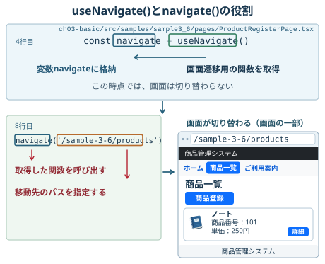{#ch03-programmatic-figure-3}

::: {#ch03-programmatic-figure-3-caption .caption}
useNavigate()で関数を取得し、navigate()で画面遷移を実行する
:::

::: {#ch03-programmatic-r840 .paragraph}
なお、`navigate` はReact Routerで決められた特別な名前ではありません。`useNavigate()` から返された関数を格納するために、自分で付けた変数名です。本研修では、画面遷移を行う関数であることが分かりやすいように、この名前を使用します。
:::

::: {#ch03-programmatic-r842 .step}
**③ イベントハンドラーから画面遷移を行う**
:::

::: {#ch03-programmatic-r844 .paragraph}
取得した `navigate` を使用して、［登録］ボタンがクリックされたときに商品一覧画面へ移動する処理を記述します。
:::

::: {#ch03-programmatic-r847 .code code-label="TSXの記述例（通常構成・抜粋）" filename="src/pages/ProductRegisterPage.tsx" example="true" wide-code-label="true"}
~~~tsx
  function handleRegister() {
    // 実際の開発では、REST APIで商品を登録し、成功を確認する。
    navigate('/products')
  }
~~~
:::

::: {#ch03-programmatic-r854 .paragraph}
`handleRegister` は、［登録］ボタンがクリックされたときに実行する関数です。
:::

::: {#ch03-programmatic-r856 .paragraph}
`navigate()` の引数には、移動先のURLのパスを指定します。今回は商品一覧画面へ移動したいため、`'/products'` を指定しています。
:::

::: {#ch03-programmatic-r858 .paragraph}
次に、この関数をボタンのクリックイベントと結び付けます。
:::

::: {#ch03-programmatic-r861 .code code-label="TSXの記述例（通常構成・抜粋）" filename="src/pages/ProductRegisterPage.tsx" example="true" wide-code-label="true"}
~~~tsx
        <button type="button" className="btn btn-primary"
                onClick={handleRegister}>
          登録
        </button>
~~~
:::

::: {#ch03-programmatic-r868 .paragraph}
2.4節で学習したように、`onClick` に関数を指定すると、ボタンをクリックしたときにその関数が実行されます。
:::

::: {#ch03-programmatic-r870 .paragraph}
今回のサンプルでは、［登録］ボタンをクリックすると、次のように処理が行われます。
:::

::: {#ch03-programmatic-r872-1 .paragraph numbered="true"}
1\. `onClick` に指定した `handleRegister` が実行される。
:::

::: {#ch03-programmatic-r872-2 .paragraph numbered="true"}
2\. `handleRegister` の中で `navigate('/products')` が呼び出される。
:::

::: {#ch03-programmatic-r872-3 .paragraph numbered="true"}
3\. React RouterがURLを変更し、そのパスに対応する子ルートを選択する。
:::

::: {#ch03-programmatic-r872-4 .paragraph numbered="true"}
4\. 共通レイアウトの `Outlet` の位置に `ProductListPage` が表示される。
:::

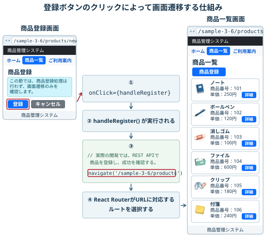{#ch03-programmatic-figure-4}

::: {#ch03-programmatic-figure-4-caption .caption}
イベントハンドラー内でnavigate()を呼び出すと、商品一覧画面へ移動する
:::

::: {#ch03-programmatic-r886 .paragraph}
このように、`Link` による画面遷移と同様に、ページ全体を再読み込みせずに画面を切り替えられます。
:::

::: {#ch03-programmatic-r888 .paragraph}
ここで、`useNavigate()` と `navigate()` を記述する場所の違いも確認しておきましょう。
:::

::: {#ch03-programmatic-r890-1 .paragraph punctuation-font="inherit"}
● **useNavigate()**：関数コンポーネントのトップレベルで呼び出す。
:::

::: {#ch03-programmatic-r890-2 .paragraph punctuation-font="inherit"}
● **navigate()**：取得した関数を、イベントハンドラーなど、画面遷移を行いたい処理の中で呼び出す。
:::

::: {#ch03-programmatic-r893 .paragraph}
`useNavigate()` はHookなので、2.3節で学習した `useState()` と同じように、イベントハンドラーやif文の中では呼び出さないようにしてください。
:::

::: {#ch03-programmatic-r895 .step}
**④ LinkとuseNavigate()の使い分け**
:::

::: {#ch03-programmatic-r897 .paragraph}
今回の商品登録画面では、［登録］と［キャンセル］のどちらを操作しても、商品一覧画面へ戻ります。
:::

::: {#ch03-programmatic-r899 .paragraph}
ただし、［キャンセル］には `navigate()` ではなく、次のように `Link` を使用しています。
:::

::: {#ch03-programmatic-r902 .code code-label="TSXの記述例（通常構成・抜粋）" filename="src/pages/ProductRegisterPage.tsx" example="true" wide-code-label="true"}
~~~tsx
        <Link to="/products" className="btn btn-secondary">
          キャンセル
        </Link>
~~~
:::

::: {#ch03-programmatic-r908 .paragraph}
［キャンセル］の目的は、商品登録を行わずに商品一覧画面へ戻ることです。移動するだけでよいので、これまでに学習した `Link` を使用できます。
:::

::: {#ch03-programmatic-r910 .paragraph}
一方、［登録］の目的は、実際の開発では商品を登録することです。登録処理の結果に応じて画面遷移を行う必要があるため、今回はイベントハンドラーの中から `navigate()` を呼び出す構成としています。
:::

::: {#ch03-programmatic-r912 .paragraph}
それぞれの使い分けを整理すると、次のようになります。
:::

::: {#ch03-programmatic-r914 .table column-widths="25 39 36"}
| 使用する機能 | 適している場面 | 使用例 |
|---|---|---|
| `Link` | リンクをクリックして、指定した画面へ移動する。 | 商品詳細へ移動する、キャンセルして一覧へ戻る。 |
| `NavLink` | リンクで移動するとともに、現在の画面に対応するリンクを強調する。 | 共通メニューの画面遷移と強調表示。 |
| `useNavigate()` で取得した関数 | プログラムの処理に応じて画面遷移を行う。 | 商品の登録や更新に成功した後で一覧へ移動する。 |
:::

::: {#ch03-programmatic-r920 .paragraph}
通常のリンクによる画面遷移には `Link` や `NavLink` を使用し、処理を実行した結果に応じて移動する場合には `useNavigate()` で取得した関数を使用する、という考え方を押さえておきましょう。
:::

:::: {#ch03-programmatic-r922 .training-note breakable="true"}
【補足】実際の商品登録画面では

今回のサンプルでは、［登録］ボタンをクリックしても、商品を登録する処理は実行されません。商品一覧画面へ移動する処理だけを記述しているためです。

`handleRegister` に記述している次のコメントは、実際の商品登録処理を追加する位置を示しています。

~~~{#ch03-programmatic-r929 .tsx code-label="TSXの記述例（通常構成・抜粋）" filename="src/pages/ProductRegisterPage.tsx" example="true" wide-code-label="true"}
    // 実際の開発では、REST APIで商品を登録し、成功を確認する。
~~~

実際の商品登録画面では、フォームで入力された商品情報をREST APIへ送信します。そして、REST APIから返された結果を確認し、登録が成功した場合に商品一覧画面へ移動するようにします。

::: {#ch03-programmatic-api .note-figure}
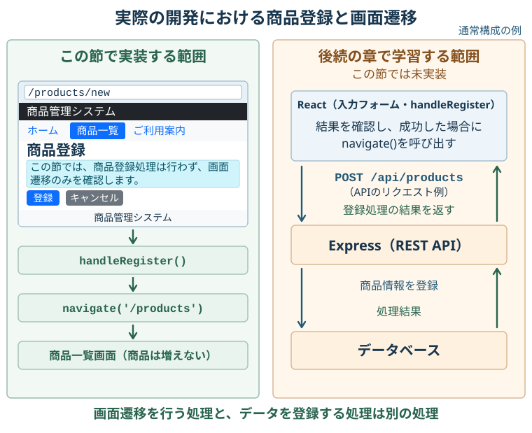
:::

**商品を登録する処理と、登録後に画面を切り替える処理は、別の処理です。** `POST /api/products` は商品を登録するためのREST APIへのリクエスト例であり、`navigate('/products')` はReact側の商品一覧画面への移動を指示する記述です。後続の章では、商品を正常に登録できた場合にのみ `navigate()` を呼び出すように実装します。
::::

:::: {#ch03-programmatic-r947 .training-note breakable="true"}
【補足】本研修の配布サンプルの構成

3.6の講義用サンプルは、`ch03-basic/src/samples/sample3_6/` に用意しています。3.5の完成コードを基に、商品登録画面と画面遷移の処理を追加しています。前節のファイルを直接変更する必要はありません。

配布サンプルでは、3.6のURLの入口が `/sample-3-6` となります。

::: {#ch03-programmatic-r953 .table column-widths="30 31 39"}
| 画面 | 通常構成のURLのパス | 配布サンプルのURLのパス |
|---|---|---|
| ホーム | `/` | `/sample-3-6` |
| 商品一覧 | `/products` | `/sample-3-6/products` |
| 商品登録 | `/products/new` | `/sample-3-6/products/new` |
| 商品詳細（商品番号101） | `/products/101` | `/sample-3-6/products/101` |
| ご利用案内 | `/guide` | `/sample-3-6/guide` |
:::

::: {#ch03-programmatic-distribution-differences .step}
**配布サンプルで異なる部分**
:::

`routes/AppRoutes.tsx` のルート定義と、`useNavigate()` で関数を取得する方法は通常構成と同じです。異なるのは、画面遷移の際に指定するパスです。

商品一覧から商品登録画面へのリンクは、次のように記述しています。

~~~{#ch03-programmatic-r968 .tsx code-label="TSX" filename="ch03-basic/src/samples/sample3_6/pages/ProductListPage.tsx" start-line="17"}
      <Link to="/sample-3-6/products/new" className="btn btn-primary mb-3">
        商品登録
      </Link>
~~~

商品登録画面の［登録］ボタンから商品一覧画面へ移動する処理では、`navigate()` の引数に `/sample-3-6/products` を指定しています。

~~~{#ch03-programmatic-r977 .tsx code-label="TSX" filename="ch03-basic/src/samples/sample3_6/pages/ProductRegisterPage.tsx" start-line="6"}
  function handleRegister() {
    // 実際の開発では、REST APIで商品を登録し、成功を確認する。
    navigate('/sample-3-6/products')
  }
~~~

［キャンセル］のリンクも同じパスを指定しています。

~~~{#ch03-programmatic-r987 .tsx code-label="TSX" filename="ch03-basic/src/samples/sample3_6/pages/ProductRegisterPage.tsx" start-line="22"}
        <Link to="/sample-3-6/products" className="btn btn-secondary">
          キャンセル
        </Link>
~~~

共通レイアウト、商品カードの詳細リンク、商品詳細画面から一覧へ戻るリンクについても、3.6のURLに合わせて設定済みです。通常のアプリケーションを開発する場合は、前節のリンク先を変更する必要はありません。
::::

::: {#ch03-programmatic-r995 .heading level="minor"}
配布サンプルの動作確認
:::

::: {#ch03-programmatic-r997 .paragraph}
`ch03-basic` の開発サーバーを起動し、ターミナルに表示されたURLを開いてください。ブラウザーのメニューから「3.6 プログラムによる画面遷移」を選択します。
:::

::: {#ch03-programmatic-r999 .paragraph}
共通メニューの［商品一覧］から［商品登録］をクリックし、URLのパスが `/sample-3-6/products/new` になることを確認してください。［登録］ボタンをクリックすると `/sample-3-6/products` に移動し、商品一覧画面が表示されます。もう一度商品登録画面に移動し、［キャンセル］からも商品一覧画面へ戻れることを確認しましょう。
:::

::: {#ch03-programmatic-r1001 .heading level="minor"}
【確認演習】プログラムから画面遷移を行う
:::

::: {#ch03-programmatic-r1003 .paragraph}
商品登録画面の［登録］ボタンをクリックすると、プログラムから商品一覧画面へ移動できるようにしましょう。
:::

::: {#ch03-programmatic-r1005 .paragraph}
今回の演習では、商品一覧画面、商品登録画面の基本構成、共通レイアウト、ルーティング、ボタンのクリックイベントなどをあらかじめ用意しています。前節までに学習した構文を使用する部分は実装済みです。
:::

::: {#ch03-programmatic-r1007 .paragraph}
編集するファイルは、`pages` フォルダー内の商品登録画面だけです。
:::

::: {#ch03-programmatic-r1009 .paragraph}
演習用の `q3_6` には、前節までの機能を完成済みの状態で用意しています。前節までの確認演習が未完成でも取り組めます。
:::

::: {#ch03-programmatic-r1011 .paragraph}
この確認演習では、商品一覧への移動先として `/sample-3-6/products` を使用してください。通常構成の `/products` をそのまま指定しないように注意しましょう。
:::

::: {#ch03-programmatic-r1013-1 .paragraph numbered="true"}
1\. `ch03-basic-q` プロジェクトの `src/exercises/q3_6/pages/ProductRegisterPage.tsx` を開いてください。
:::

::: {#ch03-programmatic-r1013-2 .paragraph numbered="true"}
2\. コード内の➀～➂の番号付きコメントを確認し、指示された箇所を実装してください。3つとも実装問題です。
:::

::: {#ch03-programmatic-r1016 .table column-widths="12 88"}
| 番号 | 作業内容 |
|---|---|
| ➀ | useNavigateを追加でインポートする。 |
| ➁ | useNavigate()で画面遷移用の関数を取得する。 |
| ➂ | 登録ボタンのイベントハンドラーから商品一覧画面へ移動する。 |
:::

::: {#ch03-programmatic-r1022-1 .paragraph}
コメントに指定されていないコードや、ほかのファイルは変更する必要はありません。
:::

::: {#ch03-programmatic-r1022-2 .paragraph numbered="true"}
3\. 編集したファイルを保存してください。
:::

::: {#ch03-programmatic-r1022-3 .paragraph numbered="true"}
4\. `ch03-basic-q` の開発サーバーを起動し、ターミナルに表示されたURLを開いてください。起動済みの場合は、開いているブラウザーの画面に戻ってください。
:::

::: {#ch03-programmatic-r1022-4 .paragraph numbered="true"}
5\. メニューから「3.6 プログラムによる画面遷移」を選択してください。
:::

::: {#ch03-programmatic-r1027 .heading level="minor"}
動作確認
:::

::: {#ch03-programmatic-r1029-1 .paragraph numbered="true"}
6\. 共通メニューの［商品一覧］をクリックしてください。次に、［商品登録］をクリックして商品登録画面を表示し、［登録］ボタンをクリックします。
:::

::: {#ch03-programmatic-r1031 .paragraph}
次の図と見比べながら、商品一覧画面へ戻ったことを確認してください。
:::

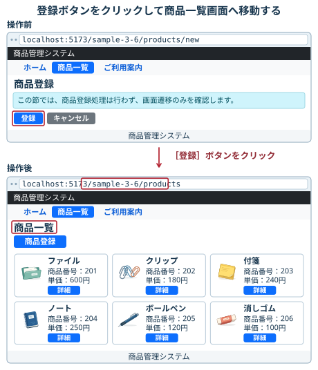{#ch03-programmatic-figure-5}

::: {#ch03-programmatic-figure-5-caption .caption}
登録ボタンのイベント処理から商品一覧画面へ移動する
:::

::: {#ch03-programmatic-r1043 .paragraph}
商品一覧画面へ戻ったら、もう一度［商品登録］をクリックしてください。今度は［キャンセル］をクリックし、商品一覧画面へ戻ることを確認してください。
:::

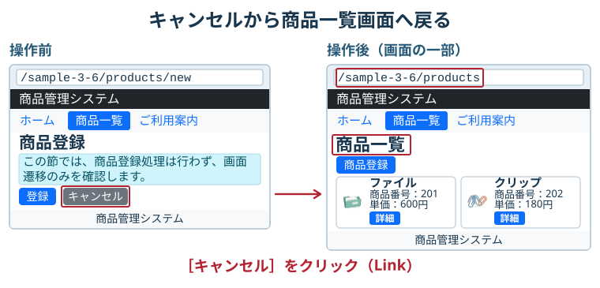{#ch03-programmatic-exercise-cancel}

::: {#ch03-programmatic-exercise-cancel-caption .caption}
キャンセルのLinkからも商品一覧画面へ戻ることを確認する
:::

::: {#ch03-programmatic-r1052 .paragraph}
次の内容を確認できれば、演習完了です。
:::

::: {#ch03-programmatic-r1054-1 .paragraph}
● ［登録］ボタンと［キャンセル］リンクのどちらを操作しても、URLのパスが `/sample-3-6/products` に変わり、商品一覧画面が表示される。
:::

::: {#ch03-programmatic-r1054-2 .paragraph}
● 共通ヘッダー、メニュー、フッターが引き続き表示される。
:::

::: {#ch03-programmatic-r1054-3 .paragraph}
● 商品一覧に表示されている商品の件数や内容は変わらない。
:::

::: {#ch03-programmatic-r1058 .paragraph}
なお、［キャンセル］はあらかじめ実装されています。［登録］ボタンをクリックした場合にも商品一覧画面へ戻れることを必ず確認してください。
:::

::: {#ch03-programmatic-r1060 .paragraph}
画面に変更が反映されない場合は、`ch03-basic-q` の開発サーバーに接続していることを確認してください。講義用と確認演習用の開発サーバーのURLは異なる場合があります。正しいURLを開いたうえで、ブラウザーの画面を再読み込みして、もう一度操作してください。
:::

::: {#ch03-programmatic-points .section-points}
この節のポイント

● `useNavigate()` を使用すると、画面遷移を行うための関数を取得できる。

● `useNavigate()` は関数コンポーネントのトップレベルで呼び出す。取得した関数は、画面遷移を行いたい処理の中で呼び出す。

● 取得した関数の引数に移動先のURLのパスを指定すると、プログラムから画面遷移を行える。

● `Link` や `NavLink` と、`useNavigate()` で取得した関数は、画面遷移を行う場面に応じて使い分ける。
:::
:::::

:::: {#page-18 .source-page}
::: {#ch03-summary-title .heading}
章のまとめ
:::

::: {#ch03-summary-slide .slide layout="summary"}
章のまとめ

■ コンポーネントの分割とProps

■ React Routerによるルーティング

■ 共通レイアウトの作成

■ SPAの画面遷移（LinkとNavLink）

■ URLパラメータの取得

■ プログラムによる画面遷移
:::

::: {#ch03-summary-m482 .paragraph}
この章では、Reactを使用して複数の画面を持つSPAを構築する方法を学習しました。
:::

::: {#ch03-summary-m484 .paragraph}
最初に、画面の一部をコンポーネントとして分割し、Propsを使用して親コンポーネントから子コンポーネントへデータを渡しました。これにより、同じ商品カードを再利用して、複数の商品を一覧表示できるようになりました。
:::

::: {#ch03-summary-m486 .paragraph}
続いて、React Routerを使用してURLと画面を対応付ける方法を学びました。画面のコンポーネント、共通レイアウト、ルーティングの設定を役割ごとに分けて管理し、`Outlet` を使用して共通レイアウトの中に各画面を表示しました。
:::

::: {#ch03-summary-m488 .paragraph}
さらに、`Link` や `NavLink` を使用したSPAの画面遷移と、`useParams()` を使用したURLパラメータの取得を学習しました。最後に、`useNavigate()` で取得した関数を使用して、プログラムの処理に応じた画面遷移を実装しました。
:::

::: {#ch03-summary-m490 .paragraph}
ここまでの学習で、複数の画面から構成されるアプリケーションの基本ができました。後続の章では、REST APIと連携し、サーバーから取得したデータを画面に表示したり、商品の登録や更新、削除を行ったりする方法を学習します。
:::
::::
