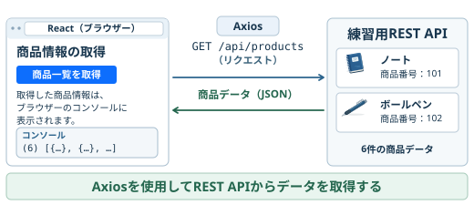
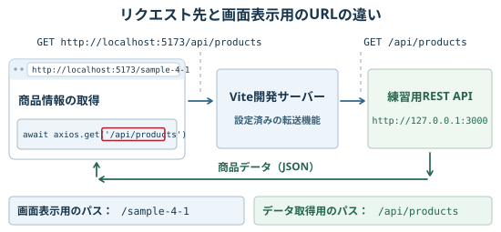
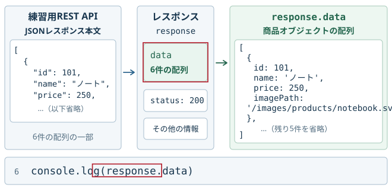
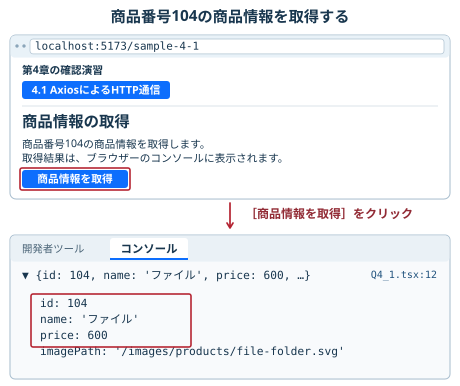

:::: {#page-1 .source-page}

::: {#ch04-number .paragraph}
4
:::

::: {#ch04-title .heading}
第4章 非同期通信と画面更新
:::

::: {#ch04-goals .heading}
章の目標
:::

::: {#ch04-goal-1 .paragraph}
◼ Axiosを使用してREST APIと通信できる
:::

::: {#ch04-goal-2 .paragraph}
◼ useEffectを使用して、画面の表示に伴う処理を実行できる
:::

::: {#ch04-goal-3 .paragraph}
◼ REST APIから取得したデータをstateで管理し、<br>画面に表示できる
:::

::: {#ch04-goal-4 .paragraph}
◼ 通信エラーが発生した場合の処理を実装できる
:::

::::

:::: {#page-2 .source-page}

::: {#ch04-overview-title .heading}
章の概要
:::

::: {#ch04-overview-slide .slide layout="summary"}
章の概要

■ AxiosによるHTTP通信

■ useEffectによる処理の実行

■ REST APIから取得したデータの画面表示

■ 通信エラーへの対応
:::

::: {#ch04-overview-1 .paragraph}
第3章までは、あらかじめ用意した商品データを使用して、Reactで画面を作成する方法や、画面を切り替える方法を学習しました。
:::

::: {#ch04-overview-2 .paragraph}
実際のWebアプリケーションでは、REST APIと通信し、サーバーからデータを取得したり、サーバーへデータを送信したりする必要があります。
:::

::: {#ch04-overview-3 .paragraph}
この章では、まずAxiosを使用してREST APIと通信する方法を学習します。続いて、useEffectを使用して画面の表示に伴う処理を実行する方法を学び、取得したデータを画面に反映する処理を実装します。最後に、通信に失敗した場合の処理を学習します。
:::

::: {#ch04-overview-4 .paragraph}
この章では、あらかじめ用意したREST APIを使用し、React側の実装に集中します。次の第5章では、Expressとデータベースを使用して、REST APIを作成する方法を学習します。
:::

::::

:::: {#page-3 .source-page}

::: {#ch04-axios-title .heading}
4.1. AxiosによるHTTP通信
:::

::: {#ch04-axios-slide .slide layout="illustration"}
AxiosによるHTTP通信


:::

::: {#ch04-axios-background .heading level="minor"}
REST APIと通信するには
:::

::: {#ch04-axios-004 .paragraph}
第3章では、Reactのプロジェクト内に商品データを用意し、そのデータを商品一覧画面に表示しました。
:::

::: {#ch04-axios-005 .paragraph}
しかし、実際の商品管理システムでは、商品の登録や更新などによって商品情報が変化します。そのため、サーバーが管理している最新の商品情報を取得する必要があります。
:::

::: {#ch04-axios-006 .paragraph}
そこで、ReactからREST APIに対してHTTPリクエストを送信し、返されたデータを使用します。
:::

::: {#ch04-axios-007 .paragraph}
SPA開発入門では、JavaScriptの `fetch()` を使用してREST APIと通信する方法を学習しました。本研修では、HTTP通信をより簡潔に記述するために **Axios（アクシオス）** というライブラリを使用します。
:::

::: {#ch04-axios-008 .paragraph}
Axiosは、HTTPリクエストの送信やレスポンスの受け取りを行うJavaScriptのライブラリです。React専用のライブラリではありませんが、ReactからREST APIと通信する際にも使用できます。
:::

::: {#ch04-axios-009 .paragraph}
Axiosでは、HTTPメソッドに対応する次のようなメソッドが用意されています。
:::

::: {#ch04-axios-010 .table column-widths="21 31 48"}
| HTTPメソッド | Axiosのメソッド | 用途の例 |
|---|---|---|
| GET | `axios.get()` | 商品情報を取得する。 |
| POST | `axios.post()` | 商品情報を登録する。 |
| PUT | `axios.put()` | 商品情報を更新する。 |
| DELETE | `axios.delete()` | 商品情報を削除する。 |
:::

::: {#ch04-axios-011 .paragraph}
この節では、GETリクエストを送信して商品情報を取得する方法を学習します。登録・更新・削除は後続の章で学習します。
:::

::: {#ch04-axios-sample .heading level="minor"}
【サンプル】REST APIから商品情報を取得する
:::

::: {#ch04-axios-013 .paragraph}
［商品一覧を取得］ボタンをクリックすると、REST APIから商品一覧を取得し、ブラウザーのコンソールに出力するプログラムを作成します。
:::

::: {#ch04-axios-api .step}
**① 練習用REST APIの起動**
:::

::: {#ch04-axios-015 .paragraph}
第4章で使用するREST APIは、`ch04-api` フォルダーに用意されています。まず、REST APIを起動します。
:::

::: {#ch04-axios-016 .paragraph numbered="true"}
1．Visual Studio Codeで `ch04-api` フォルダーを開き、ターミナルを起動してください。
:::

::: {#ch04-axios-017 .paragraph numbered="true" keep-next="1"}
2．初回のみ、次のコマンドを実行して依存ライブラリをインストールしてください。
:::

::: {#ch04-axios-018 .code example="true" code-label="コンソールの記述例"}
```powershell
npm install
```
:::

::: {#ch04-axios-019 .paragraph numbered="true" keep-next="1"}
3．次のコマンドを実行してください。
:::

::: {#ch04-axios-020 .code example="true" code-label="コンソールの記述例"}
```powershell
npm start
```
:::

::: {#ch04-axios-021 .paragraph}
ターミナルに「REST API: http://127.0.0.1:3000」と表示されれば、REST APIの起動は完了です。第4章の学習中は、このターミナルを終了せず、REST APIを起動したままにしてください。
:::

::: {#ch04-axios-022 .paragraph}
今回のREST APIには、次のリクエスト先が用意されています。
:::

::: {#ch04-axios-023 .table column-widths="20 33 47"}
| HTTPメソッド | リクエスト先 | 取得できるデータ |
|---|---|---|
| GET | `/api/products` | 6件の商品情報の配列 |
| GET | `/api/products/104` | 商品番号104（ファイル）の商品情報 |
:::

::: {#ch04-axios-024 .paragraph}
今回のREST APIは、あらかじめ用意したデータを返します。データベースには接続していません。REST APIを作成する方法については、第5章で学習します。
:::

::: {#ch04-axios-install .step}
**② Axiosのインストール**
:::

::: {#ch04-axios-026 .paragraph}
Axiosは、Reactとは別のライブラリです。通常は、Reactのプロジェクトで次のコマンドを実行して導入します。
:::

::: {#ch04-axios-027 .code example="true" code-label="コンソールの記述例"}
```powershell
npm install axios
```
:::

::: {#ch04-axios-028 .paragraph}
なお、今回配布している `ch04-basic` と `ch04-basic-q` には、Axiosが依存ライブラリとして登録されています。そのため、初回はそれぞれのプロジェクトで `npm install` を実行すれば、Axiosもインストールされます。上記の `npm install axios` を別途実行する必要はありません。
:::

::: {#ch04-axios-sample-code .step keep-next="2"}
**③ React側のプログラムの確認**
:::

::: {#ch04-axios-030 .paragraph}
完成版の `ch04-basic` を別のVisual Studio Codeのウィンドウで開き、`src/components/Sample4_1.tsx` を確認してください。
:::

::: {#ch04-axios-031 .code filename="ch04-basic/src/components/Sample4_1.tsx" start-line="1"}
```tsx
import axios from 'axios'

export default function Sample4_1() {
  async function handleGetProducts() {
    const response = await axios.get('/api/products')
    console.log(response.data)
  }

  return (
    <main className="container mt-4">
      <h1>商品情報の取得</h1>
      <p>取得した商品情報は、ブラウザーのコンソールに表示されます。</p>
      <button type="button" className="btn btn-primary"
              onClick={handleGetProducts}>
        商品一覧を取得
      </button>
    </main>
  )
}
```
:::

::: {#ch04-axios-032 .paragraph}
このプログラムでは、ボタンがクリックされると、Axiosを使用して商品情報を取得し、`console.log()` で取得結果を確認します。
:::

::: {#ch04-axios-033 .paragraph}
`ch04-basic` のターミナルで、初回のみ `npm install` を実行し、`npm run dev` で開発サーバーを起動してください。ターミナルに表示されたURLをブラウザーで開き、メニューから「4.1 AxiosによるHTTP通信」を選択します。
:::

::: {#ch04-axios-034 .paragraph}
ブラウザーでF12キーを押して開発者ツールを開き、［コンソール］（Console）を選択します。［商品一覧を取得］ボタンをクリックすると、6件の商品情報が配列としてコンソールに出力されます。
:::

{#ch04-axios-figure-1}

::: {#ch04-axios-figure-1-caption .caption}
ボタンのクリックによって取得した商品情報をコンソールに表示する
:::

::: {#ch04-axios-syntax .heading level="minor"}
構文の解説
:::

::: {#ch04-axios-import .step keep-next="1"}
**① Axiosのインポート**
:::

::: {#ch04-axios-038 .code filename="ch04-basic/src/components/Sample4_1.tsx" start-line="1"}
```tsx
import axios from 'axios'
```
:::

::: {#ch04-axios-039 .paragraph}
Axiosを使用するために、`axios` パッケージから `axios` をインポートします。これにより、`axios.get()` などのメソッドを使用できるようになります。
:::

::: {#ch04-axios-get .step keep-next="1"}
**② GETリクエストの送信とレスポンスの受け取り**
:::

::: {#ch04-axios-041 .code filename="ch04-basic/src/components/Sample4_1.tsx" start-line="4"}
```tsx
  async function handleGetProducts() {
    const response = await axios.get('/api/products')
```
:::

::: {#ch04-axios-042 .paragraph}
`axios.get()` の引数には、GETリクエストの送信先を指定します。今回の送信先は `/api/products` です。
:::

::: {#ch04-axios-043 .paragraph}
HTTP通信では、リクエストを送信してからレスポンスを受け取るまでに時間がかかります。`axios.get()` は通信結果を表すPromiseを返します。
:::

::: {#ch04-axios-044 .paragraph}
JavaScriptで学習した `async` と `await` を使用すると、レスポンスが返されるのを待ってから、次の処理を実行できます。今回のコードでは、通信が正常に完了したときにレスポンスを定数 `response` に格納します。
:::

::: {#ch04-axios-045 .paragraph}
`await` によって待機するのは、この非同期関数内の後続の処理です。ブラウザー全体の動作が停止するわけではありません。
:::

::: {#ch04-axios-046 .paragraph}
なお、今回のプロジェクトでは、`/api` から始まるリクエストが練習用REST APIへ転送されるように、あらかじめ設定しています。そのため、React側ではホスト名やポート番号を記述せずに通信できます。
:::

{#ch04-axios-figure-2}

::: {#ch04-axios-figure-2-caption .caption}
画面表示用のURLとは別のURLに対してHTTPリクエストを送信する
:::

::: {#ch04-axios-data .step keep-next="1"}
**③ レスポンスから商品データを取得する**
:::

::: {#ch04-axios-049 .code filename="ch04-basic/src/components/Sample4_1.tsx" start-line="6"}
```tsx
    console.log(response.data)
```
:::

::: {#ch04-axios-050 .paragraph}
Axiosが返すレスポンスオブジェクトには、サーバーから返されたデータだけでなく、HTTPステータスコードなどの情報も含まれています。
:::

::: {#ch04-axios-051 .table column-widths="33 67"}
| プロパティ | 内容 |
|---|---|
| `response.data` | サーバーから返されたレスポンスのデータ |
| `response.status` | HTTPステータスコード（正常に取得できた場合の例：200） |
:::

::: {#ch04-axios-052 .paragraph}
今回取得したいのは、REST APIから返された商品情報です。そのため、`response.data` を使用します。
:::

::: {#ch04-axios-053 .paragraph}
REST APIからJSON形式で返された商品情報は、AxiosによってJavaScriptで扱えるデータに変換されます。今回のコードでは、商品情報を格納した配列を取得できます。
:::

{#ch04-axios-figure-3}

::: {#ch04-axios-figure-3-caption .caption}
response.dataを使用してREST APIから返されたデータを取り出す
:::

::: {#ch04-axios-055 .paragraph}
今回はコンソールに出力するだけですが、取得したデータをstateに格納すれば、画面に表示することもできます。この方法については4.3節で学習します。
:::

::: {#ch04-axios-click .step keep-next="1"}
**④ ボタンのクリックによって通信する**
:::

::: {#ch04-axios-057 .code filename="ch04-basic/src/components/Sample4_1.tsx" start-line="13"}
```tsx
      <button type="button" className="btn btn-primary"
              onClick={handleGetProducts}>
        商品一覧を取得
      </button>
```
:::

::: {#ch04-axios-058 .paragraph}
2.4節で学習したイベント処理を使用して、ボタンのクリック時に `handleGetProducts` を実行します。
:::

::: {#ch04-axios-059 .paragraph}
今回のサンプルでは、画面を表示しただけではREST APIと通信しません。［商品一覧を取得］ボタンをクリックしたときにリクエストを送信します。
:::

::: {#ch04-axios-060 .paragraph}
画面の表示に伴って自動的にデータを取得する方法については、次の4.2節で学習します。また、通信に失敗した場合の処理については4.4節で学習します。
:::

::: {#ch04-axios-practice .heading level="minor"}
【確認演習】Axiosを使用して商品情報を取得する
:::

::: {#ch04-axios-062 .paragraph}
［商品情報を取得］ボタンをクリックすると、商品番号104（ファイル）の商品情報をREST APIから取得し、ブラウザーのコンソールに出力するようにしましょう。
:::

::: {#ch04-axios-063 .paragraph}
画面の基本構成、ボタンのイベント処理、練習用REST APIは、あらかじめ用意されています。
:::

::: {#ch04-axios-064 .paragraph numbered="true"}
1．`ch04-basic-q` プロジェクトの次のファイルを開いてください。
:::

::: {#ch04-axios-065 .paragraph}
● `src/components/Q4_1.tsx`
:::

::: {#ch04-axios-066 .paragraph numbered="true"}
2．コード内の➀～➂の番号付きコメントを確認し、指示された箇所を実装してください。コメントに指定されていないコードや、ほかのファイルは変更する必要はありません。
:::

::: {#ch04-axios-067 .paragraph numbered="true"}
3．編集したファイルを保存してください。
:::

::: {#ch04-axios-068 .paragraph numbered="true"}
4．`ch04-api` のREST APIが起動していることを確認してください。起動していない場合は、サンプルの起動手順に従って起動してください。`ch04-basic-q` で初回のみ `npm install` を実行し、`npm run dev` で開発サーバーを起動してください。ターミナルに表示されたURLをブラウザーで開きます。起動済みの場合は、開いているブラウザーの画面に戻ってください。
:::

::: {#ch04-axios-069 .paragraph numbered="true"}
5．メニューから「4.1 AxiosによるHTTP通信」を選んでください。
:::

::: {#ch04-axios-check .heading level="minor"}
動作確認
:::

::: {#ch04-axios-071 .paragraph numbered="true"}
6．ブラウザーでF12キーを押して開発者ツールを開き、［コンソール］（Console）を選択してください。コンソールの既存の出力を消去し、［商品情報を取得］ボタンをクリックしてください。
:::

::: {#ch04-axios-072 .paragraph}
次の内容を確認します。
:::

::: {#ch04-axios-073 .paragraph}
● コンソールに商品情報が出力されていること。
:::

::: {#ch04-axios-074 .paragraph}
● 商品番号（`id`）が104であること。
:::

::: {#ch04-axios-075 .paragraph}
● 商品名（`name`）が「ファイル」、単価（`price`）が600であること。
:::

{#ch04-axios-figure-4}

::: {#ch04-axios-figure-4-caption .caption}
取得した商品情報がコンソールに表示されることを確認する
:::

::: {#ch04-axios-077 .paragraph}
今回取得するデータは1件の商品情報なので、配列ではなくオブジェクトが返されます。指定した商品番号に対応する商品情報が取得できていれば、演習完了です。
:::

::: {#ch04-axios-078 .paragraph}
商品情報が画面内に表示されていないのは、意図した動作です。取得結果はコンソールで確認してください。エラーが発生した場合は、まず練習用REST APIが起動していること、リクエスト先の記述が正しいことを確認してください。
:::

::: {#ch04-axios-points .section-points}
この節のポイント

● Axiosは、HTTPリクエストを送信し、レスポンスを受け取るためのライブラリである。

● `axios.get()` を使用すると、指定したURLへGETリクエストを送信できる。

● `async` と `await` を使用して、通信の結果を待ってから後続の処理を実行できる。

● `response.data` を使用すると、REST APIから返されたデータを取り出せる。
:::

::::
