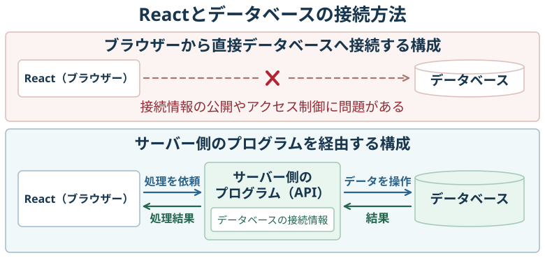

:::: {#page-1 .source-page}

::: {#ch04-number .paragraph}
4
:::

::: {#ch04-title .heading}
第4章 REST APIとの連携
:::

::: {#ch04-goals .heading}
章の目標
:::

::: {#ch04-goal-1 .paragraph}
◼ REST APIの役割と、HTTPメソッドとURLの関係を説明できる
:::

::: {#ch04-goal-2 .paragraph}
◼ Axiosを使用してREST APIからデータを取得できる
:::

::: {#ch04-goal-3 .paragraph}
◼ REST APIから取得したデータをstateで管理し、<br>画面に表示できる
:::

::: {#ch04-goal-4 .paragraph}
◼ useEffectを使用して、画面の表示に伴うデータ取得を実装できる
:::

::: {#ch04-goal-5 .paragraph}
◼ 通信に失敗した場合の処理を実装できる
:::

::::

:::: {#page-2 .source-page}

::: {#ch04-overview-title .heading}
章の概要
:::

::: {#ch04-overview-slide .slide layout="summary"}
章の概要

■ REST APIの役割と仕組み

■ AxiosによるHTTP通信

■ 取得したデータの画面表示

■ useEffectによる処理の実行

■ 通信エラーへの対応
:::

::: {#ch04-overview-1 .paragraph}
第3章までは、あらかじめ用意した商品データを使用して、Reactで画面を作成する方法や、複数の画面を切り替える方法を学習しました。
:::

::: {#ch04-overview-2 .paragraph}
実際の商品管理システムでは、サーバーから商品情報を取得したり、入力した商品情報をサーバーへ送信したりする必要があります。
:::

::: {#ch04-overview-3 .paragraph}
この章では、まずREST APIの役割と仕組みを学習します。続いて、Axiosを使用してREST APIからデータを取得し、取得したデータを画面に表示する方法を学習します。
:::

::: {#ch04-overview-4 .paragraph}
さらに、useEffectを使用して画面の表示時にデータを取得する方法や、通信に失敗した場合の処理についても学習します。
:::

::: {#ch04-overview-5 .paragraph}
本章では、あらかじめ用意したREST APIを使用し、React側の実装に集中します。REST APIの作成とデータベースとの連携については、第5章以降で学習します。
:::

::::

<!-- CODE id="ch04-rest-json-example" type="JSONの記述例" example="true" highlight="none" reason="JSON例全体が説明対象であり、実ファイルの掲載コードではない" -->

:::: {#page-3 .source-page}

::: {#ch04-rest-title .heading}
4.1. REST APIの役割と仕組み
:::

::: {#ch04-rest-slide .slide layout="illustration"}
REST APIの役割と仕組み


:::

::: {#ch04-rest-03 .heading level="minor"}
Reactとデータベースをつなぐには
:::

::: {#ch04-rest-04 .paragraph}
第3章までは、商品名や単価などの商品データをReactのソースコードに記述し、それらの情報を画面に表示してきました。
:::

::: {#ch04-rest-05 .paragraph}
しかし、実際の商品管理システムでは、商品の登録・更新・削除によって、商品情報が変化します。また、複数の利用者が同じ商品情報を参照・操作できるようにする必要があります。
:::

::: {#ch04-rest-06 .paragraph}
そのため、商品情報をソースコードに直接記述するのではなく、データベースで管理する方法が一般的です。
:::

::: {#ch04-rest-07 .paragraph}
ここで、1つの疑問が生まれます。
:::

::: {#ch04-rest-08 .paragraph}
**Reactから直接データベースを操作することはできないのでしょうか。**
:::

::: {#ch04-rest-09 .paragraph}
Reactは、主にWebブラウザー上で動作します。一般的な業務システムで使用するデータベースに、ブラウザーから直接接続して操作する構成は適していません。
:::

::: {#ch04-rest-10 .paragraph}
例えば、ブラウザー側のプログラムにデータベースへの接続情報を記述すると、その情報が利用者に知られるおそれがあります。また、利用者に直接データベースを操作させると、実行できる処理やアクセスできるデータを適切に制御することが難しくなります。
:::

::: {#ch04-rest-11 .paragraph}
そこで、**Reactとデータベースの間に、データベースを操作するサーバー側のプログラムを用意します。** Reactはそのプログラムに対して処理を依頼し、結果を受け取ります。
:::

{#ch04-rest-figure-1}

::: {#ch04-rest-figure-1-caption .caption}
データベースを操作する処理をサーバー側に用意する
:::

::: {#ch04-rest-13 .heading level="minor"}
APIが必要な理由
:::

::: {#ch04-rest-14 .paragraph}
API（Application Programming Interface）とは、別のプログラムが機能を利用するための窓口です。
:::

::: {#ch04-rest-15 .paragraph}
今回の商品管理システムでは、サーバー側に商品情報を取得・登録・更新・削除する機能を用意し、それらの機能をReactから利用できるようにします。このような、HTTP通信によって利用できるAPIをWeb APIと呼びます。
:::

::: {#ch04-rest-16 .paragraph}
例えば、商品一覧を表示する場合、ReactからAPIに商品情報の取得を依頼します。APIはその依頼を受けてデータベースから商品情報を取得し、Reactに返します。
:::

::: {#ch04-rest-17 .paragraph}
このように、Reactとデータベースを連携させる際には、画面を担当するフロントエンドと、データの取得や更新などの処理を担当するバックエンドに分ける必要があります。
:::

::: {#ch04-rest-17-benefits .paragraph}
このような構成には、次のようなメリットがあります。
:::

::: {#ch04-rest-18-1 .paragraph}
● データベースの接続情報をサーバー側で管理できる。
:::

::: {#ch04-rest-18-2 .paragraph}
● データベースに対して実行できる操作や、利用者のアクセス権限をサーバー側で制御できる。
:::

::: {#ch04-rest-18-3 .paragraph}
● Webアプリケーションだけでなく、スマートフォンアプリなどからも同じAPIを利用できる。
:::

::: {#ch04-rest-18-4 .paragraph}
● 画面を作成する処理とデータを操作する処理を分けて開発・管理できる。
:::

::: {#ch04-rest-19 .heading level="minor" keep-next="2"}
REST APIとは
:::

::: {#ch04-rest-20 .paragraph}
Web APIを設計する際には、どのURLに対してリクエストを送信すると、どの処理が実行されるのかを決める必要があります。
:::

::: {#ch04-rest-20-example .paragraph}
例えば、処理の内容をURLに含める設計方法では、商品情報の検索・登録・更新・削除に対して、それぞれ次のようなURLを定義します。
:::

::: {#ch04-rest-20-paths .table column-widths="38 62"}
| 処理内容 | URLのパス |
|---|---|
| 商品情報の検索 | `/api/searchByProduct` |
| 商品情報の登録 | `/api/insertProduct` |
| 商品情報の更新 | `/api/updateProduct` |
| 商品情報の削除 | `/api/deleteProduct` |
:::

::: {#ch04-rest-20-management .paragraph}
このような設計では、機能ごとに異なるURLを定義するため、機能が増えれば増えるほど、管理するURLの種類も増えていきます。また、開発者によってURLの命名方法が異なり、APIの設計に統一性を持たせることが難しくなる場合もあります。
:::

::: {#ch04-rest-20-rest .paragraph}
そこで、このような課題に対応する設計方法として広く利用されているのが、**REST API（レストAPI）**です。
:::

::: {#ch04-rest-21 .paragraph}
REST APIでは、商品などの操作対象となるデータをリソースと呼び、URLを使用してリソースを指定します。また、HTTPメソッドを使用して、そのリソースに対してどのような操作を行うのかを指定します。
:::

::: {#ch04-rest-21-roles .paragraph}
つまり、URLに処理内容を含めるのではなく、**URLで操作対象を、HTTPメソッドで操作内容を表現する**という考え方です。
:::

::: {#ch04-rest-22 .step}
**① URLで操作対象を指定する**
:::

::: {#ch04-rest-23 .paragraph}
例えば、商品情報を操作するためのREST APIでは、次のようなURLを使用します。
:::

::: {#ch04-rest-24 .table column-widths="38 62"}
| URLのパス | 操作対象 |
|---|---|
| `/api/products` | 商品の一覧 |
| `/api/products/101` | 商品番号101の商品 |
:::

::: {#ch04-rest-25 .paragraph}
第3章では、`/products/101` というURLを商品詳細画面の表示に使用しました。一方、`/api/products/101` は商品番号101の情報を操作するためのAPIのURLです。
:::

::: {#ch04-rest-26 .paragraph}
本研修では、画面を表示するためのURLとAPIのURLを区別しやすいように、APIのURLのパスを `/api` から始めます。
:::

::: {#ch04-rest-27 .step}
**② HTTPメソッドで操作内容を指定する**
:::

::: {#ch04-rest-28 .paragraph}
商品番号101の商品を操作する場合でも、商品情報を取得するのか、更新するのか、削除するのかによって処理は異なります。
:::

::: {#ch04-rest-29 .paragraph}
REST APIでは、操作の種類に応じてGET、POST、PUT、DELETEなどのHTTPメソッドを使い分けます。
:::

::: {#ch04-rest-30 .table column-widths="26 34 40"}
| HTTPメソッド | URLのパス | 処理内容 |
|---|---|---|
| GET | `/api/products` | 商品一覧を取得する。 |
| GET | `/api/products/101` | 商品番号101の情報を取得する。 |
| POST | `/api/products` | 新しい商品を登録する。 |
| PUT | `/api/products/101` | 商品番号101の情報を更新する。 |
| DELETE | `/api/products/101` | 商品番号101の商品を削除する。 |
:::

::: {#ch04-rest-31 .paragraph}
ここで、商品番号101の取得・更新・削除では、同じURLのパスが使用されていることに注目してください。
:::

{#ch04-rest-figure-2}

::: {#ch04-rest-figure-2-caption .caption}
同じURLでも、HTTPメソッドによって操作内容を区別する
:::

::: {#ch04-rest-33 .paragraph}
**REST APIでは、URLとHTTPメソッドの組み合わせによって操作対象と操作内容を表現できます。**
:::

::: {#ch04-rest-34 .paragraph}
このように設計することで、操作のたびに異なるURLを用意する必要が減り、APIの構成が分かりやすくなります。また、共通したルールでAPIを設計できるため、APIを利用する側も、その役割を理解しやすくなります。
:::

::: {#ch04-rest-35 .step}
**③ JSON形式でデータを受け渡す**
:::

::: {#ch04-rest-36 .paragraph}
ReactとREST APIの間で商品情報をやり取りする際には、データの形式を決めておく必要があります。
:::

::: {#ch04-rest-37 .paragraph}
REST APIでは、データの受け渡しにJSON（JavaScript Object Notation）という形式が広く利用されています。
:::

::: {#ch04-rest-38 .paragraph}
例えば、商品番号101の情報を取得した場合、次のようなJSON形式のデータが返されます。
:::

::: {#ch04-rest-json-example .code example="true" code-label="JSONの記述例"}
```json
{
  "id": 101,
  "name": "ノート",
  "price": 250,
  "imagePath": "/images/products/notebook.svg"
}
```
:::

::: {#ch04-rest-40 .paragraph}
JSONでは、JavaScriptのオブジェクトと似た形式でデータを表現できます。また、JavaScriptだけでなく、JavaやPythonなど、さまざまなプログラミング言語で扱えます。
:::

::: {#ch04-rest-41 .paragraph}
そのため、Reactと異なるプログラミング言語で作成したAPIであっても、JSON形式でデータをやり取りできます。
:::

::: {#ch04-rest-42 .heading level="minor"}
本研修で使用する技術
:::

::: {#ch04-rest-43 .paragraph}
本研修では、フロントエンドにReact、REST APIを作成するための環境にNode.jsとExpress、データベースにSQLiteを使用します。
:::

::: {#ch04-rest-44 .table column-widths="21 79"}
| 技術 | 本研修での役割 |
|---|---|
| React | フロントエンドの画面表示や入力処理を実装する。 |
| Axios | ReactからREST APIにHTTPリクエストを送信し、レスポンスを受け取る。 |
| Node.js | サーバー側でJavaScriptを実行する。 |
| Express | Node.js上でREST APIを作成する。 |
| SQLite | 商品情報などのデータを管理する。 |
:::

::::

:::: {#page-4 .source-page}

::: {#ch04-rest-45 .paragraph}
Node.jsは第1章で開発環境の構築にも使用しました。第5章以降では、REST APIを動作させるための実行環境としても使用します。ExpressはJavaScriptでAPIを作成でき、SQLiteは専用のデータベースサーバーを別途起動する必要がないため、学習用の環境を用意しやすいという特徴があります。
:::

{#ch04-rest-figure-3}

::: {#ch04-rest-figure-3-caption .caption}
REST APIを利用する側と作成する側に分けて学習する
:::

::: {#ch04-rest-47 .paragraph}
なお、第4章では、データベースに接続せず、あらかじめ用意した商品データを返す練習用REST APIを使用します。REST APIを作成する方法やデータベースと連携する方法については、第5章で学習します。
:::

::: {#ch04-rest-48 .paragraph}
次の4.2節では、Axiosを使用してREST APIから商品情報を取得する方法を学習します。
:::

::: {#ch04-rest-points .section-points}
この節のポイント

● Reactとデータベースを連携させる際には、一般的にサーバー側のAPIを経由してデータを取得・操作する。

● REST APIでは、URLで操作対象を指定し、HTTPメソッドで操作内容を指定する。

● REST APIでは、データの受け渡しにJSON形式が広く利用されている。

● 本研修では、第4章でREST APIを利用する方法を、第5章以降でREST APIを作成してデータベースと連携する方法を学習する。
:::

::::

:::: {#page-5 .source-page}

::: {#ch04-axios-title .heading}
4.2. AxiosによるHTTP通信
:::

::: {#ch04-axios-slide .slide layout="illustration"}
AxiosによるHTTP通信


:::

::: {#ch04-axios-background .heading level="minor"}
Axiosとは
:::

::: {#ch04-axios-005 .paragraph}
前節では、REST APIの役割と仕組みについて学習しました。今回は、ReactからREST APIにリクエストを送信し、商品情報を取得する方法を学習します。
:::

::: {#ch04-axios-006 .paragraph}
Webブラウザーには、JavaScriptからHTTP通信を行うための標準機能として `fetch()` が用意されています。
:::

::: {#ch04-axios-007 .paragraph}
本研修では、HTTP通信や取得したデータの取り扱いをより簡潔に記述できるように、**Axios（アクシオス）** というライブラリを使用します。
:::

::: {#ch04-axios-008 .paragraph}
Axiosは、HTTPリクエストの送信やレスポンスの受け取りを行うJavaScriptのライブラリです。React専用のライブラリではなく、JavaScriptからHTTP通信を行うさまざまな場面で使用できます。
:::

::: {#ch04-axios-009 .paragraph}
この節では、Axiosの `axios.get()` を使用してGETリクエストを送信し、商品情報を取得します。データの登録・更新・削除に使用するメソッドは後続の章で学習します。
:::

::: {#ch04-axios-sample .heading level="minor"}
【サンプル】REST APIから商品情報を取得する
:::

::: {#ch04-axios-013 .paragraph}
［商品一覧を取得］ボタンをクリックすると、REST APIから商品一覧を取得し、ブラウザーのコンソールに出力するプログラムを作成します。
:::

::: {#ch04-axios-api .step}
**① 練習用REST APIの起動**
:::

::: {#ch04-axios-015 .paragraph}
第4章で使用するREST APIは、`ch04-api` フォルダーに用意されています。まず、REST APIを起動します。
:::

::: {#ch04-axios-016 .paragraph numbered="true"}
1．Visual Studio Codeで `react-basic.code-workspace` を開き、`ch04-api` フォルダーのターミナルを起動してください。
:::

::: {#ch04-axios-017 .paragraph numbered="true" keep-next="1"}
2．初回のみ、次のコマンドを実行して依存ライブラリをインストールしてください。
:::

::: {#ch04-axios-018 .code example="true" code-label="コンソールの記述例"}
```powershell
npm install
```
:::

::: {#ch04-axios-019 .paragraph numbered="true" keep-next="1"}
3．次のコマンドを実行してください。
:::

::: {#ch04-axios-020 .code example="true" code-label="コンソールの記述例"}
```powershell
npm start
```
:::

::: {#ch04-axios-021 .paragraph}
ターミナルに「REST API: http://127.0.0.1:3000」と表示されれば、REST APIの起動は完了です。第4章の学習中は、このターミナルを終了せず、REST APIを起動したままにしてください。
:::

::: {#ch04-axios-022 .paragraph}
今回のREST APIには、次のリクエスト先が用意されています。
:::

::: {#ch04-axios-023 .table column-widths="20 33 47"}
| HTTPメソッド | リクエスト先 | 取得できるデータ |
|---|---|---|
| GET | `/api/products` | 6件の商品情報の配列 |
| GET | `/api/products/104` | 商品番号104（ファイル）の商品情報 |
:::

::: {#ch04-axios-install .step}
**② Axiosのインストール**
:::

::: {#ch04-axios-026 .paragraph}
Axiosは、Reactとは別のライブラリです。通常は、Reactのプロジェクトで次のコマンドを実行して導入します。
:::

::: {#ch04-axios-027 .code example="true" code-label="コンソールの記述例"}
```powershell
npm install axios
```
:::

::: {#ch04-axios-028 .paragraph}
なお、今回配布している `ch04-basic` と `ch04-basic-q` には、Axiosが依存ライブラリとして登録されています。そのため、初回はそれぞれのプロジェクトで `npm install` を実行すれば、Axiosもインストールされます。上記の `npm install axios` を別途実行する必要はありません。
:::

::: {#ch04-axios-sample-code .step keep-next="2"}
**③ React側のプログラムの確認**
:::

::: {#ch04-axios-030 .paragraph}
ワークスペースの `ch04-basic` フォルダーにある `src/components/Sample4_2.tsx` を確認してください。
:::

::: {#ch04-axios-031 .code filename="ch04-basic/src/components/Sample4_2.tsx" start-line="1"}
```tsx
import axios from 'axios'

export default function Sample4_2() {
  async function handleGetProducts() {
    const response = await axios.get('/api/products')
    console.log(response.data)
  }

  return (
    <main className="container mt-4">
      <h1>商品情報の取得</h1>
      <p>取得した商品情報は、ブラウザーのコンソールに表示されます。</p>
      <button type="button" className="btn btn-primary"
              onClick={handleGetProducts}>
        商品一覧を取得
      </button>
    </main>
  )
}
```
:::

::: {#ch04-axios-032 .paragraph}
このプログラムでは、ボタンがクリックされると、Axiosを使用して商品情報を取得し、`console.log()` で取得結果を確認します。
:::

::: {#ch04-axios-033 .paragraph}
`ch04-basic` のターミナルで、初回のみ `npm install` を実行し、`npm run dev` で開発サーバーを起動してください。ターミナルに表示されたURLをブラウザーで開き、メニューから「4.2 AxiosによるHTTP通信」を選択します。
:::

::: {#ch04-axios-034 .paragraph}
ブラウザーでF12キーを押して開発者ツールを開き、［コンソール］（Console）を選択します。［商品一覧を取得］ボタンをクリックすると、6件の商品情報が配列としてコンソールに出力されます。
:::

{#ch04-axios-figure-1}

::: {#ch04-axios-figure-1-caption .caption}
ボタンのクリックによって取得した商品情報をコンソールに表示する
:::

::: {#ch04-axios-syntax .heading level="minor"}
構文の解説
:::

::: {#ch04-axios-import .step keep-next="1"}
**① Axiosのインポート**
:::

::: {#ch04-axios-038 .code filename="ch04-basic/src/components/Sample4_2.tsx" start-line="1"}
```tsx
import axios from 'axios'
```
:::

::: {#ch04-axios-039 .paragraph}
Axiosを使用するために、`axios` パッケージから `axios` をインポートします。これにより、`axios.get()` などのメソッドを使用できるようになります。
:::

::: {#ch04-axios-get .step keep-next="1"}
**② GETリクエストの送信とレスポンスの受け取り**
:::

::: {#ch04-axios-041 .code filename="ch04-basic/src/components/Sample4_2.tsx" start-line="4"}
```tsx
  async function handleGetProducts() {
    const response = await axios.get('/api/products')
```
:::

::: {#ch04-axios-042 .paragraph}
`axios.get()` の引数には、GETリクエストの送信先を指定します。今回の送信先は `/api/products` です。
:::

::: {#ch04-axios-043 .paragraph}
HTTP通信では、リクエストを送信してからレスポンスを受け取るまでに時間がかかります。`axios.get()` はPromise（非同期処理の結果を表すオブジェクト）を返します。
:::

::: {#ch04-axios-044 .paragraph}
`async` は非同期関数を定義するための記述です。`await` を使用すると、通信の結果が得られるのを待ってから、その関数内の後続の処理を実行できます。今回のコードでは、通信が正常に完了したときにレスポンスを定数 `response` に格納します。
:::

::: {#ch04-axios-045 .paragraph}
`await` によって待機するのは、この非同期関数内の後続の処理です。ブラウザー全体の動作が停止するわけではありません。
:::

::: {#ch04-axios-046 .paragraph}
なお、配布プロジェクトでは、Viteのプロキシ設定により、`/api` から始まるリクエストを練習用REST API（`http://127.0.0.1:3000`）へ転送します。そのため、React側ではホスト名やポート番号を記述せずに通信できます。
:::

::: {#ch04-axios-data .step keep-next="1"}
**③ レスポンスから商品データを取得する**
:::

::: {#ch04-axios-049 .code filename="ch04-basic/src/components/Sample4_2.tsx" start-line="6"}
```tsx
    console.log(response.data)
```
:::

::: {#ch04-axios-050 .paragraph}
Axiosが返すレスポンスオブジェクトには、サーバーから返されたデータだけでなく、HTTPステータスコードなどの情報も含まれています。
:::

::: {#ch04-axios-051 .table column-widths="33 67"}
| プロパティ | 内容 |
|---|---|
| `response.data` | サーバーから返されたレスポンスのデータ |
| `response.status` | HTTPステータスコード（正常に取得できた場合の例：200） |
:::

::: {#ch04-axios-052 .paragraph}
今回取得したいのは、REST APIから返された商品情報です。そのため、`response.data` を使用します。
:::

::: {#ch04-axios-053 .paragraph}
REST APIからJSON形式で返された商品情報は、AxiosによってJavaScriptで扱えるデータに変換されます。今回のコードでは、商品情報を格納した配列を取得できます。
:::

{#ch04-axios-figure-3}

::: {#ch04-axios-figure-3-caption .caption}
response.dataを使用してREST APIから返されたデータを取り出す
:::

::: {#ch04-axios-055 .paragraph}
今回はコンソールに出力するだけですが、取得したデータをstateに格納すれば、画面に表示することもできます。この方法は次の4.3節で学習します。
:::

::: {#ch04-axios-click .step keep-next="1"}
**④ ボタンのクリックによって通信する**
:::

::: {#ch04-axios-057 .code filename="ch04-basic/src/components/Sample4_2.tsx" start-line="13"}
```tsx
      <button type="button" className="btn btn-primary"
              onClick={handleGetProducts}>
        商品一覧を取得
      </button>
```
:::

::: {#ch04-axios-058 .paragraph}
2.4節で学習したイベント処理を使用して、ボタンのクリック時に `handleGetProducts` を実行します。
:::

::: {#ch04-axios-059 .paragraph}
今回のサンプルでは、画面を表示しただけではREST APIと通信しません。［商品一覧を取得］ボタンをクリックしたときにリクエストを送信します。
:::

::: {#ch04-axios-060 .paragraph}
画面の表示に伴って自動的にデータを取得する方法については4.4節で学習します。また、通信に失敗した場合の処理については4.5節で学習します。
:::

::: {#ch04-axios-practice .heading level="minor"}
【確認演習】Axiosを使用して商品情報を取得する
:::

::: {#ch04-axios-062 .paragraph}
［商品情報を取得］ボタンをクリックすると、商品番号104（ファイル）の商品情報をREST APIから取得し、ブラウザーのコンソールに出力するようにしましょう。
:::

::: {#ch04-axios-063 .paragraph}
画面の基本構成、ボタンのイベント処理、練習用REST APIは、あらかじめ用意されています。
:::

::: {#ch04-axios-064 .paragraph numbered="true"}
1．`ch04-basic-q` プロジェクトの次のファイルを開いてください。
:::

::: {#ch04-axios-065 .paragraph}
● `src/components/Q4_2.tsx`
:::

::: {#ch04-axios-066 .paragraph numbered="true"}
2．コード内の➀～➂の番号付きコメントを確認し、指示された箇所を実装してください。コメントに指定されていないコードや、ほかのファイルは変更する必要はありません。
:::

::: {#ch04-axios-067 .paragraph numbered="true"}
3．編集したファイルを保存してください。
:::

::: {#ch04-axios-068 .paragraph numbered="true"}
4．`ch04-api` のREST APIが起動していることを確認してください。起動していない場合は、サンプルの起動手順に従って起動してください。`ch04-basic-q` で初回のみ `npm install` を実行し、`npm run dev` で開発サーバーを起動してください。ターミナルに表示されたURLをブラウザーで開きます。起動済みの場合は、開いているブラウザーの画面に戻ってください。
:::

::: {#ch04-axios-069 .paragraph numbered="true"}
5．メニューから「4.2 AxiosによるHTTP通信」を選んでください。
:::

::: {#ch04-axios-check .heading level="minor"}
動作確認
:::

::: {#ch04-axios-071 .paragraph numbered="true"}
6．ブラウザーでF12キーを押して開発者ツールを開き、［コンソール］（Console）を選択してください。コンソールの既存の出力を消去し、［商品情報を取得］ボタンをクリックしてください。
:::

::: {#ch04-axios-072 .paragraph}
次の内容を確認します。
:::

::: {#ch04-axios-073 .paragraph}
● コンソールに商品情報が出力されていること。
:::

::: {#ch04-axios-074 .paragraph}
● 商品番号（`id`）が104であること。
:::

::: {#ch04-axios-075 .paragraph}
● 商品名（`name`）が「ファイル」、単価（`price`）が600であること。
:::

{#ch04-axios-figure-4}

::: {#ch04-axios-figure-4-caption .caption}
取得した商品情報がコンソールに表示されることを確認する
:::

::: {#ch04-axios-077 .paragraph}
今回取得するデータは1件の商品情報なので、配列ではなくオブジェクトが返されます。指定した商品番号に対応する商品情報が取得できていれば、演習完了です。
:::

::: {#ch04-axios-078 .paragraph}
商品情報が画面内に表示されていないのは、意図した動作です。取得結果はコンソールで確認してください。エラーが発生した場合は、まず練習用REST APIが起動していること、リクエスト先の記述が正しいことを確認してください。
:::

::: {#ch04-axios-points .section-points}
この節のポイント

● Axiosは、HTTPリクエストを送信し、レスポンスを受け取るためのライブラリである。

● `axios.get()` を使用すると、指定したURLへGETリクエストを送信できる。

● `async` と `await` を使用して、通信の結果を待ってから後続の処理を実行できる。

● `response.data` を使用すると、REST APIから返されたデータを取り出せる。
:::

::::
