:::: {#page-1 .source-page}

::: {#ch04-number .paragraph}
4
:::

::: {#ch04-title .heading}
第4章 REST APIとの連携
:::

::: {#ch04-goals .heading}
章の目標
:::

::: {#ch04-goal-1 .paragraph}
◼ REST APIの役割と、HTTPメソッドとURLの関係を説明できる
:::

::: {#ch04-goal-2 .paragraph}
◼ Axiosを使用してREST APIからデータを取得できる
:::

::: {#ch04-goal-3 .paragraph}
◼ REST APIから取得したデータをstateで管理し、<br>画面に表示できる
:::

::: {#ch04-goal-4 .paragraph}
◼ useEffectを使用して、画面の表示に伴うデータ取得を実装できる
:::

::: {#ch04-goal-5 .paragraph}
◼ 通信に失敗した場合の処理を実装できる
:::

::::

:::: {#page-2 .source-page}

::: {#ch04-overview-title .heading}
章の概要
:::

::: {#ch04-overview-slide .slide layout="summary"}
章の概要

■ REST APIの役割と仕組み

■ AxiosによるHTTP通信

■ 取得したデータの画面表示

■ useEffectによる処理の実行

■ 通信エラーへの対応
:::

::: {#ch04-overview-1 .paragraph}
第3章までは、あらかじめ用意した商品データを使用して、Reactで画面を作成する方法や、複数の画面を切り替える方法を学習しました。
:::

::: {#ch04-overview-2 .paragraph}
実際の商品管理システムでは、サーバーから商品情報を取得したり、入力した商品情報をサーバーへ送信したりする必要があります。
:::

::: {#ch04-overview-3 .paragraph}
この章では、まずREST APIの役割と仕組みを学習します。続いて、Axiosを使用してREST APIからデータを取得し、取得したデータを画面に表示する方法を学習します。
:::

::: {#ch04-overview-4 .paragraph}
さらに、useEffectを使用して画面の表示時にデータを取得する方法や、通信に失敗した場合の処理についても学習します。
:::

::: {#ch04-overview-5 .paragraph}
本章では、あらかじめ用意したREST APIを使用し、React側の実装に集中します。REST APIの作成とデータベースとの連携については、第5章以降で学習します。
:::

::::

<!-- CODE id="ch04-rest-json-example" type="JSONの記述例" example="true" highlight="none" reason="JSON例全体が説明対象であり、実ファイルの掲載コードではない" -->

:::: {#page-3 .source-page}

::: {#ch04-rest-title .heading}
4.1. REST APIの役割と仕組み
:::

::: {#ch04-rest-slide .slide layout="illustration"}
REST APIの役割と仕組み

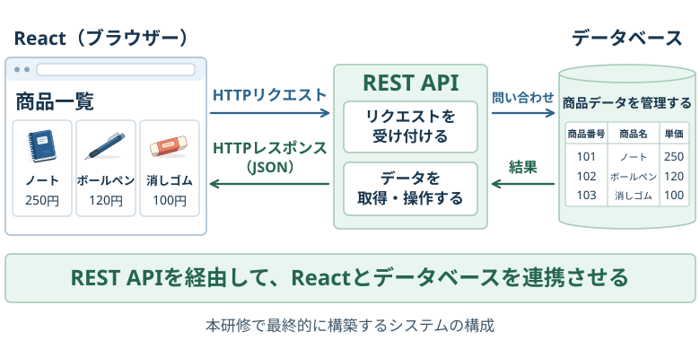
:::

::: {#ch04-rest-03 .heading level="minor"}
Reactとデータベースをつなぐには
:::

::: {#ch04-rest-04 .paragraph}
第3章までは、商品名や単価などの商品データをReactのソースコードに記述し、それらの情報を画面に表示してきました。
:::

::: {#ch04-rest-05 .paragraph}
しかし、実際の商品管理システムでは、商品の登録・更新・削除によって、商品情報が変化します。また、複数の利用者が同じ商品情報を参照・操作できるようにする必要があります。
:::

::: {#ch04-rest-06 .paragraph}
そのため、商品情報をソースコードに直接記述するのではなく、データベースで管理する方法が一般的です。
:::

::: {#ch04-rest-07 .paragraph}
ここで、1つの疑問が生まれます。
:::

::: {#ch04-rest-08 .paragraph}
**Reactから直接データベースを操作することはできないのでしょうか。**
:::

::: {#ch04-rest-09 .paragraph}
Reactは、主にWebブラウザー上で動作します。一般的な業務システムで使用するデータベースに、ブラウザーから直接接続して操作する構成は適していません。
:::

::: {#ch04-rest-10 .paragraph}
例えば、ブラウザー側のプログラムにデータベースへの接続情報を記述すると、その情報が利用者に知られるおそれがあります。また、利用者に直接データベースを操作させると、実行できる処理やアクセスできるデータを適切に制御することが難しくなります。
:::

::: {#ch04-rest-11 .paragraph}
そこで、**Reactとデータベースの間に、データベースを操作するサーバー側のプログラムを用意します。** Reactはそのプログラムに対して処理を依頼し、結果を受け取ります。
:::

{#ch04-rest-figure-1}

::: {#ch04-rest-figure-1-caption .caption}
データベースを操作する処理をサーバー側に用意する
:::

::: {#ch04-rest-13 .heading level="minor"}
APIが必要な理由
:::

::: {#ch04-rest-14 .paragraph}
API（Application Programming Interface）とは、別のプログラムが機能を利用するための窓口です。
:::

::: {#ch04-rest-15 .paragraph}
今回の商品管理システムでは、サーバー側に商品情報を取得・登録・更新・削除する機能を用意し、それらの機能をReactから利用できるようにします。このような、HTTP通信によって利用できるAPIをWeb APIと呼びます。
:::

::: {#ch04-rest-16 .paragraph}
例えば、商品一覧を表示する場合、ReactからAPIに商品情報の取得を依頼します。APIはその依頼を受けてデータベースから商品情報を取得し、Reactに返します。
:::

::: {#ch04-rest-17 .paragraph}
このように、Reactとデータベースを連携させる際には、画面を担当するフロントエンドと、データの取得や更新などの処理を担当するバックエンドに分ける必要があります。
:::

::: {#ch04-rest-17-benefits .paragraph}
このような構成には、次のようなメリットがあります。
:::

::: {#ch04-rest-18-1 .paragraph}
● データベースの接続情報をサーバー側で管理できる。
:::

::: {#ch04-rest-18-2 .paragraph}
● データベースに対して実行できる操作や、利用者のアクセス権限をサーバー側で制御できる。
:::

::: {#ch04-rest-18-3 .paragraph}
● Webアプリケーションだけでなく、スマートフォンアプリなどからも同じAPIを利用できる。
:::

::: {#ch04-rest-18-4 .paragraph}
● 画面を作成する処理とデータを操作する処理を分けて開発・管理できる。
:::

::: {#ch04-rest-19 .heading level="minor" keep-next="2"}
REST APIとは
:::

::: {#ch04-rest-20 .paragraph}
Web APIを設計する際には、どのURLに対してリクエストを送信すると、どの処理が実行されるのかを決める必要があります。
:::

::: {#ch04-rest-20-example .paragraph}
例えば、処理の内容をURLに含める設計方法では、商品情報の検索・登録・更新・削除に対して、それぞれ次のようなURLを定義します。
:::

::: {#ch04-rest-20-paths .table column-widths="38 62"}
| 処理内容 | URLのパス |
|---|---|
| 商品情報の検索 | `/api/searchByProduct` |
| 商品情報の登録 | `/api/insertProduct` |
| 商品情報の更新 | `/api/updateProduct` |
| 商品情報の削除 | `/api/deleteProduct` |
:::

::: {#ch04-rest-20-management .paragraph}
このような設計では、機能ごとに異なるURLを定義するため、機能が増えれば増えるほど、管理するURLの種類も増えていきます。また、開発者によってURLの命名方法が異なり、APIの設計に統一性を持たせることが難しくなる場合もあります。
:::

::: {#ch04-rest-20-rest .paragraph}
そこで、このような課題に対応する設計方法として広く利用されているのが、**REST API（レストAPI）**です。
:::

::: {#ch04-rest-21 .paragraph}
REST APIでは、商品などの操作対象となるデータをリソースと呼び、URLを使用してリソースを指定します。また、HTTPメソッドを使用して、そのリソースに対してどのような操作を行うのかを指定します。
:::

::: {#ch04-rest-21-roles .paragraph}
つまり、URLに処理内容を含めるのではなく、**URLで操作対象を、HTTPメソッドで操作内容を表現する**という考え方です。
:::

::: {#ch04-rest-22 .step}
**① URLで操作対象を指定する**
:::

::: {#ch04-rest-23 .paragraph}
例えば、商品情報を操作するためのREST APIでは、次のようなURLを使用します。
:::

::: {#ch04-rest-24 .table column-widths="38 62"}
| URLのパス | 操作対象 |
|---|---|
| `/api/products` | 商品の一覧 |
| `/api/products/101` | 商品番号101の商品 |
:::

::: {#ch04-rest-25 .paragraph}
第3章では、`/products/101` というURLを商品詳細画面の表示に使用しました。一方、`/api/products/101` は商品番号101の情報を操作するためのAPIのURLです。
:::

::: {#ch04-rest-26 .paragraph}
本研修では、画面を表示するためのURLとAPIのURLを区別しやすいように、APIのURLのパスを `/api` から始めます。
:::

::: {#ch04-rest-27 .step}
**② HTTPメソッドで操作内容を指定する**
:::

::: {#ch04-rest-28 .paragraph}
商品番号101の商品を操作する場合でも、商品情報を取得するのか、更新するのか、削除するのかによって処理は異なります。
:::

::: {#ch04-rest-29 .paragraph}
REST APIでは、操作の種類に応じてGET、POST、PUT、DELETEなどのHTTPメソッドを使い分けます。
:::

::: {#ch04-rest-30 .table column-widths="26 34 40"}
| HTTPメソッド | URLのパス | 処理内容 |
|---|---|---|
| GET | `/api/products` | 商品一覧を取得する。 |
| GET | `/api/products/101` | 商品番号101の情報を取得する。 |
| POST | `/api/products` | 新しい商品を登録する。 |
| PUT | `/api/products/101` | 商品番号101の情報を更新する。 |
| DELETE | `/api/products/101` | 商品番号101の商品を削除する。 |
:::

::: {#ch04-rest-31 .paragraph}
ここで、商品番号101の取得・更新・削除では、同じURLのパスが使用されていることに注目してください。
:::

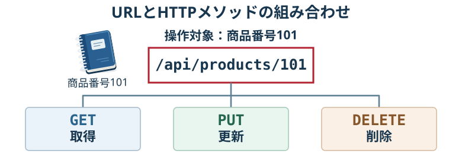{#ch04-rest-figure-2}

::: {#ch04-rest-figure-2-caption .caption}
同じURLでも、HTTPメソッドによって操作内容を区別する
:::

::: {#ch04-rest-33 .paragraph}
**REST APIでは、URLとHTTPメソッドの組み合わせによって操作対象と操作内容を表現できます。**
:::

::: {#ch04-rest-34 .paragraph}
このように設計することで、操作のたびに異なるURLを用意する必要が減り、APIの構成が分かりやすくなります。また、共通したルールでAPIを設計できるため、APIを利用する側も、その役割を理解しやすくなります。
:::

::: {#ch04-rest-35 .step}
**③ JSON形式でデータを受け渡す**
:::

::: {#ch04-rest-36 .paragraph}
ReactとREST APIの間で商品情報をやり取りする際には、データの形式を決めておく必要があります。
:::

::: {#ch04-rest-37 .paragraph}
REST APIでは、データの受け渡しにJSON（JavaScript Object Notation）という形式が広く利用されています。
:::

::: {#ch04-rest-38 .paragraph}
例えば、商品番号101の情報を取得した場合、次のようなJSON形式のデータが返されます。
:::

::: {#ch04-rest-json-example .code example="true" code-label="JSONの記述例"}
```json
{
  "id": 101,
  "name": "ノート",
  "price": 250,
  "imagePath": "/images/products/notebook.svg"
}
```
:::

::: {#ch04-rest-40 .paragraph}
JSONでは、JavaScriptのオブジェクトと似た形式でデータを表現できます。また、JavaScriptだけでなく、JavaやPythonなど、さまざまなプログラミング言語で扱えます。
:::

::: {#ch04-rest-41 .paragraph}
そのため、Reactと異なるプログラミング言語で作成したAPIであっても、JSON形式でデータをやり取りできます。
:::

::: {#ch04-rest-42 .heading level="minor"}
本研修で使用する技術
:::

::: {#ch04-rest-43 .paragraph}
本研修では、フロントエンドにReact、REST APIを作成するための環境にNode.jsとExpress、データベースにSQLiteを使用します。
:::

::: {#ch04-rest-44 .table column-widths="21 79"}
| 技術 | 本研修での役割 |
|---|---|
| React | フロントエンドの画面表示や入力処理を実装する。 |
| Axios | ReactからREST APIにHTTPリクエストを送信し、レスポンスを受け取る。 |
| Node.js | サーバー側でJavaScriptを実行する。 |
| Express | Node.js上でREST APIを作成する。 |
| SQLite | 商品情報などのデータを管理する。 |
:::

::::

:::: {#page-4 .source-page}

::: {#ch04-rest-45 .paragraph}
Node.jsは第1章で開発環境の構築にも使用しました。第5章以降では、REST APIを動作させるための実行環境としても使用します。ExpressはJavaScriptでAPIを作成でき、SQLiteは専用のデータベースサーバーを別途起動する必要がないため、学習用の環境を用意しやすいという特徴があります。
:::

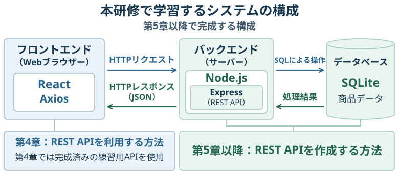{#ch04-rest-figure-3}

::: {#ch04-rest-figure-3-caption .caption}
REST APIを利用する側と作成する側に分けて学習する
:::

::: {#ch04-rest-47 .paragraph}
なお、第4章では、データベースに接続せず、あらかじめ用意した商品データを返す練習用REST APIを使用します。REST APIを作成する方法やデータベースと連携する方法については、第5章で学習します。
:::

::: {#ch04-rest-48 .paragraph}
次の4.2節では、Axiosを使用してREST APIから商品情報を取得する方法を学習します。
:::

::: {#ch04-rest-points .section-points}
この節のポイント

● Reactとデータベースを連携させる際には、一般的にサーバー側のAPIを経由してデータを取得・操作する。

● REST APIでは、URLで操作対象を指定し、HTTPメソッドで操作内容を指定する。

● REST APIでは、データの受け渡しにJSON形式が広く利用されている。

● 本研修では、第4章でREST APIを利用する方法を、第5章以降でREST APIを作成してデータベースと連携する方法を学習する。
:::

::::

:::: {#page-5 .source-page}

::: {#ch04-axios-title .heading}
4.2. AxiosによるHTTP通信
:::

::: {#ch04-axios-slide .slide layout="illustration"}
AxiosによるHTTP通信


:::

::: {#ch04-axios-background .heading level="minor"}
Axiosとは
:::

::: {#ch04-42-par-04 .paragraph}
前節では、REST APIではURLで操作対象を指定し、HTTPメソッドで操作内容を指定することを学習しました。
:::

::: {#ch04-42-par-05 .paragraph}
例えば、商品一覧を取得する場合は、`/api/products` にGETリクエストを送信します。この節では、このリクエストをReactのプログラムから送信する方法を学習します。
:::

::: {#ch04-42-par-06 .paragraph}
Webブラウザーには、JavaScriptからHTTP通信を行うための標準機能として `fetch()` が用意されています。
:::

::: {#ch04-42-par-07 .paragraph}
本研修では、HTTP通信や取得したデータの取り扱いをより簡潔に記述できるように、**Axios（アクシオス）** というライブラリを使用します。
:::

::: {#ch04-42-par-08 .paragraph}
Axiosは、HTTPリクエストの送信やレスポンスの受け取りを行うJavaScriptのライブラリです。React専用のライブラリではなく、JavaScriptからHTTP通信を行う際に使用できます。
:::

::: {#ch04-42-par-09 .paragraph}
今回は、Axiosの `axios.get()` を使用して商品情報を取得し、ブラウザーのコンソールで取得結果を確認します。
:::

::: {#ch04-axios-sample .heading level="minor"}
【サンプル】REST APIから商品情報を取得する
:::

::: {#ch04-42-par-11 .paragraph}
［商品一覧を取得］ボタンをクリックすると、REST APIから6件の商品情報を取得し、ブラウザーのコンソールに出力するプログラムを確認します。
:::

::: {#ch04-axios-api .step}
**① 練習用REST APIの起動**
:::

::: {#ch04-42-par-13 .paragraph}
第4章で使用する練習用REST APIは、`ch04-api` フォルダーに用意されています。データベースには接続せず、あらかじめ用意された商品データを返すAPIです。
:::

::: {#ch04-42-par-14 .paragraph}
まず、Reactの開発サーバーとは別に、練習用REST APIを起動します。
:::

::: {#ch04-42-par-15 .paragraph numbered="true"}
1．VS Codeで `react-basic.code-workspace` を開き、`ch04-api` フォルダーのターミナルを起動してください。
:::

::: {#ch04-42-par-16 .paragraph numbered="true" keep-next="1"}
2．初回のみ、次のコマンドを実行してください。
:::

::: {#ch04-42-api-install .code example="true" code-label="コンソールの記述例"}
```powershell
npm install
```
:::

::: {#ch04-42-par-19 .paragraph numbered="true" keep-next="1"}
3．次のコマンドを実行して、REST APIを起動してください。
:::

::: {#ch04-42-api-start .code example="true" code-label="コンソールの記述例"}
```powershell
npm start
```
:::

::: {#ch04-42-par-22 .paragraph}
ターミナルに「REST API: http://127.0.0.1:3000」と表示されれば、起動は完了です。第4章の学習中は、REST APIを起動したままにしてください。
:::

::: {#ch04-42-par-23 .paragraph numbered="true" keep-next="1"}
4．Webブラウザーの新しいタブを開き、アドレスバーに次のURLを入力してください。
:::

::: {#ch04-42-par-24 .paragraph}
`http://127.0.0.1:3000/api/products`
:::

::: {#ch04-42-par-25 .paragraph}
ブラウザーのアドレスバーからこのURLにアクセスすると、GETリクエストが送信され、6件の商品情報がJSON形式で表示されます。
:::

::: {#ch04-42-par-26 .paragraph}
このように、Reactを起動しなくても、REST APIが返すデータを確認できます。
:::

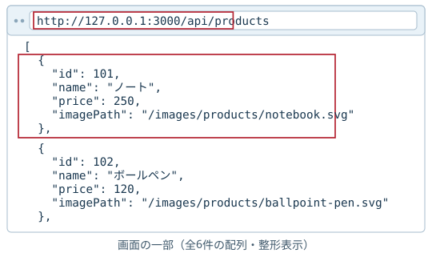{#ch04-42-figure-1}

::: {#ch04-42-figure-1-caption .caption}
練習用REST APIから返された商品情報をブラウザーで確認する
:::

::: {#ch04-42-par-28 .paragraph}
この節のサンプルと確認演習では、`/api/products` にGETリクエストを送信し、6件の商品情報を取得します。
:::

::: {#ch04-axios-install .step keep-next="2"}
**② Axiosの導入**
:::

::: {#ch04-42-par-31 .paragraph}
Axiosを使用する場合は、Reactのプロジェクトで次のコマンドを実行してインストールします。
:::

::: {#ch04-42-axios-install .code example="true" code-label="コンソールの記述例"}
```powershell
npm install axios
```
:::

::: {#ch04-42-par-34 .paragraph}
本研修の `ch04-basic` と `ch04-basic-q` では、Axiosがあらかじめ `package.json` に登録されています。そのため、通常どおり `npm install` を実行すれば、Axiosもインストールされます。個別に `npm install axios` を実行する必要はありません。
:::

::: {#ch04-axios-sample-code .step keep-next="2"}
**③ React側のプログラムの確認**
:::

::: {#ch04-42-par-36 .paragraph}
ワークスペースの `ch04-basic` フォルダーにある `src/components/Sample4_2.tsx` を確認してください。
:::

::: {#ch04-42-full .code filename="ch04-basic/src/components/Sample4_2.tsx" start-line="1"}
```tsx
import axios from 'axios'

export default function Sample4_2() {
  async function handleGetProducts() {
    const response = await axios.get('/api/products')
    console.log(response.data)
  }

  return (
    <main className="container mt-4">
      <h1>商品情報の取得</h1>
      <p>取得した商品情報は、ブラウザーのコンソールに表示されます。</p>
      <button type="button" className="btn btn-primary"
              onClick={handleGetProducts}>
        商品一覧を取得
      </button>
    </main>
  )
}
```
:::

::: {#ch04-42-par-39 .paragraph}
`ch04-basic` のフォルダーで、初回のみ `npm install` を実行してください。1.5節と同じ手順で開発サーバーを起動し、ブラウザーのメニューから［4.2 AxiosによるHTTP通信］を選択してください。
:::

::: {#ch04-42-par-40 .paragraph}
［F12］キーを押してブラウザーの開発者ツールを開き、［コンソール］（Console）を選択してください。［商品一覧を取得］ボタンをクリックすると、取得した商品情報が配列として出力されます。
:::

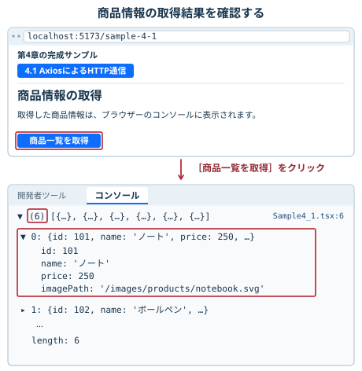{#ch04-axios-figure-1}

::: {#ch04-axios-figure-1-caption .caption}
ボタンをクリックすると、取得した6件の商品情報がコンソールに出力される
:::

::: {#ch04-axios-syntax .heading level="minor"}
構文の解説
:::

::: {#ch04-axios-import .step keep-next="1"}
**① Axiosをインポートする**
:::

::: {#ch04-42-import .code filename="ch04-basic/src/components/Sample4_2.tsx" start-line="1"}
```tsx
import axios from 'axios'
```
:::

::: {#ch04-42-par-46 .paragraph}
`axios` パッケージから `axios` をインポートします。これにより、`axios.get()` などのメソッドを使用できるようになります。
:::

::: {#ch04-axios-get .step keep-next="1"}
**② GETリクエストを送信し、レスポンスを受け取る**
:::

::: {#ch04-42-get .code filename="ch04-basic/src/components/Sample4_2.tsx" start-line="5"}
```tsx
    const response = await axios.get('/api/products')
```
:::

::: {#ch04-42-par-50 .paragraph}
`axios.get()` は、引数に指定したURLへGETリクエストを送信するためのメソッドです。
:::

::: {#ch04-42-par-51 .paragraph}
前節で学習したURLとHTTPメソッドの組み合わせを、今回のコードでは `axios.get('/api/products')` と記述しています。`get` がHTTPメソッドのGETに対応し、引数の `/api/products` が操作対象を示します。
:::

::: {#ch04-42-async-heading .step keep-next="1"}
**③ asyncとawaitで通信結果を待つ**
:::

::: {#ch04-42-async .code filename="ch04-basic/src/components/Sample4_2.tsx" start-line="4"}
```tsx
  async function handleGetProducts() {
    const response = await axios.get('/api/products')
    console.log(response.data)
  }
```
:::

::: {#ch04-42-par-55 .paragraph}
HTTP通信では、リクエストを送信してからレスポンスが返されるまでに時間がかかります。
:::

::: {#ch04-42-par-56 .paragraph}
`axios.get()` は、非同期処理の結果を後から受け取るためのPromise（プロミス）というオブジェクトを返します。`await` を付けずに戻り値を `response` に格納すると、レスポンスではなくPromiseが格納されるため、`response.data` で商品情報を取得することはできません。
:::

::: {#ch04-42-par-57 .paragraph}
そこで使用するのが、JavaScriptの `async` と `await` です。
:::

::: {#ch04-42-par-58 .table column-widths="21 79"}
| 記述 | 役割 |
|---|---|
| `async` | 非同期関数を定義する。今回のように関数内で `await` を使用するために指定する。 |
| `await` | 非同期処理の結果を待ってから、その関数内の後続の処理を実行する。 |
:::

::: {#ch04-42-par-59 .paragraph}
今回のコードでは、`await` を使用することで、通信が正常に完了した後にレスポンスを `response` に格納し、その次の行の `console.log()` を実行します。
:::

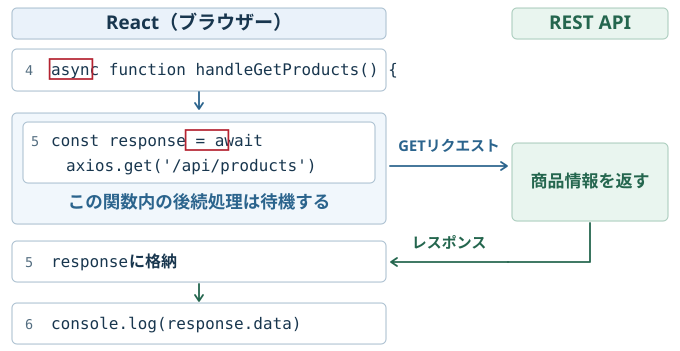{#ch04-42-figure-3}

::: {#ch04-42-figure-3-caption .caption}
awaitによって通信結果を受け取ってから後続の処理を実行する
:::

::: {#ch04-42-par-61 .paragraph}
`await` によって待機するのは、この関数内の後続の処理です。ブラウザー全体の動作が停止するわけではありません。
:::

::: {#ch04-axios-data .step keep-next="1"}
**④ レスポンスから商品データを取り出す**
:::

::: {#ch04-42-data .code filename="ch04-basic/src/components/Sample4_2.tsx" start-line="6"}
```tsx
    console.log(response.data)
```
:::

::: {#ch04-42-par-65 .paragraph}
Axiosで通信した結果を受け取る `response` は、商品データそのものではなく、HTTPステータスコードなどの情報も含むレスポンスオブジェクトです。
:::

::: {#ch04-42-par-66 .paragraph}
今回必要なのは商品データです。そのため、`response.data` を使用して、レスポンスから商品データを取り出します。
:::

::: {#ch04-42-par-67 .paragraph}
JSON形式で返された商品データは、AxiosによってJavaScriptで扱えるデータに変換されます。今回の `/api/products` に対するリクエストでは、6件の商品オブジェクトを格納した配列を取得できます。
:::

{#ch04-axios-figure-3}

::: {#ch04-axios-figure-3-caption .caption}
response.dataから商品情報を取り出す
:::

::: {#ch04-42-par-69 .paragraph}
ボタンのクリック時に `handleGetProducts` が呼び出される仕組みは、2.4節で学習した `onClick` と同じです。
:::

::: {#ch04-42-proxy .training-note}
【補足】APIの接続先について

今回、REST APIは `http://127.0.0.1:3000` で動作していますが、サンプルのコードには `/api/products` とだけ記述しています。

本研修の配布プロジェクトでは、Viteの開発サーバーが `/api` から始まるリクエストを `http://127.0.0.1:3000` へ転送するように、プロキシの設定を用意しています。そのため、今回のようにホスト名やポート番号を省略して記述できます。
:::

::: {#ch04-axios-practice .heading level="minor" keep-next="7"}
【確認演習】Axiosを使用して商品一覧を取得する
:::

::: {#ch04-42-par-74 .paragraph}
講義サンプルと同様に、［商品一覧を取得］ボタンをクリックすると、REST APIから商品一覧を取得し、ブラウザーのコンソールに出力するようにしましょう。
:::

::: {#ch04-42-par-75 .paragraph}
画面の基本構成とボタンのイベント処理は、あらかじめ用意されています。
:::

::: {#ch04-42-par-76 .paragraph numbered="true"}
1．`ch04-basic-q` プロジェクトの `src/components/Q4_2.tsx` を開いてください。
:::

::: {#ch04-42-par-77 .paragraph numbered="true"}
2．コード内の➀～➂の番号付きコメントを確認し、指示された箇所を実装してください。3つとも実装問題です。コメントに指定されていないコードや、ほかのファイルは変更する必要はありません。
:::

::: {#ch04-42-par-78 .paragraph numbered="true"}
3．編集したファイルを保存してください。
:::

::: {#ch04-42-par-79 .paragraph numbered="true"}
4．練習用REST APIが起動していることを確認してください。`ch04-basic-q` フォルダーで初回のみ `npm install` を実行し、開発サーバーを起動してください。起動済みの場合は、演習用のブラウザーの画面に戻ってください。
:::

::: {#ch04-42-par-80 .paragraph numbered="true"}
5．メニューから［4.2 AxiosによるHTTP通信］を選択してください。
:::

::: {#ch04-axios-check .heading level="minor"}
動作確認
:::

::: {#ch04-42-par-82 .paragraph numbered="true"}
6．ブラウザーの開発者ツールから［コンソール］（Console）を開き、［商品一覧を取得］ボタンをクリックしてください。次の内容を確認します。
:::

::: {#ch04-42-par-83-1 .paragraph}
● 6件の商品情報が配列として出力されていること。
:::

::: {#ch04-42-par-83-2 .paragraph}
● 1件目の商品番号（`id`）が101、商品名（`name`）が「ノート」、単価（`price`）が250であること。
:::

{#ch04-axios-figure-4}

::: {#ch04-axios-figure-4-caption .caption}
取得した6件の商品情報がコンソールに出力されることを確認する
:::

::: {#ch04-42-par-85 .paragraph}
6件の商品情報が配列として取得できていれば、演習完了です。
:::

::: {#ch04-42-par-86 .paragraph}
結果が出力されない場合は、練習用REST APIが起動していること、演習用の開発サーバーに接続していること、リクエスト先が正しく指定されていることを確認してください。
:::

::: {#ch04-42-par-87 .paragraph}
次の4.3節では、取得した商品情報をstateで管理し、画面に表示する方法を学習します。
:::

::: {#ch04-axios-points .section-points}
この節のポイント

● Axiosは、JavaScriptからHTTP通信を行うためのライブラリである。

● `axios.get()` を使用すると、指定したURLへGETリクエストを送信できる。

● `async` と `await` を使用すると、通信の結果を待ってから関数内の後続の処理を実行できる。

● `response.data` を使用すると、REST APIから返されたデータを取り出せる。
:::

::::

<!-- CODE id="ch04-42-api-install" type="コンソールの記述例" highlight="none" reason="コマンド全体が操作対象" -->
<!-- CODE id="ch04-42-api-start" type="コンソールの記述例" highlight="none" reason="コマンド全体が操作対象" -->
<!-- CODE id="ch04-42-axios-install" type="コンソールの記述例" highlight="none" reason="コマンド全体が操作対象" -->
<!-- CODE id="ch04-42-import" path="ch04-basic/src/components/Sample4_2.tsx" lines="1" type="TSX" highlight="none" reason="1行全体が説明対象" -->

:::: {#page-6 .source-page}

::: {#ch04-43-title .heading}
4.3. 取得したデータの画面表示
:::

::: {#ch04-43-slide .slide layout="illustration"}
取得したデータの画面表示

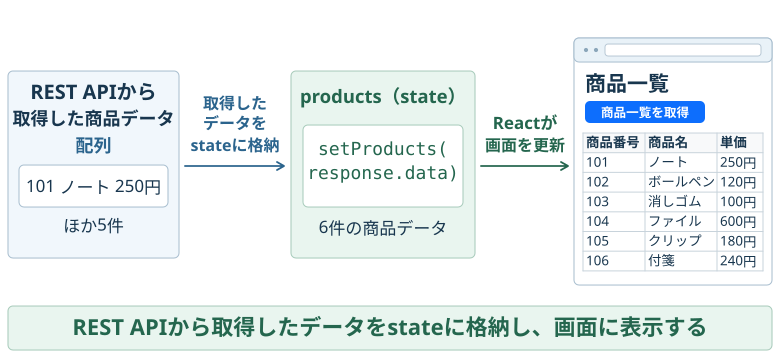
:::

::: {#ch04-43-background .heading level="minor"}
REST APIから取得したデータを画面に表示するには
:::

::: {#ch04-43-par-04 .paragraph}
前節では、Axiosを使用してREST APIから商品情報を取得し、ブラウザーのコンソールに出力しました。
:::

::: {#ch04-43-par-05 .paragraph}
実際の商品管理システムでは、取得した商品情報をコンソールではなく、利用者が操作する画面に表示する必要があります。
:::

::: {#ch04-43-par-06 .paragraph}
2.6節では、ソースコード内に商品データを配列として定義し、`map()` を使用してテーブル形式で一覧表示しました。
:::

::: {#ch04-43-par-07 .paragraph}
今回は、この配列をstateで管理し、REST APIから取得した商品データで更新します。**取得したデータをstateに格納することで、Reactが新しいデータを使用して画面を更新します。**
:::

::: {#ch04-43-sample .heading level="minor"}
【サンプル】REST APIから取得した商品を一覧表示する
:::

::: {#ch04-43-par-09 .paragraph}
［商品一覧を取得］ボタンをクリックすると、REST APIから取得した6件の商品情報をテーブル形式で表示します。
:::

::: {#ch04-43-par-10 .paragraph}
`ch04-basic` プロジェクトの `src/components/Sample4_3.tsx` を確認してください。
:::

::: {#ch04-43-full .code filename="ch04-basic/src/components/Sample4_3.tsx" start-line="1"}
```tsx
import { useState } from 'react'
import axios from 'axios'

type Product = {
  id: number
  name: string
  price: number
  imagePath: string
}

export default function Sample4_3() {
  const [products, setProducts] = useState<Product[]>([])

  async function handleGetProducts() {
    const response = await axios.get<Product[]>('/api/products')
    setProducts(response.data)
  }

  return (
    <main className="container mt-4">
      <h1>商品一覧</h1>
      <button type="button" className="btn btn-primary mb-3"
              onClick={handleGetProducts}>
        商品一覧を取得
      </button>
      <table className="table table-bordered w-auto">
        <thead className="table-light">
          <tr>
            <th>商品番号</th>
            <th>商品名</th>
            <th>単価</th>
          </tr>
        </thead>
```
:::

::: {#ch04-43-full-cont .code filename="ch04-basic/src/components/Sample4_3.tsx" start-line="34" code-label="TSX（続き）"}
```tsx
        <tbody>
          {products.map((product) => (
            <tr key={product.id}>
              <td>{product.id}</td>
              <td>{product.name}</td>
              <td>{product.price}円</td>
            </tr>
          ))}
        </tbody>
      </table>
    </main>
  )
}
```
:::

::: {#ch04-43-par-13 .paragraph}
前節のサンプルと同様に、練習用REST APIと `ch04-basic` の開発サーバーを起動してください。既に起動している場合は、起動し直す必要はありません。
:::

::: {#ch04-43-par-14 .paragraph}
ブラウザーのメニューから［4.3 取得したデータの画面表示］を選択してください。
:::

::: {#ch04-43-par-15 .paragraph}
初期状態では、テーブルの見出しだけが表示されます。［商品一覧を取得］ボタンをクリックすると、6件の商品情報が表示されます。
:::

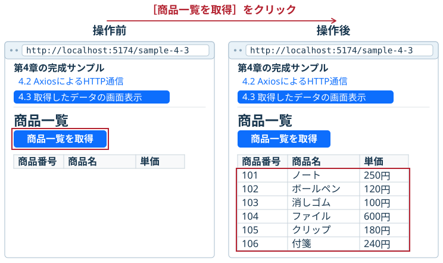{#ch04-43-figure-1}

::: {#ch04-43-figure-1-caption .caption}
ボタンをクリックすると、取得した商品情報が一覧表示される
:::

::: {#ch04-43-syntax .heading level="minor"}
構文の解説
:::

::: {#ch04-43-type-heading .step keep-next="2"}
**① 商品データを管理するstateを定義する**
:::

::: {#ch04-43-par-19 .paragraph}
今回は、REST APIから取得する商品データの型を、次のように定義しています。
:::

::: {#ch04-43-type .code filename="ch04-basic/src/components/Sample4_3.tsx" start-line="4"}
```tsx
type Product = {
  id: number
  name: string
  price: number
  imagePath: string
}
```
:::

::: {#ch04-43-par-22 .paragraph}
3.1節でPropsの型を定義したときと同じように、`type` を使用して、商品1件分のデータの型を `Product` として定義しています。
:::

::: {#ch04-43-par-23 .paragraph}
今回のAPIからは複数の商品が配列として返されるため、stateには次のように配列の型を指定します。
:::

::: {#ch04-43-state .code filename="ch04-basic/src/components/Sample4_3.tsx" start-line="12"}
```tsx
  const [products, setProducts] = useState<Product[]>([])
```
:::

::: {#ch04-43-par-26 .paragraph}
`Product[]` は、`Product` 型のデータを格納する配列の型を表します。`useState()` に対して `<Product[]>` を指定することで、商品データの配列を管理するstateとして定義できます。
:::

::: {#ch04-43-par-27 .paragraph}
引数の `[]` は空の配列です。画面の初期表示時にはまだ商品情報を取得していないため、初期値に空の配列を指定しています。
:::

::: {#ch04-43-state-table .table column-widths="25 75"}
| 記述 | 役割 |
|---|---|
| `<Product[]>` | stateで管理するデータの型を指定する。 |
| `[]` | stateの初期値として空の配列を指定する。 |
:::

::: {#ch04-43-par-29 .paragraph}
このように、空配列を初期値として使用する場合は、どの型のデータを格納する配列なのかを明示しておきます。
:::

::: {#ch04-43-load-heading .step keep-next="1"}
**② REST APIから取得したデータでstateを更新する**
:::

::: {#ch04-43-load .code filename="ch04-basic/src/components/Sample4_3.tsx" start-line="14"}
```tsx
  async function handleGetProducts() {
    const response = await axios.get<Product[]>('/api/products')
    setProducts(response.data)
  }
```
:::

::: {#ch04-43-par-33 .paragraph}
`axios.get()` を使用して商品情報を取得する処理は、前節と同じです。今回は `axios.get<Product[]>()` と記述することで、取得する `response.data` の型をTypeScriptに伝えています。
:::

::: {#ch04-43-par-34 .paragraph}
前節では、取得したデータを `console.log(response.data)` でコンソールに出力していました。今回は、コンソールへの出力の代わりに、次の処理を実行します。
:::

::: {#ch04-43-set .code filename="ch04-basic/src/components/Sample4_3.tsx" start-line="16"}
```tsx
    setProducts(response.data)
```
:::

::: {#ch04-43-par-37 .paragraph}
`response.data` に格納されている商品データの配列を `setProducts()` に渡します。これにより、productsのstateが取得した6件の商品データに更新され、Reactがコンポーネントを再レンダリングします。
:::

::: {#ch04-43-map-heading .step keep-next="1"}
**③ stateに格納された商品データを一覧表示する**
:::

::: {#ch04-43-map .code filename="ch04-basic/src/components/Sample4_3.tsx" start-line="35"}
```tsx
          {products.map((product) => (
            <tr key={product.id}>
              <td>{product.id}</td>
              <td>{product.name}</td>
              <td>{product.price}円</td>
            </tr>
          ))}
```
:::

::: {#ch04-43-par-41 .paragraph}
`map()` を使用した一覧表示の方法は、2.6節で学習した内容と同じです。
:::

::: {#ch04-43-par-42 .paragraph}
初期状態では、productsは空配列なので、`map()` によって商品データの行は生成されません。商品情報を取得し、stateが更新されると、Reactは新しいproductsの値を使用して6行分のJSXを生成します。
:::

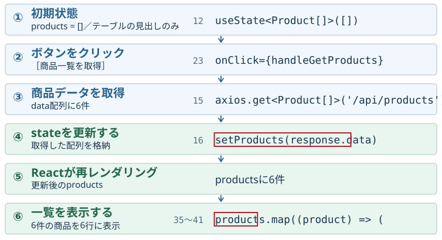{#ch04-43-figure-2}

::: {#ch04-43-figure-2-caption .caption}
REST APIから取得したデータをstateに格納すると、一覧の表示が更新される
:::

::: {#ch04-43-par-44 .paragraph}
このように、取得したデータをstateに格納すれば、テーブルに行を追加する処理を個別に記述する必要はありません。画面に表示するデータを更新するだけで、Reactが必要な表示の変更を反映します。
:::

::: {#ch04-43-exercise .heading level="minor" keep-next="7"}
【確認演習】取得した商品データをstateに格納し、一覧表示する
:::

::: {#ch04-43-par-46 .paragraph}
前節で学習したAxiosによる商品一覧の取得と、今回学習したstateによる画面更新を組み合わせて、商品一覧画面を完成させます。
:::

::: {#ch04-43-par-47 .paragraph}
商品データの型、`useState<Product[]>([])` によるstateの定義、`map()` による一覧表示は、あらかじめ用意されています。`axios.get()` の引数に商品一覧を取得するURLのパスを指定し、取得したデータでstateを更新しましょう。
:::

::: {#ch04-43-par-48 .paragraph numbered="true"}
1．`ch04-basic-q` プロジェクトの `src/components/Q4_3.tsx` を開いてください。
:::

::: {#ch04-43-par-49 .paragraph numbered="true"}
2．コード内の➀～➃の番号付きコメントに従ってください。➀・➃は既存コードの確認、➁・➂は実装問題です。➃では、`product` にどの配列の要素が1件ずつ渡されるかを確認してください。コメントに指定されていないコードや、ほかのファイルは変更する必要はありません。
:::

::: {#ch04-43-par-50 .paragraph numbered="true"}
3．編集したファイルを保存してください。
:::

::: {#ch04-43-par-51 .paragraph numbered="true"}
4．練習用REST APIと `ch04-basic-q` の開発サーバーを起動してください。起動済みの場合は、演習用のブラウザーの画面に戻ってください。
:::

::: {#ch04-43-par-52 .paragraph numbered="true"}
5．メニューから［4.3 取得したデータの画面表示］を選択してください。
:::

::: {#ch04-43-check .heading level="minor"}
動作確認
:::

::: {#ch04-43-par-54 .paragraph numbered="true"}
6．初期状態では、テーブルの見出しのみが表示されていることを確認してください。［商品一覧を取得］ボタンをクリックし、次の6件の商品情報が表示されることを確認してください。
:::

{#ch04-43-figure-3}

::: {#ch04-43-figure-3-caption .caption}
取得した商品データをstateに格納し、6件の商品を一覧表示する
:::

::: {#ch04-43-par-56 .paragraph}
商品番号101～106の6件が表示され、各商品の商品名と単価が正しければ、演習完了です。
:::

::: {#ch04-43-par-57 .paragraph}
なお、今回はボタンをクリックして商品情報を取得しています。次の4.4節では、画面が表示されたときに自動的に商品情報を取得する方法を学習します。
:::

::: {#ch04-43-points .section-points}
この節のポイント

● `useState<Product[]>([])` のように型を指定することで、商品データの配列をstateとして管理できる。

● REST APIから取得したデータを更新用の関数に渡すことで、stateを更新できる。

● stateの値を `map()` で使用することで、取得したデータの件数に応じた一覧を表示できる。
:::

::::

<!-- CODE id="ch04-43-type" path="ch04-basic/src/components/Sample4_3.tsx" lines="4-9" type="TSX" highlight="none" reason="掲載した型定義全体が説明対象であるため" -->
<!-- CODE id="ch04-43-set" path="ch04-basic/src/components/Sample4_3.tsx" lines="16" type="TSX" highlight="none" reason="1行全体が説明対象であるため" -->

:::: {#page-7 .source-page}

::: {#ch04-44-title .heading}
4.4. useEffectによる処理の実行
:::

::: {#ch04-44-slide .slide layout="illustration"}
useEffectによる処理の実行

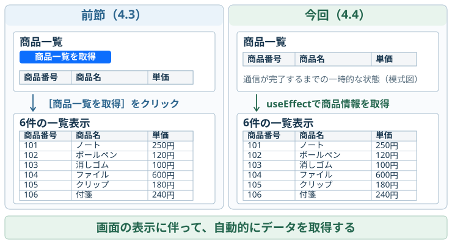
:::

::: {#ch04-44-background .heading level="minor"}
画面が表示されたときに処理を実行するには
:::

::: {#ch04-44-par-04 .paragraph}
前節では、［商品一覧を取得］ボタンをクリックすると、REST APIから取得した商品情報が一覧表示されるようにしました。
:::

::: {#ch04-44-par-05 .paragraph}
しかし、実際の商品管理システムでは、商品一覧画面を開いたときに、ボタンをクリックしなくても商品一覧が表示されることが一般的です。
:::

::: {#ch04-44-par-06 .paragraph}
では、商品一覧を取得する関数を、コンポーネントの中で直接呼び出せばよいのでしょうか。
:::

::: {#ch04-44-par-07 .paragraph}
コンポーネントの関数の中で直接通信処理を実行すると、データを取得してstateを更新した際に、Reactがコンポーネントを再レンダリングします。そのたびに通信処理が再び実行され、通信が繰り返される原因になります。
:::

::: {#ch04-44-par-08 .paragraph}
そこで使用するのが、Reactが提供する **useEffect()** です。
:::

::: {#ch04-44-par-09 .paragraph}
useEffect()は、コンポーネントのレンダリング結果が反映された後に、外部システムとの同期などの処理を実行するためのHookです。この節では、画面が最初に表示されるときにREST APIからデータを取得するために使用します。
:::

::: {#ch04-44-sample .heading level="minor"}
【サンプル】画面の表示時に商品一覧を取得する
:::

::: {#ch04-44-par-11 .paragraph}
前節の商品一覧画面から［商品一覧を取得］ボタンを取り除きます。その代わりに、useEffect()を使用して、商品一覧画面が表示されたときに商品情報を取得します。
:::

::: {#ch04-44-par-12 .paragraph}
`ch04-basic` プロジェクトの `src/components/Sample4_4.tsx` を確認してください。
:::

::: {#ch04-44-full .code filename="ch04-basic/src/components/Sample4_4.tsx" start-line="1"}
```tsx
import { useEffect, useState } from 'react'
import axios from 'axios'

type Product = {
  id: number
  name: string
  price: number
  imagePath: string
}

export default function Sample4_4() {
  const [products, setProducts] = useState<Product[]>([])

  useEffect(() => {
    async function loadProducts() {
      const response = await axios.get<Product[]>('/api/products')
      setProducts(response.data)
    }

    loadProducts()
  }, [])

  return (
    <main className="container mt-4">
      <h1>商品一覧</h1>
      <table className="table table-bordered w-auto">
        <thead className="table-light">
          <tr>
            <th>商品番号</th>
            <th>商品名</th>
            <th>単価</th>
          </tr>
        </thead>
```
:::

::: {#ch04-44-full-cont .code filename="ch04-basic/src/components/Sample4_4.tsx" start-line="34" code-label="TSX（続き）"}
```tsx
        <tbody>
          {products.map((product) => (
            <tr key={product.id}>
              <td>{product.id}</td>
              <td>{product.name}</td>
              <td>{product.price}円</td>
            </tr>
          ))}
        </tbody>
      </table>
    </main>
  )
}
```
:::

::: {#ch04-44-par-15 .paragraph}
練習用REST APIと `ch04-basic` の開発サーバーが起動していることを確認してください。ブラウザーのメニューから［4.4 useEffectによる処理の実行］を選択します。
:::

::: {#ch04-44-par-16 .paragraph}
今回はボタンをクリックする必要はありません。通信が正常に完了すると、6件の商品情報が一覧表示されます。
:::

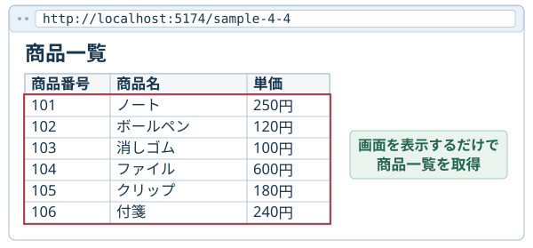{#ch04-44-figure-1}

::: {#ch04-44-figure-1-caption .caption}
画面を表示すると、商品情報が自動的に取得・表示される
:::

::: {#ch04-44-syntax .heading level="minor"}
構文の解説
:::

::: {#ch04-44-import-heading .step keep-next="1"}
**① useEffectを使用する**
:::

::: {#ch04-44-import .code filename="ch04-basic/src/components/Sample4_4.tsx" start-line="1"}
```tsx
import { useEffect, useState } from 'react'
```
:::

::: {#ch04-44-par-22 .paragraph}
useState()と同様に、ReactからuseEffectをインポートします。
:::

::: {#ch04-44-par-23 .paragraph}
今回のサンプルでは、次のようにuseEffect()を呼び出しています。
:::

::: {#ch04-44-effect .code filename="ch04-basic/src/components/Sample4_4.tsx" start-line="14"}
```tsx
  useEffect(() => {
    async function loadProducts() {
      const response = await axios.get<Product[]>('/api/products')
      setProducts(response.data)
    }

    loadProducts()
  }, [])
```
:::

::: {#ch04-44-par-26 .paragraph}
useEffect()には、実行する処理を関数として指定します。また、その処理を実行するタイミングを制御するために、第2引数に配列を指定できます。この配列を **依存配列** と呼びます。
:::

::: {#ch04-44-par-27 .paragraph}
今回のコードでは、第1引数にアロー関数を、第2引数に空配列 `[]` を指定しています。
:::

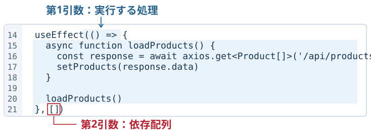{#ch04-44-figure-2}

::: {#ch04-44-figure-2-caption .caption}
useEffectの第1引数と第2引数
:::

::: {#ch04-44-dependencies-heading .step keep-next="1"}
**② 依存配列で処理を実行するタイミングを指定する**
:::

::: {#ch04-44-par-30 .paragraph}
依存配列の指定方法によって、useEffect()に渡した関数が実行されるタイミングが異なります。
:::

::: {#ch04-44-dependencies-table .table column-widths="26 74"}
| 依存配列 | 実行されるタイミング |
|---|---|
| `[]` | コンポーネントが最初に表示された後（マウント時）。 |
| `[id]` など | マウント時と、指定した値が変化した後。 |
| 指定しない | レンダリングが反映されるたび。 |
:::

::: {#ch04-44-par-32 .paragraph}
今回は、画面が最初に表示された後に商品情報を取得したいため、空配列 `[]` を指定しています。
:::

::: {#ch04-44-par-33 .paragraph}
そのため、商品情報を取得してproductsのstateが更新され、コンポーネントが再レンダリングされても、その更新だけを理由としてuseEffect()に渡した関数が再び実行されることはありません。
:::

::: {#ch04-44-par-34 .paragraph}
例えば、3.5節で学習したURLパラメータの商品番号 `id` に応じて商品情報を取得したい場合には、依存配列に `[id]` を指定することで、idが変化したときにもデータを取得するようにできます。
:::

::: {#ch04-44-par-35 .paragraph}
※ 開発環境では、ReactのStrictModeの動作確認によって、マウント時の処理が追加で実行されることがあります。また、別の画面へ移動した後に商品一覧画面を改めて表示し、コンポーネントが再びマウントされた場合にも、処理は実行されます。
:::

::: {#ch04-44-load-heading .step keep-next="1"}
**③ useEffectの中で非同期処理を実行する**
:::

::: {#ch04-44-load .code filename="ch04-basic/src/components/Sample4_4.tsx" start-line="15"}
```tsx
    async function loadProducts() {
      const response = await axios.get<Product[]>('/api/products')
      setProducts(response.data)
    }

    loadProducts()
```
:::

::: {#ch04-44-par-39 .paragraph}
useEffect()に渡した関数の中で、非同期関数 `loadProducts()` を定義しています。商品情報を取得し、取得したデータでstateを更新する処理は、前節と同じです。
:::

::: {#ch04-44-par-40 .paragraph}
その下に `loadProducts()` と記述することで、定義した非同期関数を呼び出します。
:::

::: {#ch04-44-par-41 .paragraph}
なお、useEffect()の第1引数に指定する関数そのものは、asyncで定義しないようにしてください。asyncで定義した関数はPromiseを返しますが、useEffect()に渡す関数はPromiseを戻り値として返すことができないためです。そのため、今回のようにuseEffect()に渡した関数の中で非同期関数を定義し、呼び出します。
:::

::: {#ch04-44-display-heading .step keep-next="1"}
**④ 取得したデータを画面に反映する**
:::

::: {#ch04-44-par-43 .paragraph}
今回のサンプルでは、コンポーネントの表示から商品一覧の表示まで、次のように処理が行われます。
:::

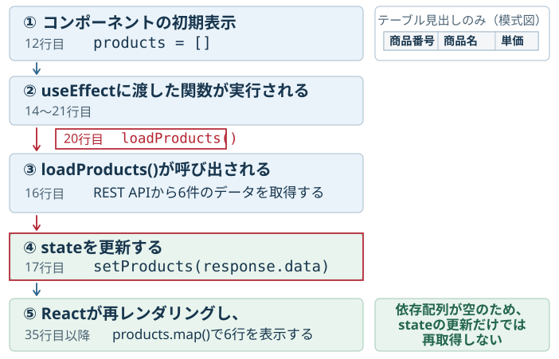{#ch04-44-figure-3}

::: {#ch04-44-figure-3-caption .caption}
useEffectによるデータ取得から一覧表示までの流れ
:::

::: {#ch04-44-par-45 .paragraph}
前節と今回のサンプルでは、取得するデータや画面を更新する仕組みは同じです。異なるのは、データを取得する処理を実行するきっかけです。
:::

::: {#ch04-44-par-46 .paragraph}
ボタンをクリックしたときに処理を実行する場合はイベントハンドラーを、今回のように画面の表示に伴ってデータを取得する場合はuseEffect()を使用します。
:::

::: {#ch04-44-exercise .heading level="minor" keep-next="7"}
【確認演習】useEffectを使用して商品一覧を自動的に表示する
:::

::: {#ch04-44-par-48 .paragraph}
講義サンプルと同様に、商品一覧画面を表示すると、REST APIから取得した6件の商品情報が一覧表示されるようにしましょう。
:::

::: {#ch04-44-par-49 .paragraph}
商品データの型、state、商品情報を取得する非同期関数、テーブルの表示処理は、あらかじめ用意されています。useEffect()を使用して、画面の表示時に非同期関数が呼び出されるように実装します。
:::

::: {#ch04-44-par-50 .paragraph numbered="true"}
1．`ch04-basic-q` プロジェクトの `src/components/Q4_4.tsx` を開いてください。
:::

::: {#ch04-44-par-51 .paragraph numbered="true"}
2．コード内の➀～➃の番号付きコメントを確認し、指示された箇所を実装してください。4つとも実装問題です。コメントに指定されていないコードや、ほかのファイルは変更する必要はありません。
:::

::: {#ch04-44-par-52 .paragraph numbered="true"}
3．編集したファイルを保存してください。
:::

::: {#ch04-44-par-53 .paragraph numbered="true"}
4．練習用REST APIと `ch04-basic-q` の開発サーバーが起動していることを確認してください。起動済みの場合は、演習用のブラウザーの画面に戻ってください。
:::

::: {#ch04-44-par-54 .paragraph numbered="true"}
5．メニューから［4.4 useEffectによる処理の実行］を選択してください。
:::

::: {#ch04-44-check .heading level="minor"}
動作確認
:::

::: {#ch04-44-par-56 .paragraph numbered="true"}
6．商品一覧画面を表示しただけで、商品番号101～106の6件の商品情報が一覧表示されることを確認してください。
:::

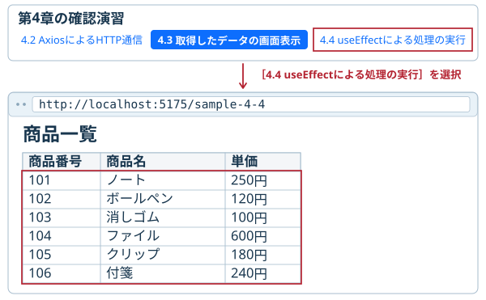{#ch04-44-figure-4}

::: {#ch04-44-figure-4-caption .caption}
商品一覧画面を表示すると、6件の商品情報が自動的に表示されることを確認する
:::

::: {#ch04-44-par-58 .paragraph}
各商品の商品名と単価が正しく表示されていれば、演習完了です。
:::

::: {#ch04-44-par-59 .paragraph}
商品情報が表示されない場合は、演習用の開発サーバーに接続していること、練習用REST APIが起動していること、useEffect()の中で非同期関数を呼び出していることを確認してください。
:::

::: {#ch04-44-par-60 .paragraph}
次の4.5節では、REST APIとの通信に失敗した場合の処理を学習します。
:::

::: {#ch04-44-points .section-points}
この節のポイント

● useEffect()を使用すると、コンポーネントのレンダリング結果が反映された後に処理を実行できる。

● 依存配列に空配列 `[]` を指定すると、マウント時に処理を実行できる。

● 依存配列に値を指定すると、その値が変化したときにも処理を実行できる。

● useEffect()の中で非同期関数を定義して呼び出すことで、REST APIからデータを取得できる。
:::

::::

:::: {#page-8 .source-page}

::: {#ch04-45-title .heading}
4.5. 通信エラーへの対応
:::

::: {#ch04-45-slide .slide layout="illustration"}
通信エラーへの対応

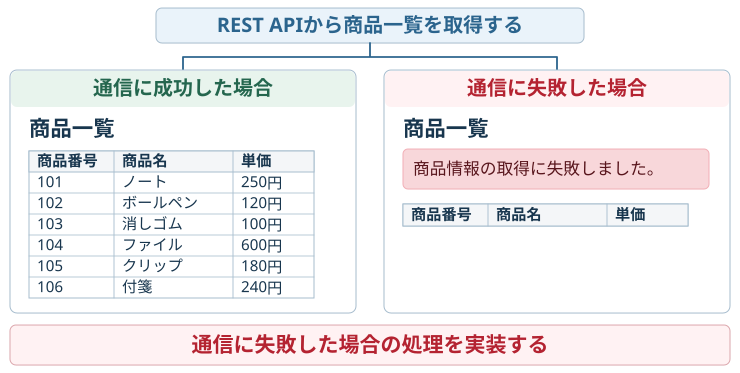
:::

::: {#ch04-45-background .heading level="minor"}
通信に失敗した場合の処理
:::

::: {#ch04-45-par-04 .paragraph}
前節では、useEffect()を使用して、商品一覧画面が表示されたときにREST APIから商品情報を取得しました。
:::

::: {#ch04-45-par-05 .paragraph}
しかし、実際のWebアプリケーションでは、サーバーが停止していたり、ネットワークに問題が発生したりすることで、REST APIとの通信に失敗する場合があります。
:::

::: {#ch04-45-par-06 .paragraph}
このような場合、商品一覧が表示されないだけでは、利用者は商品が登録されていないのか、通信に失敗したのかを判断できません。
:::

::: {#ch04-45-par-07 .paragraph}
そこで、**通信に失敗した場合は、そのことが利用者に伝わるようにエラーメッセージを表示する処理を実装します。**
:::

::: {#ch04-45-par-08 .paragraph}
JavaScriptでは、例外が発生した場合の処理を記述するために、`try` と `catch` を使用できます。Axiosによる通信で例外が発生した場合も、この仕組みを利用できます。
:::

::: {#ch04-45-sample .heading level="minor"}
【サンプル】通信に失敗した場合にエラーメッセージを表示する
:::

::: {#ch04-45-par-10 .paragraph}
前節の商品一覧画面に、通信に失敗した場合の処理を追加します。
:::

::: {#ch04-45-par-11 .paragraph}
`ch04-basic` プロジェクトの `src/components/Sample4_5.tsx` を確認してください。
:::

::: {#ch04-45-full .code filename="ch04-basic/src/components/Sample4_5.tsx" start-line="1"}
```tsx
import { useEffect, useState } from 'react'
import axios from 'axios'

type Product = {
  id: number
  name: string
  price: number
  imagePath: string
}

export default function Sample4_5() {
  const [products, setProducts] = useState<Product[]>([])
  const [errorMessage, setErrorMessage] = useState('')

  useEffect(() => {
    async function loadProducts() {
      try {
        const response = await axios.get<Product[]>('/api/products')
        setProducts(response.data)
      } catch (error) {
        console.error(error)
        setErrorMessage('商品情報の取得に失敗しました。')
      }
    }

    loadProducts()
  }, [])

  return (
    <main className="container mt-4">
      <h1>商品一覧</h1>
      {errorMessage !== '' && (
        <p className="alert alert-danger" role="alert">{errorMessage}</p>
      )}
```
:::

::: {#ch04-45-full-cont .code filename="ch04-basic/src/components/Sample4_5.tsx" start-line="35" code-label="TSX（続き）"}
```tsx
      <table className="table table-bordered w-auto">
        <thead className="table-light">
          <tr>
            <th>商品番号</th>
            <th>商品名</th>
            <th>単価</th>
          </tr>
        </thead>
        <tbody>
          {products.map((product) => (
            <tr key={product.id}>
              <td>{product.id}</td>
              <td>{product.name}</td>
              <td>{product.price}円</td>
            </tr>
          ))}
        </tbody>
      </table>
    </main>
  )
}
```
:::

::: {#ch04-45-par-14 .paragraph}
練習用REST APIと `ch04-basic` の開発サーバーが起動していることを確認し、ブラウザーのメニューから［4.5 通信エラーへの対応］を選択してください。通信が正常に完了すると、前節と同じように6件の商品情報が表示されます。
:::

::: {#ch04-45-par-15 .paragraph}
次に、通信に失敗した場合の動作を確認します。
:::

::: {#ch04-45-par-16 .paragraph numbered="true"}
1．VS Codeで `ch04-api` のREST APIを起動しているターミナルを選択し、［Ctrl］＋［C］キーを押してREST APIを停止してください。Reactの開発サーバーは起動したままにしてください。
:::

::: {#ch04-45-par-17 .paragraph numbered="true"}
2．ブラウザーで4.5の商品一覧画面を再読み込みしてください。
:::

::: {#ch04-45-par-18 .paragraph}
REST APIから商品情報を取得できず、「商品情報の取得に失敗しました。」というエラーメッセージが表示されます。
:::

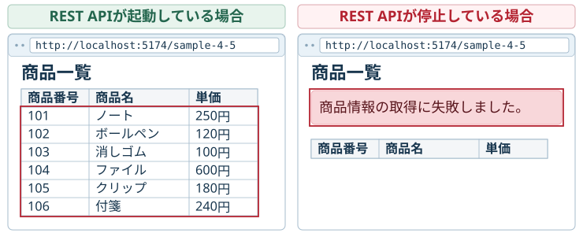{#ch04-45-figure-1}

::: {#ch04-45-figure-1-caption .caption}
通信の成否に応じて商品一覧またはエラーメッセージを表示する
:::

::: {#ch04-45-par-20 .paragraph numbered="true"}
3．`ch04-api` のターミナルで `npm start` を実行してREST APIを再び起動し、商品一覧画面を再読み込みしてください。エラーメッセージが表示されず、6件の商品情報が表示されることを確認します。
:::

::: {#ch04-45-syntax .heading level="minor"}
構文の解説
:::

::: {#ch04-45-state-heading .step keep-next="1"}
**① エラーメッセージを管理するstateを定義する**
:::

::: {#ch04-45-state .code filename="ch04-basic/src/components/Sample4_5.tsx" start-line="13"}
```tsx
  const [errorMessage, setErrorMessage] = useState('')
```
:::

::: {#ch04-45-par-25 .paragraph}
今回は、商品情報を管理するproductsのstateとは別に、エラーメッセージを管理するerrorMessageのstateを定義しています。
:::

::: {#ch04-45-par-26 .paragraph}
初期値は空文字列 `''` です。通信に失敗した場合に、表示するメッセージを `setErrorMessage()` で設定します。
:::

::: {#ch04-45-catch-heading .step keep-next="1"}
**② tryとcatchで例外が発生した場合の処理を記述する**
:::

::: {#ch04-45-catch .code filename="ch04-basic/src/components/Sample4_5.tsx" start-line="17"}
```tsx
      try {
        const response = await axios.get<Product[]>('/api/products')
        setProducts(response.data)
      } catch (error) {
        console.error(error)
        setErrorMessage('商品情報の取得に失敗しました。')
      }
```
:::

::: {#ch04-45-par-30 .paragraph}
`try` ブロックには、通常実行する処理を記述します。`catch` ブロックには、tryブロック内で例外が発生した場合に実行する処理を記述します。
:::

::: {#ch04-45-par-31 .paragraph}
今回のコードでは、tryブロック内でREST APIから商品情報を取得し、取得したデータをstateに格納しています。
:::

::: {#ch04-45-par-32 .paragraph}
Axiosでは、ネットワークエラーが発生した場合や、通常はHTTPステータスコードが400番台・500番台で返された場合、通信結果を表すPromiseが拒否されます。`await` を使用しているため、この失敗は例外として扱われます。
:::

::: {#ch04-45-par-33 .paragraph}
通信が正常に完了すれば、`setProducts(response.data)` が実行されます。一方、`await axios.get()` の実行によって例外が発生すると、tryブロック内の後続の処理は実行されず、catchブロックに処理が移ります。
:::

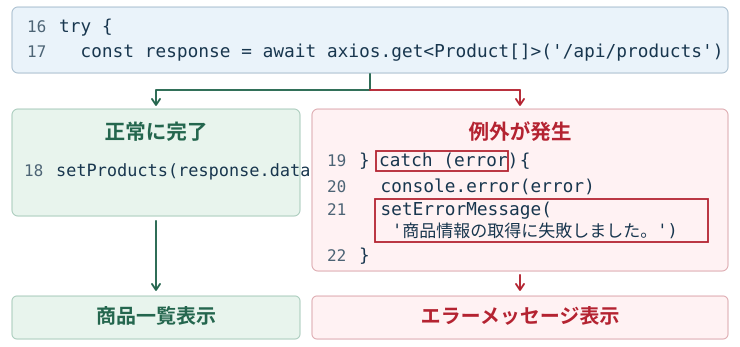{#ch04-45-figure-2}

::: {#ch04-45-figure-2-caption .caption}
tryブロック内で例外が発生した場合はcatchブロックの処理を実行する
:::

::: {#ch04-45-par-35 .paragraph}
catchブロックでは、`error` に受け取った例外の情報を `console.error(error)` で開発者ツールに出力します。また、`setErrorMessage()` を使用して、利用者に表示するエラーメッセージを設定します。
:::

::: {#ch04-45-par-36 .paragraph}
開発者が原因を調査するための情報と、利用者に伝えるメッセージは分けて扱います。
:::

::: {#ch04-45-display-heading .step keep-next="1"}
**③ エラーメッセージを画面に表示する**
:::

::: {#ch04-45-display .code filename="ch04-basic/src/components/Sample4_5.tsx" start-line="32"}
```tsx
      {errorMessage !== '' && (
        <p className="alert alert-danger" role="alert">{errorMessage}</p>
      )}
```
:::

::: {#ch04-45-par-40 .paragraph}
2.5節で学習した条件に応じた表示を使用しています。errorMessageが空文字列でない場合に、エラーメッセージを表示します。
:::

::: {#ch04-45-par-41 .paragraph}
初期状態ではerrorMessageは空文字列なので、エラーメッセージは表示されません。通信に失敗した場合は、catchブロックでerrorMessageのstateが更新され、Reactが画面を更新してエラーメッセージを表示します。
:::

::: {#ch04-45-par-42 .paragraph}
なお、`alert alert-danger` は、Bootstrapでエラーメッセージなどを目立たせるためのクラスです。
:::

::: {#ch04-45-exercise .heading level="minor" keep-next="6"}
【確認演習】通信に失敗した場合にエラーメッセージを表示する
:::

::: {#ch04-45-par-44 .paragraph}
講義サンプルと同様に、商品一覧画面を表示したときに商品情報を取得し、通信に失敗した場合はエラーメッセージを表示するようにしましょう。
:::

::: {#ch04-45-par-45 .paragraph}
商品データの型、state、useEffect()による商品情報の取得処理、テーブルとエラーメッセージの表示処理は、あらかじめ用意されています。tryとcatchを使用した例外処理を実装します。
:::

::: {#ch04-45-par-46 .paragraph numbered="true"}
1．`ch04-basic-q` プロジェクトの `src/components/Q4_5.tsx` を開いてください。
:::

::: {#ch04-45-par-47 .paragraph numbered="true"}
2．コード内の➀～➅の番号付きコメントを確認し、指示された箇所を実装してください。➀・➅は既存コードの確認、➁～➄は実装問題です。コメントに指定されていないコードや、ほかのファイルは変更する必要はありません。
:::

::: {#ch04-45-par-48 .paragraph numbered="true"}
3．編集したファイルを保存してください。
:::

::: {#ch04-45-par-49 .paragraph numbered="true"}
4．練習用REST APIと `ch04-basic-q` の開発サーバーが起動していることを確認してください。ブラウザーのメニューから［4.5 通信エラーへの対応］を選択してください。
:::

::: {#ch04-45-check .heading level="minor" keep-next="3"}
動作確認
:::

::: {#ch04-45-par-51 .paragraph numbered="true"}
5．商品番号101～106の6件の商品情報が一覧表示され、エラーメッセージが表示されていないことを確認してください。
:::

::: {#ch04-45-par-52 .paragraph numbered="true"}
6．`ch04-api` のターミナルで［Ctrl］＋［C］キーを押してREST APIを停止し、演習用の商品一覧画面を再読み込みしてください。
:::

::: {#ch04-45-par-53 .paragraph}
次の図と見比べながら、「商品情報の取得に失敗しました。」というエラーメッセージが表示され、商品情報の行が表示されないことを確認してください。
:::

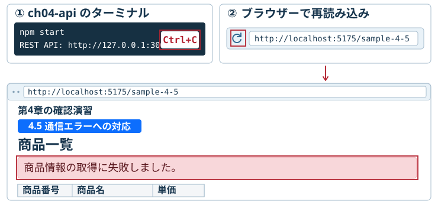{#ch04-45-figure-3}

::: {#ch04-45-figure-3-caption .caption}
REST APIを停止した状態で画面を再読み込みすると、エラーメッセージが表示される
:::

::: {#ch04-45-par-55 .paragraph numbered="true"}
7．`ch04-api` のターミナルで `npm start` を実行してREST APIを起動し、商品一覧画面を再読み込みしてください。エラーメッセージが表示されず、6件の商品情報が表示されれば、演習完了です。
:::

::: {#ch04-45-points .section-points}
この節のポイント

● `try` と `catch` を使用すると、例外が発生した場合の処理を記述できる。

● 通信に失敗した場合は、catchブロック内でエラーメッセージを設定できる。

● エラーメッセージをstateで管理し、条件に応じて表示することで、利用者に通信の失敗を伝えられる。
:::

::::

:::: {#page-9 .source-page}

::: {#ch04-summary-title .heading}
章のまとめ
:::

::: {#ch04-summary-slide .slide layout="summary"}
章のまとめ

■ REST APIの役割と仕組み

■ AxiosによるHTTP通信

■ 取得したデータの画面表示

■ useEffectによる処理の実行

■ 通信エラーへの対応
:::

::: {#ch04-summary-par-61 .paragraph}
この章では、ReactからREST APIと通信し、取得したデータを画面に表示する方法を学習しました。
:::

::: {#ch04-summary-par-62 .paragraph}
最初に、フロントエンドとバックエンドを分ける理由を確認し、REST APIではURLで操作対象を指定し、HTTPメソッドで操作内容を指定することを学びました。
:::

::: {#ch04-summary-par-63 .paragraph}
続いて、Axiosを使用してREST APIと通信し、asyncとawaitで通信結果を待ってから、取得したデータを取り出す方法を学習しました。また、取得したデータをstateに格納することで、商品一覧を表示しました。
:::

::: {#ch04-summary-par-64 .paragraph}
さらに、useEffect()を使用して画面の表示時に商品情報を自動的に取得し、最後にtryとcatchを使用して、通信に失敗した場合にエラーメッセージを表示する処理を実装しました。
:::

::: {#ch04-summary-par-65 .paragraph}
ここまでの学習では、あらかじめ用意されたREST APIを利用してきました。次の第5章では、Node.jsとExpressを使用してREST APIを作成し、データベースに保存された商品情報をReactから取得する方法を学習します。
:::

::::

<!-- CODE id="ch04-45-state" path="ch04-basic/src/components/Sample4_5.tsx" lines="13" type="TSX" highlight="none" reason="1行全体が説明対象" -->
