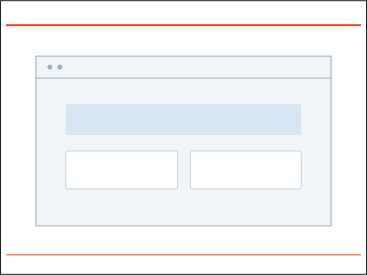

:::: {#page-1 .source-page}

::: {#sample-chapter-number .paragraph}
1
:::

::: {#sample-chapter-title .heading}
第1章 組版見本
:::

::: {#sample-goals-title .heading}
章の目標
:::

::: {#sample-goal .paragraph}
◼ 見出し、本文、コード、表の組版を確認する
:::

::::

:::: {#page-2 .source-page}

::: {#sample-section .heading}
[1.1. 本文とコード]{.s002}
:::

::: {#sample-intro .paragraph}
教材の本文に使う明朝体と段落の字下げを確認します。「表示」のような括弧を含む文章と、**強調した語句**を並べます。
:::

::: {#sample-minor-heading .heading}
[【参考】コンポーネントの例]{.s003}
:::

::: {#sample-jsx .code filename="src/Greeting.jsx"}
```jsx
export default function Greeting() {
  // 見出しを表示します。
  return <h1>こんにちは</h1>;
}
```
:::

::: {#sample-explanation .paragraph}
コンポーネントは**見出し要素**を返します。
:::

::: {#sample-table .table}
| ファイル | 内容 |
| --- | --- |
| Greeting.jsx | 見出しを表示 |
| Greeting.tsx | プロパティの型を指定 |
:::

::::

:::: {#page-3 .source-page}

{#sample-slide}

::: {#sample-slide-body .paragraph}
スライドの下の罫線に続けて、説明を配置します。図版の位置を固定し、説明はMarkdownから組版します。
:::

::: {#sample-bullet .paragraph}
● 説明は段落ごとに整えます。
:::

::: {#sample-link .paragraph}
[PDFリンクの見本](https://example.com/)
:::

::::

:::: {#page-4 .source-page}

::: {#sample-next-section .heading}
[1.2. 型付きのコード]{.s002}
:::

::: {#sample-tsx .code filename="src/Greeting.tsx"}
```tsx
type GreetingProps = { name: string };

export function Greeting({ name }: GreetingProps) {
  // JSX内で名前を表示します。
  return <h1>{name}さん、こんにちは</h1>;
}
```
:::

{#sample-diagram}

::: {#sample-diagram-body .paragraph}
名前を受け取って見出しに表示します。独立図には章と節に対応する番号を付けます。
:::

::::
